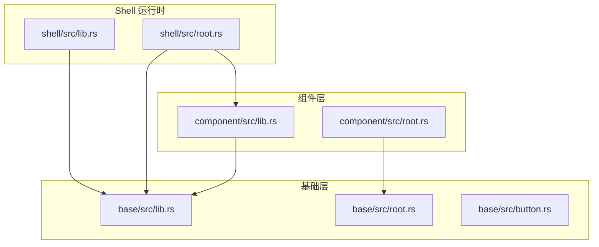
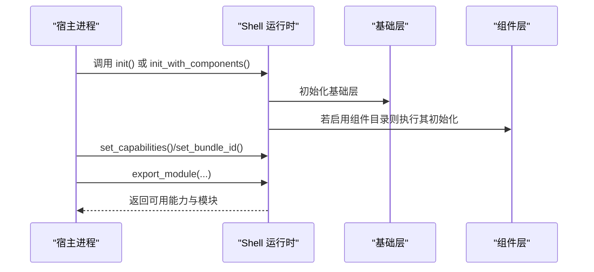
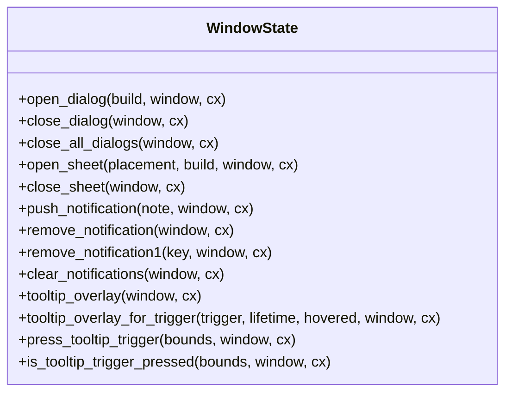
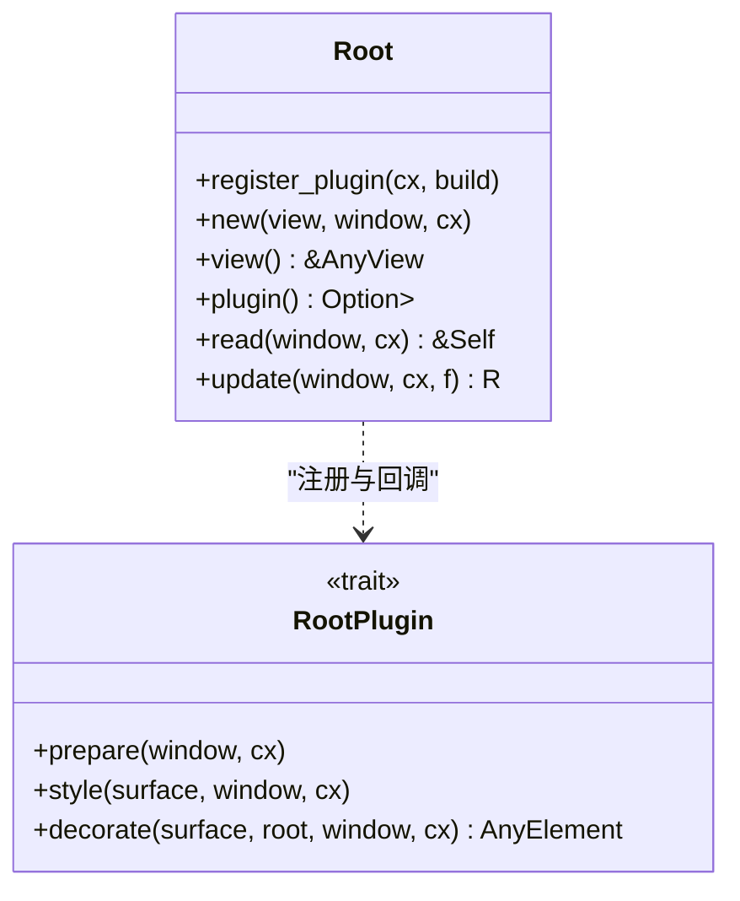
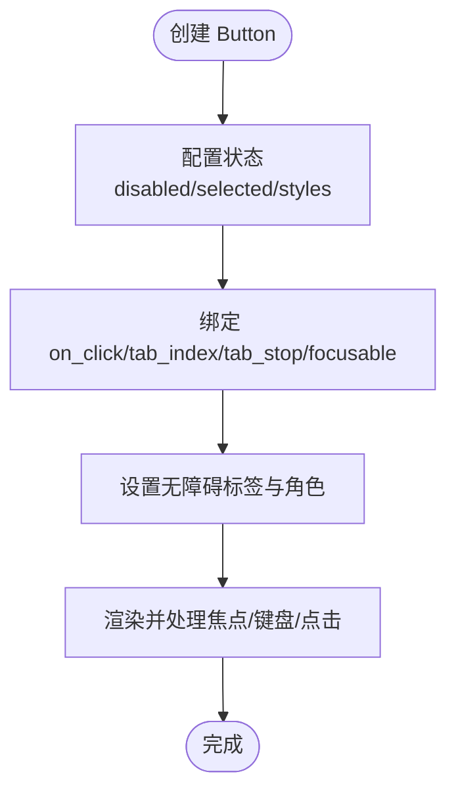
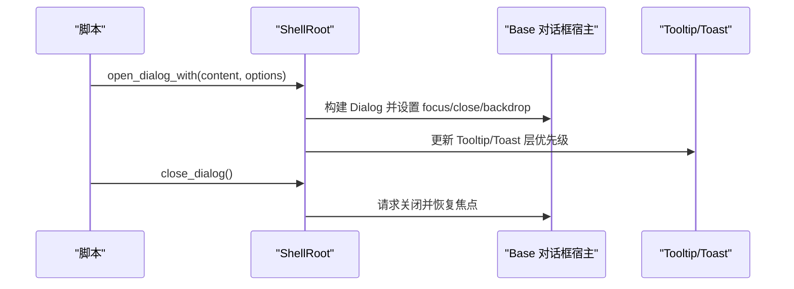
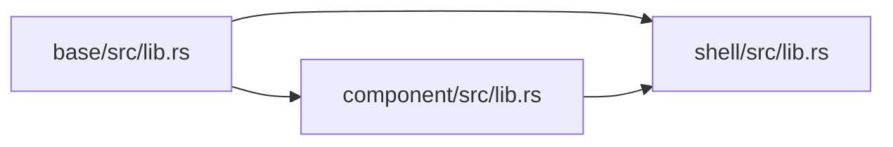

# API 参考

<cite>
**本文引用的文件**   
- [crates/base/src/lib.rs](file://crates/base/src/lib.rs)
- [crates/base/src/root.rs](file://crates/base/src/root.rs)
- [crates/base/src/button.rs](file://crates/base/src/button.rs)
- [crates/component/src/lib.rs](file://crates/component/src/lib.rs)
- [crates/component/src/root.rs](file://crates/component/src/root.rs)
- [crates/shell/src/lib.rs](file://crates/shell/src/lib.rs)
- [crates/shell/src/root.rs](file://crates/shell/src/root.rs)
</cite>

## 目录
1. [简介](#简介)
2. [项目结构](#项目结构)
3. [核心模块与公共入口](#核心模块与公共入口)
4. [架构总览](#架构总览)
5. [组件层 API](#组件层-api)
6. [基础层 API](#基础层-api)
7. [Shell 运行时 API](#shell-运行时-api)
8. [资源与主题 API](#资源与主题-api)
9. [类型、枚举与常量](#类型枚举与常量)
10. [错误类型与处理](#错误类型与处理)
11. [依赖关系分析](#依赖关系分析)
12. [性能与可观测性](#性能与可观测性)
13. [故障排查指南](#故障排查指南)
14. [结论](#结论)

## 简介
本 API 参考面向 gpui-kit 的三类使用者：
- 使用组件库构建界面的应用开发者。
- 基于基础层实现自定义控件或行为的基础层使用者。
- 通过 Shell 运行脚本并暴露宿主能力的集成方。

文档按“组件层 → 基础层 → Shell 运行时 → 资源与主题”组织，覆盖函数签名、参数说明、返回值、常用用法、废弃与迁移建议，并提供可视化图表帮助理解调用链与层次关系。

## 项目结构
仓库采用多 crate 分层组织：
- `crates/base`：无样式语义的基础 UI 能力（布局、事件、动画、文本、滚动、根窗口等）。
- `crates/component`：面向应用的组件集合（按钮、表单、对话框、通知、主题、窗口状态等），复用 base。
- `crates/shell`：脚本化应用运行时，提供能力授权、模块导出、窗口级叠加层管理、Toast/Tooltip/Dock 等。

**图示来源**
- [crates/component/src/lib.rs:1-172](file://crates/component/src/lib.rs#L1-L172)
- [crates/base/src/lib.rs:1-260](file://crates/base/src/lib.rs#L1-L260)
- [crates/shell/src/lib.rs:1-456](file://crates/shell/src/lib.rs#L1-L456)

**章节来源**
- [crates/component/src/lib.rs:1-172](file://crates/component/src/lib.rs#L1-L172)
- [crates/base/src/lib.rs:1-260](file://crates/base/src/lib.rs#L1-L260)
- [crates/shell/src/lib.rs:1-456](file://crates/shell/src/lib.rs#L1-L456)

## 核心模块与公共入口
- 组件层初始化：`component::init`
- 基础层初始化：`base::init`
- Shell 初始化：`shell::init` / `shell::init_with_components`
- 窗口根：
  - 基础层：`gpui_base::Root`
  - 组件层：`component::root::WindowState`（作为 RootPlugin）
  - Shell 层：`shell::root::ShellRoot`

这些入口决定应用启动时的全局状态、主题、输入系统、窗口叠加层和脚本能力。

**章节来源**
- [crates/component/src/lib.rs:127-151](file://crates/component/src/lib.rs#L127-L151)
- [crates/base/src/lib.rs:238-256](file://crates/base/src/lib.rs#L238-L256)
- [crates/shell/src/lib.rs:279-301](file://crates/shell/src/lib.rs#L279-L301)

## 架构总览
三层职责清晰分离：
- 基础层提供无样式的交互原语、根窗口插件机制、文本选择、动画、滚动等。
- 组件层在基础层之上提供业务组件、窗口级状态（对话框/Sheet/通知）、主题与国际化。
- Shell 运行时负责脚本加载、能力授权、模块导出、窗口级叠加层（Dialog/Sheet/Toast/Tooltip/FPS HUD）以及生命周期管理。

**图示来源**
- [crates/shell/src/lib.rs:279-301](file://crates/shell/src/lib.rs#L279-L301)
- [crates/shell/src/lib.rs:188-201](file://crates/shell/src/lib.rs#L188-L201)
- [crates/shell/src/lib.rs:351-443](file://crates/shell/src/lib.rs#L351-L443)
- [crates/component/src/lib.rs:127-151](file://crates/component/src/lib.rs#L127-L151)
- [crates/base/src/lib.rs:238-256](file://crates/base/src/lib.rs#L238-L256)

## 组件层 API
### 组件库初始化与公共导出
- `component::init(cx)`：初始化主题、全局状态、Inspector（调试开关）、Root、基础层、输入、Diff、日期选择器、Dock、Sheet、列表、命令面板、轮播、通知、气泡、菜单、表格、提示框等。
- 公共导出包括：
  - 通用能力：`Disableable`、`ElementExt`、`GlobalState`、`Root`、`animation`、`measure`、`measure_if`、`InteractiveElementExt`、`OngoingScrollExt`、`Placement`、`Side`、`AxisExt`、`Edges`、`LengthExt`。
  - 图标与索引：`icon_named`、`IndexPath`。
  - 文本与 Rope：`Rope`、`RopeExt`、`RopeLines`。
  - 可调整面板：`ResizablePanel`、`ResizablePanelGroup`、`ResizableState`、`h_resizable`、`v_resizable`、`resize_handle`、`resize_handle_appearance`。
  - 主题与样式：`theme::*`、`styled::*`。
  - 时间相关：`calendar`、`date_picker`、`time_field`。
  - 标题栏与窗口边框：`title_bar::*`、`WindowBorder`、`window_border`、`window_paddings`。
  - 虚拟列表：`VirtualList`、`VirtualListScrollHandle`、`h_virtual_list`、`v_virtual_list`。
  - 窗口扩展：`WindowExt`。

**章节来源**
- [crates/component/src/lib.rs:1-172](file://crates/component/src/lib.rs#L1-L172)

### 窗口状态与叠加层
组件层通过 `WindowState` 作为 `gpui_base::RootPlugin` 注入到基础层 Root，统一管理：
- 当前 Sheet、对话框栈、通知列表、Tooltip 层、原生菜单回退层、触摸选择层。
- 文本选择作用域分配与激活。
- 对话框打开/关闭、批量关闭、焦点恢复、退出过渡。
- Sheet 打开/关闭与位置。
- 通知推送、按类型移除、清空。
- Tooltip 触发器绑定与隐藏策略。

**图示来源**
- [crates/component/src/root.rs:21-23](file://crates/component/src/root.rs#L21-L23)
- [crates/component/src/root.rs:103-169](file://crates/component/src/root.rs#L103-L169)
- [crates/component/src/root.rs:375-453](file://crates/component/src/root.rs#L375-L453)
- [crates/component/src/root.rs:514-602](file://crates/component/src/root.rs#L514-L602)
- [crates/component/src/root.rs:604-675](file://crates/component/src/root.rs#L604-L675)

**章节来源**
- [crates/component/src/root.rs:21-23](file://crates/component/src/root.rs#L21-L23)
- [crates/component/src/root.rs:103-169](file://crates/component/src/root.rs#L103-L169)
- [crates/component/src/root.rs:375-453](file://crates/component/src/root.rs#L375-L453)
- [crates/component/src/root.rs:514-602](file://crates/component/src/root.rs#L514-L602)
- [crates/component/src/root.rs:604-675](file://crates/component/src/root.rs#L604-L675)

## 基础层 API
### 根窗口与插件机制
- `gpui_base::Root`：窗口内容容器，支持注册 `RootPlugin`，在每个渲染周期执行 prepare/style/decorate 三阶段。
- `RootPlugin` 接口：
  - `prepare(&mut self, window, cx)`：同步窗口级设置（如 rem、文本选择作用域）。
  - `style(&self, surface, window, cx)`：为根表面提供默认样式。
  - `decorate(surface, root, window, cx)`：包裹完成后的根表面，用于添加外层装饰。
- 插件注册：`Root::register_plugin::<V>(cx, build)`，按类型去重，每窗口独立实例。
- 键盘与辅助功能：Tab/Shift-Tab 聚焦循环、Copy 快捷键、FocusTrap 支持。

**图示来源**
- [crates/base/src/root.rs:74-103](file://crates/base/src/root.rs#L74-L103)
- [crates/base/src/root.rs:126-221](file://crates/base/src/root.rs#L126-L221)

**章节来源**
- [crates/base/src/root.rs:1-120](file://crates/base/src/root.rs#L1-L120)
- [crates/base/src/root.rs:126-221](file://crates/base/src/root.rs#L126-L221)

### 基础控件示例：Button
- 构造：`Button::new(id)`
- 交互与状态：
  - `disabled(bool)`、`selected(bool)`、`styles(fn(ButtonStyles)->ButtonStyles)`
  - `on_click(handler)`
  - `tab_index(isize)`、`tab_stop(bool)`、`focusable(bool)`
  - `track_focus(&FocusHandle)`
  - `accessibility_label(label)`、`role(role_override)`
- 语义样式：`ButtonStyles.selected(...)`、`ButtonStyles.disabled(...)`

**图示来源**
- [crates/base/src/button.rs:40-159](file://crates/base/src/button.rs#L40-L159)
- [crates/base/src/button.rs:171-192](file://crates/base/src/button.rs#L171-L192)
- [crates/base/src/button.rs:214-271](file://crates/base/src/button.rs#L214-L271)

**章节来源**
- [crates/base/src/button.rs:18-159](file://crates/base/src/button.rs#L18-L159)
- [crates/base/src/button.rs:171-192](file://crates/base/src/button.rs#L171-L192)
- [crates/base/src/button.rs:214-271](file://crates/base/src/button.rs#L214-L271)

## Shell 运行时 API
### 初始化与能力
- `shell::init(cx)`：初始化基础层与样式反射表。
- `shell::init_with_components(cx, components)`：初始化运行时并执行组件目录的初始化器。
- `shell::set_capabilities(capabilities)`：授予应用能力；未调用前脚本无任何权限。
- `shell::set_bundle_id(id)`：设置应用标识与数据目录，同时命名 Dock 面板持久化命名空间。
- `shell::bundle_id_for_path(root)`：为目录生成稳定 bundle id。
- `shell::set_storage_path(path)`：将 localStorage 指向指定文件。
- `shell::set_development_mode(enabled)`：开发模式，允许 eval 与原型解冻。

**章节来源**
- [crates/shell/src/lib.rs:188-201](file://crates/shell/src/lib.rs#L188-L201)
- [crates/shell/src/lib.rs:203-269](file://crates/shell/src/lib.rs#L203-L269)
- [crates/shell/src/lib.rs:271-301](file://crates/shell/src/lib.rs#L271-L301)

### 模块导出与类型声明
- `shell::export_module(module)`：向脚本暴露 Rust 模块，支持同步/异步函数、TypeScript 声明校验。
- `shell::clear_exported_modules()`：撤回所有已导出模块。
- `shell::type_declarations(components)`：获取组件注册表的类型声明字符串。
- `shell::write_type_declarations_with_components(root, components)`：写入应用树中的类型声明。
- `shell::write_dependency_links(root)`：链接 Git 依赖供编辑器解析。

**章节来源**
- [crates/shell/src/lib.rs:145-186](file://crates/shell/src/lib.rs#L145-L186)
- [crates/shell/src/lib.rs:351-443](file://crates/shell/src/lib.rs#L351-L443)
- [crates/shell/src/lib.rs:445-455](file://crates/shell/src/lib.rs#L445-L455)

### 窗口级叠加层：ShellRoot
- 职责：编排内容、Sheet、对话框栈、Toast、Tooltip、FPS HUD 的绘制顺序与交互。
- 关键方法：
  - `open_dialog(content)` / `open_dialog_with(content, options)`
  - `close_dialog()` / `close_all_dialogs()`
  - `open_sheet(placement, content)` / `close_sheet()`
  - `push_toast(toast)` / `remove_toast(id)` / `clear_toasts()`
  - `show_fps_monitor(request)` / `hide_fps_monitor()` / `fps_monitor_visible()`
  - `tooltip_overlay(window, cx)`：获取 Tooltip 层实体。
- 堆叠顺序（从后到前）：内容 → Sheet → Dialog 栈 → Toast → Tooltip。
- 焦点与键盘：Escape 仅关闭最上层对话框；Enter 由对话框自身主按钮处理；Tab/Shift-Tab 尊重 FocusTrap。

**图示来源**
- [crates/shell/src/root.rs:65-135](file://crates/shell/src/root.rs#L65-L135)
- [crates/shell/src/root.rs:380-459](file://crates/shell/src/root.rs#L380-L459)
- [crates/shell/src/root.rs:509-564](file://crates/shell/src/root.rs#L509-L564)
- [crates/shell/src/root.rs:609-666](file://crates/shell/src/root.rs#L609-L666)

**章节来源**
- [crates/shell/src/root.rs:65-135](file://crates/shell/src/root.rs#L65-L135)
- [crates/shell/src/root.rs:214-301](file://crates/shell/src/root.rs#L214-L301)
- [crates/shell/src/root.rs:380-459](file://crates/shell/src/root.rs#L380-L459)
- [crates/shell/src/root.rs:509-564](file://crates/shell/src/root.rs#L509-L564)
- [crates/shell/src/root.rs:609-666](file://crates/shell/src/root.rs#L609-L666)

## 资源与主题 API
- 颜色、半径、间距、阴影、排版等语义 Token 由基础层与组件层共同消费。
- 组件层通过 `ActiveTheme` 与 `Theme` 提供主题访问与初始化。
- Shell 层在绘制对话框/Sheet/Toast 时使用 `ColorTokens`、`RadiusTokens`、`SpacingTokens` 保证视觉一致性。

**章节来源**
- [crates/component/src/lib.rs:117-123](file://crates/component/src/lib.rs#L117-L123)
- [crates/shell/src/root.rs:609-666](file://crates/shell/src/root.rs#L609-L666)

## 类型、枚举与常量
- 基础层公开大量类型与工具：
  - 几何与布局：`Geometry`、`Placement`、`Side`、`Edges`、`AxisExt`、`LengthExt`。
  - 动画与运动：`MotionValue`、`Keyframes`、`Transition`、`Spring`、`Easing`、`Presence`、`Sequence` 等。
  - 文本与 Markdown：`Text`、`TextView`、`MarkdownNode`、`html`、`markdown`、`markdown_ast`。
  - 滚动与可视区：`VirtualList`、`VirtualListScrollHandle`、`h_virtual_list`、`v_virtual_list`。
  - 主题 Token：`ColorTokens`、`RadiusTokens`、`SpacingTokens`、`TypographyTokens`、`ShadowTokens`、`TextStyleToken`。
- Shell 运行时公开：
  - 能力与授权：`Capabilities`、`ExecuteGrant`、`HttpRequestGrant`。
  - 组件注册表：`ComponentRegistry`、`FrozenComponentRegistry`、`ArgumentDescriptor`、`MethodDescriptor`、`StateDescriptor` 等。
  - 宿主模块：`HostModule`、`HostObject`、`HostValue`、`HostResult`、`RESERVED_SPECIFIERS`。
  - 运行时指标：`RuntimeMetrics`。
  - 快照与视图：`RenderSnapshot`、`ScriptView`。
  - 观察与退出：`Watcher`、`ExitHandler`、`ExitRequest`、`on_exit_request`、`clear_exit_handler`、`failure_surface`、`resolve_app_root`。

**章节来源**
- [crates/base/src/lib.rs:91-226](file://crates/base/src/lib.rs#L91-L226)
- [crates/shell/src/lib.rs:108-139](file://crates/shell/src/lib.rs#L108-L139)

## 错误类型与处理
- Shell 运行时错误：`ShellError`（通过 `pub use error::ShellError` 暴露）。
- 宿主模块导出错误：`HostError`（导出模块时名称冲突或声明不一致会在此处报告）。
- 组件注册表错误：`RegistryError`（注册组件时参数/方法描述不匹配）。
- 基础层错误：
  - 动画相关：`DiscreteError`、`EasingError`、`KeyframeError`、`SpringError`。
  - 文本选择：`RangeHighlightError`。

常见处理建议：
- 在 `export_module` 前后检查 `HostError`，确保 TypeScript 声明与实际导出一致。
- 在 `set_capabilities` 之后才允许脚本访问文件系统、存储、剪贴板与进程能力。
- 对动画与高亮错误进行降级展示，避免阻塞界面渲染。

**章节来源**
- [crates/shell/src/lib.rs:123-129](file://crates/shell/src/lib.rs#L123-L129)
- [crates/base/src/lib.rs:135-142](file://crates/base/src/lib.rs#L135-L142)
- [crates/base/src/lib.rs:188-193](file://crates/base/src/lib.rs#L188-L193)

## 依赖关系分析
- 组件层依赖基础层：
  - 主题、Root、动画、文本、滚动、测量、样式扩展等。
- Shell 运行时依赖基础层与组件层：
  - 基础层提供 Root、Theme、Toast、Tooltip、Dialog、Sheet 等原语。
  - 组件层提供窗口级状态（对话框/Sheet/通知）与主题初始化。
- 外部依赖：
  - GPUI 框架（渲染、窗口、事件、元素）。
  - QuickJS（脚本引擎，位于 shell 内部）。
  - FPS 监控（可选，用于 HUD）。

**图示来源**
- [crates/base/src/lib.rs:1-260](file://crates/base/src/lib.rs#L1-L260)
- [crates/component/src/lib.rs:1-172](file://crates/component/src/lib.rs#L1-L172)
- [crates/shell/src/lib.rs:1-456](file://crates/shell/src/lib.rs#L1-L456)

**章节来源**
- [crates/base/src/lib.rs:1-260](file://crates/base/src/lib.rs#L1-L260)
- [crates/component/src/lib.rs:1-172](file://crates/component/src/lib.rs#L1-L172)
- [crates/shell/src/lib.rs:1-456](file://crates/shell/src/lib.rs#L1-L456)

## 性能与可观测性
- 测量日志：`base::measurement_enabled` 与 `component::measure_enable` 控制表格单元格测量开销。
- FPS HUD：`ShellRoot::show_fps_monitor` / `hide_fps_monitor` 提供帧预算与锚点配置。
- Toast 生命周期：后台时钟以固定间隔推进，限制可见数量，避免突发消息导致抖动。
- 文本选择作用域：组件层为每个模态分配独立作用域，避免背景选择泄露。

**章节来源**
- [crates/component/src/lib.rs:163-171](file://crates/component/src/lib.rs#L163-L171)
- [crates/shell/src/root.rs:328-378](file://crates/shell/src/root.rs#L328-L378)
- [crates/shell/src/root.rs:566-593](file://crates/shell/src/root.rs#L566-L593)
- [crates/component/src/root.rs:127-143](file://crates/component/src/root.rs#L127-L143)

## 故障排查指南
- 初始化顺序问题：
  - 若组件层窗口状态缺失，需先调用 `component::init`，再打开窗口。
  - Shell 运行时需在脚本加载前调用 `init` 或 `init_with_components`。
- 能力未授予：
  - 脚本无法访问文件系统、存储、剪贴板或进程，需调用 `set_capabilities`。
- 模块导出失败：
  - 检查 `export_module` 的 TypeScript 声明与实际函数名是否一致。
  - 避免使用保留模块名（见 `RESERVED_SPECIFIERS`）。
- 对话框/Sheet 焦点异常：
  - 确认顶层对话框是否设置了 `escape_dismissable` / `backdrop_dismissable`。
  - 使用 `ShellRoot::close_dialog` / `close_all_dialogs` 统一关闭。
- Toast 不消失：
  - 检查超时配置与 `remove_toast` 的 id 是否匹配。
  - 注意 `clear_toasts` 会结束所有活动 Toast 的退出过渡。

**章节来源**
- [crates/component/src/root.rs:752-754](file://crates/component/src/root.rs#L752-L754)
- [crates/shell/src/lib.rs:188-201](file://crates/shell/src/lib.rs#L188-L201)
- [crates/shell/src/lib.rs:351-443](file://crates/shell/src/lib.rs#L351-L443)
- [crates/shell/src/root.rs:380-459](file://crates/shell/src/root.rs#L380-L459)
- [crates/shell/src/root.rs:509-564](file://crates/shell/src/root.rs#L509-L564)

## 结论
- 组件层提供丰富的业务组件与窗口级状态管理，适合快速构建应用界面。
- 基础层提供稳定的交互原语与根窗口插件机制，适合定制控件与底层能力扩展。
- Shell 运行时提供脚本化能力、能力授权、模块导出与窗口级叠加层编排，适合构建可扩展、可沙箱化的应用平台。
- 建议在应用启动时严格遵循初始化顺序，明确能力边界，合理使用叠加层与焦点管理，以获得一致的交互体验与可维护的架构。