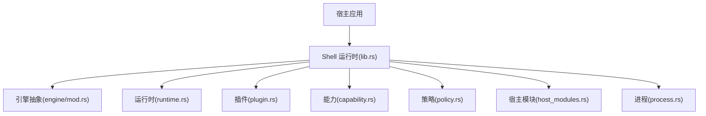
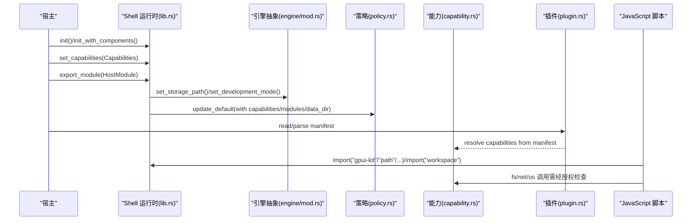
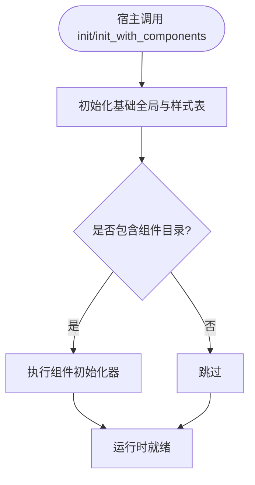
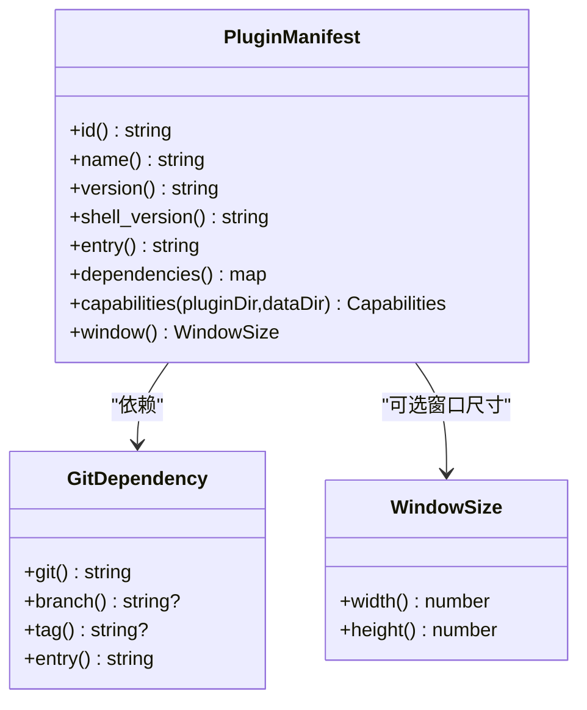
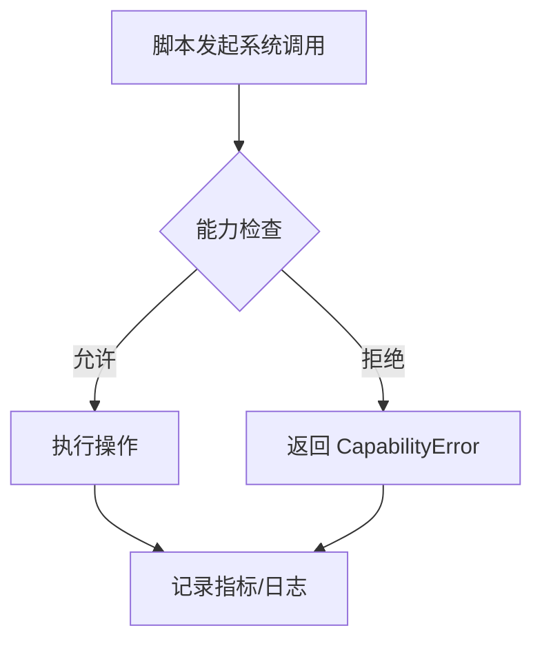
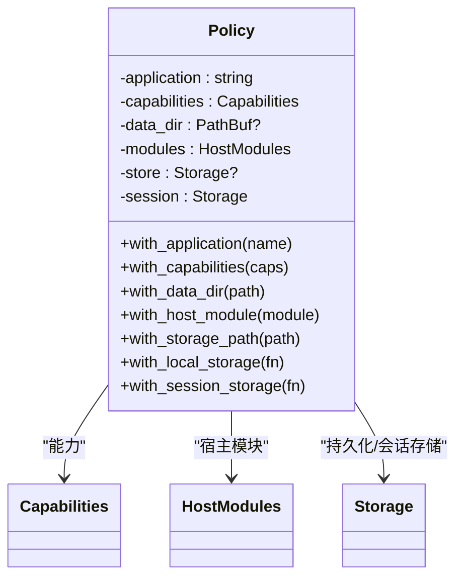
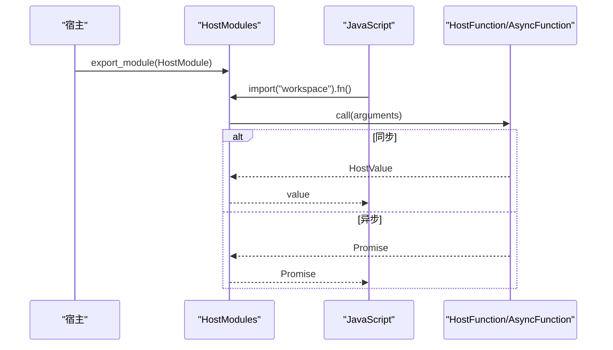
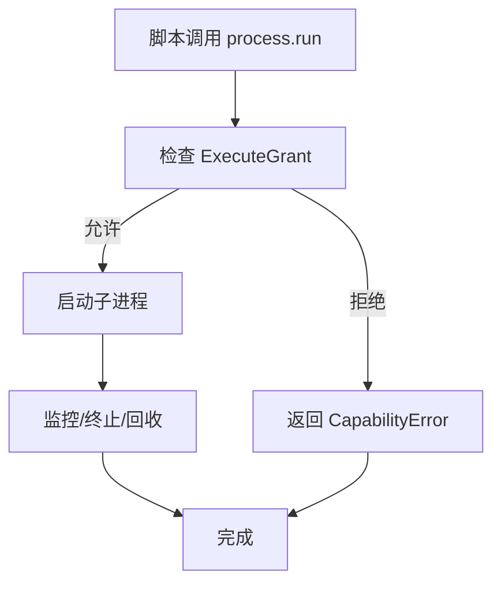
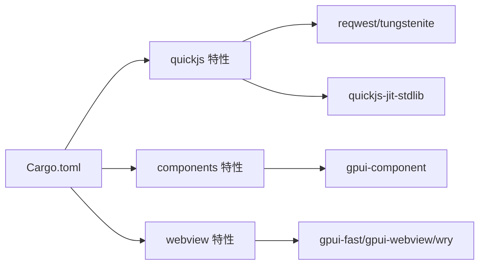

# Shell 运行时 API

<cite>
**本文引用的文件**   
- [lib.rs](file://crates/shell/src/lib.rs)
- [runtime.rs](file://crates/shell/src/runtime.rs)
- [plugin.rs](file://crates/shell/src/plugin.rs)
- [capability.rs](file://crates/shell/src/capability.rs)
- [engine/mod.rs](file://crates/shell/src/engine/mod.rs)
- [host_modules.rs](file://crates/shell/src/host_modules.rs)
- [policy.rs](file://crates/shell/src/policy.rs)
- [process.rs](file://crates/shell/src/process.rs)
- [Cargo.toml](file://crates/shell/Cargo.toml)
</cite>

## 目录
1. [简介](#简介)
2. [项目结构](#项目结构)
3. [核心组件](#核心组件)
4. [架构总览](#架构总览)
5. [详细组件分析](#详细组件分析)
6. [依赖关系分析](#依赖关系分析)
7. [性能考虑](#性能考虑)
8. [故障排查指南](#故障排查指南)
9. [结论](#结论)
10. [附录：JavaScript 侧绑定与开发指南](#附录javascript-侧绑定与开发指南)

## 简介
本文件为 Shell 运行时的 JavaScript 扩展运行时公共接口文档，覆盖引擎初始化、插件加载、能力控制系统、安全模型、宿主通信、文件系统访问、网络请求、进程管理等系统级 API，以及 JavaScript 侧的绑定模式（异步调用、事件监听、状态同步）。同时提供插件开发指南、调试方法与性能优化建议。

Shell 运行时以 GPUI 为基础，将渲染、布局、文本编辑、虚拟化与系统能力交给宿主，脚本负责组合、呈现与业务逻辑。默认沙箱严格：脚本不拥有任何系统权限，除非宿主显式授予。

## 项目结构
Shell 运行时位于 `crates/shell`，关键模块职责如下：
- 顶层入口与宿主集成：`lib.rs`
- 引擎抽象与配置：`engine/mod.rs`
- 运行时通用设施（回调、错误展示、应用根解析等）：`runtime.rs`
- 插件清单与依赖：`plugin.rs`
- 能力与安全策略：`capability.rs`、`policy.rs`
- 宿主模块注册与 JS 边界值：`host_modules.rs`
- 进程管理：`process.rs`
- 构建特性与依赖声明：`Cargo.toml`

图表来源
- [lib.rs:1-140](file://crates/shell/src/lib.rs#L1-L140)
- [engine/mod.rs:1-156](file://crates/shell/src/engine/mod.rs#L1-L156)
- [runtime.rs:1-120](file://crates/shell/src/runtime.rs#L1-L120)
- [plugin.rs:1-120](file://crates/shell/src/plugin.rs#L1-L120)
- [capability.rs:1-120](file://crates/shell/src/capability.rs#L1-L120)
- [policy.rs:1-120](file://crates/shell/src/policy.rs#L1-L120)
- [host_modules.rs:1-120](file://crates/shell/src/host_modules.rs#L1-L120)
- [process.rs:250-320](file://crates/shell/src/process.rs#L250-L320)

章节来源
- [lib.rs:1-140](file://crates/shell/src/lib.rs#L1-L140)
- [Cargo.toml:1-129](file://crates/shell/Cargo.toml#L1-L129)

## 核心组件
- 引擎初始化与生命周期
  - 基础初始化：`init(cx)`、`init_with_components(cx, components)`
  - 引擎配置：`set_storage_path(path)`、`set_development_mode(enabled)`
  - 应用根解析：`resolve_app_root(path, entry)`
- 插件与清单
  - 清单解析与校验：`PluginManifest::read/parse`
  - 依赖解析与 Git 包：`GitDependency`
  - 窗口初始尺寸：`window.width/height`
- 能力与安全
  - 能力集合：`Capabilities`（文件系统读写根、执行命令白名单、网络主机与 HTTP 请求授权、存储、剪贴板、环境变量、退出）
  - 路径授权与根约束：`open/open_link`、`Grant`
  - 策略对象：`Policy`（能力、数据目录、HostModules、localStorage/sessionStorage）
- 宿主模块与 JS 边界
  - 模块导出：`export_module(module)`、`clear_exported_modules()`
  - 值类型：`HostValue`、`HostObject`、`HostArguments`、`HostError`
  - 同步/异步函数注册：`function`、`async_function`
- 进程管理
  - 子进程启动、树形终止、平台相关配置

章节来源
- [lib.rs:279-301](file://crates/shell/src/lib.rs#L279-L301)
- [lib.rs:351-456](file://crates/shell/src/lib.rs#L351-L456)
- [engine/mod.rs:140-156](file://crates/shell/src/engine/mod.rs#L140-L156)
- [runtime.rs:130-202](file://crates/shell/src/runtime.rs#L130-L202)
- [plugin.rs:283-459](file://crates/shell/src/plugin.rs#L283-L459)
- [capability.rs:24-154](file://crates/shell/src/capability.rs#L24-L154)
- [capability.rs:393-510](file://crates/shell/src/capability.rs#L393-L510)
- [policy.rs:61-109](file://crates/shell/src/policy.rs#L61-L109)
- [host_modules.rs:112-127](file://crates/shell/src/host_modules.rs#L112-L127)
- [host_modules.rs:412-569](file://crates/shell/src/host_modules.rs#L412-L569)
- [process.rs:250-320](file://crates/shell/src/process.rs#L250-L320)

## 架构总览
Shell 运行时在“宿主—引擎—脚本”三层之间建立清晰边界：
- 宿主通过 `lib.rs` 暴露的入口初始化运行时、设置能力、导出宿主模块。
- 引擎抽象层隔离具体 VM（当前 QuickJS），对外仅暴露 `ShellRuntime` 等有限接口。
- 脚本通过标准模块（如 `path`、`fs/promises`、`net`、`websocket` 等）和宿主模块进行交互；所有系统能力受 `Capabilities` 与 `Policy` 控制。

图表来源
- [lib.rs:188-201](file://crates/shell/src/lib.rs#L188-L201)
- [lib.rs:279-301](file://crates/shell/src/lib.rs#L279-L301)
- [lib.rs:351-456](file://crates/shell/src/lib.rs#L351-L456)
- [engine/mod.rs:140-156](file://crates/shell/src/engine/mod.rs#L140-L156)
- [policy.rs:241-269](file://crates/shell/src/policy.rs#L241-L269)
- [plugin.rs:436-459](file://crates/shell/src/plugin.rs#L436-L459)

## 详细组件分析

### 引擎初始化与生命周期
- 初始化
  - `init(cx)`：初始化基础全局与样式反射表。
  - `init_with_components(cx, components)`：先执行组件目录初始化器，再初始化运行时。
- 引擎配置
  - `set_storage_path(path)`：将脚本可见的存储指向指定文件。
  - `set_development_mode(enabled)`：开发模式下放宽沙箱（允许 eval、解冻内置原型）。
- 应用根解析
  - `resolve_app_root(path, entry)`：根据入口名定位应用根目录，给出友好错误提示。

图表来源
- [lib.rs:279-301](file://crates/shell/src/lib.rs#L279-L301)
- [engine/mod.rs:140-156](file://crates/shell/src/engine/mod.rs#L140-L156)
- [runtime.rs:130-202](file://crates/shell/src/runtime.rs#L130-L202)

章节来源
- [lib.rs:279-301](file://crates/shell/src/lib.rs#L279-L301)
- [engine/mod.rs:140-156](file://crates/shell/src/engine/mod.rs#L140-L156)
- [runtime.rs:130-202](file://crates/shell/src/runtime.rs#L130-L202)

### 插件系统与清单
- 清单字段
  - `id`、`name`、`version`、`shell-version`、`entry`、`dependencies`、`capabilities`、`window`
- 依赖
  - Git 依赖支持短字符串或对象形式，支持分支/标签选择与 package entry。
- 能力
  - 从清单解析并锚定到宿主提供的目录（`${pluginDir}`、`${dataDir}`、`${homeDir}`）。
- 兼容性
  - `shell-version` 在代码执行前进行版本检查。

图表来源
- [plugin.rs:74-138](file://crates/shell/src/plugin.rs#L74-L138)
- [plugin.rs:283-459](file://crates/shell/src/plugin.rs#L283-L459)
- [plugin.rs:688-726](file://crates/shell/src/plugin.rs#L688-L726)

章节来源
- [plugin.rs:1-120](file://crates/shell/src/plugin.rs#L1-L120)
- [plugin.rs:283-459](file://crates/shell/src/plugin.rs#L283-L459)
- [plugin.rs:688-726](file://crates/shell/src/plugin.rs#L688-L726)

### 能力控制系统与安全模型
- 能力项
  - 文件系统：读/写根目录、符号链接处理、根外访问拒绝。
  - 进程执行：白名单或完全放开。
  - 网络：主机列表与细粒度 HTTP 授权（scheme/host/port/method/path）。
  - 存储：`localStorage` 开关。
  - 剪贴板：读/写开关。
  - 环境变量：默认可见变量 + 额外授权变量。
  - 退出：脚本能否请求退出。
- 授权流程
  - 宿主通过 `set_capabilities` 安装默认能力。
  - 插件清单可声明能力，由宿主合并后生效。
  - 所有系统调用均经过 `Capabilities` 判定。

图表来源
- [capability.rs:24-154](file://crates/shell/src/capability.rs#L24-L154)
- [capability.rs:393-510](file://crates/shell/src/capability.rs#L393-L510)
- [capability.rs:537-571](file://crates/shell/src/capability.rs#L537-L571)
- [lib.rs:188-201](file://crates/shell/src/lib.rs#L188-L201)

章节来源
- [capability.rs:24-154](file://crates/shell/src/capability.rs#L24-L154)
- [capability.rs:393-510](file://crates/shell/src/capability.rs#L393-L510)
- [capability.rs:537-571](file://crates/shell/src/capability.rs#L537-L571)
- [lib.rs:188-201](file://crates/shell/src/lib.rs#L188-L201)

### 策略 Policy 与多应用隔离
- Policy 持有：
  - 应用名称（用于面板命名空间）、能力、数据目录、HostModules、localStorage、sessionStorage。
- 设计要点：
  - 能力冻结在创建时，避免跨时间片被篡改。
  - HostModules 与 Storage 共享句柄，支持撤销与单文件缓存一致性。
  - 默认策略可通过 `update_default` 修改，已持有的 Policy 副本不受影响。

图表来源
- [policy.rs:61-109](file://crates/shell/src/policy.rs#L61-L109)
- [policy.rs:117-239](file://crates/shell/src/policy.rs#L117-L239)
- [policy.rs:241-296](file://crates/shell/src/policy.rs#L241-L296)

章节来源
- [policy.rs:61-109](file://crates/shell/src/policy.rs#L61-L109)
- [policy.rs:117-239](file://crates/shell/src/policy.rs#L117-L239)
- [policy.rs:241-296](file://crates/shell/src/policy.rs#L241-L296)

### 宿主模块与 JavaScript 边界
- 模块导出
  - `export_module(module)`：注册一个可由脚本 `import` 的模块。
  - `clear_exported_modules()`：撤销所有已导出模块。
- 值与参数
  - `HostValue`：null/bool/number/string/array/object。
  - `HostObject`：有序字段构建器。
  - `HostArguments`：位置参数读取与类型校验。
- 函数注册
  - `function(name, body)`：同步函数，不得重新进入引擎。
  - `async_function(name, body)`：主线程参数校验 + 后台执行 Future。
- TypeScript 声明
  - `declarations(typescript)`：生成 `.d.ts` 并校验导出一致性。

图表来源
- [host_modules.rs:112-127](file://crates/shell/src/host_modules.rs#L112-L127)
- [host_modules.rs:412-569](file://crates/shell/src/host_modules.rs#L412-L569)
- [host_modules.rs:751-778](file://crates/shell/src/host_modules.rs#L751-L778)
- [lib.rs:351-456](file://crates/shell/src/lib.rs#L351-L456)

章节来源
- [host_modules.rs:1-120](file://crates/shell/src/host_modules.rs#L1-L120)
- [host_modules.rs:412-569](file://crates/shell/src/host_modules.rs#L412-L569)
- [host_modules.rs:751-778](file://crates/shell/src/host_modules.rs#L751-L778)
- [lib.rs:351-456](file://crates/shell/src/lib.rs#L351-L456)

### 进程管理与系统级 API
- 进程树管理
  - 平台相关配置（Windows Job Object 等）。
  - 子进程启动、挂起恢复、终止。
- 安全约束
  - 执行命令需满足 `ExecuteGrant`（白名单或无限制）。
- 错误与状态
  - 退出信号与状态码映射。

图表来源
- [capability.rs:144-154](file://crates/shell/src/capability.rs#L144-L154)
- [process.rs:250-320](file://crates/shell/src/process.rs#L250-L320)
- [process.rs:266-294](file://crates/shell/src/process.rs#L266-L294)

章节来源
- [capability.rs:144-154](file://crates/shell/src/capability.rs#L144-L154)
- [process.rs:250-320](file://crates/shell/src/process.rs#L250-L320)
- [process.rs:266-294](file://crates/shell/src/process.rs#L266-L294)

## 依赖关系分析
- 构建特性
  - `quickjs`：启用 QuickJS 引擎、JIT、标准库与网络依赖。
  - `components`：启用组件目录。
  - `webview`：启用 WebView 与 Fast 窗口合成。
  - `gpui-fast`：加速路径与 GPU 相关依赖。
- 外部依赖
  - `rquickjs`、`reqwest`、`tungstenite`、`cap-std`、`semver`、`schemars` 等。

图表来源
- [Cargo.toml:20-49](file://crates/shell/Cargo.toml#L20-L49)
- [Cargo.toml:51-104](file://crates/shell/Cargo.toml#L51-L104)

章节来源
- [Cargo.toml:20-49](file://crates/shell/Cargo.toml#L20-L49)
- [Cargo.toml:51-104](file://crates/shell/Cargo.toml#L51-L104)

## 性能考虑
- 渲染频率规则
  - 引擎层保证 `build_snapshot` 是唯一进入脚本 `render` 的入口，避免每帧触发脚本渲染。
- 异步宿主函数
  - 使用 `async_function` 将耗时任务移至后台执行，避免阻塞渲染线程。
- 回调生命周期
  - 回调按快照分代管理，避免泄漏；虚拟列表渲染走专用通道，不进入脚本 `render`。
- 依赖与特性
  - 按需启用 `components`、`webview`、`gpui-fast` 以减少编译与运行开销。

章节来源
- [engine/mod.rs:70-119](file://crates/shell/src/engine/mod.rs#L70-L119)
- [host_modules.rs:496-569](file://crates/shell/src/host_modules.rs#L496-L569)
- [runtime.rs:280-442](file://crates/shell/src/runtime.rs#L280-L442)

## 故障排查指南
- 常见错误
  - 能力未授予：文件系统/网络/进程/存储/剪贴板访问被拒。
  - 清单校验失败：未知字段、无效 id/version/entry、Git 引用非法。
  - 宿主模块冲突：保留模块名不可注册、TS 声明与实际不一致。
  - 应用根缺失：入口文件不存在或路径不正确。
- 诊断工具
  - 错误横幅与覆盖层：`error_banner`、`error_overlay`、`failure_surface`。
  - 退出请求钩子：`on_exit_request`、`exit_handler`、`clear_exit_handler`。
  - 类型声明生成：`write_type_declarations_with_components`、`write_dependency_links`。

章节来源
- [capability.rs:537-571](file://crates/shell/src/capability.rs#L537-L571)
- [plugin.rs:283-459](file://crates/shell/src/plugin.rs#L283-L459)
- [host_modules.rs:649-715](file://crates/shell/src/host_modules.rs#L649-L715)
- [runtime.rs:488-510](file://crates/shell/src/runtime.rs#L488-L510)
- [runtime.rs:512-700](file://crates/shell/src/runtime.rs#L512-L700)
- [lib.rs:147-186](file://crates/shell/src/lib.rs#L147-L186)

## 结论
Shell 运行时通过清晰的宿主—引擎—脚本分层、严格的默认沙箱与可组合的能力系统，为 JavaScript 扩展提供了稳定且安全的系统级能力。插件清单与能力声明分离，确保权限在代码执行前可见并可审计；宿主模块以导入方式暴露，兼顾类型安全与可维护性。配合完善的错误展示、回调生命周期管理与异步执行模型，可在保证性能的同时提升开发者体验。

## 附录：JavaScript 侧绑定与开发指南

### JavaScript 侧绑定模式
- 模块导入
  - 标准模块：`path`、`fs/promises`、`net`、`websocket`、`url`、`crypto`、`zlib`、`buffer`、`console`、`os`、`process`。
  - 宿主模块：通过 `export_module` 注册的自定义模块，例如 `import { ... } from "workspace"`。
- 异步调用
  - 宿主异步函数返回 Promise，工作在后端执行器上运行。
- 事件监听
  - 通过回调注册机制（如点击、变更、索引、信号、可视范围等）与视图交互。
- 状态同步
  - `localStorage` 与 `sessionStorage` 分别对应持久化与进程内存储。

章节来源
- [host_modules.rs:1-120](file://crates/shell/src/host_modules.rs#L1-L120)
- [host_modules.rs:496-569](file://crates/shell/src/host_modules.rs#L496-L569)
- [policy.rs:95-109](file://crates/shell/src/policy.rs#L95-L109)

### 插件开发指南
- 清单编写
  - 明确 `id`、`name`、`version`、`shell-version`、`entry`。
  - 声明 `capabilities`（fs/network/storage/clipboard/process/env）。
  - 可选 `dependencies`（Git 包）与 `window`（初始尺寸）。
- 能力最小化
  - 仅申请必要权限，避免宽泛的网络或执行授权。
- 依赖管理
  - 使用 Git 依赖时明确 branch/tag，避免不稳定引用。
- 调试
  - 开启开发模式以获取更友好的错误信息。
  - 使用 `write_type_declarations_with_components` 与 `write_dependency_links` 辅助编辑器类型提示。

章节来源
- [plugin.rs:283-459](file://crates/shell/src/plugin.rs#L283-L459)
- [lib.rs:147-186](file://crates/shell/src/lib.rs#L147-L186)
- [lib.rs:271-277](file://crates/shell/src/lib.rs#L271-L277)

### 调试方法
- 错误横幅与覆盖层
  - 查看 `error_banner`、`error_overlay`、`failure_surface` 输出的首行摘要与详情。
- 退出请求
  - 通过 `on_exit_request` 捕获脚本退出意图，决定关闭面板或进程。
- 类型与依赖
  - 使用 `write_type_declarations_with_components` 生成运行时类型声明。
  - 使用 `write_dependency_links` 链接 Git 依赖以便编辑器识别。

章节来源
- [runtime.rs:512-700](file://crates/shell/src/runtime.rs#L512-L700)
- [runtime.rs:488-510](file://crates/shell/src/runtime.rs#L488-L510)
- [lib.rs:147-186](file://crates/shell/src/lib.rs#L147-L186)

### 性能优化建议
- 渲染路径
  - 避免在布局阶段触发脚本 `render`；使用虚拟列表专用通道。
- 宿主函数
  - 将耗时逻辑放入 `async_function` 的后台 Future。
- 特性裁剪
  - 仅启用必要的 Cargo 特性（components/webview/gpui-fast）。
- 回调管理
  - 注意回调的生命周期与快照分代，避免累积导致内存增长。

章节来源
- [engine/mod.rs:70-119](file://crates/shell/src/engine/mod.rs#L70-L119)
- [host_modules.rs:496-569](file://crates/shell/src/host_modules.rs#L496-L569)
- [runtime.rs:280-442](file://crates/shell/src/runtime.rs#L280-L442)
- [Cargo.toml:20-49](file://crates/shell/Cargo.toml#L20-L49)