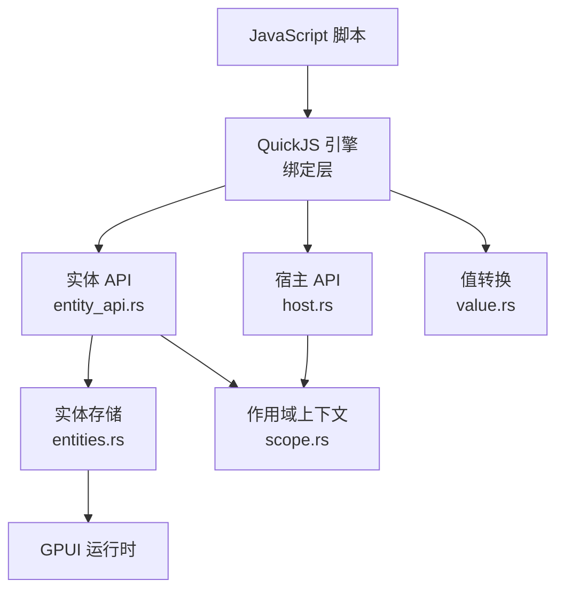
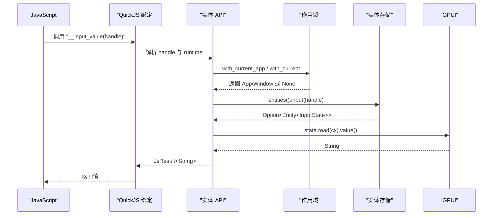
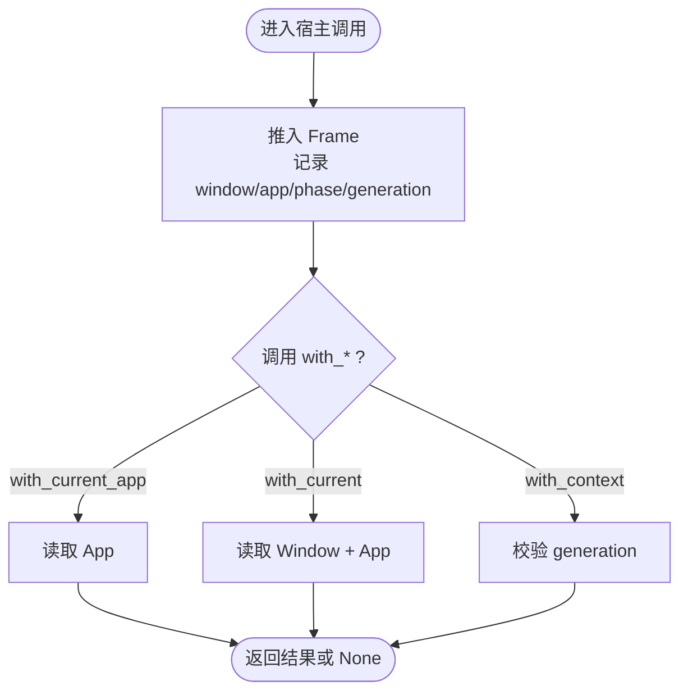
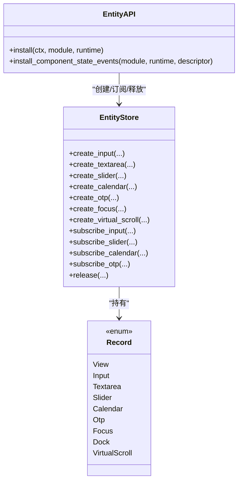
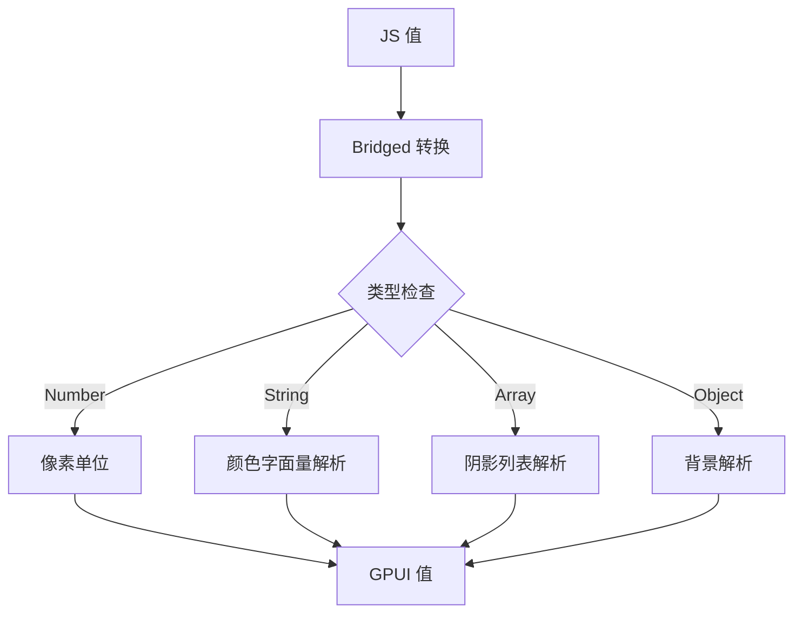
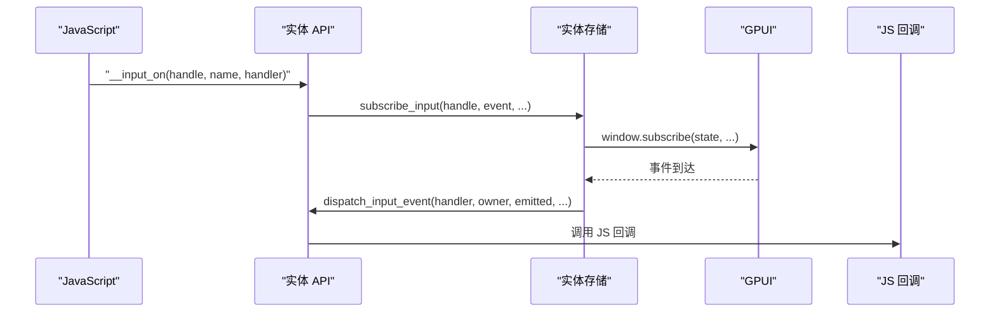
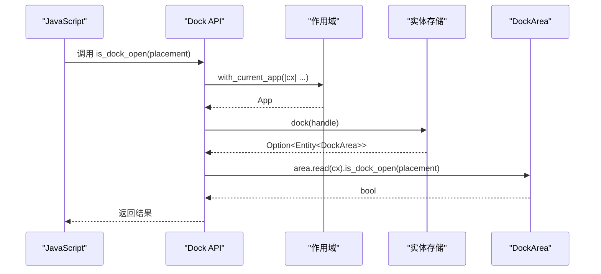
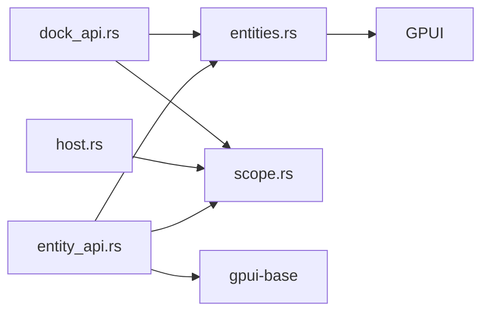

# 宿主通信接口

<cite>
**本文引用的文件**   
- [scope.rs](file://crates/shell/src/scope.rs)
- [entities.rs](file://crates/shell/src/entities.rs)
- [entity_api.rs](file://crates/shell/src/engine/quickjs/entity_api.rs)
- [value.rs](file://crates/shell/src/value.rs)
- [host.rs](file://crates/shell/src/engine/quickjs/host.rs)
- [dock_api.rs](file://crates/shell/src/engine/quickjs/dock_api.rs)
</cite>

## 目录
1. [简介](#简介)
2. [项目结构](#项目结构)
3. [核心组件](#核心组件)
4. [架构总览](#架构总览)
5. [详细组件分析](#详细组件分析)
6. [依赖关系分析](#依赖关系分析)
7. [性能与内存管理](#性能与内存管理)
8. [故障排查指南](#故障排查指南)
9. [结论](#结论)
10. [附录：通信示例清单](#附录通信示例清单)

## 简介
本文件面向需要在 Rust 宿主与 JavaScript 脚本之间进行双向通信的开发者，系统性说明以下主题：
- 上下文访问方法（如 with_current_app）的生命周期、可用阶段与安全边界。
- 实体系统（Entity）在 Rust 与 JavaScript 之间的桥接机制：句柄、持久化状态、事件订阅与释放。
- 值传递、对象序列化与跨语言类型转换规则。
- 双向通信模式、事件监听、状态同步的实现方式。
- 常见场景的完整通信示例清单，包括数据交换、回调处理与错误传播。

## 项目结构
围绕宿主通信的关键代码集中在 shell 引擎的 QuickJS 桥接层与实体子系统：
- scope.rs：定义“宿主调用作用域”，提供 with_current_app、with_current、with_context 等 API，并维护当前窗口、应用、策略、视图与应用代次。
- entities.rs：定义实体存储、句柄布局、各类实体（输入、文本域、滑块、日历、一次性码、焦点、虚拟滚动、停靠区等）的创建、查询、订阅与释放。
- entity_api.rs：将实体能力暴露给 JS，注册全局函数（如 __input_state_new、__slider_value、__otp_on 等），负责参数校验、生命周期检查与事件分发。
- value.rs：定义跨语言值模型 Bridged，以及颜色、背景、阴影等样式的解析与转换。
- host.rs：安装宿主 API（日志、剪贴板等），封装 with_app 等通用宿主调用入口。
- dock_api.rs：停靠区 JS API，大量使用 with_current_app 读取或修改 DockArea。

**图表来源**
- [entity_api.rs:55-1143](file://crates/shell/src/engine/quickjs/entity_api.rs#L55-L1143)
- [host.rs:1086-1101](file://crates/shell/src/engine/quickjs/host.rs#L1086-L1101)
- [entities.rs:1-162](file://crates/shell/src/entities.rs#L1-L162)
- [scope.rs:134-354](file://crates/shell/src/scope.rs#L134-L354)
- [value.rs:14-33](file://crates/shell/src/value.rs#L14-L33)

**章节来源**
- [scope.rs:1-113](file://crates/shell/src/scope.rs#L1-L113)
- [entities.rs:1-53](file://crates/shell/src/entities.rs#L1-L53)
- [entity_api.rs:1-31](file://crates/shell/src/engine/quickjs/entity_api.rs#L1-L31)
- [value.rs:1-20](file://crates/shell/src/value.rs#L1-L20)
- [host.rs:1086-1101](file://crates/shell/src/engine/quickjs/host.rs#L1086-L1101)

## 核心组件
- 作用域上下文（Scope）
  - 提供 with_current_app、with_current、with_context 等方法，确保只在合法的宿主调用期间访问 App/Window。
  - 维护 ScopePhase（Render/Event/Task/Layout），用于拒绝在渲染/布局阶段执行不允许的副作用。
- 实体系统（Entity）
  - 通过 EntityHandle（u64）向 JS 暴露持久化状态；高 32 位为 store id，低 32 位为单调 id，避免跨运行时泄漏。
  - 支持 InputState、TextareaState、SliderState、CalendarState、OtpState、FocusHandle、VirtualListScrollHandle、DockArea 等。
- 实体 API（entity_api.rs）
  - 将实体能力以全局函数形式注入 JS，负责参数校验、生命周期检查、事件订阅与分发。
- 值转换（value.rs）
  - 定义 Bridged 枚举，统一处理布尔、数字、字符串、Background、Shadows 等跨语言值。
- 宿主 API（host.rs）
  - 提供日志、剪贴板等能力，并通过 with_app 包装对 App 的访问。

**章节来源**
- [scope.rs:35-62](file://crates/shell/src/scope.rs#L35-L62)
- [scope.rs:330-354](file://crates/shell/src/scope.rs#L330-L354)
- [entities.rs:43-53](file://crates/shell/src/entities.rs#L43-L53)
- [entities.rs:59-162](file://crates/shell/src/entities.rs#L59-L162)
- [entity_api.rs:55-1143](file://crates/shell/src/engine/quickjs/entity_api.rs#L55-L1143)
- [value.rs:14-33](file://crates/shell/src/value.rs#L14-L33)
- [host.rs:1086-1101](file://crates/shell/src/engine/quickjs/host.rs#L1086-L1101)

## 架构总览
下图展示从 JS 到 Rust 的典型调用路径：JS 调用实体 API → 校验与上下文获取 → 实体存储操作 → 返回标量值或触发事件回调。

**图表来源**
- [entity_api.rs:143-161](file://crates/shell/src/engine/quickjs/entity_api.rs#L143-L161)
- [entities.rs:317-352](file://crates/shell/src/entities.rs#L317-L352)
- [scope.rs:330-354](file://crates/shell/src/scope.rs#L330-L354)

## 详细组件分析

### 作用域上下文（with_current_app 等）
- with_current_app
  - 仅在当前宿主调用栈内有效，返回 None 表示不在合法作用域中。
  - 被日志、剪贴板、实体读取等广泛使用。
- with_current
  - 同时提供 Window 与 App，常用于需要窗口信息的操作（如焦点、布局相关）。
- with_context
  - 基于 generation 验证 cx 是否仍有效，防止跨调用持有过期上下文。
- 阶段限制
  - Render/Layout 阶段禁止某些副作用（如创建实体、变更状态），由 refuse_creation_in_render/refuse_mutation_in_render 强制。

**图表来源**
- [scope.rs:128-165](file://crates/shell/src/scope.rs#L128-L165)
- [scope.rs:330-411](file://crates/shell/src/scope.rs#L330-L411)

**章节来源**
- [scope.rs:1-113](file://crates/shell/src/scope.rs#L1-L113)
- [scope.rs:330-411](file://crates/shell/src/scope.rs#L330-L411)

### 实体系统与 JS 桥接
- 句柄设计
  - EntityHandle = u64，高 32 位为 store id，低 32 位为单调 id，保证跨运行时隔离与可检测性。
- 实体类型
  - Input、Textarea、Slider、Calendar、Otp、Focus、VirtualScroll、Dock、View。
- JS 侧 API
  - 构造器：__input_state_new、__textarea_state_new、__slider_state_new、__calendar_state_new、__otp_state_new、__focus_handle_new、__virtual_scroll_new。
  - 读写：__input_value/__input_set_value、__slider_value/__slider_set_value、__calendar_value/__calendar_set_value、__otp_value/__otp_set_value。
  - 事件：__input_on、__slider_on、__calendar_on、__otp_on。
  - 元素构建：__input_element、__number_input_element、__textarea_element、__otp_element、__slider_*_element。
- 生命周期
  - 所有实体必须显式 release（如 __input_release、__slider_release 等），否则达到上限时报错。
  - 在渲染/布局阶段禁止创建实体或执行写操作。

**图表来源**
- [entities.rs:190-250](file://crates/shell/src/entities.rs#L190-L250)
- [entities.rs:317-508](file://crates/shell/src/entities.rs#L317-L508)
- [entities.rs:519-635](file://crates/shell/src/entities.rs#L519-L635)
- [entities.rs:646-800](file://crates/shell/src/entities.rs#L646-L800)
- [entity_api.rs:55-1143](file://crates/shell/src/engine/quickjs/entity_api.rs#L55-L1143)

**章节来源**
- [entities.rs:1-53](file://crates/shell/src/entities.rs#L1-L53)
- [entities.rs:59-162](file://crates/shell/src/entities.rs#L59-L162)
- [entities.rs:317-508](file://crates/shell/src/entities.rs#L317-L508)
- [entities.rs:519-635](file://crates/shell/src/entities.rs#L519-L635)
- [entities.rs:646-800](file://crates/shell/src/entities.rs#L646-L800)
- [entity_api.rs:55-1143](file://crates/shell/src/engine/quickjs/entity_api.rs#L55-L1143)

### 值传递、对象序列化与类型转换
- Bridged 模型
  - 统一承载 Nil、Bool、Number、Str、Background、Shadows。
  - 提供 is_truthy、as_pixels、as_color、as_background、as_shadows 等转换。
- 颜色与样式
  - 颜色字面量支持 #rgb/#rrggbb/#rrggbbaa，语义色名需通过主题 API 获取。
  - 阴影列表按 CSS 语义反转图层顺序，blur 半径按 GPUI 要求折半。
- JS ↔ Rust 数值
  - 数字默认单位为像素；滑块值在 JS 侧以数组或单值传递，Rust 侧转换为 f32 并做范围校验。

**图表来源**
- [value.rs:14-33](file://crates/shell/src/value.rs#L14-L33)
- [value.rs:68-130](file://crates/shell/src/value.rs#L68-L130)
- [value.rs:148-200](file://crates/shell/src/value.rs#L148-L200)

**章节来源**
- [value.rs:1-20](file://crates/shell/src/value.rs#L1-L20)
- [value.rs:68-130](file://crates/shell/src/value.rs#L68-L130)
- [value.rs:148-200](file://crates/shell/src/value.rs#L148-L200)

### 双向通信模式、事件监听与状态同步
- 事件订阅
  - 输入/文本域：InputEventName，包含 change、submit 等。
  - 滑块：SliderEventName，携带 SliderValue（单值或区间）。
  - 一次性码：OtpEventName，不包含 submit，完成事件独立。
  - 日历：CalendarEvent，选择日期。
- 回调所有权
  - Handler 使用 Persistent 保存 JS 函数，避免生命周期问题。
  - 订阅由 Store 持有，避免脚本侧无法保持 Subscription 导致静默失效。
- 状态同步
  - 受控实体（如输入、滑块、日历、OTP）通过 set_value 更新后，必要时刷新当前视图。
  - 渲染/布局阶段禁止突变，确保 notify 契约不被破坏。

**图表来源**
- [entity_api.rs:239-251](file://crates/shell/src/engine/quickjs/entity_api.rs#L239-L251)
- [entity_api.rs:1192-1252](file://crates/shell/src/engine/quickjs/entity_api.rs#L1192-L1252)
- [entities.rs:697-731](file://crates/shell/src/entities.rs#L697-L731)

**章节来源**
- [entity_api.rs:239-251](file://crates/shell/src/engine/quickjs/entity_api.rs#L239-L251)
- [entity_api.rs:1192-1252](file://crates/shell/src/engine/quickjs/entity_api.rs#L1192-L1252)
- [entities.rs:697-731](file://crates/shell/src/entities.rs#L697-L731)

### 停靠区（Dock）通信
- 停靠区 JS API 大量使用 with_current_app 读取 DockArea 的状态（如打开/关闭、锁定、缩放、尺寸等）。
- 停靠区实体在 Store 中以 Dock 变体持有 area、slots、contexts 与 subscriptions。

**图表来源**
- [dock_api.rs:291-304](file://crates/shell/src/engine/quickjs/dock_api.rs#L291-L304)
- [entities.rs:552-589](file://crates/shell/src/entities.rs#L552-L589)
- [scope.rs:330-339](file://crates/shell/src/scope.rs#L330-L339)

**章节来源**
- [dock_api.rs:195-430](file://crates/shell/src/engine/quickjs/dock_api.rs#L195-L430)
- [entities.rs:552-635](file://crates/shell/src/entities.rs#L552-L635)

## 依赖关系分析
- 模块耦合
  - entity_api.rs 强依赖 entities.rs（实体创建/订阅/释放）与 scope.rs（上下文访问）。
  - host.rs 依赖 scope.rs 提供 with_current_app。
  - dock_api.rs 依赖 scope.rs 与 entities.rs。
- 外部依赖
  - GPUI 的 App/Window/Entity/FocusHandle 等。
  - gpui-base 的 InputState、TextareaState、SliderState、CalendarState、OtpState、DockArea 等。

**图表来源**
- [entity_api.rs:1-31](file://crates/shell/src/engine/quickjs/entity_api.rs#L1-L31)
- [entities.rs:21-41](file://crates/shell/src/entities.rs#L21-L41)
- [host.rs:1086-1101](file://crates/shell/src/engine/quickjs/host.rs#L1086-L1101)
- [dock_api.rs:195-430](file://crates/shell/src/engine/quickjs/dock_api.rs#L195-L430)

**章节来源**
- [entity_api.rs:1-31](file://crates/shell/src/engine/quickjs/entity_api.rs#L1-L31)
- [entities.rs:21-41](file://crates/shell/src/entities.rs#L21-L41)
- [host.rs:1086-1101](file://crates/shell/src/engine/quickjs/host.rs#L1086-L1101)
- [dock_api.rs:195-430](file://crates/shell/src/engine/quickjs/dock_api.rs#L195-L430)

## 性能与内存管理
- 值拷贝 vs 实体引用
  - 标量值（数字、字符串、布尔）在桥接时复制；实体通过句柄引用，避免频繁跨语言拷贝。
- 实体预算
  - MAX_LIVE_ENTITIES 限制活跃实体数量，超限时报错，提示释放未使用的句柄。
- 订阅管理
  - 订阅由 Store 持有，避免脚本侧丢失 Subscription 导致事件不再触发。
- 渲染/布局保护
  - 拒绝在 Render/Layout 阶段创建实体或执行写操作，防止重入与不一致状态。
- 异步任务
  - 通过 scope::adopt 让虚拟化列表项渲染器等闭包能复用外层 render 的 generation，减少额外上下文开销。

**章节来源**
- [entities.rs:53-57](file://crates/shell/src/entities.rs#L53-L57)
- [entities.rs:174-250](file://crates/shell/src/entities.rs#L174-L250)
- [entity_api.rs:1555-1599](file://crates/shell/src/engine/quickjs/entity_api.rs#L1555-L1599)
- [scope.rs:288-309](file://crates/shell/src/scope.rs#L288-L309)

## 故障排查指南
- “需要活的宿主调用”
  - 现象：调用 with_current_app/with_current 返回 None，或在非宿主调用上下文中访问 App/Window。
  - 原因：在模块顶层或无作用域处调用宿主 API。
  - 解决：在 init、事件处理器或任务中调用。
- “不能在渲染/布局阶段创建实体”
  - 现象：refuse_creation_in_render 报错。
  - 原因：在 render 或 layout 阶段创建实体。
  - 解决：在 init 或事件处理器中创建实体，并在视图中持有句柄。
- “不能在渲染/布局阶段执行写操作”
  - 现象：refuse_mutation_in_render 报错。
  - 原因：在 render/layout 阶段调用 set_value 等写方法。
  - 解决：在事件处理器或任务中执行写操作。
- “实体已释放”
  - 现象：live_* 函数返回“实体已释放”。
  - 原因：调用了 release 或超出生命周期。
  - 解决：确保在渲染前未释放句柄，或在渲染失败时重新创建。
- “达到实体上限”
  - 现象：entity_limit_reached 报错。
  - 原因：活跃实体超过 MAX_LIVE_ENTITIES。
  - 解决：释放未使用的句柄，优化实体生命周期。

**章节来源**
- [host.rs:1086-1101](file://crates/shell/src/engine/quickjs/host.rs#L1086-L1101)
- [entity_api.rs:1555-1599](file://crates/shell/src/engine/quickjs/entity_api.rs#L1555-L1599)
- [entity_api.rs:1146-1189](file://crates/shell/src/engine/quickjs/entity_api.rs#L1146-L1189)

## 结论
本仓库的宿主通信接口通过作用域上下文、实体存储与 JS 绑定层实现了安全、可控的双向通信。其关键要点包括：
- 严格的作用域与阶段检查，确保 App/Window 访问合法。
- 实体句柄与持久化状态分离，避免悬垂引用与跨运行时泄漏。
- 统一的值转换模型，简化跨语言类型处理。
- 订阅由宿主持有，保障事件可靠投递。
- 明确的错误信息，帮助快速定位常见问题。

## 附录：通信示例清单
以下为常见场景的示例清单（不直接展示代码内容，仅提供实现位置参考）：
- 数据交换
  - 读取输入值：[entity_api.rs:143-161](file://crates/shell/src/engine/quickjs/entity_api.rs#L143-L161)
  - 设置输入值：[entity_api.rs:153-161](file://crates/shell/src/engine/quickjs/entity_api.rs#L153-L161)
  - 读取滑块值：[entity_api.rs:503-516](file://crates/shell/src/engine/quickjs/entity_api.rs#L503-L516)
  - 设置滑块值：[entity_api.rs:518-539](file://crates/shell/src/engine/quickjs/entity_api.rs#L518-L539)
  - 读取日历值：[entity_api.rs:664-674](file://crates/shell/src/engine/quickjs/entity_api.rs#L664-L674)
  - 设置日历值：[entity_api.rs:676-689](file://crates/shell/src/engine/quickjs/entity_api.rs#L676-L689)
  - 读取 OTP 值：[entity_api.rs:846-856](file://crates/shell/src/engine/quickjs/entity_api.rs#L846-L856)
  - 设置 OTP 值：[entity_api.rs:858-875](file://crates/shell/src/engine/quickjs/entity_api.rs#L858-L875)
- 回调处理
  - 输入事件订阅：[entity_api.rs:239-251](file://crates/shell/src/engine/quickjs/entity_api.rs#L239-L251)
  - 滑块事件订阅：[entity_api.rs:748-760](file://crates/shell/src/engine/quickjs/entity_api.rs#L748-L760)
  - 日历事件订阅：[entity_api.rs:724-736](file://crates/shell/src/engine/quickjs/entity_api.rs#L724-L736)
  - OTP 事件订阅：[entity_api.rs:926-938](file://crates/shell/src/engine/quickjs/entity_api.rs#L926-L938)
- 错误传播
  - 宿主调用缺失：[host.rs:1086-1101](file://crates/shell/src/engine/quickjs/host.rs#L1086-L1101)
  - 渲染阶段创建实体：[entity_api.rs:1555-1574](file://crates/shell/src/engine/quickjs/entity_api.rs#L1555-L1574)
  - 渲染阶段写操作：[entity_api.rs:1590-1599](file://crates/shell/src/engine/quickjs/entity_api.rs#L1590-L1599)
  - 实体上限：[entity_api.rs:1576-1588](file://crates/shell/src/engine/quickjs/entity_api.rs#L1576-L1588)