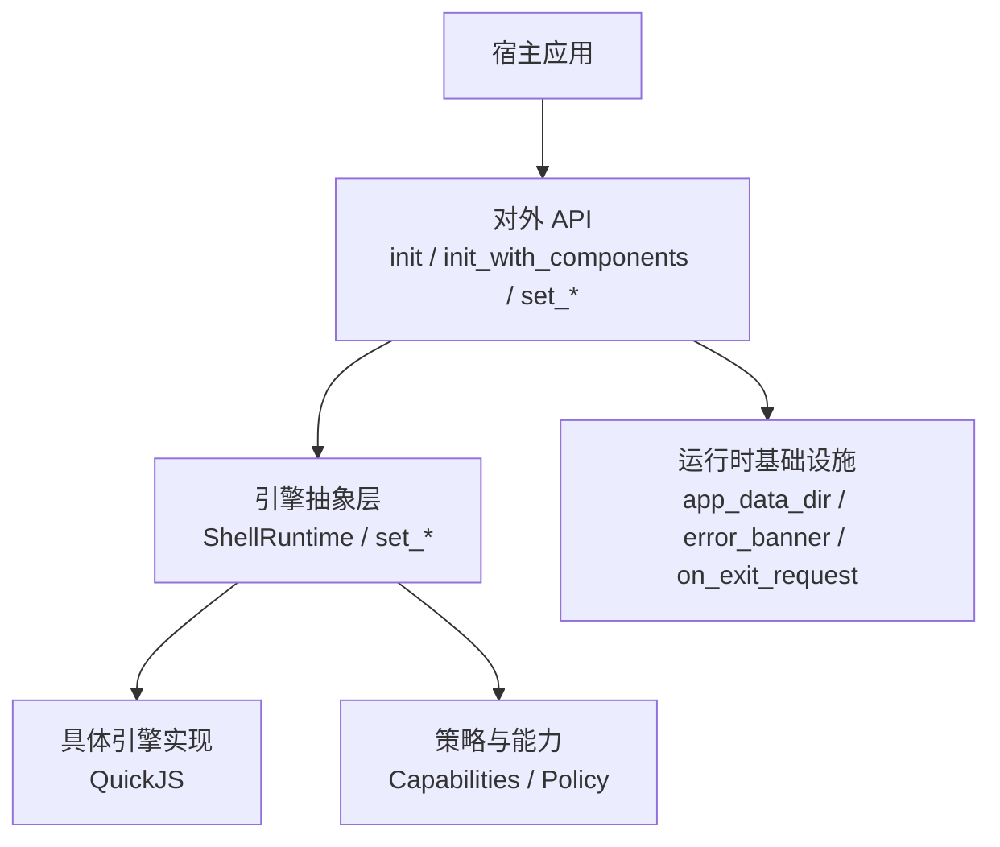
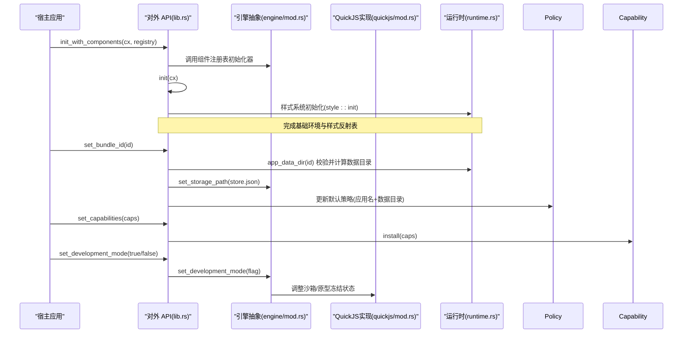
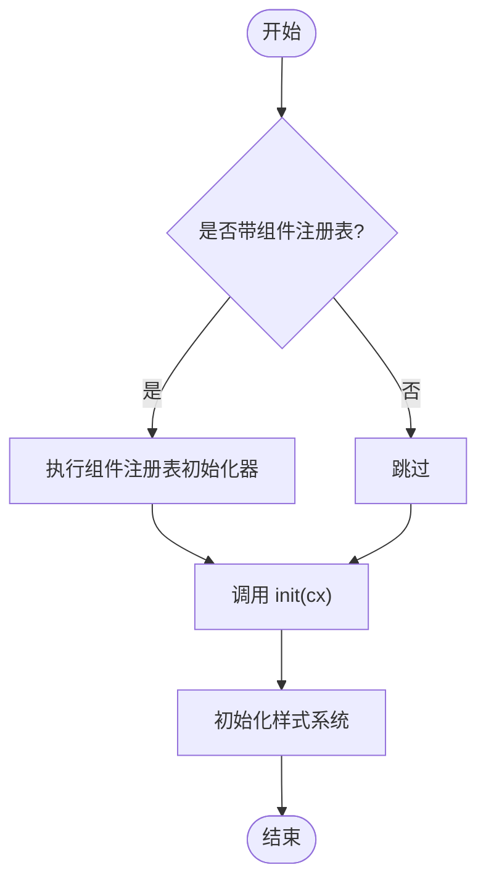
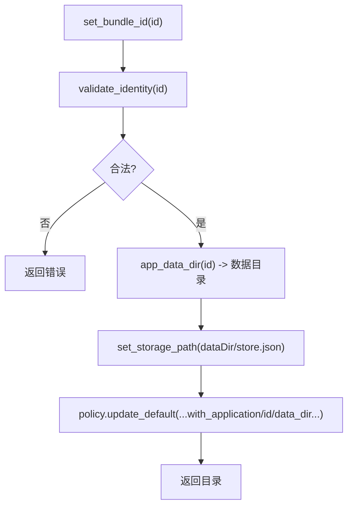
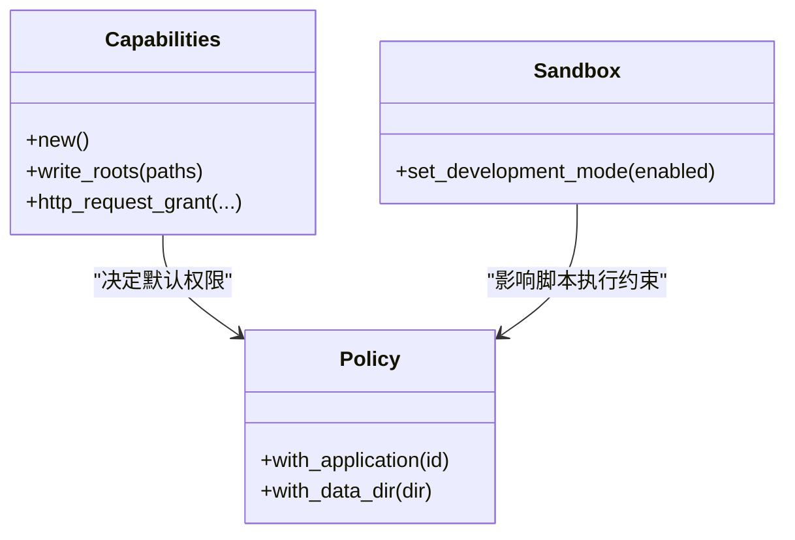
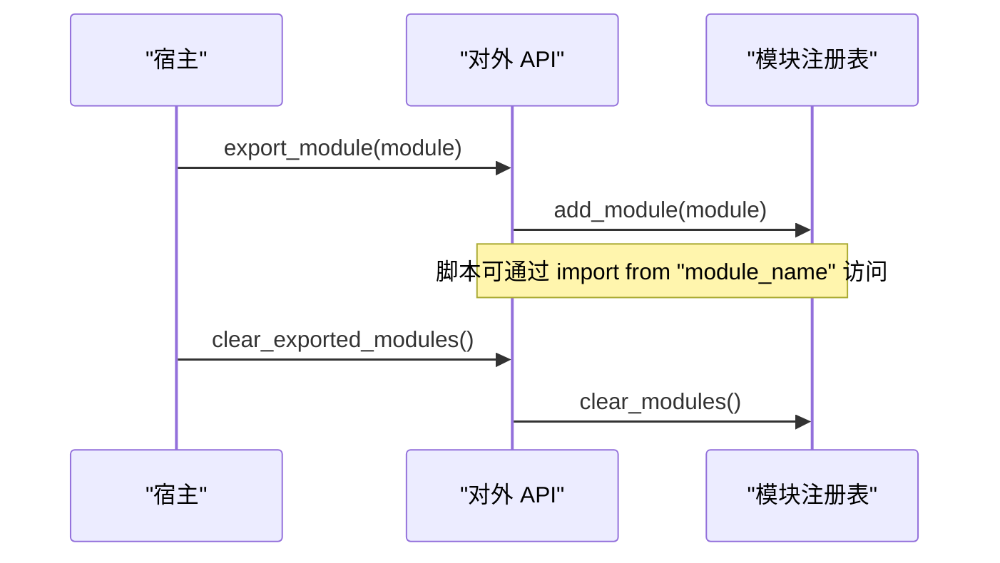
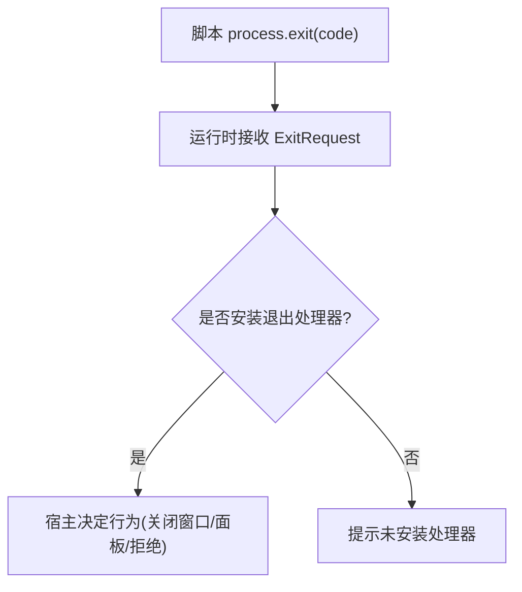
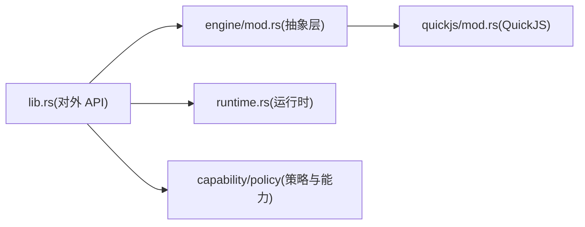
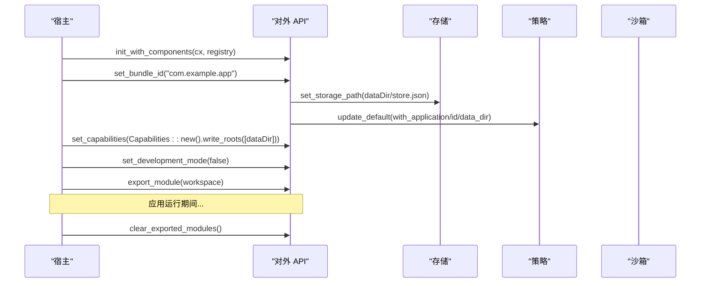

# 引擎初始化与配置

<cite>
**本文引用的文件**   
- [lib.rs](file://crates/shell/src/lib.rs)
- [engine/mod.rs](file://crates/shell/src/engine/mod.rs)
- [runtime.rs](file://crates/shell/src/runtime.rs)
- [quickjs/mod.rs](file://crates/shell/src/engine/quickjs/mod.rs)
</cite>

## 目录
1. [简介](#简介)
2. [项目结构](#项目结构)
3. [核心组件](#核心组件)
4. [架构总览](#架构总览)
5. [详细组件分析](#详细组件分析)
6. [依赖关系分析](#依赖关系分析)
7. [性能考虑](#性能考虑)
8. [故障排查指南](#故障排查指南)
9. [结论](#结论)
10. [附录：完整初始化流程示例](#附录完整初始化流程示例)

## 简介
本文聚焦 Shell 运行时引擎的初始化与配置，覆盖应用启动流程、组件注册表初始化、样式系统设置、能力与安全沙箱配置，以及开发模式与生产模式的差异。文档同时给出宿主应用如何正确初始化 Shell 运行时、处理错误并与宿主集成的实践建议。

## 项目结构
Shell 运行时由“对外 API”“引擎抽象层”“具体引擎实现（QuickJS）”“运行时基础设施”等层次组成：
- 对外 API：位于 crate 根模块，暴露 init、init_with_components、set_* 系列配置函数、能力与模块导出接口。
- 引擎抽象层：定义 ShellRuntime 及 set_storage_path、set_development_mode 等必须实现的入口，屏蔽底层脚本引擎细节。
- 具体引擎实现：当前为 QuickJS，负责 JS 上下文、模块加载、视图实例化、回调分发等。
- 运行时基础设施：提供应用数据目录、存储路径、错误展示、退出请求处理、回调生命周期管理等通用能力。

**图示来源**
- [lib.rs:279-301](file://crates/shell/src/lib.rs#L279-L301)
- [engine/mod.rs:1-60](file://crates/shell/src/engine/mod.rs#L1-L60)
- [runtime.rs:30-56](file://crates/shell/src/runtime.rs#L30-L56)

**章节来源**
- [lib.rs:1-140](file://crates/shell/src/lib.rs#L1-L140)
- [engine/mod.rs:1-60](file://crates/shell/src/engine/mod.rs#L1-L60)

## 核心组件
- 初始化入口
  - init(cx): 初始化基础层与样式反射表；仅裸运行时即可使用。
  - init_with_components(cx, components): 先执行组件注册表的初始化器，再调用 init，使组件库的全局状态可用。
- 配置函数
  - set_bundle_id(id): 设置应用标识并放置数据存储目录；同时更新默认策略的应用名与数据目录。
  - set_storage_path(path): 将 localStorage 指向指定文件；用于测试或自定义布局场景。
  - set_capabilities(capabilities): 授予应用能力；未显式授予时脚本无任何权限。
  - set_development_mode(enabled): 开启开发模式，放宽沙箱限制（如启用 eval、解冻内置原型）。
- 宿主集成点
  - export_module(module): 向脚本暴露宿主模块。
  - clear_exported_modules(): 清理已导出的宿主模块。
  - on_exit_request(handler)/clear_exit_handler(): 安装/清除进程退出请求处理器。

**章节来源**
- [lib.rs:188-277](file://crates/shell/src/lib.rs#L188-L277)
- [lib.rs:351-455](file://crates/shell/src/lib.rs#L351-L455)
- [runtime.rs:488-510](file://crates/shell/src/runtime.rs#L488-L510)

## 架构总览
Shell 运行时的初始化与控制流如下：

**图示来源**
- [lib.rs:279-301](file://crates/shell/src/lib.rs#L279-L301)
- [lib.rs:238-277](file://crates/shell/src/lib.rs#L238-L277)
- [engine/mod.rs:140-155](file://crates/shell/src/engine/mod.rs#L140-L155)
- [runtime.rs:30-56](file://crates/shell/src/runtime.rs#L30-L56)

## 详细组件分析

### 初始化流程：init 与 init_with_components
- init(cx)
  - 初始化 gpui_base 全局环境。
  - 初始化样式系统与反射表，确保主题、样式 token 在脚本侧可被反射与消费。
- init_with_components(cx, components)
  - 若组件注册表提供了初始化器，则先执行该初始化器，以便组件库的全局状态就绪。
  - 随后调用 init(cx)，保证基础环境与样式系统始终被初始化。

**图示来源**
- [lib.rs:279-301](file://crates/shell/src/lib.rs#L279-L301)

**章节来源**
- [lib.rs:279-301](file://crates/shell/src/lib.rs#L279-L301)

### 应用标识与存储：set_bundle_id 与 set_storage_path
- set_bundle_id(id)
  - 校验应用标识合法性（不允许空值、不允许包含“..”、只允许小写字母、数字、点、短横线、下划线）。
  - 计算应用数据目录（基于平台用户数据目录 + “gpui-shell/apps/<id>”）。
  - 设置 localStorage 持久化为 store.json（位于应用数据目录下）。
  - 更新默认策略中的应用名与数据目录，使 dock 面板布局等持久化命名空间与应用绑定。
- set_storage_path(path)
  - 直接指定 localStorage 的文件路径；适用于测试或宿主自定义布局场景。

**图示来源**
- [lib.rs:238-246](file://crates/shell/src/lib.rs#L238-L246)
- [runtime.rs:30-56](file://crates/shell/src/runtime.rs#L30-L56)

**章节来源**
- [lib.rs:238-269](file://crates/shell/src/lib.rs#L238-L269)
- [runtime.rs:30-56](file://crates/shell/src/runtime.rs#L30-L56)

### 能力与安全沙箱：set_capabilities 与 set_development_mode
- set_capabilities(capabilities)
  - 通过 capability::install 安装默认能力；未设置前脚本无文件系统、存储、剪贴板、进程访问等权限。
  - 多应用宿主可为每个应用维护独立的 Policy，避免跨应用越权。
- set_development_mode(enabled)
  - 开发模式下放宽沙箱：恢复 eval、解冻内置原型，便于 REPL 与调试。
  - 生产模式应保持关闭，以最小化攻击面。

**图示来源**
- [lib.rs:188-201](file://crates/shell/src/lib.rs#L188-L201)
- [engine/mod.rs:151-155](file://crates/shell/src/engine/mod.rs#L151-L155)

**章节来源**
- [lib.rs:188-201](file://crates/shell/src/lib.rs#L188-L201)
- [engine/mod.rs:151-155](file://crates/shell/src/engine/mod.rs#L151-L155)

### 宿主扩展：export_module 与 clear_exported_modules
- export_module(module)
  - 将 Rust 模块以名称暴露给脚本，支持同步/异步函数、TypeScript 声明校验。
  - 应在加载应用之前注册；重复注册同名模块会替换旧模块。
- clear_exported_modules()
  - 清理所有已导出模块，避免宿主销毁后仍持有实体句柄导致泄漏。

**图示来源**
- [lib.rs:351-455](file://crates/shell/src/lib.rs#L351-L455)

**章节来源**
- [lib.rs:351-455](file://crates/shell/src/lib.rs#L351-L455)

### 退出请求与错误展示
- on_exit_request(handler)/exit_handler()/clear_exit_handler()
  - 安装/获取/清除进程退出请求处理器；脚本不能直接终止宿主进程，需由宿主决定行为。
- error_banner/error_overlay/failure_surface
  - 将脚本渲染失败或重载失败以友好界面呈现，保留上次有效界面，提供堆栈折叠与复制功能。

**图示来源**
- [runtime.rs:488-510](file://crates/shell/src/runtime.rs#L488-L510)

**章节来源**
- [runtime.rs:488-510](file://crates/shell/src/runtime.rs#L488-L510)

## 依赖关系分析
- 对外 API 依赖引擎抽象层提供的 set_storage_path、set_development_mode。
- 引擎抽象层委托 QuickJS 实现具体逻辑。
- 运行时基础设施提供应用数据目录、错误展示、退出请求处理等通用能力。
- 策略与能力模型独立于引擎，但被引擎读取以决定是否允许某项操作。

**图示来源**
- [lib.rs:188-301](file://crates/shell/src/lib.rs#L188-L301)
- [engine/mod.rs:140-155](file://crates/shell/src/engine/mod.rs#L140-L155)
- [runtime.rs:30-56](file://crates/shell/src/runtime.rs#L30-L56)

**章节来源**
- [lib.rs:188-301](file://crates/shell/src/lib.rs#L188-L301)
- [engine/mod.rs:140-155](file://crates/shell/src/engine/mod.rs#L140-L155)

## 性能考虑
- 渲染频率控制：脚本 render 的唯一入口是 build_snapshot，避免每帧进入脚本造成耦合与性能问题。
- 回调生命周期：CallbackArena 按快照生成管理回调，避免内存泄漏与无效回调调用。
- JIT 与沙箱：开发模式可能启用 JIT 与更宽松的语义，生产模式应关闭以提升安全性与稳定性。

[本节为通用指导，不直接分析具体文件]

## 故障排查指南
- 应用标识非法
  - 现象：set_bundle_id 报错，指出包含非法字符或“..”。
  - 处理：确保 id 仅含小写字母、数字、点、短横线、下划线，且不包含“..”。
- 缺少入口文件
  - 现象：resolve_app_root 报告找不到 entry 文件或目录不存在。
  - 处理：确认应用根目录存在且包含约定的入口文件。
- 未安装退出处理器
  - 现象：脚本请求退出但未生效。
  - 处理：调用 on_exit_request 安装宿主退出处理器。
- 渲染失败
  - 现象：出现错误横幅或覆盖层，显示渲染失败信息。
  - 处理：修复脚本错误并保存，等待重新渲染；必要时展开详情查看堆栈。

**章节来源**
- [runtime.rs:30-56](file://crates/shell/src/runtime.rs#L30-L56)
- [runtime.rs:512-624](file://crates/shell/src/runtime.rs#L512-L624)

## 结论
Shell 运行时的初始化遵循“先组件初始化，再基础环境初始化”的顺序；配置阶段通过 set_bundle_id、set_storage_path、set_capabilities、set_development_mode 明确应用身份、存储位置、能力边界与沙箱强度。宿主应在应用启动早期完成这些配置，并在需要时导出宿主模块、安装退出处理器，以确保脚本安全可控地运行。

[本节为总结性内容，不直接分析具体文件]

## 附录：完整初始化流程示例
以下为宿主应用初始化 Shell 运行时的推荐步骤（以伪代码描述，避免直接粘贴源码）：
- 创建 App 上下文 cx。
- 构建 FrozenComponentRegistry（可选），并通过 init_with_components(cx, registry) 完成组件与基础环境初始化。
- 调用 set_bundle_id("com.example.app") 设置应用标识与数据目录。
- 根据需求调用 set_capabilities(Capabilities::new().write_roots([data_dir])) 授予必要能力。
- 开发阶段调用 set_development_mode(true) 以启用 eval 与原型解冻；生产阶段保持 false。
- 如需向脚本暴露宿主能力，调用 export_module(...)；应用销毁前调用 clear_exported_modules()。
- 如需处理脚本退出请求，调用 on_exit_request(...) 安装处理器。

**图示来源**
- [lib.rs:279-301](file://crates/shell/src/lib.rs#L279-L301)
- [lib.rs:238-277](file://crates/shell/src/lib.rs#L238-L277)
- [engine/mod.rs:140-155](file://crates/shell/src/engine/mod.rs#L140-L155)