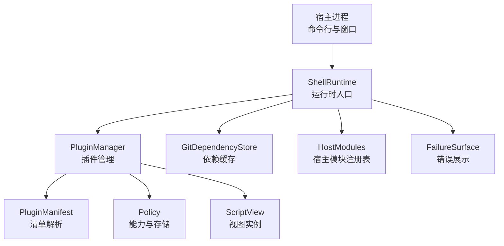
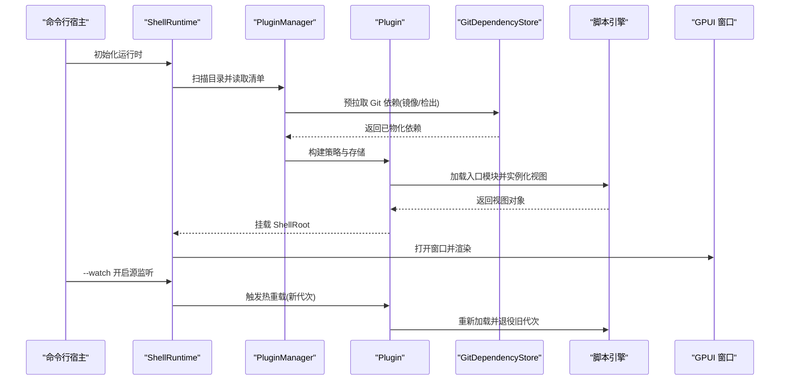
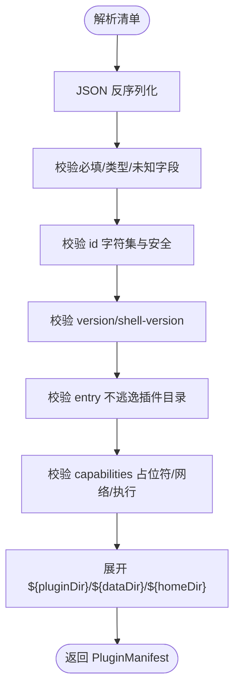
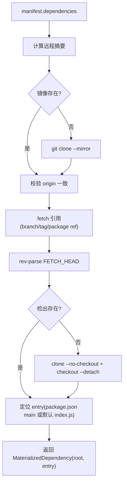
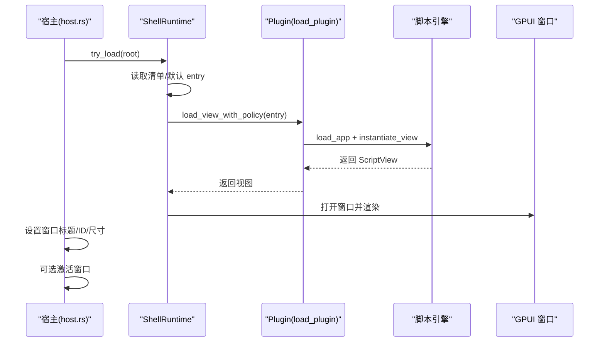
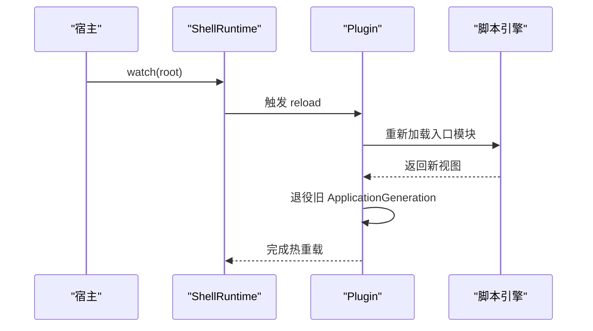
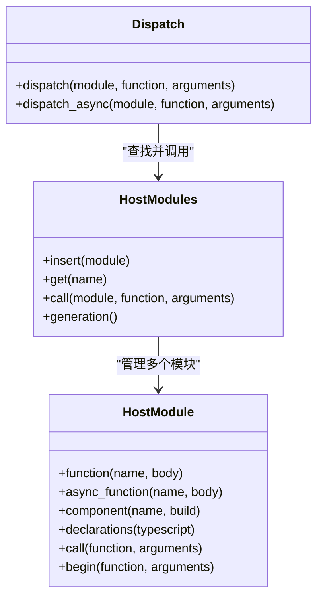
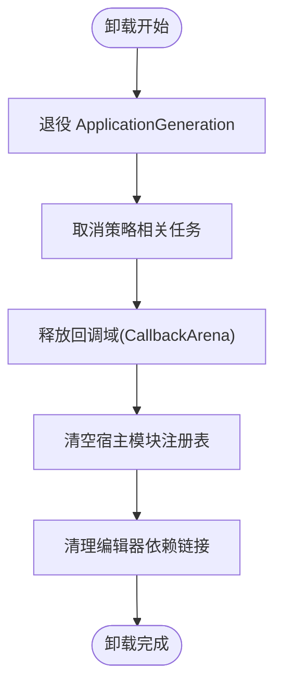
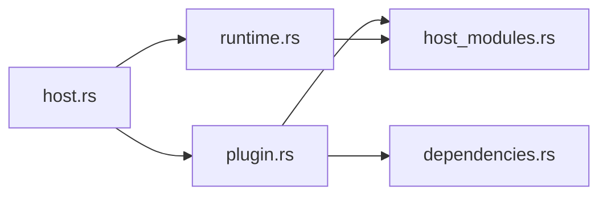

# 插件生命周期管理

<cite>
**本文引用的文件**   
- [plugin.rs](file://crates/shell/src/plugin.rs)
- [runtime.rs](file://crates/shell/src/runtime.rs)
- [host.rs](file://crates/shell/src/host.rs)
- [dependencies.rs](file://crates/shell/src/dependencies.rs)
- [host_modules.rs](file://crates/shell/src/host_modules.rs)
</cite>

## 目录
1. [简介](#简介)
2. [项目结构](#项目结构)
3. [核心组件](#核心组件)
4. [架构总览](#架构总览)
5. [详细组件分析](#详细组件分析)
6. [依赖关系分析](#依赖关系分析)
7. [性能与资源特性](#性能与资源特性)
8. [故障排查指南](#故障排查指南)
9. [结论](#结论)
10. [附录：完整生命周期示例路径](#附录完整生命周期示例路径)

## 简介
本文面向 gpui-shell 的插件（脚本应用）生命周期管理，系统说明从发现、加载、初始化、运行到卸载的全流程，并覆盖依赖解析、版本管理、热重载、状态监控、错误恢复与资源清理等关键主题。文档以仓库中 shell 运行时相关源码为依据，给出架构图、时序图与流程图，帮助读者在不直接阅读代码的情况下理解实现要点。

## 项目结构
shell 运行时围绕“清单解析 → 依赖准备 → 策略授权 → 视图实例化 → 渲染与热重载 → 卸载清理”的主线组织。关键模块职责如下：
- plugin.rs：插件清单解析、能力声明、插件实体与加载器、插件管理器。
- runtime.rs：运行时通用设施（回调域、失败展示、退出处理、应用代次）。
- host.rs：命令行宿主、窗口创建、本地权限注入、开发模式与监听热重载。
- dependencies.rs：Git 依赖镜像、检出、编辑器链接与缓存锁。
- host_modules.rs：宿主模块注册表、调用分发、异步任务边界。

**图示来源**
- [host.rs:734-903](file://crates/shell/src/host.rs#L734-L903)
- [plugin.rs:1570-1600](file://crates/shell/src/plugin.rs#L1570-L1600)
- [dependencies.rs:71-208](file://crates/shell/src/dependencies.rs#L71-L208)
- [host_modules.rs:801-946](file://crates/shell/src/host_modules.rs#L801-L946)
- [runtime.rs:204-442](file://crates/shell/src/runtime.rs#L204-L442)

**章节来源**
- [host.rs:734-903](file://crates/shell/src/host.rs#L734-L903)
- [plugin.rs:1570-1600](file://crates/shell/src/plugin.rs#L1570-L1600)
- [dependencies.rs:71-208](file://crates/shell/src/dependencies.rs#L71-L208)
- [host_modules.rs:801-946](file://crates/shell/src/host_modules.rs#L801-L946)
- [runtime.rs:204-442](file://crates/shell/src/runtime.rs#L204-L442)

## 核心组件
- 插件清单与能力
  - 清单字段包括 id、name、version、shell-version、entry、dependencies、capabilities、window。
  - capabilities 控制文件系统、网络、剪贴板、进程与环境变量访问；默认 storage 为 granted。
  - shell-version 用于在加载前校验运行时兼容性。
- 插件实体与加载
  - Plugin 持有清单、根目录、数据目录、策略、运行时、应用代次与视图。
  - load_plugin 构建策略、创建 localStorage 存储、加载入口模块并实例化视图。
- 插件管理器
  - PluginManager 负责目录扫描、清单编目、加载与卸载；每个插件拥有独立 Policy。
- 运行时与回调域
  - ApplicationGeneration 标记应用代次，支持热重载时退役旧代次。
  - CallbackArena 按快照生成期管理回调，避免泄漏与跨代误用。
- 宿主模块
  - HostModule/HostModules 提供编译期注册的宿主函数与组件，通过 dispatch 分发调用，禁止重入引擎。
- Git 依赖
  - GitDependencyStore 负责镜像克隆、引用解析、不可变检出、编辑器 node_modules 链接与清理。

**章节来源**
- [plugin.rs:74-125](file://crates/shell/src/plugin.rs#L74-L125)
- [plugin.rs:283-459](file://crates/shell/src/plugin.rs#L283-L459)
- [plugin.rs:1302-1405](file://crates/shell/src/plugin.rs#L1302-L1405)
- [plugin.rs:1570-1600](file://crates/shell/src/plugin.rs#L1570-L1600)
- [runtime.rs:204-442](file://crates/shell/src/runtime.rs#L204-L442)
- [host_modules.rs:412-749](file://crates/shell/src/host_modules.rs#L412-L749)
- [dependencies.rs:17-208](file://crates/shell/src/dependencies.rs#L17-L208)

## 架构总览
下图展示宿主启动、插件加载、依赖准备、视图渲染与热重载的整体交互。

**图示来源**
- [host.rs:734-903](file://crates/shell/src/host.rs#L734-L903)
- [plugin.rs:1363-1405](file://crates/shell/src/plugin.rs#L1363-L1405)
- [dependencies.rs:71-208](file://crates/shell/src/dependencies.rs#L71-L208)
- [runtime.rs:204-234](file://crates/shell/src/runtime.rs#L204-L234)

## 详细组件分析

### 插件清单与能力模型
- 清单解析严格校验字段类型、未知字段、id 合法性、版本号、entry 安全路径、capabilities 占位符与网络规则。
- capabilities 将 ${pluginDir}、${dataDir}、${homeDir} 展开为真实路径，未解析或未知占位符会报错。
- window 指定初始窗口尺寸，仅影响首次打开大小。

**图示来源**
- [plugin.rs:311-395](file://crates/shell/src/plugin.rs#L311-L395)
- [plugin.rs:473-532](file://crates/shell/src/plugin.rs#L473-L532)
- [plugin.rs:576-641](file://crates/shell/src/plugin.rs#L576-L641)
- [plugin.rs:875-910](file://crates/shell/src/plugin.rs#L875-L910)
- [plugin.rs:916-1003](file://crates/shell/src/plugin.rs#L916-L1003)
- [plugin.rs:1053-1085](file://crates/shell/src/plugin.rs#L1053-L1085)

**章节来源**
- [plugin.rs:311-395](file://crates/shell/src/plugin.rs#L311-L395)
- [plugin.rs:473-532](file://crates/shell/src/plugin.rs#L473-L532)
- [plugin.rs:576-641](file://crates/shell/src/plugin.rs#L576-L641)
- [plugin.rs:875-910](file://crates/shell/src/plugin.rs#L875-L910)
- [plugin.rs:916-1003](file://crates/shell/src/plugin.rs#L916-L1003)
- [plugin.rs:1053-1085](file://crates/shell/src/plugin.rs#L1053-L1085)

### 依赖解析与版本管理
- Git 依赖支持 GitHub owner/repo 简写或完整 URL，可带 #ref；也支持对象形式指定 branch/tag/entry。
- 依赖缓存位于用户目录下，使用镜像 + 不可变检出，保证多进程并发安全（文件锁）。
- 编辑器侧通过 node_modules 符号链接或 re-export stub 暴露包，便于类型检查与跳转。

**图示来源**
- [dependencies.rs:71-193](file://crates/shell/src/dependencies.rs#L71-L193)
- [dependencies.rs:422-479](file://crates/shell/src/dependencies.rs#L422-L479)

**章节来源**
- [dependencies.rs:71-193](file://crates/shell/src/dependencies.rs#L71-L193)
- [dependencies.rs:232-348](file://crates/shell/src/dependencies.rs#L232-L348)
- [dependencies.rs:422-479](file://crates/shell/src/dependencies.rs#L422-L479)

### 插件加载、初始化与运行
- 单应用加载：ShellRuntime::try_load 读取清单或默认 entry，构造 Policy，加载并实例化视图，挂载 ShellRoot。
- 插件加载：load_plugin 创建数据目录、localStorage 路径、Policy，载入入口模块并实例化视图。
- 运行阶段：宿主创建窗口，设置标题与应用 ID，必要时激活窗口，并在 watch 模式下启用源监听。

**图示来源**
- [plugin.rs:1445-1486](file://crates/shell/src/plugin.rs#L1445-L1486)
- [plugin.rs:1363-1405](file://crates/shell/src/plugin.rs#L1363-L1405)
- [host.rs:801-903](file://crates/shell/src/host.rs#L801-L903)

**章节来源**
- [plugin.rs:1445-1486](file://crates/shell/src/plugin.rs#L1445-L1486)
- [plugin.rs:1363-1405](file://crates/shell/src/plugin.rs#L1363-L1405)
- [host.rs:801-903](file://crates/shell/src/host.rs#L801-L903)

### 热重载机制
- 宿主在 --watch 或 dev 模式下启动 watch_sources，内部委托 ShellRuntime::watch。
- 每次重载创建新的 ApplicationGeneration，旧代次被 retire，确保回调与视图不再响应过期代码。
- 渲染失败或重载失败均通过统一错误表面提示，保留上一帧界面以便继续工作。

**图示来源**
- [host.rs:1239-1266](file://crates/shell/src/host.rs#L1239-L1266)
- [runtime.rs:204-234](file://crates/shell/src/runtime.rs#L204-L234)
- [runtime.rs:683-744](file://crates/shell/src/runtime.rs#L683-L744)

**章节来源**
- [host.rs:1239-1266](file://crates/shell/src/host.rs#L1239-L1266)
- [runtime.rs:204-234](file://crates/shell/src/runtime.rs#L204-L234)
- [runtime.rs:683-744](file://crates/shell/src/runtime.rs#L683-L744)

### 宿主模块与调用边界
- 宿主模块在编译期注册，脚本通过 import 引入；名称空间固定，但函数体可在运行时撤销。
- dispatch/dispatch_async 提供同步/异步调用入口，强制禁止重入脚本引擎，防止嵌套调用导致渲染栈破坏。
- 异步函数主体在后台执行，取消语义遵循“宿主销毁则 Promise 挂起”，不主动抛错。

**图示来源**
- [host_modules.rs:412-749](file://crates/shell/src/host_modules.rs#L412-L749)
- [host_modules.rs:801-946](file://crates/shell/src/host_modules.rs#L801-L946)
- [host_modules.rs:955-990](file://crates/shell/src/host_modules.rs#L955-L990)

**章节来源**
- [host_modules.rs:412-749](file://crates/shell/src/host_modules.rs#L412-L749)
- [host_modules.rs:801-946](file://crates/shell/src/host_modules.rs#L801-L946)
- [host_modules.rs:955-990](file://crates/shell/src/host_modules.rs#L955-L990)

### 插件卸载与资源清理
- Plugin::shutdown 退役应用代次并取消策略相关的异步任务。
- CallbackArena::retire/clear 释放回调与快照关联的句柄，避免内存泄漏。
- HostModules::clear_modules 清空宿主模块注册表，释放闭包持有的 GPUI 实体句柄。
- GitDependencyStore::prune 清理不再声明的编辑器链接，保持 node_modules 整洁。

**图示来源**
- [plugin.rs:1354-1360](file://crates/shell/src/plugin.rs#L1354-L1360)
- [runtime.rs:379-442](file://crates/shell/src/runtime.rs#L379-L442)
- [host_modules.rs:925-938](file://crates/shell/src/host_modules.rs#L925-L938)
- [dependencies.rs:318-348](file://crates/shell/src/dependencies.rs#L318-L348)

**章节来源**
- [plugin.rs:1354-1360](file://crates/shell/src/plugin.rs#L1354-L1360)
- [runtime.rs:379-442](file://crates/shell/src/runtime.rs#L379-L442)
- [host_modules.rs:925-938](file://crates/shell/src/host_modules.rs#L925-L938)
- [dependencies.rs:318-348](file://crates/shell/src/dependencies.rs#L318-L348)

## 依赖关系分析
- 组件耦合
  - host.rs 驱动 ShellRuntime，间接依赖 plugin.rs 的清单与加载逻辑。
  - plugin.rs 依赖 policy、scope、engine、runtime 与 dependencies.rs 的依赖缓存。
  - runtime.rs 提供通用的回调域、失败展示与退出处理，被 plugin 与 host 共用。
  - host_modules.rs 通过 scope/policy 注入模块，供脚本导入。
- 外部依赖
  - Git 工具链（git 命令）、文件系统锁、SHA256 摘要、semver 版本比较。
- 潜在循环
  - 模块间通过 Rc 共享运行时与策略，未见显式循环依赖；回调域与代次隔离避免反向引用。

**图示来源**
- [host.rs:734-903](file://crates/shell/src/host.rs#L734-L903)
- [plugin.rs:1363-1405](file://crates/shell/src/plugin.rs#L1363-L1405)
- [dependencies.rs:71-208](file://crates/shell/src/dependencies.rs#L71-L208)
- [host_modules.rs:801-946](file://crates/shell/src/host_modules.rs#L801-L946)
- [runtime.rs:204-442](file://crates/shell/src/runtime.rs#L204-L442)

**章节来源**
- [host.rs:734-903](file://crates/shell/src/host.rs#L734-L903)
- [plugin.rs:1363-1405](file://crates/shell/src/plugin.rs#L1363-L1405)
- [dependencies.rs:71-208](file://crates/shell/src/dependencies.rs#L71-L208)
- [host_modules.rs:801-946](file://crates/shell/src/host_modules.rs#L801-L946)
- [runtime.rs:204-442](file://crates/shell/src/runtime.rs#L204-L442)

## 性能与资源特性
- 依赖缓存
  - 镜像 + 不可变检出减少重复下载与冲突；文件锁避免并发竞争。
- 回调域
  - 按快照生成期批量提交与退役，避免每帧线性清理；支持 checkpoint/rollback 提高诊断重试效率。
- 错误展示
  - 错误横幅与覆盖层复用主题 token，折叠详情避免遮挡界面；复制堆栈提升排障效率。
- 退出处理
  - process.exit 请求由宿主决定行为，避免单个插件终止整个应用。

[本节为通用指导，不直接分析具体文件]

## 故障排查指南
- 清单错误
  - 常见原因：未知字段、id 非法、version/shell-version 非语义版本、entry 逃逸、capabilities 占位符未展开或无效。
  - 建议：根据错误消息修正字段拼写与值类型，使用 ${pluginDir}/${dataDir}/${homeDir} 占位符。
- 依赖拉取失败
  - 常见原因：Git 超时、origin 不一致、引用无效、package.json main 非法。
  - 建议：检查网络连接与 git 配置，确认分支/标签/引用有效，清理缓存后重试。
- 热重载失败
  - 现象：显示“重载失败”，仍运行上一版本代码。
  - 建议：修复脚本错误后保存，观察错误横幅详情；必要时重启宿主。
- 宿主模块不可用
  - 现象：import 时报“未注册模块”或“未知模块”。
  - 建议：确认宿主是否通过 export_module/add_module 注册了该模块；检查名称是否与保留名冲突。

**章节来源**
- [plugin.rs:1091-1296](file://crates/shell/src/plugin.rs#L1091-L1296)
- [dependencies.rs:503-557](file://crates/shell/src/dependencies.rs#L503-L557)
- [runtime.rs:512-744](file://crates/shell/src/runtime.rs#L512-L744)
- [host_modules.rs:865-894](file://crates/shell/src/host_modules.rs#L865-L894)

## 结论
gpui-shell 的插件生命周期以清单为中心，结合严格的权限模型与依赖缓存，实现了安全的加载与运行。通过 ApplicationGeneration 与 CallbackArena 实现可靠的代次管理与回调清理，配合统一的错误展示与退出处理，保障用户体验与稳定性。宿主模块以编译期注册的方式暴露能力，既保证了类型安全，又避免了运行时越权。整体设计在安全性、可维护性与开发者体验之间取得良好平衡。

[本节为总结性内容，不直接分析具体文件]

## 附录：完整生命周期示例路径
以下路径展示了从创建到销毁的完整生命周期步骤，便于对照源码理解：
- 清单定义与校验
  - [plugin.rs:311-395](file://crates/shell/src/plugin.rs#L311-L395)
  - [plugin.rs:473-532](file://crates/shell/src/plugin.rs#L473-L532)
  - [plugin.rs:576-641](file://crates/shell/src/plugin.rs#L576-L641)
- 依赖准备
  - [dependencies.rs:71-193](file://crates/shell/src/dependencies.rs#L71-L193)
  - [dependencies.rs:232-348](file://crates/shell/src/dependencies.rs#L232-L348)
- 插件加载与视图实例化
  - [plugin.rs:1363-1405](file://crates/shell/src/plugin.rs#L1363-L1405)
  - [plugin.rs:1445-1486](file://crates/shell/src/plugin.rs#L1445-L1486)
- 窗口创建与运行
  - [host.rs:734-903](file://crates/shell/src/host.rs#L734-L903)
- 热重载
  - [host.rs:1239-1266](file://crates/shell/src/host.rs#L1239-L1266)
  - [runtime.rs:204-234](file://crates/shell/src/runtime.rs#L204-L234)
- 卸载与清理
  - [plugin.rs:1354-1360](file://crates/shell/src/plugin.rs#L1354-L1360)
  - [runtime.rs:379-442](file://crates/shell/src/runtime.rs#L379-L442)
  - [host_modules.rs:925-938](file://crates/shell/src/host_modules.rs#L925-L938)
  - [dependencies.rs:318-348](file://crates/shell/src/dependencies.rs#L318-L348)