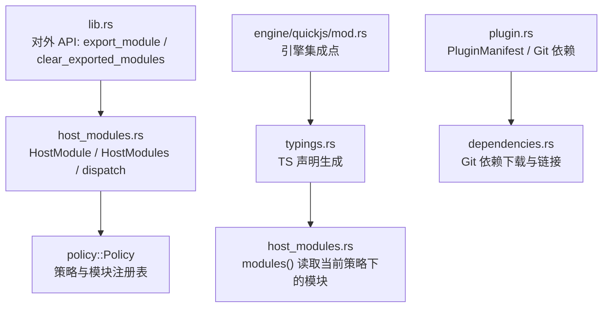
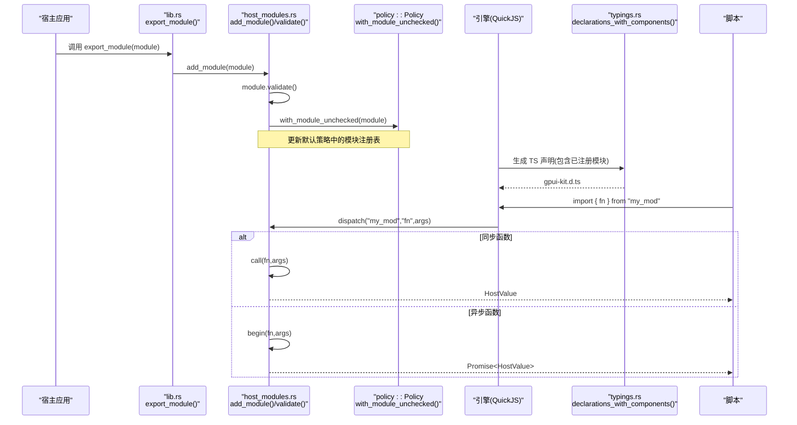
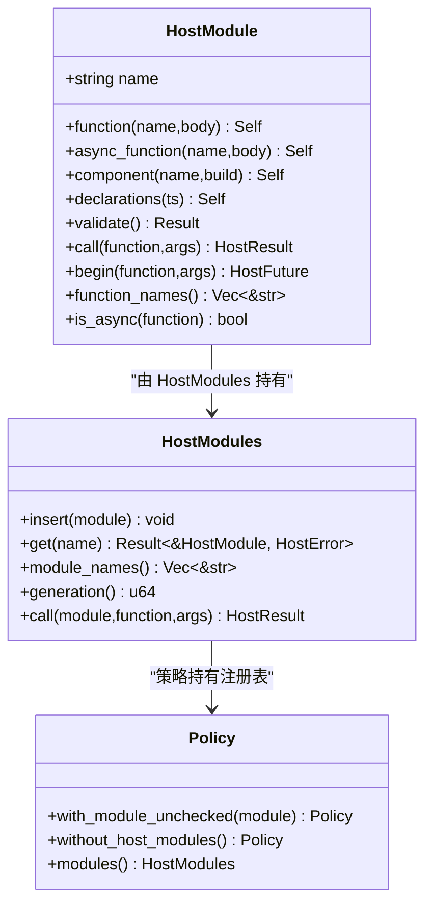
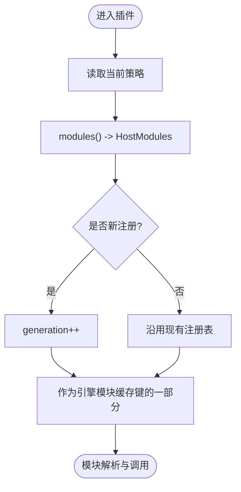
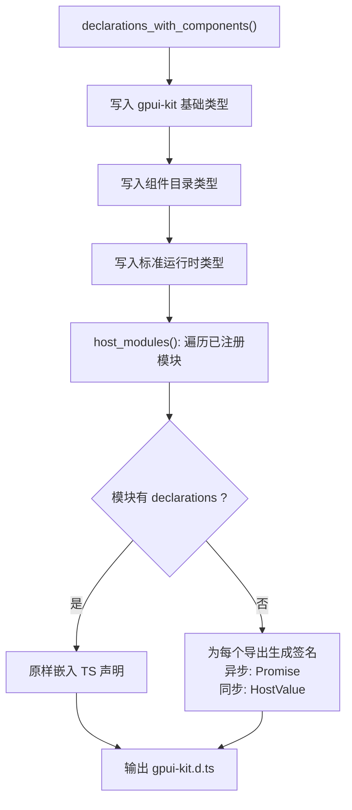
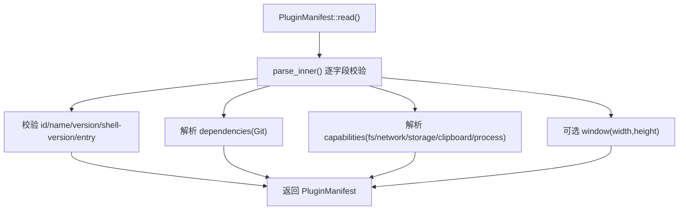
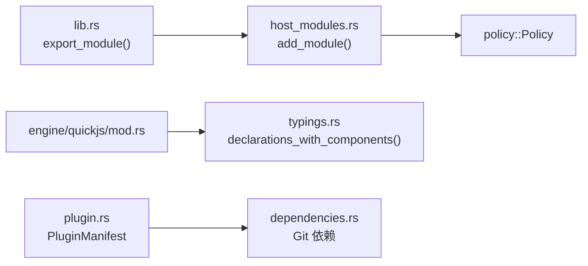

# 插件系统与模块加载

<cite>
**本文引用的文件**   
- [host_modules.rs](file://crates/shell/src/host_modules.rs)
- [lib.rs](file://crates/shell/src/lib.rs)
- [typings.rs](file://crates/shell/src/typings.rs)
- [plugin.rs](file://crates/shell/src/plugin.rs)
</cite>

## 目录
1. [简介](#简介)
2. [项目结构](#项目结构)
3. [核心组件](#核心组件)
4. [架构总览](#架构总览)
5. [详细组件分析](#详细组件分析)
6. [依赖关系分析](#依赖关系分析)
7. [性能与并发特性](#性能与并发特性)
8. [故障排查指南](#故障排查指南)
9. [结论](#结论)
10. [附录：插件开发指南与示例](#附录插件开发指南与示例)

## 简介
本文件系统性梳理 gpui-shell 的插件系统与模块加载机制，重点覆盖以下内容：
- HostModule 的创建、校验与注册流程，以及 export_module() 与 clear_exported_modules() 的使用方式。
- 插件生命周期管理、依赖解析（Git 依赖）、模块隔离机制（按策略与生成号隔离）。
- TypeScript 类型声明生成、模块导入导出语法约定、异步函数调用模式。
- 插件开发指南：如何创建自定义模块、参数验证、实现异步操作、错误处理与调试技巧。
- 从简单同步函数到复杂异步操作的完整示例路径说明。

## 项目结构
围绕插件与模块加载的关键代码集中在 shell crate 中：
- host_modules.rs：HostModule、HostValue、HostArguments、HostError、HostModules、RESERVED_SPECIFIERS、add_module/clear_modules、dispatch/dispatch_async 等核心逻辑。
- lib.rs：对外暴露 export_module()、clear_exported_modules()，以及类型声明写入工具。
- typings.rs：根据运行时状态与已注册模块生成 TypeScript 声明（gpui-kit.d.ts），并包含宿主模块的类型输出。
- plugin.rs：插件清单（PluginManifest）解析、能力（Capabilities）与 Git 依赖解析、窗口尺寸等元数据。

图表来源
- [lib.rs:351-455](file://crates/shell/src/lib.rs#L351-L455)
- [host_modules.rs:411-749](file://crates/shell/src/host_modules.rs#L411-L749)
- [host_modules.rs:800-990](file://crates/shell/src/host_modules.rs#L800-L990)
- [typings.rs:436-512](file://crates/shell/src/typings.rs#L436-L512)
- [plugin.rs:80-460](file://crates/shell/src/plugin.rs#L80-L460)

章节来源
- [lib.rs:351-455](file://crates/shell/src/lib.rs#L351-L455)
- [host_modules.rs:1-105](file://crates/shell/src/host_modules.rs#L1-L105)
- [host_modules.rs:411-749](file://crates/shell/src/host_modules.rs#L411-L749)
- [host_modules.rs:800-990](file://crates/shell/src/host_modules.rs#L800-L990)
- [typings.rs:436-512](file://crates/shell/src/typings.rs#L436-L512)
- [plugin.rs:80-460](file://crates/shell/src/plugin.rs#L80-L460)

## 核心组件
- HostModule：定义一个可被脚本通过 import 引入的模块，包含同步函数、异步函数、组件工厂与 TypeScript 声明片段。
- HostValue / HostObject / HostArguments / HostError：跨主机边界的值、对象、参数与错误模型。
- HostModules：进程内模块注册表，维护模块名到 HostModule 的映射，并提供 generation 用于模块缓存隔离。
- Policy（策略）：将模块注册表与能力授予绑定到当前作用域，决定脚本能访问哪些宿主模块。
- PluginManifest：插件清单，描述 id、name、version、shell-version、entry、dependencies、capabilities、window 等。
- typings.rs：根据运行时与已注册模块生成 TS 声明，确保“注册即类型”。

章节来源
- [host_modules.rs:112-425](file://crates/shell/src/host_modules.rs#L112-L425)
- [host_modules.rs:427-749](file://crates/shell/src/host_modules.rs#L427-L749)
- [host_modules.rs:800-990](file://crates/shell/src/host_modules.rs#L800-L990)
- [plugin.rs:80-460](file://crates/shell/src/plugin.rs#L80-L460)
- [typings.rs:436-512](file://crates/shell/src/typings.rs#L436-L512)

## 架构总览
下图展示从宿主侧注册模块到脚本侧调用的整体流程，包括同步与异步两条路径，以及 TS 声明生成的参与点。

图表来源
- [lib.rs:351-455](file://crates/shell/src/lib.rs#L351-L455)
- [host_modules.rs:912-990](file://crates/shell/src/host_modules.rs#L912-L990)
- [host_modules.rs:649-749](file://crates/shell/src/host_modules.rs#L649-L749)
- [typings.rs:436-512](file://crates/shell/src/typings.rs#L436-L512)

## 详细组件分析

### HostModule 与模块注册
- 构造与导出
  - 使用 HostModule::new(name) 命名模块，随后以 .function/.async_function/.component/.declarations 链式添加导出。
  - validate() 会拒绝保留名称（RESERVED_SPECIFIERS），并检查 TypeScript 声明与注册项的一致性。
- 注册入口
  - 宿主通过 lib.rs 的 export_module(module) 调用 host_modules::add_module(module)，后者执行 validate 并通过 policy::update_default 将模块注入默认策略。
- 撤销与清理
  - clear_exported_modules() 调用 host_modules::clear_modules()，清空默认策略中的宿主模块，使已导入的引用在下次调用时拒绝。

图表来源
- [host_modules.rs:411-749](file://crates/shell/src/host_modules.rs#L411-L749)
- [host_modules.rs:800-990](file://crates/shell/src/host_modules.rs#L800-L990)

章节来源
- [host_modules.rs:411-749](file://crates/shell/src/host_modules.rs#L411-L749)
- [host_modules.rs:800-990](file://crates/shell/src/host_modules.rs#L800-L990)
- [lib.rs:351-455](file://crates/shell/src/lib.rs#L351-L455)

### 模块隔离与作用域
- 每个 HostModules 实例拥有独立的 generation，用于区分不同策略下的模块集合，避免引擎模块缓存共享导致的不同插件之间互相污染。
- modules() 通过当前策略获取模块注册表，从而保证插件只能看到其宿主为其注册的模块。

图表来源
- [host_modules.rs:780-845](file://crates/shell/src/host_modules.rs#L780-L845)
- [host_modules.rs:940-990](file://crates/shell/src/host_modules.rs#L940-L990)

章节来源
- [host_modules.rs:780-845](file://crates/shell/src/host_modules.rs#L780-L845)
- [host_modules.rs:940-990](file://crates/shell/src/host_modules.rs#L940-L990)

### TypeScript 类型声明生成
- 生成入口
  - typings.rs 的 declarations_with_components(components) 生成完整的 gpui-kit.d.ts，包括内置模块、组件目录、标准运行时与宿主模块。
- 宿主模块类型
  - host_modules() 遍历当前策略下的模块，若模块提供了 declarations，则原样嵌入；否则为每个导出生成弱类型签名，但异步导出仍标注 Promise<HostValue>。
- 一致性校验
  - HostModule::validate() 对比 declared 与 function_names/component_names，缺失或多余都会报错，确保“注册即类型”。

图表来源
- [typings.rs:184-367](file://crates/shell/src/typings.rs#L184-L367)
- [typings.rs:436-512](file://crates/shell/src/typings.rs#L436-L512)
- [host_modules.rs:649-749](file://crates/shell/src/host_modules.rs#L649-L749)

章节来源
- [typings.rs:184-367](file://crates/shell/src/typings.rs#L184-L367)
- [typings.rs:436-512](file://crates/shell/src/typings.rs#L436-L512)
- [host_modules.rs:649-749](file://crates/shell/src/host_modules.rs#L649-L749)

### 插件清单与依赖解析
- 清单字段
  - id、name、version、shell-version、entry、dependencies、capabilities、window。
- 依赖解析
  - dependencies 支持 Git 包，支持分支/标签/短格式 GitHub 引用，并在启动前进行解析与校验。
- 能力与权限
  - capabilities 控制文件系统、网络、剪贴板、进程等权限；storage 默认开启，其他默认关闭。
- 兼容性
  - shell-version 指定最低兼容的 gpui-shell 版本，不匹配则在执行 entry 前拒绝。

图表来源
- [plugin.rs:283-460](file://crates/shell/src/plugin.rs#L283-L460)
- [plugin.rs:462-641](file://crates/shell/src/plugin.rs#L462-L641)

章节来源
- [plugin.rs:283-460](file://crates/shell/src/plugin.rs#L283-L460)
- [plugin.rs:462-641](file://crates/shell/src/plugin.rs#L462-L641)

## 依赖关系分析
- 模块注册依赖策略
  - export_module() 最终通过 policy::update_default 将模块注入默认策略，所有模块访问都经过策略层。
- 引擎与类型声明
  - 引擎在加载应用时会触发类型声明生成，以便编辑器获得准确的补全与类型检查。
- 插件清单与依赖
  - 插件清单解析后，依赖会被下载并链接到编辑器可发现的位置，供脚本以裸模块名导入。

图表来源
- [lib.rs:351-455](file://crates/shell/src/lib.rs#L351-L455)
- [host_modules.rs:912-990](file://crates/shell/src/host_modules.rs#L912-L990)
- [typings.rs:184-367](file://crates/shell/src/typings.rs#L184-L367)
- [plugin.rs:283-460](file://crates/shell/src/plugin.rs#L283-L460)

章节来源
- [lib.rs:351-455](file://crates/shell/src/lib.rs#L351-L455)
- [host_modules.rs:912-990](file://crates/shell/src/host_modules.rs#L912-L990)
- [typings.rs:184-367](file://crates/shell/src/typings.rs#L184-L367)
- [plugin.rs:283-460](file://crates/shell/src/plugin.rs#L283-L460)

## 性能与并发特性
- 异步函数拆分
  - async_function 的闭包在主线程运行，负责参数校验与读取宿主状态；返回的 Future 在后台执行器上运行，避免阻塞渲染线程。
- 重入保护
  - dispatch/dispatch_async 通过线程局部标志防止宿主函数再次回调脚本引擎，避免嵌套调用导致的未定义行为。
- 模块缓存隔离
  - 每次插入模块都会递增 generation，作为引擎模块缓存键的一部分，避免不同策略下的模块缓存冲突。

章节来源
- [host_modules.rs:496-569](file://crates/shell/src/host_modules.rs#L496-L569)
- [host_modules.rs:948-990](file://crates/shell/src/host_modules.rs#L948-L990)
- [host_modules.rs:820-845](file://crates/shell/src/host_modules.rs#L820-L845)

## 故障排查指南
- 常见错误与定位
  - 未知模块：当策略下没有注册任何模块时，错误消息会明确提示“宿主未注册任何模块”，并指引使用 export_module。
  - 未知函数：错误消息列出该模块实际提供的函数名，便于快速修正拼写。
  - 参数类型错误：HostArguments 提供 string/number/integer/boolean 等方法，错误消息会指出位置与期望类型。
  - 保留名称冲突：尝试注册 RESERVERD_SPECIFIERS 中的名称会被拒绝，错误消息列出保留名列表。
  - 声明不一致：HostModule::validate() 会报告“已注册但未声明”和“已声明但未注册”的差异。
- 调试建议
  - 在开发阶段启用 development mode，以获得更友好的诊断信息。
  - 使用 write_type_declarations_with_components 强制刷新类型声明，确保编辑器与运行时一致。
  - 对异步函数，注意主线程闭包只做轻量校验与拷贝，耗时逻辑放入 Future。

章节来源
- [host_modules.rs:859-894](file://crates/shell/src/host_modules.rs#L859-L894)
- [host_modules.rs:717-749](file://crates/shell/src/host_modules.rs#L717-L749)
- [host_modules.rs:649-715](file://crates/shell/src/host_modules.rs#L649-L715)
- [lib.rs:271-277](file://crates/shell/src/lib.rs#L271-L277)
- [lib.rs:151-158](file://crates/shell/src/lib.rs#L151-L158)

## 结论
gpui-shell 的插件系统以 HostModule 为核心，通过策略与生成号实现严格的模块隔离；通过 export_module/clear_exported_modules 完成安全的生命周期管理；通过 typings.rs 将运行时能力与 TypeScript 类型声明保持同步；通过 PluginManifest 与 Git 依赖解析提供可扩展的插件生态。设计强调“安全边界”“编译期约束”“运行时最小化权限”，为宿主与脚本之间的扩展面提供了清晰、可控且可演进的机制。

## 附录：插件开发指南与示例

### 创建自定义模块（同步函数）
- 步骤
  - 使用 HostModule::new("your_module") 命名模块。
  - 使用 .function("fn_name", |args| ...) 注册同步函数。
  - 可选：使用 .declarations(...) 提供 TypeScript 声明。
  - 在应用启动时调用 export_module(module)。
- 参考路径
  - [host_modules.rs:479-494](file://crates/shell/src/host_modules.rs#L479-L494)
  - [lib.rs:351-443](file://crates/shell/src/lib.rs#L351-L443)

### 创建自定义模块（异步函数）
- 步骤
  - 使用 .async_function("fn_name", |args| Ok(Box::pin(async move { ... }))) 注册异步函数。
  - 主线程闭包仅做参数校验与必要拷贝；耗时逻辑放在 Future。
  - 在 declarations 中将返回类型声明为 Promise<T>。
- 参考路径
  - [host_modules.rs:496-569](file://crates/shell/src/host_modules.rs#L496-L569)
  - [typings.rs:487-500](file://crates/shell/src/typings.rs#L487-L500)

### 参数验证与错误处理
- 使用 HostArguments 的 string/number/integer/boolean/value 等方法获取参数，错误消息会指明位置与期望类型。
- 业务错误通过 HostError::new(message) 返回，引擎会将其转换为脚本异常。
- 参考路径
  - [host_modules.rs:268-348](file://crates/shell/src/host_modules.rs#L268-L348)
  - [host_modules.rs:350-393](file://crates/shell/src/host_modules.rs#L350-L393)

### 模块导入导出语法
- 脚本侧使用 ES 模块语法：import { fn } from "your_module"。
- 模块名即为 HostModule::new 的名称，由引擎模块解析器直接解析。
- 参考路径
  - [host_modules.rs:26-49](file://crates/shell/src/host_modules.rs#L26-L49)

### 异步函数调用模式
- 脚本侧 await 异步导出的函数，返回值类型为 Promise<HostValue>（若未提供 declarations）。
- 引擎在构建绑定时根据 is_async 决定返回 Promise 还是 HostValue。
- 参考路径
  - [host_modules.rs:633-640](file://crates/shell/src/host_modules.rs#L633-L640)
  - [typings.rs:487-500](file://crates/shell/src/typings.rs#L487-L500)

### 模块生命周期管理
- 注册：export_module(module) 在应用加载前调用。
- 撤销：clear_exported_modules() 立即生效，已导入的函数在下一次调用时被拒绝。
- 参考路径
  - [lib.rs:388-455](file://crates/shell/src/lib.rs#L388-L455)
  - [host_modules.rs:912-938](file://crates/shell/src/host_modules.rs#L912-L938)

### 插件清单与依赖
- 在插件根目录放置 gpui-shell.json，填写 id、name、version、shell-version、entry、dependencies、capabilities、window。
- dependencies 支持 Git 包，会在启动前解析并链接到编辑器可发现的位置。
- 参考路径
  - [plugin.rs:80-460](file://crates/shell/src/plugin.rs#L80-L460)
  - [plugin.rs:462-641](file://crates/shell/src/plugin.rs#L462-L641)

### 调试技巧
- 使用 set_development_mode(true) 打开开发模式，获得更丰富的诊断信息。
- 使用 write_type_declarations_with_components 强制刷新类型声明，确保编辑器与运行时一致。
- 参考路径
  - [lib.rs:271-277](file://crates/shell/src/lib.rs#L271-L277)
  - [lib.rs:151-158](file://crates/shell/src/lib.rs#L151-L158)