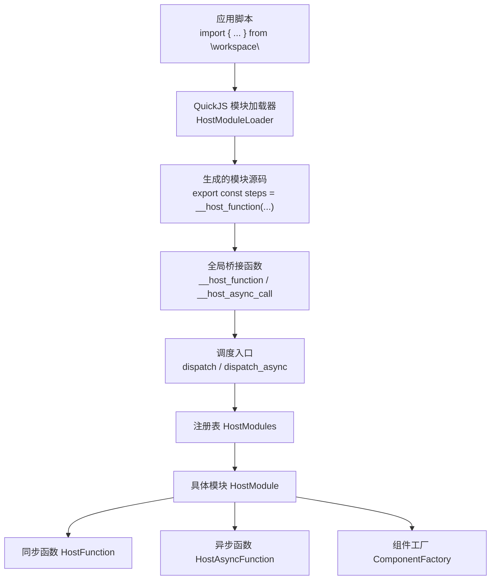
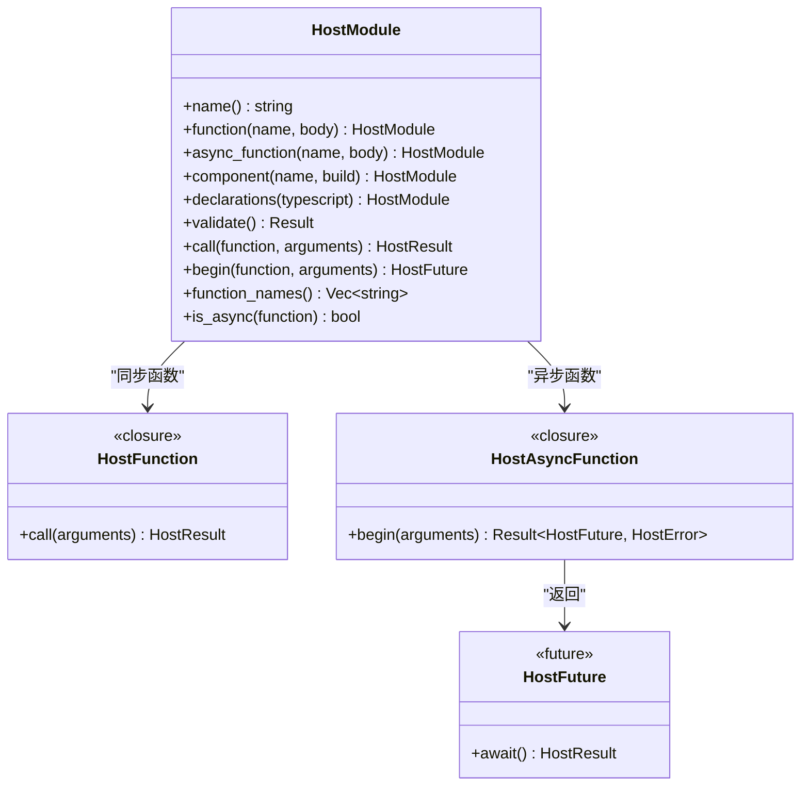
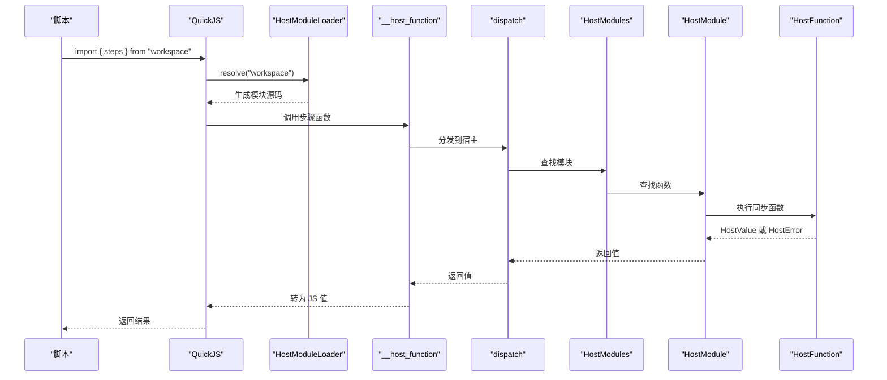
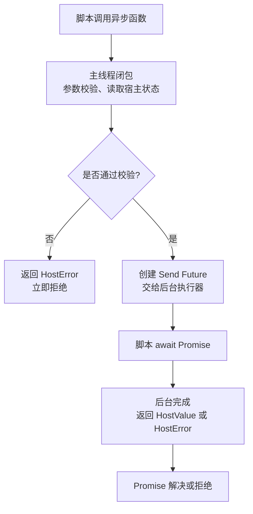
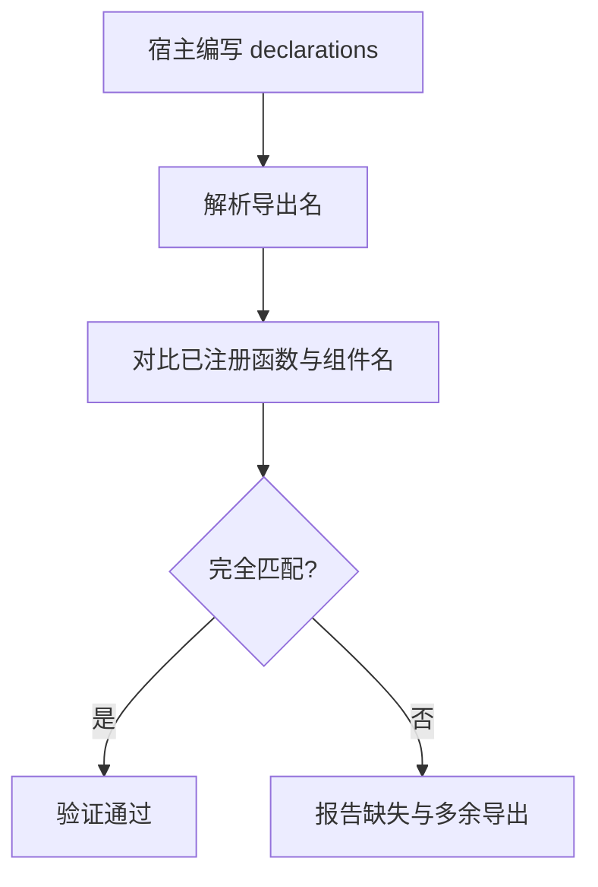
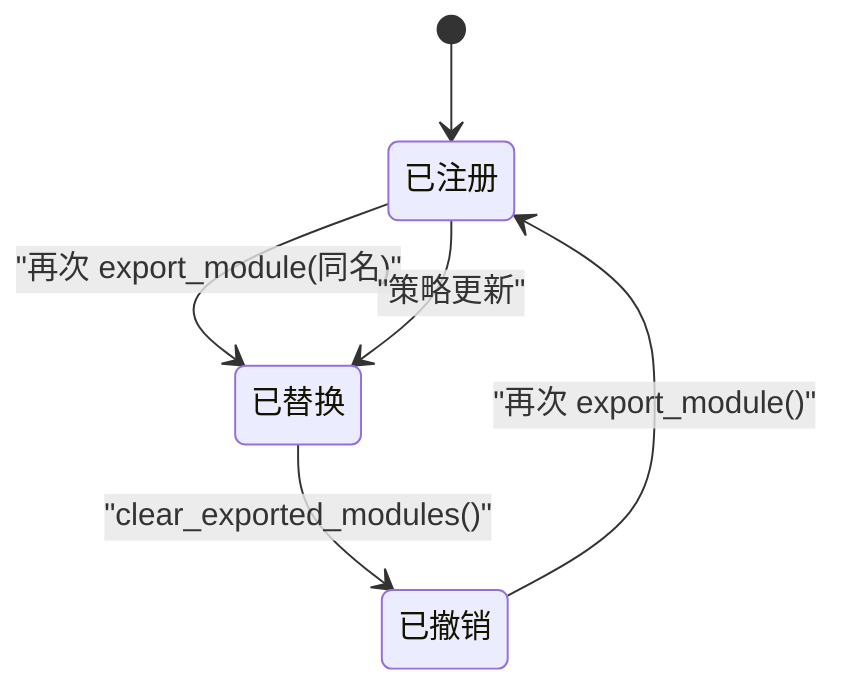
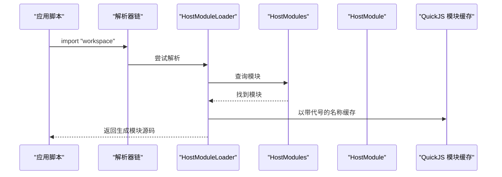
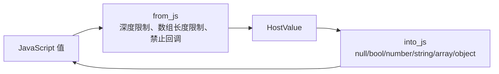

# 模块注册与导出

<cite>
**本文引用的文件**   
- [host_modules.rs](file://crates/shell/src/host_modules.rs)
- [engine/quickjs/host_modules.rs](file://crates/shell/src/engine/quickjs/host_modules.rs)
- [lib.rs](file://crates/shell/src/lib.rs)
- [host.rs](file://crates/shell/src/engine/quickjs/host.rs)
</cite>

## 目录
1. [引言](#引言)
2. [项目结构定位](#项目结构定位)
3. [核心概念与数据模型](#核心概念与数据模型)
4. [HostModule 构建器模式](#hostmodule-构建器模式)
5. [函数注册与调用路径](#函数注册与调用路径)
6. [异步函数支持](#异步函数支持)
7. [TypeScript 声明与类型生成](#typescript-声明与类型生成)
8. [模块命名空间、冲突与动态替换](#模块命名空间冲突与动态替换)
9. [生命周期管理、错误处理与调试](#生命周期管理错误处理与调试)
10. [架构总览图](#架构总览图)
11. [使用示例索引](#使用示例索引)
12. [性能与边界限制](#性能与边界限制)
13. [故障排查清单](#故障排查清单)
14. [结论](#结论)

## 引言
本文聚焦 `gpui-shell` 中“宿主模块”机制：Rust 侧通过 `HostModule` 把函数、组件和 TypeScript 声明暴露给脚本；脚本侧通过普通 `import` 导入，而不是运行时查找。该设计强调三点：
- **编译期可审计的扩展面**：脚本只能访问显式注册的模块和导出名。
- **纯数据边界**：跨语言边界的参数和返回值是 `HostValue`，不传递脚本句柄或回调。
- **安全与可诊断性**：保留名称冲突检查、递归深度限制、数组大小限制、重入保护、以及清晰的错误消息。

## 项目结构定位
模块注册与导出的实现分布在以下位置：
- 引擎无关的核心定义、构建器、注册表、调度入口：`crates/shell/src/host_modules.rs`
- QuickJS 引擎适配层：解析器、加载器、值转换、全局绑定：`crates/shell/src/engine/quickjs/host_modules.rs`
- 对外 API：`export_module`、`clear_exported_modules`：`crates/shell/src/lib.rs`
- 能力与文件系统等宿主 API（展示同一套边界语义）：`crates/shell/src/engine/quickjs/host.rs`

**图表来源**
- [engine/quickjs/host_modules.rs:16-48](file://crates/shell/src/engine/quickjs/host_modules.rs#L16-L48)
- [engine/quickjs/host_modules.rs:189-288](file://crates/shell/src/engine/quickjs/host_modules.rs#L189-L288)
- [host_modules.rs:411-749](file://crates/shell/src/host_modules.rs#L411-L749)
- [host_modules.rs:800-990](file://crates/shell/src/host_modules.rs#L800-L990)

**章节来源**
- [host_modules.rs:1-105](file://crates/shell/src/host_modules.rs#L1-L105)
- [engine/quickjs/host_modules.rs:1-56](file://crates/shell/src/engine/quickjs/host_modules.rs#L1-L56)

## 核心概念与数据模型
### HostValue：跨语言边界值
`HostValue` 是 Rust 与脚本之间唯一允许传递的数据形状，包括空值、布尔、数字、字符串、数组和对象。它的设计目标是与脚本引擎和 JSON 的交集一致，从而让同一份注册表可以服务于不同引擎。

关键行为：
- 提供类型安全的读取方法，例如获取布尔、数字、字符串、数组、对象字段。
- 提供错误友好的描述信息，用于参数校验失败时报告“期望什么、实际得到什么”。
- 支持从常见 Rust 类型直接构造，也支持从 `Option`、`Vec` 等集合构造。

**章节来源**
- [host_modules.rs:112-232](file://crates/shell/src/host_modules.rs#L112-L232)

### HostObject：有序对象构建器
`HostObject` 是一个 builder，按写入顺序维护字段列表。重复键会原地替换旧值，避免意外产生重复键。最终转换为 `HostValue::Object`。

适用场景：
- 返回记录型数据，如配置快照、进度报告、表格行。
- 需要保持宿主写入顺序，以便脚本渲染或序列化结果稳定。

**章节来源**
- [host_modules.rs:234-266](file://crates/shell/src/host_modules.rs#L234-L266)

### HostArguments：参数校验与错误定位
`HostArguments` 保存位置参数，并提供强类型读取方法：
- `value(index)`：返回指定位置的参数，缺失时报错。
- `string(number/integer/boolean)`：带位置信息的类型校验错误。
- `integer`：额外要求数值为整数，适合标识符、计数、索引。

错误消息会明确指出第几个参数出错、期望类型与实际类型，降低宿主函数手写错误文案的成本。

**章节来源**
- [host_modules.rs:268-348](file://crates/shell/src/host_modules.rs#L268-L348)

### HostError 与 HostResult
- `HostError` 只携带人类可读的错误消息；引擎在抛出脚本异常时会补充模块名和函数名。
- `HostResult` 是 `Result<HostValue, HostError>`，统一表示成功返回值或宿主函数拒绝。

**章节来源**
- [host_modules.rs:350-393](file://crates/shell/src/host_modules.rs#L350-L393)

## HostModule 构建器模式
`HostModule` 是宿主模块的不可变构建体。它通过链式方法注册：
- `new(name)`：设置模块名，即脚本 `import` 时的模块标识符。
- `function(name, body)`：注册同步函数。
- `async_function(name, body)`：注册异步函数。
- `component(name, build)`：注册可由脚本使用的原生组件构造器。
- `declarations(typescript)`：声明 TypeScript 接口与导出签名。

**图表来源**
- [host_modules.rs:411-749](file://crates/shell/src/host_modules.rs#L411-L749)

### 构建器互斥规则
- 同名不能同时是同步函数、异步函数或组件。
- 后注册的覆盖先前的同名列，而不是合并。这样能尽早暴露“重复注册同一个模块名”的问题。

**章节来源**
- [host_modules.rs:444-569](file://crates/shell/src/host_modules.rs#L444-L569)

## 函数注册与调用路径
### 同步函数
同步函数在调用线程上执行，适合轻量逻辑：
- 读取宿主状态。
- 校验参数。
- 触发视图重新渲染通知。

注意：同步函数不得回调脚本引擎，否则会触发重入保护。

### 调用流程

**图表来源**
- [engine/quickjs/host_modules.rs:189-288](file://crates/shell/src/engine/quickjs/host_modules.rs#L189-L288)
- [engine/quickjs/host_modules.rs:299-343](file://crates/shell/src/engine/quickjs/host_modules.rs#L299-L343)
- [host_modules.rs:948-966](file://crates/shell/src/host_modules.rs#L948-L966)
- [host_modules.rs:884-893](file://crates/shell/src/host_modules.rs#L884-L893)

**章节来源**
- [host_modules.rs:479-494](file://crates/shell/src/host_modules.rs#L479-L494)
- [host_modules.rs:717-749](file://crates/shell/src/host_modules.rs#L717-L749)
- [host_modules.rs:884-893](file://crates/shell/src/host_modules.rs#L884-L893)
- [host_modules.rs:948-966](file://crates/shell/src/host_modules.rs#L948-L966)

## 异步函数支持
异步函数将工作交给后台执行器，避免阻塞渲染线程。其设计采用“两阶段”：
1. **主线程阶段**：闭包接收参数并做快速校验，必要时读取宿主状态。
2. **后台阶段**：返回一个 `Send + 'static` future，由后台执行器驱动。

**图表来源**
- [host_modules.rs:496-569](file://crates/shell/src/host_modules.rs#L496-L569)
- [engine/quickjs/host_modules.rs:139-158](file://crates/shell/src/engine/quickjs/host_modules.rs#L139-L158)
- [host_modules.rs:968-990](file://crates/shell/src/host_modules.rs#L968-L990)

### 取消语义
如果持有调用的视图消失或应用重载，Promise 可能永远挂起，不会主动报错。这与 `cx.sleep` 的行为一致：被取消的等待不需要错误，而是“不再继续”。

**章节来源**
- [host_modules.rs:534-546](file://crates/shell/src/host_modules.rs#L534-L546)
- [engine/quickjs/host_modules.rs:139-158](file://crates/shell/src/engine/quickjs/host_modules.rs#L139-L158)

## TypeScript 声明与类型生成
### 为什么声明要放在模块里
- 声明与实现放在一起，避免 `.d.ts` 成为第二个语言、第二个文件、第二个真相源。
- `HostModule::declarations` 会在启动时校验：已注册的导出必须全部声明，已声明的导出必须全部注册。
- 未声明的模块仍会被生成，但签名退化为任意参数、任意返回类型，仅保留模块名和导出名检查。

### 声明语法
声明内容是一个 `declare module` 的主体片段，可以包含接口、类型别名和导出函数。系统只识别行首的 `export function`、`export declare function`、`export const`，其他内容不会被误认为导出。

**图表来源**
- [host_modules.rs:571-601](file://crates/shell/src/host_modules.rs#L571-L601)
- [host_modules.rs:662-715](file://crates/shell/src/host_modules.rs#L662-L715)

**章节来源**
- [host_modules.rs:571-601](file://crates/shell/src/host_modules.rs#L571-L601)
- [host_modules.rs:662-715](file://crates/shell/src/host_modules.rs#L662-L715)
- [lib.rs:406-414](file://crates/shell/src/lib.rs#L406-L414)

## 模块命名空间、冲突与动态替换
### 命名空间
- 模块名即脚本中的模块标识符。
- 默认注册表为空，因此默认没有任何扩展能力。
- 模块名与内置模块、标准运行时共享命名空间，但解析顺序保证内置优先。

### 保留名称
`RESERVED_SPECIFIERS` 列出宿主不能注册的名称，例如 `gpui-kit`、`path`、`console`、`fs/promises` 等。尝试注册这些名称会在注册阶段失败，而不是静默失效。

### 冲突处理
- 同一模块名多次注册：后者替换前者，而不是合并。
- 同一导出名不能既是同步函数、异步函数又是组件。
- 导出名必须是合法的 JavaScript 标识符，否则生成模块源码时会报错。

### 动态替换
每个导出都是转发桩：每次调用都通过注册表查找当前模块。因此：
- 替换模块后，已导入的函数在下一次调用时生效。
- 撤销模块后，已导入的函数在下一次调用时被拒绝。
- 模块名在链接时固定，但函数实现可在运行时变化。

**图表来源**
- [host_modules.rs:834-845](file://crates/shell/src/host_modules.rs#L834-L845)
- [host_modules.rs:919-938](file://crates/shell/src/host_modules.rs#L919-L938)
- [lib.rs:388-404](file://crates/shell/src/lib.rs#L388-L404)

**章节来源**
- [host_modules.rs:751-778](file://crates/shell/src/host_modules.rs#L751-L778)
- [host_modules.rs:834-845](file://crates/shell/src/host_modules.rs#L834-L845)
- [host_modules.rs:919-938](file://crates/shell/src/host_modules.rs#L919-L938)
- [engine/quickjs/host_modules.rs:189-288](file://crates/shell/src/engine/quickjs/host_modules.rs#L189-L288)
- [lib.rs:388-404](file://crates/shell/src/lib.rs#L388-L404)

## 生命周期管理、错误处理与调试
### 生命周期
- **注册前**：必须在加载应用之前调用 `export_module`，因为模块导入发生在模块图链接阶段。
- **运行中**：导出是转发桩，替换或撤销会立即影响下一次调用。
- **清理**：宿主销毁前应调用 `clear_exported_modules`，释放捕获 GPUI 实体句柄的闭包，避免泄漏。

### 错误分类
| 错误类型 | 典型原因 | 诊断重点 |
|---|---|---|
| 未知模块 | 未注册、拼写错误、未安装扩展面 | 查看已注册模块列表或提示“宿主未注册任何模块” |
| 未知函数 | 模块存在但导出名不存在 | 查看模块提供的函数列表 |
| 参数类型错误 | 传入类型与期望不符 | 查看参数位置和实际类型 |
| 重入错误 | 宿主函数内部再次调用脚本或另一个宿主函数 | 避免在宿主函数中回调引擎 |
| 保留名称错误 | 尝试注册 `path`、`console` 等保留名 | 更换模块名 |
| 声明不一致 | 已注册但未声明，或已声明但未注册 | 修正 declarations 或注册名 |
| 标识符非法 | 导出名不是合法 JS 标识符 | 改为字母、下划线、美元符号开头及后续字符 |

### 调试建议
- 使用 `check` 命令加载应用并构建描述，有助于发现注册、声明、组件材质化阶段的错误。
- 使用日志级别控制输出：开发模式更详细，生产模式更简洁。
- 关注错误消息中的模块名、函数名、可用导出列表，这些是定位问题的关键线索。

**章节来源**
- [lib.rs:388-430](file://crates/shell/src/lib.rs#L388-L430)
- [host_modules.rs:919-938](file://crates/shell/src/host_modules.rs#L919-L938)
- [host_modules.rs:948-1007](file://crates/shell/src/host_modules.rs#L948-L1007)
- [host.rs:1-34](file://crates/shell/src/engine/quickjs/host.rs#L1-L34)

## 架构总览图
### 模块解析与加载

**图表来源**
- [engine/quickjs/host_modules.rs:189-288](file://crates/shell/src/engine/quickjs/host_modules.rs#L189-L288)
- [host_modules.rs:800-893](file://crates/shell/src/host_modules.rs#L800-L893)

### 值转换边界

**图表来源**
- [engine/quickjs/host_modules.rs:345-442](file://crates/shell/src/engine/quickjs/host_modules.rs#L345-L442)

**章节来源**
- [engine/quickjs/host_modules.rs:16-56](file://crates/shell/src/engine/quickjs/host_modules.rs#L16-L56)
- [engine/quickjs/host_modules.rs:345-442](file://crates/shell/src/engine/quickjs/host_modules.rs#L345-L442)

## 使用示例索引
以下示例不直接粘贴代码，而是给出实现位置和使用方式说明：

### 同步函数示例
- 注册无参函数：参考测试中 `project_name` 的注册方式。
- 注册多参函数：参考测试中 `open_count` 使用 `arguments.len()`。
- 注册回显函数：参考测试中 `echo` 返回第一个参数。
- 注册返回错误的函数：参考测试中 `close` 使用 `HostError`。

**章节来源**
- [host_modules.rs:1013-1028](file://crates/shell/src/host_modules.rs#L1013-L1028)

### 异步函数示例
- 注册数据库查询类异步函数：参考文档注释中 `db.query` 的示例。
- 主线程校验参数，后台执行耗时任务：参考 `async_function` 文档注释。

**章节来源**
- [host_modules.rs:502-517](file://crates/shell/src/host_modules.rs#L502-L517)

### 带参数的函数示例
- 字符串参数：使用 `arguments.string(index)`。
- 数字参数：使用 `arguments.number(index)`。
- 整数参数：使用 `arguments.integer(index)`。
- 布尔参数：使用 `arguments.boolean(index)`。
- 复杂对象：使用 `HostObject` 构建返回对象，或使用 `HostValue::Object`。

**章节来源**
- [host_modules.rs:308-340](file://crates/shell/src/host_modules.rs#L308-L340)
- [host_modules.rs:234-266](file://crates/shell/src/host_modules.rs#L234-L266)

### TypeScript 声明示例
- 声明接口与导出函数：参考 `market` 模块的 declarations 示例。
- 声明与注册不一致时报错：参考测试中 `declared but not registered` 与 `registered but not declared`。

**章节来源**
- [host_modules.rs:576-586](file://crates/shell/src/host_modules.rs#L576-L586)
- [host_modules.rs:1217-1254](file://crates/shell/src/host_modules.rs#L1217-L1254)

## 性能与边界限制
### 嵌套深度
- 最大嵌套深度为 16 层，防止深层结构导致栈溢出。
- 超过限制时返回类型错误，便于脚本侧调整数据结构。

### 数组大小
- 跨边界数组项上限为 10,000，防止稀疏大数组造成内存压力。
- 数组长度必须是非负有限整数。

### 文件操作限制
- 读文件上限约 64MB。
- 写文件上限约 8MB。
- 目录列举条目上限约 10,000，文件名字节总量也有上限。

### 重入保护
- 宿主函数内不得再次进入脚本引擎。
- 通过线程局部标志位检测重入，并在检测到嵌套调用时返回明确错误。

**章节来源**
- [engine/quickjs/host_modules.rs:75-88](file://crates/shell/src/engine/quickjs/host_modules.rs#L75-L88)
- [engine/quickjs/host_modules.rs:354-410](file://crates/shell/src/engine/quickjs/host_modules.rs#L354-L410)
- [engine/quickjs/host.rs:580-589](file://crates/shell/src/engine/quickjs/host.rs#L580-L589)
- [host_modules.rs:948-1007](file://crates/shell/src/host_modules.rs#L948-L1007)

## 故障排查清单
| 现象 | 可能原因 | 排查步骤 |
|---|---|---|
| 脚本导入模块失败 | 模块未注册、名称拼写错误、模块名属于保留名称 | 检查 `export_module` 调用、模块名、`RESERVED_SPECIFIERS` |
| 函数调用报“没有该函数” | 导出名不存在、同步/异步/组件混用 | 检查 `function_names`、声明与实现一致性 |
| 参数类型错误 | 传入类型不符合期望 | 检查 `string/number/integer/boolean` 调用位置 |
| 宿主函数报“不得回调脚本引擎” | 宿主函数内部再次调用引擎或另一个宿主函数 | 移除重入调用，改用事件或状态更新 |
| 声明不一致 | declarations 与注册名不一致 | 修正 declarations 或注册名 |
| 导出名非法 | 导出名不是合法 JS 标识符 | 改为合法标识符 |
| 应用启动后行为异常 | 模块被替换或撤销 | 检查 `export_module` 与 `clear_exported_modules` 调用时机 |

**章节来源**
- [host_modules.rs:859-893](file://crates/shell/src/host_modules.rs#L859-L893)
- [host_modules.rs:948-1007](file://crates/shell/src/host_modules.rs#L948-L1007)
- [engine/quickjs/host_modules.rs:244-288](file://crates/shell/src/engine/quickjs/host_modules.rs#L244-L288)

## 结论
`HostModule` 机制通过构建器模式、纯数据边界、严格命名空间和声明校验，为脚本提供了安全、可审计、可调试的宿主扩展能力。同步函数适合轻量逻辑，异步函数适合耗时任务；模块名在链接时固定，但函数实现可在运行时替换；声明与实现不一致会在启动阶段被发现。正确使用 `export_module` 与 `clear_exported_modules`，配合错误消息和调试工具，能够稳定地构建跨语言宿主 API。