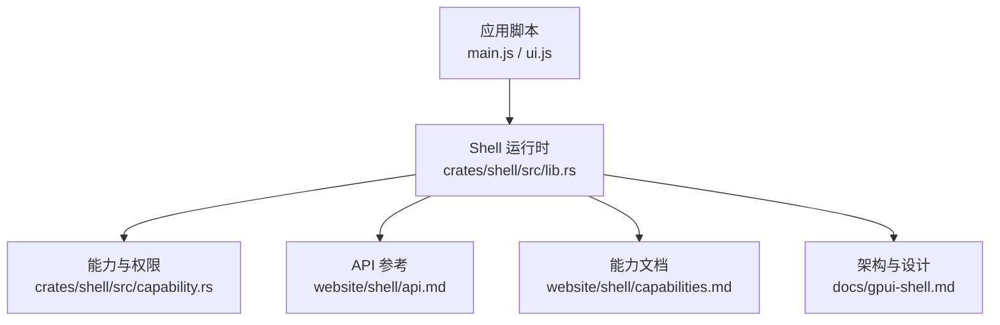
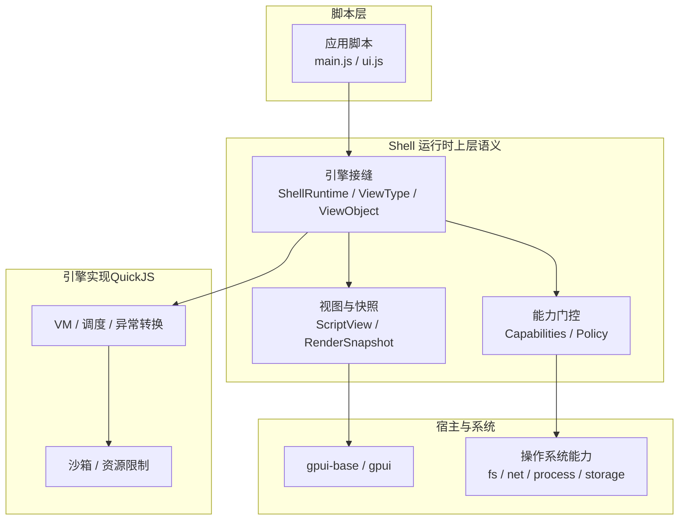
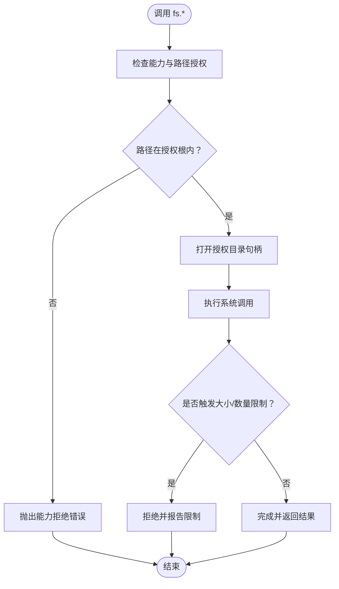
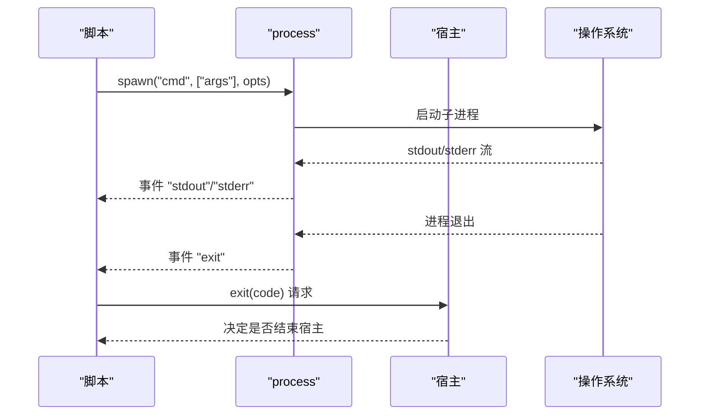
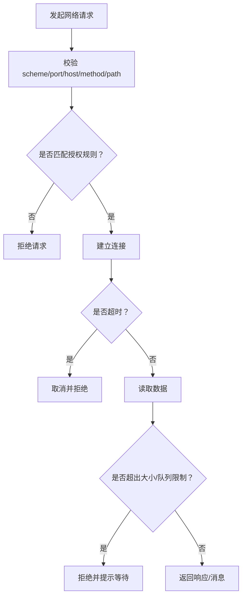
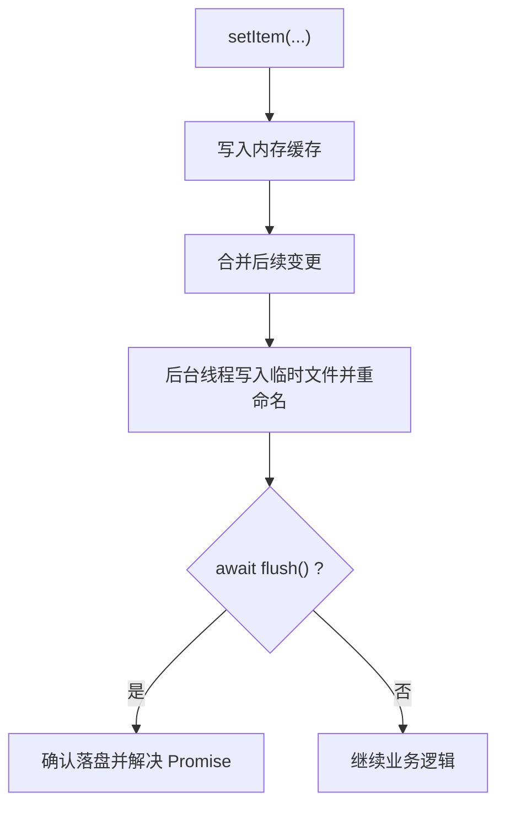
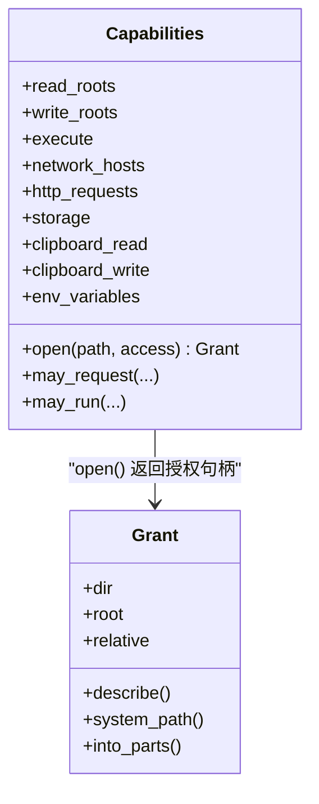

# 系统级 API

<cite>
**本文引用的文件**   
- [crates/shell/src/lib.rs](file://crates/shell/src/lib.rs)
- [website/shell/api.md](file://website/shell/api.md)
- [website/shell/capabilities.md](file://website/shell/capabilities.md)
- [docs/gpui-shell.md](file://docs/gpui-shell.md)
- [crates/shell/src/capability.rs](file://crates/shell/src/capability.rs)
</cite>

## 目录
1. [引言](#引言)
2. [项目结构](#项目结构)
3. [核心组件](#核心组件)
4. [架构总览](#架构总览)
5. [详细组件分析](#详细组件分析)
6. [依赖关系分析](#依赖关系分析)
7. [性能与资源限制](#性能与资源限制)
8. [故障排查指南](#故障排查指南)
9. [结论](#结论)
10. [附录：API 速查表](#附录api-速查表)

## 引言
本文件面向需要在 GPUI Shell 中调用系统级能力的 JavaScript 开发者，系统化说明文件系统、进程管理、网络请求、存储访问等底层功能的绑定接口。文档覆盖参数与返回值约定、错误处理机制、异步与流式模型、批量优化建议、安全能力门控、平台差异以及常见使用场景示例路径。

GPUI Shell 是一个基于 gpui-base 的可脚本化运行时：宿主负责渲染、布局、文本输入、叠加层和系统能力；脚本负责界面组合、样式和业务逻辑。JavaScript 默认运行在 QuickJS 上，并通过“能力门控”暴露受控的系统 API。

**章节来源**
- [docs/gpui-shell.md:10-57](file://docs/gpui-shell.md#L10-L57)
- [docs/gpui-shell.md:327-374](file://docs/gpui-shell.md#L327-L374)

## 项目结构
Shell 的公开入口集中在 `crates/shell/src/lib.rs`，对外提供初始化、能力配置、模块导出、类型声明生成等能力；脚本侧 API 参考由 `website/shell/api.md` 维护；能力与安全策略由 `website/shell/capabilities.md` 与 `crates/shell/src/capability.rs` 共同定义。

**图表来源**
- [crates/shell/src/lib.rs:18-54](file://crates/shell/src/lib.rs#L18-L54)
- [website/shell/api.md:14-34](file://website/shell/api.md#L14-L34)
- [website/shell/capabilities.md:8-14](file://website/shell/capabilities.md#L8-L14)
- [docs/gpui-shell.md:376-406](file://docs/gpui-shell.md#L376-L406)

**章节来源**
- [crates/shell/src/lib.rs:18-54](file://crates/shell/src/lib.rs#L18-L54)
- [website/shell/api.md:14-34](file://website/shell/api.md#L14-L34)
- [website/shell/capabilities.md:8-14](file://website/shell/capabilities.md#L8-L14)
- [docs/gpui-shell.md:376-406](file://docs/gpui-shell.md#L376-L406)

## 核心组件
- 运行时初始化与扩展点
  - `init(cx)`：初始化基础层与样式反射表，必须在任何脚本运行前调用一次。
  - `set_capabilities(capabilities)`：为即将运行的应用授予能力；未显式授权则默认拒绝一切敏感操作。
  - `export_module(module)`：将 Rust 模块以命名模块形式暴露给脚本导入；支持同步/异步函数、TypeScript 声明校验。
  - `clear_exported_modules()`：撤回已导出的模块，立即生效。
- 应用数据与存储定位
  - `set_bundle_id(id)`：设置应用标识并放置持久化数据目录；同时设置 `localStorage` 的文件位置。
  - `bundle_id_for_path(root)`：为无名称的应用目录生成稳定标识。
  - `set_storage_path(path)`：将 `localStorage` 指向指定文件（测试或自定义宿主场景）。
- 类型声明与依赖工具
  - `type_declarations(...)` / `write_type_declarations_with_components(...)`：生成 `gpui-kit.d.ts`。
  - `write_dependency_links(root)`：根据清单链接 Git 依赖到编辑器可发现的位置。

这些是宿主侧控制脚本能力与生命周期的关键入口；脚本侧通过 `gpui-kit`、`gpui-base`、标准模块（如 `fs/promises`、`process`）与全局对象（`window`、`cx`）进行交互。

**章节来源**
- [crates/shell/src/lib.rs:145-186](file://crates/shell/src/lib.rs#L145-L186)
- [crates/shell/src/lib.rs:188-277](file://crates/shell/src/lib.rs#L188-L277)
- [crates/shell/src/lib.rs:279-301](file://crates/shell/src/lib.rs#L279-L301)
- [crates/shell/src/lib.rs:351-455](file://crates/shell/src/lib.rs#L351-L455)

## 架构总览
Shell 将“引擎实现”与“上层语义”解耦：上层负责元素描述、样式、主题、能力、上下文安全；下层封装 QuickJS VM、调度、异常转换、沙箱等。脚本渲染产物不会进入布局与绘制路径，避免把脚本成本放在帧预算内。

**图表来源**
- [docs/gpui-shell.md:214-241](file://docs/gpui-shell.md#L214-L241)
- [docs/gpui-shell.md:376-406](file://docs/gpui-shell.md#L376-L406)
- [docs/gpui-shell.md:590-743](file://docs/gpui-shell.md#L590-L743)

**章节来源**
- [docs/gpui-shell.md:214-241](file://docs/gpui-shell.md#L214-L241)
- [docs/gpui-shell.md:376-406](file://docs/gpui-shell.md#L376-L406)
- [docs/gpui-shell.md:590-743](file://docs/gpui-shell.md#L590-L743)

## 详细组件分析

### 文件系统 API（`fs/promises`）
- 模块入口：`import * as fs from "fs/promises"`
- 返回模型：所有方法返回 Promise；拒绝或抛出取决于是否发生能力拒绝。
- 主要方法与行为
  - `readFile(path)` / `readFile(path, "utf8")`：二进制或 UTF-8 文本；超过 64 MiB 拒绝。
  - `writeFile(path, contents)`：单次写入上限 8 MiB。
  - `readdir(path)` / `readdir(path, { withFileTypes: true })`：按名称排序；最多 10,000 项或 1 MiB 名称字节。
  - `exists(path)` / `unlink(path)` / `rmdir(path)` / `mkdir(path, options?)` / `stat(path)` / `lstat(path)` / `rename(from, to)` / `readlink(path)`。
- 路径解析与能力
  - 相对路径解析到已授权的根；绝对路径必须已在授权根内。
  - 使用 `cap-std` 打开目录句柄，避免“先检查再使用”的竞态；符号链接最终目标仍须落在授权根内。
  - 拒绝时抛出明确错误信息，而不是返回 `false`，防止脚本探测外部路径。
- 典型用法
  - 读取配置文件、列出目录、创建子目录、重命名文件、读取软链接目标。

**图表来源**
- [website/shell/capabilities.md:129-186](file://website/shell/capabilities.md#L129-L186)
- [crates/shell/src/capability.rs:376-510](file://crates/shell/src/capability.rs#L376-L510)

**章节来源**
- [website/shell/capabilities.md:129-186](file://website/shell/capabilities.md#L129-L186)
- [crates/shell/src/capability.rs:376-510](file://crates/shell/src/capability.rs#L376-L510)

### 进程管理 API（`process`）
- 模块入口：`import process from "process"`，也可作为裸全局使用。
- 两种模式
  - 一次性执行：`process.run(command, args, options?)`
    - 返回 Promise，捕获 stdout/stderr，不继承输出。
    - 默认超时 30 秒，stdout/stderr 各 8 MiB；超限终止子进程并拒绝 Promise。
    - 可选 `cwd`（需在 `fs/read` 授权内）与 `timeoutMs`。
  - 流式执行：`process.spawn(command, args, options?)`
    - 立即返回 `ChildProcess`，支持事件：`stdout`、`stderr`、`exit`。
    - 支持 `lines: true` 逐行输出；单行最大 8 MiB。
    - 支持 `stdin: "pipe"` 后调用 `write(text)` 与 `end()`。
    - `kill()` 杀死整个进程组；Windows 使用 Job Object。
    - 子进程属于创建它的 View；释放 View、重载应用或关闭窗口会清理子进程。
- 执行授权
  - 三种模式：拒绝、允许名单、完全放开；被拒命令在调用处直接抛出。
- 退出请求
  - `process.exit(code)` 是请求而非直接退出进程；宿主安装处理器决定动作。
  - 若未安装处理器且授权了 `process.exit`，调用失败并提示缺失处理器。
- 环境变量
  - `process.env` 仅暴露白名单变量；额外变量需 `capabilities.process.env` 授权。

**图表来源**
- [website/shell/capabilities.md:315-362](file://website/shell/capabilities.md#L315-L362)

**章节来源**
- [website/shell/capabilities.md:315-362](file://website/shell/capabilities.md#L315-L362)

### 网络请求 API（`fetch`、`net`、WebSocket）
- 全局 `fetch(url, options?)`
  - 返回 `{ status, ok, url, text(), json(), arrayBuffer(), bytes() }`。
  - 每个请求与重定向都必须匹配清单中的 HTTP 主机、方法与路径前缀；HTTPS 不会降级为 HTTP。
  - 默认发送 `User-Agent: gpui-shell/<version>`，除非脚本自行设置。
- TCP 连接：`net.connect(host, port)`
  - 使用 `capabilities.network.hosts` 授权；30 秒 I/O 超时；每次读写 1 MiB 限制。
- WebSocket：`websocket.WebSocket.connect(url, { headers? })`
  - 非浏览器全局，也不是构造函数；支持文本与二进制消息。
  - 不支持重定向；握手与写操作 30 秒超时；每 socket 只允许一个待处理的 `read()`。
  - 拒绝凭据与握手控制头；8 条命令队列共享 `read`/`write`/`close`。
- DNS 解析
  - 进程级服务，两个解析器工作线程，64 请求队列；饱和时表现为超时而非无限增长。

**图表来源**
- [website/shell/capabilities.md:416-424](file://website/shell/capabilities.md#L416-L424)

**章节来源**
- [website/shell/capabilities.md:416-424](file://website/shell/capabilities.md#L416-L424)

### 存储访问 API（`localStorage`、`sessionStorage`）
- Web Storage API 兼容：`length`、`key(index)`、`getItem(key)`、`setItem(key, value)`、`removeItem(key)`、`clear()`。
- 新增 `flush()`：等待写入落盘；用于需要确认持久化的场景。
- 行为差异
  - `localStorage`：能力门控；跨进程重启保留；值字符串化；缓存内存读；后台合并写入。
  - `sessionStorage`：内存存储，无需能力；随进程销毁。
- 容量限制
  - 单个存储文件序列化不超过 8 MiB；最多 4,096 个键；单个值不超过 1 MiB。
  - 最多 1,024 个并发 `flush()` 等待；超量拒绝。
- 存储位置
  - Linux/Unix：`$XDG_DATA_HOME/gpui-shell/apps/<id>/store.json`
  - macOS：`~/Library/Application Support/gpui-shell/apps/<id>/store.json`
  - Windows：`%APPDATA%\gpui-shell\apps\<id>\store.json`

**图表来源**
- [website/shell/capabilities.md:188-255](file://website/shell/capabilities.md#L188-L255)

**章节来源**
- [website/shell/capabilities.md:188-255](file://website/shell/capabilities.md#L188-L255)

### 剪贴板与控制台
- 剪贴板：`cx.read_from_clipboard()` / `cx.write_to_clipboard(text)`
  - 读写分别授权；没有宿主调用上下文时报错。
- 控制台：`console.log/info/warn/error/debug`
  - 无需能力；结构化值 JSON 打印；输出经 tracing 目标 `gpui_kit::shell::script`。

**章节来源**
- [website/shell/capabilities.md:279-314](file://website/shell/capabilities.md#L279-L314)

### 宿主模块扩展（HostModule）
- 宿主通过 `export_module(HostModule)` 注册命名模块，脚本以普通模块方式导入。
- 支持同步函数与异步函数；异步函数返回 Promise，在 GPUI 后台执行器运行。
- 可通过 TypeScript 声明校验导出名与签名；重复注册同名模块会替换而非合并。
- 生命周期：应在加载应用前注册；宿主销毁时应调用 `clear_exported_modules()`。

**章节来源**
- [crates/shell/src/lib.rs:351-455](file://crates/shell/src/lib.rs#L351-L455)

## 依赖关系分析
Shell 对脚本暴露的能力边界由 `Capabilities` 与清单共同决定；文件系统路径解析由 `capability.rs` 统一实现，确保“能力即句柄”，避免路径二次解析漏洞。

**图表来源**
- [crates/shell/src/capability.rs:24-38](file://crates/shell/src/capability.rs#L24-L38)
- [crates/shell/src/capability.rs:376-510](file://crates/shell/src/capability.rs#L376-L510)
- [crates/shell/src/capability.rs:597-653](file://crates/shell/src/capability.rs#L597-L653)

**章节来源**
- [crates/shell/src/capability.rs:24-38](file://crates/shell/src/capability.rs#L24-L38)
- [crates/shell/src/capability.rs:376-510](file://crates/shell/src/capability.rs#L376-L510)
- [crates/shell/src/capability.rs:597-653](file://crates/shell/src/capability.rs#L597-L653)

## 性能与资源限制
- 渲染与布局路径不包含脚本执行；脚本描述构建发生在快照阶段，避免帧成本。
- 资源限制
  - 堆：256 MiB
  - 解释器栈：1 MiB
  - 单源模块：8 MiB
  - 并发宿主任务：1,024
  - 单次调用时间：渲染/布局 50 ms；事件/任务 500 ms；模块评估 5 s
- 文件系统
  - `readFile` 上限 64 MiB；`writeFile` 上限 8 MiB；`readdir` 上限 10,000 项或 1 MiB 名称字节。
- 网络
  - fetch 体延迟解码；TCP/WebSocket 30 秒超时；WebSocket 8 命令队列；DNS 64 请求队列。
- 存储
  - `localStorage` 文件上限 8 MiB；键数 4,096；单值 1 MiB；`flush()` 等待上限 1,024。

**章节来源**
- [docs/gpui-shell.md:448-474](file://docs/gpui-shell.md#L448-L474)
- [website/shell/capabilities.md:384-424](file://website/shell/capabilities.md#L384-L424)
- [website/shell/capabilities.md:176-186](file://website/shell/capabilities.md#L176-L186)
- [website/shell/capabilities.md:223-229](file://website/shell/capabilities.md#L223-L229)

## 故障排查指南
- 能力拒绝
  - 文件系统：明确提示缺少 `fs.read`/`fs.write` 或路径不在授权根内。
  - 存储：提示未授权 `storage`。
  - 进程执行：提示命令未被允许或未授权 `process.execute`。
  - 剪贴板：提示缺少读或写授权。
- 调用时机错误
  - 在 `render` 中读取剪贴板或窗口状态会报错；应放在事件处理器或任务中。
  - 在 `render` 中 `await` 文件读取会破坏渲染契约；应在 `init` 或事件中读取并更新状态。
- 日志与诊断
  - 脚本输出经 tracing 目标 `gpui_kit::shell::script`；若无订阅器则全部丢弃。
  - 宿主二进制默认安装 stderr sink；开发模式下可调整级别。

**章节来源**
- [website/shell/capabilities.md:44-67](file://website/shell/capabilities.md#L44-L67)
- [website/shell/capabilities.md:288-314](file://website/shell/capabilities.md#L288-L314)
- [website/shell/api.md:167-199](file://website/shell/api.md#L167-L199)

## 结论
GPUI Shell 的系统级 API 以“能力门控 + 最小暴露”为核心原则：脚本默认一无所获，宿主按需授予文件系统、进程、网络、存储与剪贴板能力。API 设计强调可预测的错误信息、严格的资源限制与清晰的异步/流式模型。对于大规模数据与长耗时任务，应优先采用流式与批量化策略，并在宿主侧做好能力与生命周期管理。

## 附录：API 速查表

### 文件系统（`fs/promises`）
- 参数与返回
  - `readFile(path)` → `Uint8Array`
  - `readFile(path, "utf8")` → `string`
  - `writeFile(path, contents)` → `Promise<void>`
  - `readdir(path)` → `string[]`
  - `readdir(path, { withFileTypes: true })` → `Dirent[]`
  - `exists(path)` → `boolean`
  - `unlink(path)` → `Promise<void>`
  - `rmdir(path)` → `Promise<void>`
  - `mkdir(path, options?)` → `Promise<void>`
  - `stat(path)` → `Stats`
  - `lstat(path)` → `Stats`
  - `rename(from, to)` → `Promise<void>`
  - `readlink(path)` → `string`
- 错误处理
  - 能力拒绝抛错；路径越界抛错；超大文件或过大目录拒绝。

**章节来源**
- [website/shell/capabilities.md:129-186](file://website/shell/capabilities.md#L129-L186)

### 进程（`process`）
- 一次性执行
  - `run(command, args, { cwd?, timeoutMs? })` → `Promise<{ code, stdout, stderr }>`
- 流式执行
  - `spawn(command, args, { stdin?, lines?, cwd?, timeoutMs? })` → `ChildProcess`
  - 事件：`stdout`、`stderr`、`exit`
  - 方法：`write(text)`、`end()`、`kill()`
- 退出请求
  - `exit(code)` → 请求宿主处理

**章节来源**
- [website/shell/capabilities.md:315-362](file://website/shell/capabilities.md#L315-L362)

### 网络（`fetch`、`net`、WebSocket）
- `fetch(url, options?)` → `{ status, ok, url, text(), json(), arrayBuffer(), bytes() }`
- `net.connect(host, port)` → 连接句柄
- `WebSocket.connect(url, { headers? })` → WebSocket 实例

**章节来源**
- [website/shell/capabilities.md:416-424](file://website/shell/capabilities.md#L416-L424)

### 存储（`localStorage`、`sessionStorage`）
- 成员：`length`、`key(index)`、`getItem(key)`、`setItem(key, value)`、`removeItem(key)`、`clear()`、`flush()`
- 行为：字符串值；`localStorage` 能力门控；`sessionStorage` 内存存储；`flush()` 落盘屏障

**章节来源**
- [website/shell/capabilities.md:188-255](file://website/shell/capabilities.md#L188-L255)

### 剪贴板与控制台
- 剪贴板：`cx.read_from_clipboard()` / `cx.write_to_clipboard(text)`
- 控制台：`console.*` 系列方法

**章节来源**
- [website/shell/capabilities.md:279-314](file://website/shell/capabilities.md#L279-L314)