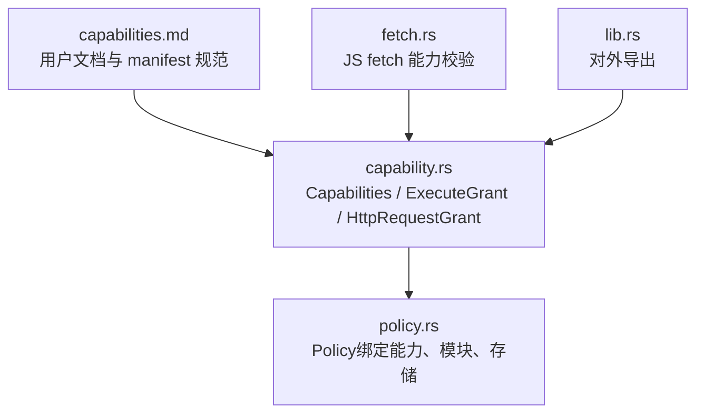
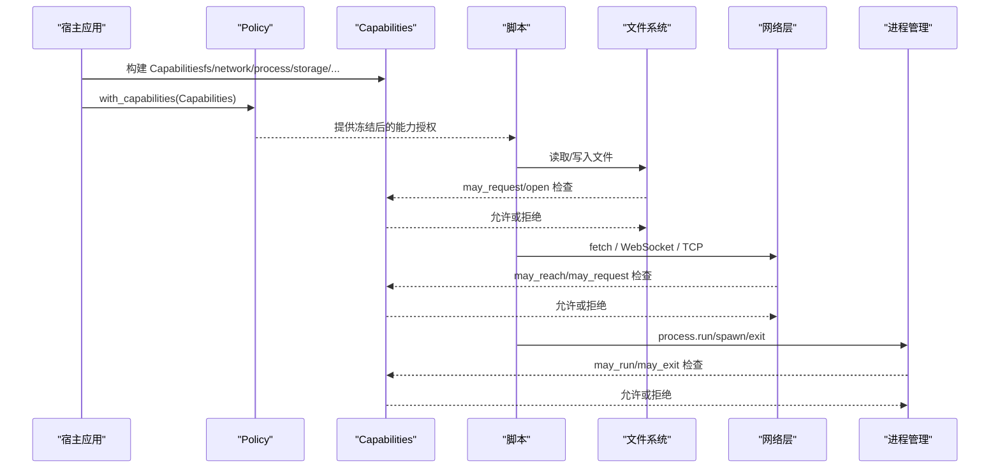
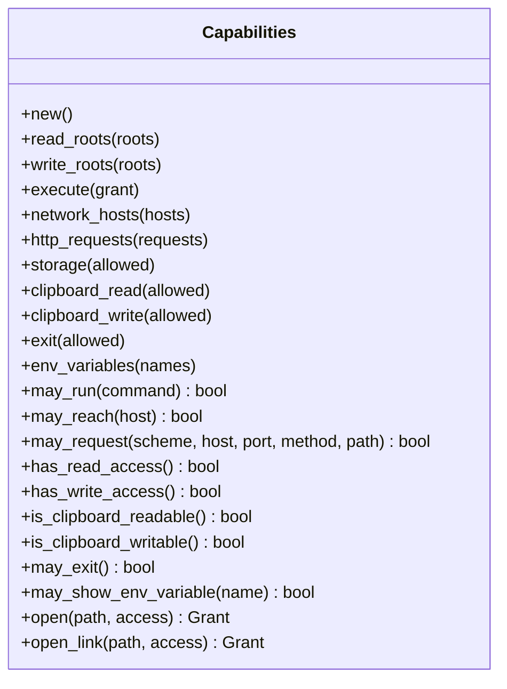
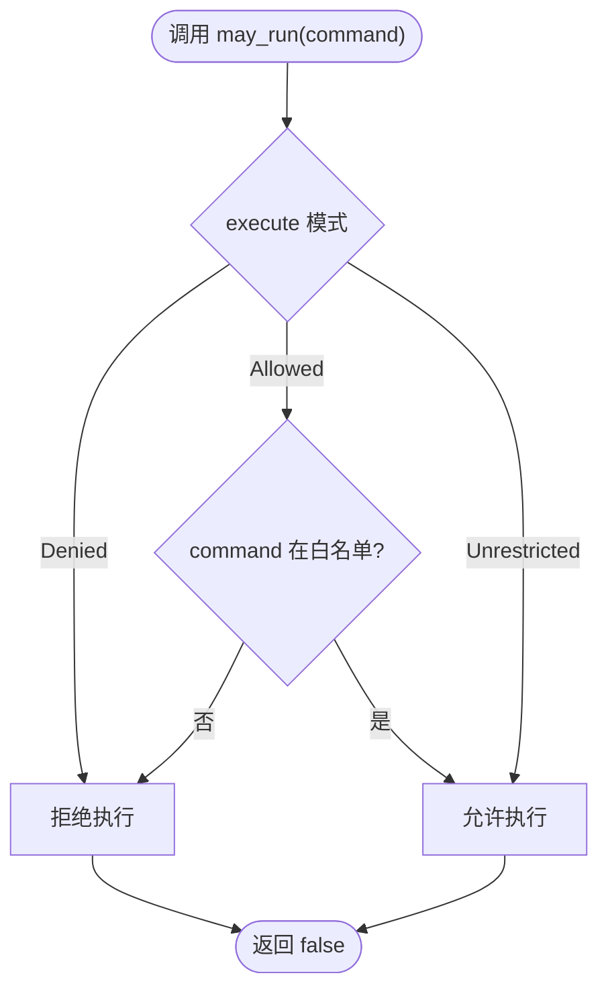
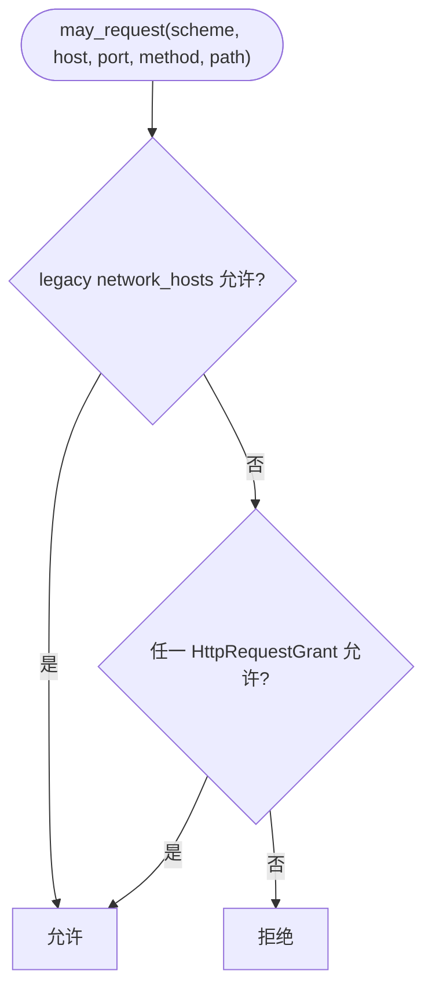
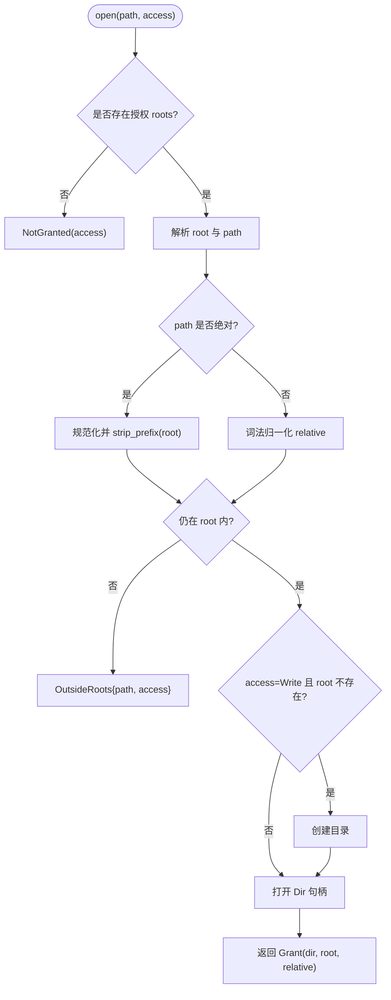
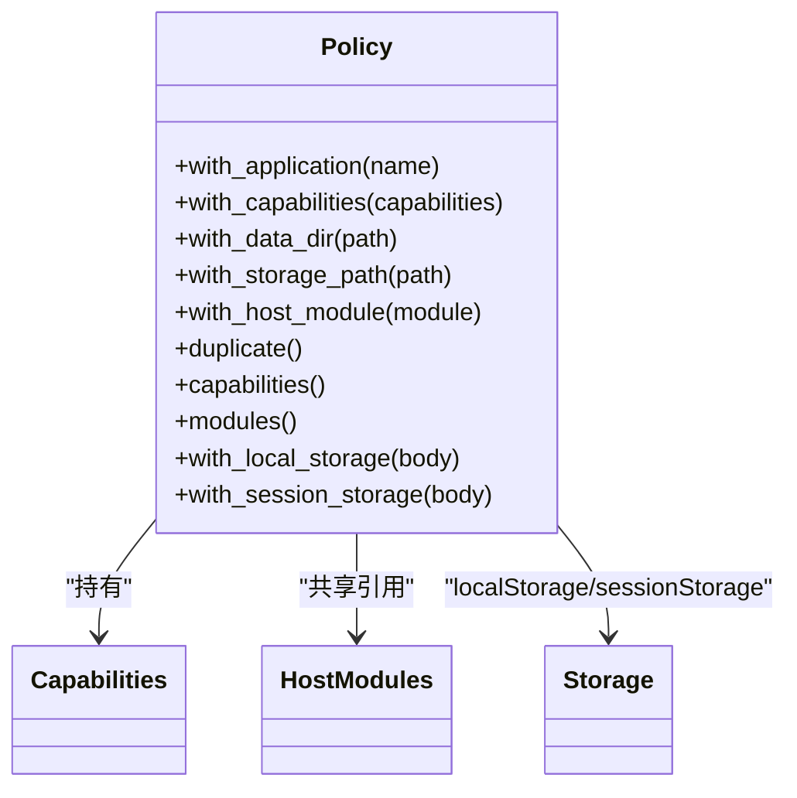
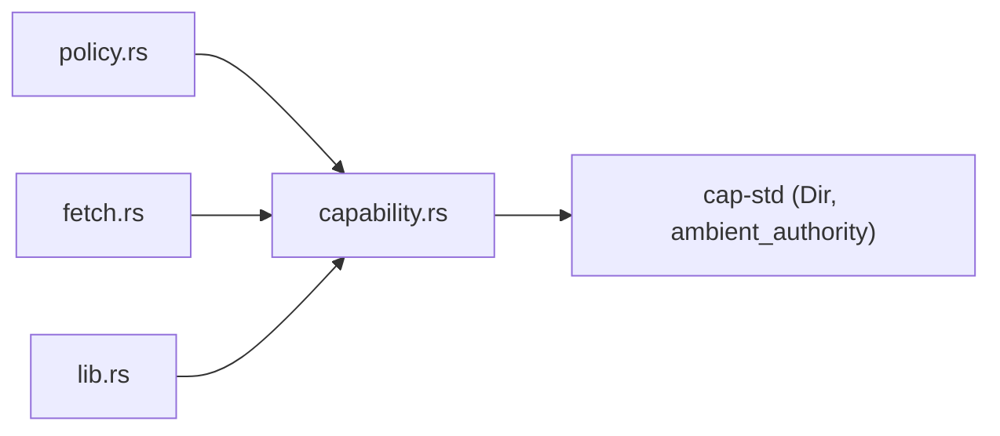

# 能力控制系统

<cite>
**本文引用的文件**   
- [capability.rs](file://crates/shell/src/capability.rs)
- [policy.rs](file://crates/shell/src/policy.rs)
- [capabilities.md](file://website/shell/capabilities.md)
- [fetch.rs](file://crates/shell/src/engine/quickjs/standard/fetch.rs)
- [lib.rs](file://crates/shell/src/lib.rs)
</cite>

## 目录
1. [引言](#引言)
2. [项目结构](#项目结构)
3. [核心组件](#核心组件)
4. [架构总览](#架构总览)
5. [详细组件分析](#详细组件分析)
6. [依赖关系分析](#依赖关系分析)
7. [性能与资源限制](#性能与资源限制)
8. [安全最佳实践](#安全最佳实践)
9. [权限配置示例](#权限配置示例)
10. [故障排除指南](#故障排除指南)
11. [结论](#结论)

## 引言
本文件系统性说明 gpui-kit shell 的能力控制系统，围绕 Capabilities 结构体、ExecuteGrant 与 HttpRequestGrant 的设计与用法，文件系统访问、网络请求、进程管理、存储与剪贴板等能力的授予与限制策略展开。文档同时解释默认策略与特定策略的区别，给出在不同环境下的能力级别配置建议、完整权限配置示例以及常见问题的排查方法。

## 项目结构
能力控制相关代码主要位于 shell crate 中：
- capability.rs：定义 Capabilities、ExecuteGrant、HttpRequestGrant、错误类型、路径解析与授权检查逻辑。
- policy.rs：定义 Policy，将 Capabilities、HostModules、Storage 等运行时上下文绑定到“当前运行代码的权威主体”。
- website/shell/capabilities.md：面向用户的 Shell 能力文档，描述默认拒绝模型、manifest 字段、fs/storage/clipboard/process/sandbox 行为。
- engine/quickjs/standard/fetch.rs：HTTP 能力在 JS fetch 中的使用示例。
- lib.rs：对外导出 Capabilities、ExecuteGrant、HttpRequestGrant。

图表来源
- [capability.rs:24-38](file://crates/shell/src/capability.rs#L24-L38)
- [policy.rs:61-109](file://crates/shell/src/policy.rs#L61-L109)
- [capabilities.md:1-14](file://website/shell/capabilities.md#L1-L14)
- [fetch.rs:542-586](file://crates/shell/src/engine/quickjs/standard/fetch.rs#L542-L586)
- [lib.rs:110](file://crates/shell/src/lib.rs#L110)

章节来源
- [capability.rs:1-10](file://crates/shell/src/capability.rs#L1-L10)
- [policy.rs:1-45](file://crates/shell/src/policy.rs#L1-L45)
- [capabilities.md:1-24](file://website/shell/capabilities.md#L1-L24)

## 核心组件
- Capabilities：声明脚本可使用的全部能力集合，包括文件系统读写根、进程执行、网络主机、HTTP 请求规则、存储、剪贴板读/写、退出请求、环境变量白名单等。默认值为空集，遵循“默认拒绝”原则。
- ExecuteGrant：进程执行能力枚举，支持 Denied（默认）、Allowed（命令名白名单）、Unrestricted（任意命令）。
- HttpRequestGrant：针对单个主机的 HTTP 请求授权，包含 scheme、host、port、methods、paths、path_prefixes，用于精细控制 GET/POST 等方法与路径前缀。
- Policy：运行时策略对象，持有 Capabilities、HostModules、Storage 等，确保每个视图/插件拥有独立且冻结的能力授权。

章节来源
- [capability.rs:24-38](file://crates/shell/src/capability.rs#L24-L38)
- [capability.rs:144-154](file://crates/shell/src/capability.rs#L144-L154)
- [capability.rs:61-142](file://crates/shell/src/capability.rs#L61-L142)
- [policy.rs:61-109](file://crates/shell/src/policy.rs#L61-L109)

## 架构总览
能力控制的总体流程如下：
- 宿主应用通过 Capabilities 构建器设置允许的能力。
- 通过 Policy 将 Capabilities 与 HostModules、Storage 绑定，并安装为默认策略或特定策略。
- 脚本调用 fs、process、storage、clipboard、network/http 时，由 Capability 检查是否被允许。
- 若未授权，返回明确错误信息，提示需要在 manifest 或宿主侧补充授权。

图表来源
- [capability.rs:345-374](file://crates/shell/src/capability.rs#L345-L374)
- [policy.rs:151-154](file://crates/shell/src/policy.rs#L151-L154)
- [capabilities.md:10-14](file://website/shell/capabilities.md#L10-L14)

## 详细组件分析

### Capabilities 设计
- 字段覆盖：read_roots、write_roots、execute、network_hosts、http_requests、storage、clipboard_read、clipboard_write、exit、env_variables。
- 构造器风格：链式 API，如 read_roots、write_roots、execute、network_hosts、http_requests、storage、clipboard_read、clipboard_write、exit、env_variables。
- 检查方法：may_run、may_reach、may_request、has_read_access、has_write_access、is_clipboard_readable、is_clipboard_writable、may_exit、may_show_env_variable。
- 文件系统授权：open/open_link 基于 cap-std 的 Dir 句柄，避免路径二次解析和符号链接逃逸；对绝对路径进行规范化与 root 内校验；对缺失目录在写授权下自动创建。

图表来源
- [capability.rs:24-38](file://crates/shell/src/capability.rs#L24-L38)
- [capability.rs:219-293](file://crates/shell/src/capability.rs#L219-L293)
- [capability.rs:345-374](file://crates/shell/src/capability.rs#L345-L374)
- [capability.rs:393-510](file://crates/shell/src/capability.rs#L393-L510)

章节来源
- [capability.rs:24-38](file://crates/shell/src/capability.rs#L24-L38)
- [capability.rs:219-293](file://crates/shell/src/capability.rs#L219-L293)
- [capability.rs:345-374](file://crates/shell/src/capability.rs#L345-L374)
- [capability.rs:393-510](file://crates/shell/src/capability.rs#L393-L510)

### ExecuteGrant：进程执行能力
- 三种模式：Denied（默认）、Allowed（白名单）、Unrestricted（任意命令）。
- may_run 根据 command 名称匹配白名单；Unrestricted 直接允许；Denied 直接拒绝。
- 典型场景：
  - 本地开发工具需要执行 git、npm、cargo 等命令，可使用 Allowed(["git","npm","cargo"])。
  - 生产环境严格限制，仅允许必要命令；或完全禁用。
  - 调试或受控沙箱中可临时启用 Unrestricted，但需最高严重性提示用户。

图表来源
- [capability.rs:144-154](file://crates/shell/src/capability.rs#L144-L154)
- [capability.rs:345-351](file://crates/shell/src/capability.rs#L345-L351)

章节来源
- [capability.rs:144-154](file://crates/shell/src/capability.rs#L144-L154)
- [capability.rs:345-351](file://crates/shell/src/capability.rs#L345-L351)

### HttpRequestGrant：HTTP 请求授权
- 字段：scheme（默认 https）、host、port（默认标准端口）、methods、paths、path_prefixes。
- allows 判断：scheme/host/port/method/path 必须匹配；path 支持精确匹配与前缀匹配。
- 与 network_hosts 的区别：前者更细粒度，后者是较宽泛的主机级访问；一个插件可以只允许某个 REST 端点而不开放同一主机的 TCP/WebSocket。

图表来源
- [capability.rs:61-142](file://crates/shell/src/capability.rs#L61-L142)
- [capability.rs:359-374](file://crates/shell/src/capability.rs#L359-L374)

章节来源
- [capability.rs:61-142](file://crates/shell/src/capability.rs#L61-L142)
- [capability.rs:359-374](file://crates/shell/src/capability.rs#L359-L374)

### 文件系统访问与路径解析
- open/open_link：基于 cap-std 的 Dir 句柄，保证操作始终在授权目录内进行，防止符号链接逃逸与路径二次解析。
- 绝对路径：必须在已授权的 root 内；相对路径：先做词法归一化，再与 resolved root 比较。
- 写授权：若目标 root 不存在则自动创建；读授权：不存在的目录不提供可读内容。
- 错误类型：NotGranted、OutsideRoots、ExecuteDenied、StorageDenied，均带有修复提示。

图表来源
- [capability.rs:393-510](file://crates/shell/src/capability.rs#L393-L510)
- [capability.rs:537-569](file://crates/shell/src/capability.rs#L537-L569)

章节来源
- [capability.rs:393-510](file://crates/shell/src/capability.rs#L393-L510)
- [capability.rs:537-569](file://crates/shell/src/capability.rs#L537-L569)

### 策略系统：默认策略与特定策略
- Policy：绑定 Capabilities、HostModules、Storage，回答“这段代码在当前权威主体下能做什么”。
- 默认策略：线程局部 DEFAULT，供单应用宿主快速配置；update_default/set_default 修改新视图的默认策略。
- 特定策略：插件宿主为每个插件构建独立 Policy，确保两个插件在同一运行时拥有不同授权。
- 冻结能力：View 加载时冻结其 Capabilities；后续更新默认策略不影响已运行的视图。

图表来源
- [policy.rs:61-109](file://crates/shell/src/policy.rs#L61-L109)
- [policy.rs:117-239](file://crates/shell/src/policy.rs#L117-L239)
- [policy.rs:241-269](file://crates/shell/src/policy.rs#L241-L269)
- [policy.rs:271-296](file://crates/shell/src/policy.rs#L271-L296)

章节来源
- [policy.rs:61-109](file://crates/shell/src/policy.rs#L61-L109)
- [policy.rs:117-239](file://crates/shell/src/policy.rs#L117-L239)
- [policy.rs:241-269](file://crates/shell/src/policy.rs#L241-L269)
- [policy.rs:271-296](file://crates/shell/src/policy.rs#L271-L296)

### 使用场景：ExecuteGrant 与 HttpRequestGrant
- ExecuteGrant：
  - 本地 CLI 运行目录：默认不授予进程执行；可通过 manifest 或宿主侧添加 Allowed 列表。
  - 自动化脚本：允许有限命令（如 git、curl），避免任意命令执行风险。
  - 调试模式：可临时启用 Unrestricted，但需显著警告用户。
- HttpRequestGrant：
  - 仅允许特定 API 端点：例如 https://api.example.com/v1/data GET。
  - 多方法多路径：methods=["GET","POST"]，paths=["/v1/upload"]，path_prefixes=["/v1/assets/"]。
  - 非默认端口：port=8443，配合 scheme="https"。

章节来源
- [capabilities.md:26-43](file://website/shell/capabilities.md#L26-L43)
- [capabilities.md:127-128](file://website/shell/capabilities.md#L127-L128)
- [fetch.rs:542-586](file://crates/shell/src/engine/quickjs/standard/fetch.rs#L542-L586)

## 依赖关系分析
- capability.rs 依赖 cap-std 的 ambient_authority 与 fs::Dir，实现安全的目录句柄授权。
- policy.rs 依赖 capability.rs 的 Capabilities，以及 host_modules、storage 模块。
- fetch.rs 使用 Capabilities::http_requests 校验 JS fetch 请求。
- lib.rs 导出 Capabilities、ExecuteGrant、HttpRequestGrant，供外部宿主使用。

图表来源
- [capability.rs:7-10](file://crates/shell/src/capability.rs#L7-L10)
- [policy.rs:52-56](file://crates/shell/src/policy.rs#L52-L56)
- [fetch.rs:542-586](file://crates/shell/src/engine/quickjs/standard/fetch.rs#L542-L586)
- [lib.rs:110](file://crates/shell/src/lib.rs#L110)

章节来源
- [capability.rs:7-10](file://crates/shell/src/capability.rs#L7-L10)
- [policy.rs:52-56](file://crates/shell/src/policy.rs#L52-L56)
- [fetch.rs:542-586](file://crates/shell/src/engine/quickjs/standard/fetch.rs#L542-L586)
- [lib.rs:110](file://crates/shell/src/lib.rs#L110)

## 性能与资源限制
- 文件系统：
  - readFile 上限 64 MiB；writeFile 单次上限 8 MiB；readdir 最多 10,000 条目或 1 MiB UTF-8 名称字节。
- 存储：
  - localStorage 最大 8 MiB 序列化大小、最多 4,096 个键、单值不超过 1 MiB；flush 等待队列最多 1,024。
- 进程：
  - process.run 超时 30 秒、stdout/stderr 各 8 MiB；spawn 单行输出上限 8 MiB。
- 语言沙箱：
  - Heap 256 MiB、Interpreter Stack 1 MiB、每源文件 8 MiB、宿主任务 1,024、render/layout 50 ms、事件/task 500 ms、模块评估 5 s。

章节来源
- [capabilities.md:176-183](file://website/shell/capabilities.md#L176-L183)
- [capabilities.md:225-230](file://website/shell/capabilities.md#L225-L230)
- [capabilities.md:324-351](file://website/shell/capabilities.md#L324-L351)
- [capabilities.md:394-408](file://website/shell/capabilities.md#L394-L408)

## 安全最佳实践
- 默认拒绝：始终从 Capabilities::default() 开始，显式授予最小必要能力。
- 文件系统：
  - 仅授予应用目录与数据目录；避免 ${homeDir} 写权限，除非确需管理用户文件。
  - 使用 add_read_roots/add_write_roots 扩展而非覆盖，避免意外缩小授权。
- 网络：
  - 优先使用 HttpRequestGrant 精确限定 scheme/host/port/method/path；仅在必要时放宽 network.hosts。
  - HTTPS 默认，禁止降级；非标准端口显式声明。
- 进程：
  - 生产环境使用 Allowed 白名单；避免 Unrestricted。
  - 对 process.exit 单独授权，并安装宿主处理函数。
- 存储与剪贴板：
  - storage 按需开启；clipboard 分读写分别授权。
- 环境变量：
  - 仅暴露必要变量；敏感密钥不要放入 env。
- 开发模式：
  - --dev 仅放松语言沙箱，不放宽能力授权；生产环境保持严格。

章节来源
- [capabilities.md:10-14](file://website/shell/capabilities.md#L10-L14)
- [capabilities.md:112-128](file://website/shell/capabilities.md#L112-L128)
- [capabilities.md:384-414](file://website/shell/capabilities.md#L384-L414)

## 权限配置示例
以下为典型的权限配置思路（以 JSON manifest 为例）：
- 基础应用：
  - fs.read: ["${pluginDir}"]
  - fs.write: ["${dataDir}"]
  - storage: true
  - clipboard: { read: false, write: true }
  - process.exit: false
- 网络访问：
  - network.hosts: ["stream.example.com"]
  - network.http: [{ scheme: "https", host: "api.example.com", methods: ["GET"], path_prefixes: ["/v1/"] }]
- 进程执行：
  - 生产环境：仅允许必要命令，如 ["git"]
  - 调试环境：可临时允许更多命令，但仍避免 Unrestricted

章节来源
- [capabilities.md:69-128](file://website/shell/capabilities.md#L69-L128)

## 故障排除指南
- 常见错误与修复：
  - “filesystem read is not granted; declare capabilities.fs.read in the manifest”
    - 修复：在 manifest 的 capabilities.fs.read 中添加所需目录。
  - “`/etc/passwd` is outside every granted read root”
    - 修复：将目标目录加入 capabilities.fs.read；避免跨 root 访问。
  - “storage is not granted; set capabilities.storage to true”
    - 修复：在 manifest 中启用 storage。
  - “running `git` is not granted; add it to capabilities.fs.execute in the manifest”
    - 修复：在 process.execute 白名单中添加命令名。
  - “process.exit() is not granted; set capabilities.process.exit to true in the manifest”
    - 修复：启用 capabilities.process.exit，并确保宿主安装了 exit 处理器。
- 诊断建议：
  - 查看 Capabilities.summary 输出，确认实际授予的能力清单。
  - 检查 may_run/may_reach/may_request 的判断结果，定位具体拒绝原因。
  - 对于 fs 路径问题，确认 open/open_link 的 root 解析与符号链接行为。

章节来源
- [capabilities.md:44-67](file://website/shell/capabilities.md#L44-L67)
- [capability.rs:167-217](file://crates/shell/src/capability.rs#L167-L217)
- [capability.rs:537-569](file://crates/shell/src/capability.rs#L537-L569)

## 结论
gpui-kit shell 的能力控制系统以 Capabilities 为核心，结合 Policy 的冻结授权机制，实现了默认拒绝、最小授权、细粒度控制的安全模型。通过 ExecuteGrant 与 HttpRequestGrant，宿主可以在不同环境下灵活配置进程执行与网络访问能力；文件系统访问通过 cap-std 的 Dir 句柄确保路径安全。遵循本文的最佳实践与配置示例，可在保障安全的前提下满足多样化的业务需求。