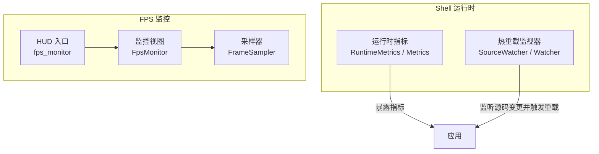
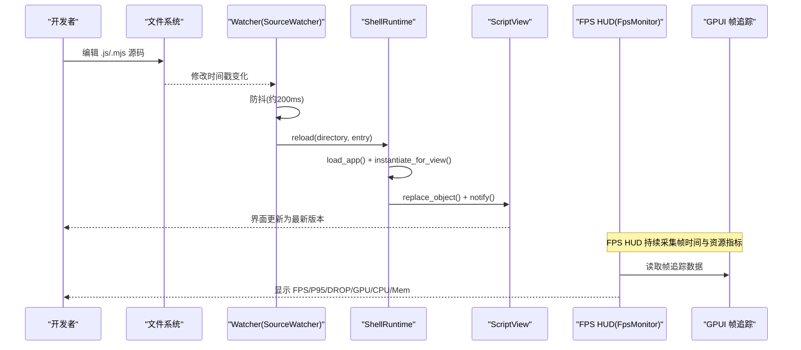
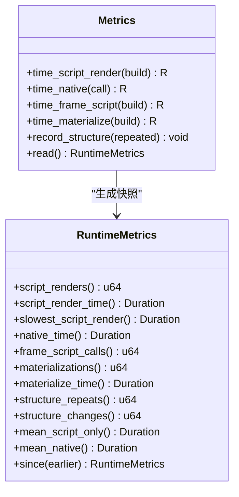
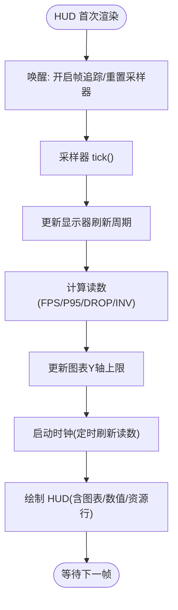
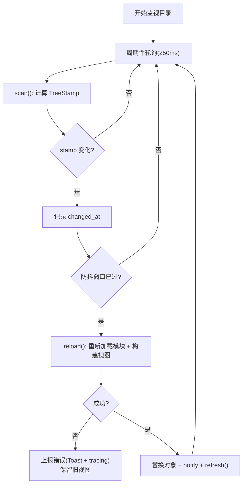
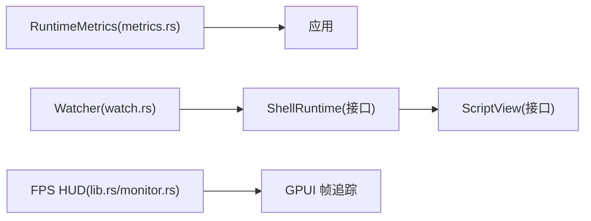

# 调试与性能分析

<cite>
**本文引用的文件**
- [metrics.rs](file://crates/shell/src/metrics.rs)
- [lib.rs](file://crates/fps/src/lib.rs)
- [monitor.rs](file://crates/fps/src/monitor.rs)
- [watch.rs](file://crates/shell/src/watch.rs)
</cite>

## 目录
1. [简介](#简介)
2. [项目结构](#项目结构)
3. [核心组件](#核心组件)
4. [架构总览](#架构总览)
5. [详细组件分析](#详细组件分析)
6. [依赖关系分析](#依赖关系分析)
7. [性能考量](#性能考量)
8. [故障排除指南](#故障排除指南)
9. [结论](#结论)

## 简介
本文件面向开发者，系统化梳理 gpui-kit 中与“调试、性能分析与热重载”相关的实现：运行时指标收集（RuntimeMetrics）、实时性能 HUD（FPS 监控）、以及脚本应用的热重载（Watcher）。文档提供使用方法、数据含义、错误处理机制、日志输出方式、调试技巧与性能瓶颈定位方法，帮助快速定位问题并优化体验。

## 项目结构
围绕调试与性能分析的关键代码分布在两个 crate：
- shell 子 crate：提供运行时指标 RuntimeMetrics 与脚本应用热重载 Watcher
- fps 子 crate：提供 FPS 监控 HUD，用于观察帧率、帧耗时、GPU/CPU/内存等

图表来源
- [metrics.rs:45-213](file://crates/shell/src/metrics.rs#L45-L213)
- [watch.rs:81-153](file://crates/shell/src/watch.rs#L81-L153)
- [lib.rs:83-100](file://crates/fps/src/lib.rs#L83-L100)
- [monitor.rs:202-232](file://crates/fps/src/monitor.rs#L202-L232)

章节来源
- [metrics.rs:45-213](file://crates/shell/src/metrics.rs#L45-L213)
- [watch.rs:81-153](file://crates/shell/src/watch.rs#L81-L153)
- [lib.rs:83-100](file://crates/fps/src/lib.rs#L83-L100)
- [monitor.rs:202-232](file://crates/fps/src/monitor.rs#L202-L232)

## 核心组件
- RuntimeMetrics 与 Metrics：采集脚本渲染次数、渲染耗时、宿主函数调用耗时、材料化次数与耗时、结构重复/变化计数等，并提供差值计算与均值统计。
- FPS HUD（fps_monitor / FpsMonitor）：基于 GPUI 的 FrameTimingCollector 采集帧时间，展示 FPS、P95、DROP、无效重绘比例，以及可选的 GPU/CPU/内存占用。
- Watcher（SourceWatcher / Watcher）：轮询源码目录，防抖后触发应用模块重新加载与视图重建，保持窗口与实体不变，失败时保留上一版本视图并上报错误。

章节来源
- [metrics.rs:45-213](file://crates/shell/src/metrics.rs#L45-L213)
- [lib.rs:1-35](file://crates/fps/src/lib.rs#L1-L35)
- [monitor.rs:106-125](file://crates/fps/src/monitor.rs#L106-L125)
- [watch.rs:1-24](file://crates/shell/src/watch.rs#L1-L24)

## 架构总览
下图展示了从“源码变更”到“视图重建”，以及“运行时指标采集”和“FPS HUD 展示”的整体流程。

图表来源
- [watch.rs:248-287](file://crates/shell/src/watch.rs#L248-L287)
- [watch.rs:494-561](file://crates/shell/src/watch.rs#L494-L561)
- [lib.rs:1-35](file://crates/fps/src/lib.rs#L1-L35)
- [monitor.rs:106-125](file://crates/fps/src/monitor.rs#L106-L125)

## 详细组件分析

### 运行时指标 RuntimeMetrics
- 设计目标：以可断言的数字衡量“脚本成本跟随应用活动而非帧率”。通过 script_renders 与 materializations 两个计数器及其差值，判断渲染是否被缓存命中。
- 关键指标
  - script_renders：进入脚本 render 的次数
  - script_render_time：脚本 render 总耗时
  - slowest_script_render：单次最慢脚本渲染耗时
  - native_time：宿主函数调用总耗时（可从脚本渲染中剥离）
  - frame_script_calls：GPUI 帧路径中对脚本的调用次数（如虚拟列表项渲染）
  - materializations：快照材料化次数
  - materialize_time：材料化总耗时
  - structure_repeats / structure_changes：模板结构重复/变化次数
- 常用 API
  - mean_script_only / mean_native：平均纯脚本耗时 / 平均宿主耗时
  - since：两次读数的差值，适合计算速率
- 内部实现要点
  - 使用 Cell 存储原子级计数器，避免在渲染路径上引入锁或可能 panic 的借用
  - 计时基于 instant::Instant，WASM 下使用兼容实现

图表来源
- [metrics.rs:47-213](file://crates/shell/src/metrics.rs#L47-L213)
- [metrics.rs:222-328](file://crates/shell/src/metrics.rs#L222-L328)

章节来源
- [metrics.rs:45-213](file://crates/shell/src/metrics.rs#L45-L213)
- [metrics.rs:222-328](file://crates/shell/src/metrics.rs#L222-L328)

### FPS 监控 HUD
- 数据来源：GPUI 的帧追踪（FrameTimingCollector），不主动驱动帧循环，避免自身开销污染指标。
- 主要展示
  - MAX/OBSERVED FPS：理论可持续帧率 vs 实际呈现帧率
  - INTERVAL：平台呈现间隔
  - FRAME/P95：平均帧耗时与尾部耗时
  - DROP：超预算帧占比
  - INV：无效重绘合并比
  - GPU/CPU/MEM：进程资源占用（非 WASM）
- 交互与生命周期
  - 每窗口一个 FpsMonitor，全局复用
  - 点击切换紧凑模式；右键切换 MAX/OBSERVED
  - 隐藏时自动停止时钟与帧追踪，避免无谓开销

图表来源
- [monitor.rs:261-304](file://crates/fps/src/monitor.rs#L261-L304)
- [monitor.rs:378-444](file://crates/fps/src/monitor.rs#L378-L444)
- [monitor.rs:475-527](file://crates/fps/src/monitor.rs#L475-L527)
- [monitor.rs:653-683](file://crates/fps/src/monitor.rs#L653-L683)

章节来源
- [lib.rs:1-35](file://crates/fps/src/lib.rs#L1-L35)
- [lib.rs:83-100](file://crates/fps/src/lib.rs#L83-L100)
- [monitor.rs:106-125](file://crates/fps/src/monitor.rs#L106-L125)
- [monitor.rs:202-232](file://crates/fps/src/monitor.rs#L202-L232)
- [monitor.rs:261-304](file://crates/fps/src/monitor.rs#L261-L304)
- [monitor.rs:378-444](file://crates/fps/src/monitor.rs#L378-L444)
- [monitor.rs:475-527](file://crates/fps/src/monitor.rs#L475-L527)
- [monitor.rs:653-683](file://crates/fps/src/monitor.rs#L653-L683)

### 热重载 Watcher
- 工作原理
  - 轮询源码目录，比较 TreeStamp（最新修改时间、文件数、字节数）检测变更
  - 防抖约 200ms，合并编辑器批量写入
  - 变更发生后，先执行所有可能失败的操作（重新加载模块、构造新视图），成功后再替换 live 对象并通知重绘
  - 失败时保留上一版本视图，并通过 Toast 与 tracing 报告错误
- 安全与边界
  - 限制扫描深度与文件数量，防止无限遍历与性能退化
  - 忽略隐藏目录与非源码扩展名
  - 仅在允许 notify 的阶段执行重载（事件/任务/定时器）

图表来源
- [watch.rs:81-153](file://crates/shell/src/watch.rs#L81-L153)
- [watch.rs:179-240](file://crates/shell/src/watch.rs#L179-L240)
- [watch.rs:248-287](file://crates/shell/src/watch.rs#L248-L287)
- [watch.rs:494-561](file://crates/shell/src/watch.rs#L494-L561)

章节来源
- [watch.rs:1-24](file://crates/shell/src/watch.rs#L1-L24)
- [watch.rs:81-153](file://crates/shell/src/watch.rs#L81-L153)
- [watch.rs:179-240](file://crates/shell/src/watch.rs#L179-L240)
- [watch.rs:248-287](file://crates/shell/src/watch.rs#L248-L287)
- [watch.rs:494-561](file://crates/shell/src/watch.rs#L494-L561)

## 依赖关系分析
- RuntimeMetrics 与 FPS HUD 相互独立：前者关注脚本渲染与材料化成本，后者关注帧呈现与系统资源。
- Watcher 与 ShellRuntime/ScriptView 耦合：通过 ShellRuntime 提供的接口完成模块加载与视图实例化，不直接依赖具体引擎实现。
- FPS HUD 依赖 GPUI 的帧追踪能力，但不控制帧循环，避免干扰应用性能。

图表来源
- [metrics.rs:45-213](file://crates/shell/src/metrics.rs#L45-L213)
- [watch.rs:400-447](file://crates/shell/src/watch.rs#L400-L447)
- [lib.rs:1-35](file://crates/fps/src/lib.rs#L1-L35)

章节来源
- [metrics.rs:45-213](file://crates/shell/src/metrics.rs#L45-L213)
- [watch.rs:400-447](file://crates/shell/src/watch.rs#L400-L447)
- [lib.rs:1-35](file://crates/fps/src/lib.rs#L1-L35)

## 性能考量
- 识别性能瓶颈
  - 使用 RuntimeMetrics.mean_script_only 与 mean_native 区分脚本侧与宿主侧耗时
  - 使用 slowest_script_render 与 mean_script_render 对比，判断是否存在偶发长尾（如 GC、首屏初始化）
  - 使用 materialize_time 与 mean_materialize 评估快照材料化成本
  - 使用 FPS HUD 的 FRAME/P95/DROP 判断是否频繁超时，结合 INV 观察无效重绘
- 内存泄漏检测
  - FPS HUD 在非 WASM 平台提供内存占用趋势，配合长时间运行观察是否有单调增长
  - 注意 HUD 自身的 Monitors 全局表会持有 Entity 引用，但每个窗口仅一次，属于可控泄漏
- 执行时间分析
  - 将 FPS HUD 的 chart 与 RUNTIME 指标结合：当 P95 升高且 DROP 增加时，优先检查最近变更的脚本 render 与宿主调用
  - 对 VirtualList 场景，注意 frame_script_calls 与 materialize_time 的含义差异：它们计入帧预算但不计入 materializations 计数

[本节为通用指导，不直接分析具体文件]

## 故障排除指南
- 热重载未触发
  - 确认文件扩展名为 .js/.mjs，且不在隐藏目录或跳过目录（node_modules、target）
  - 检查防抖窗口：编辑器批量写入需等待稳定后再触发
  - 查看 tracing 与 Toast 是否报告“source watch stopped”或“reload failed”
- 重载失败但界面未崩溃
  - 这是预期行为：失败时保留上一版本视图，错误通过 view.set_reload_error 与 Toast 展示
  - 检查错误链信息，定位具体阶段（加载模块/构建视图）
- FPS HUD 不显示或数值异常
  - 确认已渲染 HUD 元素，且父容器为 relative
  - 若 HUD 隐藏，会自动关闭帧追踪与采样器，再次显示时会重启
  - 检查是否启用了自定义 frame_budget，导致阈值与期望不符
- 指标波动大
  - 使用 since 计算区间差值，避免累积值误导
  - 关注 slowest_script_render 与 mean 的差异，区分系统抖动与真实变慢

章节来源
- [watch.rs:450-492](file://crates/shell/src/watch.rs#L450-L492)
- [watch.rs:494-561](file://crates/shell/src/watch.rs#L494-L561)
- [lib.rs:119-160](file://crates/fps/src/lib.rs#L119-L160)
- [monitor.rs:261-304](file://crates/fps/src/monitor.rs#L261-L304)

## 结论
- RuntimeMetrics 提供了细粒度的脚本与宿主侧耗时度量，适合回归测试与长期趋势分析
- FPS HUD 在不干扰应用的前提下，直观呈现帧质量与系统资源，便于快速定位卡顿
- Watcher 实现了稳健的热重载：防抖、限深、失败回退、错误上报，保证开发体验与稳定性
- 建议在生产环境按需启用 HUD 与指标采集，并结合 since 差值进行速率化分析

[本节为总结性内容，不直接分析具体文件]