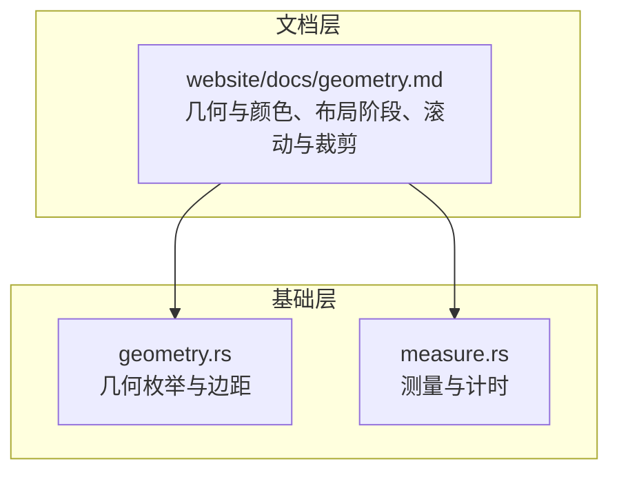
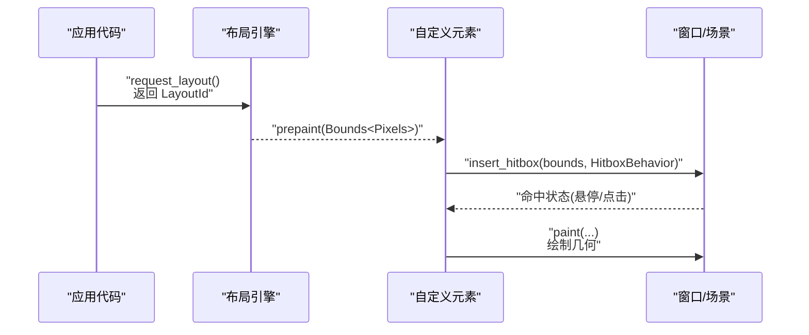
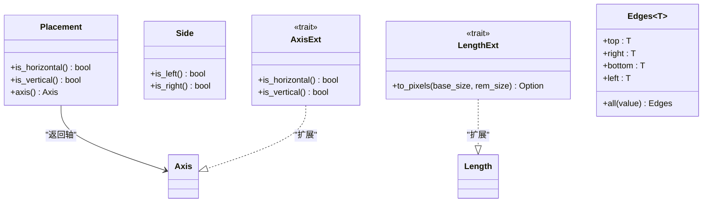
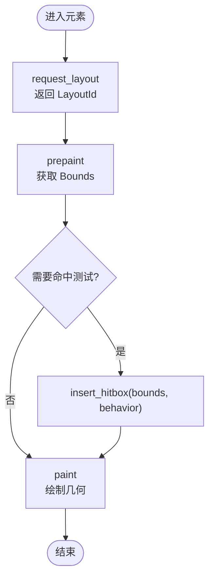
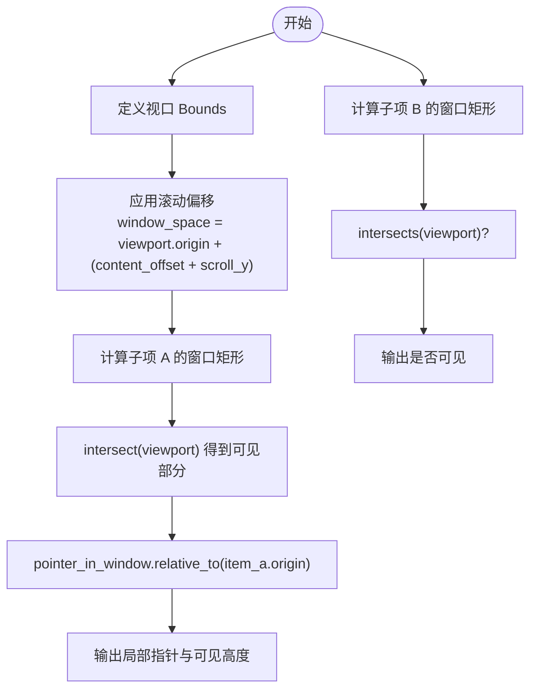
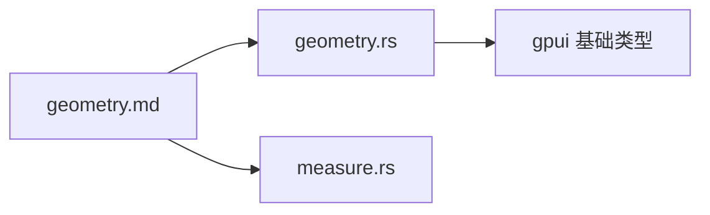

# Geometry 几何计算 API

<cite>
**本文引用的文件**   
- [crates/base/src/geometry.rs](file://crates/base/src/geometry.rs)
- [website/docs/geometry.md](file://website/docs/geometry.md)
- [crates/base/src/measure.rs](file://crates/base/src/measure.rs)
</cite>

## 目录
1. [简介](#简介)
2. [项目结构](#项目结构)
3. [核心组件](#核心组件)
4. [架构总览](#架构总览)
5. [详细组件分析](#详细组件分析)
6. [依赖分析](#依赖分析)
7. [性能考虑](#性能考虑)
8. [故障排查指南](#故障排查指南)
9. [结论](#结论)
10. [附录](#附录)

## 简介
本文件面向 GPUI Kit 的几何计算与布局相关 API，聚焦点、矩形、尺寸、边距等基础几何类型，以及坐标系统、变换矩阵、布局计算、测量算法、碰撞检测、边界计算和空间查询。文档同时提供布局算法、自适应计算与响应式设计的实用工具函数说明，并给出性能优化建议与常见问题解决方案，帮助在复杂布局场景中正确进行几何计算。

## 项目结构
本项目将几何相关的公共定义集中在 base 层的 geometry 模块中，并通过网站文档对几何概念、坐标系、布局阶段、滚动与裁剪等进行系统化说明；同时提供测量工具用于性能分析。

**图表来源**
- [crates/base/src/geometry.rs:1-152](file://crates/base/src/geometry.rs#L1-L152)
- [website/docs/geometry.md:1-234](file://website/docs/geometry.md#L1-L234)
- [crates/base/src/measure.rs:1-49](file://crates/base/src/measure.rs#L1-L49)

**章节来源**
- [crates/base/src/geometry.rs:1-152](file://crates/base/src/geometry.rs#L1-L152)
- [website/docs/geometry.md:1-234](file://website/docs/geometry.md#L1-L234)
- [crates/base/src/measure.rs:1-49](file://crates/base/src/measure.rs#L1-L49)

## 核心组件
本节梳理几何 API 的核心类型与职责：

- 放置与方向
  - Placement：表示元素相对于触发点的四个方位（上、下、左、右），并提供水平/垂直判断与对应轴。
  - Side：仅表示左右两侧，适用于更窄的场景。
  - AxisExt：为 Axis 扩展水平/垂直判断方法。

- 长度与像素
  - LengthExt：将 Length 转换为 Pixels（当为 Auto 时返回 None）。
  - 文档强调 Pixels 是逻辑 UI 像素，保留小数精度；AbsoluteLength/DefiniteLength/Length 区分固定值、父级比例与自动选择。

- 边距
  - Edges<T>：统一描述 top/right/bottom/left 四条边的尺寸，支持全边相同值的构造。

- 几何基础类型（由文档说明）
  - Point<T>：二维位置。
  - Size<T>：宽高范围，不含位置。
  - Bounds<T>：轴对齐矩形，包含 origin 与 size，提供 contains、center、intersects、from_corners、centered_at 等方法。

这些类型共同构成布局与绘制阶段的几何基础：布局阶段使用 Length 等未解析长度，prepaint/paint 阶段使用已解析的 Bounds<Pixels>。

**章节来源**
- [crates/base/src/geometry.rs:8-152](file://crates/base/src/geometry.rs#L8-L152)
- [website/docs/geometry.md:11-196](file://website/docs/geometry.md#L11-L196)

## 架构总览
几何计算贯穿“样式 → 布局 → 命中测试 → 绘制”的管线。文档明确区分 request_layout、prepaint、paint 三个阶段可用的几何信息与职责。

**图表来源**
- [website/docs/geometry.md:61-71](file://website/docs/geometry.md#L61-L71)

**章节来源**
- [website/docs/geometry.md:61-71](file://website/docs/geometry.md#L61-L71)

## 详细组件分析

### 几何类型与操作
- Point<T>、Size<T>、Bounds<T>
  - 用途：表达位置、范围与矩形。
  - 常用操作：right()/bottom() 计算边界；contains() 判断点是否在矩形内；center() 取中心；intersects() 判断相交；from_corners()/centered_at() 辅助定位。
  - 注意：contains() 包含左上边界，排除右下边界，避免相邻矩形重复命中。

- 坐标系统与原点
  - Point<Pixels> 只记录单位，不记录坐标系。需显式声明变量名以区分窗口坐标与元素局部坐标。
  - 相对转换：relative_to(origin) 将点从窗口坐标转换到元素局部坐标；origin + local_point 将局部坐标转换到窗口坐标。

- 边距与四边
  - Edges<T>：top/right/bottom/left 独立值；Edges::all(value) 设置统一边距。
  - 注意：GPUI 的 Edges 与 GPUI Kit 的 base/component Edges 是不同的 Rust 类型，按 API 要求选用。

- 放置与侧边
  - Placement：Top/Right/Bottom/Left，常用于弹出层的首选边，可能根据视口翻转。
  - Side：Left/Right，更窄的侧边枚举。
  - Axis：Horizontal/Vertical，表达主轴方向。

- 长度与像素
  - AbsoluteLength/DefiniteLength/Length：分别表示固定值、父级比例、可自动选择的布局长度。
  - relative(fraction)、rems(base)、px(value)、auto()：构建不同长度的便捷函数。
  - Percentage：圆百分比专用包装，不同于 layout 的 relative。

- 颜色模型
  - Hsla/Rgba：主题色与通道色；Hsla 适合主题交互态，Rgba 适合 hex 输入与合成。
  - Colorize：lighten/darken/hue/saturation/lightness/opacity 等变换；注意 lighten/darken 是乘法而非加减百分点。

**图表来源**
- [crates/base/src/geometry.rs:8-152](file://crates/base/src/geometry.rs#L8-L152)

**章节来源**
- [crates/base/src/geometry.rs:8-152](file://crates/base/src/geometry.rs#L8-L152)
- [website/docs/geometry.md:11-196](file://website/docs/geometry.md#L11-L196)

### 布局阶段与命中测试流程
- request_layout：基于样式长度与布局节点，返回 LayoutId。
- prepaint：获得已解析的 Bounds<Pixels>，准备几何，必要时插入 hitbox。
- paint：使用 resolved bounds 绘制，注册帧内输入监听。

**图表来源**
- [website/docs/geometry.md:61-71](file://website/docs/geometry.md#L61-L71)

**章节来源**
- [website/docs/geometry.md:61-71](file://website/docs/geometry.md#L61-L71)

### 滚动、裁剪与可视区域计算
- 滚动视口与内容具有不同的原点。
- 负滚动偏移用于定位内容；在窗口空间中累加偏移；使用 ContentMask 限制绘制与输入。
- visible_range 先在内容空间筛选可见项，再用掩码限制绘制与输入。

**图表来源**
- [website/docs/geometry.md:73-125](file://website/docs/geometry.md#L73-L125)

**章节来源**
- [website/docs/geometry.md:73-125](file://website/docs/geometry.md#L73-L125)

### 碰撞检测、边界计算与空间查询
- 碰撞检测：Bounds::intersects 快速判断两矩形是否相交；contains 判断点是否在矩形内（含左上、不含右下）。
- 边界计算：right()/bottom() 基于 origin 与 size 计算；from_corners()/centered_at() 辅助构造。
- 空间查询：结合 ContentMask 与 hitbox 实现可视区域内的命中测试；visible_range 先筛再画。

**章节来源**
- [website/docs/geometry.md:11-71](file://website/docs/geometry.md#L11-L71)

### 变换矩阵与坐标转换
- 文档强调 Point/Pixels 的类型安全与原点管理，未直接暴露矩阵 API。
- 常见变换：
  - 窗口坐标 → 元素局部坐标：relative_to(&element_bounds.origin)。
  - 元素局部坐标 → 窗口坐标：element_bounds.origin + local_point。
- 注意：不要在已经基于 bounds 的矩形上再次叠加 origin；不要将局部坐标直接与窗口 hitbox 比较。

**章节来源**
- [website/docs/geometry.md:42-59](file://website/docs/geometry.md#L42-L59)

### 布局算法、自适应计算与响应式设计工具
- 长度体系：AbsoluteLength/DefiniteLength/Length 与 relative/rems/px/auto 配合，实现自适应宽度/高度。
- 边距与间距：Edges<T> 统一管理四边，便于主题化与序列化。
- 放置策略：Placement 指定首选边，Positioner 可根据视口自动翻转与裁剪。
- 颜色与主题：Hsla/Rgba 与 Colorize 提供语义化颜色与交互态变换。

**章节来源**
- [website/docs/geometry.md:127-196](file://website/docs/geometry.md#L127-L196)
- [crates/base/src/geometry.rs:8-152](file://crates/base/src/geometry.rs#L8-L152)

## 依赖分析
- geometry.rs 依赖 gpui 的基础类型（Axis、Length、Pixels、AbsoluteLength）与序列化/Schema 能力。
- website/docs/geometry.md 作为用户文档，引用 GPUI/GPUI Kit 的类型与行为，指导如何正确使用几何 API。
- measure.rs 提供测量与计时工具，用于性能分析与瓶颈定位。

**图表来源**
- [crates/base/src/geometry.rs:1-152](file://crates/base/src/geometry.rs#L1-L152)
- [website/docs/geometry.md:1-234](file://website/docs/geometry.md#L1-L234)
- [crates/base/src/measure.rs:1-49](file://crates/base/src/measure.rs#L1-L49)

**章节来源**
- [crates/base/src/geometry.rs:1-152](file://crates/base/src/geometry.rs#L1-L152)
- [website/docs/geometry.md:1-234](file://website/docs/geometry.md#L1-L234)
- [crates/base/src/measure.rs:1-49](file://crates/base/src/measure.rs#L1-L49)

## 性能考虑
- 使用 measure_if/measure 包裹关键几何计算或布局路径，通过环境变量开关日志，定位热点。
- 避免重复坐标转换与不必要的中间对象分配；尽量复用 Bounds/Pixels。
- 在大量子元素的滚动列表中，优先使用 visible_range 与 ContentMask，减少绘制与命中测试范围。
- 合理使用 Length 体系，避免在布局前过早解析为 Pixels，减少重排。

**章节来源**
- [crates/base/src/measure.rs:1-49](file://crates/base/src/measure.rs#L1-L49)
- [website/docs/geometry.md:73-125](file://website/docs/geometry.md#L73-L125)

## 故障排查指南
- 坐标原点混淆
  - 症状：命中测试失败、绘制错位。
  - 排查：确认每个 Point/Pixels 的原点（窗口 vs 元素局部），必要时用 relative_to 转换。
  - 参考：[website/docs/geometry.md:42-59](file://website/docs/geometry.md#L42-L59)

- 滚动偏移符号错误
  - 症状：内容位置异常、不可见。
  - 排查：检查 scroll_y 的正负号与累加方式；确保 window_space = viewport.origin + (content_offset + scroll_y)。
  - 参考：[website/docs/geometry.md:73-125](file://website/docs/geometry.md#L73-L125)

- 误把 contains 当作裁剪
  - 症状：子元素被意外隐藏或未被裁剪。
  - 排查：contains/intersect 仅做几何判断；实际裁剪需使用 ContentMask。
  - 参考：[website/docs/geometry.md:73-125](file://website/docs/geometry.md#L73-L125)

- 边距类型混用
  - 症状：编译错误或序列化异常。
  - 排查：区分 GPUI 的 Edges 与 GPUI Kit 的 base/component Edges，按 API 签名选用。
  - 参考：[website/docs/geometry.md:127-143](file://website/docs/geometry.md#L127-L143)

- 颜色变换越界
  - 症状：主题色过亮或过暗。
  - 排查：lighten/darken 是乘法变换，可能产生超出范围的 l 值；使用前检查结果。
  - 参考：[website/docs/geometry.md:218-234](file://website/docs/geometry.md#L218-L234)

**章节来源**
- [website/docs/geometry.md:42-59](file://website/docs/geometry.md#L42-L59)
- [website/docs/geometry.md:73-125](file://website/docs/geometry.md#L73-L125)
- [website/docs/geometry.md:127-143](file://website/docs/geometry.md#L127-L143)
- [website/docs/geometry.md:218-234](file://website/docs/geometry.md#L218-L234)

## 结论
GPUI Kit 的几何 API 通过强类型与清晰的阶段划分，确保布局、命中测试与绘制的准确性与可维护性。正确使用 Point/Size/Bounds、Length/Pixels、Edges 与 Placement，并结合 ContentMask 与 hitbox，可在复杂布局中实现可靠的几何计算与响应式体验。借助 measure 工具与环境变量，可高效定位性能瓶颈并持续优化。

## 附录
- 实践示例路径
  - 几何走查示例程序位于仓库根目录下 examples/hello_world/src/bin/geometry_walkthrough.rs（需在 hello_world 包中添加 bin 目标后运行）。
  - 该示例演示了视口、滚动偏移、子项窗口矩形、局部指针转换与可见区域交集的计算过程。

**章节来源**
- [website/docs/geometry.md:77-125](file://website/docs/geometry.md#L77-L125)