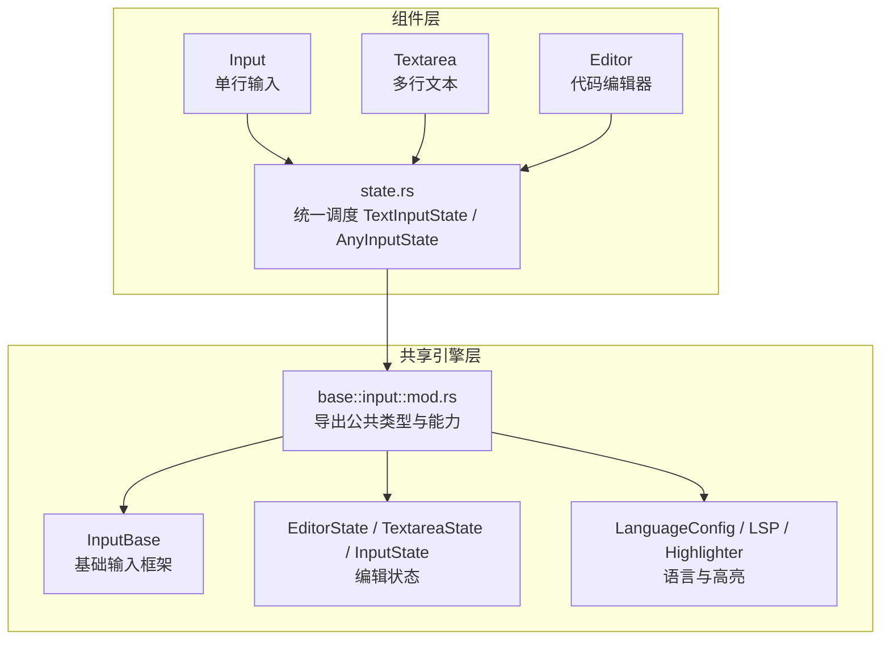
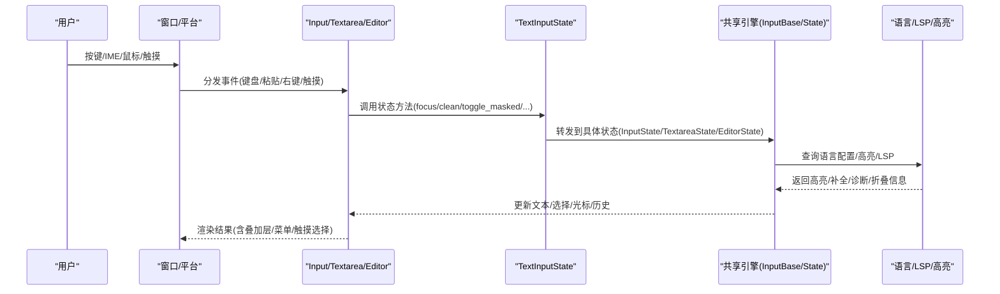
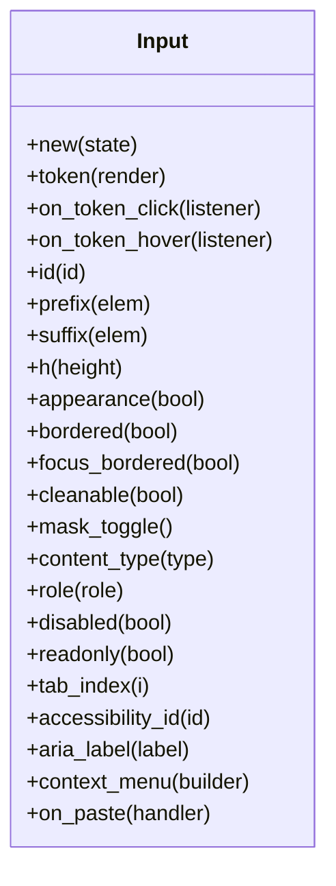
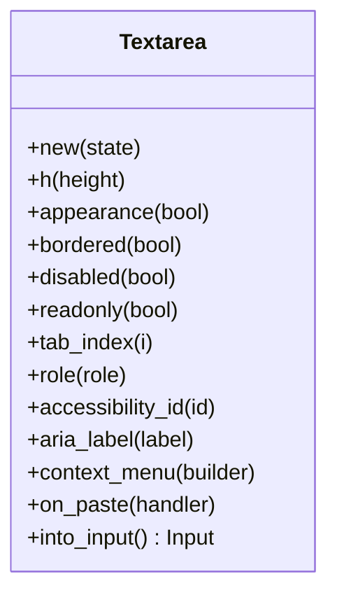
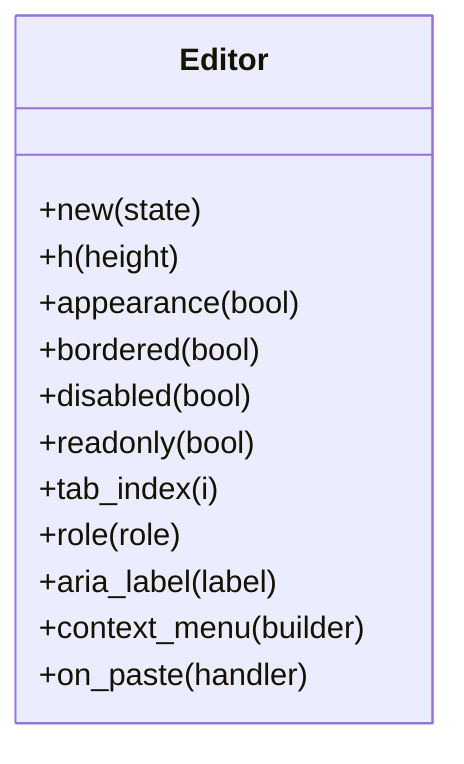
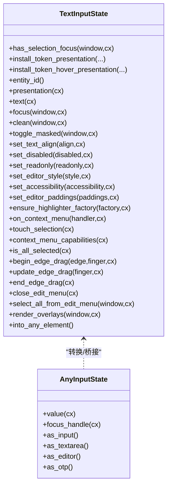
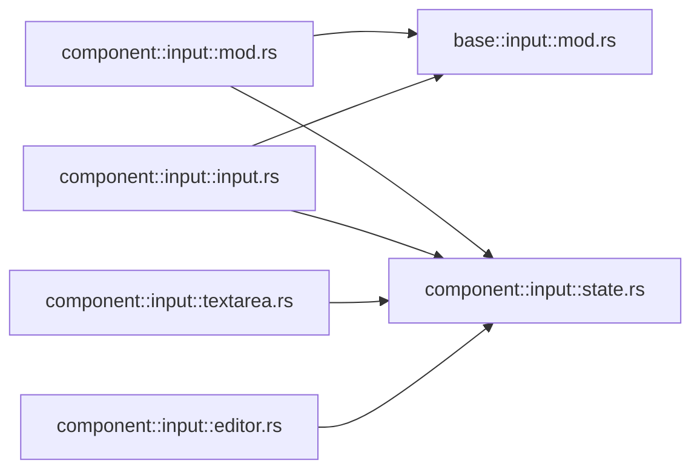

# Input 输入系统 API

<cite>
**本文引用的文件**   
- [crates/component/src/input/mod.rs](file://crates/component/src/input/mod.rs)
- [crates/component/src/input/input.rs](file://crates/component/src/input/input.rs)
- [crates/component/src/input/textarea.rs](file://crates/component/src/input/textarea.rs)
- [crates/component/src/input/editor.rs](file://crates/component/src/input/editor.rs)
- [crates/component/src/input/state.rs](file://crates/component/src/input/state.rs)
- [crates/base/src/input/mod.rs](file://crates/base/src/input/mod.rs)
</cite>

## 目录
1. [简介](#简介)
2. [项目结构](#项目结构)
3. [核心组件](#核心组件)
4. [架构总览](#架构总览)
5. [详细组件分析](#详细组件分析)
6. [依赖关系分析](#依赖关系分析)
7. [性能与可访问性](#性能与可访问性)
8. [疑难解答](#疑难解答)
9. [结论](#结论)
10. [附录：API 速查](#附录api-速查)

## 简介
本文件面向开发者，系统化梳理 gpui-kit 的 Input 输入系统 API，覆盖单行输入、多行文本、代码编辑器三类组件，以及底层共享编辑引擎。文档重点包括：
- 组件接口：Input、Textarea、Editor、InputBase（共享基础）
- 编辑能力：文本编辑、光标管理、选择区域、撤销重做
- 输入法与键盘事件：IME 组合输入、平台快捷键、上下文菜单
- 文本验证与格式化：内容类型、掩码模式、语法高亮、自动补全
- 扩展指南：自定义 Token、上下文菜单、粘贴拦截、语言配置、LSP 集成
- 无障碍与多语言：语义角色、屏幕阅读器、国际化
- 复杂场景示例：代码编辑器、带 Token 的表单、受控值与只读模式

## 项目结构
Input 输入系统由“组件层”和“共享引擎层”组成：
- 组件层位于 component 包，提供用户可见的 UI 组件与样式封装
- 共享引擎层位于 base 包，提供统一的编辑状态、光标、选择、撤销重做、语法高亮、LSP 等能力

图表来源
- [crates/component/src/input/mod.rs:1-67](file://crates/component/src/input/mod.rs#L1-L67)
- [crates/base/src/input/mod.rs:1-132](file://crates/base/src/input/mod.rs#L1-L132)

章节来源
- [crates/component/src/input/mod.rs:1-67](file://crates/component/src/input/mod.rs#L1-L67)
- [crates/base/src/input/mod.rs:1-132](file://crates/base/src/input/mod.rs#L1-L132)

## 核心组件
本节概述三类输入组件及其职责边界。

- Input（单行输入）
  - 绑定到 InputState，支持前缀/后缀、清除按钮、密码掩码切换、内容类型、语义角色、上下文菜单、粘贴拦截、触摸选择、Token 渲染与交互
  - 通过 TextInputState 将具体状态分派到底层引擎

- Textarea（多行文本）
  - 复用 Input 的渲染与行为，提供高度、外观、边框、禁用/只读、Tab 顺序、无障碍标识等属性
  - 内部转换为 Input 进行渲染

- Editor（代码编辑器）
  - 基于 EditorState，使用等宽字体与固定行高比例，支持语言配置、自动闭合括号、语法高亮、折叠、诊断、LSP 补全/定义跳转/悬停提示等
  - 同样通过 Input 渲染，但注入代码编辑专属样式与行为

- InputBase（共享基础）
  - 提供焦点、样式、语义所有者、右键菜单、粘贴拦截等通用能力
  - 所有输入组件最终都委托给 BaseInput 完成平台级输入处理

章节来源
- [crates/component/src/input/input.rs:130-421](file://crates/component/src/input/input.rs#L130-L421)
- [crates/component/src/input/textarea.rs:12-170](file://crates/component/src/input/textarea.rs#L12-L170)
- [crates/component/src/input/editor.rs:16-176](file://crates/component/src/input/editor.rs#L16-L176)
- [crates/base/src/input/mod.rs:86-132](file://crates/base/src/input/mod.rs#L86-L132)

## 架构总览
Input 输入系统的运行时流程如下：

图表来源
- [crates/component/src/input/input.rs:541-770](file://crates/component/src/input/input.rs#L541-L770)
- [crates/component/src/input/state.rs:54-235](file://crates/component/src/input/state.rs#L54-L235)
- [crates/base/src/input/mod.rs:86-132](file://crates/base/src/input/mod.rs#L86-L132)

## 详细组件分析

### Input 组件
- 关键能力
  - 绑定状态：new(state)
  - 外观与布局：appearance/bordered/focus_bordered/h(h_full)/size/tab_index
  - 行为开关：disabled/readonly/cleanable/mask_toggle/content_type/role/accessibility_id/aria_label
  - 交互扩展：context_menu/on_paste/token/on_token_click/on_token_hover
  - 无障碍：语义角色推导、值暴露控制、标签与占位符
  - 触摸选择：长按弹出选区手柄与编辑菜单（可交由平台绘制）

- 重要方法与回调
  - set_native_touch_selection：启用/禁用平台绘制触摸选择
  - on_paste：拦截剪贴板项，true 表示消费，false 走默认插入逻辑
  - context_menu：替换内置右键菜单
  - token/on_token_click/on_token_hover：自定义内联 Token 渲染与交互

- 渲染要点
  - 安装 Token 展示与悬浮监听
  - 同步焦点注册到窗口
  - 设置编辑器样式与内边距
  - 根据 content_type 或 masked 状态决定无障碍角色
  - 构建并显示浮动叠加层（搜索面板、触摸选择、补全等）

图表来源
- [crates/component/src/input/input.rs:130-421](file://crates/component/src/input/input.rs#L130-L421)

章节来源
- [crates/component/src/input/input.rs:26-128](file://crates/component/src/input/input.rs#L26-L128)
- [crates/component/src/input/input.rs:130-421](file://crates/component/src/input/input.rs#L130-L421)
- [crates/component/src/input/input.rs:541-770](file://crates/component/src/input/input.rs#L541-L770)

### Textarea 组件
- 关键能力
  - 继承 Input 的大部分外观与行为，并通过 into_input 转为 Input 渲染
  - 提供高度、外观、边框、禁用/只读、Tab 顺序、无障碍标识、上下文菜单、粘贴拦截、Token 相关回调

- 设计要点
  - 作为“普通多行文本字段”，不引入代码编辑特性
  - 保持与 Input 一致的交互体验与样式密度

图表来源
- [crates/component/src/input/textarea.rs:12-170](file://crates/component/src/input/textarea.rs#L12-L170)

章节来源
- [crates/component/src/input/textarea.rs:12-170](file://crates/component/src/input/textarea.rs#L12-L170)
- [crates/component/src/input/textarea.rs:185-223](file://crates/component/src/input/textarea.rs#L185-L223)

### Editor 组件
- 关键能力
  - 基于 EditorState，使用等宽字体与固定行高比例
  - 支持语言配置、自动闭合括号、语法高亮、折叠、诊断、LSP 补全/定义跳转/悬停提示
  - 提供高度、外观、边框、禁用/只读、Tab 顺序、无障碍标识、上下文菜单、粘贴拦截

- 设计要点
  - 通过 Input::from_state 复用渲染与交互
  - 注入代码编辑专属样式（字体族、字号、行高）
  - 测试覆盖语言配置、别名、自动闭合、预编辑上下文等复杂场景

图表来源
- [crates/component/src/input/editor.rs:16-176](file://crates/component/src/input/editor.rs#L16-L176)

章节来源
- [crates/component/src/input/editor.rs:16-176](file://crates/component/src/input/editor.rs#L16-L176)
- [crates/component/src/input/editor.rs:291-471](file://crates/component/src/input/editor.rs#L291-L471)

### 共享状态与调度：TextInputState / AnyInputState
- TextInputState
  - 对 InputState/TextareaState/EditorState 的统一抽象
  - 提供 focus/clean/toggle_masked/set_text_align/set_disabled/set_readonly/set_editor_style/set_accessibility/set_editor_paddings/ensure_highlighter_factory/on_context_menu 等方法
  - 负责触摸选择、上下文菜单能力、全选判断、边缘拖拽、编辑菜单关闭、叠加层渲染等

- AnyInputState
  - 更宽泛的枚举，包含 OtpState
  - 提供 value/focus_handle/as_input/as_textarea/as_editor/as_otp 等便捷方法
  - 用于窗口级聚焦输入注册与查询

图表来源
- [crates/component/src/input/state.rs:8-41](file://crates/component/src/input/state.rs#L8-L41)
- [crates/component/src/input/state.rs:54-235](file://crates/component/src/input/state.rs#L54-L235)
- [crates/component/src/input/state.rs:265-343](file://crates/component/src/input/state.rs#L265-L343)

章节来源
- [crates/component/src/input/state.rs:8-41](file://crates/component/src/input/state.rs#L8-L41)
- [crates/component/src/input/state.rs:54-235](file://crates/component/src/input/state.rs#L54-L235)
- [crates/component/src/input/state.rs:265-343](file://crates/component/src/input/state.rs#L265-L343)

## 依赖关系分析
- 组件对外导出
  - component::input::mod.rs 重新导出大量来自 base::input 的类型，如 EditorState、Textareastate、InputState、Rope、Selection、DisplayMap、Highlighter、LSP、LanguageProvider、MaskPattern 等
  - 同时导出组件自身类型：Editor、Textarea、NumberInput、OtpInput、group 等

- 组件对内依赖
  - Input/Textarea/Editor 均依赖 state.rs 中的 TextInputState 进行状态调度
  - Input 依赖 gpui_base::InputBase 完成平台输入、焦点、样式、语义所有者等

图表来源
- [crates/component/src/input/mod.rs:1-67](file://crates/component/src/input/mod.rs#L1-L67)
- [crates/base/src/input/mod.rs:1-132](file://crates/base/src/input/mod.rs#L1-L132)
- [crates/component/src/input/state.rs:8-41](file://crates/component/src/input/state.rs#L8-L41)

章节来源
- [crates/component/src/input/mod.rs:1-67](file://crates/component/src/input/mod.rs#L1-L67)
- [crates/base/src/input/mod.rs:1-132](file://crates/base/src/input/mod.rs#L1-L132)

## 性能与可访问性

### 性能优化建议
- 避免在渲染路径中频繁创建闭包；复用 token 渲染器与回调
- 合理使用 readonly/disabled 减少不必要的编辑计算
- 大文本场景优先使用 Editor 的虚拟滚动与按需高亮（结合 LanguageConfig 与 Highlighter）
- 谨慎使用 on_paste 的大对象处理，避免阻塞主线程
- 使用 ensure_highlighter_factory 一次性注册高亮工厂，避免重复初始化

### 可访问性最佳实践
- 为输入框设置 role/accessibility_id/aria_label，确保屏幕阅读器正确朗读
- 密码输入时通过 content_type 或 masked 状态让辅助技术识别为密码字段
- 多行输入使用 MultilineTextInput 语义角色
- 为 Token 提供可访问标签与点击/悬浮反馈

### 多语言支持
- 使用 rust_i18n 提供的 locale()/set_locale() 切换界面语言
- 组件内的文案通过 t! 宏进行本地化（例如“剪切/复制/粘贴/全选”等）

章节来源
- [crates/component/src/lib.rs:125-161](file://crates/component/src/lib.rs#L125-L161)
- [crates/component/src/input/input.rs:430-496](file://crates/component/src/input/input.rs#L430-L496)
- [crates/component/src/input/input.rs:687-752](file://crates/component/src/input/input.rs#L687-L752)

## 疑难解答

### 常见问题与排查
- 粘贴未生效
  - 检查 on_paste 是否返回 true 导致被消费
  - Web 环境下异步剪贴板读取可能不可用，需改用键盘粘贴路径
- 只读模式下仍出现编辑菜单
  - 只读仍可导航代码，仅拒绝改变文本的操作；确认 capabilities.is_editable() 分支
- 触摸选择异常
  - 可通过 set_native_touch_selection 切换由平台绘制或组件绘制
- 语言配置未生效
  - 确认 set_language_config 已调用且语言名/别名匹配
  - 首次渲染前后均可应用，注意别名共享配置的行为

章节来源
- [crates/component/src/input/input.rs:400-421](file://crates/component/src/input/input.rs#L400-L421)
- [crates/component/src/input/input.rs:617-669](file://crates/component/src/input/input.rs#L617-L669)
- [crates/component/src/input/editor.rs:291-471](file://crates/component/src/input/editor.rs#L291-L471)

## 结论
Input 输入系统在组件层提供了直观易用的 Input、Textarea、Editor 三类控件，并在共享引擎层实现了统一的编辑能力与扩展点。借助 TextInputState/AnyInputState 的状态调度机制，组件可以以一致的方式访问文本、选择、光标、历史、高亮与 LSP 能力。开发者可以通过 Token、上下文菜单、粘贴拦截、语言配置与高亮器工厂扩展输入体验，同时遵循无障碍与多语言的最佳实践，获得稳定、可访问、高性能的输入体验。

## 附录：API 速查

### 组件构造与常用方法
- Input
  - new(state), id, prefix/suffix, h/h_full, appearance/bordered/focus_bordered
  - disabled/readonly/cleanable/mask_toggle/content_type/role
  - accessibility_id/aria_label/tab_index
  - context_menu/on_paste
  - token/on_token_click/on_token_hover
- Textarea
  - new(state), h/appearance/bordered/disabled/readonly/tab_index
  - role/accessibility_id/aria_label
  - context_menu/on_paste
- Editor
  - new(state), h/appearance/bordered/disabled/readonly/tab_index
  - role/aria_label
  - context_menu/on_paste

章节来源
- [crates/component/src/input/input.rs:130-421](file://crates/component/src/input/input.rs#L130-L421)
- [crates/component/src/input/textarea.rs:12-170](file://crates/component/src/input/textarea.rs#L12-L170)
- [crates/component/src/input/editor.rs:16-176](file://crates/component/src/input/editor.rs#L16-L176)

### 共享引擎与类型（部分）
- 状态与数据：InputState、TextareaState、EditorState、Rope、Selection、Point、BufferPoint、DisplayPoint
- 显示与布局：DisplayMap、FoldRange、WrappingIndent、TabSize
- 高亮与语言：InputHighlighter、InputHighlighterFactory、HighlightStyleResolver、LanguageProvider、set_language_config、AutoClosingPair、BracketPair、IndentationRules
- LSP 与工具：CompletionProvider、CodeActionProvider、DefinitionProvider、HoverProvider、DocumentColorProvider、DocumentRangeSemanticTokensProvider、ShowDocumentHandler
- 装饰与诊断：GutterDecoration、OverviewRulerDecoration、RangeDecoration、TextDecoration、Diagnostic*
- 其他：MaskPattern、NativeMenu、CursorBlink、SearchSession、SearchMatcher

章节来源
- [crates/base/src/input/mod.rs:86-132](file://crates/base/src/input/mod.rs#L86-L132)
- [crates/component/src/input/mod.rs:22-62](file://crates/component/src/input/mod.rs#L22-L62)