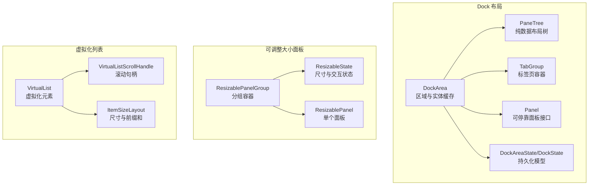
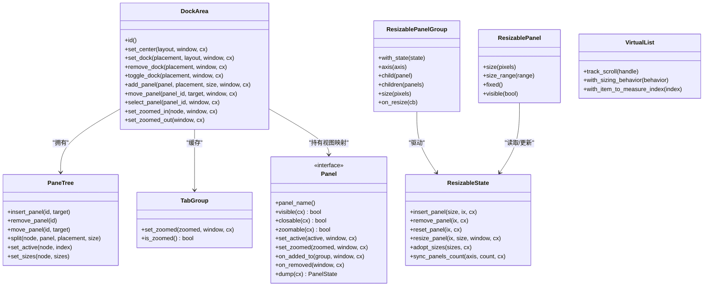
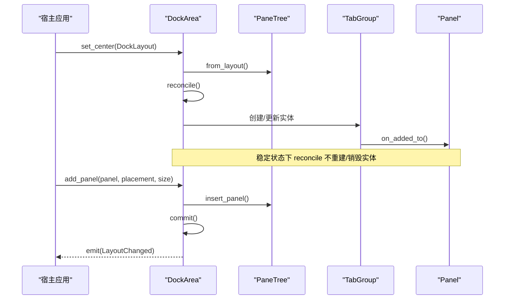
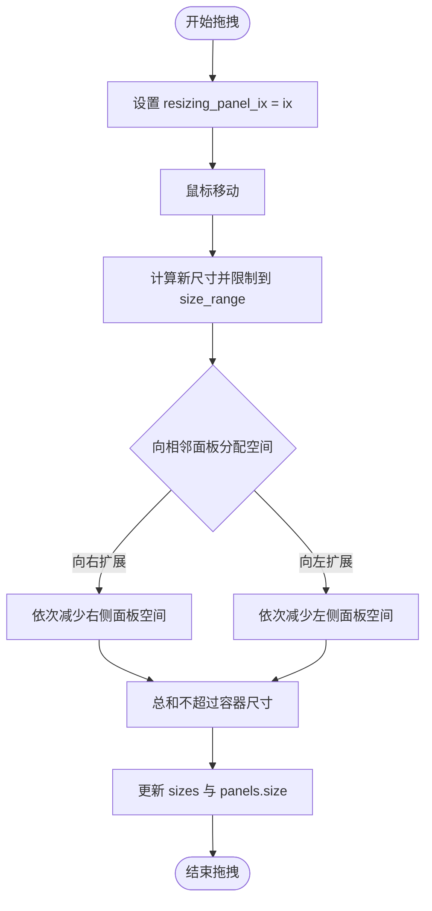
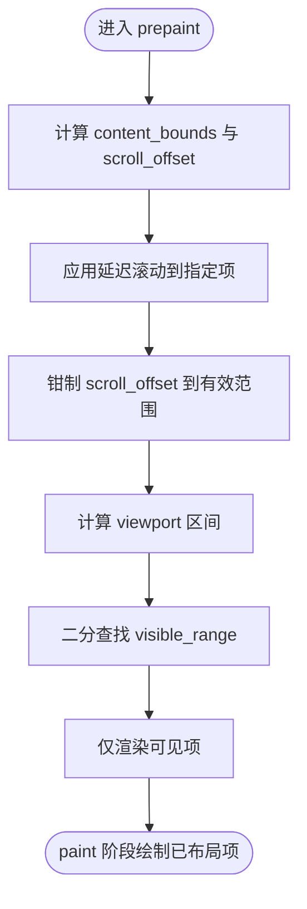
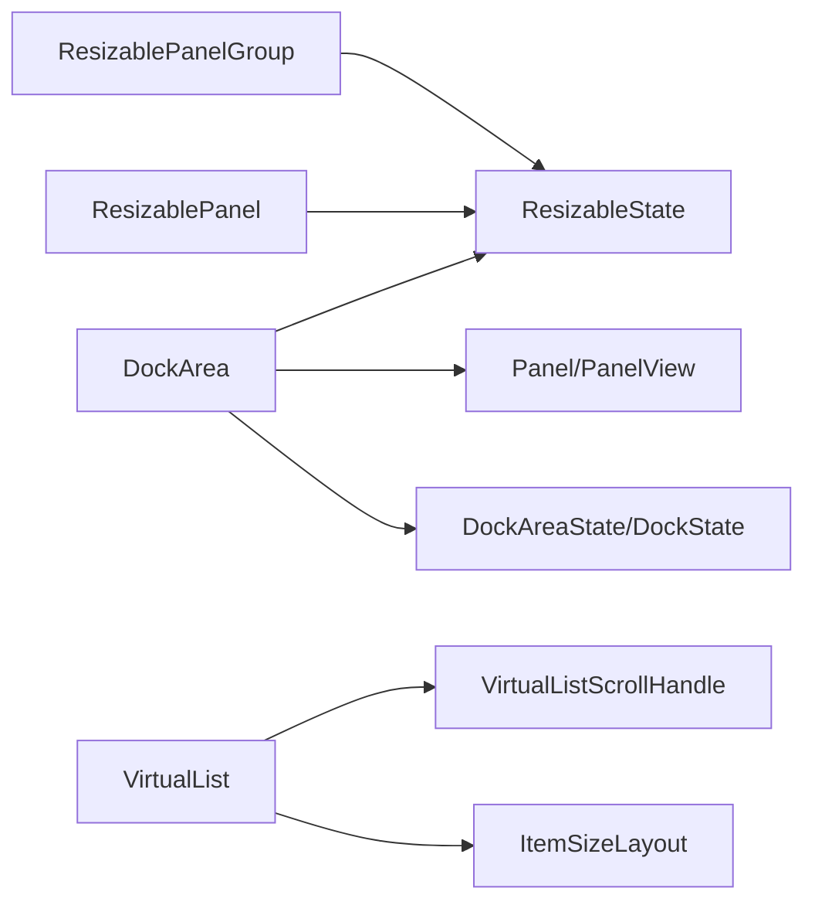

# Layout 布局系统 API

<cite>
**本文引用的文件**   
- [crates/base/src/dock/mod.rs](file://crates/base/src/dock/mod.rs)
- [crates/base/src/dock/dock_area.rs](file://crates/base/src/dock/dock_area.rs)
- [crates/base/src/dock/state.rs](file://crates/base/src/dock/state.rs)
- [crates/base/src/dock/panel.rs](file://crates/base/src/dock/panel.rs)
- [crates/base/src/resizable/mod.rs](file://crates/base/src/resizable/mod.rs)
- [crates/base/src/resizable/panel.rs](file://crates/base/src/resizable/panel.rs)
- [crates/base/src/virtual_list.rs](file://crates/base/src/virtual_list.rs)
</cite>

## 目录
1. [简介](#简介)
2. [项目结构](#项目结构)
3. [核心组件](#核心组件)
4. [架构总览](#架构总览)
5. [详细组件分析](#详细组件分析)
6. [依赖关系分析](#依赖关系分析)
7. [性能与内存优化](#性能与内存优化)
8. [故障排查指南](#故障排查指南)
9. [结论](#结论)
10. [附录：设计模式与最佳实践](#附录设计模式与最佳实践)

## 简介
本文件面向 Layout 布局系统的 API 文档，聚焦 Dock、ResizablePanel、VirtualList 三大能力，覆盖面板管理、拖拽调整、嵌套布局与虚拟化渲染机制。同时给出布局算法要点、性能优化策略、内存管理建议，以及复杂界面（IDE、数据仪表板、内容管理系统）的布局设计与跨平台适配指导。

## 项目结构
Layout 相关代码主要分布在 base 层的 dock、resizable 与 virtual_list 三个模块中：
- dock：提供可停靠区域、树形布局、面板注册与持久化等“行为层”能力，外观由宿主通过渲染器注入。
- resizable：提供可拖拽分割的可调整大小面板组与状态机。
- virtual_list：提供支持不等高/不等宽项的虚拟化列表，仅渲染可视范围以提升性能。

**图表来源**
- [crates/base/src/dock/mod.rs:1-203](file://crates/base/src/dock/mod.rs#L1-L203)
- [crates/base/src/dock/dock_area.rs:1-116](file://crates/base/src/dock/dock_area.rs#L1-L116)
- [crates/base/src/dock/state.rs:1-170](file://crates/base/src/dock/state.rs#L1-L170)
- [crates/base/src/resizable/mod.rs:1-54](file://crates/base/src/resizable/mod.rs#L1-L54)
- [crates/base/src/resizable/panel.rs:26-132](file://crates/base/src/resizable/panel.rs#L26-L132)
- [crates/base/src/virtual_list.rs:214-227](file://crates/base/src/virtual_list.rs#L214-L227)

**章节来源**
- [crates/base/src/dock/mod.rs:1-203](file://crates/base/src/dock/mod.rs#L1-L203)
- [crates/base/src/resizable/mod.rs:1-54](file://crates/base/src/resizable/mod.rs#L1-L54)
- [crates/base/src/virtual_list.rs:1-29](file://crates/base/src/virtual_list.rs#L1-L29)

## 核心组件
- Dock 布局
  - DockArea：区域管理器，维护中心区与左/右/下 Dock 的 PaneTree、实体缓存、缩放与锁定状态，负责将布局树与 GPUI 实体对齐。
  - Panel：可停靠面板的行为契约（可见性、关闭、缩放、激活、生命周期回调），具体外观在更高层实现。
  - DockAreaState/DockState：持久化数据结构，用于序列化/反序列化整个 Dock 布局。
- ResizablePanel
  - ResizablePanelGroup：水平或垂直方向的面板分组容器，负责同步子面板数量、计算尺寸、处理拖拽分割条。
  - ResizableState：分组的状态机，记录每个面板的尺寸、边界、固定标记、当前拖拽索引，并提供插入/删除/重置/程序化调整等 API。
  - ResizablePanel：单个面板，声明初始尺寸、尺寸范围、是否固定、可见性等，并挂载拖拽手柄。
- VirtualList
  - VirtualList：支持不等高/不等宽项的虚拟化列表，按轴（水平/垂直）仅渲染可视范围内的项。
  - VirtualListScrollHandle：封装底层 ScrollHandle，提供滚动到指定项、到底部等便捷方法。
  - ItemSizeLayout：维护每项沿主轴的尺寸、前缀和与内容尺寸，供可见范围计算与定位使用。

**章节来源**
- [crates/base/src/dock/dock_area.rs:95-116](file://crates/base/src/dock/dock_area.rs#L95-L116)
- [crates/base/src/dock/panel.rs:18-93](file://crates/base/src/dock/panel.rs#L18-L93)
- [crates/base/src/dock/state.rs:4-32](file://crates/base/src/dock/state.rs#L4-L32)
- [crates/base/src/resizable/mod.rs:18-54](file://crates/base/src/resizable/mod.rs#L18-L54)
- [crates/base/src/resizable/panel.rs:26-132](file://crates/base/src/resizable/panel.rs#L26-L132)
- [crates/base/src/virtual_list.rs:214-227](file://crates/base/src/virtual_list.rs#L214-L227)

## 架构总览
Dock 采用“布局即数据 + 渲染分离”的设计：PaneTree 是纯值类型，DockArea 负责将其投影为 GPUI 实体；外观通过 DockAreaRenderer/TabGroupRenderer 注入，基础层不绘制任何颜色、边框或尺寸。ResizablePanel 提供通用拖拽分割能力，被 Dock 内部复用以表达 Split 槽位尺寸。VirtualList 独立于 Dock/Resizable，提供高性能长列表渲染。

**图表来源**
- [crates/base/src/dock/dock_area.rs:118-365](file://crates/base/src/dock/dock_area.rs#L118-L365)
- [crates/base/src/dock/panel.rs:18-93](file://crates/base/src/dock/panel.rs#L18-L93)
- [crates/base/src/resizable/mod.rs:18-54](file://crates/base/src/resizable/mod.rs#L18-L54)
- [crates/base/src/resizable/panel.rs:26-132](file://crates/base/src/resizable/panel.rs#L26-L132)
- [crates/base/src/virtual_list.rs:214-227](file://crates/base/src/virtual_list.rs#L214-L227)

## 详细组件分析

### Dock 布局组件
- 区域与树
  - DockArea 维护 center 与多个 Dock 的 PaneTree，并通过 groups/splits/panels 缓存实体与视图映射。
  - 所有编辑（插入、移除、移动、拆分、设置活跃项、设置尺寸）均通过 PaneTree 完成，并在返回时进行规范化，保证树自洽。
- 面板与生命周期
  - Panel 定义可见性、关闭、缩放、激活、加入/离开组、销毁等钩子；PanelView 提供对象安全的访问接口。
- 持久化
  - DockAreaState/DockState/PanelState/PanelInfo 描述中心区、各 Dock、面板及其堆叠/标签页结构与活跃项，支持序列化/反序列化。

**图表来源**
- [crates/base/src/dock/dock_area.rs:228-365](file://crates/base/src/dock/dock_area.rs#L228-L365)
- [crates/base/src/dock/dock_area.rs:367-710](file://crates/base/src/dock/dock_area.rs#L367-L710)

**章节来源**
- [crates/base/src/dock/mod.rs:1-203](file://crates/base/src/dock/mod.rs#L1-L203)
- [crates/base/src/dock/dock_area.rs:95-116](file://crates/base/src/dock/dock_area.rs#L95-L116)
- [crates/base/src/dock/dock_area.rs:228-365](file://crates/base/src/dock/dock_area.rs#L228-L365)
- [crates/base/src/dock/dock_area.rs:367-710](file://crates/base/src/dock/dock_area.rs#L367-L710)
- [crates/base/src/dock/panel.rs:18-93](file://crates/base/src/dock/panel.rs#L18-L93)
- [crates/base/src/dock/state.rs:4-170](file://crates/base/src/dock/state.rs#L4-L170)

### ResizablePanel 组件
- 分组与状态
  - ResizablePanelGroup 负责同步子面板数量、轴向、尺寸约束，并在 prepaint 阶段根据容器尺寸变化按比例调整。
  - ResizableState 维护 panels/sizes/fixed/resizing_panel_ix/bounds，提供 resize_panel_at_handle 的核心算法。
- 拖拽与交互
  - 拖拽起始于 ResizePanelGroupElement.on_mouse_event，更新 ResizableState.resizing_panel_ix，随后在鼠标移动中调用 resize_panel_at_handle 重新分配空间。
  - 释放鼠标后触发 done_resizing 并回调 on_resize。
- 固定面板与比例保持
  - fixed 面板在容器尺寸变化时保持自身尺寸，其余面板按比例分享剩余空间；drag 不会从非目标固定面板取空间。

**图表来源**
- [crates/base/src/resizable/panel.rs:416-523](file://crates/base/src/resizable/panel.rs#L416-L523)
- [crates/base/src/resizable/mod.rs:302-379](file://crates/base/src/resizable/mod.rs#L302-L379)

**章节来源**
- [crates/base/src/resizable/mod.rs:18-54](file://crates/base/src/resizable/mod.rs#L18-L54)
- [crates/base/src/resizable/mod.rs:56-436](file://crates/base/src/resizable/mod.rs#L56-L436)
- [crates/base/src/resizable/panel.rs:26-132](file://crates/base/src/resizable/panel.rs#L26-L132)
- [crates/base/src/resizable/panel.rs:242-306](file://crates/base/src/resizable/panel.rs#L242-L306)
- [crates/base/src/resizable/panel.rs:320-414](file://crates/base/src/resizable/panel.rs#L320-L414)
- [crates/base/src/resizable/panel.rs:416-523](file://crates/base/src/resizable/panel.rs#L416-L523)

### VirtualList 组件
- 可见范围计算
  - 基于 ItemSizeLayout.sizes 与 origins 的前缀和，使用二分查找快速确定 viewport 相交的项区间，并包含一个过绘项以保证平滑滚动。
- 渲染管线
  - request_layout 阶段计算 longest_item_size 与 content_size，并按 ListSizingBehavior 决定布局策略。
  - prepaint 阶段计算 content_bounds、scroll_offset、viewport，调用 visible_range 得到可见项索引，再按需渲染。
- 滚动控制
  - VirtualListScrollHandle 支持 scroll_to_item、scroll_to_bottom，并支持延迟滚动策略（Center/Top 等）。

**图表来源**
- [crates/base/src/virtual_list.rs:388-413](file://crates/base/src/virtual_list.rs#L388-L413)
- [crates/base/src/virtual_list.rs:435-599](file://crates/base/src/virtual_list.rs#L435-L599)
- [crates/base/src/virtual_list.rs:601-743](file://crates/base/src/virtual_list.rs#L601-L743)

**章节来源**
- [crates/base/src/virtual_list.rs:1-29](file://crates/base/src/virtual_list.rs#L1-L29)
- [crates/base/src/virtual_list.rs:30-127](file://crates/base/src/virtual_list.rs#L30-L127)
- [crates/base/src/virtual_list.rs:129-212](file://crates/base/src/virtual_list.rs#L129-L212)
- [crates/base/src/virtual_list.rs:214-337](file://crates/base/src/virtual_list.rs#L214-L337)
- [crates/base/src/virtual_list.rs:339-413](file://crates/base/src/virtual_list.rs#L339-L413)
- [crates/base/src/virtual_list.rs:415-743](file://crates/base/src/virtual_list.rs#L415-L743)

## 依赖关系分析
- Dock 与 Resizable
  - DockArea 在拆分节点处复用 ResizableState 来承载 Split 槽位的尺寸与交互，确保布局树与 UI 尺寸一致。
- Dock 与 VirtualList
  - 面板内容可使用 VirtualList 渲染大量数据，Dock 不关心其内部渲染细节，仅通过 Panel 接口协调生命周期与可见性。
- Resizable 与 VirtualList
  - 两者相互独立；Resizable 管理分组尺寸，VirtualList 管理长列表虚拟化，可在同一界面组合使用。

**图表来源**
- [crates/base/src/dock/dock_area.rs:95-116](file://crates/base/src/dock/dock_area.rs#L95-L116)
- [crates/base/src/resizable/mod.rs:18-54](file://crates/base/src/resizable/mod.rs#L18-L54)
- [crates/base/src/virtual_list.rs:214-227](file://crates/base/src/virtual_list.rs#L214-L227)

**章节来源**
- [crates/base/src/dock/dock_area.rs:95-116](file://crates/base/src/dock/dock_area.rs#L95-L116)
- [crates/base/src/resizable/mod.rs:18-54](file://crates/base/src/resizable/mod.rs#L18-L54)
- [crates/base/src/virtual_list.rs:214-227](file://crates/base/src/virtual_list.rs#L214-L227)

## 性能与内存优化
- Dock
  - 布局树为纯值类型，reconcile 在稳态下不创建/销毁实体，避免拖动过程中无关面板状态丢失。
  - 通过 NodeId/PanelId 的稳定标识，使差异对比最小化重绘。
- ResizablePanel
  - adjust_to_container_size 仅在存在明确尺寸偏好时按比例缩放，避免未测量面板干扰比例计算。
  - 拖拽过程中对 sizes 与 panels.size 的更新有防抖与边界检查，防止无效通知。
- VirtualList
  - 仅渲染可见范围，使用二分查找计算可见区间，减少 DOM/元素构建开销。
  - ItemSizeLayout 使用前缀和与共享 Rc<Vec> 降低帧间拷贝成本。
  - 滚动偏移钳制与延迟滚动策略提升交互流畅度。

[本节为通用性能讨论，不直接分析具体文件]

## 故障排查指南
- Dock 面板未显示
  - 检查 Panel::visible 是否返回 false；若容器内所有面板隐藏，容器会放弃槽位。
  - 确认 Panel 已通过 PanelRegistry 正确注册，且 PanelId 稳定。
- 拖拽分割条无响应
  - 确认 ResizablePanelGroup 的 axis 与子面板一致；检查是否在最后一个面板上尝试拖拽（无手柄）。
  - 查看 ResizableState.resizing_panel_ix 是否正确设置并在 MouseMove 中更新。
- 虚拟列表滚动异常
  - 检查 item_sizes 是否与 items_count 一致；确认 with_item_to_measure_index 指向有效项。
  - 验证 scroll_to_item 的策略与 offset 参数是否符合预期。

**章节来源**
- [crates/base/src/dock/panel.rs:18-93](file://crates/base/src/dock/panel.rs#L18-L93)
- [crates/base/src/resizable/panel.rs:396-414](file://crates/base/src/resizable/panel.rs#L396-L414)
- [crates/base/src/resizable/panel.rs:416-523](file://crates/base/src/resizable/panel.rs#L416-L523)
- [crates/base/src/virtual_list.rs:129-212](file://crates/base/src/virtual_list.rs#L129-L212)
- [crates/base/src/virtual_list.rs:601-743](file://crates/base/src/virtual_list.rs#L601-L743)

## 结论
Layout 布局系统通过“布局即数据”的 Dock 引擎、通用的 ResizablePanel 拖拽分割能力与高效的 VirtualList 虚拟化渲染，提供了可扩展、高性能且易于测试的界面布局方案。结合渲染器注入与稳定的 ID 体系，既能满足 IDE 级复杂布局，也能支撑数据仪表板与内容管理系统的高效呈现。

[本节为总结性内容，不直接分析具体文件]

## 附录：设计模式与最佳实践
- 复杂界面布局模式
  - IDE 界面：中心编辑器区使用 Tabs+Split，侧边栏与底部终端作为 Dock；编辑器内容使用 VirtualList 渲染大文件行。
  - 数据仪表板：主区域使用 ResizablePanelGroup 划分图表、表格与详情面板；关键指标面板设为 fixed 以保持宽度。
  - 内容管理系统：左侧导航 Dock，中间内容区使用 VirtualList 渲染文章列表，右侧属性面板可折叠。
- 响应式布局
  - 使用 ResizablePanelGroup.adjust_to_container_size 的比例保持特性，在小屏设备上自动压缩非固定面板。
  - 通过 DockPlacement.axis 判断横竖屏，动态切换 Dock 位置或隐藏次要 Dock。
- 多窗口管理
  - 每个窗口实例维护独立的 DockArea；通过 DockAreaState 序列化/反序列化恢复用户布局。
- 跨平台适配
  - Dock 渲染器与 TabGroup 渲染器在不同平台可定制外观；基础行为保持一致。
  - VirtualList 在 WebAssembly 与原生平台均可用，注意 item_sizes 的计算需考虑字体与 DPI。

[本节为概念性指导，不直接分析具体文件]