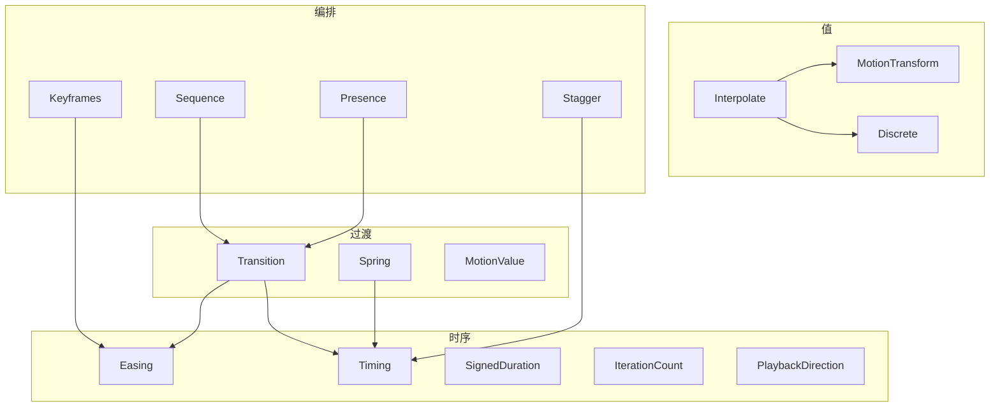
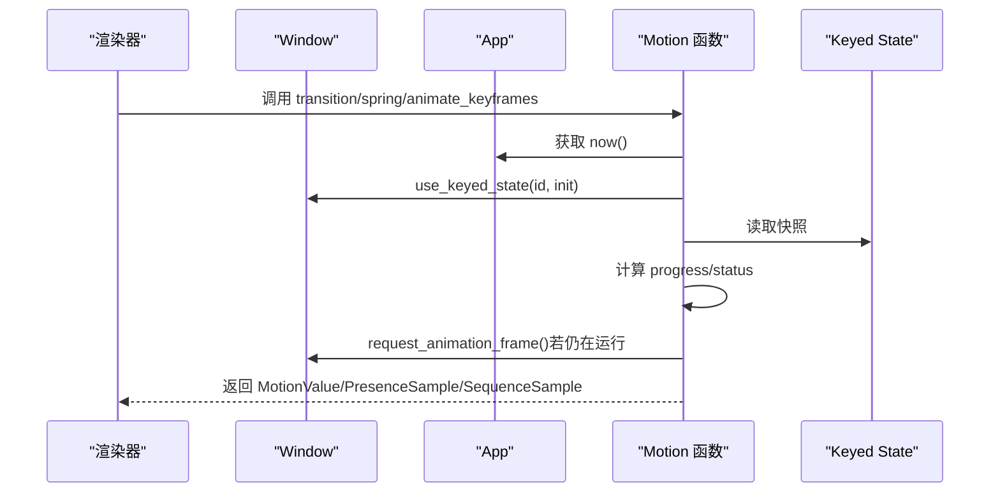
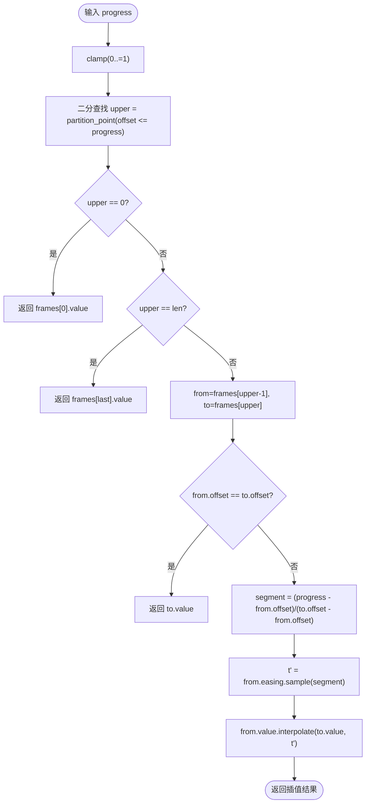
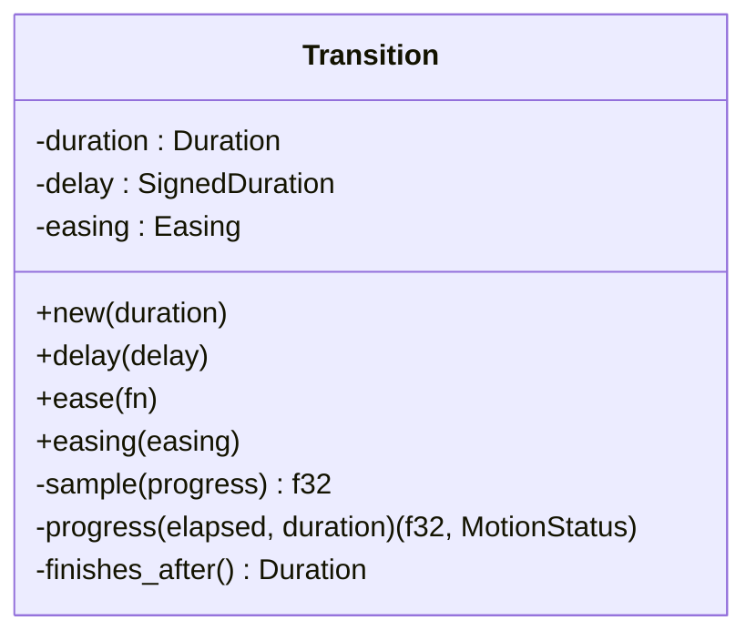
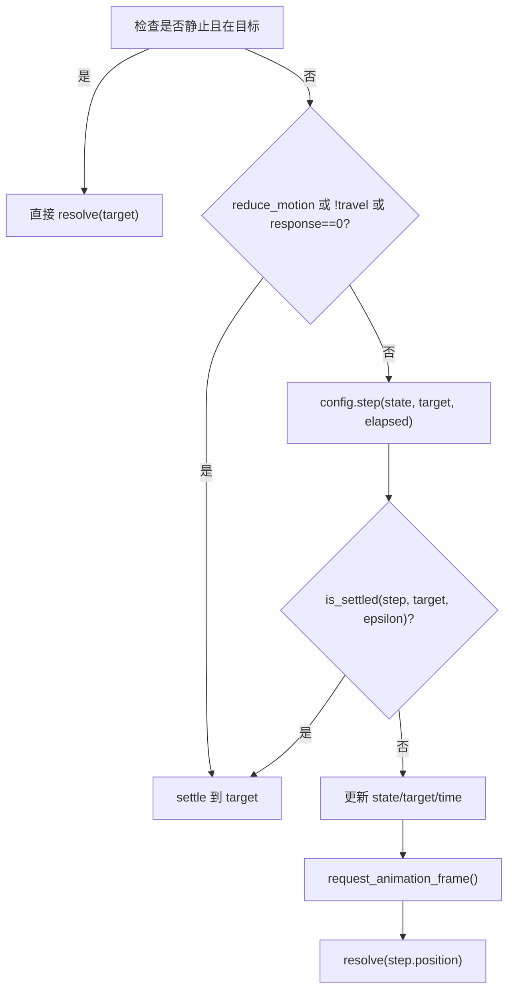
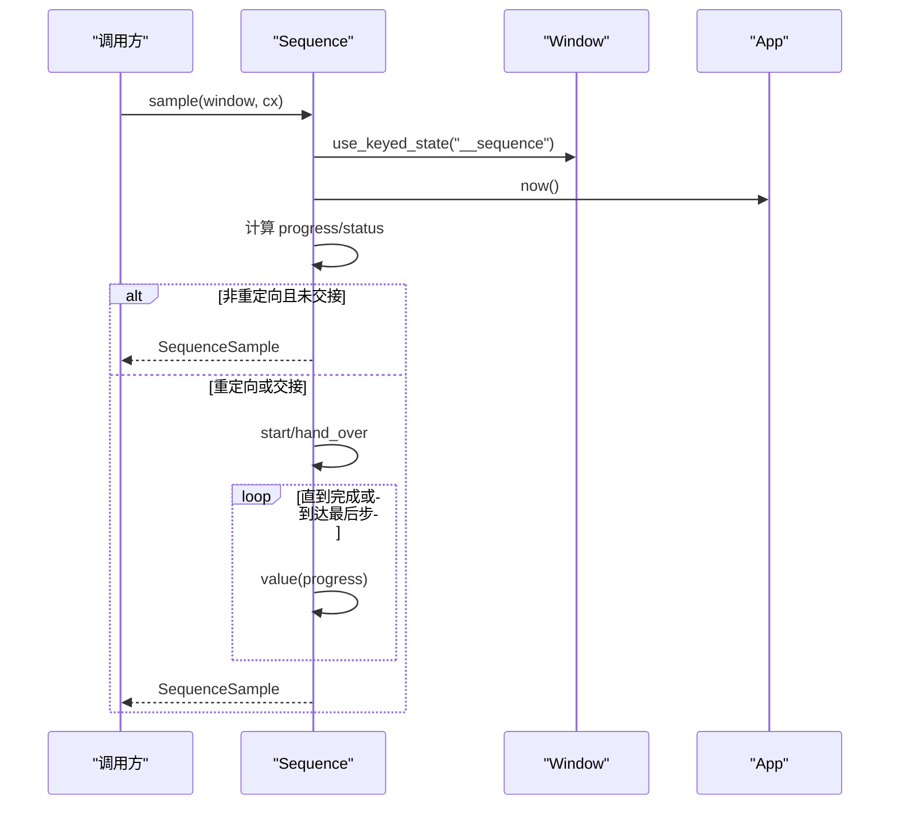
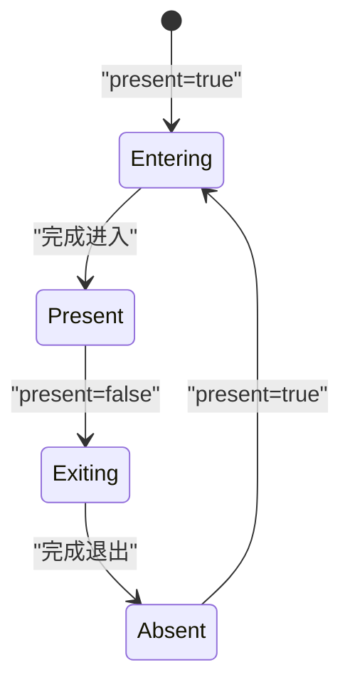
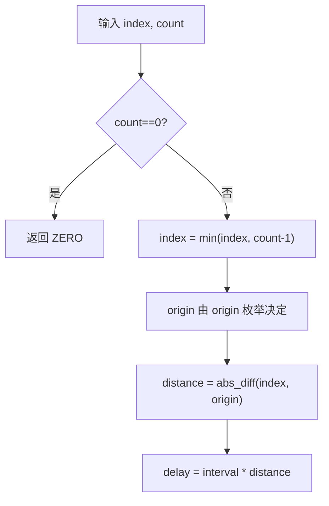
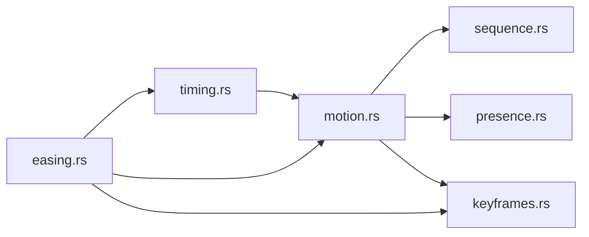

# Motion 动画系统 API

<cite>
**本文引用的文件**   
- [motion.rs](file://crates/base/src/motion.rs)
- [keyframes.rs](file://crates/base/src/motion/keyframes.rs)
- [sequence.rs](file://crates/base/src/motion/sequence.rs)
- [stagger.rs](file://crates/base/src/motion/stagger.rs)
- [presence.rs](file://crates/base/src/motion/presence.rs)
- [timing.rs](file://crates/base/src/motion/timing.rs)
- [easing.rs](file://crates/base/src/motion/easing.rs)
</cite>

## 目录
1. [简介](#简介)
2. [项目结构](#项目结构)
3. [核心类型与职责](#核心类型与职责)
4. [架构总览](#架构总览)
5. [详细组件分析](#详细组件分析)
6. [依赖关系分析](#依赖关系分析)
7. [性能与 GPU 加速](#性能与-gpu-加速)
8. [调试与故障排查](#调试与故障排查)
9. [常用动画模式指南](#常用动画模式指南)
10. [结论](#结论)

## 简介
本文件系统化梳理 gpui-kit 的 Motion 动画系统，覆盖 Keyframe、Keyframes、Transition、Spring、Sequence、Stagger、Presence、MotionValue、MotionTransform、Timing、Easing 等核心类型的接口语义、状态流转和使用方式。文档同时说明关键帧定义、缓动函数、时间控制、状态管理、组合与交错动画的实现方法，并给出性能优化、GPU 加速建议与调试技巧。

## 项目结构
Motion 动画系统位于 base crate 的 motion 模块中，采用“值驱动 + 时序策略”的分层设计：
- 值层：Interpolate、MotionTransform、Discrete 描述可插值的值。
- 过渡层：Transition、Spring 提供基于时长或物理弹簧的值过渡。
- 时序层：Timing、Easing、SignedDuration、IterationCount、PlaybackDirection 描述 CSS 风格的时序与缓动。
- 编排层：Keyframes、Sequence、Presence、Stagger 组合多个值与时序，形成复杂动画。
- 运行时：transition、spring、animate_keyframes 等函数在 GPUI 渲染上下文中采样并请求下一帧。



**图表来源**
- [motion.rs:36-104](file://crates/base/src/motion.rs#L36-L104)
- [motion.rs:112-173](file://crates/base/src/motion.rs#L112-L173)
- [motion.rs:421-561](file://crates/base/src/motion.rs#L421-L561)
- [timing.rs:74-175](file://crates/base/src/motion/timing.rs#L74-L175)
- [easing.rs:64-235](file://crates/base/src/motion/easing.rs#L64-L235)
- [keyframes.rs:6-99](file://crates/base/src/motion/keyframes.rs#L6-L99)
- [sequence.rs:6-96](file://crates/base/src/motion/sequence.rs#L6-L96)
- [presence.rs:28-32](file://crates/base/src/motion/presence.rs#L28-L32)
- [stagger.rs:3-37](file://crates/base/src/motion/stagger.rs#L3-L37)

**章节来源**
- [motion.rs:1-31](file://crates/base/src/motion.rs#L1-L31)

## 核心类型与职责
- Interpolate：定义任意可插值类型的统一接口，支持线性插值。
- MotionTransform：封装平移、缩放、旋转、透明度，实现逐属性插值，便于直接映射到 GPU 变换管线。
- Transition：CSS 风格时长过渡，支持延迟、缓动、反向缩短返回路径。
- Spring：物理弹簧过渡，保持速度连续性，适合拖拽后回弹、弹性效果。
- Keyframe / Keyframes：关键帧轨道，每段可配置独立缓动；支持离散切换 Discrete。
- Timing：延迟、时长、迭代次数、播放方向、缓动曲线，输出带方向的进度。
- Sequence：按顺序串接多个 Transition，边界精确衔接，支持重定向重启。
- Presence：元素存在性（进入/呈现/退出/消失）的状态机，配合 Transition 控制显隐动画。
- Stagger：交错延迟，支持从首项、末项、中心或指定索引出发计算每项延迟。
- MotionValue：包裹当前值与状态（Idle/Delayed/Running/Finished）。
- Easing：内置与自定义缓动曲线，兼容 CSS ease/ease-in/ease-out/ease-in-out、cubic-bezier、steps、linear stops。

**章节来源**
- [motion.rs:36-104](file://crates/base/src/motion.rs#L36-L104)
- [motion.rs:112-173](file://crates/base/src/motion.rs#L112-L173)
- [motion.rs:421-561](file://crates/base/src/motion.rs#L421-L561)
- [keyframes.rs:6-99](file://crates/base/src/motion/keyframes.rs#L6-L99)
- [timing.rs:74-175](file://crates/base/src/motion/timing.rs#L74-L175)
- [sequence.rs:6-96](file://crates/base/src/motion/sequence.rs#L6-L96)
- [presence.rs:28-32](file://crates/base/src/motion/presence.rs#L28-L32)
- [stagger.rs:3-37](file://crates/base/src/motion/stagger.rs#L3-L37)
- [easing.rs:64-235](file://crates/base/src/motion/easing.rs#L64-L235)

## 架构总览
Motion 系统在渲染阶段被调用，通过 GPUI 的 keyed state 保存每个动画实例的起始时间与中间状态，按需请求下一帧。所有公共 API 都遵循“值 + 策略 + 上下文”的模式：
- transition / spring：对单一目标值进行过渡。
- animate_keyframes：对 Keyframes 轨道进行采样。
- Presence::sample：根据 present 布尔值驱动进入/退出状态。
- Sequence::sample：串联多个 Transition，维护步骤状态。



**图表来源**
- [motion.rs:268-361](file://crates/base/src/motion.rs#L268-L361)
- [motion.rs:374-410](file://crates/base/src/motion.rs#L374-L410)
- [motion.rs:579-653](file://crates/base/src/motion.rs#L579-L653)
- [presence.rs:48-128](file://crates/base/src/motion/presence.rs#L48-L128)
- [sequence.rs:131-208](file://crates/base/src/motion/sequence.rs#L131-L208)

## 详细组件分析

### Keyframe 与 Keyframes
- Keyframe：包含 offset（0..=1）、value、easing。
- Keyframes：校验至少两帧、单调递增偏移、端点为 0 和 1；sample(progress) 使用二分查找定位区间，并按段内 easing 插值。
- Discrete：在 switch_at 处切换 from/to，常用于条件动画或状态突变。



**图表来源**
- [keyframes.rs:42-90](file://crates/base/src/motion/keyframes.rs#L42-L90)

**章节来源**
- [keyframes.rs:6-99](file://crates/base/src/motion/keyframes.rs#L6-L99)
- [keyframes.rs:101-141](file://crates/base/src/motion/keyframes.rs#L101-L141)

### Transition
- 构造：new(duration)，默认 ease_out_cubic。
- 配置：delay、ease、easing。
- 内部：progress(elapsed, duration) 返回 (progress, status)；finish_after 用于序列衔接。
- 返回值：transition 返回值，transition_with_status 返回 MotionValue。



**图表来源**
- [motion.rs:112-173](file://crates/base/src/motion.rs#L112-L173)

**章节来源**
- [motion.rs:112-173](file://crates/base/src/motion.rs#L112-L173)

### Spring
- 参数：response（周期尺度）、damping（阻尼比）、epsilon（收敛容差）、travel（是否移动）。
- 行为：当处于静止且已在目标时零开销；否则步进 SpringState，达到 epsilon 即 settle。
- 适用：拖拽释放后的弹性回弹、需要速度连续性的场景。



**图表来源**
- [motion.rs:579-653](file://crates/base/src/motion.rs#L579-L653)

**章节来源**
- [motion.rs:421-561](file://crates/base/src/motion.rs#L421-L561)
- [motion.rs:579-653](file://crates/base/src/motion.rs#L579-L653)

### Sequence
- 组成：from + Vec<SequenceStep>，每个 step 含 target 与 Transition。
- 行为：按步推进，边界精确衔接；改变当前步 target 会重启序列；未播放步变更不影响已播放步。
- 输出：SequenceSample(value, step, status)。



**图表来源**
- [sequence.rs:131-208](file://crates/base/src/motion/sequence.rs#L131-L208)

**章节来源**
- [sequence.rs:6-96](file://crates/base/src/motion/sequence.rs#L6-L96)
- [sequence.rs:131-208](file://crates/base/src/motion/sequence.rs#L131-L208)

### Presence
- 状态机：Entering → Present → Exiting → Absent。
- 行为：present=true 时进入，false 时退出；finished 后稳定到 Present/Absent；should_render 排除 Absent。
- 与 Transition 复用相同的延迟/缓动/反向缩短逻辑。



**图表来源**
- [presence.rs:7-26](file://crates/base/src/motion/presence.rs#L7-L26)
- [presence.rs:48-128](file://crates/base/src/motion/presence.rs#L48-L128)

**章节来源**
- [presence.rs:7-26](file://crates/base/src/motion/presence.rs#L7-L26)
- [presence.rs:28-32](file://crates/base/src/motion/presence.rs#L28-L32)
- [presence.rs:48-128](file://crates/base/src/motion/presence.rs#L48-L128)

### Stagger
- 原点：First、Last、Center、Index(index)。
- 计算：delay(index, count) 基于 index 与原点的距离乘以 interval，避免分配调度表。



**图表来源**
- [stagger.rs:17-37](file://crates/base/src/motion/stagger.rs#L17-L37)

**章节来源**
- [stagger.rs:3-37](file://crates/base/src/motion/stagger.rs#L3-L37)

### Timing 与 Easing
- Timing：支持 delay（可为负）、duration、iterations（Finite/Infinite）、direction（Normal/Reverse/Alternate/AlternateReverse）、easing。
- Easing：Linear、Ease、EaseIn、EaseOut、EaseInOut、CubicBezier、Steps、LinearStops、Custom。

```mermaid
classDiagram
class Timing {
-delay : SignedDuration
-duration : Duration
-iterations : IterationCount
-direction : PlaybackDirection
-easing : Easing
+new(duration)
+delay(d)
+iterations(n)
+direction(dir)
+ease(e)
+sample(elapsed) TimingSample
}
class Easing {
<<enum>>
Linear
Ease
EaseIn
EaseOut
EaseInOut
CubicBezier{x1,y1,x2,y2}
Steps{count,position}
LinearStops[(input,output)]
Custom(fn)
+sample(progress) f32
}
```

**图表来源**
- [timing.rs:74-175](file://crates/base/src/motion/timing.rs#L74-L175)
- [easing.rs:64-235](file://crates/base/src/motion/easing.rs#L64-L235)

**章节来源**
- [timing.rs:74-175](file://crates/base/src/motion/timing.rs#L74-L175)
- [easing.rs:64-235](file://crates/base/src/motion/easing.rs#L64-L235)

## 依赖关系分析
- motion.rs 导出 Easing、Keyframe、Keyframes、Presence、Sequence、Stagger、Timing 等公共类型。
- keyframes.rs 依赖 Easing 与 Interpolate。
- sequence.rs 依赖 Transition、TransitionId、Instant、Interpolate、MotionStatus。
- presence.rs 依赖 Transition、TransitionId、MotionStatus。
- stagger.rs 仅依赖 Duration 与 StaggerOrigin。
- timing.rs 依赖 Easing。
- easing.rs 依赖 animation 中的 cubic_bezier 工具。



**图表来源**
- [motion.rs:14-30](file://crates/base/src/motion.rs#L14-L30)
- [keyframes.rs:1-3](file://crates/base/src/motion/keyframes.rs#L1-L3)
- [sequence.rs:1-3](file://crates/base/src/motion/sequence.rs#L1-L3)
- [presence.rs:1-5](file://crates/base/src/motion/presence.rs#L1-L5)
- [timing.rs:1-3](file://crates/base/src/motion/timing.rs#L1-L3)

**章节来源**
- [motion.rs:14-30](file://crates/base/src/motion.rs#L14-L30)

## 性能与 GPU 加速
- 减少不必要的帧请求：
  - Spring 在静止且位于目标时直接 resolve，不构建 config 也不步进，零额外开销。
  - Presence、Sequence、Transition 仅在 Delayed/Running 时请求下一帧。
- 降低抖动与重绘：
  - 使用 MotionTransform 将位移、缩放、旋转、透明度作为一组值插值，便于一次性应用到 GPU 变换矩阵。
  - 对像素级动画可适当增大 Spring.epsilon，提前结束子像素运动，减少帧请求。
- 减少运动时的 CPU 压力：
  - 开启 reduce_motion 时，所有动画立即解析为目标值，不请求帧。
  - 使用 Timing.direction=Alternate 等组合时注意迭代次数，避免无限循环导致持续帧请求。
- GPU 加速建议：
  - 优先使用 transform（translate/scale/rotate）与 opacity 这类可由合成器处理的属性。
  - 避免在动画中频繁改变 layout-affecting 属性（如 width/height），改用尺寸插值并在必要时结合 will-change 思维（GPUI 侧由组件负责）。
  - 批量更新：同一帧内尽量合并多次目标变化，避免反复重建 Transition/Spring 策略。

**章节来源**
- [motion.rs:602-653](file://crates/base/src/motion.rs#L602-L653)
- [motion.rs:357-361](file://crates/base/src/motion.rs#L357-L361)
- [motion.rs:403-410](file://crates/base/src/motion.rs#L403-L410)
- [presence.rs:111-128](file://crates/base/src/motion/presence.rs#L111-L128)
- [sequence.rs:174-208](file://crates/base/src/motion/sequence.rs#L174-L208)

## 调试与故障排查
- 常见错误与原因：
  - Keyframes 校验失败：缺少端点、偏移非单调、偏移越界、帧数不足。
  - Easing 参数非法：cubic-bezier 控制点非有限或 x 不在 [0,1]；steps 计数无效；linear_stops 输入/输出非法。
  - Spring 参数非法：damping 非负有限；epsilon 正有限。
- 调试手段：
  - 使用 transition_with_status 或 SequenceSample.status 观察 Idle/Delayed/Running/Finished。
  - 在测试中通过 executor.advance_clock 推进时间，验证边界与状态转换。
  - 使用 PresenceSample.should_render 判断是否应渲染。
  - 利用 reduce_motion 快速验证无动画分支的正确性。

**章节来源**
- [keyframes.rs:42-68](file://crates/base/src/motion/keyframes.rs#L42-L68)
- [easing.rs:113-176](file://crates/base/src/motion/easing.rs#L113-L176)
- [motion.rs:494-544](file://crates/base/src/motion.rs#L494-L544)
- [motion.rs:958-970](file://crates/base/src/motion.rs#L958-L970)
- [motion.rs:1019-1065](file://crates/base/src/motion.rs#L1019-L1065)
- [motion.rs:1120-1174](file://crates/base/src/motion.rs#L1120-L1174)

## 常用动画模式指南

### 淡入淡出
- 使用 Presence 控制 present 布尔值，搭配 Transition 设置淡入/淡出时长与缓动。
- should_render 确保 Absent 阶段不渲染。

参考路径
- [presence.rs:48-128](file://crates/base/src/motion/presence.rs#L48-L128)

### 滑动
- 使用 MotionTransform.translation 与 Transition 或 Spring 驱动。
- 对大列表建议使用 Stagger 错开入场，提升观感。

参考路径
- [motion.rs:64-104](file://crates/base/src/motion.rs#L64-L104)
- [stagger.rs:17-37](file://crates/base/src/motion/stagger.rs#L17-L37)

### 缩放
- 使用 MotionTransform.scale 与 ease_out 或 Spring 弹性缩放。
- 对像素级缩放适当增大 Spring.epsilon 以提前结束。

参考路径
- [motion.rs:64-104](file://crates/base/src/motion.rs#L64-L104)
- [motion.rs:519-544](file://crates/base/src/motion.rs#L519-L544)

### 弹性效果
- 使用 Spring.with_damping < 1.0 产生过冲，with_travel=false 在交互中暂停移动但保留状态。
- 适用于按钮点击反馈、卡片弹出等。

参考路径
- [motion.rs:472-517](file://crates/base/src/motion.rs#L472-L517)
- [motion.rs:579-653](file://crates/base/src/motion.rs#L579-L653)

### 关键帧动画
- 使用 Keyframes 定义多段关键帧，每段可配不同 easing。
- 结合 Timing.iterations 与 direction 实现循环或交替播放。

参考路径
- [keyframes.rs:42-90](file://crates/base/src/motion/keyframes.rs#L42-L90)
- [timing.rs:113-175](file://crates/base/src/motion/timing.rs#L113-L175)

### 序列动画
- 使用 Sequence 串联多个 Transition，适合“先位移再缩放再淡出”的多阶段动画。
- 改变当前步 target 会重启序列；未播放步变更不影响已播放步。

参考路径
- [sequence.rs:131-208](file://crates/base/src/motion/sequence.rs#L131-L208)

### 交错动画
- 使用 Stagger 计算每项延迟，结合 Keyframes 或 Transition 实现瀑布式入场。
- 选择合适 origin（First/Last/Center/Index）以获得自然视觉流。

参考路径
- [stagger.rs:17-37](file://crates/base/src/motion/stagger.rs#L17-L37)

## 结论
Motion 动画系统以 Interpolate 为核心抽象，围绕 Transition、Spring、Keyframes、Sequence、Presence、Stagger 构建了从单值到复杂编排的完整能力。其设计强调：
- 值与策略分离，便于组合与复用。
- 时序与缓动兼容 CSS 语义，降低学习成本。
- 状态机清晰，便于调试与测试。
- 性能敏感路径零开销或最小开销，合理请求帧。
在实际项目中，推荐优先使用 transform 与 opacity 进行 GPU 友好动画，并结合 Spring 与 Stagger 提升交互质感；对于复杂流程，使用 Sequence 组织阶段，用 Presence 管理生命周期，用 Keyframes 表达非线性节奏。