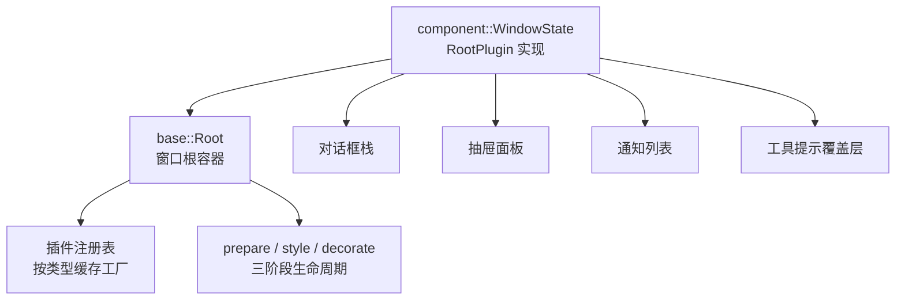
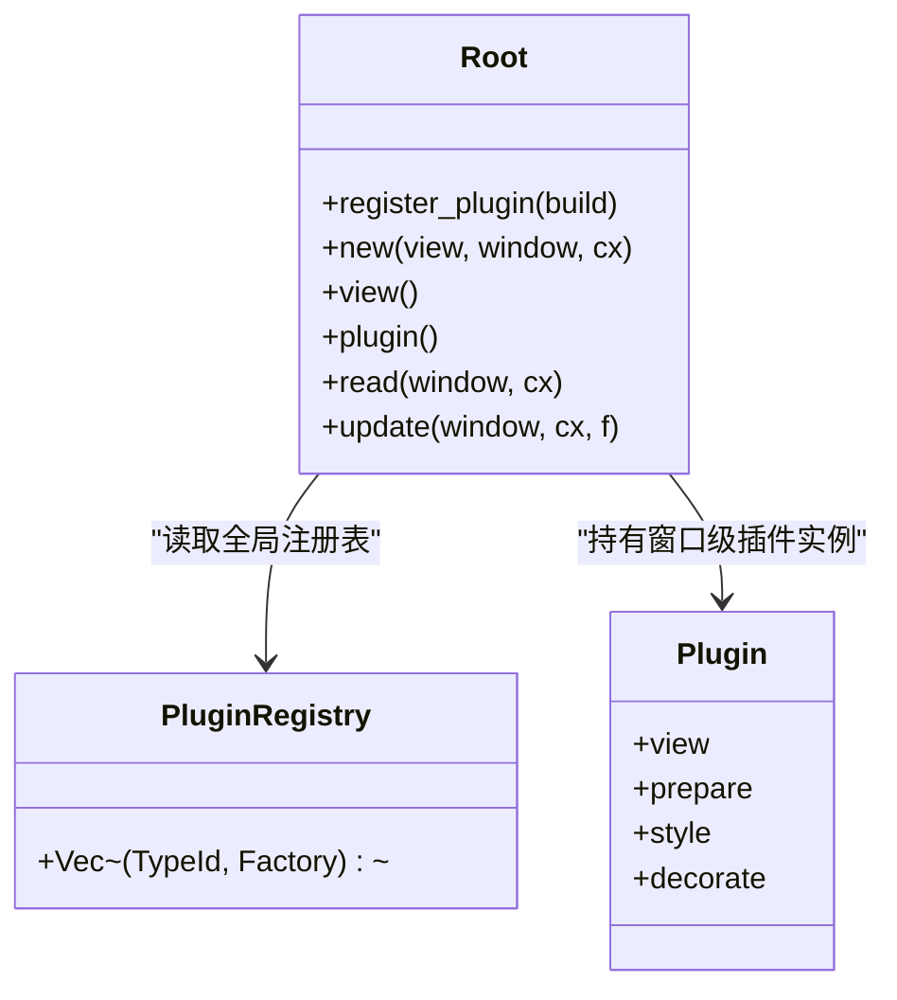
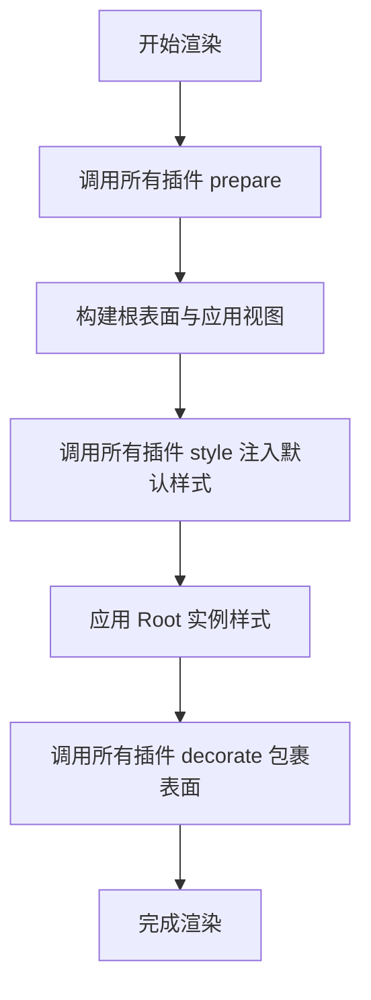
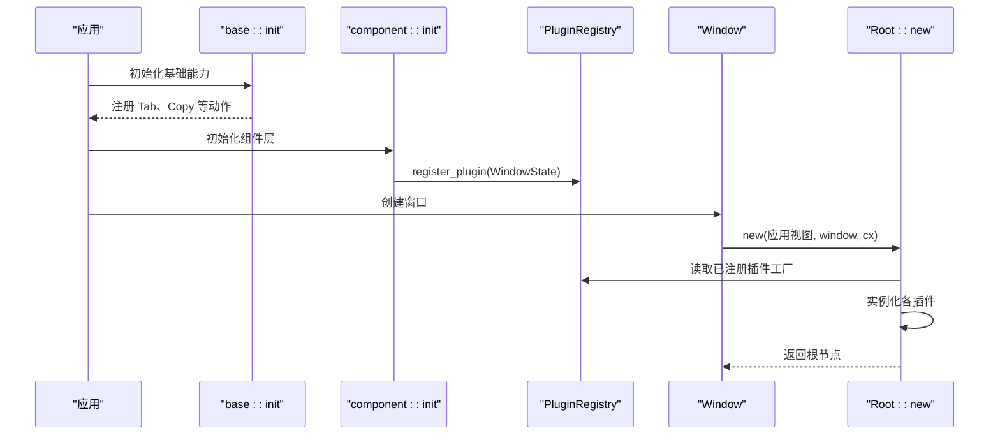
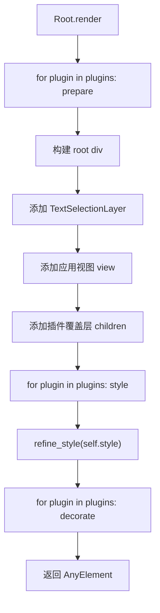
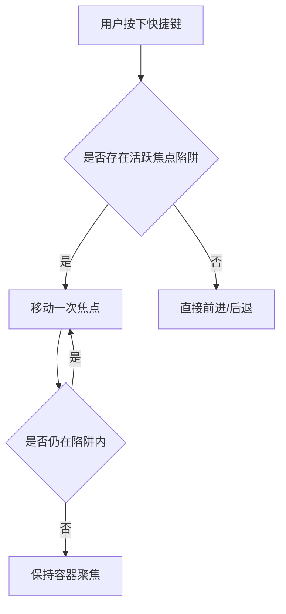
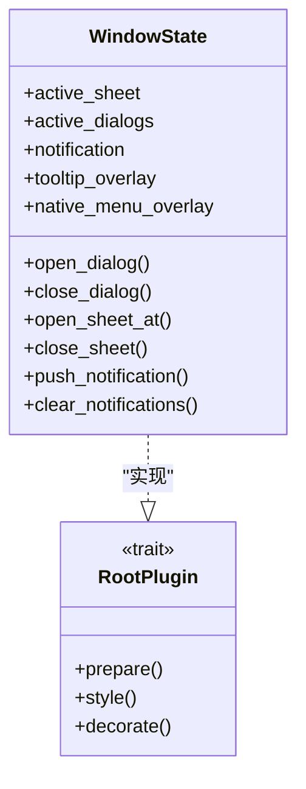
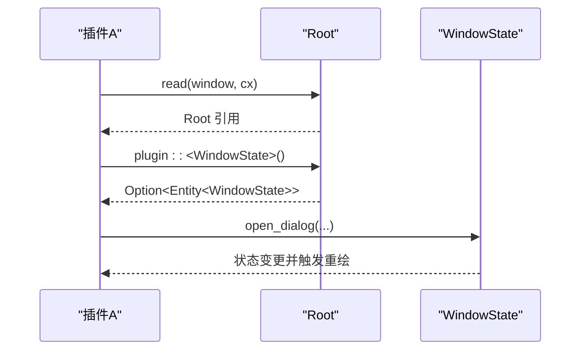

# Root 根元素 API

<cite>
**本文引用的文件**   
- [crates/base/src/root.rs](file://crates/base/src/root.rs)
- [crates/component/src/root.rs](file://crates/component/src/root.rs)
</cite>

## 目录
1. [简介](#简介)
2. [项目结构定位](#项目结构定位)
3. [核心概念与职责边界](#核心概念与职责边界)
4. [Root 类型总览](#root-类型总览)
5. [RootPlugin 接口规范](#rootplugin-接口规范)
6. [应用初始化与插件注册流程](#应用初始化与插件注册流程)
7. [窗口渲染生命周期](#窗口渲染生命周期)
8. [事件处理机制](#事件处理机制)
9. [组件层 WindowState 插件实现](#组件层-windowstate-插件实现)
10. [插件间通信与数据共享](#插件间通信与数据共享)
11. [构建方式与配置选项](#构建方式与配置选项)
12. [性能与注意事项](#性能与注意事项)
13. [常见问题排查](#常见问题排查)
14. [结论](#结论)

## 简介
本文面向使用 gpui-kit 的开发者，系统化说明 Root 根元素及其插件体系的使用方法。重点包括：
- Root 作为窗口内容宿主和覆盖层容器的职责。
- RootPlugin 接口的生命周期钩子、样式注入与装饰器扩展点。
- 应用初始化、插件注册、窗口创建、渲染阶段与事件处理的完整流程。
- 组件库提供的 WindowState 插件如何复用 Root 能力，提供对话框、抽屉、通知、工具提示等窗口级能力。
- 插件间的访问方式、状态隔离与资源管理建议。

## 项目结构定位
Root 相关能力由两层共同组成：
- base 层提供通用 Root 类型、插件注册表、基础事件绑定与焦点遍历逻辑。
- component 层基于 RootPlugin 实现 WindowState，封装对话框、抽屉、通知、工具提示、原生菜单回退等窗口级 UI 能力。

**图示来源**
- [crates/base/src/root.rs:53-103](file://crates/base/src/root.rs#L53-L103)
- [crates/base/src/root.rs:109-124](file://crates/base/src/root.rs#L109-L124)
- [crates/base/src/root.rs:126-240](file://crates/base/src/root.rs#L126-L240)
- [crates/component/src/root.rs:21-23](file://crates/component/src/root.rs#L21-L23)
- [crates/component/src/root.rs:25-43](file://crates/component/src/root.rs#L25-L43)
- [crates/component/src/root.rs:711-737](file://crates/component/src/root.rs#L711-L737)

**章节来源**
- [crates/base/src/root.rs:1-13](file://crates/base/src/root.rs#L1-L13)
- [crates/component/src/root.rs:1-23](file://crates/component/src/root.rs#L1-L23)

## 核心概念与职责边界
- Root 是窗口内容的根容器，负责挂载应用视图、文本选择层、插件覆盖层，并统一处理 Tab、Shift+Tab、复制等动作。
- RootPlugin 是“表现层插件”抽象，允许第三方或上层组件在窗口根上注入默认样式、包裹外层容器、同步窗口状态。
- WindowState 是组件库对 RootPlugin 的具体实现，集中管理对话框、抽屉、通知、工具提示、触摸选区等窗口级状态。

关键职责划分：
- base::Root：不依赖具体 UI 组件库，只负责根容器、插件调度、基础事件。
- component::WindowState：依赖组件库能力，提供业务常用的窗口级交互。

**章节来源**
- [crates/base/src/root.rs:53-73](file://crates/base/src/root.rs#L53-L73)
- [crates/component/src/root.rs:25-43](file://crates/component/src/root.rs#L25-L43)

## Root 类型总览
Root 的核心能力包括：
- 全局注册插件工厂，供后续窗口实例化时重建插件实体。
- 构造窗口根，收集已注册插件并按顺序执行 prepare、style、decorate。
- 提供读取当前窗口 Root、更新 Root、查找指定类型插件实体的方法。
- 内置 Tab 前进、Tab 后退、复制选中文本等动作处理。

**图示来源**
- [crates/base/src/root.rs:109-117](file://crates/base/src/root.rs#L109-L117)
- [crates/base/src/root.rs:120-124](file://crates/base/src/root.rs#L120-L124)
- [crates/base/src/root.rs:126-240](file://crates/base/src/root.rs#L126-L240)

**章节来源**
- [crates/base/src/root.rs:120-240](file://crates/base/src/root.rs#L120-L240)

## RootPlugin 接口规范
RootPlugin 定义了三阶段生命周期钩子：

| 钩子 | 调用时机 | 主要用途 | 注意事项 |
|---|---|---|---|
| `prepare` | 每次渲染前，先于元素构建 | 同步窗口级设置，例如 rem 大小、文本选择作用域 | 不应产生元素，也不应主动触发 notify |
| `style` | 插件默认样式注入阶段 | 为根表面设置字体、背景、前景色等默认样式 | 实例样式会覆盖插件默认样式 |
| `decorate` | 所有样式应用后 | 包裹根表面，添加边框、遮罩、外层容器等 | 可读取 Root 但不修改其内部状态 |

**图示来源**
- [crates/base/src/root.rs:59-73](file://crates/base/src/root.rs#L59-L73)
- [crates/base/src/root.rs:246-277](file://crates/base/src/root.rs#L246-L277)

**章节来源**
- [crates/base/src/root.rs:74-103](file://crates/base/src/root.rs#L74-L103)
- [crates/base/src/root.rs:246-277](file://crates/base/src/root.rs#L246-L277)

## 应用初始化与插件注册流程
典型流程如下：
1. 在应用启动时调用 base 层初始化，注册基础键绑定。
2. 在组件层初始化中，通过 Root::register_plugin 注册 WindowState。
3. 创建窗口时传入应用视图，由 Root::new 构建根容器并实例化所有已注册插件。
4. 每个窗口拥有独立的插件实体；重复注册同一类型只会替换未来窗口的工厂。

**图示来源**
- [crates/base/src/root.rs:42-51](file://crates/base/src/root.rs#L42-L51)
- [crates/component/src/root.rs:21-23](file://crates/component/src/root.rs#L21-L23)
- [crates/base/src/root.rs:129-173](file://crates/base/src/root.rs#L129-L173)
- [crates/base/src/root.rs:175-190](file://crates/base/src/root.rs#L175-L190)

**章节来源**
- [crates/base/src/root.rs:42-51](file://crates/base/src/root.rs#L42-L51)
- [crates/component/src/root.rs:21-23](file://crates/component/src/root.rs#L21-L23)
- [crates/base/src/root.rs:129-190](file://crates/base/src/root.rs#L129-L190)

## 窗口渲染生命周期
Root 每次渲染都会按固定顺序执行插件生命周期：

1. 遍历所有插件，调用 `prepare`。
2. 构建根 div、文本选择层、应用视图、插件覆盖层。
3. 遍历所有插件，调用 `style` 注入默认样式。
4. 合并 Root 实例样式。
5. 遍历所有插件，调用 `decorate` 包裹最终表面。

**图示来源**
- [crates/base/src/root.rs:246-277](file://crates/base/src/root.rs#L246-L277)

**章节来源**
- [crates/base/src/root.rs:246-277](file://crates/base/src/root.rs#L246-L277)

## 事件处理机制
Root 内置以下动作：
- Tab：将焦点移动到下一个可聚焦控件。
- Shift+Tab：将焦点移动到上一个可聚焦控件。
- Copy：复制当前文本选区内容。

此外，Root 还包含一个辅助函数用于在存在焦点陷阱时安全地遍历焦点，避免焦点跳出模态范围。

**图示来源**
- [crates/base/src/root.rs:14-40](file://crates/base/src/root.rs#L14-L40)
- [crates/base/src/root.rs:222-239](file://crates/base/src/root.rs#L222-L239)

**章节来源**
- [crates/base/src/root.rs:14-40](file://crates/base/src/root.rs#L14-L40)
- [crates/base/src/root.rs:222-239](file://crates/base/src/root.rs#L222-L239)

## 组件层 WindowState 插件实现
component 层的 WindowState 实现了 RootPlugin，承担以下职责：
- 在 `prepare` 中设置 rem 大小、激活当前文本选择作用域。
- 在 `style` 中注入主题字体、背景、前景色。
- 在 `decorate` 中添加窗口边框。
- 管理对话框栈、抽屉面板、通知列表、工具提示覆盖层、原生菜单回退覆盖层。
- 提供打开/关闭对话框、打开/关闭抽屉、推送/清除通知等窗口级 API。

**图示来源**
- [crates/component/src/root.rs:25-43](file://crates/component/src/root.rs#L25-L43)
- [crates/component/src/root.rs:375-512](file://crates/component/src/root.rs#L375-L512)
- [crates/component/src/root.rs:560-602](file://crates/component/src/root.rs#L560-L602)
- [crates/component/src/root.rs:711-737](file://crates/component/src/root.rs#L711-L737)

**章节来源**
- [crates/component/src/root.rs:21-43](file://crates/component/src/root.rs#L21-L43)
- [crates/component/src/root.rs:375-602](file://crates/component/src/root.rs#L375-L602)
- [crates/component/src/root.rs:711-737](file://crates/component/src/root.rs#L711-L737)

## 插件间通信与数据共享
Root 提供了两种主要访问方式：
- 通过 `Root::plugin::<V>()` 获取某个已注册插件的实体。
- 通过 `Root::read()` 和 `Root::update()` 从当前窗口读取或更新 Root。

component 层的 WindowState 进一步封装了窗口级操作，例如打开对话框、推送通知。其他插件可以通过 Root 获取 WindowState 实体，从而共享窗口级状态。

**图示来源**
- [crates/base/src/root.rs:197-210](file://crates/base/src/root.rs#L197-L210)
- [crates/component/src/root.rs:123-125](file://crates/component/src/root.rs#L123-L125)
- [crates/component/src/root.rs:375-408](file://crates/component/src/root.rs#L375-L408)

**章节来源**
- [crates/base/src/root.rs:197-210](file://crates/base/src/root.rs#L197-L210)
- [crates/component/src/root.rs:123-125](file://crates/component/src/root.rs#L123-L125)
- [crates/component/src/root.rs:375-408](file://crates/component/src/root.rs#L375-L408)

## 构建方式与配置选项
### Root 构建
- 使用 `Root::new(view, window, cx)` 创建根节点，其中 `view` 是应用主视图。
- 使用 `Root::register_plugin::<V>(cx, build)` 在全局注册插件工厂。
- 使用 `Root::plugin::<V>()` 获取窗口内某插件实体。
- 使用 `Root::read()` 和 `Root::update()` 从窗口上下文读写 Root。

### RootPlugin 配置
- `prepare`：适合设置 rem、激活文本选择作用域等窗口级前置逻辑。
- `style`：适合设置字体族、背景色、前景色等默认样式。
- `decorate`：适合添加窗口边框、遮罩、外层容器等结构性包装。

### 示例路径
- 插件注册入口：[crates/component/src/root.rs:21-23](file://crates/component/src/root.rs#L21-L23)
- Root 构造与插件实例化：[crates/base/src/root.rs:175-190](file://crates/base/src/root.rs#L175-L190)
- 插件生命周期执行：[crates/base/src/root.rs:246-277](file://crates/base/src/root.rs#L246-L277)
- WindowState 插件实现：[crates/component/src/root.rs:711-737](file://crates/component/src/root.rs#L711-L737)

**章节来源**
- [crates/base/src/root.rs:129-190](file://crates/base/src/root.rs#L129-L190)
- [crates/base/src/root.rs:246-277](file://crates/base/src/root.rs#L246-L277)
- [crates/component/src/root.rs:21-23](file://crates/component/src/root.rs#L21-L23)
- [crates/component/src/root.rs:711-737](file://crates/component/src/root.rs#L711-L737)

## 性能与注意事项
- 插件工厂在应用初始化时捕获，因此注册行为影响的是之后创建的窗口，而不是已有窗口。
- 插件实体在每个窗口独立创建，重复注册同一类型不会导致同一窗口出现多个实例。
- `prepare` 和 `style` 在渲染期间运行，不应主动调用 notify，否则可能引发额外渲染。
- 插件覆盖层按注册顺序叠加，后注册的插件显示在上层。
- 文本选择作用域会在对话框或抽屉打开时被隔离，避免背景内容被误选或复制。

**章节来源**
- [crates/base/src/root.rs:66-73](file://crates/base/src/root.rs#L66-L73)
- [crates/base/src/root.rs:136-148](file://crates/base/src/root.rs#L136-L148)
- [crates/base/src/root.rs:246-277](file://crates/base/src/root.rs#L246-L277)
- [crates/component/src/root.rs:404-407](file://crates/component/src/root.rs#L404-L407)

## 常见问题排查
- 未调用组件层初始化：如果直接使用组件库能力但未调用 `gpui_component::init`，则 WindowState 插件未注册，访问窗口状态时会报错。
- 插件未生效：确认已在应用启动阶段调用 `Root::register_plugin`，且新窗口是在注册之后创建的。
- 样式冲突：插件默认样式会被 Root 实例样式覆盖，如需更高优先级，应在 `decorate` 中包裹更外层容器或使用更具体的样式策略。
- 焦点异常：若自定义模态区域未正确使用焦点陷阱，可能导致 Tab 遍历跳出预期范围；可使用 Root 内置的焦点遍历逻辑或结合组件库的焦点控制能力。

**章节来源**
- [crates/component/src/root.rs:752-753](file://crates/component/src/root.rs#L752-L753)
- [crates/base/src/root.rs:129-173](file://crates/base/src/root.rs#L129-L173)
- [crates/base/src/root.rs:246-277](file://crates/base/src/root.rs#L246-L277)

## 结论
Root 是 gpui-kit 窗口级能力的根基：它提供稳定的根容器、插件注册机制和三阶段生命周期，使表现层插件可以安全地注入样式、包裹容器并同步窗口状态。component 层的 WindowState 在此基础上实现了对话框、抽屉、通知、工具提示等常用窗口级功能。对于自定义插件，推荐遵循 RootPlugin 的生命周期约定，并通过 Root 提供的 API 与其他插件协作，避免直接耦合具体组件实现。