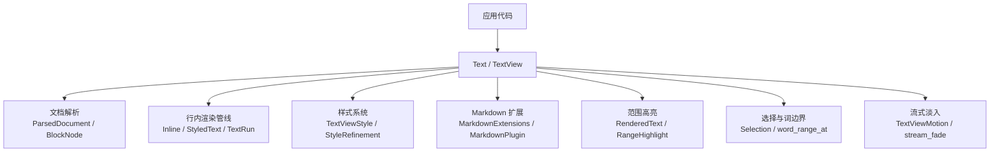
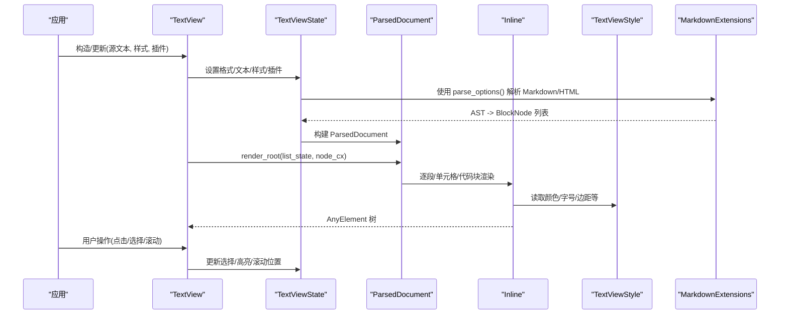
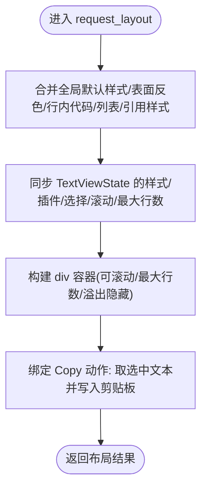
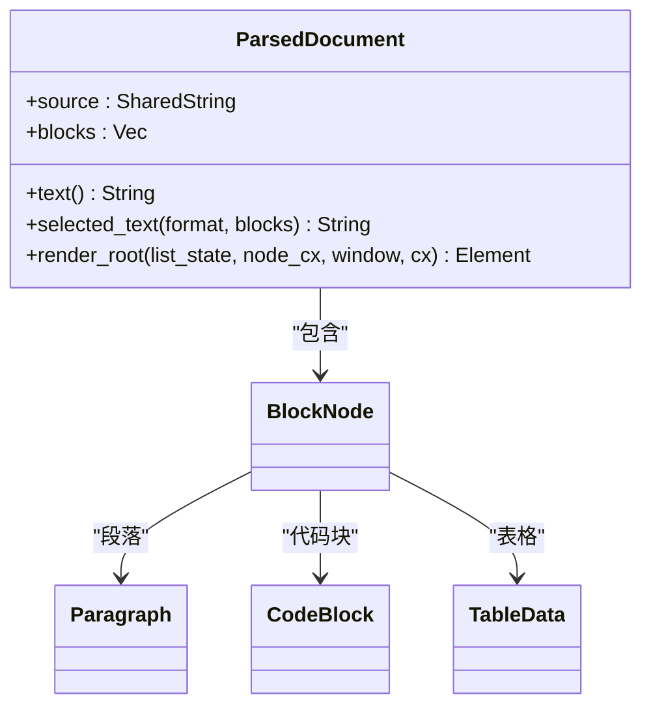
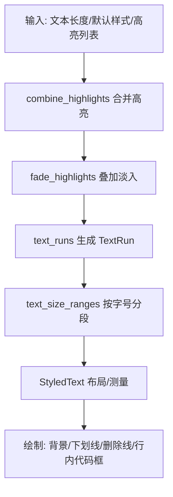
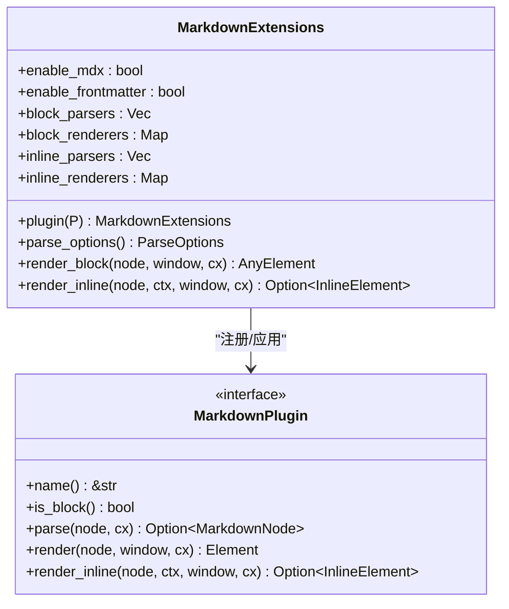
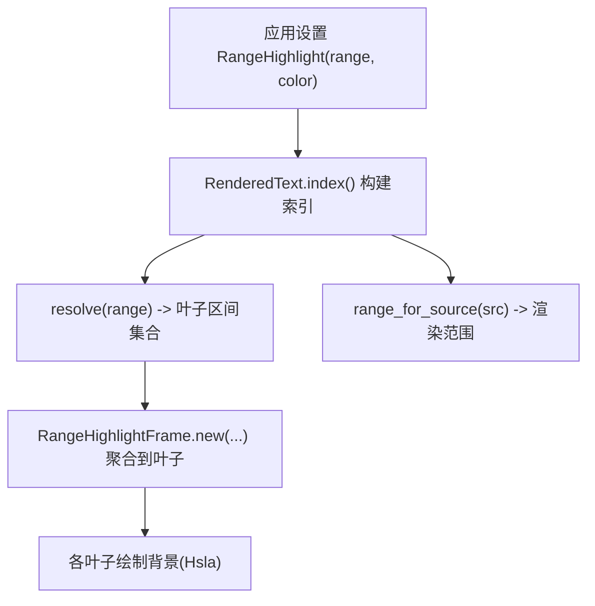
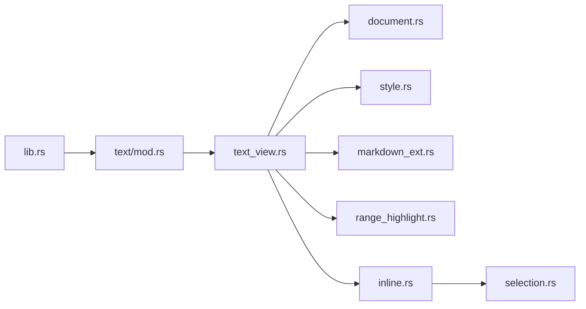

# Text 文本处理 API

<cite>
**本文引用的文件**   
- [lib.rs](file://crates/base/src/lib.rs)
- [mod.rs](file://crates/base/src/text/mod.rs)
- [text_view.rs](file://crates/base/src/text/text_view.rs)
- [document.rs](file://crates/base/src/text/document.rs)
- [inline.rs](file://crates/base/src/text/inline.rs)
- [style.rs](file://crates/base/src/text/style.rs)
- [markdown_ext.rs](file://crates/base/src/text/markdown_ext.rs)
- [inline_element.rs](file://crates/base/src/text/inline_element.rs)
- [range_highlight.rs](file://crates/base/src/text/range_highlight.rs)
- [selection.rs](file://crates/base/src/text/selection.rs)
</cite>

## 目录
1. [简介](#简介)
2. [项目结构](#项目结构)
3. [核心组件](#核心组件)
4. [架构总览](#架构总览)
5. [详细组件分析](#详细组件分析)
6. [依赖关系分析](#依赖关系分析)
7. [性能与渲染优化](#性能与渲染优化)
8. [故障排查指南](#故障排查指南)
9. [结论](#结论)
10. [附录：API 速查](#附录api-速查)

## 简介
本文件系统性梳理 Text 文本处理 API，覆盖以下主题：
- 文档模型、渲染上下文、样式系统与格式化机制
- Markdown 解析、HTML 渲染、富文本处理与流式渲染
- 文本搜索、高亮、选择与复制粘贴实现指南
- 国际化支持、字体管理与渲染性能优化
- 富文本编辑器、文档查看器与内容管理系统的集成示例思路

该子系统以 TextView 为核心，提供对 Markdown 与 HTML 的富文本渲染能力，并通过 InlineElement、MarkdownPlugin、RangeHighlight 等扩展点支持自定义节点、语法高亮、范围高亮与流式淡入。

## 项目结构
Text 子系统位于 base 层，对外暴露 Text、TextView、Markdown、InlineElement 等类型；内部按职责拆分为文档解析、节点树、行内元素、样式、选择、高亮、流式动画等模块。

图表来源
- [mod.rs:1-35](file://crates/base/src/text/mod.rs#L1-L35)
- [text_view.rs:136-175](file://crates/base/src/text/text_view.rs#L136-L175)
- [document.rs:15-20](file://crates/base/src/text/document.rs#L15-L20)
- [inline.rs:311-340](file://crates/base/src/text/inline.rs#L311-L340)
- [style.rs:7-39](file://crates/base/src/text/style.rs#L7-L39)
- [markdown_ext.rs:244-255](file://crates/base/src/text/markdown_ext.rs#L244-L255)
- [range_highlight.rs:57-63](file://crates/base/src/text/range_highlight.rs#L57-L63)
- [selection.rs:1-13](file://crates/base/src/text/selection.rs#L1-L13)

章节来源
- [mod.rs:1-35](file://crates/base/src/text/mod.rs#L1-L35)
- [lib.rs:188-193](file://crates/base/src/lib.rs#L188-L193)

## 核心组件
- Text：统一承载纯字符串或 TextView 的枚举类型，提供 style/get_text/render 等便捷方法。
- TextView：Markdown/HTML 富文本视图，负责状态管理、样式解析、插件扩展、滚动与最大行数裁剪、链接点击、图片源替换、表格/代码块回调等。
- ParsedDocument：解析后的文档 AST（BlockNode 列表），提供文本提取、选择文本生成、根节点渲染等。
- Inline：行内文本与对象渲染单元，负责 StyledText 构建、保留布局缓存、选择投影、范围背景绘制、流式淡入等。
- TextViewStyle：富文本样式体系，包含前景色、链接色、选择色、段落间距、标题样式、代码块/表格/行内代码样式、反色适配等。
- MarkdownExtensions / MarkdownPlugin：Markdown 扩展注册中心与插件接口，支持 MDX、Frontmatter、自定义块/行内节点解析与渲染。
- RenderedText / RangeHighlight：基于渲染文本索引的范围高亮与定位，支持从源码范围映射到渲染范围。
- Selection / word_range_at：字符分类与单词边界计算，支撑双击选词、多击扩展等交互。

章节来源
- [mod.rs:51-115](file://crates/base/src/text/mod.rs#L51-L115)
- [text_view.rs:136-175](file://crates/base/src/text/text_view.rs#L136-L175)
- [document.rs:15-20](file://crates/base/src/text/document.rs#L15-L20)
- [inline.rs:311-340](file://crates/base/src/text/inline.rs#L311-L340)
- [style.rs:7-39](file://crates/base/src/text/style.rs#L7-L39)
- [markdown_ext.rs:44-75](file://crates/base/src/text/markdown_ext.rs#L44-L75)
- [range_highlight.rs:57-63](file://crates/base/src/text/range_highlight.rs#L57-L63)
- [selection.rs:1-13](file://crates/base/src/text/selection.rs#L1-L13)

## 架构总览
TextView 作为 UI Element，在布局阶段创建并维护 TextViewState，将 Markdown/HTML 源解析为 ParsedDocument，再根据 NodeContext 渲染为 GPUI 元素树。行内文本通过 Inline 进行排版与绘制，样式由 TextViewStyle 驱动，Markdown 扩展通过 MarkdownExtensions 注入自定义节点。RangeHighlight 在渲染文本上叠加背景，Selection 提供选择与复制能力。

图表来源
- [text_view.rs:649-773](file://crates/base/src/text/text_view.rs#L649-L773)
- [document.rs:240-302](file://crates/base/src/text/document.rs#L240-L302)
- [markdown_ext.rs:392-409](file://crates/base/src/text/markdown_ext.rs#L392-L409)
- [inline.rs:692-720](file://crates/base/src/text/inline.rs#L692-L720)
- [style.rs:71-109](file://crates/base/src/text/style.rs#L71-L109)

## 详细组件分析

### TextView：富文本视图
- 功能要点
  - 支持 Markdown 与 HTML 两种格式，默认 Markdown。
  - 可配置 selectable、scrollable、max_lines、selection_format。
  - 支持代码块动作、语法高亮、表格动作、链接点击、图片源替换、范围揭示回调。
  - 支持 MDX、Frontmatter、自定义块/行内节点解析与渲染。
  - 支持流式淡入动画策略。
- 关键流程
  - request_layout 中解析/合并样式，同步更新 TextViewState。
  - 根据 scrollable/max_lines 决定容器尺寸与裁剪策略。
  - 通过 on_action 处理 Copy 事件，调用 TextSelection 获取选中文本并写入剪贴板。

图表来源
- [text_view.rs:649-773](file://crates/base/src/text/text_view.rs#L649-L773)
- [text_view.rs:786-800](file://crates/base/src/text/text_view.rs#L786-L800)

章节来源
- [text_view.rs:136-175](file://crates/base/src/text/text_view.rs#L136-L175)
- [text_view.rs:200-530](file://crates/base/src/text/text_view.rs#L200-L530)
- [text_view.rs:649-800](file://crates/base/src/text/text_view.rs#L649-L800)

### ParsedDocument：文档模型
- 功能要点
  - 保存源文本与 BlockNode 列表。
  - 提供 text()/selected_text()/render_root() 等方法。
  - flow_position 用于确定块在流中的位置，影响标题/分割线间距。
- 渲染流程
  - 非虚拟模式：直接遍历 blocks 渲染。
  - 虚拟模式：使用 gpui::list 按需渲染，保持滚动性能。

图表来源
- [document.rs:15-20](file://crates/base/src/text/document.rs#L15-L20)
- [document.rs:80-87](file://crates/base/src/text/document.rs#L80-L87)
- [document.rs:240-302](file://crates/base/src/text/document.rs#L240-L302)

章节来源
- [document.rs:15-20](file://crates/base/src/text/document.rs#L15-L20)
- [document.rs:55-71](file://crates/base/src/text/document.rs#L55-L71)
- [document.rs:80-87](file://crates/base/src/text/document.rs#L80-L87)
- [document.rs:240-302](file://crates/base/src/text/document.rs#L240-L302)

### Inline：行内文本与对象
- 功能要点
  - 封装 StyledText，负责 TextRun 构建、字体族/字号缩放、行内代码内边距、保留布局缓存、选择投影、范围背景绘制、流式淡入。
  - 与 Editor Seam 协作，向编辑器报告文本片段几何与背景。
- 关键算法
  - combine_highlights：合并多个高亮区间为非重叠区间。
  - fade_highlights：为流式淡入叠加透明度。
  - text_runs：按高亮与字体族生成 TextRun。
  - text_size_ranges：按字号分段，避免同一 run 内字号变化。

图表来源
- [inline.rs:136-170](file://crates/base/src/text/inline.rs#L136-L170)
- [inline.rs:172-220](file://crates/base/src/text/inline.rs#L172-L220)
- [inline.rs:222-257](file://crates/base/src/text/inline.rs#L222-L257)
- [inline.rs:271-309](file://crates/base/src/text/inline.rs#L271-L309)

章节来源
- [inline.rs:311-340](file://crates/base/src/text/inline.rs#L311-L340)
- [inline.rs:692-720](file://crates/base/src/text/inline.rs#L692-L720)
- [inline.rs:136-309](file://crates/base/src/text/inline.rs#L136-L309)

### Markdown 扩展与插件
- MarkdownExtensions：集中管理 MDX/Frontmatter 开关、块/行内解析器与渲染器、版本控制。
- MarkdownPlugin：定义 name/parse/render/render_inline 等钩子，支持块级与行内节点。
- 解析选项：基于 markdown-rs 的 ParseOptions，启用 GFM、数学公式、MDX 等。

图表来源
- [markdown_ext.rs:244-255](file://crates/base/src/text/markdown_ext.rs#L244-L255)
- [markdown_ext.rs:44-75](file://crates/base/src/text/markdown_ext.rs#L44-L75)
- [markdown_ext.rs:392-409](file://crates/base/src/text/markdown_ext.rs#L392-L409)
- [markdown_ext.rs:411-455](file://crates/base/src/text/markdown_ext.rs#L411-L455)

章节来源
- [markdown_ext.rs:44-75](file://crates/base/src/text/markdown_ext.rs#L44-L75)
- [markdown_ext.rs:244-255](file://crates/base/src/text/markdown_ext.rs#L244-L255)
- [markdown_ext.rs:392-409](file://crates/base/src/text/markdown_ext.rs#L392-L409)
- [markdown_ext.rs:411-455](file://crates/base/src/text/markdown_ext.rs#L411-L455)

### InlineElement 与 InlineRenderContext
- InlineElement：包装任意 GPUI 元素，作为行内原子对象参与排版，支持基线对齐。
- InlineRenderContext：提供当前位置的 TextStyle、font_size、line_height、rem_size，供自定义渲染器读取。

章节来源
- [inline_element.rs:1-75](file://crates/base/src/text/inline_element.rs#L1-L75)

### 范围高亮与渲染文本索引
- RenderedText：快照化渲染文本与索引，支持 range_for_source 将源码范围映射到渲染范围。
- RangeHighlight：指定渲染文本上的背景高亮区间。
- RenderedIndex：维护 leaves/blocks/source_map，支持 resolve/locate/range_for_source。
- RangeHighlightFrame：每帧计算叶子级别的高亮背景，支持 remap 随文档变更迁移。

图表来源
- [range_highlight.rs:57-63](file://crates/base/src/text/range_highlight.rs#L57-L63)
- [range_highlight.rs:174-200](file://crates/base/src/text/range_highlight.rs#L174-L200)
- [range_highlight.rs:228-289](file://crates/base/src/text/range_highlight.rs#L228-L289)
- [range_highlight.rs:594-662](file://crates/base/src/text/range_highlight.rs#L594-L662)

章节来源
- [range_highlight.rs:57-63](file://crates/base/src/text/range_highlight.rs#L57-L63)
- [range_highlight.rs:174-200](file://crates/base/src/text/range_highlight.rs#L174-L200)
- [range_highlight.rs:228-289](file://crates/base/src/text/range_highlight.rs#L228-L289)
- [range_highlight.rs:594-662](file://crates/base/src/text/range_highlight.rs#L594-L662)

### 选择与词边界
- CharType：字符分类（单词/空白/换行/其他）。
- word_range_at：基于相邻字符类型扩展单词边界，支持多语言字符集。
- 与 TextView 的 Copy 动作配合，输出所选文本。

章节来源
- [selection.rs:1-13](file://crates/base/src/text/selection.rs#L1-L13)
- [selection.rs:16-40](file://crates/base/src/text/selection.rs#L16-L40)
- [selection.rs:51-93](file://crates/base/src/text/selection.rs#L51-L93)
- [text_view.rs:794-800](file://crates/base/src/text/text_view.rs#L794-L800)

## 依赖关系分析
- lib.rs 导出 Text、TextView、Markdown 相关类型，作为 base 层对外门面。
- text/mod.rs 组织子模块并初始化 inline/state。
- text_view.rs 依赖 document、node、state、stream_fade、style、markdown_ext 等。
- inline.rs 依赖 selection、range_highlight、text_view 回调类型。
- style.rs 依赖 theme tokens 与 gpui 样式类型。
- markdown_ext.rs 依赖 markdown crate 与 InlineElement。
- range_highlight.rs 依赖 document/node/stream_fade。

图表来源
- [lib.rs:188-193](file://crates/base/src/lib.rs#L188-L193)
- [mod.rs:1-35](file://crates/base/src/text/mod.rs#L1-L35)
- [text_view.rs:1-18](file://crates/base/src/text/text_view.rs#L1-L18)
- [inline.rs:26-37](file://crates/base/src/text/inline.rs#L26-L37)

章节来源
- [lib.rs:188-193](file://crates/base/src/lib.rs#L188-L193)
- [mod.rs:1-35](file://crates/base/src/text/mod.rs#L1-L35)
- [text_view.rs:1-18](file://crates/base/src/text/text_view.rs#L1-L18)
- [inline.rs:26-37](file://crates/base/src/text/inline.rs#L26-L37)

## 性能与渲染优化
- 保留 StyledText 布局缓存：Inline 跨帧复用 StyledText，减少重复排版与 shaping 开销。
- 流式淡入：fade_highlights 与 TextViewMotion 结合，逐步显示文本，避免一次性重绘。
- 虚拟列表：scrollable 模式下使用 gpui::list 按需渲染块，降低大文档内存与布局成本。
- 最大行数裁剪：max_lines 限制可见行数，避免超大内容导致布局膨胀。
- 样式增量更新：TextViewStyle 比较与 on_text_color 反色适配，避免不必要的重排。
- 高亮增量迁移：RangeHighlightFrame.remap 在文档变更时尽量保留未变叶子的背景。

章节来源
- [inline.rs:364-388](file://crates/base/src/text/inline.rs#L364-L388)
- [inline.rs:429-448](file://crates/base/src/text/inline.rs#L429-L448)
- [text_view.rs:357-378](file://crates/base/src/text/text_view.rs#L357-L378)
- [range_highlight.rs:641-662](file://crates/base/src/text/range_highlight.rs#L641-L662)
- [style.rs:364-407](file://crates/base/src/text/style.rs#L364-L407)

## 故障排查指南
- HTML 视图不支持源码范围映射：RangeHighlightError.Unsupported。
- 范围无效：RangeHighlightError.InvalidRange，检查起止边界与字符边界。
- 链接点击未触发：确认是否设置了 on_link_click；未设置时默认调用 open_url。
- 图片不显示：检查 image_source 是否覆盖默认 URI/data URL 处理。
- 代码块无高亮：确认 code_block_highlighter 已安装且 Arc 引用稳定。
- 复制为空：确保存在选中区域；否则 Copy 会传播事件。

章节来源
- [range_highlight.rs:202-224](file://crates/base/src/text/range_highlight.rs#L202-L224)
- [text_view.rs:116-134](file://crates/base/src/text/text_view.rs#L116-L134)
- [text_view.rs:282-293](file://crates/base/src/text/text_view.rs#L282-L293)
- [text_view.rs:395-422](file://crates/base/src/text/text_view.rs#L395-L422)
- [text_view.rs:794-800](file://crates/base/src/text/text_view.rs#L794-L800)

## 结论
Text 子系统围绕 TextView 构建了完整的富文本渲染链路：从 Markdown/HTML 解析、AST 渲染、行内排版到选择与高亮，同时提供可扩展的插件机制与高性能的渲染优化策略。借助 InlineElement、MarkdownPlugin、RangeHighlight 等扩展点，开发者可以灵活定制节点、语法高亮与范围标注，满足文档查看器、富文本编辑器与内容管理系统等多种场景需求。

## 附录：API 速查
- Text
  - 用途：统一承载字符串或 TextView。
  - 常用方法：style(get_text/render)。
  - 参考路径：[mod.rs:51-115](file://crates/base/src/text/mod.rs#L51-L115)

- TextView
  - 用途：Markdown/HTML 富文本视图。
  - 构造：new/markdown/html。
  - 配置：style/selectable/scrollable/max_lines/selection_format/code_block_actions/code_block_highlighter/table_actions/on_link_click/image_source/on_reveal/markdown_extensions/motion/plugin/markdown_mdx/markdown_block_parser/markdown_block_renderer。
  - 参考路径：[text_view.rs:200-530](file://crates/base/src/text/text_view.rs#L200-L530)

- Markdown 扩展
  - MarkdownExtensions：parser_revision/frontmatter/mdx/block_parser/block_renderer/plugin/parse_options/render_block/render_inline。
  - MarkdownPlugin：name/is_block/parse/render/render_inline。
  - 参考路径：[markdown_ext.rs:44-75](file://crates/base/src/text/markdown_ext.rs#L44-L75), [markdown_ext.rs:244-255](file://crates/base/src/text/markdown_ext.rs#L244-L255), [markdown_ext.rs:392-409](file://crates/base/src/text/markdown_ext.rs#L392-L409)

- InlineElement / InlineRenderContext
  - InlineElement：new/with_baseline。
  - InlineRenderContext：text_style/font_size/line_height/rem_size。
  - 参考路径：[inline_element.rs:1-75](file://crates/base/src/text/inline_element.rs#L1-L75)

- 范围高亮
  - RenderedText：as_str/len/is_empty/source/range_for_source/index。
  - RangeHighlight：new/range/background。
  - RangeHighlightError：Unsupported/InvalidRange。
  - 参考路径：[range_highlight.rs:57-63](file://crates/base/src/text/range_highlight.rs#L57-L63), [range_highlight.rs:174-200](file://crates/base/src/text/range_highlight.rs#L174-L200), [range_highlight.rs:202-224](file://crates/base/src/text/range_highlight.rs#L202-L224)

- 选择与词边界
  - CharType：Word/Whitespace/Newline/Other。
  - word_range_at：基于字符类型扩展单词边界。
  - 参考路径：[selection.rs:1-13](file://crates/base/src/text/selection.rs#L1-L13), [selection.rs:51-93](file://crates/base/src/text/selection.rs#L51-L93)

- 样式系统
  - TextViewStyle：from_theme/with_* 系列方法/foreground/link/selection/code_background/paragraph_gap/heading/code_block/table/table_head/table_cell/inline_code/inline_code_style/list_style/blockquote_style/is_dark/on_text_color/is_inverted_by。
  - 参考路径：[style.rs:7-39](file://crates/base/src/text/style.rs#L7-L39), [style.rs:71-109](file://crates/base/src/text/style.rs#L71-L109), [style.rs:111-261](file://crates/base/src/text/style.rs#L111-L261), [style.rs:263-407](file://crates/base/src/text/style.rs#L263-L407)