# Theme 主题系统 API

<cite>
**本文引用的文件**   
- [crates/base/src/theme.rs](file://crates/base/src/theme.rs)
- [crates/base/src/theme_tokens.rs](file://crates/base/src/theme_tokens.rs)
- [crates/base/src/lib.rs](file://crates/base/src/lib.rs)
- [crates/component/src/theme/mod.rs](file://crates/component/src/theme/mod.rs)
- [crates/component/src/theme/schema.rs](file://crates/component/src/theme/schema.rs)
- [crates/component/src/theme/theme_color.rs](file://crates/component/src/theme/theme_color.rs)
- [crates/component/src/lib.rs](file://crates/component/src/lib.rs)
- [themes/tokyonight.json](file://themes/tokyonight.json)
- [website/src/lib/theme-catalog.ts](file://website/src/lib/theme-catalog.ts)
</cite>

## 目录
1. [简介](#简介)
2. [项目结构](#项目结构)
3. [核心组件](#核心组件)
4. [架构总览](#架构总览)
5. [详细组件分析](#详细组件分析)
6. [依赖关系分析](#依赖关系分析)
7. [性能与最佳实践](#性能与最佳实践)
8. [故障排查指南](#故障排查指南)
9. [结论](#结论)
10. [附录](#附录)

## 简介
本文件面向使用 gpui-kit 的开发者，系统化说明 Theme 主题系统的 API、数据结构与运行机制。内容覆盖：
- 主题类型：Theme、ThemeAppearance、PlotTheme、ResizableTheme、ScrollbarTheme
- 令牌体系：SemanticThemeTokens、ColorTokens、TypographyTokens、RadiusTokens、SpacingTokens、ShadowTokens
- 主题定义结构与 JSON Schema：ThemeSet、ThemeConfig、ThemeConfigColors、SemanticThemeConfig
- 颜色令牌系统与样式继承机制
- 动态主题切换流程与 Base 层同步
- 自定义主题创建指南（主题文件格式、令牌映射、组件样式定制）
- 主题切换、动态更新与性能优化最佳实践

## 项目结构
主题系统横跨两层：
- base 层：提供基础行为与全局主题（ThemeAppearance、ScrollbarTheme、ResizableTheme、PlotTheme）以及语义令牌（SemanticThemeTokens 等）。
- component 层：提供 UI 组件主题（Theme、ThemeColor、ThemeTokens）、主题配置解析（ThemeSet/ThemeConfig/ThemeConfigColors/SemanticThemeConfig）、默认主题与注册表。

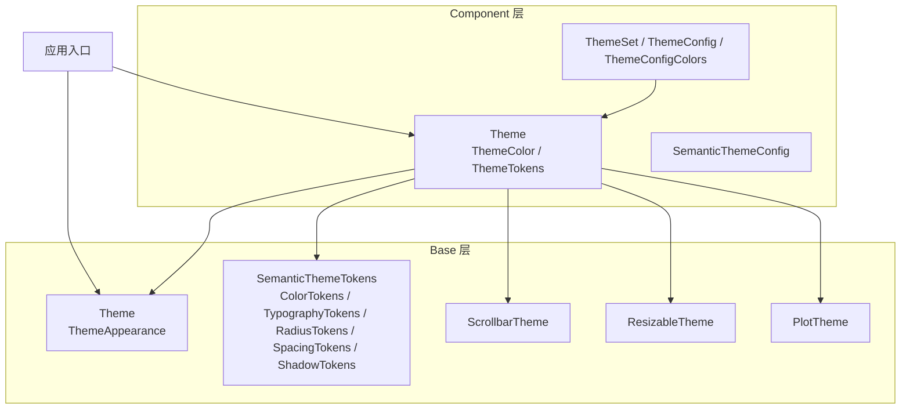

**图示来源**
- [crates/base/src/theme.rs:11-31](file://crates/base/src/theme.rs#L11-L31)
- [crates/base/src/theme_tokens.rs:10-18](file://crates/base/src/theme_tokens.rs#L10-L18)
- [crates/component/src/theme/mod.rs:149-219](file://crates/component/src/theme/mod.rs#L149-L219)
- [crates/component/src/theme/schema.rs:21-84](file://crates/component/src/theme/schema.rs#L21-L84)

**章节来源**
- [crates/base/src/lib.rs:200-204](file://crates/base/src/lib.rs#L200-L204)
- [crates/component/src/lib.rs:118-131](file://crates/component/src/lib.rs#L118-L131)

## 核心组件
本节聚焦主题相关类型的职责与用法要点。

- ThemeAppearance：应用级明暗模式枚举（Light/Dark），用于 Base 层外观控制。
- Theme（Base）：应用级默认行为主题，包含 appearance、tokens、scrollbar、resizable、plot、cursor_blink。
- ScrollbarTheme：滚动条全局默认（mode/motion/styles）。
- ResizableTheme：可调整大小面板手柄视觉默认（handle/active_handle）。
- PlotTheme：图表动效默认（motion）。
- Theme（Component）：UI 组件主题，包含 colors、tokens、highlight_theme、light/dark theme 配置、字体、圆角、阴影、滚动条显示模式、通知/列表/表单设置、动效策略、光标闪烁等。
- SemanticThemeTokens：语义设计令牌集合（colors/radius/spacing/typography/shadow）。
- ColorTokens/Tokens：语义色板；ThemeTokens：组件级令牌（兼容旧主题字段）。
- ThemeSet/ThemeConfig/ThemeConfigColors：主题集与主题配置（JSON 主题文件结构）。
- SemanticThemeConfig：独立语义主题配置（仅 tokens 子集）。

**章节来源**
- [crates/base/src/theme.rs:11-31](file://crates/base/src/theme.rs#L11-L31)
- [crates/base/src/theme.rs:60-146](file://crates/base/src/theme.rs#L60-L146)
- [crates/base/src/theme_tokens.rs:10-18](file://crates/base/src/theme_tokens.rs#L10-L18)
- [crates/component/src/theme/mod.rs:149-219](file://crates/component/src/theme/mod.rs#L149-L219)
- [crates/component/src/theme/theme_color.rs:59-345](file://crates/component/src/theme/theme_color.rs#L59-L345)
- [crates/component/src/theme/theme_color.rs:347-405](file://crates/component/src/theme/theme_color.rs#L347-L405)
- [crates/component/src/theme/schema.rs:21-84](file://crates/component/src/theme/schema.rs#L21-L84)
- [crates/component/src/theme/schema.rs:86-106](file://crates/component/src/theme/schema.rs#L86-L106)

## 架构总览
主题系统在运行时的工作流如下：
- 初始化：component 层初始化主题注册表并加载默认主题；base 层初始化全局 Theme。
- 主题切换：调用 Theme::change 或 Theme::update，内部执行 edit，合并/对齐 colors 与 tokens，必要时重新加载当前 mode 对应主题配置，同步 Base 层并刷新窗口。
- Base 投影：Theme::sync_base 将 Component 层的 Theme 投影为 Base 层的 Theme（appearance、semantic_tokens、scrollbar/resizable/plot 默认值），供底层控件绘制。

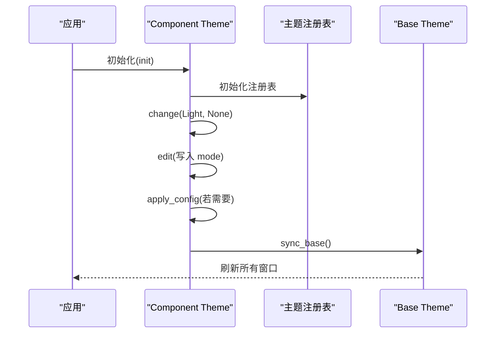

**图示来源**
- [crates/component/src/theme/mod.rs:36-42](file://crates/component/src/theme/mod.rs#L36-L42)
- [crates/component/src/theme/mod.rs:396-406](file://crates/component/src/theme/mod.rs#L396-L406)
- [crates/component/src/theme/mod.rs:305-343](file://crates/component/src/theme/mod.rs#L305-L343)
- [crates/component/src/theme/mod.rs:479-484](file://crates/component/src/theme/mod.rs#L479-L484)

## 详细组件分析

### Theme（Component 层）
- 作用：维护 UI 组件的主题状态，包括颜色、令牌、高亮主题、字体、圆角、阴影、滚动条显示模式、动效策略、光标闪烁等。
- 关键方法：
  - global/global_mut：获取全局主题引用。
  - update/edit：安全编辑主题，保证 colors 与 tokens 一致，并在必要时重载当前 mode 的配置。
  - change：切换主题模式（Light/Dark），确保加载已注册的对应主题。
  - sync_system_appearance/sync_scrollbar_appearance：与系统外观和滚动条行为同步。
  - semantic_tokens/color_tokens/radius_tokens/spacing_tokens/typography_tokens/shadow_tokens：生成语义令牌快照。
  - apply_semantic_tokens/apply_semantic_config/resolve_semantic_config：应用语义令牌或配置。
  - sync_base：将当前主题投影到 Base 层。

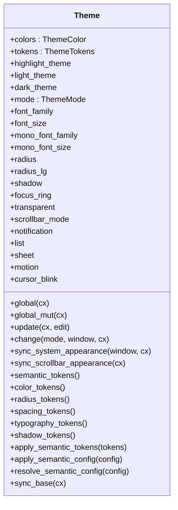

**图示来源**
- [crates/component/src/theme/mod.rs:149-219](file://crates/component/src/theme/mod.rs#L149-L219)
- [crates/component/src/theme/mod.rs:243-343](file://crates/component/src/theme/mod.rs#L243-L343)
- [crates/component/src/theme/mod.rs:360-484](file://crates/component/src/theme/mod.rs#L360-L484)
- [crates/component/src/theme/mod.rs:508-681](file://crates/component/src/theme/mod.rs#L508-L681)

**章节来源**
- [crates/component/src/theme/mod.rs:36-42](file://crates/component/src/theme/mod.rs#L36-L42)
- [crates/component/src/theme/mod.rs:243-343](file://crates/component/src/theme/mod.rs#L243-L343)
- [crates/component/src/theme/mod.rs:360-484](file://crates/component/src/theme/mod.rs#L360-L484)
- [crates/component/src/theme/mod.rs:508-681](file://crates/component/src/theme/mod.rs#L508-L681)

### Theme（Base 层）与 ThemeAppearance
- ThemeAppearance：Light/Dark 枚举，表示应用外观模式。
- Theme（Base）：聚合 appearance、tokens、scrollbar、resizable、plot、cursor_blink，作为 Base 层的全局主题。
- ActiveTheme：为 App 提供便捷读取当前主题的 trait。

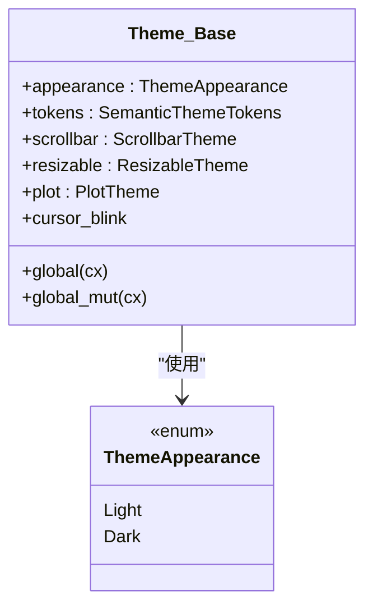

**图示来源**
- [crates/base/src/theme.rs:11-31](file://crates/base/src/theme.rs#L11-L31)
- [crates/base/src/theme.rs:35-46](file://crates/base/src/theme.rs#L35-L46)

**章节来源**
- [crates/base/src/theme.rs:11-31](file://crates/base/src/theme.rs#L11-L31)
- [crates/base/src/theme.rs:35-46](file://crates/base/src/theme.rs#L35-L46)

### ScrollbarTheme、ResizableTheme、PlotTheme（Base 层）
- ScrollbarTheme：封装滚动条的模式、动效与样式，提供 with_mode/with_motion/with_styles 构建器。
- ResizableTheme：可调整大小面板手柄的可选颜色（handle/active_handle），未设置时回退到语义令牌。
- PlotTheme：图表动效策略（motion），提供 with_motion 构建器。

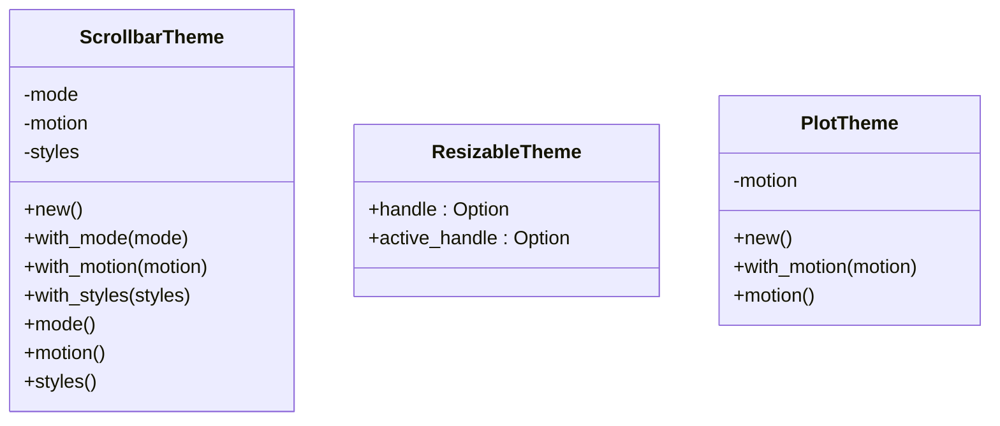

**图示来源**
- [crates/base/src/theme.rs:60-102](file://crates/base/src/theme.rs#L60-L102)
- [crates/base/src/theme.rs:104-126](file://crates/base/src/theme.rs#L104-L126)
- [crates/base/src/theme.rs:128-146](file://crates/base/src/theme.rs#L128-L146)

**章节来源**
- [crates/base/src/theme.rs:60-102](file://crates/base/src/theme.rs#L60-L102)
- [crates/base/src/theme.rs:104-126](file://crates/base/src/theme.rs#L104-L126)
- [crates/base/src/theme.rs:128-146](file://crates/base/src/theme.rs#L128-L146)

### 令牌体系：SemanticThemeTokens、ColorTokens、TypographyTokens
- SemanticThemeTokens：语义令牌容器，包含 colors、radius、spacing、typography、shadow。
- ColorTokens：语义色板（background/foreground/surface/primary/secondary/accent/destructive/border/input/ring/selection 等）。
- TypographyTokens：字体族与字号行高（sans/mono/xs/sm/md/lg/xl/mono_md）。
- RadiusTokens/SpacingTokens/ShadowTokens：圆角、间距、阴影层级。

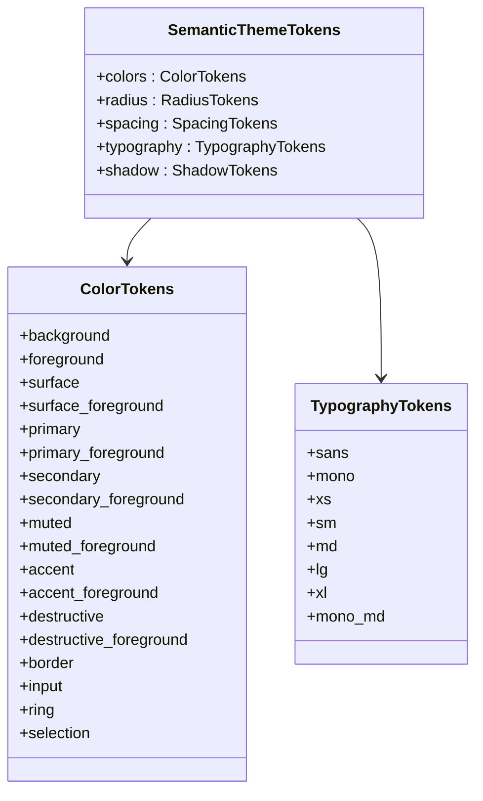

**图示来源**
- [crates/base/src/theme_tokens.rs:10-18](file://crates/base/src/theme_tokens.rs#L10-L18)
- [crates/base/src/theme_tokens.rs:20-47](file://crates/base/src/theme_tokens.rs#L20-L47)
- [crates/base/src/theme_tokens.rs:175-201](file://crates/base/src/theme_tokens.rs#L175-L201)

**章节来源**
- [crates/base/src/theme_tokens.rs:10-18](file://crates/base/src/theme_tokens.rs#L10-L18)
- [crates/base/src/theme_tokens.rs:20-47](file://crates/base/src/theme_tokens.rs#L20-L47)
- [crates/base/src/theme_tokens.rs:175-201](file://crates/base/src/theme_tokens.rs#L175-L201)

### 主题定义结构：ThemeSet、ThemeConfig、ThemeConfigColors、SemanticThemeConfig
- ThemeSet：主题集元数据（name/author/url/themes）。
- ThemeConfig：单个主题配置（is_default/name/mode/font/radius/shadow/colors/highlight）。
- ThemeConfigColors：具体颜色键名（如 accent.background、primary.background、chart.grid、base.red 等），支持 fallback 与背景 token 解析。
- SemanticThemeConfig：独立语义主题配置（仅 tokens 子集），用于覆盖语义令牌而不改变 legacy 字段形状。

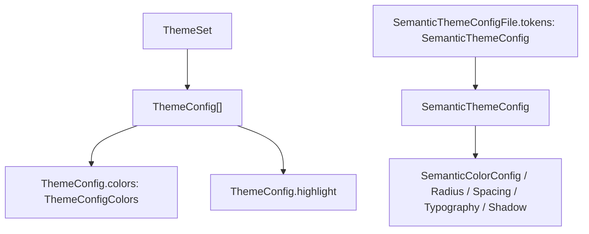

**图示来源**
- [crates/component/src/theme/schema.rs:21-84](file://crates/component/src/theme/schema.rs#L21-L84)
- [crates/component/src/theme/schema.rs:86-106](file://crates/component/src/theme/schema.rs#L86-L106)
- [crates/component/src/theme/schema.rs:262-689](file://crates/component/src/theme/schema.rs#L262-L689)

**章节来源**
- [crates/component/src/theme/schema.rs:21-84](file://crates/component/src/theme/schema.rs#L21-L84)
- [crates/component/src/theme/schema.rs:86-106](file://crates/component/src/theme/schema.rs#L86-L106)
- [crates/component/src/theme/schema.rs:262-689](file://crates/component/src/theme/schema.rs#L262-L689)

### 颜色令牌系统与样式继承机制
- ThemeToken：同时保存代表色 color 与可渲染背景 background（支持渐变）。
- ThemeColor：组件主题颜色集合（大量组件级颜色键）。
- ThemeTokens：由宏生成的组件令牌集合，保留 legacy 字段以兼容旧主题。
- reconcile：在 Theme::edit 中协调 colors 与 tokens，确保两者一致性；当直接编辑 colors 时，token 被替换为纯色；当只编辑 token 时，反向写回 colors；保持来自主题文件的渐变不被覆盖。

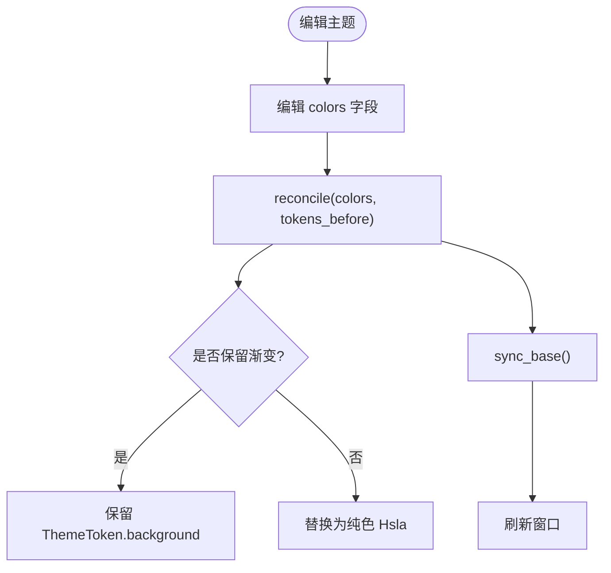

**图示来源**
- [crates/component/src/theme/theme_color.rs:347-405](file://crates/component/src/theme/theme_color.rs#L347-L405)
- [crates/component/src/theme/mod.rs:305-343](file://crates/component/src/theme/mod.rs#L305-L343)
- [crates/component/src/theme/mod.rs:479-484](file://crates/component/src/theme/mod.rs#L479-L484)

**章节来源**
- [crates/component/src/theme/theme_color.rs:9-56](file://crates/component/src/theme/theme_color.rs#L9-L56)
- [crates/component/src/theme/theme_color.rs:347-405](file://crates/component/src/theme/theme_color.rs#L347-L405)
- [crates/component/src/theme/mod.rs:305-343](file://crates/component/src/theme/mod.rs#L305-L343)
- [crates/component/src/theme/mod.rs:479-484](file://crates/component/src/theme/mod.rs#L479-L484)

### 动态主题切换流程
- Theme::change：根据目标模式加载已注册主题（light_theme/dark_theme），通过 edit 写入 mode，必要时重载配置，最终 sync_base 并刷新窗口。
- Theme::sync_system_appearance：从 Window 或 App 获取系统外观并切换。
- Theme::sync_scrollbar_appearance：根据系统自动隐藏滚动条策略设置 ScrollbarMode。

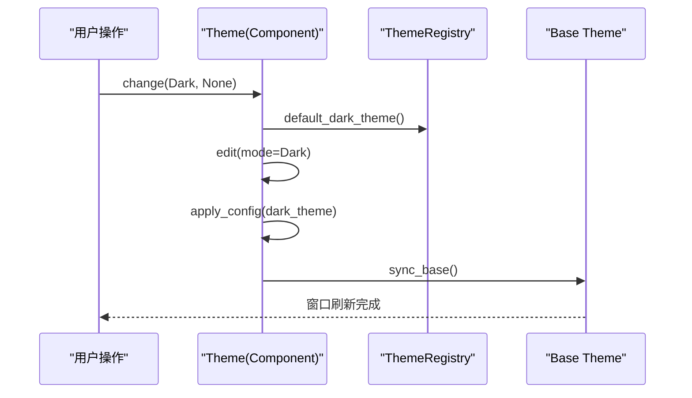

**图示来源**
- [crates/component/src/theme/mod.rs:396-406](file://crates/component/src/theme/mod.rs#L396-L406)
- [crates/component/src/theme/mod.rs:305-343](file://crates/component/src/theme/mod.rs#L305-L343)
- [crates/component/src/theme/mod.rs:479-484](file://crates/component/src/theme/mod.rs#L479-L484)

**章节来源**
- [crates/component/src/theme/mod.rs:360-406](file://crates/component/src/theme/mod.rs#L360-L406)
- [crates/component/src/theme/mod.rs:479-484](file://crates/component/src/theme/mod.rs#L479-L484)

### 主题文件与网站展示
- themes/*.json：主题集文件，包含 name/author/url/$schema/themes[]，每个 variant 包含 name/mode/colors/highlight。
- website/src/lib/theme-catalog.ts：构建期扫描 themes/*.json，生成主题清单与 CSS 变量映射（将主题键映射到 CSS 变量名）。

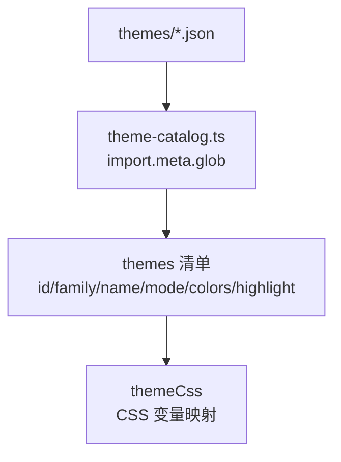

**图示来源**
- [themes/tokyonight.json:1-422](file://themes/tokyonight.json#L1-L422)
- [website/src/lib/theme-catalog.ts:1-107](file://website/src/lib/theme-catalog.ts#L1-L107)

**章节来源**
- [themes/tokyonight.json:1-422](file://themes/tokyonight.json#L1-L422)
- [website/src/lib/theme-catalog.ts:1-107](file://website/src/lib/theme-catalog.ts#L1-L107)

## 依赖关系分析
- base 层导出 Theme、ThemeAppearance、ScrollbarTheme、ResizableTheme、PlotTheme 与语义令牌类型。
- component 层导出 Theme（含 ThemeColor/ThemeTokens）、主题配置类型与注册表，并在 init 中初始化主题。
- 应用入口需先初始化 component 层主题，再初始化 base 层基础设施。

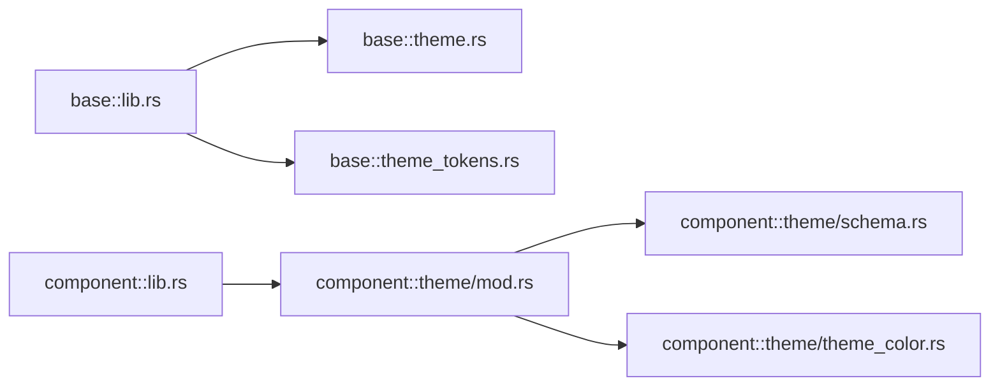

**图示来源**
- [crates/base/src/lib.rs:200-204](file://crates/base/src/lib.rs#L200-L204)
- [crates/component/src/lib.rs:118-131](file://crates/component/src/lib.rs#L118-L131)
- [crates/component/src/theme/mod.rs:1-34](file://crates/component/src/theme/mod.rs#L1-L34)

**章节来源**
- [crates/base/src/lib.rs:200-204](file://crates/base/src/lib.rs#L200-L204)
- [crates/component/src/lib.rs:118-131](file://crates/component/src/lib.rs#L118-L131)

## 性能与最佳实践
- 使用 Theme::update 而非直接修改 global_mut：确保 colors 与 tokens 一致，避免 Base 层与组件层不一致导致的闪烁或样式漂移。
- 批量编辑：一次 update 内完成多个字段修改，减少多次 sync_base 与窗口刷新开销。
- 避免频繁切换主题：主题切换会触发全量窗口刷新，建议合并用户操作。
- 合理使用语义令牌：新组件优先使用 SemanticThemeTokens，避免扩展 legacy ThemeTokens。
- 谨慎使用渐变背景：ThemeToken.background 可承载渐变，但直接覆盖 colors 会丢失渐变；如需保留渐变，应编辑 tokens 而非 colors。
- 滚动条与图表动效：通过 Theme::sync_scrollbar_appearance 与 motion tokens 控制，避免过度动画影响性能。

[本节为通用指导，不直接分析具体文件]

## 故障排查指南
- 主题切换后滚动条样式异常：检查 Theme::sync_scrollbar_appearance 是否被调用，确认 ScrollbarMode 与 motion 是否正确。
- 主题切换后颜色不一致：确认是否通过 Theme::update 编辑；若直接修改 global_mut，请手动调用 sync_base 并刷新窗口。
- 渐变背景丢失：确认是否直接赋值 colors 字段；如需保留渐变，应编辑 ThemeTokens 对应字段。
- 字体未生效：检查 font_family/mono_font_family 是否在 ThemeConfig 中正确设置，并确保字体已安装或嵌入。
- 主题文件无效：校验 $schema 与 ThemeConfigColors 键名是否匹配，必要时参考 theme-catalog.ts 的映射规则。

**章节来源**
- [crates/component/src/theme/mod.rs:305-343](file://crates/component/src/theme/mod.rs#L305-L343)
- [crates/component/src/theme/mod.rs:479-484](file://crates/component/src/theme/mod.rs#L479-L484)
- [website/src/lib/theme-catalog.ts:34-107](file://website/src/lib/theme-catalog.ts#L34-L107)

## 结论
gpui-kit 的主题系统通过 Base 层与 Component 层协作，提供了统一的语义令牌、丰富的组件颜色与完善的主题配置文件体系。开发者可通过 Theme::update/change 进行安全的动态主题切换，并通过 ThemeConfig/SemanticThemeConfig 灵活定制主题。遵循本文的最佳实践，可在保证一致性的前提下获得良好的性能与可维护性。

[本节为总结，不直接分析具体文件]

## 附录
- 自定义主题创建步骤：
  1. 在 themes/ 下新增 JSON 主题文件，包含 name/author/url/$schema/themes[]。
  2. 在每个 variant 中定义 name/mode/colors/highlight，colors 使用 ThemeConfigColors 键名（如 primary.background、chart.grid、base.red 等）。
  3. 如需仅覆盖语义令牌，可使用 SemanticThemeConfigFile.tokens 子集。
  4. 在应用中通过 ThemeRegistry 注册主题集，并使用 Theme::change 切换模式。
  5. 如需在网页端预览，确保 theme-catalog.ts 能扫描到新主题文件。

**章节来源**
- [themes/tokyonight.json:1-422](file://themes/tokyonight.json#L1-L422)
- [crates/component/src/theme/schema.rs:21-84](file://crates/component/src/theme/schema.rs#L21-L84)
- [website/src/lib/theme-catalog.ts:1-107](file://website/src/lib/theme-catalog.ts#L1-L107)