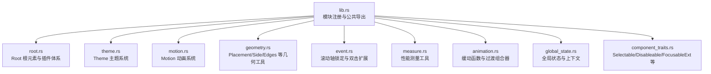
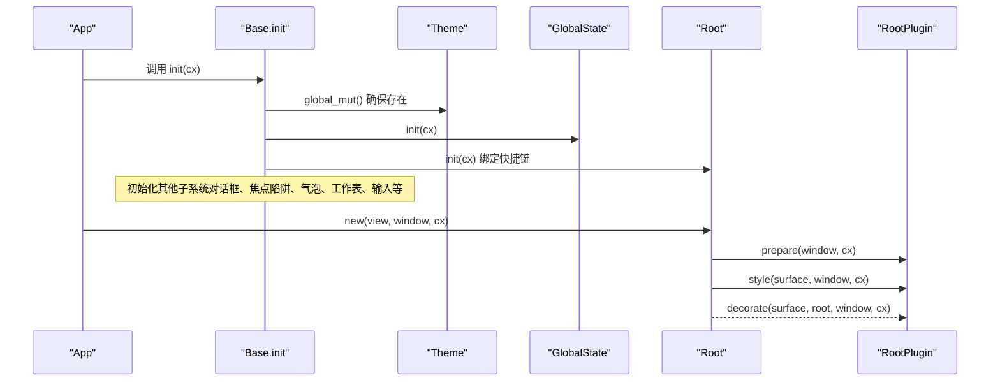
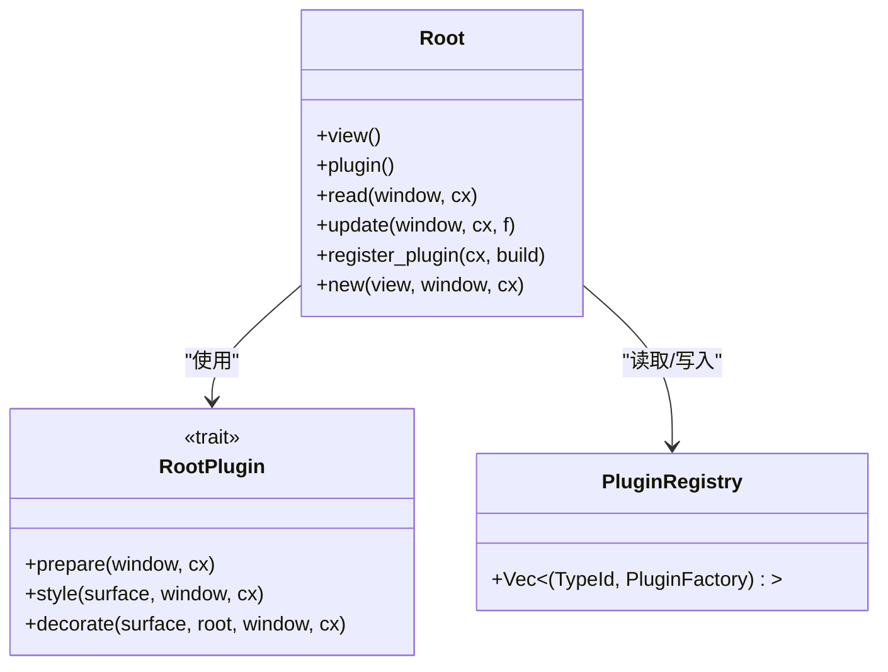
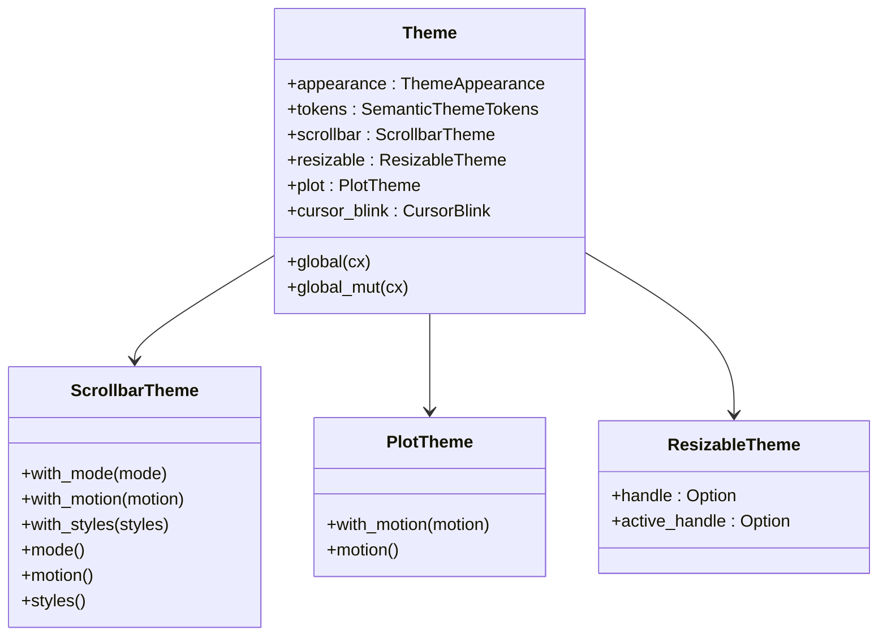
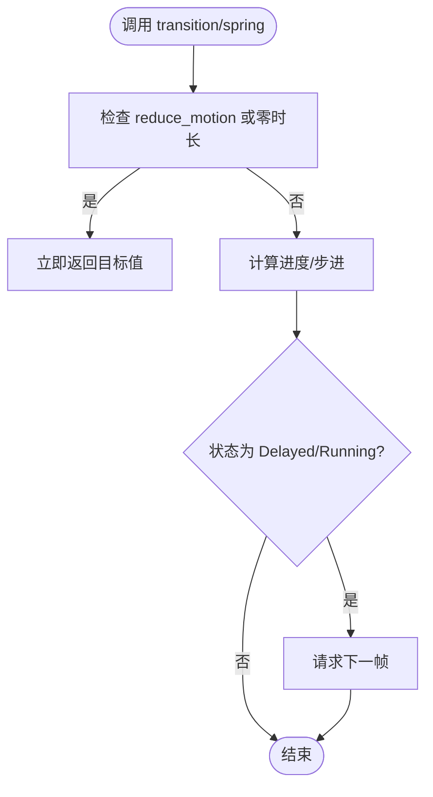
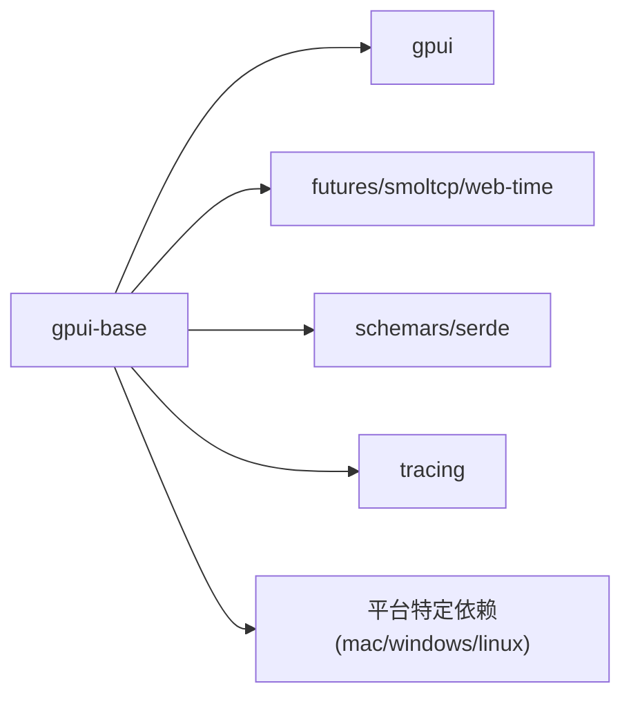

# 基础层 API

<cite>
**本文引用的文件**   
- [lib.rs](file://crates/base/src/lib.rs)
- [Cargo.toml](file://crates/base/Cargo.toml)
- [root.rs](file://crates/base/src/root.rs)
- [theme.rs](file://crates/base/src/theme.rs)
- [motion.rs](file://crates/base/src/motion.rs)
- [geometry.rs](file://crates/base/src/geometry.rs)
- [event.rs](file://crates/base/src/event.rs)
- [measure.rs](file://crates/base/src/measure.rs)
- [animation.rs](file://crates/base/src/animation.rs)
- [global_state.rs](file://crates/base/src/global_state.rs)
- [component_traits.rs](file://crates/base/src/component_traits.rs)
</cite>

## 目录
1. [简介](#简介)
2. [项目结构](#项目结构)
3. [核心组件](#核心组件)
4. [架构总览](#架构总览)
5. [详细组件分析](#详细组件分析)
6. [依赖关系分析](#依赖关系分析)
7. [性能考量](#性能考量)
8. [故障排查指南](#故障排查指南)
9. [结论](#结论)
10. [附录：类型与枚举速查](#附录类型与枚举速查)

## 简介
本文件面向 gpui-base crate 的基础层 API，聚焦根元素 Root、主题 Theme、动画 Motion、几何 Geometry、事件 Event、测量 Measure、全局状态 GlobalState、通用组件 Trait 等底层能力。文档提供类型定义、枚举值、常量说明、错误类型、异步与任务调度接口、内存管理要点以及最佳实践示例路径，帮助读者快速掌握并正确使用基础能力。

## 项目结构
gpui-base 以行为与基础设施为核心，避免直接绑定展示样式；布局、定位、颜色、尺寸与动效由应用或上层 facade 负责。顶层 lib.rs 集中导出模块与公共类型，便于跨模块复用。

图表来源
- [lib.rs:1-260](file://crates/base/src/lib.rs#L1-L260)

章节来源
- [lib.rs:1-260](file://crates/base/src/lib.rs#L1-L260)

## 核心组件
- Root 根元素与 RootPlugin 插件体系：窗口级内容宿主与叠加层，支持 prepare/style/decorate 三阶段渲染钩子，统一 Tab/Shift+Tab/Copy 快捷键处理，以及焦点陷阱（Focus Trap）的遍历保护。
- Theme 主题系统：应用级默认配置，包含外观 ThemeAppearance、语义 Token、滚动条主题 ScrollbarTheme、可调整面板主题 ResizableTheme、绘图主题 PlotTheme、光标闪烁 CursorBlink。
- Motion 动画系统：CSS 风格 Timing/Easing、Keyframes、Sequence/Stagger、Presence/Reveal、Spring 物理弹簧、TransitionId/MotionValue/MotionStatus 等，提供 transition/spring/animate_keyframes 等 API。
- Geometry 几何工具：Placement/Side 枚举、AxisExt/LengthExt 扩展、Edges<T> 四边容器。
- Event 事件扩展：OngoingScrollExt::lock_axis 与 InteractiveElementExt::lock_scroll_axis/on_double_click。
- Measure 测量工具：Measure/measure/measure_if，基于 tracing 输出耗时。
- Animation 缓动与过渡：cubic_bezier/ease_* 缓动函数、EffectTransition 组合 fade/slide/width/height 等效果。
- GlobalState 全局状态：应用菜单、延迟弹出上下文、文本选择抑制、TextView/TableCell 绘制栈、触摸时间戳等。
- Component Traits：Selectable/Disableable/FocusableExt/Collapsible 等通用组件契约。

章节来源
- [root.rs:1-278](file://crates/base/src/root.rs#L1-L278)
- [theme.rs:1-167](file://crates/base/src/theme.rs#L1-L167)
- [motion.rs:1-800](file://crates/base/src/motion.rs#L1-L800)
- [geometry.rs:1-152](file://crates/base/src/geometry.rs#L1-L152)
- [event.rs:1-61](file://crates/base/src/event.rs#L1-L61)
- [measure.rs:1-49](file://crates/base/src/measure.rs#L1-L49)
- [animation.rs:1-405](file://crates/base/src/animation.rs#L1-L405)
- [global_state.rs:1-309](file://crates/base/src/global_state.rs#L1-L309)
- [component_traits.rs:1-115](file://crates/base/src/component_traits.rs#L1-L115)

## 架构总览
Base 层在应用启动时通过 init 初始化各子系统，随后每个 Window 使用 Root 作为内容宿主，并通过 RootPlugin 注入呈现层。主题、全局状态、文本选择层、滚动条、可调整面板、绘图等子系统共享同一套运行时。

图表来源
- [lib.rs:238-256](file://crates/base/src/lib.rs#L238-L256)
- [root.rs:42-51](file://crates/base/src/root.rs#L42-L51)
- [root.rs:175-278](file://crates/base/src/root.rs#L175-L278)

## 详细组件分析

### Root 根元素与插件体系
- 职责
  - 作为窗口内容与叠加层的宿主，独立于任何样式化组件库。
  - 维护插件注册表，按注册顺序参与 prepare/style/decorate 三个阶段。
  - 处理 Tab/Shift+Tab/Copy 动作，并在焦点陷阱内安全地循环遍历。
- 关键类型与方法
  - trait RootPlugin：prepare/style/decorate 生命周期钩子。
  - struct Root：new/register_plugin/plugin/view/read/update 等。
  - 内部 PluginRegistry：按 TypeId 去重注册工厂。
- 交互流程
  - 首次创建 Root 时，从全局读取已注册的插件工厂，构造 per-window 的插件实例。
  - 每次渲染执行插件 prepare，构建内容 div，应用插件 style 与实例样式，再依次装饰。
- 焦点陷阱
  - advance_focus 保证在焦点陷阱内循环，避免背景控件被误选中。

图表来源
- [root.rs:74-124](file://crates/base/src/root.rs#L74-L124)
- [root.rs:126-278](file://crates/base/src/root.rs#L126-L278)

章节来源
- [root.rs:1-278](file://crates/base/src/root.rs#L1-L278)

### Theme 主题系统
- 职责
  - 提供应用级默认主题配置，供滚动条、绘图、可调整面板等子系统消费。
- 关键类型
  - enum ThemeAppearance：Light/Dark。
  - struct Theme：appearance/tokens/scrollbar/resizable/plot/cursor_blink。
  - struct ScrollbarTheme：mode/motion/styles。
  - struct PlotTheme：motion。
  - struct ResizableTheme：handle/active_handle（可选）。
- 访问方式
  - Theme::global/global_mut 提供全局读写；App 实现 ActiveTheme 便捷访问。

图表来源
- [theme.rs:10-46](file://crates/base/src/theme.rs#L10-L46)
- [theme.rs:60-146](file://crates/base/src/theme.rs#L60-L146)

章节来源
- [theme.rs:1-167](file://crates/base/src/theme.rs#L1-L167)

### Motion 动画系统
- 职责
  - 提供 CSS 风格的时序与缓动、关键帧序列、交错、出现/消失、物理弹簧等能力。
- 关键类型与 API
  - Interpolate：自定义插值类型需实现。
  - Transition：duration/delay/easing，配合 transition/transition_with_status。
  - Spring：response/damping/epsilon/travel，配合 spring。
  - Keyframes/Timing/Sequence/Stagger/Presence/Reveal：复杂动画编排。
  - MotionTransform/MotionValue/MotionStatus：动画值与状态封装。
  - animate_keyframes：关键帧播放采样。
- 设计要点
  - 通过 TransitionId 将状态绑定到元素键控状态，避免重复重建。
  - reduce_motion 开关下自动回退为瞬时完成。
  - Spring 保留速度信息，支持中途重定向而不重启曲线。

图表来源
- [motion.rs:268-361](file://crates/base/src/motion.rs#L268-L361)
- [motion.rs:579-653](file://crates/base/src/motion.rs#L579-L653)

章节来源
- [motion.rs:1-800](file://crates/base/src/motion.rs#L1-L800)

### Geometry 几何工具
- Placement：Top/Bottom/Left/Right，提供 is_horizontal/is_vertical/axis 方法。
- Side：Left/Right，用于边缘侧判断。
- AxisExt/LengthExt：对 Axis/Length 的扩展，如 to_pixels。
- Edges<T>：四边容器，all(value) 快捷构造。

章节来源
- [geometry.rs:1-152](file://crates/base/src/geometry.rs#L1-L152)

### Event 事件扩展
- OngoingScrollExt::lock_axis：在平台支持时将滚轮增量锁定到手势主轴；wasm 下为无操作。
- InteractiveElementExt::lock_scroll_axis：包装 restrict_scroll_to_axis，wasm 下返回原元素。
- InteractiveElementExt::on_double_click：基于 ClickEvent.click_count 的双击监听。

章节来源
- [event.rs:1-61](file://crates/base/src/event.rs#L1-L61)

### Measure 测量工具
- measurement_enabled：检测环境变量 ZED_MEASUREMENTS/GPUI_MEASUREMENTS。
- measure/measure_if：条件启用测量，使用 Measure 结构体在 drop 时通过 tracing 输出耗时。

章节来源
- [measure.rs:1-49](file://crates/base/src/measure.rs#L1-L49)

### Animation 缓动与过渡
- cubic_bezier/unclamped_cubic_bezier：CSS cubic-bezier 求解与采样。
- ease_out_cubic/ease_in_cubic/ease_in_out_cubic：常用缓动预设。
- Lerp：f32/Pixels/Point/Hsla 线性插值实现。
- EffectTransition：组合 slide_x/y/fade/width/height 等效果，apply 生成 AnimationElement。

章节来源
- [animation.rs:1-405](file://crates/base/src/animation.rs#L1-L405)

### GlobalState 全局状态
- DeferredPopover：延迟弹出上下文令牌，持有即保持打开。
- GlobalState：应用菜单、延迟弹出列表、文本选择抑制、TextView/TableCell 绘制栈、last_touch 触摸时间戳。
- 关键方法：init/note_touch/is_touch_press/suppress_text_selection/reset_text_selection_suppression/is_text_selection_suppressed/app_menus/set_app_menus/register_deferred_popover/is_in_deferred_context。
- confine_to_cell：限制选择范围到单元格边界。

章节来源
- [global_state.rs:1-309](file://crates/base/src/global_state.rs#L1-L309)

### Component Traits 通用组件契约
- Selectable：selected/open/is_selected/is_open，默认 open 回退到 selected。
- Disableable：disabled。
- FocusableExt：focus_ring/is_focus_ring_enabled，仅携带状态，不决定视觉。
- Collapsible：collapsed/is_collapsed。

章节来源
- [component_traits.rs:1-115](file://crates/base/src/component_traits.rs#L1-L115)

## 依赖关系分析
- 外部依赖
  - gpui：核心 UI 框架（App/Window/Element/Animation 等）。
  - futures/smoltcp/web-time：异步与时间抽象（非 wasm 用 smol，wasm 用 async-channel/web-time）。
  - schemars/serde：主题与配置的序列化与 JSON Schema。
  - tracing：测量与日志。
  - 平台相关：macOS/Windows/Linux 特定依赖用于辅助功能、减少动效设置等。
- 特性开关
  - gpui-fast：替换底层 gpui 实现。
  - test-support：测试支持。
  - inspector：调试器集成。
  - decimal：可选十进制精度支持。

图表来源
- [Cargo.toml:27-81](file://crates/base/Cargo.toml#L27-L81)

章节来源
- [Cargo.toml:1-94](file://crates/base/Cargo.toml#L1-L94)

## 性能考量
- 动画与渲染
  - transition/spring 仅在需要时请求动画帧；静止弹簧零开销分支。
  - reduce_motion 下跳过动画，直接返回目标值。
- 测量与诊断
  - 使用 measure/measure_if 在关键路径上记录耗时，结合 tracing 进行性能分析。
- 全局状态
  - GlobalState 使用弱引用与栈式结构，避免长生命周期对象泄漏与重复注册。
- 平台差异
  - wasm 下滚动轴锁定为无操作，避免 panic；触摸时间戳用于区分点击与拖拽。

[本节为通用指导，无需代码来源]

## 故障排查指南
- 滚动轴锁定无效
  - 在 wasm 平台 lock_axis/lock_scroll_axis 为无操作，属预期行为。
  - 参考：[event.rs:11-24](file://crates/base/src/event.rs#L11-L24)、[event.rs:26-41](file://crates/base/src/event.rs#L26-L41)。
- 动画未触发或卡顿
  - 检查是否启用了 reduce_motion；确认 TransitionId 唯一且稳定；确认 request_animation_frame 被正确调用。
  - 参考：[motion.rs:303-361](file://crates/base/src/motion.rs#L303-L361)、[motion.rs:390-410](file://crates/base/src/motion.rs#L390-L410)。
- 焦点陷阱无法循环
  - 确认焦点陷阱容器未被排除出 tab 顺序；检查 advance_focus 逻辑与嵌套陷阱深度。
  - 参考：[root.rs:14-40](file://crates/base/src/root.rs#L14-L40)、[root.rs:222-239](file://crates/base/src/root.rs#L222-L239)。
- 主题未生效
  - 确保 Theme::global_mut 在应用初始化时被调用；检查 ScrollbarTheme/PlotTheme/ResizableTheme 字段是否正确设置。
  - 参考：[lib.rs:238-256](file://crates/base/src/lib.rs#L238-L256)、[theme.rs:35-46](file://crates/base/src/theme.rs#L35-L46)。
- 文本选择冲突
  - 在拥有按下/拖拽交互的控件中调用 suppress_text_selection，避免与应用级文本选择冲突。
  - 参考：[global_state.rs:75-93](file://crates/base/src/global_state.rs#L75-L93)。

章节来源
- [event.rs:1-61](file://crates/base/src/event.rs#L1-L61)
- [motion.rs:303-410](file://crates/base/src/motion.rs#L303-L410)
- [root.rs:14-40](file://crates/base/src/root.rs#L14-L40)
- [root.rs:222-239](file://crates/base/src/root.rs#L222-L239)
- [lib.rs:238-256](file://crates/base/src/lib.rs#L238-L256)
- [theme.rs:35-46](file://crates/base/src/theme.rs#L35-L46)
- [global_state.rs:75-93](file://crates/base/src/global_state.rs#L75-L93)

## 结论
gpui-base 提供了稳健的根元素、主题、动画、几何、事件、测量、全局状态与通用组件契约，构成应用 UI 的基础设施。通过 RootPlugin 机制，呈现层可以无缝接入；通过 Motion 与 Animation，开发者能以声明式方式编排复杂动画；通过 Theme 与 GlobalState，应用可统一管理外观与跨组件状态。遵循本文档的类型与用法建议，可在不同平台上获得一致且高性能的用户体验。

[本节为总结性内容，无需代码来源]

## 附录：类型与枚举速查
- Root 与插件
  - Root、RootPlugin、PluginRegistry
- 主题
  - Theme、ThemeAppearance、ScrollbarTheme、PlotTheme、ResizableTheme
- 动画
  - Interpolate、Transition、Spring、Keyframes、Timing、Sequence、Stagger、Presence、Reveal、MotionTransform、MotionValue、MotionStatus、TransitionId、animate_keyframes、spring、transition、transition_with_status
- 几何
  - Placement、Side、AxisExt、LengthExt、Edges<T>
- 事件
  - OngoingScrollExt、InteractiveElementExt
- 测量
  - Measure、measurement_enabled、measure、measure_if
- 缓动与过渡
  - cubic_bezier、unclamped_cubic_bezier、ease_out_cubic、ease_in_cubic、ease_in_out_cubic、Lerp、EffectTransition
- 全局状态
  - DeferredPopover、GlobalState、confine_to_cell
- 组件契约
  - Selectable、Disableable、FocusableExt、Collapsible

章节来源
- [root.rs:74-124](file://crates/base/src/root.rs#L74-L124)
- [theme.rs:10-146](file://crates/base/src/theme.rs#L10-L146)
- [motion.rs:32-800](file://crates/base/src/motion.rs#L32-L800)
- [geometry.rs:8-152](file://crates/base/src/geometry.rs#L8-L152)
- [event.rs:11-61](file://crates/base/src/event.rs#L11-L61)
- [measure.rs:1-49](file://crates/base/src/measure.rs#L1-L49)
- [animation.rs:9-264](file://crates/base/src/animation.rs#L9-L264)
- [global_state.rs:14-172](file://crates/base/src/global_state.rs#L14-L172)
- [component_traits.rs:1-56](file://crates/base/src/component_traits.rs#L1-L56)