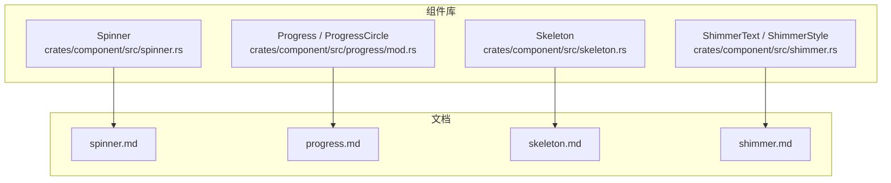
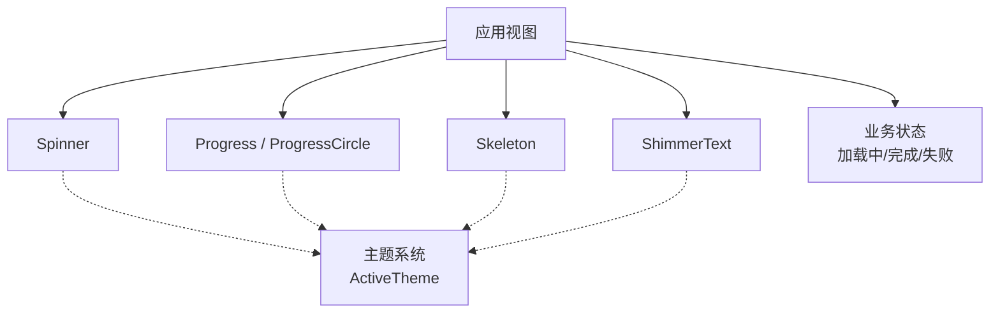
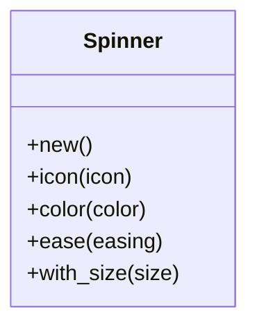
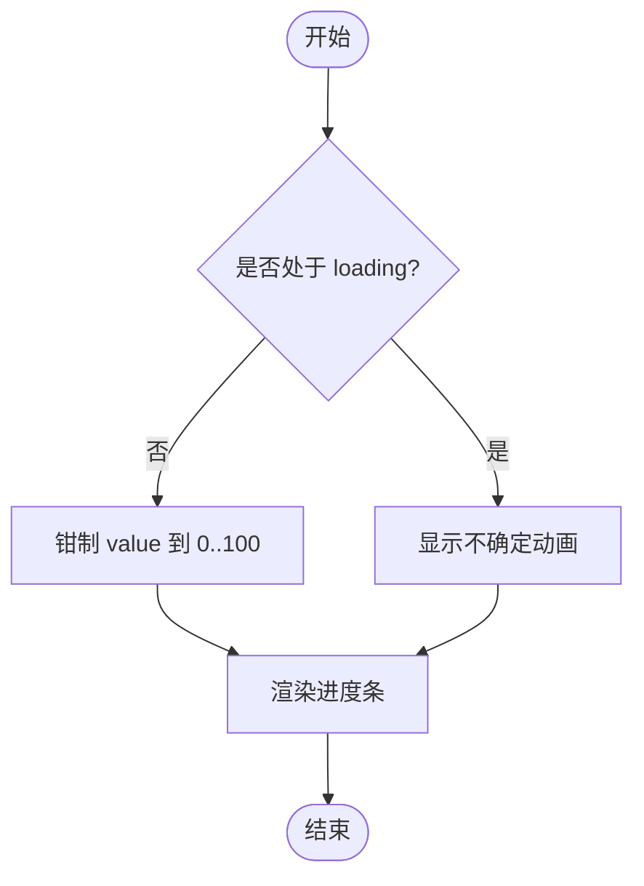
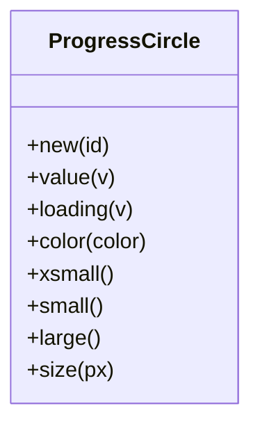
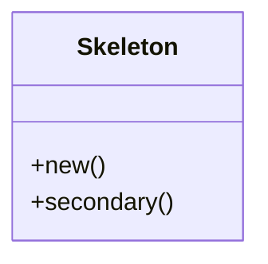
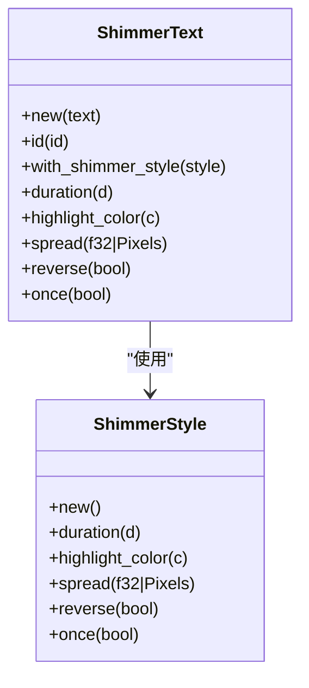
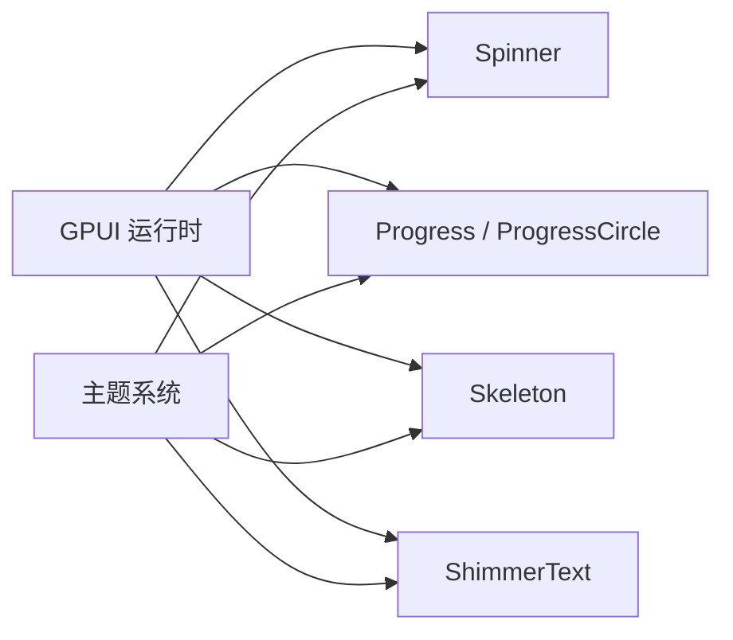

# 反馈组件 API

<cite>
**本文引用的文件**   
- [spinner.rs](file://crates/component/src/spinner.rs)
- [progress/mod.rs](file://crates/component/src/progress/mod.rs)
- [skeleton.rs](file://crates/component/src/skeleton.rs)
- [shimmer.rs](file://crates/component/src/shimmer.rs)
- [spinner.md](file://website/component/spinner.md)
- [progress.md](file://website/component/progress.md)
- [skeleton.md](file://website/component/skeleton.md)
- [shimmer.md](file://website/component/shimmer.md)
</cite>

## 目录
1. [简介](#简介)
2. [项目结构](#项目结构)
3. [核心组件](#核心组件)
4. [架构总览](#架构总览)
5. [详细组件分析](#详细组件分析)
6. [依赖关系分析](#依赖关系分析)
7. [性能考量](#性能考量)
8. [故障排查指南](#故障排查指南)
9. [结论](#结论)
10. [附录：使用示例与最佳实践](#附录使用示例与最佳实践)

## 简介
本文件为 gpui-kit 反馈类组件的权威 API 文档，覆盖 Spinner、Progress（含 ProgressCircle）、Skeleton、ShimmerText 等组件。内容包含公共属性、事件与方法、动画配置、主题适配和无障碍访问支持说明，并给出异步加载、文件上传进度、内容占位符等典型场景的实现指引。所有实现细节均与仓库源码保持一致。

## 项目结构
反馈相关组件位于 component crate 中，按功能模块组织：
- spinner.rs：旋转加载指示器
- progress/mod.rs：线性进度条与环形进度指示器的模块入口
- skeleton.rs：骨架屏占位元素
- shimmer.rs：带高亮扫光效果的文本组件与样式

图示来源
- [spinner.rs:1-104](file://crates/component/src/spinner.rs#L1-L104)
- [progress/mod.rs:1-6](file://crates/component/src/progress/mod.rs#L1-L6)
- [skeleton.rs:1-60](file://crates/component/src/skeleton.rs#L1-L60)
- [shimmer.rs:1-658](file://crates/component/src/shimmer.rs#L1-L658)
- [spinner.md:1-298](file://website/component/spinner.md#L1-L298)
- [progress.md:1-320](file://website/component/progress.md#L1-L320)
- [skeleton.md:1-255](file://website/component/skeleton.md#L1-L255)
- [shimmer.md:1-333](file://website/component/shimmer.md#L1-L333)

章节来源
- [spinner.rs:1-104](file://crates/component/src/spinner.rs#L1-L104)
- [progress/mod.rs:1-6](file://crates/component/src/progress/mod.rs#L1-L6)
- [skeleton.rs:1-60](file://crates/component/src/skeleton.rs#L1-L60)
- [shimmer.rs:1-658](file://crates/component/src/shimmer.rs#L1-L658)

## 核心组件
本节概述各组件的职责与适用场景：
- Spinner：用于展示循环旋转的加载状态，适合按钮内嵌、卡片头部或全屏遮罩等轻量级加载提示。
- Progress / ProgressCircle：用于表达确定性的任务完成百分比；支持“不确定”模式下的持续动画。
- Skeleton：用于在内容未就绪时维持布局结构的骨架占位块，带有呼吸式闪烁。
- ShimmerText：为短文本提供可读的高亮扫光效果，适合“思考中/生成中”等短暂加载态。

章节来源
- [spinner.md:1-298](file://website/component/spinner.md#L1-L298)
- [progress.md:1-320](file://website/component/progress.md#L1-L320)
- [skeleton.md:1-255](file://website/component/skeleton.md#L1-L255)
- [shimmer.md:1-333](file://website/component/shimmer.md#L1-L333)

## 架构总览
四个组件共同遵循 GPUI 的元素渲染模型，通过 Animation 驱动视觉变化，并通过 ActiveTheme 获取主题色。它们不直接持有业务状态，而是由调用方根据异步结果切换可见性、值或状态。

图示来源
- [spinner.rs:1-104](file://crates/component/src/spinner.rs#L1-L104)
- [progress/mod.rs:1-6](file://crates/component/src/progress/mod.rs#L1-L6)
- [skeleton.rs:1-60](file://crates/component/src/skeleton.rs#L1-L60)
- [shimmer.rs:1-658](file://crates/component/src/shimmer.rs#L1-L658)

## 详细组件分析

### Spinner（旋转加载）
- 职责：以可配置的图标、尺寸、颜色与缓动函数进行 360° 旋转动画，表示“正在进行中”。
- 关键属性与方法
  - new()：创建默认 Spinner
  - icon(...)：设置图标（默认 Loader）
  - color(...)：设置颜色
  - ease(...)：设置缓动函数
  - with_size(...)：通过 Sizable 设置尺寸（xsmall/small/large/自定义）
- 动画
  - 默认时长约 0.8 秒，ease-in-out，无限循环
  - 受 reduce_motion 影响：当系统请求减少动画时，不会请求帧更新
- 无障碍
  - 作为纯视觉指示器，建议配合语义化文本或 ARIA 角色由上层容器负责可访问性描述
- 常见用法
  - 按钮内嵌、卡片头部、全屏遮罩、条件显示等

图示来源
- [spinner.rs:1-104](file://crates/component/src/spinner.rs#L1-L104)

章节来源
- [spinner.rs:1-104](file://crates/component/src/spinner.rs#L1-L104)
- [spinner.md:1-298](file://website/component/spinner.md#L1-L298)

### Progress（线性进度条）
- 职责：以水平条形图展示任务的完成百分比，支持“不确定”模式。
- 关键属性与方法
  - new(id)：创建实例
  - value(v)：设置进度值（0–100），自动钳制
  - loading(v)：开启不确定模式（忽略 value）
  - color(...)：覆盖填充色（默认来自主题）
  - xsmall()/small()/large()：预设高度（Sizable）
  - Styled trait：自定义高度、圆角、边框等
- 动态更新
  - 将 value 与 loading 绑定到业务状态，随异步进度刷新 UI
- 无障碍
  - 建议使用 aria-valuenow/aria-valuemin/aria-valuemax 等语义（由上层容器或宿主框架处理）

图示来源
- [progress.md:115-124](file://website/component/progress.md#L115-L124)

章节来源
- [progress.md:1-320](file://website/component/progress.md#L1-L320)

### ProgressCircle（环形进度）
- 职责：以圆弧形式展示完成百分比，适合紧凑空间或内联标签。
- 关键属性与方法
  - new(id)：创建实例
  - value(v)：设置进度值（0–100），自动钳制
  - loading(v)：开启不确定模式（忽略 value）
  - color(...)：覆盖弧线颜色（默认来自主题）
  - xsmall()/small()/large()/size(px(n))：预设尺寸或自定义尺寸（Sizable）
  - ParentElement：可在圆环内部放置内容（如百分比文字）
- 常见用法
  - 下载/上传指示、初始化状态、多步骤流程中的整体进度

图示来源
- [progress.md:210-220](file://website/component/progress.md#L210-L220)

章节来源
- [progress.md:126-220](file://website/component/progress.md#L126-L220)

### Skeleton（骨架屏）
- 职责：在内容加载期间显示带呼吸动画的占位块，保持布局稳定。
- 关键属性与方法
  - new()：创建实例
  - secondary()：使用更淡的主题色变体
  - Styled：通过宽高、圆角等工具类控制形状
- 动画
  - 默认 2 秒周期，bounce(ease_in_out)，透明度在 100%~50% 之间循环
  - 动画不可禁用（用于明确指示加载）
- 主题
  - 使用主题的 skeleton 颜色；secondary 变体为 50% 不透明度
- 常见用法
  - 头像、标题行、卡片图片、列表项、表单字段等占位

图示来源
- [skeleton.rs:1-60](file://crates/component/src/skeleton.rs#L1-L60)

章节来源
- [skeleton.rs:1-60](file://crates/component/src/skeleton.rs#L1-L60)
- [skeleton.md:1-255](file://website/component/skeleton.md#L1-L255)

### ShimmerText（闪烁文本）
- 职责：为短文本添加可读的高亮扫光效果，适合“思考中/生成中”等短暂加载态。
- 关键类型
  - ShimmerStyle：可复用的外观与时序配置
  - ShimmerSpread：相对或绝对的高亮半宽
- ShimmerStyle 方法
  - new()：默认 2 秒循环
  - duration(d)：单次扫光时长（低于 1ms 会钳制）
  - highlight_color(c)：覆盖高亮色（默认主题感知）
  - spread(f32|Pixels)：相对比例或绝对像素半宽
  - reverse(bool)：反向扫光
  - once(bool)：播放一次后停止
- ShimmerText 方法
  - new(text)：创建实例
  - id(ElementId)：显式标识（兄弟节点相同文本时避免冲突）
  - with_shimmer_style(style)：复用样式
  - duration/duration/highlight_color/spread/reverse/once：直接配置
  - Styled：继承父级文本样式，可继续细化字体、颜色、换行等
- 主题与无障碍
  - 默认高亮色基于当前前景/背景色计算，保证明暗主题可读性
  - 当 reduce_motion 为真时，渲染静态文本且不请求动画帧
  - 应保持有意义的文本标签，不要仅依赖动画传达成功/失败/百分比

图示来源
- [shimmer.rs:47-127](file://crates/component/src/shimmer.rs#L47-L127)
- [shimmer.rs:140-200](file://crates/component/src/shimmer.rs#L140-L200)

章节来源
- [shimmer.rs:1-658](file://crates/component/src/shimmer.rs#L1-L658)
- [shimmer.md:1-333](file://website/component/shimmer.md#L1-L333)

## 依赖关系分析
- 组件间耦合
  - 组件彼此独立，无直接相互依赖
  - 均依赖 GPUI 的动画与主题能力
- 外部依赖
  - GPUI：Animation、Styled、ParentElement、RenderOnce 等
  - instant::Duration：时间单位
  - theme tokens：主题色与语义 token

图示来源
- [spinner.rs:1-104](file://crates/component/src/spinner.rs#L1-L104)
- [progress/mod.rs:1-6](file://crates/component/src/progress/mod.rs#L1-L6)
- [skeleton.rs:1-60](file://crates/component/src/skeleton.rs#L1-L60)
- [shimmer.rs:1-658](file://crates/component/src/shimmer.rs#L1-L658)

章节来源
- [spinner.rs:1-104](file://crates/component/src/spinner.rs#L1-L104)
- [progress/mod.rs:1-6](file://crates/component/src/progress/mod.rs#L1-L6)
- [skeleton.rs:1-60](file://crates/component/src/skeleton.rs#L1-L60)
- [shimmer.rs:1-658](file://crates/component/src/shimmer.rs#L1-L658)

## 性能考量
- Spinner
  - 使用 CSS transform 旋转，开销低；多个 Spinner 共享动画时序
  - 大量出现时优先使用较小尺寸
- Progress / ProgressCircle
  - 值变更触发平滑过渡；不确定模式下持续动画
  - 合理合并状态更新，避免频繁重绘
- Skeleton
  - 固定周期的透明度动画；数量较多时注意布局复杂度
- ShimmerText
  - 基于文本布局与多层蒙版绘制高亮；reduce_motion 下跳过动画帧
  - 避免在同一帧内对大量 ShimmerText 做高频样式变更

[本节为通用指导，无需列出具体文件来源]

## 故障排查指南
- Spinner 不旋转或卡顿
  - 检查是否启用了 reduce_motion；若启用，应预期为静态且无帧请求
  - 确认图标与尺寸是否合适，避免过大导致重绘压力
- Progress 值异常
  - 确保传入的 value 在 0–100 范围；组件会自动钳制
  - 在 loading=true 时，value 会被忽略
- Skeleton 动画不明显
  - 检查主题中 skeleton 颜色对比度；必要时使用 secondary 变体
- ShimmerText 高亮不可见
  - 检查 highlight_color 与主题对比度；推荐用语义主题色而非原始调色板值
  - 确认 reduce_motion 下仍保留有意义文本

章节来源
- [spinner.rs:90-103](file://crates/component/src/spinner.rs#L90-L103)
- [progress.md:115-124](file://website/component/progress.md#L115-L124)
- [skeleton.md:244-255](file://website/component/skeleton.md#L244-L255)
- [shimmer.md:245-281](file://website/component/shimmer.md#L245-L281)

## 结论
Spinner、Progress/ProgressCircle、Skeleton 与 ShimmerText 覆盖了常见的反馈场景：旋转加载、确定性进度、布局占位与文本高亮。它们均具备主题感知、动画可控与无障碍友好特性。建议在业务层统一管理加载状态，按需组合这些组件以获得一致的用户体验。

[本节为总结性内容，无需列出具体文件来源]

## 附录：使用示例与最佳实践

### 异步操作加载
- 使用 Spinner 表示“进行中”，完成后替换为实际内容
- 结合 Progress 展示已知进度；未知进度时使用 loading 模式

参考路径
- [spinner.md:117-131](file://website/component/spinner.md#L117-L131)
- [progress.md:37-49](file://website/component/progress.md#L37-L49)

### 文件上传进度
- 使用 Progress 显示百分比，并在顶部显示“已上传/总计”
- 可选搭配 ProgressCircle 作为内联小指标

参考路径
- [progress.md:222-250](file://website/component/progress.md#L222-L250)

### 内容占位符
- 使用 Skeleton 模拟头像、标题、正文、按钮等布局
- 列表与表格行可用多个 Skeleton 组合

参考路径
- [skeleton.md:134-232](file://website/component/skeleton.md#L134-L232)

### 闪烁文本
- 使用 ShimmerText 表达“思考中/生成中”等短暂加载
- 通过 ShimmerStyle 统一多次使用的扫光行为

参考路径
- [shimmer.md:39-100](file://website/component/shimmer.md#L39-L100)
- [shimmer.md:161-211](file://website/component/shimmer.md#L161-L211)

### 动画配置与主题适配
- Spinner：可通过 size/color/ease 定制
- Progress/ProgressCircle：通过 color/Sizable/Styled 定制
- Skeleton：通过 secondary 与主题 token 定制
- ShimmerText：通过 ShimmerStyle 的 duration/highlight_color/spread/reverse/once 定制

参考路径
- [spinner.md:96-114](file://website/component/spinner.md#L96-L114)
- [progress.md:51-74](file://website/component/progress.md#L51-L74)
- [skeleton.md:99-132](file://website/component/skeleton.md#L99-L132)
- [shimmer.md:57-100](file://website/component/shimmer.md#L57-L100)

### 无障碍访问支持
- Spinner：作为纯视觉指示器，由上层提供语义描述
- Progress：确保数值语义正确（由宿主框架处理）
- Skeleton：保持布局稳定，不影响屏幕阅读器阅读顺序
- ShimmerText：始终保留可读文本；尊重 reduce_motion

参考路径
- [shimmer.md:268-281](file://website/component/shimmer.md#L268-L281)
- [spinner.rs:90-103](file://crates/component/src/spinner.rs#L90-L103)