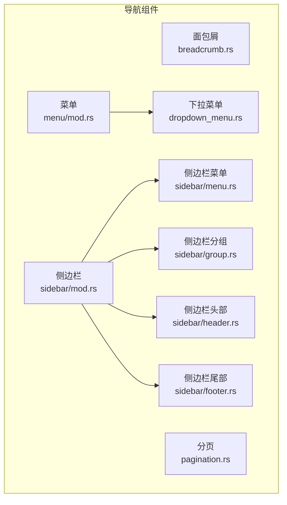
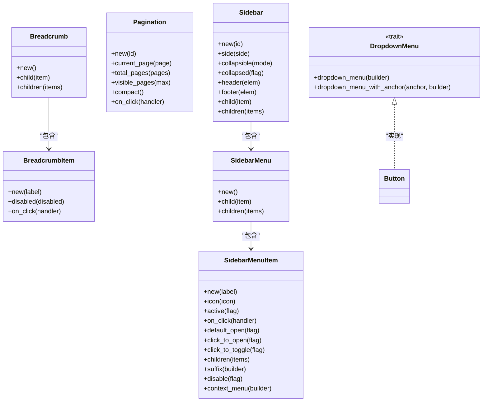
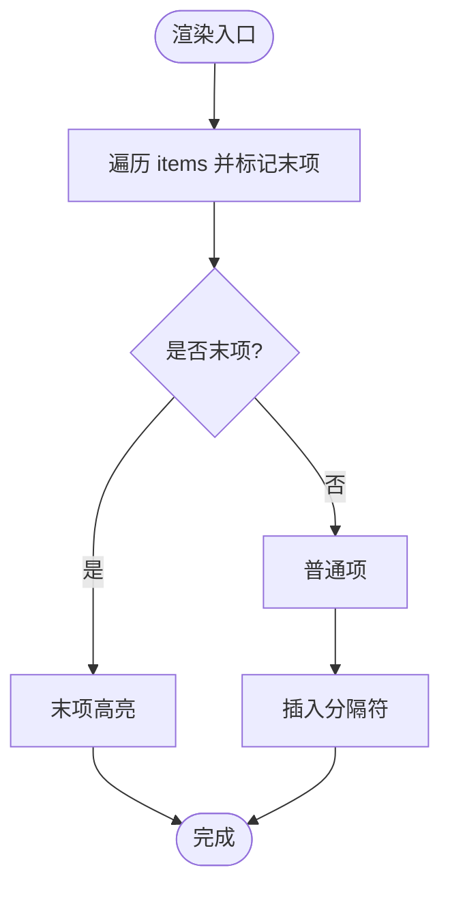
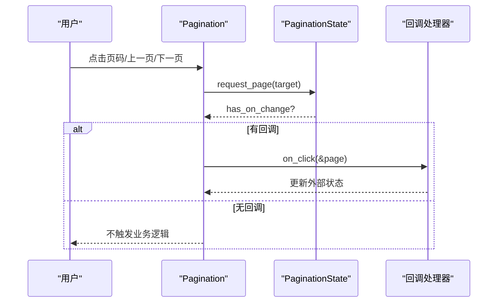
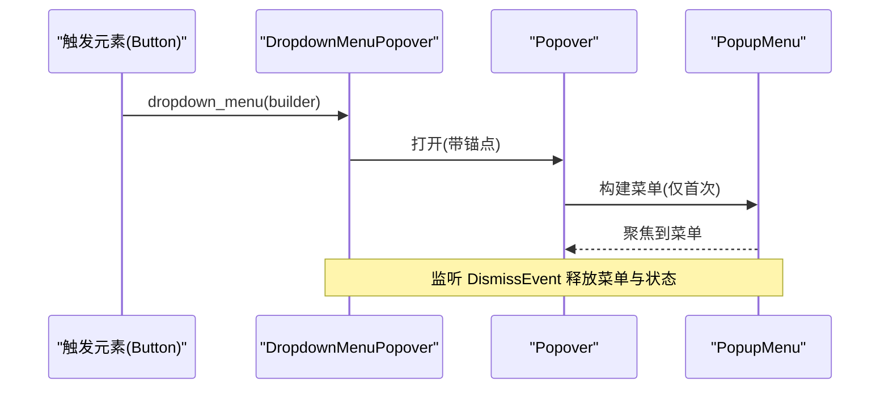
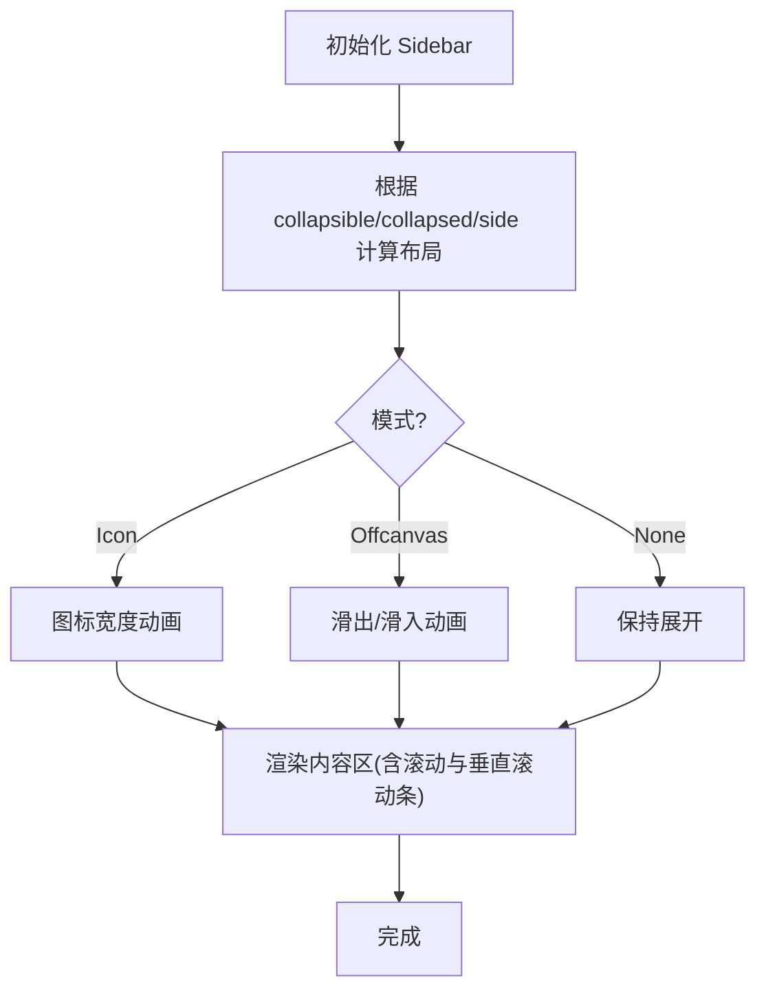
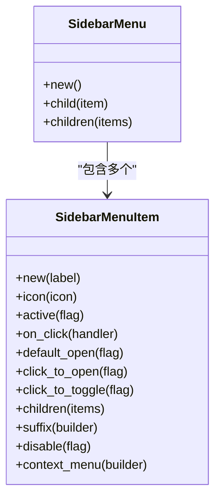
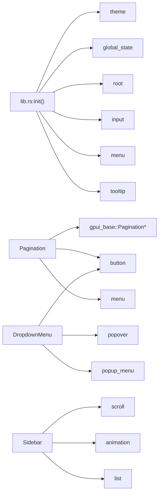

# 导航组件 API

<cite>
**本文引用的文件**   
- [lib.rs](file://crates/component/src/lib.rs)
- [breadcrumb.rs](file://crates/component/src/breadcrumb.rs)
- [pagination.rs](file://crates/component/src/pagination.rs)
- [menu/mod.rs](file://crates/component/src/menu/mod.rs)
- [dropdown_menu.rs](file://crates/component/src/menu/dropdown_menu.rs)
- [sidebar/mod.rs](file://crates/component/src/sidebar/mod.rs)
- [sidebar/menu.rs](file://crates/component/src/sidebar/menu.rs)
- [sidebar/group.rs](file://crates/component/src/sidebar/group.rs)
- [sidebar/header.rs](file://crates/component/src/sidebar/header.rs)
- [sidebar/footer.rs](file://crates/component/src/sidebar/footer.rs)
</cite>

## 目录
1. [简介](#简介)
2. [项目结构](#项目结构)
3. [核心组件](#核心组件)
4. [架构总览](#架构总览)
5. [详细组件分析](#详细组件分析)
6. [依赖关系分析](#依赖关系分析)
7. [性能考虑](#性能考虑)
8. [故障排查指南](#故障排查指南)
9. [结论](#结论)
10. [附录](#附录)

## 简介
本文件面向使用 gpui-kit 的开发者，系统化文档化导航相关组件的公共 API，包括面包屑（Breadcrumb）、分页（Pagination）、菜单（Menu）与侧边栏（Sidebar）。内容涵盖：
- 属性、事件与方法
- 导航状态管理与路由集成建议
- 菜单项配置与多级菜单
- 侧边栏折叠模式与动画
- 无障碍访问支持与响应式适配
- 代码示例路径与实现要点

## 项目结构
导航相关组件位于 component 包中，按功能模块组织：
- breadcrumb.rs：面包屑
- pagination.rs：分页
- menu/：菜单体系（下拉菜单、弹出菜单等）
- sidebar/：侧边栏及其子组件（菜单、分组、头部、尾部）

图表来源
- [lib.rs:29-96](file://crates/component/src/lib.rs#L29-L96)
- [breadcrumb.rs:11-179](file://crates/component/src/breadcrumb.rs#L11-L179)
- [pagination.rs:37-279](file://crates/component/src/pagination.rs#L37-L279)
- [menu/mod.rs:1-19](file://crates/component/src/menu/mod.rs#L1-L19)
- [dropdown_menu.rs:11-435](file://crates/component/src/menu/dropdown_menu.rs#L11-L435)
- [sidebar/mod.rs:211-557](file://crates/component/src/sidebar/mod.rs#L211-L557)
- [sidebar/menu.rs:18-474](file://crates/component/src/sidebar/menu.rs#L18-L474)
- [sidebar/group.rs:7-87](file://crates/component/src/sidebar/group.rs#L7-L87)
- [sidebar/header.rs:8-101](file://crates/component/src/sidebar/header.rs#L8-L101)
- [sidebar/footer.rs:8-89](file://crates/component/src/sidebar/footer.rs#L8-L89)

章节来源
- [lib.rs:29-96](file://crates/component/src/lib.rs#L29-L96)

## 核心组件
本节概述各导航组件的职责与对外暴露能力。

- 面包屑（Breadcrumb）
  - 用途：展示层级路径，支持点击跳转与禁用态
  - 关键类型：Breadcrumb、BreadcrumbItem
  - 主要方法：new()、child()/children()；BreadcrumbItem::new()、disabled()、on_click()
  - 渲染行为：自动插入分隔符，末项高亮，可点击项具备 Link 语义

- 分页（Pagination）
  - 用途：页码导航、上一页/下一页、省略号菜单
  - 关键类型：Pagination
  - 主要方法：new(id)、current_page()、total_pages()、visible_pages()、compact()、on_click()
  - 状态管理：内部基于 PaginationState 驱动页面变更回调

- 菜单（Menu）
  - 用途：提供下拉菜单、弹出菜单等交互容器
  - 关键类型：DropdownMenu（trait）、PopupMenu
  - 主要能力：按钮等元素通过 dropdown_menu() 构建菜单；支持 on_open_change 回调

- 侧边栏（Sidebar）
  - 用途：应用主导航区域，支持折叠、动画、分组与多级菜单
  - 关键类型：Sidebar、SidebarCollapsible、SidebarToggleButton、SidebarMenu、SidebarMenuItem、SidebarGroup、SidebarHeader、SidebarFooter
  - 主要方法：new(id)、side()、collapsible()、collapsed()、header()/footer()、child()/children()
  - 折叠模式：Icon（缩至图标宽度）、Offcanvas（滑出布局外）、None（禁用折叠）

章节来源
- [breadcrumb.rs:11-179](file://crates/component/src/breadcrumb.rs#L11-L179)
- [pagination.rs:37-279](file://crates/component/src/pagination.rs#L37-L279)
- [menu/mod.rs:1-19](file://crates/component/src/menu/mod.rs#L1-L19)
- [dropdown_menu.rs:11-435](file://crates/component/src/menu/dropdown_menu.rs#L11-L435)
- [sidebar/mod.rs:211-557](file://crates/component/src/sidebar/mod.rs#L211-L557)
- [sidebar/menu.rs:18-474](file://crates/component/src/sidebar/menu.rs#L18-L474)
- [sidebar/group.rs:7-87](file://crates/component/src/sidebar/group.rs#L7-L87)
- [sidebar/header.rs:8-101](file://crates/component/src/sidebar/header.rs#L8-L101)
- [sidebar/footer.rs:8-89](file://crates/component/src/sidebar/footer.rs#L8-L89)

## 架构总览
导航组件围绕 GPUI 的元素模型与主题系统构建，复用基础组件（Button、Icon、Popover、ScrollableElement 等），并通过 trait 扩展交互能力（如 DropdownMenu）。

图表来源
- [breadcrumb.rs:11-179](file://crates/component/src/breadcrumb.rs#L11-L179)
- [pagination.rs:37-279](file://crates/component/src/pagination.rs#L37-L279)
- [dropdown_menu.rs:11-435](file://crates/component/src/menu/dropdown_menu.rs#L11-L435)
- [sidebar/mod.rs:211-557](file://crates/component/src/sidebar/mod.rs#L211-L557)
- [sidebar/menu.rs:18-474](file://crates/component/src/sidebar/menu.rs#L18-L474)

## 详细组件分析

### 面包屑（Breadcrumb）
- 属性
  - items：BreadcrumbItem 列表
  - style：样式细化
- 方法
  - Breadcrumb::new()：创建实例
  - Breadcrumb::child()/children()：添加单项或多项
  - BreadcrumbItem::new(label)：以文本创建项
  - BreadcrumbItem::disabled(flag)：禁用态
  - BreadcrumbItem::on_click(handler)：点击回调
- 事件
  - on_click：传递 ClickEvent、Window、App
- 无障碍
  - 可点击项设置 Role::Link，不可点击为 Role::ListItem
- 响应式
  - 使用主题色与间距，跟随主题自适应

图表来源
- [breadcrumb.rs:156-179](file://crates/component/src/breadcrumb.rs#L156-L179)

章节来源
- [breadcrumb.rs:11-179](file://crates/component/src/breadcrumb.rs#L11-L179)

### 分页（Pagination）
- 属性
  - id、size、current_page、total_pages、visible_pages、disabled、compact
- 方法
  - new(id)：初始化
  - current_page(page)：当前页（1 基）
  - total_pages(pages)：总页数
  - visible_pages(max)：可见页码数
  - compact()：紧凑模式（仅上下页图标）
  - on_click(handler)：页码变化回调
- 事件
  - on_click：传入目标页码
- 内部逻辑
  - 基于 PaginationState 计算页码项与省略区间
  - 省略区间通过 PopupMenu 展示隐藏页码，限制最大显示数量以提升性能

图表来源
- [pagination.rs:117-157](file://crates/component/src/pagination.rs#L117-L157)
- [pagination.rs:180-259](file://crates/component/src/pagination.rs#L180-L259)

章节来源
- [pagination.rs:37-279](file://crates/component/src/pagination.rs#L37-L279)

### 菜单（Menu）
- 关键接口
  - DropdownMenu trait：为 Button 等元素提供 dropdown_menu() 与 dropdown_menu_with_anchor()
  - DropdownMenuPopover：封装 Popover 与 PopupMenu，维护打开状态与焦点
- 属性与方法
  - anchor：锚点位置
  - on_open_change(open)：打开/关闭回调
- 交互流程
  - 首次打开时构建并缓存 PopupMenu，监听 DismissEvent 以清理资源
  - 通过 TriggerFocus 在触发元素上注册 FocusHandle，确保快捷键提示在同一帧绘制

图表来源
- [dropdown_menu.rs:11-79](file://crates/component/src/menu/dropdown_menu.rs#L11-L79)
- [dropdown_menu.rs:86-174](file://crates/component/src/menu/dropdown_menu.rs#L86-L174)

章节来源
- [menu/mod.rs:1-19](file://crates/component/src/menu/mod.rs#L1-L19)
- [dropdown_menu.rs:11-435](file://crates/component/src/menu/dropdown_menu.rs#L11-L435)

### 侧边栏（Sidebar）
- 折叠模式
  - SidebarCollapsible::Icon：缩至图标宽度，保持布局占位
  - SidebarCollapsible::Offcanvas：滑出布局外，收起时释放布局空间
  - SidebarCollapsible::None：禁用折叠
- 属性与方法
  - new(id)：创建实例
  - side(side)：左侧或右侧
  - collapsible(mode)：设置折叠模式
  - collapsed(flag)：控制折叠状态
  - header()/footer()：设置头尾区域
  - child()/children()：添加可折叠子项（实现 Collapsible + SidebarItem）
- 动画与布局
  - 使用 EffectTransition 进行宽度过渡动画
  - Offcanvas 模式下延迟卸载子树，避免隐藏控件参与 Tab 顺序
- 子组件
  - SidebarMenu/SidebarMenuItem：支持图标、标签、后缀、上下文菜单、多级展开
  - SidebarGroup：分组标题与子项集合
  - SidebarHeader/SidebarFooter：可选择的头尾区域，支持悬停与选中态

图表来源
- [sidebar/mod.rs:69-112](file://crates/component/src/sidebar/mod.rs#L69-L112)
- [sidebar/mod.rs:388-557](file://crates/component/src/sidebar/mod.rs#L388-L557)

章节来源
- [sidebar/mod.rs:211-557](file://crates/component/src/sidebar/mod.rs#L211-L557)

#### 侧边栏菜单（SidebarMenu / SidebarMenuItem）
- 属性与方法（SidebarMenu）
  - new()、child()/children()
- 属性与方法（SidebarMenuItem）
  - new(label)、icon()、label_style()、accessibility_label()
  - active(flag)、on_click(handler)、collapsed(flag)
  - default_open(flag)、click_to_open(flag)、click_to_toggle(flag)
  - children(items)、suffix(builder)、disable(flag)、context_menu(builder)
- 交互
  - 支持点击展开/切换子菜单，或通过箭头按钮切换
  - 折叠状态下对带图标的项显示 Tooltip
  - 支持右键上下文菜单

图表来源
- [sidebar/menu.rs:18-84](file://crates/component/src/sidebar/menu.rs#L18-L84)
- [sidebar/menu.rs:92-474](file://crates/component/src/sidebar/menu.rs#L92-L474)

章节来源
- [sidebar/menu.rs:18-474](file://crates/component/src/sidebar/menu.rs#L18-L474)

#### 侧边栏分组（SidebarGroup）
- 作用：将一组子项归为一组，可选显示分组标题
- 属性与方法
  - new(label)、child()/children()
  - 实现 Collapsible，受父级折叠状态影响

章节来源
- [sidebar/group.rs:7-87](file://crates/component/src/sidebar/group.rs#L7-L87)

#### 侧边栏头部与尾部（SidebarHeader / SidebarFooter）
- 作用：作为侧边栏的可选择区域，支持悬停与选中态
- 能力：Selectable、Collapsible、DropdownMenu、Styled、InteractiveElement

章节来源
- [sidebar/header.rs:8-101](file://crates/component/src/sidebar/header.rs#L8-L101)
- [sidebar/footer.rs:8-89](file://crates/component/src/sidebar/footer.rs#L8-L89)

## 依赖关系分析
- 组件初始化
  - 库入口 lib.rs 中 init() 会依次初始化 theme、global_state、root、input、diff、date_picker、dock、sheet、list、command、carousel、notification、popover、questionnaire、menu、table、tooltip 等子系统
- 组件间依赖
  - Pagination 依赖 base 中的 Pagination/PaginationState 以及 button、menu、icon 等
  - DropdownMenu 依赖 Popover、PopupMenu、Selectable、Button
  - Sidebar 依赖 ScrollableElement、Animation、Theme、List 等

图表来源
- [lib.rs:127-151](file://crates/component/src/lib.rs#L127-L151)
- [pagination.rs:1-17](file://crates/component/src/pagination.rs#L1-L17)
- [dropdown_menu.rs:1-10](file://crates/component/src/menu/dropdown_menu.rs#L1-L10)
- [sidebar/mod.rs:1-16](file://crates/component/src/sidebar/mod.rs#L1-L16)

章节来源
- [lib.rs:127-151](file://crates/component/src/lib.rs#L127-L151)

## 性能考虑
- 分页省略菜单
  - 通过常量限制省略菜单展示的隐藏页数量，避免每次打开菜单都重绘大量行
- 侧边栏动画
  - 使用 EffectTransition 与 keyed state 稳定动画 ID，减少不必要的重排
  - Offcanvas 模式在收起后延迟卸载子树，避免隐藏控件参与布局与 Tab 顺序
- 菜单缓存
  - DropdownMenu 在首次打开时构建并缓存 PopupMenu，避免重复构建开销

[本节为通用性能建议，不直接分析具体文件]

## 故障排查指南
- 面包屑
  - 问题：点击无效
    - 检查是否设置了 disabled(true) 或未绑定 on_click
    - 确认末项与分隔符渲染逻辑符合预期
- 分页
  - 问题：页码不更新
    - 确认已设置 on_click 并在回调中更新 current_page
    - 检查 total_pages 与 current_page 的边界约束
- 菜单
  - 问题：快捷键提示未显示
    - 确保触发元素的 key_context 与菜单项 action 一致
    - 检查 DropdownMenuPopover 是否在正确帧捕获触发器焦点
- 侧边栏
  - 问题：折叠后布局错乱
    - 检查 collapsible 模式与 expanded_width 的设置
    - Offcanvas 模式下确认初始 collapsed 状态与 width 类型（像素值）

章节来源
- [breadcrumb.rs:91-115](file://crates/component/src/breadcrumb.rs#L91-L115)
- [pagination.rs:67-115](file://crates/component/src/pagination.rs#L67-L115)
- [dropdown_menu.rs:176-284](file://crates/component/src/menu/dropdown_menu.rs#L176-L284)
- [sidebar/mod.rs:496-557](file://crates/component/src/sidebar/mod.rs#L496-L557)

## 结论
本 API 文档梳理了面包屑、分页、菜单与侧边栏的核心接口与交互流程，提供了状态管理、路由集成与无障碍访问的实践建议。结合可视化图示与源码定位，帮助开发者快速理解并正确使用这些导航组件，同时兼顾性能与可维护性。

## 附录
- 路由集成建议
  - 面包屑：在 on_click 中调用路由跳转，并根据当前路由动态生成 items
  - 分页：在 on_click 中更新查询参数或状态，重新拉取数据
  - 侧边栏菜单：在 on_click 中执行路由跳转或页面切换，配合 active 状态高亮当前项
- 无障碍访问
  - 面包屑：可点击项使用 Link 角色
  - 侧边栏菜单：为子菜单开关提供明确的 accessibility_label
  - 侧边栏切换按钮：通过 accessibility_label 提供可读名称
- 响应式设计
  - 使用主题 token 与尺寸工具类，确保在不同屏幕尺寸下表现一致
  - 侧边栏 Offcanvas 模式适合移动端小屏场景

[本节为概念性补充，不直接分析具体文件]