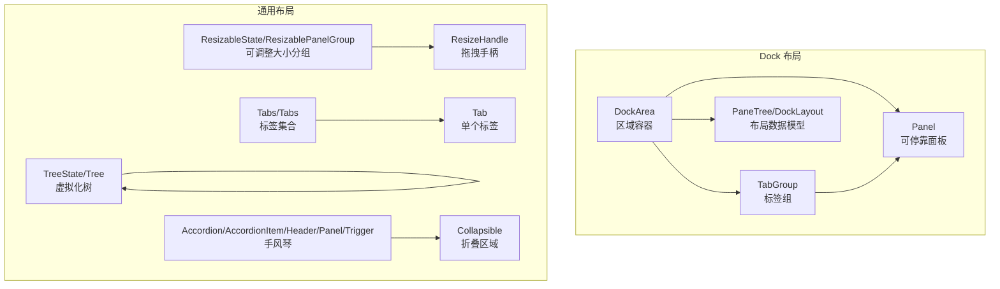
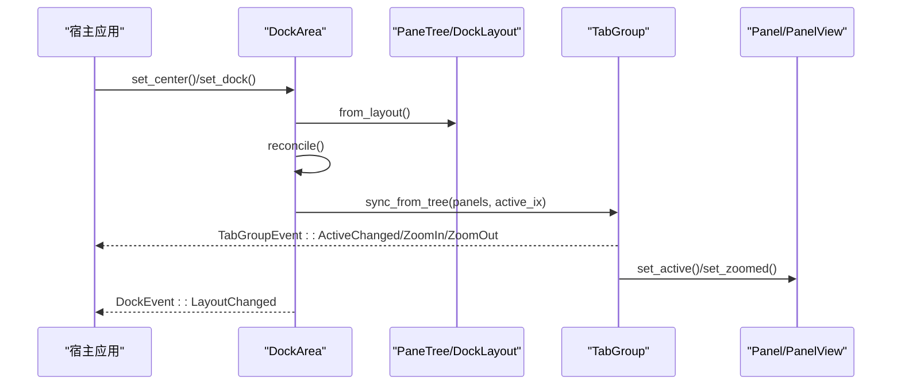
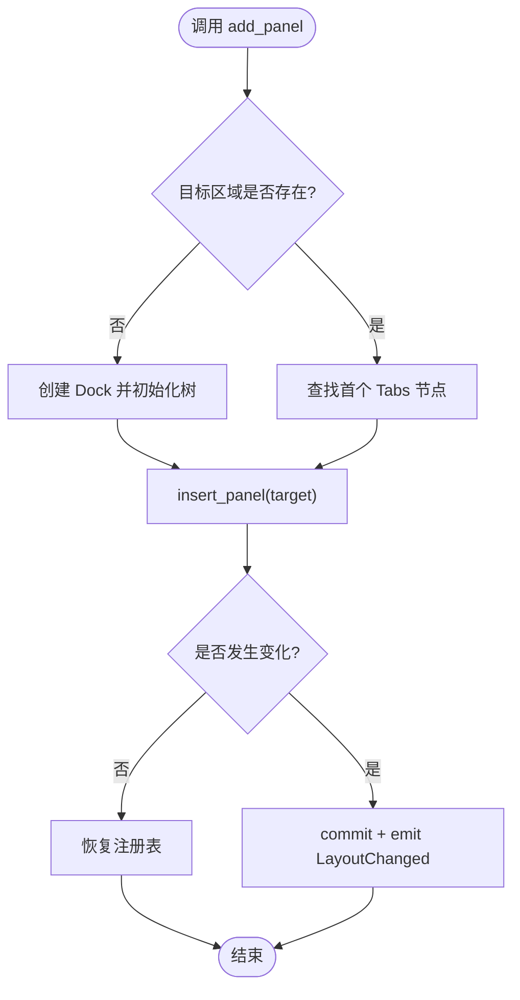
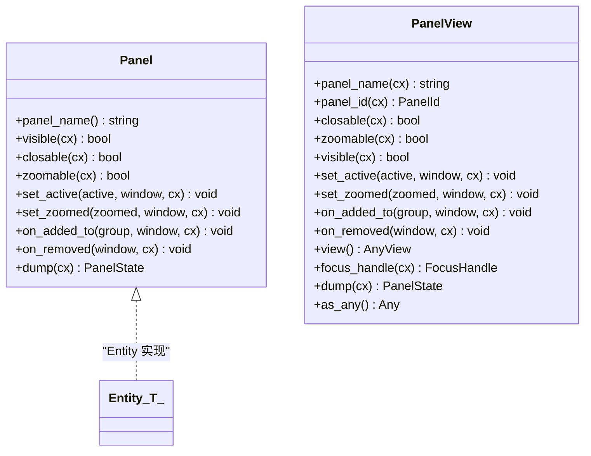
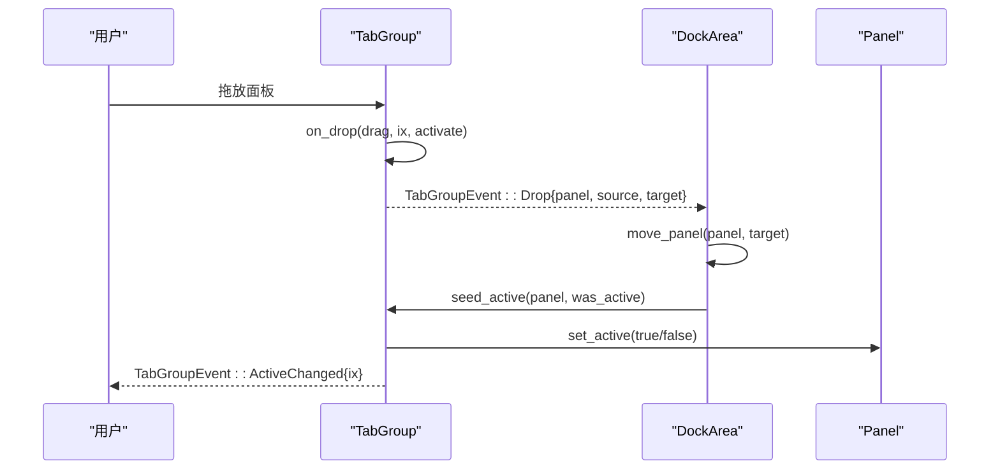
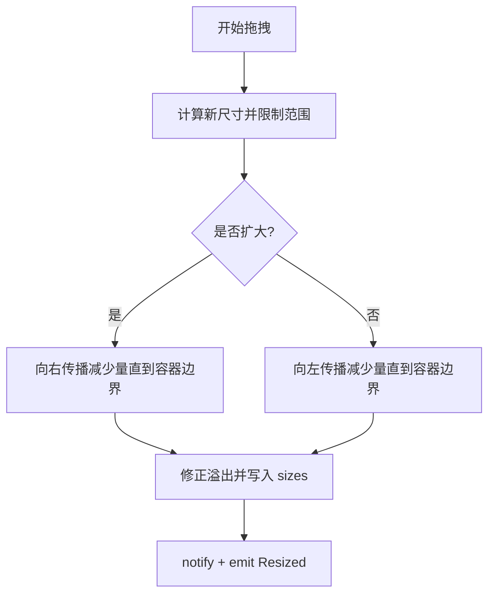
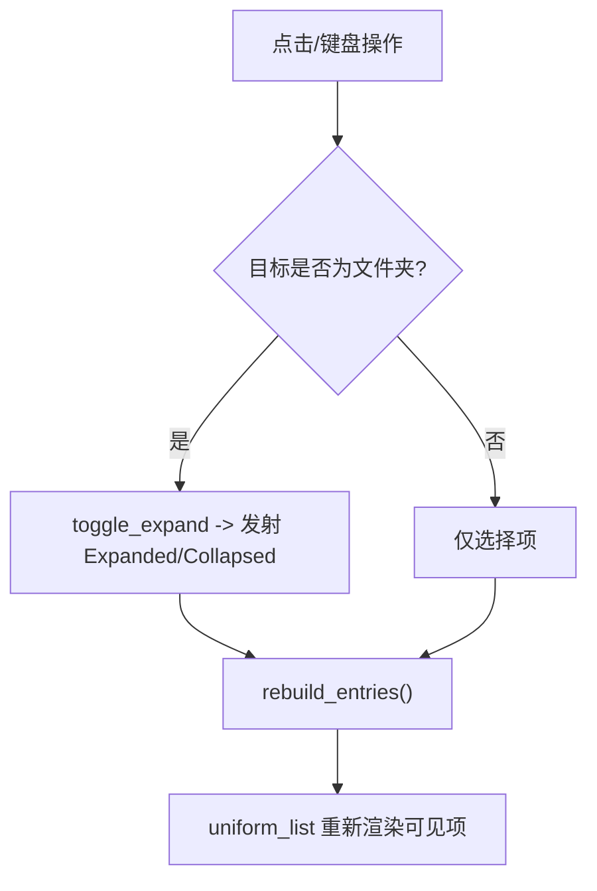
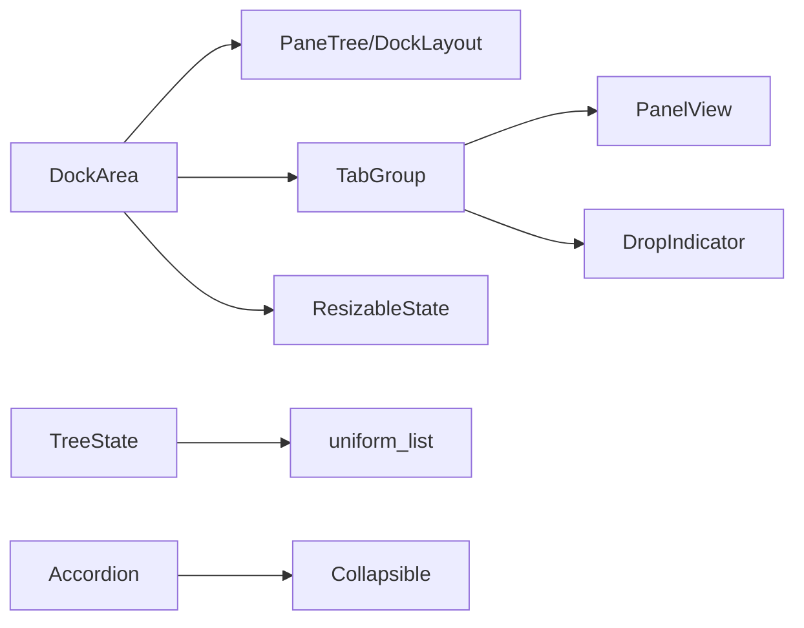

# 布局组件 API

<cite>
**本文引用的文件**   
- [dock/mod.rs](file://crates/base/src/dock/mod.rs)
- [dock/dock_area.rs](file://crates/base/src/dock/dock_area.rs)
- [dock/panel.rs](file://crates/base/src/dock/panel.rs)
- [dock/tab_group.rs](file://crates/base/src/dock/tab_group.rs)
- [resizable/mod.rs](file://crates/base/src/resizable/mod.rs)
- [tabs.rs](file://crates/base/src/tabs.rs)
- [tree.rs](file://crates/base/src/tree.rs)
- [collapsible.rs](file://crates/base/src/collapsible.rs)
- [accordion.rs](file://crates/base/src/accordion.rs)
</cite>

## 目录
1. [简介](#简介)
2. [项目结构](#项目结构)
3. [核心组件](#核心组件)
4. [架构总览](#架构总览)
5. [详细组件分析](#详细组件分析)
6. [依赖关系分析](#依赖关系分析)
7. [性能考虑](#性能考虑)
8. [故障排查指南](#故障排查指南)
9. [结论](#结论)
10. [附录](#附录)

## 简介
本文件系统化梳理 gpui-kit 中与“布局”相关的公共 API，覆盖 Dock、Tab、Tree、Resizable、Collapsible、Accordion 等组件。文档聚焦以下目标：
- 公共接口：属性、事件、方法
- 嵌套结构与组合模式
- 尺寸控制与拖拽行为
- 状态管理与持久化
- 复杂布局示例（面板管理、标签页切换、树形展开收起）
- 最佳实践与注意事项

## 项目结构
布局相关代码主要分布在 base 包中：
- dock：可停靠区域、面板、标签组、布局树与渲染器分离
- resizable：可调整大小的面板组与手柄
- tabs：基础 Tab/Tabs 元素
- tree：虚拟化的树控件
- collapsible：受控的折叠区域
- accordion：手风琴（标题+面板+触发器）

图表来源
- [dock/mod.rs:169-203](file://crates/base/src/dock/mod.rs#L169-L203)
- [dock/dock_area.rs:99-116](file://crates/base/src/dock/dock_area.rs#L99-L116)
- [dock/tab_group.rs:146-159](file://crates/base/src/dock/tab_group.rs#L146-L159)
- [dock/panel.rs:21-93](file://crates/base/src/dock/panel.rs#L21-L93)
- [resizable/mod.rs:18-31](file://crates/base/src/resizable/mod.rs#L18-L31)
- [tabs.rs:23-35](file://crates/base/src/tabs.rs#L23-L35)
- [tree.rs:40-53](file://crates/base/src/tree.rs#L40-L53)
- [collapsible.rs:13-19](file://crates/base/src/collapsible.rs#L13-L19)
- [accordion.rs:16-21](file://crates/base/src/accordion.rs#L16-L21)

章节来源
- [dock/mod.rs:1-203](file://crates/base/src/dock/mod.rs#L1-L203)

## 核心组件
本节概述各布局组件的职责与对外暴露的关键能力。

- Dock（DockArea）
  - 职责：维护中心区与左/右/下三个停靠区的布局树；将纯数据树与实体视图解耦；提供布局编辑、锁定、缩放、持久化等能力。
  - 关键能力：设置中心/停靠区布局、添加/移动/移除面板、选择活动面板、分割槽尺寸、锁定布局、打开/关闭/折叠停靠区、缩放标签组。
  - 事件：布局变更、拖放宿主项。

- Panel（面板）
  - 职责：定义可停靠内容的行为契约（名称、可见性、可关闭、可缩放、激活/缩放回调、加入/离开组回调、持久化）。
  - 对象安全视图：PanelView 用于在运行时持有异构面板实体。

- TabGroup（标签组）
  - 职责：维护一组面板、当前选中索引、焦点、拖放指示器、缩放状态；通过约束决定是否可关闭/拖拽/放置。
  - 事件：面板拖放、宿主项拖放、关闭面板、活动变化、放大/缩小。

- Resizable（可调整大小）
  - 职责：按水平/垂直轴分配空间，支持固定/弹性面板、最小/最大范围、拖拽手柄、程序化调整。
  - 状态：ResizableState 维护面板列表、尺寸、边界、正在调整的面板索引等。

- Tabs/Tab（标签）
  - 职责：无样式的标签集合与单个标签，负责点击、禁用、无障碍语义。

- Tree（树）
  - 职责：虚拟化树，支持展开/收起、选择、滚动、键盘导航、右键菜单状态。

- Collapsible（折叠区域）
  - 职责：受控显示/隐藏内容，支持渐进式 reveal 动画。

- Accordion（手风琴）
  - 职责：由 Header/Panel/Trigger 组成，受控 open 状态，支持 keep_mounted 保持挂载。

章节来源
- [dock/dock_area.rs:99-116](file://crates/base/src/dock/dock_area.rs#L99-L116)
- [dock/panel.rs:21-93](file://crates/base/src/dock/panel.rs#L21-L93)
- [dock/tab_group.rs:146-159](file://crates/base/src/dock/tab_group.rs#L146-L159)
- [resizable/mod.rs:34-54](file://crates/base/src/resizable/mod.rs#L34-L54)
- [tabs.rs:23-35](file://crates/base/src/tabs.rs#L23-L35)
- [tree.rs:40-53](file://crates/base/src/tree.rs#L40-L53)
- [collapsible.rs:13-19](file://crates/base/src/collapsible.rs#L13-L19)
- [accordion.rs:16-21](file://crates/base/src/accordion.rs#L16-L21)

## 架构总览
Dock 采用“数据即布局”的设计：PaneTree/DockLayout 是纯值类型，DockArea 负责将其映射为 GPUI 实体并缓存；渲染完全交给 Renderer 钩子，Base 只负责交互与状态同步。

图表来源
- [dock/mod.rs:31-47](file://crates/base/src/dock/mod.rs#L31-L47)
- [dock/dock_area.rs:232-238](file://crates/base/src/dock/dock_area.rs#L232-L238)
- [dock/tab_group.rs:329-348](file://crates/base/src/dock/tab_group.rs#L329-L348)
- [dock/panel.rs:44-61](file://crates/base/src/dock/panel.rs#L44-L61)

## 详细组件分析

### Dock（DockArea）API
- 构造与外观
  - new(id, version, window, cx)：创建空区域，安装渲染器 with_renderer(renderer)。
  - id()/version()/set_version()：标识与版本控制，用于持久化迁移。
  - bounds()：当前区域边界，用于停靠区尺寸测量。

- 布局查询
  - layout(placement)：获取指定区域的 PaneTree。
  - panel(panel_id)：获取活动面板视图。
  - is_empty(placement, cx)：区域是否为空。
  - is_locked()/set_locked()：锁定布局（仅禁止重排，允许调整大小）。

- 停靠区控制
  - has_dock()/is_dock_open()/toggle_dock()/remove_dock()
  - is_dock_collapsible()/set_dock_collapsible()
  - dock_size()/set_dock_size()

- 面板操作
  - add_panel()/add_panel_view()：向区域添加面板，自动合并到首个标签组或新建分组。
  - remove_panel()：从任意位置移除面板，通知 on_removed。
  - move_panel(panel, target)：跨区域/同区域移动，保留活动状态。
  - select_panel(panel)：仅显示某面板而不移动。
  - set_split_sizes(node, sizes)：设置分割槽尺寸。
  - split_at(node, panel, placement)：在节点旁分割出新槽位。

- 缩放
  - set_zoomed_in()/set_zoomed_out()/is_zoomed()/zoomed_group()

- 事件
  - DockEvent::LayoutChanged：每次布局变更时发出（建议去抖持久化）。
  - DockEvent::DragDrop：宿主拖放项落入停靠区。

图表来源
- [dock/dock_area.rs:371-457](file://crates/base/src/dock/dock_area.rs#L371-L457)

章节来源
- [dock/dock_area.rs:118-226](file://crates/base/src/dock/dock_area.rs#L118-L226)
- [dock/dock_area.rs:229-365](file://crates/base/src/dock/dock_area.rs#L229-L365)
- [dock/dock_area.rs:368-710](file://crates/base/src/dock/dock_area.rs#L368-L710)
- [dock/dock_area.rs:721-800](file://crates/base/src/dock/dock_area.rs#L721-L800)

### Panel（面板）API
- 行为契约 Panel
  - panel_name()：持久化标识名
  - visible(cx)/closable(cx)/zoomable(cx)：可见性、可关闭、可缩放
  - set_active(active)/set_zoomed(zoomed)：被激活/缩放时的回调
  - on_added_to(group)/on_removed()：加入/离开组的生命周期
  - dump(cx)：持久化自身状态

- 对象安全视图 PanelView
  - 提供 panel_name/panel_id/closable/zoomable/visible/set_active/set_zoomed/on_added_to/on_removed/view/focus_handle/dump/as_any 等方法，用于在运行时以统一方式访问具体面板。

图表来源
- [dock/panel.rs:21-93](file://crates/base/src/dock/panel.rs#L21-L93)
- [dock/panel.rs:98-132](file://crates/base/src/dock/panel.rs#L98-L132)
- [dock/panel.rs:134-190](file://crates/base/src/dock/panel.rs#L134-L190)

章节来源
- [dock/panel.rs:1-311](file://crates/base/src/dock/panel.rs#L1-L311)

### TabGroup（标签组）API
- 约束 TabGroupConstraints
  - alone/in_split(alone)/dock_locked()/collapsed()/closable()
  - is_alone()/is_locked()/is_collapsed()/is_closable()

- 行为与状态
  - node()/panels()/active_ix()/active_panel(cx)/is_zoomed()/is_collapsed()
  - select_tab(ix, window, cx)：选择标签页
  - close_panel(panel, cx)：请求关闭面板
  - toggle_zoom()/set_zoomed(zoomed, window, cx)：缩放标签组
  - context(cx)：构建渲染上下文 TabGroupContext

- 事件
  - Drop{panel, source, target}
  - DragDrop{item, target}
  - ClosePanel{panel}
  - ActiveChanged{ix}
  - ZoomIn/ZoomOut

图表来源
- [dock/tab_group.rs:626-669](file://crates/base/src/dock/tab_group.rs#L626-L669)
- [dock/dock_area.rs:480-553](file://crates/base/src/dock/dock_area.rs#L480-L553)
- [dock/tab_group.rs:494-512](file://crates/base/src/dock/tab_group.rs#L494-L512)

章节来源
- [dock/tab_group.rs:24-51](file://crates/base/src/dock/tab_group.rs#L24-L51)
- [dock/tab_group.rs:61-134](file://crates/base/src/dock/tab_group.rs#L61-L134)
- [dock/tab_group.rs:146-179](file://crates/base/src/dock/tab_group.rs#L146-L179)
- [dock/tab_group.rs:181-320](file://crates/base/src/dock/tab_group.rs#L181-L320)
- [dock/tab_group.rs:325-430](file://crates/base/src/dock/tab_group.rs#L325-L430)
- [dock/tab_group.rs:432-670](file://crates/base/src/dock/tab_group.rs#L432-L670)
- [dock/tab_group.rs:768-800](file://crates/base/src/dock/tab_group.rs#L768-L800)

### Resizable（可调整大小）API
- 工厂与基本用法
  - h_resizable(id)/v_resizable(id)：创建水平/垂直分组
  - resizable_panel()：创建面板

- 状态 ResizableState
  - sizes()/resize_panel(ix, size, window, cx)：程序化调整
  - insert_panel(size, ix, cx)：插入面板并重分布
  - adopt_sizes(sizes, cx)：从外部布局接管槽尺寸（Dock 使用）
  - sync_panels_count(axis, panels_count, cx)：同步面板数量
  - update_panel_size(panel_ix, bounds, size_range, fixed, cx)：更新面板测量
  - remove_panel/remove/reset/clear：面板生命周期
  - container_size()/done_resizing()：容器尺寸与结束拖拽

- 事件
  - ResizablePanelEvent::Resized：尺寸调整后发出

图表来源
- [resizable/mod.rs:302-379](file://crates/base/src/resizable/mod.rs#L302-L379)

章节来源
- [resizable/mod.rs:1-13](file://crates/base/src/resizable/mod.rs#L1-L13)
- [resizable/mod.rs:18-31](file://crates/base/src/resizable/mod.rs#L18-L31)
- [resizable/mod.rs:34-54](file://crates/base/src/resizable/mod.rs#L34-L54)
- [resizable/mod.rs:56-171](file://crates/base/src/resizable/mod.rs#L56-L171)
- [resizable/mod.rs:173-280](file://crates/base/src/resizable/mod.rs#L173-L280)
- [resizable/mod.rs:282-436](file://crates/base/src/resizable/mod.rs#L282-L436)

### Tabs/Tab（标签）API
- Tab
  - id()/selected()/disabled()/accessibility_label()/set_position()/on_click()/styles()
- Tabs
  - new(id)：标签集合根，提供 Role=TabList

章节来源
- [tabs.rs:23-107](file://crates/base/src/tabs.rs#L23-L107)
- [tabs.rs:186-235](file://crates/base/src/tabs.rs#L186-L235)

### Tree（树）API
- 数据结构
  - TreeItem：id/label/children/expanded/disabled
  - TreeEntry：扁平化条目，含 depth
  - TreeState：虚拟化树的状态与交互

- 常用方法
  - items()/set_items()：设置根节点
  - selected_index()/set_selected_index()/selected_item()/selected_entry()
  - index_of()/reveal_item()/scroll_to_item()
  - focus()/expand_ancestors()（内部）
  - toggle_expand()/rebuild_entries()（内部）

- 事件
  - TreeEvent::Expanded/Collapsed

图表来源
- [tree.rs:349-376](file://crates/base/src/tree.rs#L349-L376)
- [tree.rs:448-491](file://crates/base/src/tree.rs#L448-L491)

章节来源
- [tree.rs:19-32](file://crates/base/src/tree.rs#L19-L32)
- [tree.rs:34-53](file://crates/base/src/tree.rs#L34-L53)
- [tree.rs:91-97](file://crates/base/src/tree.rs#L91-L97)
- [tree.rs:98-167](file://crates/base/src/tree.rs#L98-L167)
- [tree.rs:169-186](file://crates/base/src/tree.rs#L169-L186)
- [tree.rs:190-226](file://crates/base/src/tree.rs#L190-L226)
- [tree.rs:228-319](file://crates/base/src/tree.rs#L228-L319)
- [tree.rs:321-446](file://crates/base/src/tree.rs#L321-L446)
- [tree.rs:493-564](file://crates/base/src/tree.rs#L493-L564)

### Collapsible（折叠区域）API
- 属性
  - open(bool)：受控开关
  - content(...)：内容区域
  - reveal(id, progress)：渐进式显示（基于 MotionReveal）

章节来源
- [collapsible.rs:13-47](file://crates/base/src/collapsible.rs#L13-L47)
- [collapsible.rs:68-81](file://crates/base/src/collapsible.rs#L68-L81)

### Accordion（手风琴）API
- Accordion：根容器，Role=Group
- AccordionItem：包含 header/panel/children，open/disabled 受控
- AccordionHeader：标题，level/id，内部包装 AccordionTrigger
- AccordionPanel：面板，open/keep_mounted/id
- AccordionTrigger：触发器，open/disabled/on_change

章节来源
- [accordion.rs:16-65](file://crates/base/src/accordion.rs#L16-L65)
- [accordion.rs:67-134](file://crates/base/src/accordion.rs#L67-L134)
- [accordion.rs:136-204](file://crates/base/src/accordion.rs#L136-L204)
- [accordion.rs:206-271](file://crates/base/src/accordion.rs#L206-L271)
- [accordion.rs:273-360](file://crates/base/src/accordion.rs#L273-L360)

## 依赖关系分析
- DockArea 依赖 PaneTree/DockLayout（纯数据）、PanelRegistry（面板注册）、TabGroup（标签组实体）、ResizableState（分割槽尺寸）。
- TabGroup 依赖 PanelView（面板视图）、ActiveTracker（激活跟踪）、DropIndicator（拖放指示器）。
- ResizableState 独立于 Dock，但 DockArea 通过 adopt_sizes 与其协作。
- Tree 使用 uniform_list 虚拟化渲染，并与 actions 绑定键盘导航。
- Collapsible 与 Accordion 是无样式 UI 原语，供上层皮肤组合。

图表来源
- [dock/dock_area.rs:99-116](file://crates/base/src/dock/dock_area.rs#L99-L116)
- [dock/tab_group.rs:146-159](file://crates/base/src/dock/tab_group.rs#L146-L159)
- [resizable/mod.rs:139-171](file://crates/base/src/resizable/mod.rs#L139-L171)
- [tree.rs:448-491](file://crates/base/src/tree.rs#L448-L491)
- [accordion.rs:16-65](file://crates/base/src/accordion.rs#L16-L65)

章节来源
- [dock/mod.rs:169-203](file://crates/base/src/dock/mod.rs#L169-L203)
- [dock/dock_area.rs:99-116](file://crates/base/src/dock/dock_area.rs#L99-L116)
- [dock/tab_group.rs:146-159](file://crates/base/src/dock/tab_group.rs#L146-L159)
- [resizable/mod.rs:139-171](file://crates/base/src/resizable/mod.rs#L139-L171)
- [tree.rs:448-491](file://crates/base/src/tree.rs#L448-L491)

## 性能考虑
- Dock 的数据驱动设计避免重建无关实体：稳定 NodeId/PanelId 使 reconcile 成为 diff，稳态下不创建/销毁任何实体。
- 布局归一化（normalize）幂等且可测试，无需 App 即可验证。
- ResizableState 对面板尺寸更新进行增量处理，仅在必要时 notify。
- Tree 使用 uniform_list 虚拟化渲染，仅渲染可见项。
- DockArea 的 LayoutChanged 事件频繁触发，宿主应做去抖持久化。

[本节为通用指导，不直接分析具体文件]

## 故障排查指南
- 面板未显示
  - 检查 Panel::visible 是否返回 false；若为 true 但被其他可见面板遮挡，确认 active_panel 是否正确。
  - 参考：[dock/panel.rs:28-30](file://crates/base/src/dock/panel.rs#L28-L30)、[dock/tab_group.rs:199-208](file://crates/base/src/dock/tab_group.rs#L199-L208)

- 无法关闭面板
  - 检查 TabGroupConstraints.is_closable 与 Panel.closable；若为最后一个可见面板，容器会阻止关闭。
  - 参考：[dock/tab_group.rs:218-229](file://crates/base/src/dock/tab_group.rs#L218-L229)

- 拖放无效
  - 确认 DockArea.set_locked 与 TabGroup.constraints.dock_locked；缩放状态下组不可放置。
  - 参考：[dock/dock_area.rs:216-225](file://crates/base/src/dock/dock_area.rs#L216-L225)、[dock/tab_group.rs:441-460](file://crates/base/src/dock/tab_group.rs#L441-L460)

- 尺寸异常
  - ResizableState 要求面板尺寸总和不超过容器；固定面板优先保留尺寸，弹性面板按比例分配。
  - 参考：[resizable/mod.rs:381-435](file://crates/base/src/resizable/mod.rs#L381-L435)

- 树项不可见
  - 使用 reveal_item 展开祖先并滚动至目标；确保目标 ID 存在。
  - 参考：[tree.rs:275-285](file://crates/base/src/tree.rs#L275-L285)

章节来源
- [dock/panel.rs:28-30](file://crates/base/src/dock/panel.rs#L28-L30)
- [dock/tab_group.rs:218-229](file://crates/base/src/dock/tab_group.rs#L218-L229)
- [dock/dock_area.rs:216-225](file://crates/base/src/dock/dock_area.rs#L216-L225)
- [dock/tab_group.rs:441-460](file://crates/base/src/dock/tab_group.rs#L441-L460)
- [resizable/mod.rs:381-435](file://crates/base/src/resizable/mod.rs#L381-L435)
- [tree.rs:275-285](file://crates/base/src/tree.rs#L275-L285)

## 结论
本仓库的布局体系以 Dock 为核心，通过纯数据树与实体视图解耦，结合 Resizable、Tabs、Tree、Collapsible、Accordion 等通用原语，形成可扩展、可测试、可持久化的布局方案。推荐在宿主层实现自定义 Renderer 与皮肤，同时遵循上述 API 与最佳实践，以获得一致的用户体验与良好的性能表现。

[本节为总结，不直接分析具体文件]

## 附录
- 复杂布局组合示例要点
  - 面板管理：使用 DockArea.add_panel/add_panel_view 添加面板，move_panel/select_panel 管理活动与位置，remove_panel 清理资源。
  - 标签页切换：通过 TabGroup.select_tab 或 DockArea.select_panel 控制显示。
  - 树形展开收起：使用 TreeState.reveal_item 展开祖先并定位，配合 TreeEvent 监听展开/收起。
  - 尺寸控制：ResizableState.resize_panel 或 DockArea.set_split_sizes 精确控制槽宽/高。
  - 状态管理：订阅 DockEvent::LayoutChanged 与 ResizablePanelEvent::Resized 进行持久化与偏好保存。

[本节为概念性说明，不直接分析具体文件]