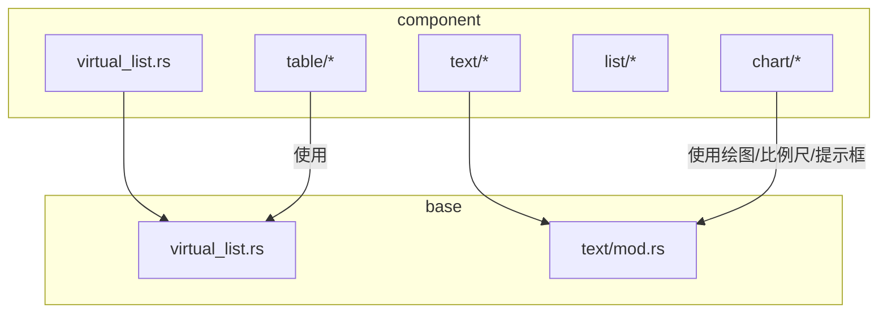
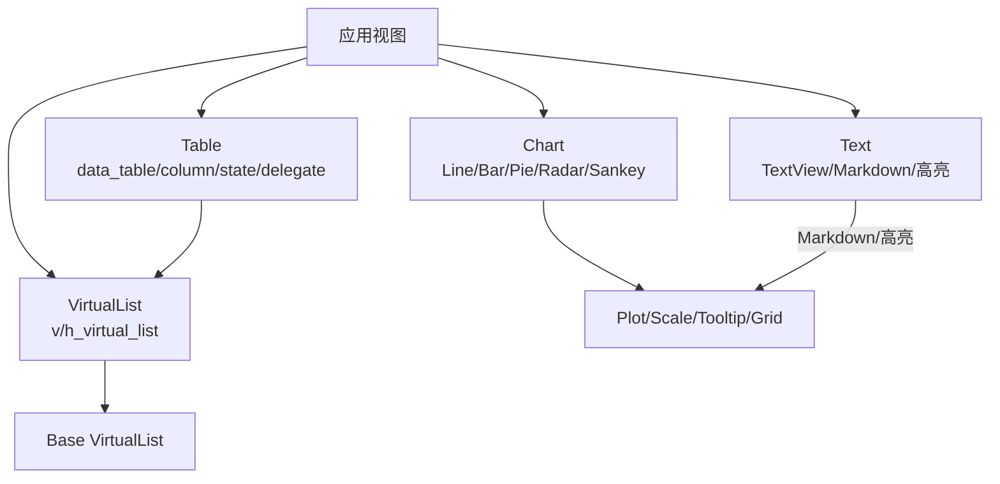
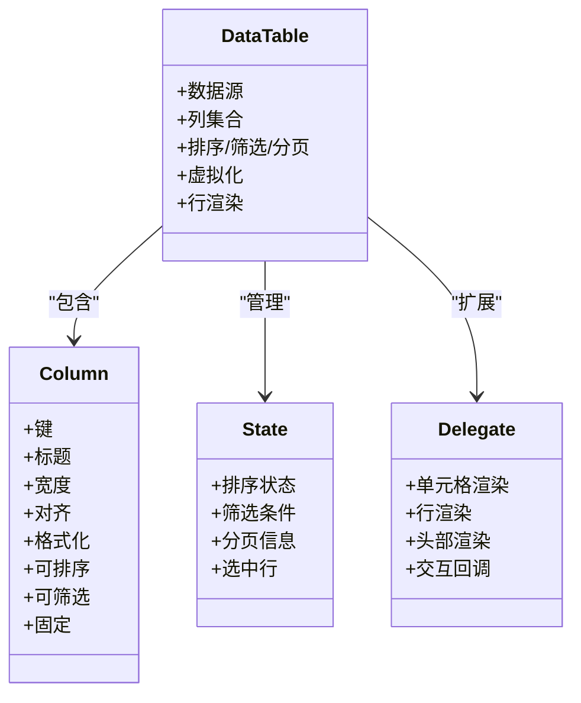
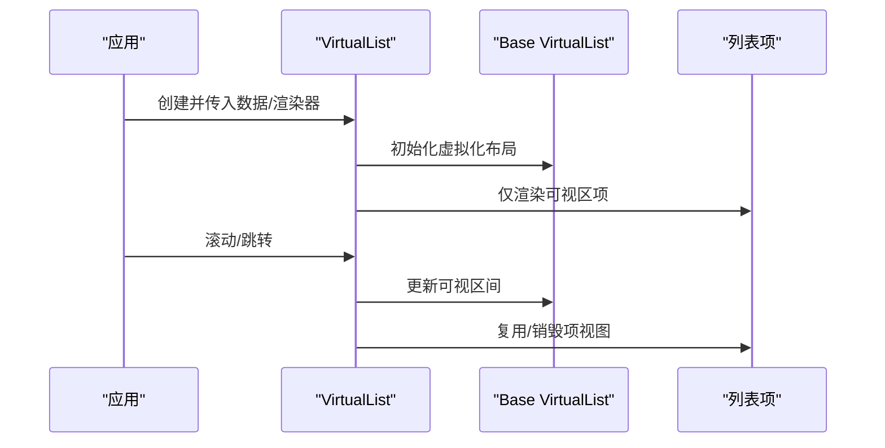
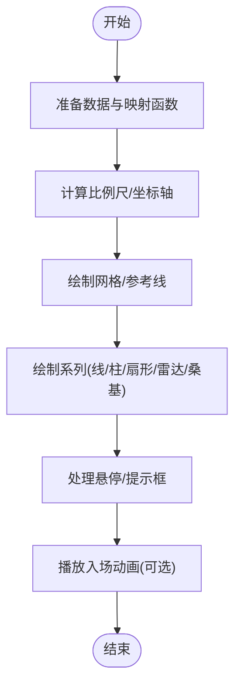
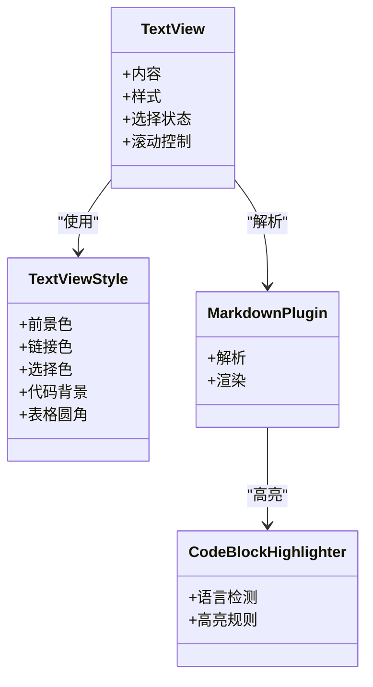
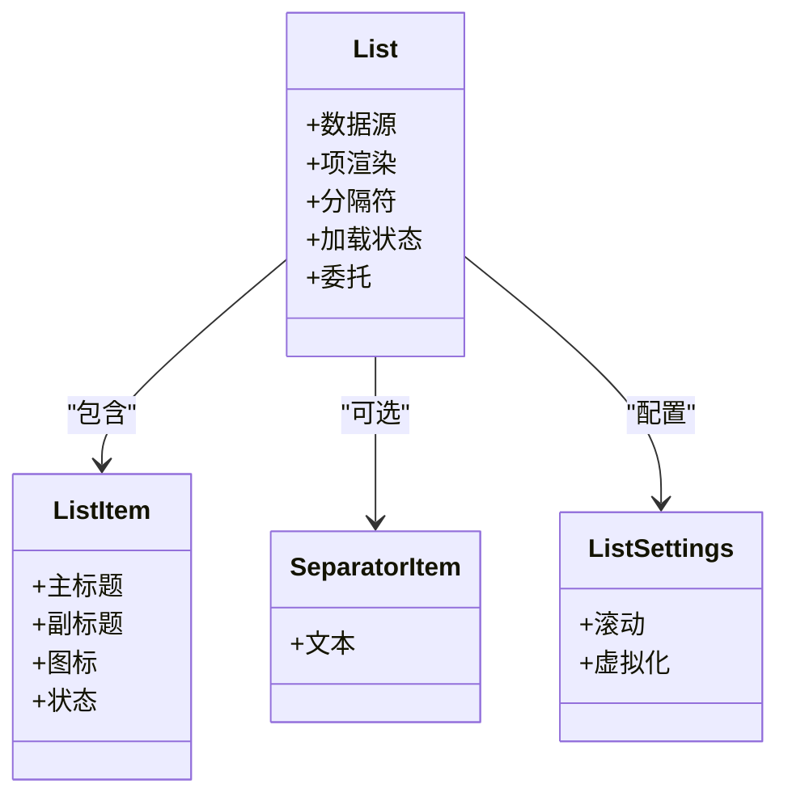
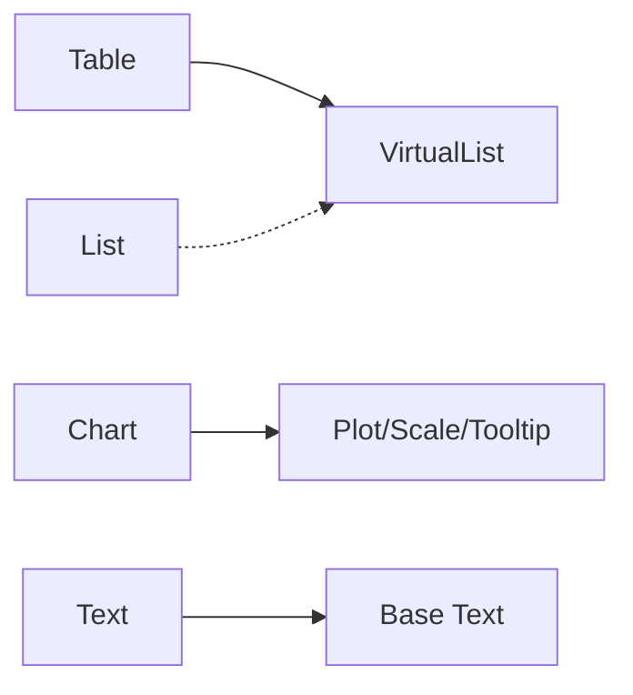

# 数据展示 API

<cite>
**本文引用的文件**   
- [crates/component/src/table/mod.rs](file://crates/component/src/table/mod.rs)
- [crates/component/src/table/data_table.rs](file://crates/component/src/table/data_table.rs)
- [crates/component/src/table/column.rs](file://crates/component/src/table/column.rs)
- [crates/component/src/table/state.rs](file://crates/component/src/table/state.rs)
- [crates/component/src/table/delegate.rs](file://crates/component/src/table/delegate.rs)
- [crates/component/src/virtual_list.rs](file://crates/component/src/virtual_list.rs)
- [crates/base/src/virtual_list.rs](file://crates/base/src/virtual_list.rs)
- [crates/component/src/chart/mod.rs](file://crates/component/src/chart/mod.rs)
- [crates/component/src/chart/line_chart.rs](file://crates/component/src/chart/line_chart.rs)
- [crates/component/src/chart/bar_chart.rs](file://crates/component/src/chart/bar_chart.rs)
- [crates/component/src/chart/pie_chart.rs](file://crates/component/src/chart/pie_chart.rs)
- [crates/component/src/text/mod.rs](file://crates/component/src/text/mod.rs)
- [crates/base/src/text/mod.rs](file://crates/base/src/text/mod.rs)
- [crates/component/src/list/mod.rs](file://crates/component/src/list/mod.rs)
- [crates/component/src/list/list.rs](file://crates/component/src/list/list.rs)
</cite>

## 目录
1. [简介](#简介)
2. [项目结构](#项目结构)
3. [核心组件](#核心组件)
4. [架构总览](#架构总览)
5. [详细组件分析](#详细组件分析)
6. [依赖关系分析](#依赖关系分析)
7. [性能与内存优化](#性能与内存优化)
8. [故障排查指南](#故障排查指南)
9. [结论](#结论)

## 简介
本文件面向“数据展示”相关组件的 API 文档，覆盖以下能力：
- 表格 Table：列定义、数据绑定、排序、筛选、分页与虚拟化渲染。
- 虚拟列表 VirtualList：大数据集滚动优化、滚动句柄控制。
- 图表 Chart：折线、柱状、饼图、雷达、桑基等的数据绑定、坐标轴、网格、提示框与动画。
- 文本 Text：富文本、Markdown、代码高亮、选择与样式。
- 列表 List：基础列表项、分隔符、加载状态与委托模式。

目标读者包括前端/桌面端开发者，既需要快速上手 API，也需要理解底层实现以进行性能调优和扩展。

## 项目结构
数据展示相关代码主要分布在 component 与 base 两个 crate 中：
- component 层提供面向业务的高阶组件（Table、Chart、Text、List、VirtualList 再导出）。
- base 层提供通用基础设施（虚拟化列表、文本系统、绘图与比例尺等）。

图示来源
- [crates/component/src/table/mod.rs:1-19](file://crates/component/src/table/mod.rs#L1-L19)
- [crates/component/src/virtual_list.rs:1-23](file://crates/component/src/virtual_list.rs#L1-L23)
- [crates/component/src/text/mod.rs:1-18](file://crates/component/src/text/mod.rs#L1-L18)

章节来源
- [crates/component/src/table/mod.rs:1-19](file://crates/component/src/table/mod.rs#L1-L19)
- [crates/component/src/virtual_list.rs:1-23](file://crates/component/src/virtual_list.rs#L1-L23)
- [crates/component/src/text/mod.rs:1-18](file://crates/component/src/text/mod.rs#L1-L18)

## 核心组件
本节概述各组件的职责与对外暴露的关键能力，具体属性、事件与方法见后续“详细组件分析”。

- 表格 Table
  - 职责：二维数据的结构化展示，支持列配置、排序、筛选、分页、虚拟化渲染。
  - 关键入口：data_table、column、state、delegate。
- 虚拟列表 VirtualList
  - 职责：大数据集的高效滚动渲染，提供滚动句柄。
  - 关键入口：VirtualList、VirtualListScrollHandle、v_virtual_list/h_virtual_list。
- 图表 Chart
  - 职责：多类型图表的数据可视化，包含坐标轴、网格、提示框、动画与交互。
  - 关键入口：LineChart、BarChart、PieChart、RadarChart、SankeyChart。
- 文本 Text
  - 职责：富文本、Markdown、代码高亮、选择与主题适配。
  - 关键入口：Text、TextView、TextViewStyle、markdown/html 构建器。
- 列表 List
  - 职责：通用列表容器，支持自定义项、分隔符、加载态与委托。
  - 关键入口：List、ListItem、SeparatorItem、ListSettings。

章节来源
- [crates/component/src/table/mod.rs:10-18](file://crates/component/src/table/mod.rs#L10-L18)
- [crates/component/src/virtual_list.rs:1-23](file://crates/component/src/virtual_list.rs#L1-L23)
- [crates/component/src/chart/mod.rs:9-15](file://crates/component/src/chart/mod.rs#L9-L15)
- [crates/component/src/text/mod.rs:7-17](file://crates/component/src/text/mod.rs#L7-L17)
- [crates/component/src/list/mod.rs:8-12](file://crates/component/src/list/mod.rs#L8-L12)

## 架构总览
下图展示了数据展示组件在运行时如何协作：应用通过组件 API 传入数据与配置；表格与列表基于虚拟化机制仅渲染可视区域；图表将数据映射到比例尺并绘制；文本模块负责解析与渲染富文本内容。

图示来源
- [crates/component/src/table/mod.rs:10-18](file://crates/component/src/table/mod.rs#L10-L18)
- [crates/component/src/virtual_list.rs:1-23](file://crates/component/src/virtual_list.rs#L1-L23)
- [crates/component/src/chart/mod.rs:9-15](file://crates/component/src/chart/mod.rs#L9-L15)
- [crates/component/src/text/mod.rs:7-17](file://crates/component/src/text/mod.rs#L7-L17)

## 详细组件分析

### 表格 Table
- 公共接口概览
  - 列 Column：定义列键、标题、宽度、对齐、格式化、可排序、可筛选、可固定等。
  - 数据表 DataTable：承载数据源、列集合、排序/筛选/分页状态、虚拟化开关、行渲染回调。
  - 状态 State：封装当前排序、筛选、分页、选中行等状态，供外部同步或驱动 UI。
  - 委托 Delegate：为单元格、行、头部等提供可扩展的渲染与交互逻辑。
- 数据绑定
  - 通过数据源与列映射函数将原始数据转为表格行；支持异步数据加载与增量更新。
- 排序与筛选
  - 列级排序：点击列头触发排序，支持升序/降序/无排序。
  - 列级筛选：基于列值过滤数据，支持文本模糊匹配、数值范围、枚举多选等。
- 虚拟化渲染
  - 启用虚拟化后，仅渲染可视范围内的行，大幅降低 DOM/视图节点数量。
- 示例要点（不直接展示代码）
  - 大数据集高效渲染：开启虚拟化 + 分页 + 懒加载 + 列宽自适应。
  - 排序筛选组合：先筛选再排序，避免全量计算。
  - 行操作：展开详情、批量选择、右键菜单等通过委托扩展。

图示来源
- [crates/component/src/table/column.rs](file://crates/component/src/table/column.rs)
- [crates/component/src/table/data_table.rs](file://crates/component/src/table/data_table.rs)
- [crates/component/src/table/state.rs](file://crates/component/src/table/state.rs)
- [crates/component/src/table/delegate.rs](file://crates/component/src/table/delegate.rs)

章节来源
- [crates/component/src/table/mod.rs:10-18](file://crates/component/src/table/mod.rs#L10-L18)
- [crates/component/src/table/data_table.rs](file://crates/component/src/table/data_table.rs)
- [crates/component/src/table/column.rs](file://crates/component/src/table/column.rs)
- [crates/component/src/table/state.rs](file://crates/component/src/table/state.rs)
- [crates/component/src/table/delegate.rs](file://crates/component/src/table/delegate.rs)

### 虚拟列表 VirtualList
- 公共接口概览
  - VirtualList：虚拟化列表容器，支持垂直/水平方向。
  - VirtualListScrollHandle：滚动控制句柄，支持滚动到指定位置、获取滚动偏移等。
  - v_virtual_list / h_virtual_list：便捷构造器。
- 虚拟化渲染
  - 仅渲染可见区域项，滚动时复用项视图，减少布局与绘制开销。
- 滚动优化
  - 使用滚动句柄精确控制滚动位置，避免抖动与重排。
- 示例要点（不直接展示代码）
  - 长列表滚动：设置预估行高、缓冲区域、惰性加载下一页。
  - 跳转到指定项：通过滚动句柄定位，配合搜索高亮。

图示来源
- [crates/component/src/virtual_list.rs:1-23](file://crates/component/src/virtual_list.rs#L1-L23)
- [crates/base/src/virtual_list.rs](file://crates/base/src/virtual_list.rs)

章节来源
- [crates/component/src/virtual_list.rs:1-23](file://crates/component/src/virtual_list.rs#L1-L23)
- [crates/base/src/virtual_list.rs](file://crates/base/src/virtual_list.rs)

### 图表 Chart
- 公共接口概览
  - LineChart：折线图，适合时间序列与趋势展示。
  - BarChart：柱状图，适合分类对比。
  - PieChart：饼图，适合占比展示。
  - RadarChart：雷达图，适合多维指标对比。
  - SankeyChart：桑基图，适合流量/能量流向。
- 数据绑定
  - 通过数据数组与字段映射函数将数据映射到 x/y 轴或类别/数值。
- 坐标轴与网格
  - 支持刻度数量、标签格式、参考线、网格虚线/实线、标签内外放置。
- 提示框 Tooltip
  - 支持自定义标题、值文本、值颜色、完整内容元素。
- 动画与交互
  - 入场动画、悬停高亮点、十字准线、路径缓存。
- 示例要点（不直接展示代码）
  - 大数据集：分片渲染、按需计算比例尺、关闭不必要的网格/刻度。
  - 动态数据：使用 key 触发动画回放，避免重复计算。

图示来源
- [crates/component/src/chart/mod.rs:9-15](file://crates/component/src/chart/mod.rs#L9-L15)
- [crates/component/src/chart/mod.rs:286-380](file://crates/component/src/chart/mod.rs#L286-L380)
- [crates/component/src/chart/mod.rs:382-566](file://crates/component/src/chart/mod.rs#L382-L566)

章节来源
- [crates/component/src/chart/mod.rs:9-15](file://crates/component/src/chart/mod.rs#L9-L15)
- [crates/component/src/chart/mod.rs:286-380](file://crates/component/src/chart/mod.rs#L286-L380)
- [crates/component/src/chart/mod.rs:382-566](file://crates/component/src/chart/mod.rs#L382-L566)
- [crates/component/src/chart/line_chart.rs](file://crates/component/src/chart/line_chart.rs)
- [crates/component/src/chart/bar_chart.rs](file://crates/component/src/chart/bar_chart.rs)
- [crates/component/src/chart/pie_chart.rs](file://crates/component/src/chart/pie_chart.rs)

### 文本 Text
- 公共接口概览
  - Text/TextView：富文本容器，支持 Markdown、HTML、代码块高亮、选择、滚动。
  - TextViewStyle：主题化样式，包括前景色、链接、选择、代码背景、表格圆角等。
  - markdown/html：便捷构建器，从字符串生成富文本。
- 功能特性
  - Markdown 解析与渲染：标题、段落、表格、代码块、图片等。
  - 代码高亮：支持 tree-sitter/syntect 两种后端，按语言着色。
  - 选择与编辑：支持文本选择、复制、联动光标移动。
- 示例要点（不直接展示代码）
  - 大文档渲染：分段加载、延迟渲染、禁用不必要的高亮。
  - 主题切换：统一通过 TextViewStyle 注入主题。

图示来源
- [crates/component/src/text/mod.rs:7-17](file://crates/component/src/text/mod.rs#L7-L17)
- [crates/component/src/text/mod.rs:36-80](file://crates/component/src/text/mod.rs#L36-L80)
- [crates/base/src/text/mod.rs](file://crates/base/src/text/mod.rs)

章节来源
- [crates/component/src/text/mod.rs:7-17](file://crates/component/src/text/mod.rs#L7-L17)
- [crates/component/src/text/mod.rs:36-80](file://crates/component/src/text/mod.rs#L36-L80)
- [crates/base/src/text/mod.rs](file://crates/base/src/text/mod.rs)

### 列表 List
- 公共接口概览
  - List：列表容器，支持自定义项、分隔符、加载状态、委托。
  - ListItem：单项包装，支持选中、禁用、图标、描述等。
  - SeparatorItem：分隔项，用于分组。
  - ListSettings：列表行为配置（如滚动、虚拟化等）。
- 示例要点（不直接展示代码）
  - 大数据集：结合虚拟化与分页加载。
  - 复杂项：通过委托定制渲染与交互。

图示来源
- [crates/component/src/list/mod.rs:8-12](file://crates/component/src/list/mod.rs#L8-L12)
- [crates/component/src/list/list.rs](file://crates/component/src/list/list.rs)

章节来源
- [crates/component/src/list/mod.rs:8-12](file://crates/component/src/list/mod.rs#L8-L12)
- [crates/component/src/list/list.rs](file://crates/component/src/list/list.rs)

## 依赖关系分析
- 组件耦合
  - Table 依赖 VirtualList 进行虚拟化渲染；Column/State/Delegate 解耦列定义、状态管理与扩展点。
  - Chart 依赖 Plot/Scale/Tooltip 等绘图基础设施；不同图表共享通用工具（如刻度、标签、遮罩）。
  - Text 依赖 base 的文本系统与高亮器；Theme 适配统一样式。
  - List 可独立使用，也可与 VirtualList 组合。
- 外部依赖
  - gpui 框架：Element、Window、App、主题系统等。
  - base 库：虚拟化、文本、绘图、比例尺等。

图示来源
- [crates/component/src/table/mod.rs:10-18](file://crates/component/src/table/mod.rs#L10-L18)
- [crates/component/src/virtual_list.rs:1-23](file://crates/component/src/virtual_list.rs#L1-L23)
- [crates/component/src/chart/mod.rs:9-15](file://crates/component/src/chart/mod.rs#L9-L15)
- [crates/component/src/text/mod.rs:7-17](file://crates/component/src/text/mod.rs#L7-L17)
- [crates/component/src/list/mod.rs:8-12](file://crates/component/src/list/mod.rs#L8-L12)

章节来源
- [crates/component/src/table/mod.rs:10-18](file://crates/component/src/table/mod.rs#L10-L18)
- [crates/component/src/virtual_list.rs:1-23](file://crates/component/src/virtual_list.rs#L1-L23)
- [crates/component/src/chart/mod.rs:9-15](file://crates/component/src/chart/mod.rs#L9-L15)
- [crates/component/src/text/mod.rs:7-17](file://crates/component/src/text/mod.rs#L7-L17)
- [crates/component/src/list/mod.rs:8-12](file://crates/component/src/list/mod.rs#L8-L12)

## 性能与内存优化
- 表格
  - 启用虚拟化：仅渲染可视行，避免一次性创建大量视图。
  - 列宽自适应：仅在必要时测量文本宽度，避免频繁重排。
  - 排序/筛选：优先在数据层完成，减少 UI 层计算。
  - 分页/懒加载：分批拉取数据，降低首屏压力。
- 虚拟列表
  - 预估行高：提高布局精度，减少重绘。
  - 缓冲区域：合理设置上下缓冲，平衡滚动流畅度与内存占用。
  - 滚动句柄：精准控制滚动位置，避免抖动。
- 图表
  - 数据分片：对大数据集分片计算比例尺与路径。
  - 关闭非必要元素：隐藏网格/刻度/参考线以提升绘制速度。
  - 动画控制：大数据集关闭入场动画或缩短时长。
  - 路径缓存：复用已计算路径，减少重复计算。
- 文本
  - 大文档分段渲染：避免一次性解析与渲染全部 Markdown。
  - 代码高亮按需启用：非代码场景禁用高亮。
  - 主题切换：复用高亮器实例，避免重复构建。
- 列表
  - 虚拟化+分页：结合两者应对超长列表。
  - 项复用：避免频繁创建/销毁复杂子树。

[本节为通用指导，不直接分析具体文件]

## 故障排查指南
- 表格
  - 现象：滚动卡顿或内存暴涨。
    - 检查是否启用虚拟化；确认列格式化未执行昂贵计算。
    - 检查排序/筛选是否在数据层完成。
  - 现象：列宽异常或溢出。
    - 检查列宽策略与文本截断设置；确认自适应列宽测量时机。
- 虚拟列表
  - 现象：滚动抖动或跳帧。
    - 调整预估行高与缓冲区域；使用滚动句柄精准定位。
  - 现象：项错位。
    - 检查项唯一 key；确保数据更新时保持稳定性。
- 图表
  - 现象：提示框显示异常。
    - 检查 TooltipContent 的 title/value/content 回调返回值。
  - 现象：动画闪烁或重复播放。
    - 检查 appear_key 是否稳定；大数据集建议关闭动画。
- 文本
  - 现象：Markdown 渲染错乱。
    - 检查插件注册与主题样式；确认代码块语言配置。
  - 现象：代码高亮失效。
    - 检查语言注册与高亮器缓存；确认 theme 一致性。
- 列表
  - 现象：项渲染重复或缺失。
    - 检查项 key 与数据更新策略；确认委托渲染逻辑幂等。

章节来源
- [crates/component/src/chart/mod.rs:286-380](file://crates/component/src/chart/mod.rs#L286-L380)
- [crates/component/src/text/mod.rs:36-80](file://crates/component/src/text/mod.rs#L36-L80)
- [crates/component/src/virtual_list.rs:1-23](file://crates/component/src/virtual_list.rs#L1-L23)

## 结论
本 API 文档围绕 Table、VirtualList、Chart、Text、List 五大类数据展示组件，梳理了公共接口、数据绑定、虚拟化渲染、图表配置与文本格式化等核心能力，并结合仓库源码给出架构图、类图与流程图，帮助开发者快速上手并进行性能调优。实际使用中，请根据数据规模与交互需求选择合适的虚拟化、分页、动画与高亮策略，以获得最佳的用户体验与资源利用率。