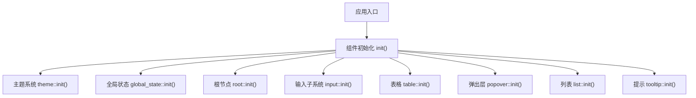
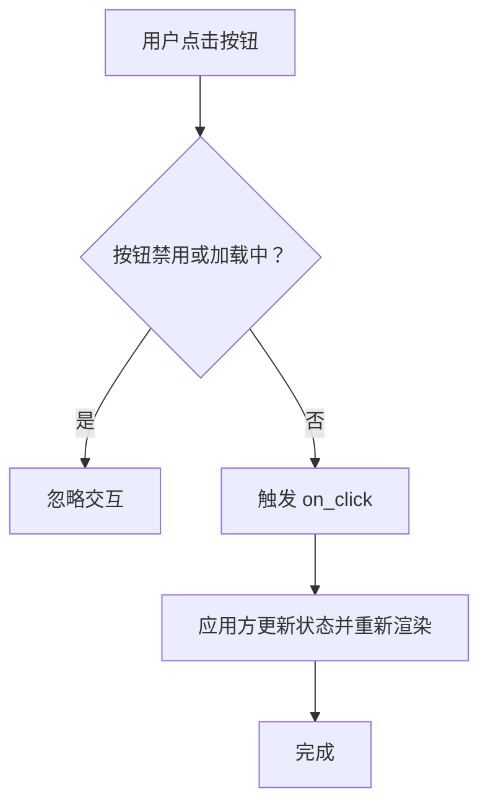
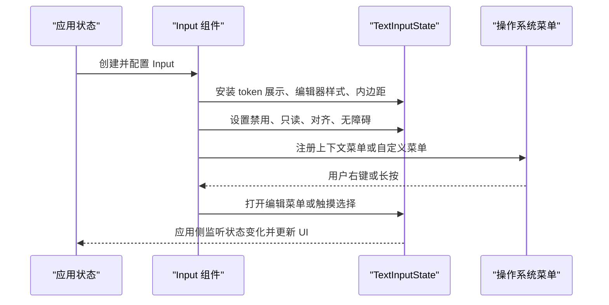
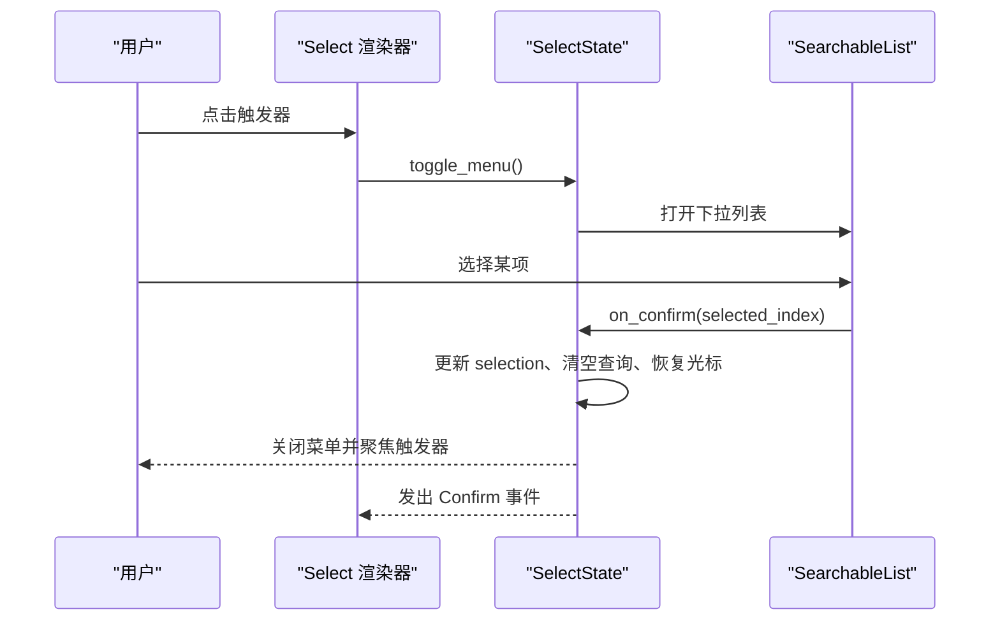
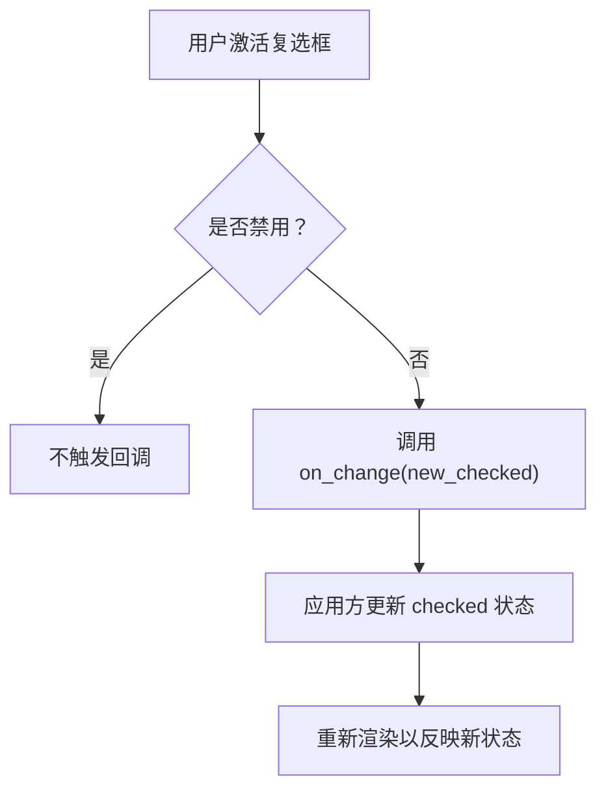
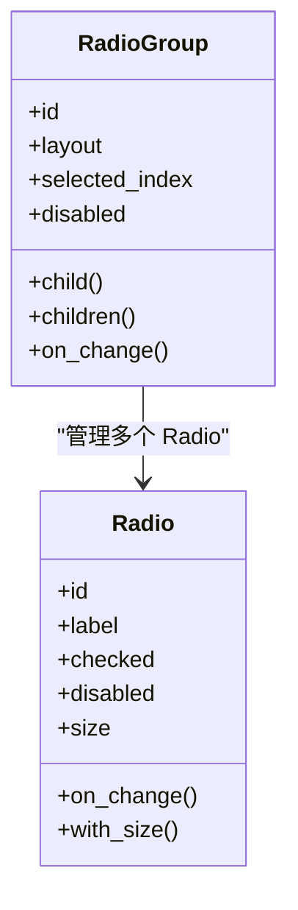
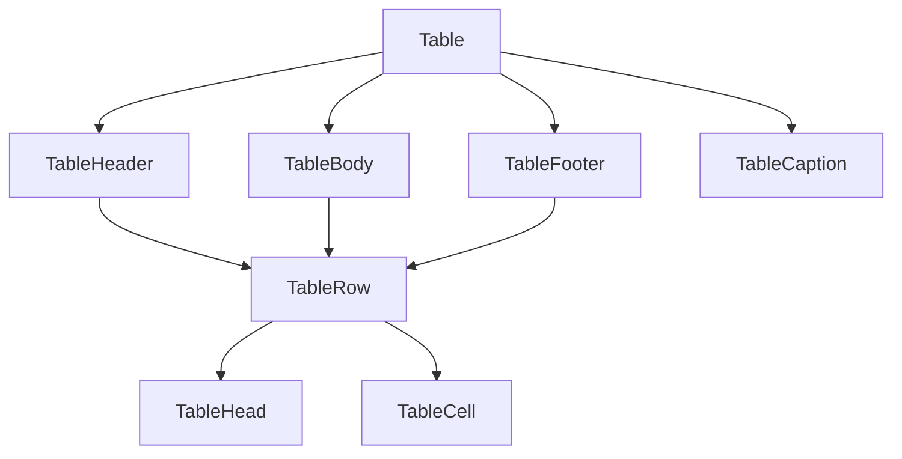
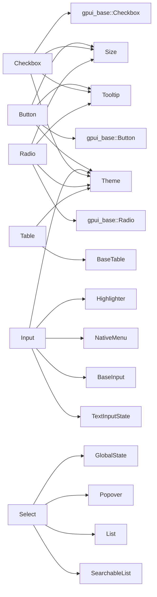
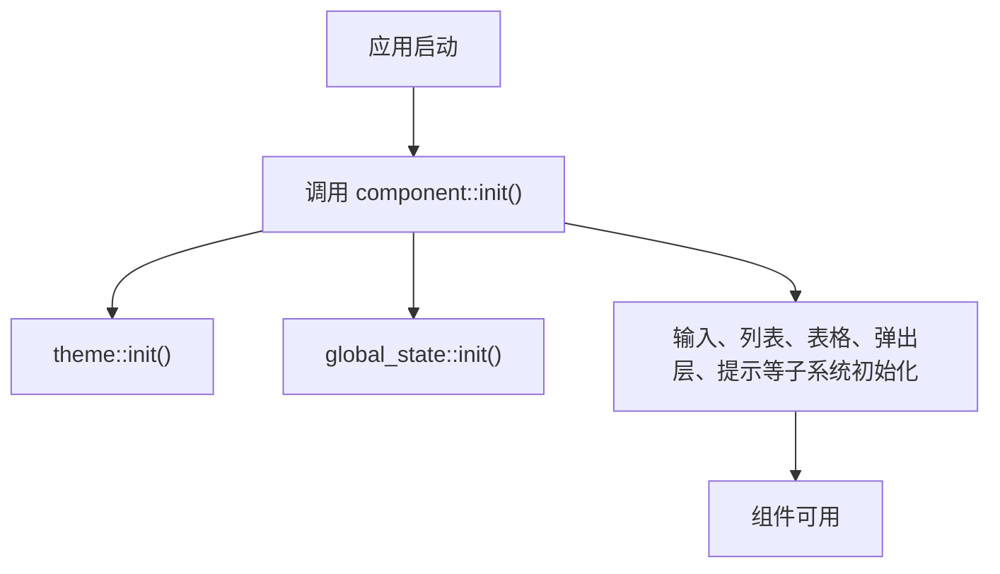

# 组件 API

<cite>
**本文引用的文件**   
- [lib.rs](file://crates/component/src/lib.rs)
- [button.rs](file://crates/component/src/button/button.rs)
- [input.rs](file://crates/component/src/input/input.rs)
- [select.rs](file://crates/component/src/select.rs)
- [checkbox.rs](file://crates/component/src/checkbox.rs)
- [radio.rs](file://crates/component/src/radio.rs)
- [table.rs](file://crates/component/src/table/table.rs)
</cite>

## 目录
1. [简介](#简介)
2. [项目结构](#项目结构)
3. [核心组件总览](#核心组件总览)
4. [架构总览](#架构总览)
5. [详细组件 API](#详细组件-api)
6. [依赖关系分析](#依赖关系分析)
7. [性能与可访问性](#性能与可访问性)
8. [样式定制与主题集成](#样式定制与主题集成)
9. [组合模式与最佳实践](#组合模式与最佳实践)
10. [故障排查](#故障排查)
11. [结论](#结论)

## 简介
本文件面向使用 gpui-kit 的开发者，系统化梳理 UI 组件的公共接口，覆盖按钮、输入框、选择器、表格、复选框和单选框等核心组件。文档重点包括：
- 类型定义、属性、事件回调与方法
- 受控状态管理接口
- 组合模式、样式定制与主题集成方式
- 废弃 API 提示与迁移建议
- 基于源码的准确引用，确保文档与实际实现同步

## 项目结构
组件库位于 `crates/component`，通过根模块统一导出所有公开组件、主题初始化、全局状态、国际化语言设置以及基础能力扩展。应用入口需要调用组件初始化函数，使主题、输入、列表、表格、弹窗等子系统生效。



**图表来源**
- [lib.rs:127-151](file://crates/component/src/lib.rs#L127-L151)

**章节来源**
- [lib.rs:1-172](file://crates/component/src/lib.rs#L1-L172)

## 核心组件总览
以下组件均遵循统一的构建器风格：通过 `new(...)` 创建实例，再链式配置属性、事件和样式；多数交互控件支持受控模式，由外部状态驱动渲染。

| 组件 | 主要职责 | 关键属性 | 关键事件 | 关键方法 |
|---|---|---|---|---|
| Button | 通用按钮、图标按钮、加载态、变体样式 | 标签、图标、尺寸、变体、禁用、选中、打开、圆角、边框、紧凑、工具提示、加载图标 | `on_click`、`on_hover` | `label`、`icon`、`variant`、`loading`、`compact`、`rounded`、`outline`、`tab_index`、`tab_stop` |
| Input | 文本输入、掩码切换、前缀后缀、粘贴拦截、上下文菜单、内容语义类型 | 尺寸、外观、边框、禁用、只读、清理按钮、掩码开关、内容类型、角色、无障碍标识 | 内部编辑事件由状态驱动；提供 `on_paste`、`context_menu` | `cleanable`、`mask_toggle`、`content_type`、`role`、`prefix`、`suffix`、`h_full`、`appearance` |
| Select | 下拉选择器，支持搜索、占位符、标题前缀、清空、滚动回弹 | 菜单宽度、最大高度、占位符、无障碍标签、标题前缀、搜索占位符、滚动回弹、禁用、外观 | `SelectEvent::Confirm` | `searchable`、`set_selected_index`、`set_selected_value`、`set_items`、`focus` |
| Checkbox | 复选框，支持标签、子元素、工具提示、无障碍标签 | 选中、禁用、尺寸、Tab 行为、工具提示延迟、角色 | `on_click` / `on_change` | `checked`、`disabled`、`tooltip`、`accessibility_label` |
| Radio | 单选按钮及分组容器 | 选中、禁用、尺寸、位置信息、组布局、选中索引 | `on_click` / `on_change` | `checked`、`disabled`、`layout`、`selected_index`、`child` |
| Table | 基础表格，包含表头、表体、行、单元格、说明文字 | 无障碍标签、尺寸、子元素 | 无业务事件 | `accessibility_label`、`child`、`children` |

**章节来源**
- [button.rs:188-593](file://crates/component/src/button/button.rs#L188-L593)
- [input.rs:131-421](file://crates/component/src/input/input.rs#L131-L421)
- [select.rs:120-146](file://crates/component/src/select.rs#L120-L146)
- [checkbox.rs:15-128](file://crates/component/src/checkbox.rs#L15-L128)
- [radio.rs:15-132](file://crates/component/src/radio.rs#L15-L132)
- [table.rs:40-82](file://crates/component/src/table/table.rs#L40-L82)

## 架构总览
组件库采用“基础基元 + 高级组件”的分层设计：
- `gpui_base` 提供基础交互基元，如 `Button`、`Checkbox`、`Radio`、`InputBase`、`Table` 系列。
- `component` 在基元之上封装业务语义、主题样式、无障碍、尺寸系统和组合逻辑。
- 复杂组件如 `Select` 复用 `List`、`SearchableList`、`Popover` 等能力。
- 主题、全局状态、国际化、测量日志等基础设施在 `init()` 中集中注册。

```mermaid
classDiagram
class Button {
+id
+base
+icon
+label
+variant
+size
+disabled
+selected
+open
+loading
+on_click()
+on_hover()
+with_size()
+variant()
}
class Input {
+state
+size
+appearance
+cleanable
+mask_toggle
+disabled
+readonly
+content_type
+role
+on_paste()
+context_menu()
+with_size()
}
class SelectState {
+state
+searchable
+icon
+title_prefix
+focus_ring_enabled
+new()
+set_selected_index()
+set_selected_value()
+set_items()
+selected_index()
+selected_value()
+focus()
}
class Checkbox {
+base
+label
+children
+checked
+disabled
+size
+on_click()
+on_change()
+with_size()
}
class Radio {
+base
+label
+children
+checked
+disabled
+size
+on_click()
+on_change()
+with_size()
}
class Table {
+children
+size
+accessibility_label
+child()
+children()
}
Button --> "uses" gpui_base : : Button
Input --> "wraps" BaseInput
SelectState --> "delegates" SearchableListState
Checkbox --> "wraps" gpui_base : : Checkbox
Radio --> "wraps" gpui_base : : Radio
Table --> "wraps" BaseTable
```

**图表来源**
- [button.rs:188-593](file://crates/component/src/button/button.rs#L188-L593)
- [input.rs:131-421](file://crates/component/src/input/input.rs#L131-L421)
- [select.rs:120-146](file://crates/component/src/select.rs#L120-L146)
- [checkbox.rs:15-128](file://crates/component/src/checkbox.rs#L15-L128)
- [radio.rs:15-132](file://crates/component/src/radio.rs#L15-L132)
- [table.rs:40-82](file://crates/component/src/table/table.rs#L40-L82)

## 详细组件 API

### 按钮 Button
Button 是通用交互入口，支持多种视觉变体、图标模式、加载态、紧凑模式、悬停组、工具提示和无障碍命名。

#### 类型与属性
- 变体：默认、主色、次要、危险、警告、成功、信息、幽灵、链接、文本、自定义。
- 外观：圆角、描边、边框角落、边框边、下拉箭头、紧凑模式。
- 状态：禁用、选中、打开、加载、悬停组持有。
- 交互：点击、悬停、Tab 顺序、焦点环。
- 可访问性：开发者 ID、屏幕阅读器名称、切换状态。

#### 关键方法
- `new(id)`：创建按钮。
- `label(label)`：设置可见标签。
- `icon(icon)`：设置图标。
- `variant(variant)`：设置变体。
- `loading(loading)`：开启加载指示。
- `compact()`：紧凑模式。
- `rounded(rounded)`：设置圆角。
- `outline()`：描边样式。
- `tab_index(index)`：设置 Tab 顺序。
- `tab_stop(enabled)`：是否参与 Tab。
- `dropdown_caret(enabled)`：显示下拉箭头。
- `toggled(toggled)`：暴露为切换按钮的可访问性状态。
- `on_click(handler)`：点击回调。
- `on_hover(handler)`：悬停回调。

#### 事件
- `ClickEvent`：点击事件参数。
- 悬停布尔值：表示鼠标是否悬停。

#### 受控状态
- `selected`：控制选中样式。
- `open`：控制弹出层关联时的选中样式。
- `loading`：控制交互不可用但保持外观。



**图表来源**
- [button.rs:531-544](file://crates/component/src/button/button.rs#L531-L544)
- [button.rs:458-471](file://crates/component/src/button/button.rs#L458-L471)

**章节来源**
- [button.rs:23-186](file://crates/component/src/button/button.rs#L23-L186)
- [button.rs:188-593](file://crates/component/src/button/button.rs#L188-L593)

### 输入框 Input
Input 是基于 `TextInputState` 的文本输入组件，支持单行和多行、掩码切换、前缀后缀、粘贴拦截、原生上下文菜单、内容语义类型和无障碍角色。

#### 类型与属性
- 尺寸、外观、边框、禁用、只读。
- 清理按钮、掩码切换。
- 内容类型：电话、邮箱、URL、密码、日期时间、姓名、地址、信用卡、用户名、一次性验证码等。
- 角色：可被覆盖，否则根据多行和内容类型推断。
- 无障碍：开发者 ID、ARIA 标签。
- 上下文菜单：自定义原生菜单构建器。
- 粘贴拦截：返回 true 表示已处理，阻止默认插入。

#### 关键方法
- `new(state)`：绑定输入状态实体。
- `id(id)`：设置框架 ID。
- `prefix(element)`：前缀元素。
- `suffix(element)`：后缀元素。
- `h_full()`：多行时全高。
- `h(height)`：多行时固定高度。
- `appearance(bool)`：是否带背景和边框。
- `bordered(bool)`：是否带边框。
- `focus_bordered(bool)`：聚焦时是否带边框。
- `cleanable(bool)`：非空时显示清理按钮。
- `mask_toggle()`：启用密码显示隐藏切换。
- `content_type(type)`：设置语义内容类型。
- `role(role)`：覆盖无障碍角色。
- `disabled(bool)`：禁用。
- `readonly(bool)`：只读。
- `tab_index(index)`：Tab 顺序。
- `context_menu(builder)`：自定义右键菜单。
- `on_paste(handler)`：拦截粘贴。

#### 事件与状态
- 编辑、选择、上下文菜单、触摸选择、掩码切换均由内部状态驱动。
- 应用侧可通过 `TextInputState` 控制文本、选择、掩码、上下文菜单能力。



**图表来源**
- [input.rs:541-669](file://crates/component/src/input/input.rs#L541-L669)

**章节来源**
- [input.rs:26-128](file://crates/component/src/input/input.rs#L26-L128)
- [input.rs:131-421](file://crates/component/src/input/input.rs#L131-L421)
- [input.rs:541-800](file://crates/component/src/input/input.rs#L541-L800)

### 选择器 Select
Select 是基于可搜索列表的下拉选择器，支持搜索、占位符、标题前缀、清空、滚动回弹、菜单宽度和最大高度。

#### 类型与属性
- `SelectState<D>`：选择器状态，委托给 `SearchableListState`。
- `Select<D>`：渲染器，绑定状态并配置外观。
- 选项：菜单宽度、最大高度、占位符、无障碍标签、标题前缀、搜索占位符、滚动回弹、禁用、外观、焦点环。

#### 关键方法
- `SelectState::new(delegate, selected_index, window, cx)`：创建状态。
- `searchable(bool)`：是否启用搜索。
- `set_selected_index(index, window, cx)`：按索引设置选中。
- `set_selected_value(value, window, cx)`：按值查找位置后设置选中。
- `set_items(items, window, cx)`：替换数据源并尽量保留选中。
- `selected_index(cx)`：获取当前选中索引。
- `selected_value()`：获取当前选中值。
- `focus(window, cx)`：聚焦触发器。
- `Select::new(state)`：创建渲染器。
- `menu_width(width)`：设置菜单宽度。
- `menu_max_h(max_h)`：设置菜单最大高度。
- `placeholder(text)`：设置未选中占位符。
- `accessibility_label(label)`：设置无障碍标签。
- `icon(icon)`：替换默认箭头。
- `title_prefix(prefix)`：标题前缀。
- `cleanable(bool)`：选中后显示清空按钮。
- `search_placeholder(text)`：搜索输入占位符。
- `scroll_bounce(enabled)`：滚动回弹。
- `disabled(bool)`：禁用。
- `empty(builder)`：自定义空状态。
- `appearance(bool)`：是否显示边框和背景。

#### 事件
- `SelectEvent::Confirm(value?)`：确认选择时发出，值为选中项的值或未选中。



**图表来源**
- [select.rs:148-300](file://crates/component/src/select.rs#L148-L300)
- [select.rs:420-476](file://crates/component/src/select.rs#L420-L476)

**章节来源**
- [select.rs:70-116](file://crates/component/src/select.rs#L70-L116)
- [select.rs:120-146](file://crates/component/src/select.rs#L120-L146)
- [select.rs:148-532](file://crates/component/src/select.rs#L148-L532)
- [select.rs:674-776](file://crates/component/src/select.rs#L674-L776)

### 复选框 Checkbox
Checkbox 是受控复选框，支持标签、子元素、工具提示、无障碍标签、尺寸和 Tab 行为。

#### 类型与属性
- `id`、`base`、`label`、`children`、`checked`、`disabled`、`size`、`tab_stop`、`tab_index`、`tooltip`、`accessibility_label`、`role`、`focus_ring_enabled`。

#### 关键方法
- `new(id)`：创建复选框。
- `checked(bool)`：设置选中状态。
- `disabled(bool)`：禁用。
- `label(text)`：设置标签。
- `accessibility_label(label)`：设置屏幕阅读器名称。
- `tooltip(text)`：设置工具提示。
- `tooltip_show_delay(delay)`：设置工具提示显示延迟。
- `on_click(handler)`：点击回调别名。
- `on_change(handler)`：受控变更回调。
- `tab_stop(bool)`：是否参与 Tab。
- `tab_index(index)`：Tab 顺序。
- `with_size(size)`：设置尺寸。

#### 事件
- `on_click` / `on_change`：传入新的布尔值，应用方需写入状态并通知重渲染。



**图表来源**
- [checkbox.rs:101-128](file://crates/component/src/checkbox.rs#L101-L128)
- [checkbox.rs:275-280](file://crates/component/src/checkbox.rs#L275-L280)

**章节来源**
- [checkbox.rs:15-128](file://crates/component/src/checkbox.rs#L15-L128)
- [checkbox.rs:226-364](file://crates/component/src/checkbox.rs#L226-L364)

### 单选框 Radio 与 RadioGroup
Radio 是单个单选按钮；RadioGroup 管理一组 Radio，负责布局、选中索引和禁用状态。

#### Radio 类型与属性
- `id`、`base`、`label`、`children`、`checked`、`disabled`、`size`、`tab_stop`、`tab_index`、`tooltip`、`accessibility_label`、`position_in_set`、`size_of_set`、`focus_ring_enabled`。

#### Radio 关键方法
- `new(id)`：创建单选按钮。
- `checked(bool)`：设置选中。
- `disabled(bool)`：禁用。
- `label(text)`：设置标签。
- `accessibility_label(label)`：设置无障碍名称。
- `tooltip(text)`：设置工具提示。
- `tooltip_show_delay(delay)`：设置工具提示延迟。
- `on_click(handler)`：点击回调别名。
- `on_change(handler)`：受控变更回调。
- `tab_stop(bool)`：是否参与 Tab。
- `tab_index(index)`：Tab 顺序。
- `with_size(size)`：设置尺寸。

#### RadioGroup 类型与属性
- `id`、`style`、`radios`、`layout`、`selected_index`、`disabled`、`on_click`。

#### RadioGroup 关键方法
- `new(id)`：创建分组。
- `vertical(id)`：垂直布局快捷构造。
- `horizontal(id)`：水平布局快捷构造。
- `layout(axis)`：设置布局方向。
- `selected_index(index?)`：设置选中索引。
- `disabled(bool)`：禁用整个分组。
- `child(radio)`：添加一个 Radio。
- `children(iter)`：批量添加 Radio。
- `on_click(handler)`：选中变更回调，传入选中索引。



**图表来源**
- [radio.rs:15-132](file://crates/component/src/radio.rs#L15-L132)
- [radio.rs:283-364](file://crates/component/src/radio.rs#L283-L364)

**章节来源**
- [radio.rs:15-132](file://crates/component/src/radio.rs#L15-L132)
- [radio.rs:172-281](file://crates/component/src/radio.rs#L172-L281)
- [radio.rs:283-424](file://crates/component/src/radio.rs#L283-L424)

### 表格 Table
Table 是简单、无状态、可组合的基础表格，不包含虚拟滚动或列管理；尺寸会传播到子元素。

#### 类型与属性
- `Table`：表格容器，支持无障碍标签、子元素、尺寸。
- `TableHeader`：表头区域。
- `TableBody`：表体区域。
- `TableFooter`：表尾区域。
- `TableRow`：行。
- `TableHead`：表头单元格，支持跨列、居中对齐、右对齐。
- `TableCell`：数据单元格，支持跨列、居中对齐、右对齐。
- `TableCaption`：表格说明文字。

#### 关键方法
- `Table::new()`：创建表格。
- `accessibility_label(label)`：设置无障碍标签。
- `child(child)`：添加子元素。
- `children(iter)`：批量添加子元素。
- `with_size(size)`：设置尺寸。
- `TableHead::col_span(span)`：设置跨列数。
- `TableHead::text_center()`：居中对齐。
- `TableHead::text_right()`：右对齐。
- `TableCell::col_span(span)`：设置跨列数。
- `TableCell::text_center()`：居中对齐。
- `TableCell::text_right()`：右对齐。



**图表来源**
- [table.rs:40-82](file://crates/component/src/table/table.rs#L40-L82)
- [table.rs:141-211](file://crates/component/src/table/table.rs#L141-L211)
- [table.rs:213-279](file://crates/component/src/table/table.rs#L213-L279)
- [table.rs:281-352](file://crates/component/src/table/table.rs#L281-L352)
- [table.rs:354-424](file://crates/component/src/table/table.rs#L354-L424)
- [table.rs:426-515](file://crates/component/src/table/table.rs#L426-L515)
- [table.rs:517-606](file://crates/component/src/table/table.rs#L517-L606)
- [table.rs:608-669](file://crates/component/src/table/table.rs#L608-L669)

**章节来源**
- [table.rs:16-47](file://crates/component/src/table/table.rs#L16-L47)
- [table.rs:40-82](file://crates/component/src/table/table.rs#L40-L82)
- [table.rs:141-211](file://crates/component/src/table/table.rs#L141-L211)
- [table.rs:213-279](file://crates/component/src/table/table.rs#L213-L279)
- [table.rs:281-352](file://crates/component/src/table/table.rs#L281-L352)
- [table.rs:354-424](file://crates/component/src/table/table.rs#L354-L424)
- [table.rs:426-515](file://crates/component/src/table/table.rs#L426-L515)
- [table.rs:517-606](file://crates/component/src/table/table.rs#L517-L606)
- [table.rs:608-669](file://crates/component/src/table/table.rs#L608-L669)

## 依赖关系分析
- Button 依赖基础按钮基元、图标、工具提示、尺寸系统和主题样式。
- Input 依赖 `TextInputState`、基础输入基元、上下文菜单、触摸选择、高亮器和主题。
- Select 依赖可搜索列表、列表、弹出层、主题和全局状态。
- Checkbox 和 Radio 依赖基础复选框和单选框基元、工具提示、尺寸系统和主题。
- Table 依赖基础表格基元、主题 token 和尺寸系统。



**图表来源**
- [button.rs:188-593](file://crates/component/src/button/button.rs#L188-L593)
- [input.rs:131-421](file://crates/component/src/input/input.rs#L131-L421)
- [select.rs:120-146](file://crates/component/src/select.rs#L120-L146)
- [checkbox.rs:15-128](file://crates/component/src/checkbox.rs#L15-L128)
- [radio.rs:15-132](file://crates/component/src/radio.rs#L15-L132)
- [table.rs:40-82](file://crates/component/src/table/table.rs#L40-L82)

**章节来源**
- [lib.rs:127-151](file://crates/component/src/lib.rs#L127-L151)
- [button.rs:188-593](file://crates/component/src/button/button.rs#L188-L593)
- [input.rs:131-421](file://crates/component/src/input/input.rs#L131-L421)
- [select.rs:120-146](file://crates/component/src/select.rs#L120-L146)
- [checkbox.rs:15-128](file://crates/component/src/checkbox.rs#L15-L128)
- [radio.rs:15-132](file://crates/component/src/radio.rs#L15-L132)
- [table.rs:40-82](file://crates/component/src/table/table.rs#L40-L82)

## 性能与可访问性
- 性能
  - Select 在确认选择后清空搜索查询并恢复光标，避免过滤视图与提交索引不一致。
  - Input 将 token 展示、编辑器样式、内边距和无障碍配置集中在渲染阶段设置，减少重复计算。
  - Table 为单元格设置最小宽度，避免过窄列导致布局抖动。
- 可访问性
  - Button、Checkbox、Radio、Input、Table 均支持无障碍标签或角色覆盖。
  - Input 根据多行和内容类型推断无障碍角色，密码字段不暴露值。
  - Select 支持无障碍标签，避免把占位符或当前值当作控件名称。

**章节来源**
- [select.rs:219-247](file://crates/component/src/select.rs#L219-L247)
- [input.rs:49-116](file://crates/component/src/input/input.rs#L49-L116)
- [input.rs:746-753](file://crates/component/src/input/input.rs#L746-L753)
- [table.rs:501-514](file://crates/component/src/table/table.rs#L501-L514)
- [table.rs:592-605](file://crates/component/src/table/table.rs#L592-L605)

## 样式定制与主题集成
- 主题初始化
  - 应用入口调用 `init()`，依次初始化主题、全局状态、根节点、输入、差异、日期选择、停靠面板、表单、列表、命令、轮播、通知、弹出层、问卷、菜单、表格、提示。
- 尺寸系统
  - 多数组件实现 `Sizable`，通过 `with_size(Size)` 统一控制尺寸。
- 样式细化
  - 组件普遍实现 `Styled`，暴露 `StyleRefinement` 供上层追加样式。
- 主题 Token
  - 颜色、圆角、阴影、Token 表、高亮主题、运动 token 等由主题提供。
- 可访问性与焦点环
  - 组件通过 `FocusableExt` 控制焦点环显示。



**图表来源**
- [lib.rs:127-151](file://crates/component/src/lib.rs#L127-L151)

**章节来源**
- [lib.rs:127-151](file://crates/component/src/lib.rs#L127-L151)
- [button.rs:584-606](file://crates/component/src/button/button.rs#L584-L606)
- [input.rs:167-194](file://crates/component/src/input/input.rs#L167-L194)
- [checkbox.rs:177-182](file://crates/component/src/checkbox.rs#L177-L182)
- [radio.rs:134-156](file://crates/component/src/radio.rs#L134-L156)
- [table.rs:90-95](file://crates/component/src/table/table.rs#L90-L95)

## 组合模式与最佳实践
- 受控模式
  - Button、Checkbox、Radio、Select 都推荐由外部状态驱动 `selected`、`checked`、`selected_index` 或 `selected_value`，并在回调中更新状态后调用 `cx.notify()`。
- 组合输入
  - Input 支持 `prefix` 和 `suffix`，适合组合图标、按钮、单位文本。
- 组合选择
  - Select 通过 `SearchableListDelegate` 提供数据，适合大数据集和自定义项渲染。
- 组合表格
  - Table 是无状态容器，适合组合 `TableHeader`、`TableBody`、`TableRow`、`TableHead`、`TableCell`。
- 无障碍优先
  - 为按钮、输入、表格设置明确的无障碍标签，避免仅依赖可见文本。
- 工具提示与键盘
  - Button 支持工具提示和快捷键展示；Checkbox、Radio 支持 Tab、Enter、Space 激活。

**章节来源**
- [checkbox.rs:101-128](file://crates/component/src/checkbox.rs#L101-L128)
- [radio.rs:117-131](file://crates/component/src/radio.rs#L117-L131)
- [select.rs:154-169](file://crates/component/src/select.rs#L154-L169)
- [input.rs:297-305](file://crates/component/src/input/input.rs#L297-L305)
- [table.rs:23-39](file://crates/component/src/table/table.rs#L23-L39)

## 故障排查
- 选择器确认后光标错位
  - 现象：选择后再次打开菜单，光标与标记不一致。
  - 原因：过滤视图中的索引与完整列表不一致。
  - 解决：确认流程会清空查询并恢复提交索引。
- 输入框粘贴行为异常
  - 现象：Web 端粘贴无效或图片粘贴不符合预期。
  - 原因：Web 端异步剪贴板读取限制。
  - 解决：使用 `on_paste` 拦截已知类型，或将图片、文件放入应用状态而非输入文本。
- 按钮点击不触发
  - 现象：加载态或禁用状态下点击无响应。
  - 原因：`interactive()` 返回 false。
  - 解决：关闭 `loading` 或移除 `disabled`。
- 复选框点击多次触发
  - 现象：指针按下和激活可能产生多余事件。
  - 原因：基础交互与门面行为差异。
  - 解决：使用 `on_change` 作为唯一受控入口，避免同时注册多个同名回调。
- 单选组选中状态不同步
  - 现象：Radio 自身 `checked` 与分组 `selected_index` 不一致。
  - 原因：RadioGroup 会覆盖每个 Radio 的选中状态。
  - 解决：通过分组 `selected_index` 管理选中，不要单独维护 Radio 的 `checked`。

**章节来源**
- [select.rs:219-247](file://crates/component/src/select.rs#L219-L247)
- [input.rs:400-421](file://crates/component/src/input/input.rs#L400-L421)
- [button.rs:531-544](file://crates/component/src/button/button.rs#L531-L544)
- [checkbox.rs:101-128](file://crates/component/src/checkbox.rs#L101-L128)
- [radio.rs:390-424](file://crates/component/src/radio.rs#L390-L424)

## 结论
gpui-kit 的组件 API 以受控状态、构建器风格和主题驱动为核心。Button、Input、Select、Checkbox、Radio、Table 提供了清晰的公共接口，并通过基础基元、主题、尺寸和无障碍能力保证一致体验。实际使用中应优先使用受控模式、明确无障碍标签、合理组合前缀后缀与子元素，并在复杂场景下结合 Select 的数据委托和 Input 的状态管理能力。