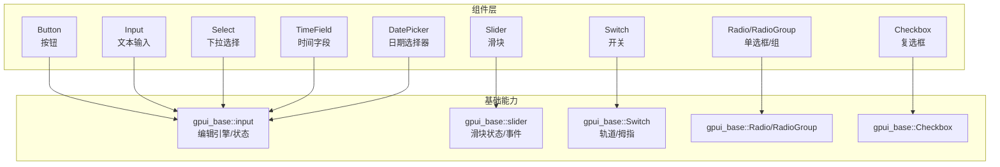
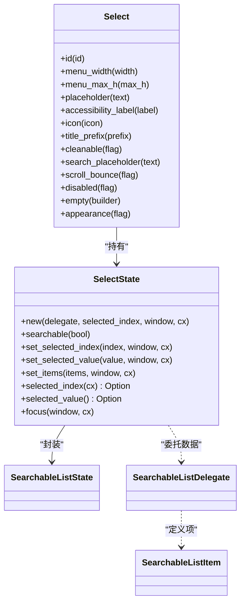
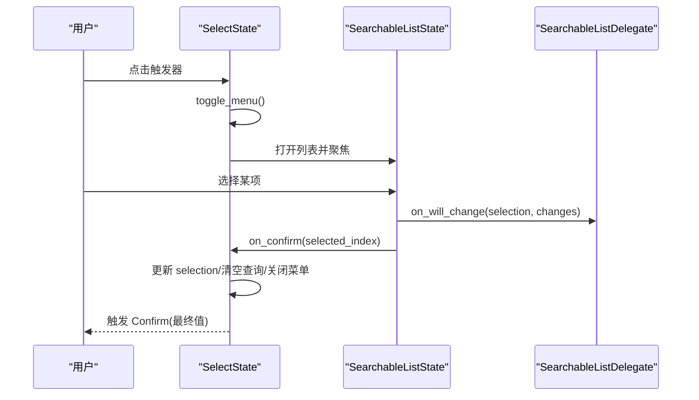
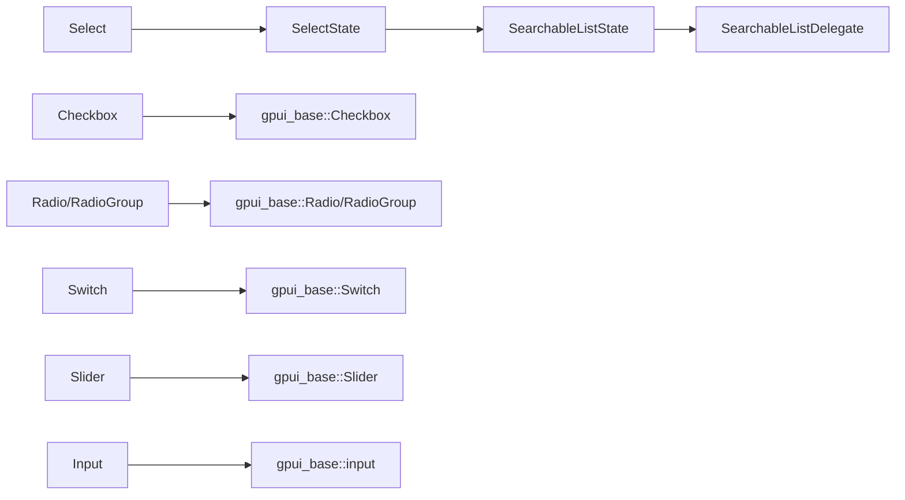

# 表单控件 API

<cite>
**本文引用的文件**   
- [crates/component/src/button/mod.rs](file://crates/component/src/button/mod.rs)
- [crates/component/src/input/mod.rs](file://crates/component/src/input/mod.rs)
- [crates/component/src/select.rs](file://crates/component/src/select.rs)
- [crates/component/src/checkbox.rs](file://crates/component/src/checkbox.rs)
- [crates/component/src/radio.rs](file://crates/component/src/radio.rs)
- [crates/component/src/switch.rs](file://crates/component/src/switch.rs)
- [crates/component/src/slider.rs](file://crates/component/src/slider.rs)
- [crates/component/src/time/time_field.rs](file://crates/component/src/time/time_field.rs)
- [crates/component/src/time/date_picker.rs](file://crates/component/src/time/date_picker.rs)
</cite>

## 目录
1. [简介](#简介)
2. [项目结构](#项目结构)
3. [核心组件](#核心组件)
4. [架构总览](#架构总览)
5. [组件详细 API](#组件详细-api)
6. [依赖关系分析](#依赖关系分析)
7. [性能与可访问性](#性能与可访问性)
8. [故障排查](#故障排查)
9. [结论](#结论)

## 简介
本文件为 gpui-kit 的“表单控件 API”文档，聚焦以下组件：Button、Input、Select、Checkbox、Radio、Switch、Slider、TimeField、DatePicker。内容覆盖公共接口（属性、事件、方法）、配置选项、状态管理、验证规则与回调函数，并提供受控与非受控模式的使用说明、组合模式、数据绑定与错误处理机制。所有描述均基于仓库中的实际实现进行归纳，确保 API 文档与代码同步。

## 项目结构
- 组件实现位于 crates/component/src 下，按功能模块组织；输入相关能力由 crates/base 提供并通过 input 模块统一导出。
- Select 使用 SearchableListState 作为内部列表状态，并暴露 SelectState 供外部控制。
- Checkbox、Radio、Switch、Slider 等基础控件通过 gpui_base 提供的基元类型组合渲染与交互。
- TimeField 与 DatePicker 在 time 子模块中实现，对外暴露时间选择能力。

图表来源
- [crates/component/src/input/mod.rs:1-67](file://crates/component/src/input/mod.rs#L1-L67)
- [crates/component/src/slider.rs:1-10](file://crates/component/src/slider.rs#L1-L10)
- [crates/component/src/switch.rs:1-12](file://crates/component/src/switch.rs#L1-L12)
- [crates/component/src/radio.rs:1-14](file://crates/component/src/radio.rs#L1-L14)
- [crates/component/src/checkbox.rs:1-14](file://crates/component/src/checkbox.rs#L1-L14)

章节来源
- [crates/component/src/input/mod.rs:1-67](file://crates/component/src/input/mod.rs#L1-L67)

## 核心组件
本节概述各表单控件的公共接口要点，包括属性、事件与方法，以及受控/非受控模式与数据绑定方式。

- Button
  - 作用：触发操作或提交表单。
  - 常见属性：尺寸、禁用、图标、样式、无障碍标签。
  - 事件：点击回调。
  - 用法：通常用于提交表单或触发动作。

- Input
  - 作用：通用文本输入，支持多种输入模式、补全、语法高亮、语言配置等。
  - 关键能力：输入状态、光标、选择、撤销/重做、补全菜单、编辑器模式。
  - 事件：输入变更、焦点、键盘命令等。
  - 数据绑定：通过外部状态与 on_change 回调实现受控模式；也可使用内部状态的非受控模式。

- Select
  - 作用：带搜索的下拉选择控件。
  - 关键状态：SelectState 封装 SearchableListState，提供 selected_index/value、set_selected_index/value、focus、clear 等方法。
  - 事件：Confirm(可选值)、DismissEvent（菜单关闭）。
  - 配置：placeholder、cleanable、search_placeholder、menu_width/max_h、appearance、scroll_bounce、disabled、title_prefix、icon、accessibility_label。
  - 数据绑定：通过 SelectState 与外部状态联动，实现受控选择。

- Checkbox
  - 作用：布尔型选择。
  - 属性：checked、disabled、size、label/accessibility_label、tooltip、tab_stop/tab_index、focus_ring。
  - 事件：on_click/on_change（受控），传入期望的新值。
  - 数据绑定：父级维护 checked 状态并在回调中更新。

- Radio / RadioGroup
  - 作用：单项选择；RadioGroup 管理一组 Radio 的布局与选中项。
  - 属性：checked/disabled/size/label/accessibility_label/tooltip/tab_stop/tab_index/focus_ring；RadioGroup 支持 layout、selected_index、disabled、child/children、on_click/on_change。
  - 事件：on_change 传递选中索引。
  - 数据绑定：RadioGroup.selected_index 与 on_change 配合实现受控单选。

- Switch
  - 作用：开/关切换。
  - 属性：checked、disabled、label/accessibility_label、color、tooltip、tab_stop/tab_index、focus_ring、size。
  - 事件：on_click/on_change（受控）。
  - 数据绑定：父级维护 checked 并在回调中更新。

- Slider
  - 作用：数值范围选择，支持单值与区间。
  - 状态：SliderState（来自 gpui_base::slider），包含 value、percentage 等。
  - 属性：axis(horizontal/vertical)、disabled、accessibility_label、reverse（仅单值有效）。
  - 事件：通过 SliderState 的 SliderEvent 监听变化。
  - 数据绑定：将 SliderState 与外部逻辑绑定，实现受控滑块。

- TimeField
  - 作用：时间输入与校验。
  - 能力：基于输入引擎，支持时间格式、校验与格式化。
  - 事件：输入变更、校验结果反馈。
  - 数据绑定：通过外部状态与 on_change 回调实现受控模式。

- DatePicker
  - 作用：日期选择。
  - 能力：日历面板、日期选择、格式化。
  - 事件：确认选择、取消、打开/关闭。
  - 数据绑定：通过外部状态与回调实现受控模式。

章节来源
- [crates/component/src/select.rs:118-146](file://crates/component/src/select.rs#L118-L146)
- [crates/component/src/checkbox.rs:15-35](file://crates/component/src/checkbox.rs#L15-L35)
- [crates/component/src/radio.rs:15-37](file://crates/component/src/radio.rs#L15-L37)
- [crates/component/src/switch.rs:13-31](file://crates/component/src/switch.rs#L13-L31)
- [crates/component/src/slider.rs:84-93](file://crates/component/src/slider.rs#L84-L93)
- [crates/component/src/input/mod.rs:23-62](file://crates/component/src/input/mod.rs#L23-L62)

## 架构总览
下图展示表单控件与基础能力的交互关系，以及 Select 的内部状态流。

图表来源
- [crates/component/src/select.rs:118-146](file://crates/component/src/select.rs#L118-L146)
- [crates/component/src/select.rs:148-300](file://crates/component/src/select.rs#L148-L300)
- [crates/component/src/select.rs:674-776](file://crates/component/src/select.rs#L674-L776)

## 组件详细 API

### Select（下拉选择）
- 状态与生命周期
  - SelectState 封装 SearchableListState，负责选择、查询、打开/关闭菜单、失焦清理等。
  - 当菜单关闭时发出 DismissEvent；选择确认后发出 SelectEvent::Confirm(可选值)。
- 关键方法与属性
  - set_selected_index/set_selected_value：设置选中项（索引或值）。
  - set_items：替换数据源并保持选中一致性。
  - selected_index/selected_value：读取当前选中。
  - focus：聚焦触发器。
  - searchable/cleanable/search_placeholder/menu_width/menu_max_h/appearance/scroll_bounce/disabled/title_prefix/icon/accessibility_label/placeholder/empty：外观与行为配置。
- 事件
  - Confirm(Option<Value>)：用户确认选择后触发。
  - DismissEvent：菜单关闭时触发。
- 数据绑定
  - 受控模式：外部维护 selected_index/value，调用 set_selected_* 同步到 SelectState。
  - 非受控模式：不主动设置选中，由用户交互驱动。

图表来源
- [crates/component/src/select.rs:148-300](file://crates/component/src/select.rs#L148-L300)
- [crates/component/src/select.rs:420-476](file://crates/component/src/select.rs#L420-L476)

章节来源
- [crates/component/src/select.rs:70-76](file://crates/component/src/select.rs#L70-L76)
- [crates/component/src/select.rs:118-146](file://crates/component/src/select.rs#L118-L146)
- [crates/component/src/select.rs:148-300](file://crates/component/src/select.rs#L148-L300)
- [crates/component/src/select.rs:302-406](file://crates/component/src/select.rs#L302-L406)
- [crates/component/src/select.rs:420-476](file://crates/component/src/select.rs#L420-L476)
- [crates/component/src/select.rs:674-776](file://crates/component/src/select.rs#L674-L776)

### Checkbox（复选框）
- 属性
  - checked、disabled、size、label/accessibility_label、tooltip、tooltip_show_delay、tab_stop、tab_index、focus_ring。
- 事件
  - on_click/on_change：受控回调，传入期望的新布尔值。
- 数据绑定
  - 受控模式：父级维护 checked，并在回调中更新状态。
  - 非受控模式：不传 checked，由内部状态管理（但推荐受控以保持一致性）。

章节来源
- [crates/component/src/checkbox.rs:15-35](file://crates/component/src/checkbox.rs#L15-L35)
- [crates/component/src/checkbox.rs:37-128](file://crates/component/src/checkbox.rs#L37-L128)
- [crates/component/src/checkbox.rs:226-363](file://crates/component/src/checkbox.rs#L226-L363)

### Radio / RadioGroup（单选框/组）
- Radio
  - 属性：checked、disabled、size、label/accessibility_label、tooltip、tooltip_show_delay、tab_stop、tab_index、focus_ring。
  - 事件：on_click/on_change（受控）。
- RadioGroup
  - 属性：layout(vertical/horizontal)、selected_index、disabled、child/children、on_click/on_change。
  - 行为：根据 selected_index 计算每个 Radio 的 checked，并将点击映射为 on_change(&usize)。
- 数据绑定
  - 受控模式：RadioGroup.selected_index 与 on_change 共同维护选中项。

章节来源
- [crates/component/src/radio.rs:15-37](file://crates/component/src/radio.rs#L15-L37)
- [crates/component/src/radio.rs:39-132](file://crates/component/src/radio.rs#L39-L132)
- [crates/component/src/radio.rs:283-424](file://crates/component/src/radio.rs#L283-L424)

### Switch（开关）
- 属性
  - checked、disabled、label/accessibility_label、color、tooltip、tooltip_show_delay、tab_stop、tab_index、focus_ring、size。
- 事件
  - on_click/on_change：受控回调，传入期望的新布尔值。
- 数据绑定
  - 受控模式：父级维护 checked，并在回调中更新。

章节来源
- [crates/component/src/switch.rs:13-31](file://crates/component/src/switch.rs#L13-L31)
- [crates/component/src/switch.rs:33-134](file://crates/component/src/switch.rs#L33-L134)
- [crates/component/src/switch.rs:167-310](file://crates/component/src/switch.rs#L167-L310)

### Slider（滑块）
- 状态
  - 使用 gpui_base::slider::SliderState，包含 value（单值/区间）与 percentage。
- 属性
  - axis(horizontal/vertical)、disabled、accessibility_label、reverse（仅单值有效，改变填充方向）。
- 事件
  - 通过 SliderState 的 SliderEvent 监听值变化。
- 数据绑定
  - 受控模式：外部持有 SliderState 并订阅其事件，驱动 UI 更新。

章节来源
- [crates/component/src/slider.rs:1-12](file://crates/component/src/slider.rs#L1-L12)
- [crates/component/src/slider.rs:84-145](file://crates/component/src/slider.rs#L84-L145)
- [crates/component/src/slider.rs:153-323](file://crates/component/src/slider.rs#L153-L323)

### Input（输入框）
- 能力
  - 基于 gpui_base::input 的编辑引擎，提供丰富的输入、选择、补全、语法高亮、语言配置等能力。
  - 导出大量类型与枚举（如 InputMode、EditorMode、CompletionProvider、CodeActionProvider 等）。
- 事件
  - 输入变更、焦点、键盘命令、补全、代码动作等。
- 数据绑定
  - 受控模式：外部维护输入值，通过 on_change 回调更新。
  - 非受控模式：使用内部状态（例如 TextareaState/InputState）管理。

章节来源
- [crates/component/src/input/mod.rs:1-67](file://crates/component/src/input/mod.rs#L1-L67)

### TimeField（时间字段）
- 能力
  - 时间输入、格式化、校验。
- 事件
  - 输入变更、校验结果反馈。
- 数据绑定
  - 受控模式：外部维护时间值，通过 on_change 回调更新。

章节来源
- [crates/component/src/time/time_field.rs](file://crates/component/src/time/time_field.rs)

### DatePicker（日期选择器）
- 能力
  - 日历面板、日期选择、格式化。
- 事件
  - 确认选择、取消、打开/关闭。
- 数据绑定
  - 受控模式：外部维护日期值，通过回调更新。

章节来源
- [crates/component/src/time/date_picker.rs](file://crates/component/src/time/date_picker.rs)

## 依赖关系分析
- Select 依赖 SearchableListState 与 SearchableListDelegate，形成“视图-状态-数据源”的解耦结构。
- Checkbox、Radio、Switch、Slider 分别依赖 gpui_base 对应的基础组件，负责外观与交互细节。
- Input 模块聚合了 base 层的输入能力，向上层组件提供统一的输入 API。

图表来源
- [crates/component/src/select.rs:118-146](file://crates/component/src/select.rs#L118-L146)
- [crates/component/src/checkbox.rs:1-14](file://crates/component/src/checkbox.rs#L1-L14)
- [crates/component/src/radio.rs:1-14](file://crates/component/src/radio.rs#L1-L14)
- [crates/component/src/switch.rs:1-12](file://crates/component/src/switch.rs#L1-L12)
- [crates/component/src/slider.rs:1-12](file://crates/component/src/slider.rs#L1-L12)
- [crates/component/src/input/mod.rs:1-67](file://crates/component/src/input/mod.rs#L1-L67)

## 性能与可访问性
- 动画与过渡
  - Checkbox、Switch、Slider 使用 spring 动画提升交互体验，避免不必要的重绘。
- 可访问性
  - 多数控件支持 accessibility_label，优先于可见 label 被读屏器播报。
  - FocusRing 可通过 focus_ring(false) 关闭，或在 disabled 状态下自动忽略焦点。
- 渲染优化
  - Select 在菜单关闭时清理查询并恢复游标，避免下次打开时的不一致。
  - Slider 对 hover/pressed 状态采用 keyed state 采样，减少闪烁。

章节来源
- [crates/component/src/checkbox.rs:184-224](file://crates/component/src/checkbox.rs#L184-L224)
- [crates/component/src/switch.rs:211-226](file://crates/component/src/switch.rs#L211-L226)
- [crates/component/src/slider.rs:42-82](file://crates/component/src/slider.rs#L42-L82)
- [crates/component/src/select.rs:447-459](file://crates/component/src/select.rs#L447-L459)

## 故障排查
- Select 菜单关闭后再次打开显示异常
  - 现象：上次搜索过滤后的游标未恢复。
  - 原因：未在关闭路径清理查询与恢复游标。
  - 解决：确保在 escape/on_blur 等路径调用 clear_query_and_restore_cursor。
- Checkbox/Radio/Switch 点击无响应
  - 现象：disabled=true 时不会触发回调。
  - 原因：禁用控件跳过回调。
  - 解决：检查 disabled 状态，并确保父级在回调中更新 checked。
- Slider 反向填充无效
  - 现象：reverse 对区间滑块无效。
  - 原因：reverse 仅对单值滑块生效。
  - 解决：仅在单值模式下启用 reverse。
- 可访问性名称不正确
  - 现象：读屏器播报内容与预期不符。
  - 原因：未设置 accessibility_label 或 visible label 与语义名不一致。
  - 解决：显式设置 accessibility_label。

章节来源
- [crates/component/src/select.rs:420-476](file://crates/component/src/select.rs#L420-L476)
- [crates/component/src/checkbox.rs:143-148](file://crates/component/src/checkbox.rs#L143-L148)
- [crates/component/src/radio.rs:99-103](file://crates/component/src/radio.rs#L99-L103)
- [crates/component/src/switch.rs:149-154](file://crates/component/src/switch.rs#L149-L154)
- [crates/component/src/slider.rs:132-144](file://crates/component/src/slider.rs#L132-L144)

## 结论
本文档系统化梳理了 gpui-kit 表单控件的公共 API，涵盖属性、事件、方法、状态管理与数据绑定模式，并结合源码给出架构图与流程图。建议在实际项目中优先采用受控模式，结合外部状态与回调统一管理表单数据；对于复杂表单，可使用 Select 的组合能力与 Input 的扩展能力构建灵活的输入体验。同时注意可访问性与动画性能，确保良好的用户体验。