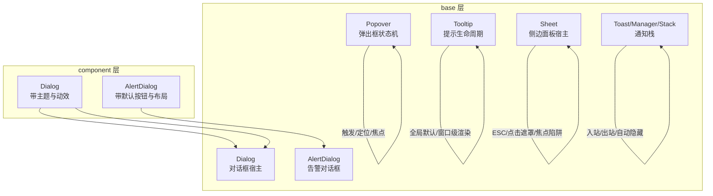
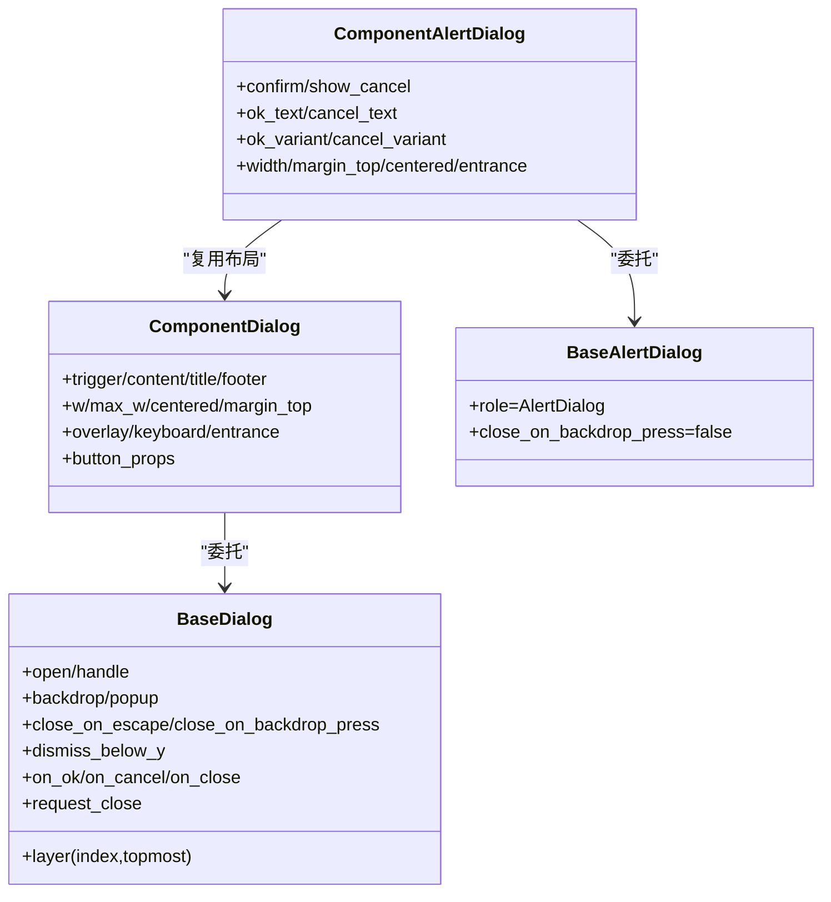
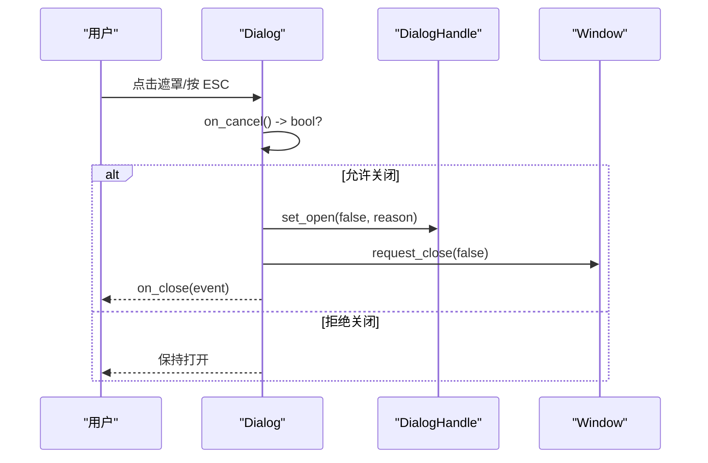
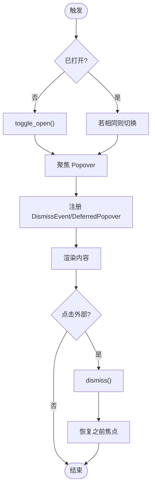
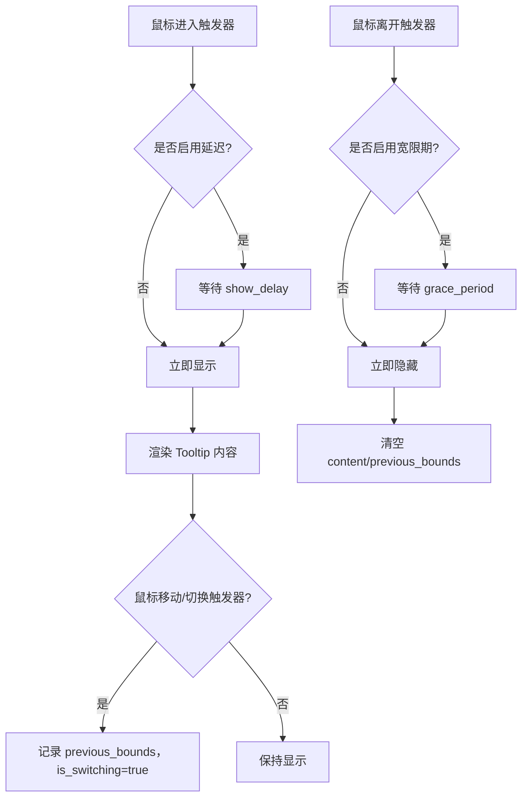
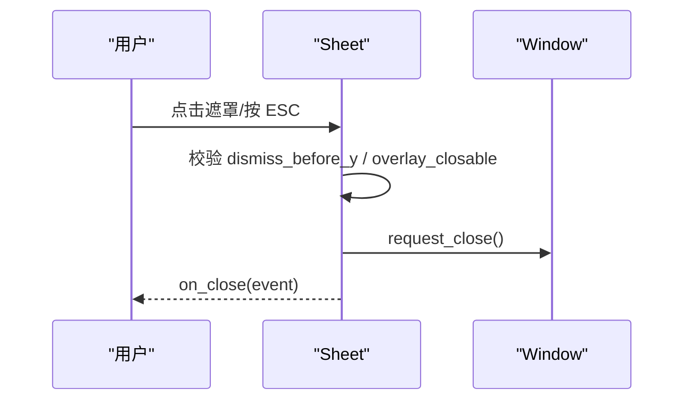
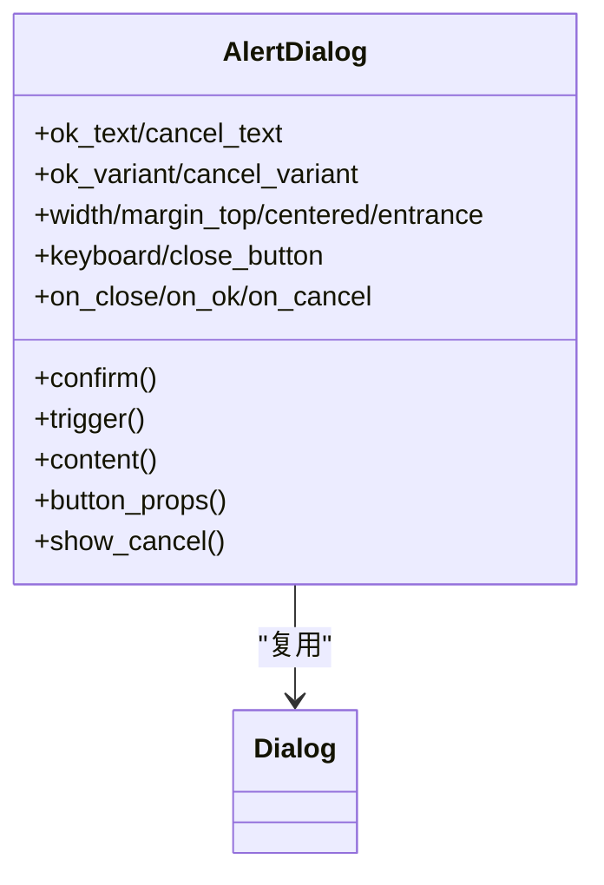
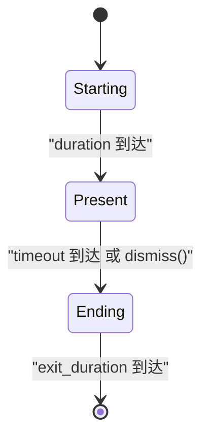
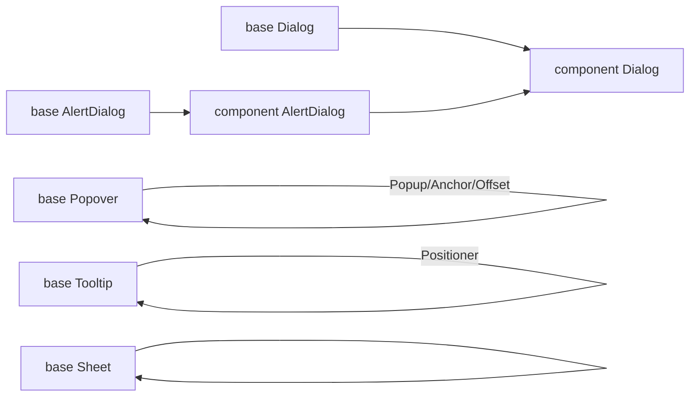

# 覆盖层组件 API

<cite>
**本文引用的文件**   
- [crates/base/src/dialog.rs](file://crates/base/src/dialog.rs)
- [crates/base/src/popover.rs](file://crates/base/src/popover.rs)
- [crates/base/src/tooltip.rs](file://crates/base/src/tooltip.rs)
- [crates/base/src/sheet.rs](file://crates/base/src/sheet.rs)
- [crates/base/src/alert_dialog.rs](file://crates/base/src/alert_dialog.rs)
- [crates/base/src/toast.rs](file://crates/base/src/toast.rs)
- [crates/component/src/dialog/dialog.rs](file://crates/component/src/dialog/dialog.rs)
- [crates/component/src/dialog/alert_dialog.rs](file://crates/component/src/dialog/alert_dialog.rs)
</cite>

## 目录
1. [简介](#简介)
2. [项目结构](#项目结构)
3. [核心组件](#核心组件)
4. [架构总览](#架构总览)
5. [详细组件分析](#详细组件分析)
6. [依赖关系分析](#依赖关系分析)
7. [性能与动画](#性能与动画)
8. [故障排查](#故障排查)
9. [结论](#结论)

## 简介
本文件系统化文档化覆盖层相关组件的公共 API，包括 Dialog、Popover、Tooltip、Sheet、Alert、Notification（Toast）等。内容涵盖：
- 属性、事件与方法
- 定位算法与视口适配
- 动画与过渡
- 焦点管理与键盘导航
- 层级管理、事件冒泡与样式定制
- 典型使用场景与示例路径

## 项目结构
覆盖层能力由两层组成：
- base 层提供无样式的基础实现与通用行为（模态宿主、弹出状态机、提示生命周期、通知栈等）
- component 层在 base 之上提供带主题、布局、动效和默认 UI 的高阶组件

图表来源
- [crates/base/src/dialog.rs:122-645](file://crates/base/src/dialog.rs#L122-L645)
- [crates/base/src/popover.rs:34-390](file://crates/base/src/popover.rs#L34-L390)
- [crates/base/src/tooltip.rs:18-327](file://crates/base/src/tooltip.rs#L18-L327)
- [crates/base/src/sheet.rs:27-167](file://crates/base/src/sheet.rs#L27-L167)
- [crates/base/src/alert_dialog.rs:192-289](file://crates/base/src/alert_dialog.rs#L192-L289)
- [crates/base/src/toast.rs:110-278](file://crates/base/src/toast.rs#L110-L278)
- [crates/component/src/dialog/dialog.rs:312-596](file://crates/component/src/dialog/dialog.rs#L312-L596)
- [crates/component/src/dialog/alert_dialog.rs:65-364](file://crates/component/src/dialog/alert_dialog.rs#L65-L364)

章节来源
- [crates/base/src/dialog.rs:122-645](file://crates/base/src/dialog.rs#L122-L645)
- [crates/base/src/popover.rs:34-390](file://crates/base/src/popover.rs#L34-L390)
- [crates/base/src/tooltip.rs:18-327](file://crates/base/src/tooltip.rs#L18-L327)
- [crates/base/src/sheet.rs:27-167](file://crates/base/src/sheet.rs#L27-L167)
- [crates/base/src/alert_dialog.rs:192-289](file://crates/base/src/alert_dialog.rs#L192-L289)
- [crates/base/src/toast.rs:110-278](file://crates/base/src/toast.rs#L110-L278)
- [crates/component/src/dialog/dialog.rs:312-596](file://crates/component/src/dialog/dialog.rs#L312-L596)
- [crates/component/src/dialog/alert_dialog.rs:65-364](file://crates/component/src/dialog/alert_dialog.rs#L65-L364)

## 核心组件
- Dialog（基础模态宿主）
  - 职责：拥有焦点、键盘动作、遮罩关闭、回调顺序、层级优先级
  - 关键属性：open/handle、backdrop/popup、close_on_escape、close_on_backdrop_press、dismiss_below_y、layer/topmost
  - 关键方法：on_ok/on_cancel/on_close、request_close、layer(index, topmost)、focus_handle
  - 键盘：Escape 触发取消；Enter 触发确认；可禁用键盘交互
  - 事件：on_open_change(reason)，reason 包含 TriggerPress/BackdropPress/Cancel/Confirm/Imperative
- Popover（弹出框）
  - 职责：受控 open 生命周期、焦点捕获与恢复、延迟弹出注册、键盘激活
  - 关键属性：anchor、offset、mouse_button、overlay_closable、default_open/open
  - 关键方法：trigger/content、on_position、track_focus、on_open_change
  - 键盘：Enter/Space 切换；Escape 关闭；内容内按键优先于外层
- Tooltip（提示）
  - 职责：应用级显示/隐藏策略、延迟与宽限期、位置器
  - 关键类型：TooltipDefaults、TooltipRequest、TooltipOverlay、TooltipPositioner
  - 关键方法：request_show/request_hide/hide、with_placement、with_show_delay
  - 定位：基于 Positioner 的侧向放置 + 视口翻转与裁剪
- Sheet（侧边面板）
  - 职责：模态宿主、ESC 处理、遮罩点击关闭、焦点陷阱
  - 关键属性：overlay_interactive、overlay_closable、dismiss_before_y
  - 关键方法：overlay/surface、on_close、request_close
- AlertDialog（告警对话框）
  - 职责：基于 Dialog 的强约束变体，禁止遮罩关闭，默认 OK/Cancel 按钮
  - 关键属性：show_cancel、ok_text/cancel_text、ok_variant/cancel_variant
  - 关键方法：confirm、button_props、width/margin_top/centered/entrance
- Toast/Notification（通知）
  - 职责：通知入栈、生命周期推进、自动隐藏、堆叠动画
  - 关键类型：ToastManager、ToastStack、ToastMotion、ToastTransitionStatus
  - 关键方法：push/dismiss/dismiss_all、advance、visible/iter/get

章节来源
- [crates/base/src/dialog.rs:25-72](file://crates/base/src/dialog.rs#L25-L72)
- [crates/base/src/dialog.rs:122-645](file://crates/base/src/dialog.rs#L122-L645)
- [crates/base/src/popover.rs:34-390](file://crates/base/src/popover.rs#L34-L390)
- [crates/base/src/tooltip.rs:57-108](file://crates/base/src/tooltip.rs#L57-L108)
- [crates/base/src/tooltip.rs:116-154](file://crates/base/src/tooltip.rs#L116-L154)
- [crates/base/src/tooltip.rs:169-327](file://crates/base/src/tooltip.rs#L169-L327)
- [crates/base/src/sheet.rs:27-167](file://crates/base/src/sheet.rs#L27-L167)
- [crates/base/src/alert_dialog.rs:192-289](file://crates/base/src/alert_dialog.rs#L192-L289)
- [crates/base/src/toast.rs:110-278](file://crates/base/src/toast.rs#L110-L278)

## 架构总览
覆盖层通过“宿主 + 内容”的模式组织：
- base 层提供宿主与状态机
- component 层组合宿主并注入主题、布局、动效与默认 UI

图表来源
- [crates/base/src/dialog.rs:122-645](file://crates/base/src/dialog.rs#L122-L645)
- [crates/base/src/alert_dialog.rs:192-289](file://crates/base/src/alert_dialog.rs#L192-L289)
- [crates/component/src/dialog/dialog.rs:312-596](file://crates/component/src/dialog/dialog.rs#L312-L596)
- [crates/component/src/dialog/alert_dialog.rs:65-364](file://crates/component/src/dialog/alert_dialog.rs#L65-L364)

## 详细组件分析

### Dialog（基础模态宿主）
- 公共接口
  - 构造：new(cx)
  - 受控：handle(DialogHandle)、open(bool)、on_open_change(handler)
  - 外观：backdrop(element)、popup(element)
  - 行为：close_on_escape(bool)、close_on_backdrop_press(bool)、dismiss_below_y(Pixels)
  - 内部：layer(index, topmost)、focus_handle(handle)、request_close(handler)
  - 回调：on_ok(handler)->bool、on_cancel(handler)->bool、on_close(handler)
- 键盘与焦点
  - 绑定 Escape/Enter 到 Cancel/Confirm
  - 使用 focus_trap 将焦点限制在对话框内
  - DialogClose 通过锚点 FocusHandle 派发 Cancel，避免被外部 always-on-top 拦截
- 层级与优先级
  - deferred 元素优先级 = 10 + layer，确保上层覆盖下层
- 事件冒泡
  - 遮罩点击会 stop_propagation，避免穿透到下层
  - on_ok/on_cancel 返回 false 可阻止关闭（veto）

图表来源
- [crates/base/src/dialog.rs:525-645](file://crates/base/src/dialog.rs#L525-L645)
- [crates/base/src/dialog.rs:40-72](file://crates/base/src/dialog.rs#L40-L72)

章节来源
- [crates/base/src/dialog.rs:25-72](file://crates/base/src/dialog.rs#L25-L72)
- [crates/base/src/dialog.rs:122-645](file://crates/base/src/dialog.rs#L122-L645)

### Popover（弹出框）
- 公共接口
  - 构造：new(id)
  - 定位：anchor(Anchor)、offset(Pixels)、on_position(callback)
  - 触发：trigger(Selectable)/trigger_with(builder)、mouse_button(MouseButton)
  - 受控：default_open(bool)、open(bool)、track_focus(handle)
  - 行为：overlay_closable(bool)、on_open_change(handler)
  - 内容：content(builder)
- 定位算法
  - 基于 Popup + Anchor/Offset，支持 on_position 回调获取最终 ResolvedPosition 与 Bounds
- 焦点与键盘
  - 打开时聚焦自身，关闭时恢复之前焦点
  - Enter/Space 切换；Escape 关闭；内容内按键优先
- 延迟上下文
  - 打开时注册 DeferredPopover，关闭或卸载时清理，避免泄漏

图表来源
- [crates/base/src/popover.rs:96-146](file://crates/base/src/popover.rs#L96-L146)
- [crates/base/src/popover.rs:317-390](file://crates/base/src/popover.rs#L317-L390)

章节来源
- [crates/base/src/popover.rs:34-390](file://crates/base/src/popover.rs#L34-L390)

### Tooltip（提示）
- 公共接口
  - 语义容器：Tooltip(id).role(Role::Tooltip)
  - 全局默认：TooltipDefaults.with_show_delay()/with_grace_period()/install()/global()
  - 请求构建：TooltipRequest.new(bounds, builder).with_placement()/with_show_delay()
  - 生命周期：TooltipOverlay.request_show()/request_hide()/hide()
  - 定位：TooltipPositioner.new(trigger_bounds).placement()
- 显示策略
  - show_delay：指针停留多久才显示
  - grace_period：离开后仍保留一段时间，便于快速切换到下一个触发器
  - 移动端默认禁用
- 定位算法
  - 基于 Positioner.side 的侧向放置 + 视口 margin 与翻转/裁剪

图表来源
- [crates/base/src/tooltip.rs:215-293](file://crates/base/src/tooltip.rs#L215-L293)
- [crates/base/src/tooltip.rs:330-359](file://crates/base/src/tooltip.rs#L330-L359)

章节来源
- [crates/base/src/tooltip.rs:57-108](file://crates/base/src/tooltip.rs#L57-L108)
- [crates/base/src/tooltip.rs:116-154](file://crates/base/src/tooltip.rs#L116-L154)
- [crates/base/src/tooltip.rs:169-327](file://crates/base/src/tooltip.rs#L169-L327)

### Sheet（侧边面板）
- 公共接口
  - 构造：new(cx)
  - 外观：overlay(element)、surface(element)
  - 行为：overlay_closable(bool)、overlay_interactive(bool)、dismiss_before_y(Pixels)
  - 回调：on_close(handler)、request_close(handler)
  - 内部：focus_handle(handle)
- 行为细节
  - ESC 触发 cancel 动作，统一走 request_close -> on_close 顺序
  - 遮罩点击可配置是否关闭，支持顶部 cutoff 区域不触发关闭
  - 使用 focus_trap 限制焦点范围

图表来源
- [crates/base/src/sheet.rs:115-167](file://crates/base/src/sheet.rs#L115-L167)

章节来源
- [crates/base/src/sheet.rs:27-167](file://crates/base/src/sheet.rs#L27-L167)

### AlertDialog（告警对话框）
- 公共接口（component 层）
  - 构造：new(cx)
  - 模式：confirm()
  - 触发：trigger(element)
  - 内容：content(builder)
  - 按钮：button_props、ok_text/cancel_text、ok_variant/cancel_variant、show_cancel
  - 布局：width、margin_top、centered、entrance
  - 行为：keyboard(bool)、close_button(bool)、on_close/on_ok/on_cancel
- 行为差异
  - 禁止遮罩关闭（设计如此）
  - 默认 Footer 居中排列 OK/Cancel
  - 支持 declarative 与 imperative 两种用法

图表来源
- [crates/component/src/dialog/alert_dialog.rs:65-364](file://crates/component/src/dialog/alert_dialog.rs#L65-L364)
- [crates/base/src/alert_dialog.rs:192-289](file://crates/base/src/alert_dialog.rs#L192-L289)

章节来源
- [crates/component/src/dialog/alert_dialog.rs:65-364](file://crates/component/src/dialog/alert_dialog.rs#L65-L364)
- [crates/base/src/alert_dialog.rs:192-289](file://crates/base/src/alert_dialog.rs#L192-L289)

### Toast/Notification（通知）
- 公共接口
  - 管理器：ToastManager.push(id,value,options)/dismiss(id)/dismiss_all()/advance(now,paused)
  - 可见性：visible(limit)/iter()/get(id)
  - 堆栈：ToastStack.item(id,child)/motion/placement/focus_handle
  - 状态：ToastTransitionStatus{Starting,Present,Ending}
  - 动效：ToastMotion.sonner()
- 生命周期
  - Starting -> Present（duration）-> Ending（exit_duration）-> 移除
  - 暂停时计时器暂停，结束后再移除
- 堆叠布局
  - collapsed_peek/collapsed_visible/collapsed_scale_step/expanded_gap
  - 根据 hover/focus 展开/折叠，弹簧动画平滑过渡

图表来源
- [crates/base/src/toast.rs:110-278](file://crates/base/src/toast.rs#L110-L278)
- [crates/base/src/toast.rs:584-660](file://crates/base/src/toast.rs#L584-L660)

章节来源
- [crates/base/src/toast.rs:110-278](file://crates/base/src/toast.rs#L110-L278)
- [crates/base/src/toast.rs:280-582](file://crates/base/src/toast.rs#L280-L582)
- [crates/base/src/toast.rs:584-660](file://crates/base/src/toast.rs#L584-L660)

## 依赖关系分析
- Dialog 与 AlertDialog
  - AlertDialog 基于 base AlertDialog，进一步委托给 base Dialog 的能力
- Component Dialog/AlertDialog
  - 在 base 之上组合主题、布局、动效与默认 UI
- Popover/Tooltip
  - 分别依赖 Popup/Positioner 完成定位与展示
- Sheet
  - 独立宿主，与 Dialog 共享焦点陷阱与 ESC 行为模型

图表来源
- [crates/base/src/dialog.rs:122-645](file://crates/base/src/dialog.rs#L122-L645)
- [crates/base/src/alert_dialog.rs:192-289](file://crates/base/src/alert_dialog.rs#L192-L289)
- [crates/component/src/dialog/dialog.rs:312-596](file://crates/component/src/dialog/dialog.rs#L312-L596)
- [crates/component/src/dialog/alert_dialog.rs:65-364](file://crates/component/src/dialog/alert_dialog.rs#L65-L364)
- [crates/base/src/popover.rs:317-390](file://crates/base/src/popover.rs#L317-L390)
- [crates/base/src/tooltip.rs:330-359](file://crates/base/src/tooltip.rs#L330-L359)
- [crates/base/src/sheet.rs:115-167](file://crates/base/src/sheet.rs#L115-L167)

章节来源
- [crates/base/src/dialog.rs:122-645](file://crates/base/src/dialog.rs#L122-L645)
- [crates/base/src/alert_dialog.rs:192-289](file://crates/base/src/alert_dialog.rs#L192-L289)
- [crates/component/src/dialog/dialog.rs:312-596](file://crates/component/src/dialog/dialog.rs#L312-L596)
- [crates/component/src/dialog/alert_dialog.rs:65-364](file://crates/component/src/dialog/alert_dialog.rs#L65-L364)
- [crates/base/src/popover.rs:317-390](file://crates/base/src/popover.rs#L317-L390)
- [crates/base/src/tooltip.rs:330-359](file://crates/base/src/tooltip.rs#L330-L359)
- [crates/base/src/sheet.rs:115-167](file://crates/base/src/sheet.rs#L115-L167)

## 性能与动画
- 层级与绘制优先级
  - Dialog 使用 deferred 元素，优先级 = 10 + layer，保证上层覆盖
  - Tooltip 使用固定高优先级常量，高于 Popup 层
- 动画与过渡
  - Dialog：entrance 控制入场，exit_duration 控制离场；支持 reduced motion 与自定义曲线
  - Toast：Spring 几何动画，collapsed/expanded 状态平滑过渡
  - Tooltip：Switch/Enter 过渡 epoch，配合 is_switching 优化切换体验
- 性能建议
  - 合理设置 overlay_closable 与 keyboard，减少不必要的重绘
  - 使用 handle 进行受控更新，避免频繁重建
  - 对大量 Toast 使用 visible(limit) 控制渲染数量

章节来源
- [crates/base/src/dialog.rs:525-645](file://crates/base/src/dialog.rs#L525-L645)
- [crates/base/src/tooltip.rs:12-13](file://crates/base/src/tooltip.rs#L12-L13)
- [crates/component/src/dialog/dialog.rs:554-580](file://crates/component/src/dialog/dialog.rs#L554-L580)
- [crates/base/src/toast.rs:414-582](file://crates/base/src/toast.rs#L414-L582)

## 故障排查
- 对话框无法关闭
  - 检查 on_ok/on_cancel 是否返回 false（veto）
  - 确认 close_on_backdrop_press/close_on_escape 未被关闭
  - 查看 dismiss_below_y 是否导致遮罩点击被忽略
- 焦点丢失或 ESC 无效
  - 确认使用了 focus_trap 且 focus_handle 正确传入
  - 检查 key_context 是否正确绑定
- 遮罩点击无效
  - 检查 overlay_closable 与 overlay_interactive
  - 对于 Sheet，检查 dismiss_before_y 是否截断点击区域
- 弹出框位置异常
  - 检查 anchor/offset 与 on_position 回调返回值
  - 确认父容器尺寸变化后触发了重新定位
- 提示不显示
  - 检查 TooltipDefaults.show_delay/grace_period 配置
  - 移动端默认禁用，需显式启用或改用其他提示方案
- 通知未消失
  - 检查 ToastOptions.timeout 是否设置为 None
  - 确认 ToastManager.advance 被周期性调用

章节来源
- [crates/base/src/dialog.rs:525-645](file://crates/base/src/dialog.rs#L525-L645)
- [crates/base/src/sheet.rs:115-167](file://crates/base/src/sheet.rs#L115-L167)
- [crates/base/src/popover.rs:317-390](file://crates/base/src/popover.rs#L317-L390)
- [crates/base/src/tooltip.rs:215-293](file://crates/base/src/tooltip.rs#L215-L293)
- [crates/base/src/toast.rs:225-278](file://crates/base/src/toast.rs#L225-L278)

## 结论
本 API 文档覆盖了覆盖层组件的核心能力与最佳实践：
- base 层提供稳定、可组合的宿主与状态机
- component 层在此基础上提供主题、布局、动效与默认 UI
- 统一的焦点与键盘模型、清晰的层级与优先级机制、完善的动画与定位策略
- 通过 handle 与回调实现可控的生命周期，兼顾灵活性与一致性