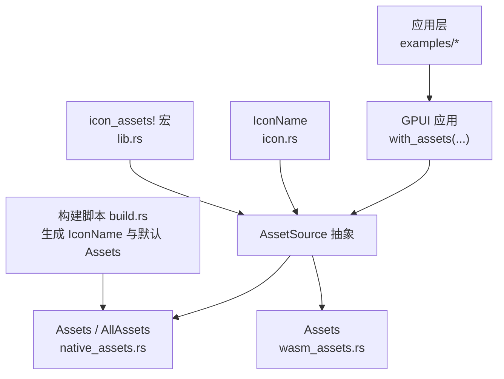
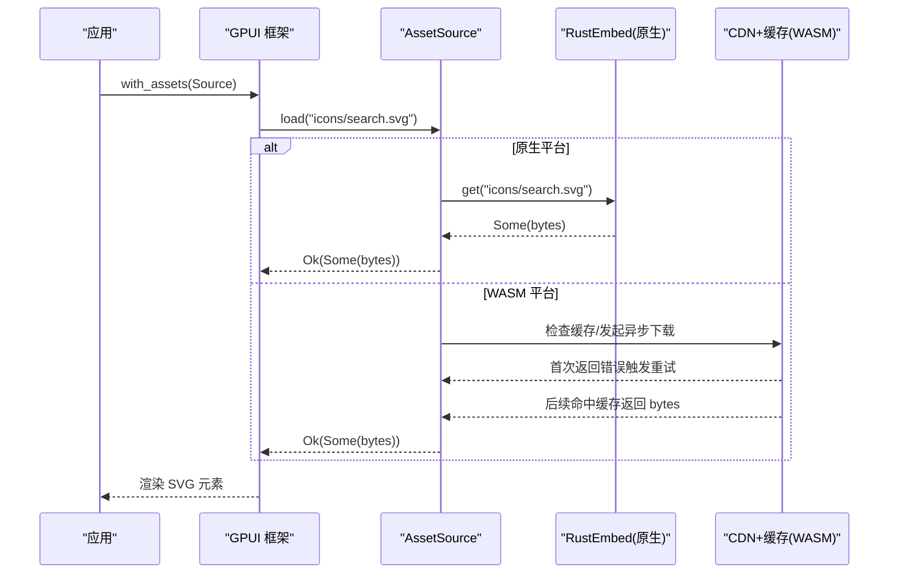
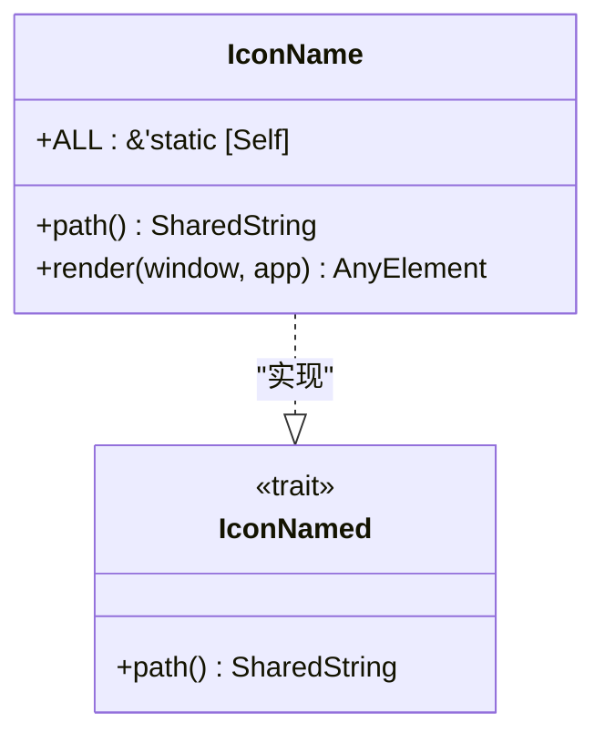
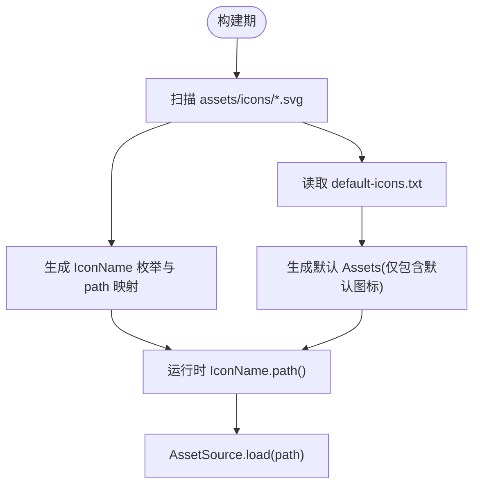
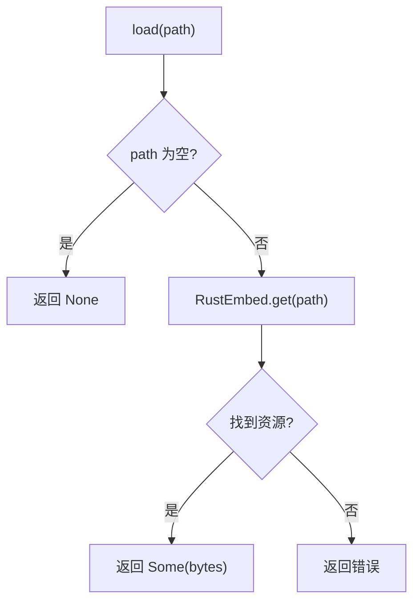
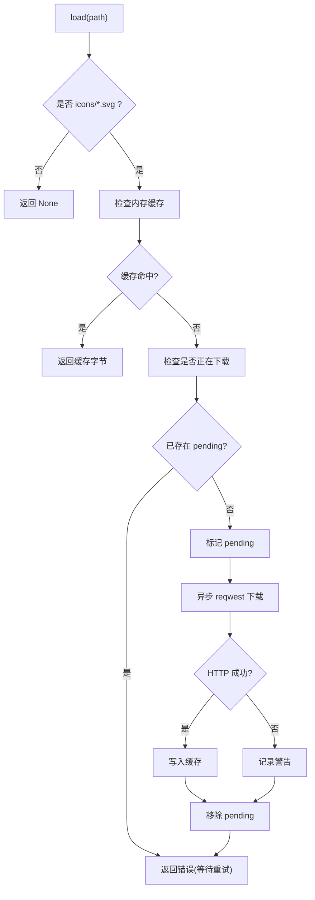
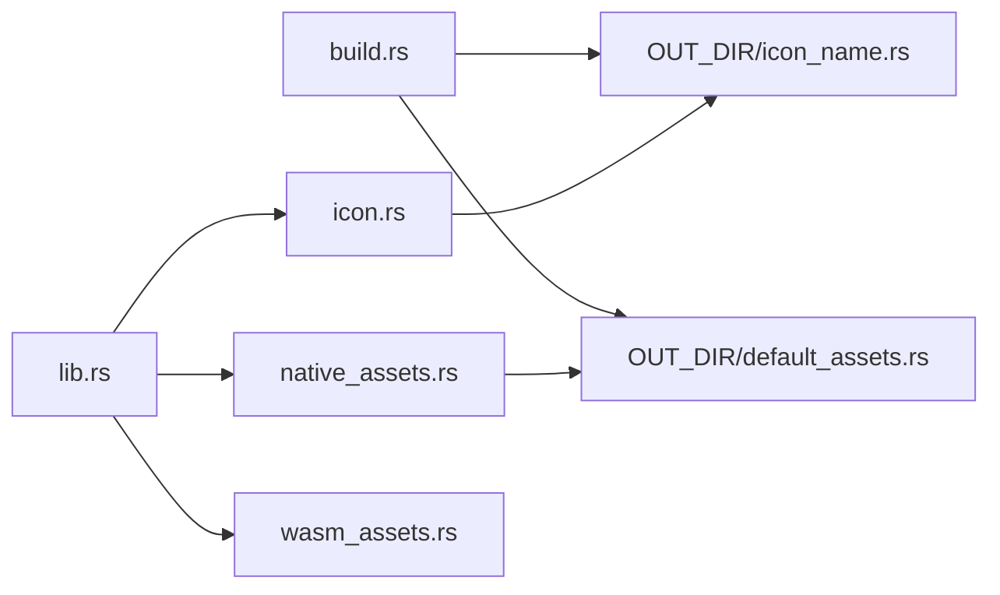
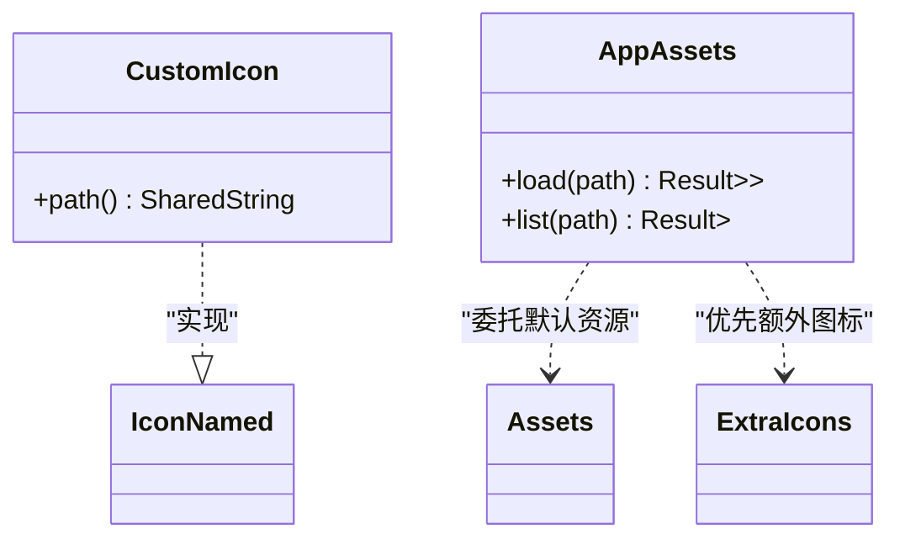

# 资源 API

<cite>
**本文引用的文件**   
- [crates/assets/src/lib.rs](file://crates/assets/src/lib.rs)
- [crates/assets/src/icon.rs](file://crates/assets/src/icon.rs)
- [crates/assets/src/native_assets.rs](file://crates/assets/src/native_assets.rs)
- [crates/assets/src/wasm_assets.rs](file://crates/assets/src/wasm_assets.rs)
- [crates/assets/build.rs](file://crates/assets/build.rs)
- [crates/assets/examples/extra_assets.rs](file://crates/assets/examples/extra_assets.rs)
- [crates/assets/examples/selected_assets.rs](file://crates/assets/examples/selected_assets.rs)
- [crates/assets/tests/icons.rs](file://crates/assets/tests/icons.rs)
- [examples/app_assets/src/main.rs](file://examples/app_assets/src/main.rs)
- [examples/speech/src/main.rs](file://examples/speech/src/main.rs)
</cite>

## 目录
1. [简介](#简介)
2. [项目结构](#项目结构)
3. [核心组件](#核心组件)
4. [架构总览](#架构总览)
5. [详细组件分析](#详细组件分析)
6. [依赖关系分析](#依赖关系分析)
7. [性能与体积优化](#性能与体积优化)
8. [打包、缓存与平台差异](#打包缓存与平台差异)
9. [扩展自定义资源类型](#扩展自定义资源类型)
10. [使用示例与最佳实践](#使用示例与最佳实践)
11. [故障排查](#故障排查)
12. [结论](#结论)

## 简介
本资源 API 文档聚焦图标系统与静态资源加载，覆盖以下目标：
- 图标的注册、查找与渲染方法
- 原生（Native）与 WebAssembly（WASM）平台的差异化资源处理
- 资源打包、优化与缓存的管理接口
- 自定义资源类型的扩展方式与最佳实践
- 结合仓库中的示例展示实际使用方式

该资源系统围绕 GPUI 的 `AssetSource` 抽象构建，提供默认图标集、完整图标集、按需选择图标宏以及 WASM 端按需下载与内存缓存能力。

## 项目结构
资源相关代码集中在 `crates/assets` 中，包含：
- 公共入口与宏：`lib.rs`
- 图标名称与渲染：`icon.rs`
- 原生平台实现：`native_assets.rs`
- WASM 平台实现：`wasm_assets.rs`
- 构建期生成枚举与嵌入清单：`build.rs`
- 示例与测试：`examples/*.rs`、`tests/*.rs`

**图表来源**
- [crates/assets/src/lib.rs:15-48](file://crates/assets/src/lib.rs#L15-L48)
- [crates/assets/src/native_assets.rs:7-42](file://crates/assets/src/native_assets.rs#L7-L42)
- [crates/assets/src/wasm_assets.rs:8-29](file://crates/assets/src/wasm_assets.rs#L8-L29)
- [crates/assets/src/icon.rs:1-34](file://crates/assets/src/icon.rs#L1-L34)
- [crates/assets/build.rs:53-120](file://crates/assets/build.rs#L53-L120)

**章节来源**
- [crates/assets/src/lib.rs:1-48](file://crates/assets/src/lib.rs#L1-L48)
- [crates/assets/build.rs:1-122](file://crates/assets/build.rs#L1-L122)

## 核心组件
- 图标命名与渲染
  - `IconName`：由构建脚本生成的枚举，表示每个内置 SVG 图标；提供 `path()` 返回资源路径，并实现 `RenderOnce` 以直接渲染为 GPUI 元素。
  - `IconNamed`：允许自定义类型实现该 trait，将自身映射到资源路径，从而被通用 `Icon` 组件消费。
- 资源源
  - `Assets`：默认组件图标集合，仅包含 `default-icons.txt` 指定的子集，用于减小二进制体积。
  - `AllAssets`：完整 Lucide + GPUI Kit 图标集合，包含所有内置 SVG。
  - `icon_assets!`：宏，根据指定图标名生成一个最小化的 `AssetSource`，只嵌入所选图标，零运行时拷贝。
- 平台差异
  - 原生：通过 RustEmbed 在编译期嵌入 SVG 字节，`load` 直接返回静态引用。
  - WASM：首次访问时从 CDN 异步下载，结果写入进程内内存缓存，后续命中缓存。

**章节来源**
- [crates/assets/src/icon.rs:1-34](file://crates/assets/src/icon.rs#L1-L34)
- [crates/assets/src/lib.rs:15-48](file://crates/assets/src/lib.rs#L15-L48)
- [crates/assets/src/native_assets.rs:7-42](file://crates/assets/src/native_assets.rs#L7-L42)
- [crates/assets/src/wasm_assets.rs:8-29](file://crates/assets/src/wasm_assets.rs#L8-L29)
- [crates/assets/build.rs:53-120](file://crates/assets/build.rs#L53-L120)

## 架构总览
资源系统的调用链如下：
- 应用启动时通过 `with_assets(...)` 注册 `AssetSource`
- 组件或业务逻辑请求图标路径（如 `IconName::Search.path()`）
- GPUI 调用 `AssetSource::load(path)` 获取 SVG 字节
- 原生平台从嵌入资源读取；WASM 平台从 CDN 异步下载并缓存

**图表来源**
- [crates/assets/src/native_assets.rs:22-36](file://crates/assets/src/native_assets.rs#L22-L36)
- [crates/assets/src/wasm_assets.rs:31-107](file://crates/assets/src/wasm_assets.rs#L31-L107)
- [crates/assets/src/icon.rs:19-27](file://crates/assets/src/icon.rs#L19-L27)

## 详细组件分析

### 图标系统：IconName 与 IconNamed
- `IconName`
  - 由 `build.rs` 扫描 `assets/icons` 下的 SVG 文件生成枚举和路径映射。
  - 提供 `ALL` 常量数组，便于遍历全部图标。
  - 实现 `RenderOnce`，自动适配字体大小与颜色。
- `IconNamed`
  - 自定义类型可实现该 trait，将自身解析为资源路径，从而接入通用图标消费流程。

**图表来源**
- [crates/assets/src/icon.rs:1-34](file://crates/assets/src/icon.rs#L1-L34)
- [crates/assets/build.rs:53-72](file://crates/assets/build.rs#L53-L72)

**章节来源**
- [crates/assets/src/icon.rs:1-34](file://crates/assets/src/icon.rs#L1-L34)
- [crates/assets/build.rs:53-72](file://crates/assets/build.rs#L53-L72)

### 资源源：Assets、AllAssets 与 icon_assets!
- `Assets`（默认）
  - 仅包含 `default-icons.txt` 列出的图标，适合大多数组件场景，显著降低二进制体积。
- `AllAssets`（完整）
  - 包含所有内置图标，适合需要全量图标的场景。
- `icon_assets!`（宏）
  - 生成一个最小化 `AssetSource`，只嵌入指定图标列表，无运行时缓存，零拷贝。
  - 支持空列表，作为合法的“空资源源”。

**图表来源**
- [crates/assets/build.rs:19-52](file://crates/assets/build.rs#L19-L52)
- [crates/assets/build.rs:73-120](file://crates/assets/build.rs#L73-L120)
- [crates/assets/src/native_assets.rs:7-42](file://crates/assets/src/native_assets.rs#L7-L42)
- [crates/assets/src/lib.rs:70-91](file://crates/assets/src/lib.rs#L70-L91)

**章节来源**
- [crates/assets/src/native_assets.rs:7-42](file://crates/assets/src/native_assets.rs#L7-L42)
- [crates/assets/src/lib.rs:58-91](file://crates/assets/src/lib.rs#L58-L91)
- [crates/assets/build.rs:19-120](file://crates/assets/build.rs#L19-L120)

### 原生平台资源加载
- 使用 RustEmbed 在编译期嵌入 SVG 字节。
- `load` 对空路径返回 `None`，否则尝试从嵌入资源读取，找不到则返回错误。
- `list` 列出以给定前缀开头的嵌入资源路径。

**图表来源**
- [crates/assets/src/native_assets.rs:22-36](file://crates/assets/src/native_assets.rs#L22-L36)

**章节来源**
- [crates/assets/src/native_assets.rs:1-42](file://crates/assets/src/native_assets.rs#L1-L42)

### WASM 平台资源加载
- 首次访问 `icons/*.svg` 时：
  - 检查内存缓存；若命中则直接返回。
  - 若未命中且无并发下载，标记为“进行中”，通过 `reqwest` 异步从 CDN 下载。
  - 下载成功后写入缓存；失败则记录警告。
  - 首次调用返回错误，促使 GPUI 重试；后续命中缓存成功。
- `list` 在当前实现中返回空列表（不枚举远端资源）。

**图表来源**
- [crates/assets/src/wasm_assets.rs:31-107](file://crates/assets/src/wasm_assets.rs#L31-L107)

**章节来源**
- [crates/assets/src/wasm_assets.rs:1-109](file://crates/assets/src/wasm_assets.rs#L1-L109)

## 依赖关系分析
- `icon.rs` 依赖 GPUI 的渲染与样式能力，并通过 `include!(OUT_DIR/icon_name.rs)` 引入构建期生成的图标枚举。
- `native_assets.rs` 依赖 RustEmbed 与 `default-assets.rs`（由 `build.rs` 生成），实现 `AssetSource`。
- `wasm_assets.rs` 依赖 `reqwest`、`wasm_bindgen_futures` 与日志库，实现基于 CDN 的异步加载与内存缓存。
- `lib.rs` 暴露公共 API：`IconName`、`IconNamed`、`Assets`、`AllAssets`、`icon_assets!`。
- `build.rs` 负责扫描图标目录、校验默认图标清单、生成枚举与默认资源清单。

**图表来源**
- [crates/assets/build.rs:117-120](file://crates/assets/build.rs#L117-L120)
- [crates/assets/src/icon.rs:3-3](file://crates/assets/src/icon.rs#L3-L3)
- [crates/assets/src/native_assets.rs:5-5](file://crates/assets/src/native_assets.rs#L5-L5)
- [crates/assets/src/lib.rs:12-48](file://crates/assets/src/lib.rs#L12-L48)

**章节来源**
- [crates/assets/src/lib.rs:12-48](file://crates/assets/src/lib.rs#L12-L48)
- [crates/assets/build.rs:117-120](file://crates/assets/build.rs#L117-L120)

## 性能与体积优化
- 默认图标集 `Assets`
  - 仅包含 `default-icons.txt` 指定的图标，避免嵌入全部 Lucide 图标，显著减少二进制体积。
  - 适用于大多数组件场景，同时保持与 `AllAssets` 的行为一致。
- 选择式图标 `icon_assets!`
  - 编译期生成最小化资源源，零运行时拷贝，适合精确控制包体大小。
- WASM 按需下载
  - 图标不在初始包中，首次使用时从 CDN 拉取，减少初始包大小。
  - 内存缓存避免重复网络请求。

**章节来源**
- [crates/assets/build.rs:73-120](file://crates/assets/build.rs#L73-L120)
- [crates/assets/src/lib.rs:58-91](file://crates/assets/src/lib.rs#L58-L91)
- [crates/assets/src/wasm_assets.rs:31-107](file://crates/assets/src/wasm_assets.rs#L31-L107)

## 打包、缓存与平台差异
- 打包
  - 原生：RustEmbed 在构建时将选定的 SVG 嵌入二进制。
  - WASM：不嵌入图标，运行时从 CDN 获取。
- 缓存
  - WASM：进程内内存缓存（HashMap），键为资源路径，值为字节切片。
  - 原生：静态嵌入，无需运行时缓存。
- 平台差异
  - 原生：`Assets` 与 `AllAssets` 均实现 `AssetSource`，行为一致。
  - WASM：`Assets` 提供 CDN 下载与缓存；`AllAssets` 别名指向同一实现。

**章节来源**
- [crates/assets/src/native_assets.rs:7-42](file://crates/assets/src/native_assets.rs#L7-L42)
- [crates/assets/src/wasm_assets.rs:8-29](file://crates/assets/src/wasm_assets.rs#L8-L29)
- [crates/assets/src/lib.rs:40-48](file://crates/assets/src/lib.rs#L40-L48)

## 扩展自定义资源类型
- 实现 `IconNamed`
  - 自定义类型实现 `path()`，返回资源路径，即可被通用图标组件消费。
- 组合资源源
  - 使用 `icon_assets!` 生成最小资源源，再实现 `AssetSource` 委托给默认 `Assets`，形成“默认 + 额外”的组合。
- 自定义资源加载策略
  - 可完全自定义 `AssetSource`，例如从文件系统、数据库或远程服务加载任意资源。

**图表来源**
- [crates/assets/src/icon.rs:7-15](file://crates/assets/src/icon.rs#L7-L15)
- [crates/assets/examples/extra_assets.rs:24-39](file://crates/assets/examples/extra_assets.rs#L24-L39)
- [examples/speech/src/main.rs:40-58](file://examples/speech/src/main.rs#L40-L58)

**章节来源**
- [crates/assets/src/icon.rs:7-15](file://crates/assets/src/icon.rs#L7-L15)
- [crates/assets/examples/extra_assets.rs:24-39](file://crates/assets/examples/extra_assets.rs#L24-L39)
- [examples/speech/src/main.rs:40-58](file://examples/speech/src/main.rs#L40-L58)

## 使用示例与最佳实践
- 注册默认资源源
  - 在应用初始化时调用 `with_assets(Assets)` 或 `with_assets(AllAssets)`。
  - 参考示例：[examples/app_assets/src/main.rs:45-55](file://examples/app_assets/src/main.rs#L45-L55)
- 使用图标
  - 直接使用 `IconName::Search` 等枚举值，或通过 `Icon::new(ExtraIcon::AudioLines)` 等方式消费。
  - 参考示例：[examples/speech/src/main.rs:40-58](file://examples/speech/src/main.rs#L40-L58)、[examples/speech/src/main.rs:680-686](file://examples/speech/src/main.rs#L680-L686)
- 选择式图标
  - 使用 `icon_assets!(AppAssets, [Search, Check])` 生成最小资源源。
  - 参考示例：[crates/assets/examples/selected_assets.rs:5-15](file://crates/assets/examples/selected_assets.rs#L5-L15)
- 组合默认与额外图标
  - 先定义额外图标集合，再实现 `AssetSource`，优先返回额外图标，回退到默认 `Assets`。
  - 参考示例：[crates/assets/examples/extra_assets.rs:24-39](file://crates/assets/examples/extra_assets.rs#L24-L39)、[examples/speech/src/main.rs:40-58](file://examples/speech/src/main.rs#L40-L58)
- 验证图标可用性
  - 使用 `AllAssets.list("icons/")` 与 `IconName::ALL` 对比，确保枚举与嵌入资源一致。
  - 参考测试：[crates/assets/tests/icons.rs:10-23](file://crates/assets/tests/icons.rs#L10-L23)

**章节来源**
- [examples/app_assets/src/main.rs:45-55](file://examples/app_assets/src/main.rs#L45-L55)
- [examples/speech/src/main.rs:40-58](file://examples/speech/src/main.rs#L40-L58)
- [crates/assets/examples/selected_assets.rs:5-15](file://crates/assets/examples/selected_assets.rs#L5-L15)
- [crates/assets/examples/extra_assets.rs:24-39](file://crates/assets/examples/extra_assets.rs#L24-L39)
- [crates/assets/tests/icons.rs:10-23](file://crates/assets/tests/icons.rs#L10-L23)

## 故障排查
- 图标路径为空
  - 原生与 WASM 均对空路径返回 `None`，需检查调用方是否正确传入路径。
  - 参考：[crates/assets/src/native_assets.rs:22-30](file://crates/assets/src/native_assets.rs#L22-L30)、[crates/assets/src/wasm_assets.rs:31-35](file://crates/assets/src/wasm_assets.rs#L31-L35)
- WASM 首次加载失败
  - 首次请求会返回错误以触发重试；检查 CDN 地址与网络连通性。
  - 参考：[crates/assets/src/wasm_assets.rs:97-99](file://crates/assets/src/wasm_assets.rs#L97-L99)
- 默认图标缺失
  - `default-icons.txt` 必须与实际 SVG 一一对应；构建时会校验。
  - 参考：[crates/assets/build.rs:73-91](file://crates/assets/build.rs#L73-L91)
- 选择式图标未生效
  - 确认宏参数中的图标名与 `IconName` 枚举一致；空列表是合法但不会提供任何图标。
  - 参考：[crates/assets/tests/icons.rs:33-58](file://crates/assets/tests/icons.rs#L33-L58)

**章节来源**
- [crates/assets/src/native_assets.rs:22-30](file://crates/assets/src/native_assets.rs#L22-L30)
- [crates/assets/src/wasm_assets.rs:97-99](file://crates/assets/src/wasm_assets.rs#L97-L99)
- [crates/assets/build.rs:73-91](file://crates/assets/build.rs#L73-L91)
- [crates/assets/tests/icons.rs:33-58](file://crates/assets/tests/icons.rs#L33-L58)

## 结论
该资源 API 提供了统一的图标与静态资源访问接口，兼顾原生与 WASM 平台的差异化需求：
- 通过 `IconName` 与 `IconNamed` 统一图标命名与渲染
- 通过 `Assets`、`AllAssets` 与 `icon_assets!` 灵活控制资源体积与范围
- 原生平台使用 RustEmbed 嵌入资源，WASM 平台采用 CDN 下载与内存缓存
- 提供组合与扩展机制，便于集成自定义资源类型与加载策略

建议在生产环境中：
- 使用默认 `Assets` 满足常见组件需求
- 使用 `icon_assets!` 精确裁剪图标集合
- 在 WASM 部署时配置可靠的 CDN 与缓存策略
- 通过测试用例验证图标枚举与资源一致性