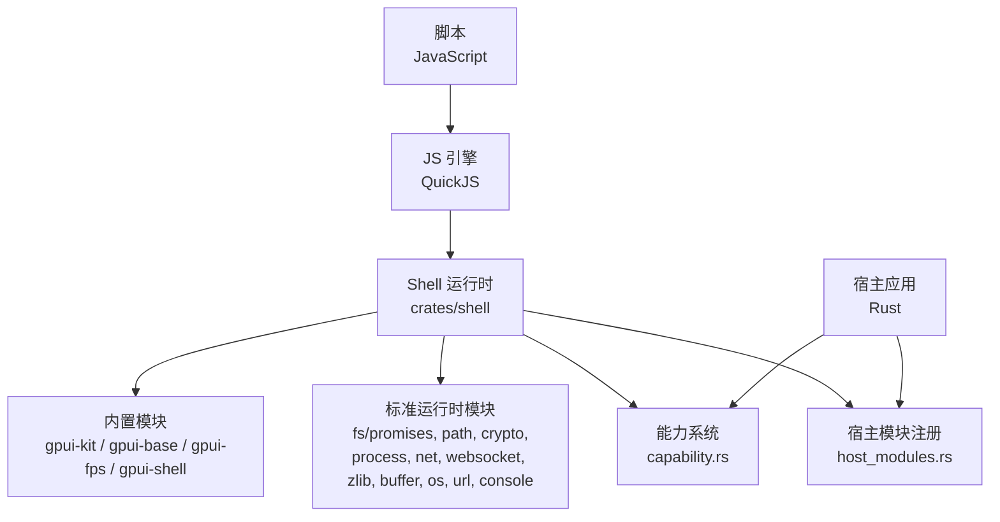
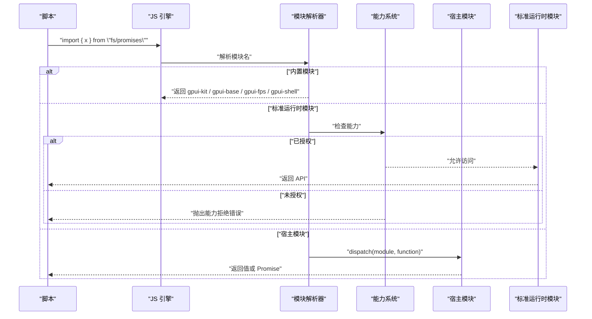
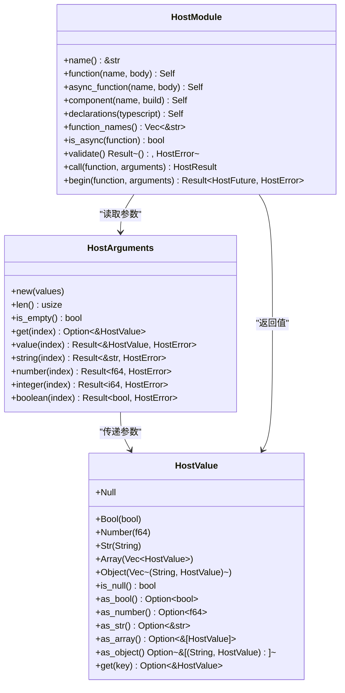
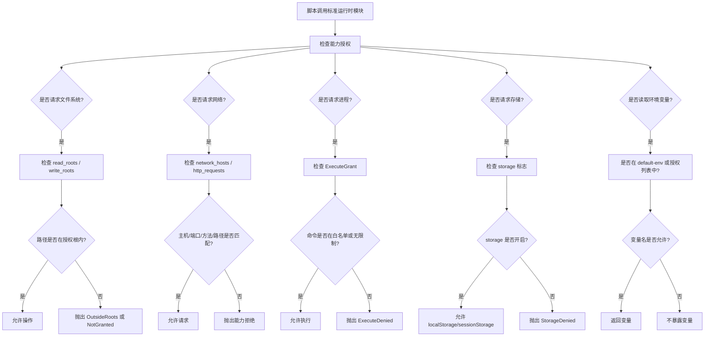
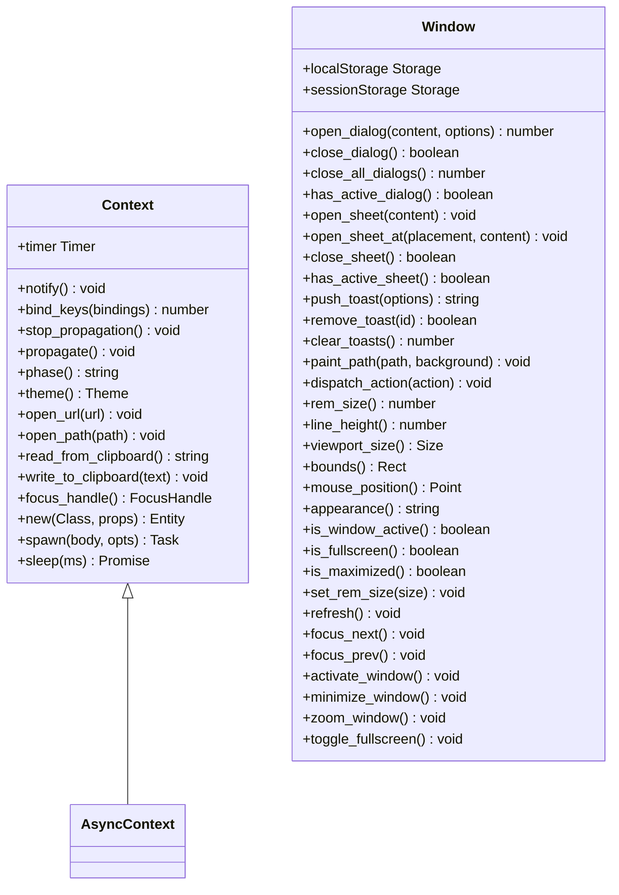
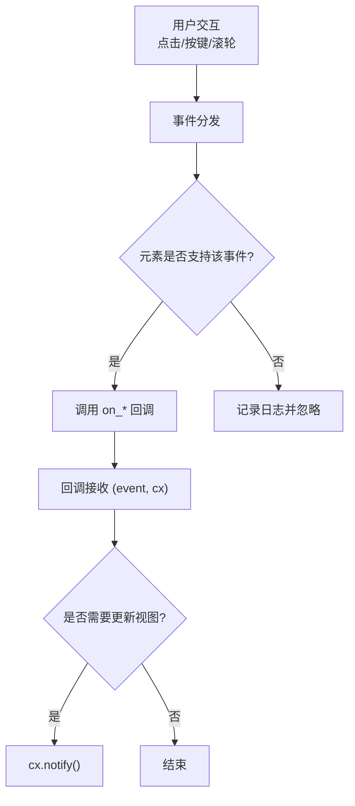
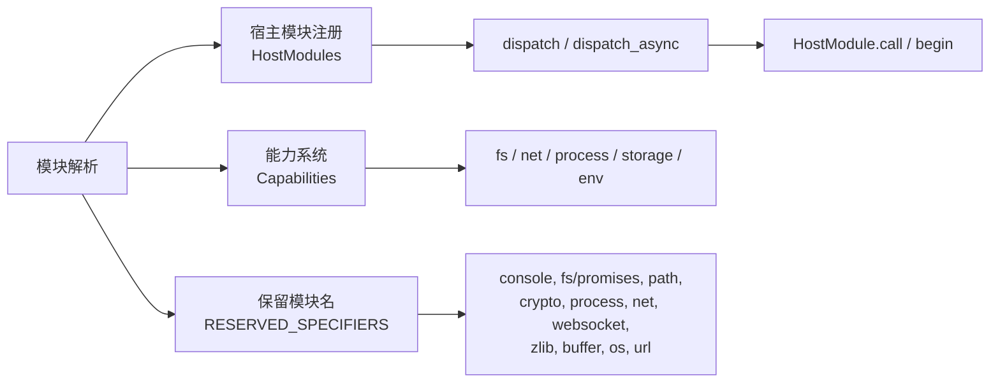
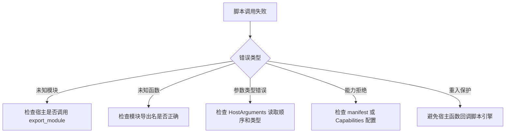

# JavaScript API

<cite>
**本文引用的文件**   
- [crates/shell/src/host_modules.rs](file://crates/shell/src/host_modules.rs)
- [crates/shell/src/capability.rs](file://crates/shell/src/capability.rs)
- [website/shell/api.md](file://website/shell/api.md)
- [examples/js_todolist/types.d.ts](file://examples/js_todolist/types.d.ts)
</cite>

## 目录
1. [引言](#引言)
2. [项目结构](#项目结构)
3. [核心组件](#核心组件)
4. [架构总览](#架构总览)
5. [详细组件分析](#详细组件分析)
6. [依赖关系分析](#依赖关系分析)
7. [性能考虑](#性能考虑)
8. [故障排查指南](#故障排查指南)
9. [结论](#结论)
10. [附录：API 参考与迁移指南](#附录api-参考与迁移指南)

## 引言
本文件面向在 gpui-kit 的 JavaScript Shell 中编写脚本的开发者，目标是系统化说明“标准运行时提供的 API 集合”。该运行时并非浏览器或 Node.js，而是一个由 Rust 实现的 JS 宿主环境；它暴露三类能力：
- 内置模块：`gpui-kit`、`gpui-base`、`gpui-fps`、`gpui-shell`。
- 全局对象：`window`、`cx`（上下文）、以及 `localStorage`/`sessionStorage`。
- 标准运行时模块：如 `fs/promises`、`path`、`crypto`、`process`、`net`、`websocket`、`zlib`、`buffer`、`os`、`url`、`console` 等。

需要特别注意：**标准运行时模块默认不可用**。它们是否可用、能访问哪些主机、路径和命令，完全由宿主通过“能力授权”决定。因此，文档会同时说明 API 表面、调用语义、错误来源、权限边界和最佳实践。

## 项目结构
从仓库角度看，JavaScript API 的实现主要分布在以下位置：
- `crates/shell/src/host_modules.rs`：定义宿主模块注册机制、跨语言值类型、异步函数模型、保留模块名列表。
- `crates/shell/src/capability.rs`：定义脚本能力模型，包括文件系统根、网络主机、HTTP 请求范围、进程执行、存储、剪贴板、环境变量等。
- `website/shell/api.md`：官方 JavaScript API 参考文档，描述 `gpui-kit`、`gpui-base`、`gpui-fps`、`gpui-shell`、`cx`、`window`、元素方法、主题、Dock、事件等。
- `examples/js_todolist/types.d.ts`：示例项目中使用的 TypeScript 声明，体现运行时生成的 `.d.ts` 的使用方式。

**图表来源**
- [crates/shell/src/host_modules.rs:1-105](file://crates/shell/src/host_modules.rs#L1-L105)
- [crates/shell/src/capability.rs:1-38](file://crates/shell/src/capability.rs#L1-L38)
- [website/shell/api.md:14-34](file://website/shell/api.md#L14-L34)

**章节来源**
- [crates/shell/src/host_modules.rs:1-105](file://crates/shell/src/host_modules.rs#L1-L105)
- [crates/shell/src/capability.rs:1-38](file://crates/shell/src/capability.rs#L1-L38)
- [website/shell/api.md:14-34](file://website/shell/api.md#L14-L34)

## 核心组件
本节聚焦 JavaScript API 的关键抽象：

| 组件 | 职责 | 关键行为 |
|---|---|---|
| `HostModule` | 宿主向脚本暴露的模块 | 同步函数、异步函数、组件、TypeScript 声明、导出校验 |
| `HostModules` | 已注册模块集合 | 按名称解析、拒绝未授权模块、生成版本隔离 |
| `Capabilities` | 脚本能力授权 | 控制 fs、http、process、storage、clipboard、env 等 |
| `Context` / `AsyncContext` | 渲染/事件/任务上下文 | `notify`、`spawn`、`timer`、`bind_keys`、`open_url`、`focus_handle` 等 |
| `window` | 窗口级全局对象 | 对话框、面板、Toast、路径绘制、窗口状态、存储 |
| 标准运行时模块 | 平台能力桥接 | 受能力限制，默认关闭 |

**章节来源**
- [crates/shell/src/host_modules.rs:112-127](file://crates/shell/src/host_modules.rs#L112-L127)
- [crates/shell/src/host_modules.rs:412-425](file://crates/shell/src/host_modules.rs#L412-L425)
- [crates/shell/src/capability.rs:24-38](file://crates/shell/src/capability.rs#L24-L38)
- [website/shell/api.md:137-199](file://website/shell/api.md#L137-L199)

## 架构总览
JavaScript API 的整体调用链可以概括为：脚本导入模块 → Shell 解析器查找模块 → 如果是内置模块则直接返回绑定；如果是标准运行时模块则检查能力；如果是宿主模块则通过 `dispatch` 调用 Rust 实现。

**图表来源**
- [crates/shell/src/host_modules.rs:758-778](file://crates/shell/src/host_modules.rs#L758-L778)
- [crates/shell/src/host_modules.rs:948-990](file://crates/shell/src/host_modules.rs#L948-L990)
- [crates/shell/src/capability.rs:24-38](file://crates/shell/src/capability.rs#L24-L38)

## 详细组件分析

### 宿主模块与跨语言值
宿主模块是 Rust 暴露给 JavaScript 的扩展接口。其设计要点如下：
- 所有跨语言值统一为 `HostValue`，包含 null、布尔、数字、字符串、数组、有序对象。
- 参数通过 `HostArguments` 读取，并提供强类型读取方法，例如 `string`、`number`、`integer`、`boolean`。
- 同步函数直接返回 `HostResult`；异步函数返回一个 `Send + 'static` Future，避免阻塞渲染线程。
- 每个模块可附带 TypeScript 声明，启动时校验注册导出与声明导出一致。
- 模块名属于保留命名空间的一部分，宿主不能覆盖运行时自有模块名。

**图表来源**
- [crates/shell/src/host_modules.rs:112-127](file://crates/shell/src/host_modules.rs#L112-L127)
- [crates/shell/src/host_modules.rs:268-340](file://crates/shell/src/host_modules.rs#L268-L340)
- [crates/shell/src/host_modules.rs:412-425](file://crates/shell/src/host_modules.rs#L412-L425)
- [crates/shell/src/host_modules.rs:479-569](file://crates/shell/src/host_modules.rs#L479-L569)
- [crates/shell/src/host_modules.rs:719-748](file://crates/shell/src/host_modules.rs#L719-L748)

**章节来源**
- [crates/shell/src/host_modules.rs:112-127](file://crates/shell/src/host_modules.rs#L112-L127)
- [crates/shell/src/host_modules.rs:268-340](file://crates/shell/src/host_modules.rs#L268-L340)
- [crates/shell/src/host_modules.rs:412-425](file://crates/shell/src/host_modules.rs#L412-L425)
- [crates/shell/src/host_modules.rs:479-569](file://crates/shell/src/host_modules.rs#L479-L569)
- [crates/shell/src/host_modules.rs:719-748](file://crates/shell/src/host_modules.rs#L719-L748)

### 能力系统与标准运行时模块
标准运行时模块包括：
- 文件系统：`fs/promises`
- 路径处理：`path`
- 加密：`crypto`
- 进程：`process`
- 网络：`net`
- WebSocket：`websocket`
- 压缩：`zlib`
- 缓冲区：`buffer`
- 操作系统：`os`
- URL：`url`
- 控制台：`console`

这些模块被标记为“保留模块名”，宿主不能重新注册同名模块。它们的可用性由 `Capabilities` 控制：
- 文件系统读/写根目录
- HTTP 请求范围：scheme、host、port、method、path
- 进程执行：拒绝、白名单、无限制
- 存储：`localStorage`、`sessionStorage`
- 剪贴板：读、写
- 环境变量：默认可见变量 + 显式授权变量

**图表来源**
- [crates/shell/src/capability.rs:24-38](file://crates/shell/src/capability.rs#L24-L38)
- [crates/shell/src/capability.rs:61-142](file://crates/shell/src/capability.rs#L61-L142)
- [crates/shell/src/capability.rs:144-154](file://crates/shell/src/capability.rs#L144-L154)
- [crates/shell/src/capability.rs:315-374](file://crates/shell/src/capability.rs#L315-L374)
- [crates/shell/src/capability.rs:393-510](file://crates/shell/src/capability.rs#L393-L510)
- [crates/shell/src/host_modules.rs:758-778](file://crates/shell/src/host_modules.rs#L758-L778)

**章节来源**
- [crates/shell/src/capability.rs:24-38](file://crates/shell/src/capability.rs#L24-L38)
- [crates/shell/src/capability.rs:61-142](file://crates/shell/src/capability.rs#L61-L142)
- [crates/shell/src/capability.rs:144-154](file://crates/shell/src/capability.rs#L144-L154)
- [crates/shell/src/capability.rs:315-374](file://crates/shell/src/capability.rs#L315-L374)
- [crates/shell/src/capability.rs:393-510](file://crates/shell/src/capability.rs#L393-L510)
- [crates/shell/src/host_modules.rs:758-778](file://crates/shell/src/host_modules.rs#L758-L778)

### 内置模块与全局对象
内置模块提供 UI 构建、布局、控件、主题、Dock、虚拟列表、焦点、调度等能力。官方 API 参考明确列出：
- `gpui-kit`：GPUI 元素、View、Entity、FocusHandle、Task、Timer、共享类型。
- `gpui-base`：布局、控件、文本编辑、容器、表格、虚拟列表、Dock、主题。
- `gpui-fps`：性能监控 HUD。
- `gpui-shell`：仅类型概念，没有运行时导出。

全局对象方面：
- `window`：对话框、Sheet、Toast、路径绘制、窗口状态、存储、鼠标位置、视口尺寸等。
- `cx`：上下文，用于通知重绘、绑定快捷键、打开 URL、读写剪贴板、创建 View、调度任务、定时器。
- `localStorage` / `sessionStorage`：遵循 Web Storage API，支持 `flush()`。

**图表来源**
- [website/shell/api.md:137-199](file://website/shell/api.md#L137-L199)
- [website/shell/api.md:202-216](file://website/shell/api.md#L202-L216)

**章节来源**
- [website/shell/api.md:14-34](file://website/shell/api.md#L14-L34)
- [website/shell/api.md:36-105](file://website/shell/api.md#L36-L105)
- [website/shell/api.md:116-135](file://website/shell/api.md#L116-L135)
- [website/shell/api.md:137-199](file://website/shell/api.md#L137-L199)
- [website/shell/api.md:202-216](file://website/shell/api.md#L202-L216)

### 元素方法与事件模型
元素方法分为组合、插槽、事件、动作与快捷键、控制状态、无障碍、焦点与键盘、滚动与面板、锚定表面、Dock 命令、动画、样式模板、样式方法等。关键点：
- 元素链式调用返回同一元素，便于组合。
- 事件回调通常携带 `(event, cx)`，其中 `cx` 可用于重绘、调度、焦点等操作。
- 某些事件只在特定组件上有效，无效时会在日志中报告而非静默丢弃。
- 动作与快捷键通过 `cx.bind_keys` 和 `on_action` 解耦。

**图表来源**
- [website/shell/api.md:569-625](file://website/shell/api.md#L569-L625)
- [website/shell/api.md:626-648](file://website/shell/api.md#L626-L648)

**章节来源**
- [website/shell/api.md:569-625](file://website/shell/api.md#L569-L625)
- [website/shell/api.md:626-648](file://website/shell/api.md#L626-L648)

## 依赖关系分析
Shell 运行时对模块解析、能力检查和宿主模块调用的依赖关系如下：

**图表来源**
- [crates/shell/src/host_modules.rs:758-778](file://crates/shell/src/host_modules.rs#L758-L778)
- [crates/shell/src/host_modules.rs:800-894](file://crates/shell/src/host_modules.rs#L800-L894)
- [crates/shell/src/host_modules.rs:948-990](file://crates/shell/src/host_modules.rs#L948-L990)
- [crates/shell/src/capability.rs:24-38](file://crates/shell/src/capability.rs#L24-L38)

**章节来源**
- [crates/shell/src/host_modules.rs:758-778](file://crates/shell/src/host_modules.rs#L758-L778)
- [crates/shell/src/host_modules.rs:800-894](file://crates/shell/src/host_modules.rs#L800-L894)
- [crates/shell/src/host_modules.rs:948-990](file://crates/shell/src/host_modules.rs#L948-L990)
- [crates/shell/src/capability.rs:24-38](file://crates/shell/src/capability.rs#L24-L38)

## 性能考虑
- **异步宿主函数**：慢操作应放在异步分支，避免阻塞渲染线程。
- **元素渲染回调**：虚拟列表的 `render(range, cx)` 在帧期间被调用，应避免在其中进行重绘或持有状态变更。
- **主题与样式**：主题变更需要合法上下文，不能在渲染阶段直接修改。
- **存储写入**：`localStorage` 使用 `flush()` 确保落盘，但频繁写入会影响性能。
- **网络请求**：应遵循最小授权原则，只请求必要的主机、方法和路径。
- **进程执行**：尽量避免执行外部命令；若必须执行，应使用白名单。

[本节为通用性能建议，不直接分析具体文件]

## 故障排查指南
常见错误与定位方式：
- **未知模块**：如果宿主未注册任何模块，错误消息会明确指出“宿主未注册任何模块”；如果已注册部分模块，则会列出可用模块名。
- **未知函数**：错误消息会列出模块实际提供的函数名。
- **参数类型错误**：`HostArguments` 的类型读取方法会报告参数位置和实际类型。
- **能力拒绝**：文件系统、网络、进程、存储、环境变量等都会抛出明确的 `CapabilityError`。
- **重入保护**：宿主函数内部再次调用脚本引擎会被拒绝，防止嵌套进入渲染或事件循环。

**图表来源**
- [crates/shell/src/host_modules.rs:859-882](file://crates/shell/src/host_modules.rs#L859-L882)
- [crates/shell/src/host_modules.rs:948-990](file://crates/shell/src/host_modules.rs#L948-L990)
- [crates/shell/src/capability.rs:537-569](file://crates/shell/src/capability.rs#L537-L569)

**章节来源**
- [crates/shell/src/host_modules.rs:859-882](file://crates/shell/src/host_modules.rs#L859-L882)
- [crates/shell/src/host_modules.rs:948-990](file://crates/shell/src/host_modules.rs#L948-L990)
- [crates/shell/src/capability.rs:537-569](file://crates/shell/src/capability.rs#L537-L569)

## 结论
gpui-kit 的 JavaScript API 是一个以 Rust 为核心、面向桌面应用的脚本运行时。它通过三种机制暴露能力：
- 内置模块提供 UI 与调度。
- 标准运行时模块提供平台能力，但默认关闭，需显式授权。
- 宿主模块提供业务扩展，通过严格的安全边界与类型声明保证稳定性。

对于开发者而言，最重要的原则是：
- 优先使用内置模块完成 UI 与交互。
- 谨慎申请标准运行时能力，遵循最小授权。
- 将耗时操作放入异步分支。
- 使用运行时生成的 `.d.ts` 获得类型安全。
- 遇到错误时，优先检查能力配置、模块注册和参数类型。

[本节为总结性内容，不直接分析具体文件]

## 附录：API 参考与迁移指南

### 标准运行时模块清单
| 模块 | 用途 | 授权要求 | 备注 |
|---|---|---|---|
| `fs/promises` | 异步文件系统 | `capabilities.fs.read` / `capabilities.fs.write` | 路径必须在授权根内 |
| `path` | 路径处理 | 通常不需要额外授权 | 与能力系统配合 |
| `crypto` | 加密工具 | 通常需要能力授权 | 具体能力取决于实现 |
| `process` | 进程信息/退出 | `capabilities.process.execute` | 环境变量受控 |
| `net` | TCP/UDP 网络 | `capabilities.network_hosts` | 主机名大小写不敏感 |
| `websocket` | WebSocket | `capabilities.network_hosts` | 与网络能力联动 |
| `zlib` | 压缩/解压 | 通常需要能力授权 | 大文件注意内存 |
| `buffer` | 二进制缓冲 | 通常需要能力授权 | 注意编码 |
| `os` | 操作系统信息 | 通常需要能力授权 | 与进程能力联动 |
| `url` | URL 解析 | 通常需要能力授权 | 与 open_url 能力联动 |
| `console` | 控制台输出 | 通常需要能力授权 | 开发调试常用 |

**章节来源**
- [crates/shell/src/host_modules.rs:758-778](file://crates/shell/src/host_modules.rs#L758-L778)
- [crates/shell/src/capability.rs:24-38](file://crates/shell/src/capability.rs#L24-L38)

### 方法签名与返回值规范
由于标准运行时模块的具体实现可能随版本变化，推荐以运行时生成的 `gpui-kit.d.ts` 为准。仓库中的示例展示了如何使用该声明：

- 示例项目引入 `types.d.ts`，并在脚本顶部添加 `// @ts-check` 启用类型检查。
- 官方 API 参考说明：运行时会在应用加载时刷新 `.d.ts`，开发者应保持该文件被忽略，并通过 `gpui-shell types <directory>` 主动生成。

**章节来源**
- [website/shell/api.md:12-13](file://website/shell/api.md#L12-L13)
- [examples/js_todolist/types.d.ts](file://examples/js_todolist/types.d.ts)

### 版本兼容性与迁移指南
- **类型声明优先**：不要手写标准运行时模块的 `.d.ts`，始终使用运行时生成的版本。
- **能力迁移**：如果旧代码依赖任意网络或文件访问，应逐步收敛到精确的 `HttpRequestGrant` 和 `read_roots`/`write_roots`。
- **进程迁移**：如果旧代码允许任意命令执行，应迁移到白名单模式。
- **环境变量迁移**：如果旧代码读取任意环境变量，应迁移到 `default-env` 与显式授权列表。
- **模块命名迁移**：不要尝试覆盖保留模块名；如需扩展，使用新的宿主模块名。

**章节来源**
- [crates/shell/src/capability.rs:61-142](file://crates/shell/src/capability.rs#L61-L142)
- [crates/shell/src/capability.rs:144-154](file://crates/shell/src/capability.rs#L144-L154)
- [crates/shell/src/host_modules.rs:758-778](file://crates/shell/src/host_modules.rs#L758-L778)