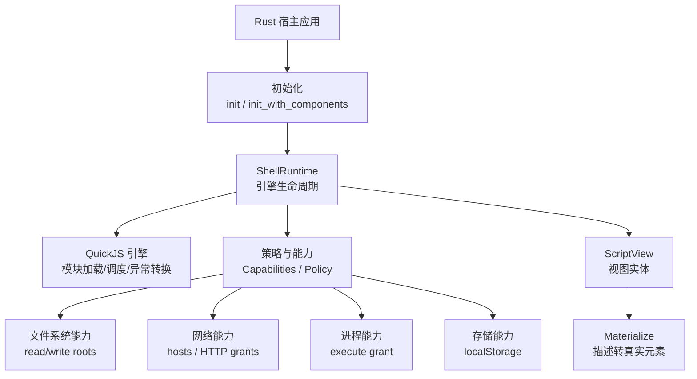
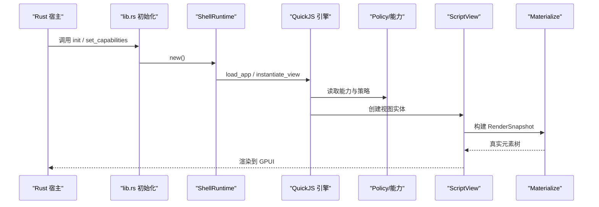
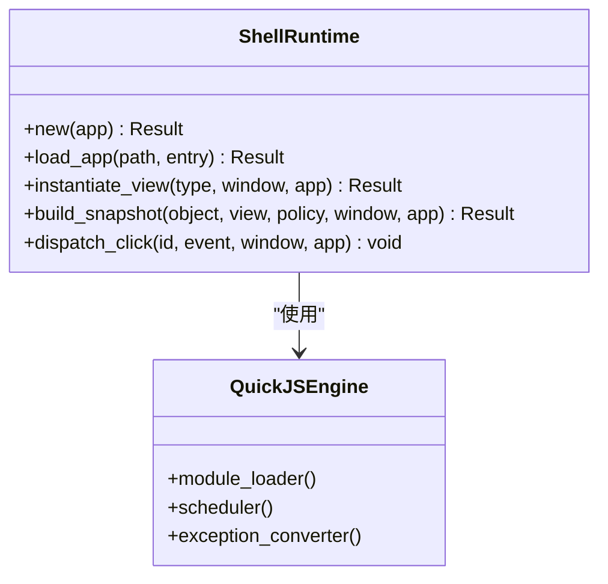
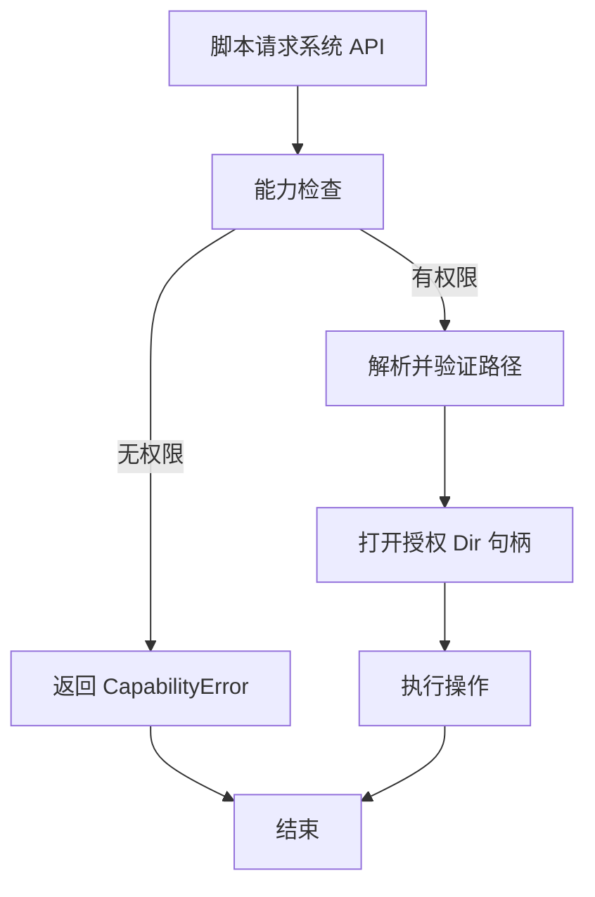
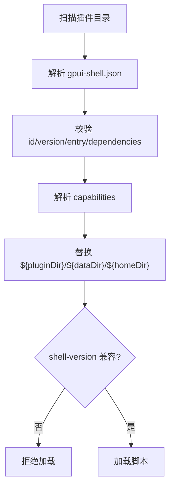
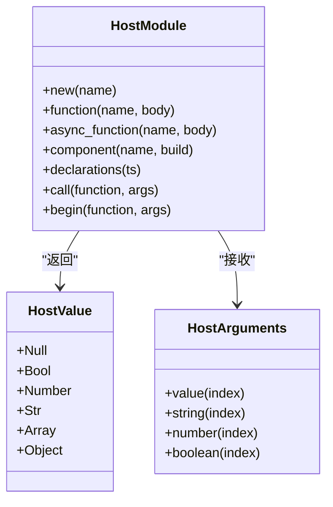
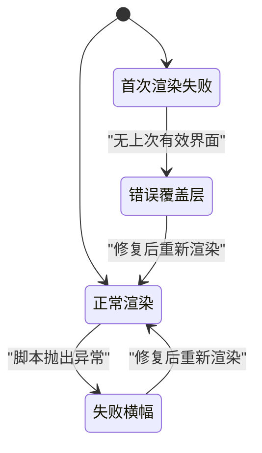
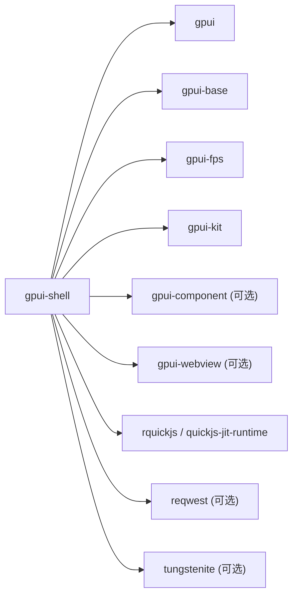
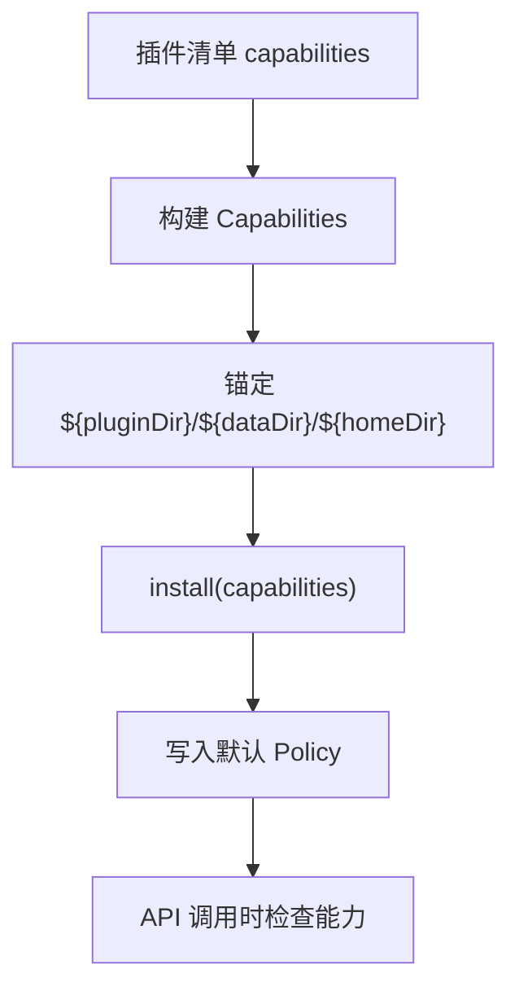

# Shell 运行时

<cite>
**本文引用的文件**   
- [crates/shell/src/lib.rs](file://crates/shell/src/lib.rs)
- [crates/shell/Cargo.toml](file://crates/shell/Cargo.toml)
- [crates/shell/src/engine/mod.rs](file://crates/shell/src/engine/mod.rs)
- [crates/shell/src/capability.rs](file://crates/shell/src/capability.rs)
- [crates/shell/src/plugin.rs](file://crates/shell/src/plugin.rs)
- [crates/shell/src/host_modules.rs](file://crates/shell/src/host_modules.rs)
- [crates/shell/src/runtime.rs](file://crates/shell/src/runtime.rs)
- [docs/gpui-shell.md](file://docs/gpui-shell.md)
</cite>

## 目录
1. [简介](#简介)
2. [项目结构](#项目结构)
3. [核心组件](#核心组件)
4. [架构总览](#架构总览)
5. [详细组件分析](#详细组件分析)
6. [依赖关系分析](#依赖关系分析)
7. [性能与可观测性](#性能与可观测性)
8. [插件开发指南](#插件开发指南)
9. [能力授予与安全模型](#能力授予与安全模型)
10. [故障排查](#故障排查)
11. [结论](#结论)

## 简介
Shell 运行时为基于 GPUI 的 Rust 宿主应用提供 JavaScript 扩展能力。Rust 负责渲染、布局、文本、焦点、覆盖层和系统能力；脚本负责界面组合、展示和业务逻辑。默认脚本语言是 QuickJS，标准模块通过内置适配器暴露文件系统、网络、进程等能力，并通过“能力授予”机制进行安全控制。

该运行时不是浏览器或 Node.js 兼容层：没有 DOM、没有 CommonJS require、没有通用 Node 模块解析。它提供的是最小且稳定的 JS 扩展面，保证脚本不会进入布局/绘制路径，同时保持 Rust 在渲染路径上。

**章节来源**
- [docs/gpui-shell.md:10-57](file://docs/gpui-shell.md#L10-L57)
- [docs/gpui-shell.md:182-210](file://docs/gpui-shell.md#L182-L210)

## 项目结构
Shell 运行时位于 `crates/shell`，其职责按模块划分：引擎抽象、能力系统、插件清单、主机模块注册、视图与快照、主题与样式反射、错误恢复、类型声明生成等。Cargo feature 控制是否启用 QuickJS、组件目录和 WebView。

**图表来源**
- [crates/shell/src/lib.rs:279-301](file://crates/shell/src/lib.rs#L279-L301)
- [crates/shell/src/engine/mod.rs:1-60](file://crates/shell/src/engine/mod.rs#L1-L60)
- [crates/shell/src/capability.rs:24-38](file://crates/shell/src/capability.rs#L24-L38)

**章节来源**
- [crates/shell/Cargo.toml:1-49](file://crates/shell/Cargo.toml#L1-L49)
- [crates/shell/src/lib.rs:64-106](file://crates/shell/src/lib.rs#L64-L106)

## 核心组件
- 引擎抽象：`engine/mod.rs` 定义 `ShellRuntime` 表面，隔离 QuickJS 实现细节。
- 能力系统：`capability.rs` 定义 `Capabilities`、`ExecuteGrant`、HTTP 请求授权、路径根限制。
- 插件系统：`plugin.rs` 解析 `gpui-shell.json`，校验版本、依赖、能力占位符，并在加载前检查兼容性。
- 主机模块：`host_modules.rs` 提供 `HostModule`，让宿主以 ES 模块形式导出函数、异步函数和原生组件。
- 运行期状态：`runtime.rs` 管理回调区域、失败表面、退出请求、应用数据目录。
- 初始化入口：`lib.rs` 暴露 `init`、`set_capabilities`、`set_bundle_id`、`export_module` 等宿主集成点。

**章节来源**
- [crates/shell/src/engine/mod.rs:1-60](file://crates/shell/src/engine/mod.rs#L1-L60)
- [crates/shell/src/capability.rs:24-38](file://crates/shell/src/capability.rs#L24-L38)
- [crates/shell/src/plugin.rs:1-32](file://crates/shell/src/plugin.rs#L1-L32)
- [crates/shell/src/host_modules.rs:1-105](file://crates/shell/src/host_modules.rs#L1-L105)
- [crates/shell/src/runtime.rs:30-56](file://crates/shell/src/runtime.rs#L30-L56)
- [crates/shell/src/lib.rs:188-277](file://crates/shell/src/lib.rs#L188-L277)

## 架构总览
Shell 运行时采用“引擎之上/之下”的分层设计：引擎之上是元素模型、样式、主题、能力、上下文安全；引擎之下是脚本值、方法分发、异常转换、沙箱。`build_snapshot` 是唯一进入脚本 `render` 的入口，避免脚本成本落入帧预算。

**图表来源**
- [crates/shell/src/lib.rs:279-301](file://crates/shell/src/lib.rs#L279-L301)
- [crates/shell/src/engine/mod.rs:60-119](file://crates/shell/src/engine/mod.rs#L60-L119)
- [crates/shell/src/runtime.rs:512-624](file://crates/shell/src/runtime.rs#L512-L624)

**章节来源**
- [docs/gpui-shell.md:376-407](file://docs/gpui-shell.md#L376-L407)
- [crates/shell/src/engine/mod.rs:60-119](file://crates/shell/src/engine/mod.rs#L60-L119)

## 详细组件分析

### 引擎抽象与初始化
`engine/mod.rs` 定义了宿主调用的唯一表面：创建运行时、加载应用、实例化视图、构建快照、分发事件。QuickJS 实现被隐藏在该模块之后，所有上层代码不直接引用脚本值类型。

关键约束：
- `build_snapshot` 是唯一进入脚本 `render` 的入口。
- 引擎配置必须通过公开函数提供，不能静默忽略。
- 能力决策位于引擎之上，引擎只能读取而不能决定。

**图表来源**
- [crates/shell/src/engine/mod.rs:1-60](file://crates/shell/src/engine/mod.rs#L1-L60)
- [crates/shell/src/engine/mod.rs:128-156](file://crates/shell/src/engine/mod.rs#L128-L156)

**章节来源**
- [crates/shell/src/engine/mod.rs:1-119](file://crates/shell/src/engine/mod.rs#L1-L119)

### 能力控制系统
`capability.rs` 中的 `Capabilities` 默认允许为空，所有敏感能力都需要显式授予。支持：
- 文件系统读/写根目录
- 网络主机与 HTTP 请求授权
- 进程执行白名单或拒绝
- localStorage 存储
- 剪贴板读写
- 环境变量白名单
- 退出请求权限

路径访问通过 `cap-std` 的 `Dir` 持有已打开的授权目录句柄，防止路径逃逸和符号链接绕过。

**图表来源**
- [crates/shell/src/capability.rs:24-38](file://crates/shell/src/capability.rs#L24-L38)
- [crates/shell/src/capability.rs:376-510](file://crates/shell/src/capability.rs#L376-L510)

**章节来源**
- [crates/shell/src/capability.rs:24-38](file://crates/shell/src/capability.rs#L24-L38)
- [crates/shell/src/capability.rs:376-510](file://crates/shell/src/capability.rs#L376-L510)

### 插件系统与清单
`plugin.rs` 负责插件发现、清单解析、Git 依赖解析、能力占位符替换、shell 版本兼容性检查。清单字段包括 `id`、`name`、`version`、`shell-version`、`entry`、`dependencies`、`capabilities`、`window`。

重要规则：
- 发现阶段不执行任何脚本。
- 兼容性检查在加载前完成。
- 能力来自清单，但路径锚点由宿主提供。
- Git 依赖支持 GitHub 简写、分支/标签选择、包入口。

**图表来源**
- [crates/shell/src/plugin.rs:1-32](file://crates/shell/src/plugin.rs#L1-L32)
- [crates/shell/src/plugin.rs:283-395](file://crates/shell/src/plugin.rs#L283-L395)
- [crates/shell/src/plugin.rs:436-459](file://crates/shell/src/plugin.rs#L436-L459)

**章节来源**
- [crates/shell/src/plugin.rs:1-32](file://crates/shell/src/plugin.rs#L1-L32)
- [crates/shell/src/plugin.rs:283-395](file://crates/shell/src/plugin.rs#L283-L395)

### 主机模块扩展机制
`host_modules.rs` 提供 `HostModule`，宿主可在启动时注册函数、异步函数和原生组件。脚本通过 ES 模块导入这些名称。

关键点：
- 模块名是 specifier，与内置模块共享命名空间。
- 同步函数在主线程执行；异步函数返回 `Send` future，在后台执行器驱动。
- 参数和返回值使用 `HostValue`，不传递脚本句柄，避免跨边界持有脚本对象。
- TypeScript 声明与注册函数保持一致性校验。

**图表来源**
- [crates/shell/src/host_modules.rs:112-127](file://crates/shell/src/host_modules.rs#L112-L127)
- [crates/shell/src/host_modules.rs:412-425](file://crates/shell/src/host_modules.rs#L412-L425)
- [crates/shell/src/host_modules.rs:484-569](file://crates/shell/src/host_modules.rs#L484-L569)

**章节来源**
- [crates/shell/src/host_modules.rs:1-105](file://crates/shell/src/host_modules.rs#L1-L105)
- [crates/shell/src/host_modules.rs:412-569](file://crates/shell/src/host_modules.rs#L412-L569)

### 视图、快照与错误恢复
`runtime.rs` 管理回调区域、失败表面、退出请求和应用数据目录。脚本渲染失败不会崩溃宿主，而是显示可折叠的错误横幅，保留上一次有效界面。

**图表来源**
- [crates/shell/src/runtime.rs:512-624](file://crates/shell/src/runtime.rs#L512-L624)
- [crates/shell/src/runtime.rs:678-700](file://crates/shell/src/runtime.rs#L678-L700)

**章节来源**
- [crates/shell/src/runtime.rs:512-624](file://crates/shell/src/runtime.rs#L512-L624)
- [crates/shell/src/runtime.rs:678-700](file://crates/shell/src/runtime.rs#L678-L700)

## 依赖关系分析
Shell 运行时依赖 GPUI、GPUI Base、QuickJS 绑定、网络库、压缩库、图像解码等。Cargo feature 控制是否启用 QuickJS、组件目录和 WebView。

**图表来源**
- [crates/shell/Cargo.toml:51-84](file://crates/shell/Cargo.toml#L51-L84)

**章节来源**
- [crates/shell/Cargo.toml:1-49](file://crates/shell/Cargo.toml#L1-L49)
- [crates/shell/Cargo.toml:51-84](file://crates/shell/Cargo.toml#L51-L84)

## 性能与可观测性
- 脚本不在布局/绘制路径中执行；帧预算不受脚本 render 影响。
- 虚拟列表项渲染是例外，但受限于布局阶段，不允许 notify 或注册回调。
- 回调存储在 `CallbackArena` 中，按快照代际管理，避免泄漏。
- 运行时指标可通过 `RuntimeMetrics` 观察脚本渲染次数。
- QuickJS 是字节码解释器，无 JIT；热点循环和每调用边界成本不如 JIT 引擎，但适合脚本迭代速度优先的场景。

**章节来源**
- [docs/gpui-shell.md:448-474](file://docs/gpui-shell.md#L448-L474)
- [crates/shell/src/engine/mod.rs:70-89](file://crates/shell/src/engine/mod.rs#L70-L89)
- [crates/shell/src/runtime.rs:280-442](file://crates/shell/src/runtime.rs#L280-L442)

## 插件开发指南

### 脚本编写规范
- 入口文件默认是 `main.js`，需 `export default` 一个继承 `View` 的类。
- 组件使用 builder 链，如 `Button.new("id")`，而不是 `new Button()`。
- 样式方法保持 Rust snake_case，例如 `items_center`、`gap_2`、`text_3xl`。
- 不要假设元素对象可复用；描述对象在一次渲染后失效。
- 使用 `cx.notify()` 触发重渲染，不要直接操作底层元素。

**章节来源**
- [docs/gpui-shell.md:481-588](file://docs/gpui-shell.md#L481-L588)

### 调试技巧
- 开发模式可通过 `set_development_mode(true)` 放宽沙箱，启用 `eval` 和原型解冻。
- 错误会显示可折叠横幅，包含摘要和堆栈详情。
- 使用 `console` 输出日志，映射到 tracing。
- 类型声明自动生成，编辑器可获得提示。

**章节来源**
- [crates/shell/src/lib.rs:271-277](file://crates/shell/src/lib.rs#L271-L277)
- [crates/shell/src/runtime.rs:512-624](file://crates/shell/src/runtime.rs#L512-L624)

### 性能优化
- 避免在 render 中进行昂贵计算；将工作移到异步主机函数。
- 使用虚拟列表减少大量节点渲染。
- 避免频繁创建新描述对象；复用稳定 ID。
- 合理使用 `when` 条件渲染，减少无用子树。

**章节来源**
- [docs/gpui-shell.md:448-474](file://docs/gpui-shell.md#L448-L474)
- [crates/shell/src/host_modules.rs:496-547](file://crates/shell/src/host_modules.rs#L496-L547)

### 实际插件示例与集成模式
- 独立应用：通过 `cargo run -p gpui-shell -- run examples/js_todolist` 运行示例。
- 嵌入宿主：调用 `gpui_shell::init(cx)` 和 `ShellRuntime::new(cx)`。
- 能力授予：调用 `set_capabilities(Capabilities::new().read_roots([...]))`。
- 主机模块：调用 `export_module(HostModule::new("workspace").function(...))`。
- 插件清单：在插件目录放置 `gpui-shell.json`，声明能力、依赖和入口。

**章节来源**
- [docs/gpui-shell.md:62-97](file://docs/gpui-shell.md#L62-L97)
- [crates/shell/src/lib.rs:188-277](file://crates/shell/src/lib.rs#L188-L277)
- [crates/shell/src/plugin.rs:283-395](file://crates/shell/src/plugin.rs#L283-L395)

## 能力授予与安全模型

### 能力授予机制
- 默认能力为空，必须显式授予。
- 文件系统通过 read/write roots 限制路径范围。
- 网络通过 hosts 和 HTTP grants 限制主机、端口、方法和路径。
- 进程执行通过 `ExecuteGrant` 控制命令白名单或拒绝。
- localStorage 默认开启，但可由宿主关闭。
- 环境变量通过白名单暴露，默认变量来自 `default-env`。

**图表来源**
- [crates/shell/src/plugin.rs:436-459](file://crates/shell/src/plugin.rs#L436-L459)
- [crates/shell/src/capability.rs:573-595](file://crates/shell/src/capability.rs#L573-L595)

**章节来源**
- [crates/shell/src/capability.rs:24-38](file://crates/shell/src/capability.rs#L24-L38)
- [crates/shell/src/capability.rs:573-595](file://crates/shell/src/capability.rs#L573-L595)

### 沙箱隔离与资源限制
- 脚本不能动态加载原生扩展；只能通过宿主注册的 `HostModule` 访问能力。
- 路径访问通过 `cap-std` 的 `Dir` 句柄限制，防止逃逸。
- 网络请求有限制：HTTP 超时、体大小限制、TCP I/O 超时、WebSocket 消息大小限制。
- 进程执行需要明确授权。
- 多运行时隔离 VM、堆、模块缓存和回调，但不是进程级安全沙箱。

**章节来源**
- [docs/gpui-shell.md:100-113](file://docs/gpui-shell.md#L100-L113)
- [crates/shell/src/host_modules.rs:1-105](file://crates/shell/src/host_modules.rs#L1-L105)
- [crates/shell/src/engine/mod.rs:659-673](file://crates/shell/src/engine/mod.rs#L659-L673)

## 故障排查
- 脚本错误显示为横幅或覆盖层，保留上次有效界面。
- 退出请求由宿主处理，脚本只能请求退出。
- 应用数据目录通过 `set_bundle_id` 设置，避免路径漂移。
- 模块注册冲突会报错，保留模块名不被宿主覆盖。
- 清单字段拼写错误会给出建议字段名。

**章节来源**
- [crates/shell/src/runtime.rs:512-624](file://crates/shell/src/runtime.rs#L512-L624)
- [crates/shell/src/runtime.rs:444-510](file://crates/shell/src/runtime.rs#L444-L510)
- [crates/shell/src/lib.rs:203-245](file://crates/shell/src/lib.rs#L203-L245)
- [crates/shell/src/host_modules.rs:642-715](file://crates/shell/src/host_modules.rs#L642-L715)
- [crates/shell/src/plugin.rs:654-682](file://crates/shell/src/plugin.rs#L654-L682)

## 结论
Shell 运行时为 GPUI 应用提供了稳定、安全、可迭代的 JavaScript 扩展面。它通过引擎抽象、能力授予、插件清单和主机模块机制，将脚本业务逻辑与 Rust 渲染路径解耦。开发者可以专注于脚本界面和业务，而宿主控制能力、安全和系统集成。未来若引入第二个引擎，应遵循当前 seam 约束，确保脚本 API 语义一致且不破坏渲染频率规则。