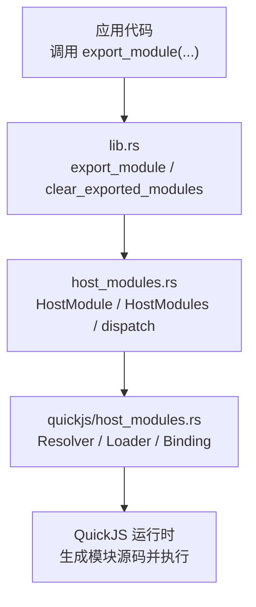
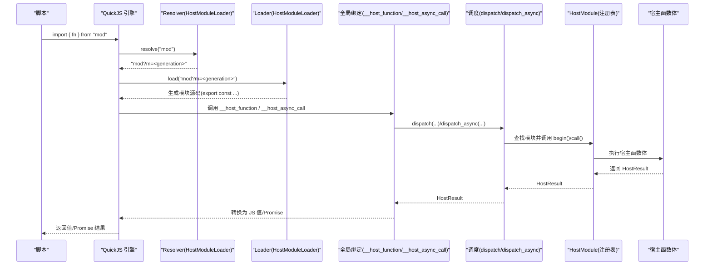
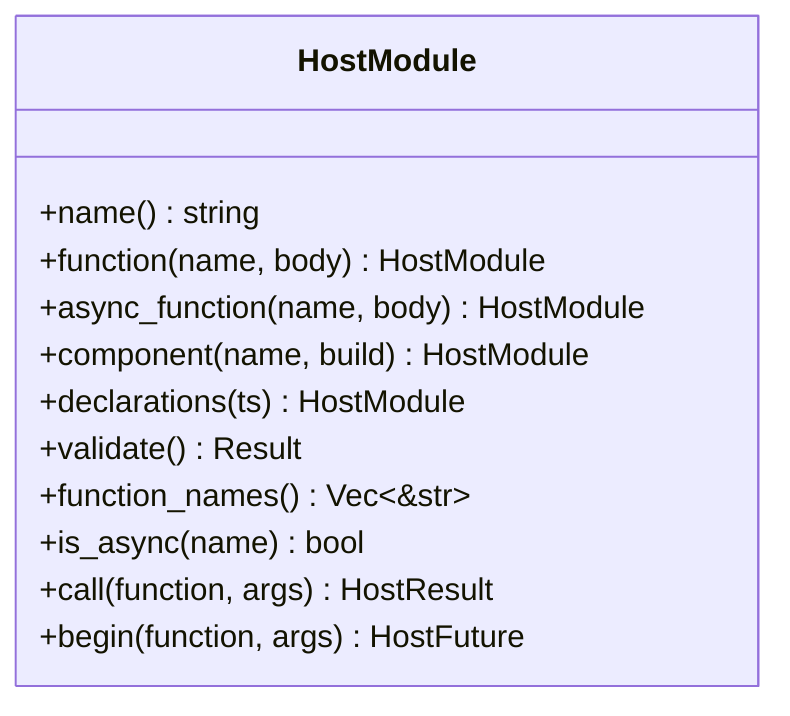
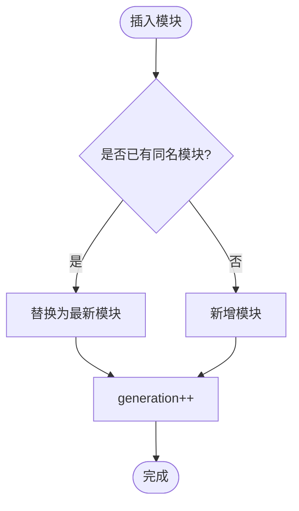
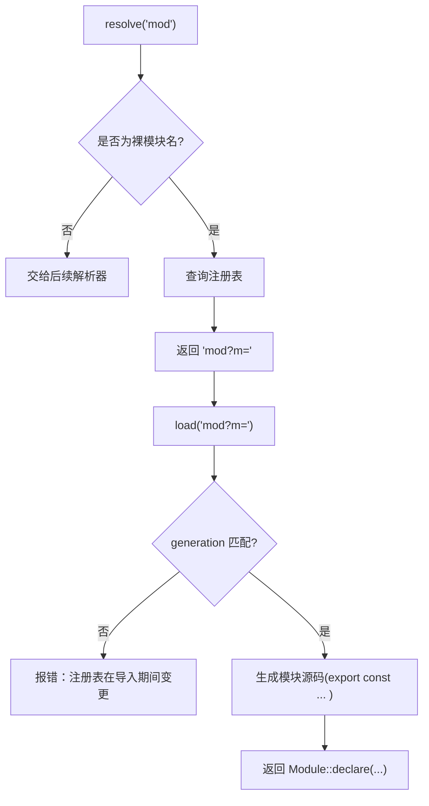
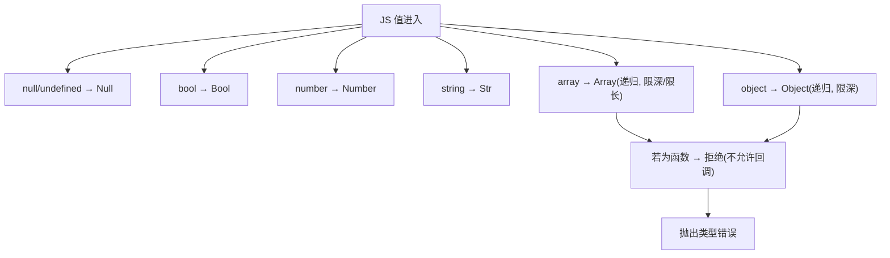
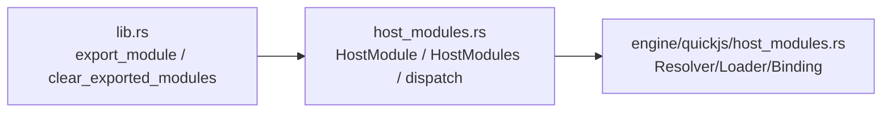
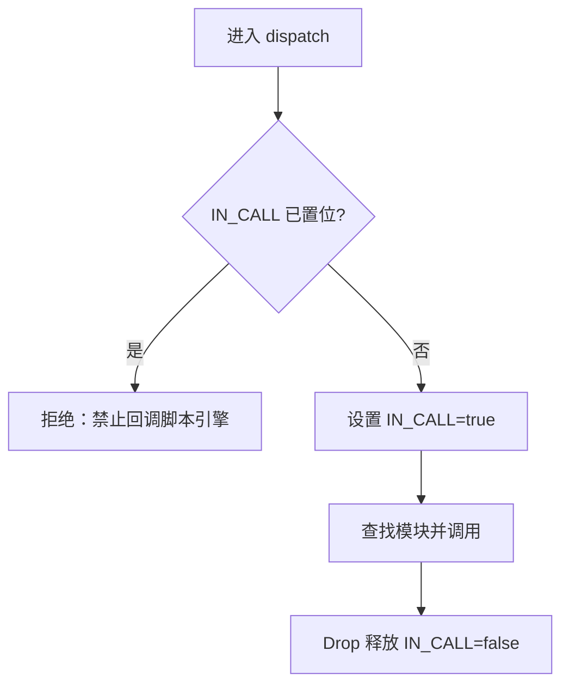
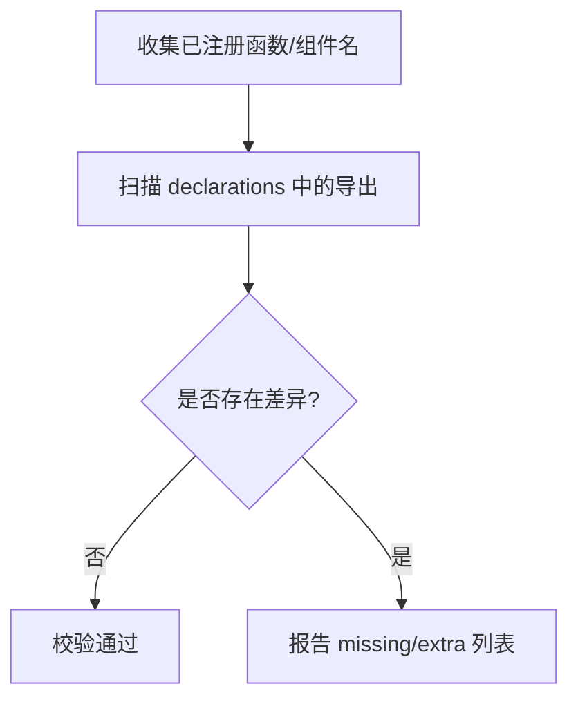

# 宿主模块

<cite>
**本文引用的文件**   
- [crates/shell/src/host_modules.rs](file://crates/shell/src/host_modules.rs)
- [crates/shell/src/engine/quickjs/host_modules.rs](file://crates/shell/src/engine/quickjs/host_modules.rs)
- [crates/shell/src/lib.rs](file://crates/shell/src/lib.rs)
</cite>

## 目录
1. [简介](#简介)
2. [项目结构](#项目结构)
3. [核心组件](#核心组件)
4. [架构总览](#架构总览)
5. [详细组件分析](#详细组件分析)
6. [依赖关系分析](#依赖关系分析)
7. [性能与并发特性](#性能与并发特性)
8. [作用域、上下文与能力边界](#作用域上下文与能力边界)
9. [TypeScript 声明生成与类型安全](#typescript-声明生成与类型安全)
10. [自定义宿主模块开发指南](#自定义宿主模块开发指南)
11. [常见用例示例索引](#常见用例示例索引)
12. [故障排查与调试](#故障排查与调试)
13. [结论](#结论)

## 简介
本文件面向“宿主模块”这一扩展机制：宿主在编译期将 Rust 函数以“模块 + 函数名”的形式暴露给脚本，脚本通过 import 语法使用。该设计强调：
- 最小权限：默认不开放任何能力，显式注册才可用。
- 纯数据边界：跨语言边界的参数和返回值是 JSON 可表达的数据，不传递脚本句柄或回调。
- 同步与异步分离：同步函数在主线程执行；异步函数返回 Promise，实际工作在后台执行器运行。
- TypeScript 类型对齐：宿主可在注册时附带 TypeScript 声明，启动时校验声明与导出一致。

## 项目结构
围绕宿主模块的关键代码分布在三个位置：
- 引擎无关的模块定义、值类型、错误类型、注册表与调度入口：host_modules.rs
- QuickJS 侧的解析器、加载器、全局绑定与 JS↔Rust 值转换：engine/quickjs/host_modules.rs
- 对外 API（export_module/clear_exported_modules）：lib.rs

**图表来源**
- [crates/shell/src/lib.rs:350-456](file://crates/shell/src/lib.rs#L350-L456)
- [crates/shell/src/host_modules.rs:413-749](file://crates/shell/src/host_modules.rs#L413-L749)
- [crates/shell/src/engine/quickjs/host_modules.rs:177-289](file://crates/shell/src/engine/quickjs/host_modules.rs#L177-L289)

**章节来源**
- [crates/shell/src/lib.rs:350-456](file://crates/shell/src/lib.rs#L350-L456)
- [crates/shell/src/host_modules.rs:1-105](file://crates/shell/src/host_modules.rs#L1-L105)
- [crates/shell/src/engine/quickjs/host_modules.rs:1-56](file://crates/shell/src/engine/quickjs/host_modules.rs#L1-L56)

## 核心组件
- HostValue：跨语言边界的统一值类型（null、bool、number、string、array、object）。
- HostObject：用于构建对象字段的辅助构造器。
- HostArguments：函数入参集合，提供强类型读取方法（string/number/integer/boolean/value）。
- HostError：宿主函数抛出的错误消息。
- HostModule：一个可被脚本导入的模块，包含同步函数、异步函数、组件与 TypeScript 声明。
- HostModules：全局注册表，维护模块集合与版本代际号 generation。
- 调度入口：dispatch（同步）、dispatch_async（异步），负责重入保护与查找注册表。

**章节来源**
- [crates/shell/src/host_modules.rs:112-405](file://crates/shell/src/host_modules.rs#L112-L405)
- [crates/shell/src/host_modules.rs:413-749](file://crates/shell/src/host_modules.rs#L413-L749)
- [crates/shell/src/host_modules.rs:801-990](file://crates/shell/src/host_modules.rs#L801-L990)

## 架构总览
下图展示从脚本到宿主的完整调用路径，包括解析、加载、生成绑定、参数转换、调度与结果转换。

**图表来源**
- [crates/shell/src/engine/quickjs/host_modules.rs:120-158](file://crates/shell/src/engine/quickjs/host_modules.rs#L120-L158)
- [crates/shell/src/engine/quickjs/host_modules.rs:189-289](file://crates/shell/src/engine/quickjs/host_modules.rs#L189-L289)
- [crates/shell/src/host_modules.rs:948-990](file://crates/shell/src/host_modules.rs#L948-L990)
- [crates/shell/src/host_modules.rs:719-749](file://crates/shell/src/host_modules.rs#L719-L749)

## 详细组件分析

### HostModule：模块定义与导出
- 名称即模块标识符，脚本通过 import 指定。
- 支持三类导出：
  - function(name, body)：同步函数，主线程执行。
  - async_function(name, body)：异步函数，body 在主线程检查参数并返回 Send Future，Future 在后台执行。
  - component(name, build)：导出 GPUI 组件构造器。
- declarations(typescript)：附加 TypeScript 声明体，启动时校验与已注册导出一致。
- validate()：拒绝保留名（RESERVED_SPECIFIERS），并校验声明与导出是否一致。

**图表来源**
- [crates/shell/src/host_modules.rs:413-749](file://crates/shell/src/host_modules.rs#L413-L749)

**章节来源**
- [crates/shell/src/host_modules.rs:413-749](file://crates/shell/src/host_modules.rs#L413-L749)

### HostModules：注册表与代际隔离
- 维护模块映射与 generation 编号。
- insert(module)：替换同名模块并递增 generation，使引擎缓存失效。
- get(name)：按名称查找模块，区分“未注册任何模块”和“未知模块”的错误信息。
- modules()：获取当前策略下的注册表引用。

**图表来源**
- [crates/shell/src/host_modules.rs:842-845](file://crates/shell/src/host_modules.rs#L842-L845)

**章节来源**
- [crates/shell/src/host_modules.rs:801-894](file://crates/shell/src/host_modules.rs#L801-L894)

### QuickJS 侧：解析器、加载器与全局绑定
- Resolver.resolve：仅处理裸模块名，附加 generation 标签。
- Loader.load：根据 generation 校验一致性，动态生成模块源码（每个导出对应一个 stub）。
- install：安装 __host_function 与 __host_async_call 两个全局函数。
- Binding：同步导出的包装，每次调用转发到 dispatch。
- host_async_call：异步导出的箭头函数，封装 Promise 生命周期。

**图表来源**
- [crates/shell/src/engine/quickjs/host_modules.rs:189-289](file://crates/shell/src/engine/quickjs/host_modules.rs#L189-L289)

**章节来源**
- [crates/shell/src/engine/quickjs/host_modules.rs:120-158](file://crates/shell/src/engine/quickjs/host_modules.rs#L120-L158)
- [crates/shell/src/engine/quickjs/host_modules.rs:177-289](file://crates/shell/src/engine/quickjs/host_modules.rs#L177-L289)

### 值转换与边界约束
- MAX_DEPTH=16：限制嵌套深度，防止栈溢出。
- MAX_BRIDGE_ARRAY_ITEMS=10_000：限制数组项数量，防止超大稀疏数组导致分配失控。
- 禁止传递函数/闭包作为参数：避免持有脚本句柄跨越调用边界。
- 双向转换：from_js（JS→HostValue）、into_js（HostValue→JS）。

**图表来源**
- [crates/shell/src/engine/quickjs/host_modules.rs:348-410](file://crates/shell/src/engine/quickjs/host_modules.rs#L348-L410)

**章节来源**
- [crates/shell/src/engine/quickjs/host_modules.rs:75-88](file://crates/shell/src/engine/quickjs/host_modules.rs#L75-L88)
- [crates/shell/src/engine/quickjs/host_modules.rs:348-410](file://crates/shell/src/engine/quickjs/host_modules.rs#L348-L410)

## 依赖关系分析
- lib.rs 暴露对外 API：export_module 与 clear_exported_modules。
- host_modules.rs 实现核心数据结构与调度逻辑。
- quickjs/host_modules.rs 实现引擎适配层（解析、加载、值转换）。

**图表来源**
- [crates/shell/src/lib.rs:350-456](file://crates/shell/src/lib.rs#L350-L456)
- [crates/shell/src/host_modules.rs:912-990](file://crates/shell/src/host_modules.rs#L912-L990)
- [crates/shell/src/engine/quickjs/host_modules.rs:177-289](file://crates/shell/src/engine/quickjs/host_modules.rs#L177-L289)

**章节来源**
- [crates/shell/src/lib.rs:350-456](file://crates/shell/src/lib.rs#L350-L456)
- [crates/shell/src/host_modules.rs:912-990](file://crates/shell/src/host_modules.rs#L912-L990)
- [crates/shell/src/engine/quickjs/host_modules.rs:177-289](file://crates/shell/src/engine/quickjs/host_modules.rs#L177-L289)

## 性能与并发特性
- 同步函数：在主线程执行，适合轻量操作；耗时操作应使用异步函数。
- 异步函数：
  - 同步半段：在主线程内检查参数、访问宿主状态，失败快速返回。
  - 异步半段：返回 Send + 'static Future，由后台执行器驱动，不持有引擎上下文。
- 取消语义：当视图销毁或应用重载，Promise 可能永远挂起，不会主动拒绝。
- 指标计时：同步调用可通过 runtime.metrics().time_native 统计原生调用耗时。

**章节来源**
- [crates/shell/src/host_modules.rs:496-569](file://crates/shell/src/host_modules.rs#L496-L569)
- [crates/shell/src/engine/quickjs/host_modules.rs:309-343](file://crates/shell/src/engine/quickjs/host_modules.rs#L309-L343)

## 作用域、上下文与能力边界
- 重入保护：dispatch/dispatch_async 通过线程局部标志 IN_CALL 阻止宿主函数再次调用脚本引擎，避免重入渲染管线。
- 上下文访问：宿主函数可通过 with_current_app 等机制访问宿主状态，但不得持有脚本句柄。
- 能力授予：默认无能力；只有显式注册的模块才可被导入。保留名（RESERVED_SPECIFIERS）不可覆盖。

**图表来源**
- [crates/shell/src/host_modules.rs:955-1007](file://crates/shell/src/host_modules.rs#L955-L1007)

**章节来源**
- [crates/shell/src/host_modules.rs:73-86](file://crates/shell/src/host_modules.rs#L73-L86)
- [crates/shell/src/host_modules.rs:948-1007](file://crates/shell/src/host_modules.rs#L948-L1007)

## TypeScript 声明生成与类型安全
- 声明位置：HostModule::declarations 接收一段 TypeScript 声明体。
- 校验规则：
  - 仅识别行首的 export function / export declare function / export const。
  - 比较“已注册函数/组件名”与“声明中导出的函数名”，报告缺失与多余。
- 生成 .d.ts：宿主声明与注册保持一致，保证编辑器补全与类型检查有效。
- 未声明模块：仍会生成 any 签名，但仍能校验模块名与导出名。

**图表来源**
- [crates/shell/src/host_modules.rs:669-715](file://crates/shell/src/host_modules.rs#L669-L715)

**章节来源**
- [crates/shell/src/host_modules.rs:571-606](file://crates/shell/src/host_modules.rs#L571-L606)
- [crates/shell/src/host_modules.rs:669-715](file://crates/shell/src/host_modules.rs#L669-L715)

## 自定义宿主模块开发指南

### 创建与注册
- 使用 HostModule::new("模块名") 构建模块。
- 通过 .function/.async_function/.component 添加导出。
- 可选地通过 .declarations 附加 TypeScript 声明。
- 最终通过 gpui_shell::export_module 注册。

参考路径：
- [crates/shell/src/lib.rs:350-456](file://crates/shell/src/lib.rs#L350-L456)
- [crates/shell/src/host_modules.rs:413-749](file://crates/shell/src/host_modules.rs#L413-L749)

### 同步函数
- 适用于轻量、非阻塞逻辑。
- 参数通过 HostArguments 强类型读取，错误通过 HostError 返回。

参考路径：
- [crates/shell/src/host_modules.rs:479-494](file://crates/shell/src/host_modules.rs#L479-L494)
- [crates/shell/src/host_modules.rs:297-340](file://crates/shell/src/host_modules.rs#L297-L340)

### 异步函数
- 同步半段：在主线程检查参数、读取宿主状态。
- 异步半段：返回 Send Future，在后台执行器运行。
- 注意：不要在 Future 中尝试访问引擎上下文。

参考路径：
- [crates/shell/src/host_modules.rs:496-569](file://crates/shell/src/host_modules.rs#L496-L569)

### 组件导出
- 通过 .component 导出 GPUI 组件构造器，供脚本侧渲染。

参考路径：
- [crates/shell/src/host_modules.rs:444-473](file://crates/shell/src/host_modules.rs#L444-L473)

### 错误处理
- 参数类型错误：HostArguments 提供的读取方法会返回带位置的错误消息。
- 业务错误：返回 HostError，引擎会在调用点附加模块与函数名。
- 重入保护：宿主函数内部不得再次调用脚本引擎，否则触发重入错误。

参考路径：
- [crates/shell/src/host_modules.rs:297-340](file://crates/shell/src/host_modules.rs#L297-L340)
- [crates/shell/src/host_modules.rs:350-390](file://crates/shell/src/host_modules.rs#L350-L390)
- [crates/shell/src/host_modules.rs:955-1007](file://crates/shell/src/host_modules.rs#L955-L1007)

### 性能优化
- 将耗时工作放入异步函数，避免阻塞渲染线程。
- 控制传入数据结构大小：数组长度与嵌套深度有限制。
- 避免在同步函数中进行 I/O 或重型计算。

参考路径：
- [crates/shell/src/engine/quickjs/host_modules.rs:75-88](file://crates/shell/src/engine/quickjs/host_modules.rs#L75-L88)
- [crates/shell/src/engine/quickjs/host_modules.rs:348-410](file://crates/shell/src/engine/quickjs/host_modules.rs#L348-L410)

### 调试技巧
- 利用生成的模块源码与全局绑定 __host_function/__host_async_call 定位问题。
- 关注 generation 标签不一致导致的“注册表在导入期间变更”错误。
- 使用 metrics 计时统计原生调用耗时。

参考路径：
- [crates/shell/src/engine/quickjs/host_modules.rs:120-158](file://crates/shell/src/engine/quickjs/host_modules.rs#L120-L158)
- [crates/shell/src/engine/quickjs/host_modules.rs:220-238](file://crates/shell/src/engine/quickjs/host_modules.rs#L220-L238)
- [crates/shell/src/engine/quickjs/host_modules.rs:309-343](file://crates/shell/src/engine/quickjs/host_modules.rs#L309-L343)

## 常见用例示例索引
以下为常见用例的实现思路与对应源码路径（不包含具体代码内容）：
- 文件操作：在异步函数中执行文件系统 I/O，返回 HostValue 表示结果或错误。
  - 参考：[crates/shell/src/host_modules.rs:496-569](file://crates/shell/src/host_modules.rs#L496-L569)
- 网络请求：在异步函数中使用 HTTP 客户端发起请求，将响应序列化为 HostValue/Object。
  - 参考：[crates/shell/src/host_modules.rs:496-569](file://crates/shell/src/host_modules.rs#L496-L569)
- 进程管理：在异步函数中启动子进程、等待结束并返回状态码。
  - 参考：[crates/shell/src/host_modules.rs:496-569](file://crates/shell/src/host_modules.rs#L496-L569)
- 配置读取：同步函数读取宿主配置，返回 HostValue/Object。
  - 参考：[crates/shell/src/host_modules.rs:479-494](file://crates/shell/src/host_modules.rs#L479-L494)
- 事件通知：同步函数触发 UI 刷新（如 cx.notify），不直接回调脚本。
  - 参考：[crates/shell/src/host_modules.rs:73-86](file://crates/shell/src/host_modules.rs#L73-L86)

## 故障排查与调试

### 常见问题与诊断
- 模块名冲突：尝试注册保留名（如 path、process 等）会被拒绝。
  - 参考：[crates/shell/src/host_modules.rs:751-778](file://crates/shell/src/host_modules.rs#L751-L778)
- 声明与导出不一致：缺少或多余的导出会在启动时报错。
  - 参考：[crates/shell/src/host_modules.rs:669-715](file://crates/shell/src/host_modules.rs#L669-L715)
- 未知模块或函数：错误消息会列出已注册模块与函数名，便于定位。
  - 参考：[crates/shell/src/host_modules.rs:865-882](file://crates/shell/src/host_modules.rs#L865-L882)
  - 参考：[crates/shell/src/host_modules.rs:742-748](file://crates/shell/src/host_modules.rs#L742-L748)
- 重入错误：宿主函数内部再次调用脚本引擎会触发保护。
  - 参考：[crates/shell/src/host_modules.rs:955-1007](file://crates/shell/src/host_modules.rs#L955-L1007)
- 参数类型错误：HostArguments 读取方法会给出位置与期望类型。
  - 参考：[crates/shell/src/host_modules.rs:297-340](file://crates/shell/src/host_modules.rs#L297-L340)
- 数组过大或嵌套过深：桥接层会拒绝超限数据。
  - 参考：[crates/shell/src/engine/quickjs/host_modules.rs:75-88](file://crates/shell/src/engine/quickjs/host_modules.rs#L75-L88)
  - 参考：[crates/shell/src/engine/quickjs/host_modules.rs:348-410](file://crates/shell/src/engine/quickjs/host_modules.rs#L348-L410)

**章节来源**
- [crates/shell/src/host_modules.rs:751-778](file://crates/shell/src/host_modules.rs#L751-L778)
- [crates/shell/src/host_modules.rs:669-715](file://crates/shell/src/host_modules.rs#L669-L715)
- [crates/shell/src/host_modules.rs:865-882](file://crates/shell/src/host_modules.rs#L865-L882)
- [crates/shell/src/host_modules.rs:742-748](file://crates/shell/src/host_modules.rs#L742-L748)
- [crates/shell/src/host_modules.rs:955-1007](file://crates/shell/src/host_modules.rs#L955-L1007)
- [crates/shell/src/host_modules.rs:297-340](file://crates/shell/src/host_modules.rs#L297-L340)
- [crates/shell/src/engine/quickjs/host_modules.rs:75-88](file://crates/shell/src/engine/quickjs/host_modules.rs#L75-L88)
- [crates/shell/src/engine/quickjs/host_modules.rs:348-410](file://crates/shell/src/engine/quickjs/host_modules.rs#L348-L410)

## 结论
宿主模块机制通过“编译期注册 + 运行时导入”的方式，为脚本提供了稳定、可控且类型安全的扩展能力。其关键优势在于：
- 明确的能力边界与最小权限原则。
- 同步/异步职责清晰，避免阻塞渲染线程。
- TypeScript 声明与注册同步校验，提升开发体验与可靠性。
- 严格的值边界与重入保护，保障宿主与脚本的安全交互。

在实际开发中，建议：
- 始终为模块编写 TypeScript 声明。
- 将耗时任务放入异步函数。
- 谨慎管理宿主状态与作用域，避免持有脚本句柄。
- 在宿主退出前清理已注册模块，防止资源泄漏。