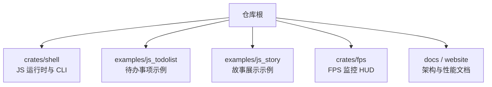
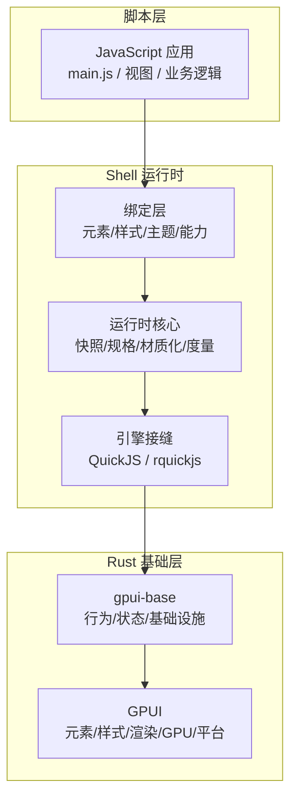
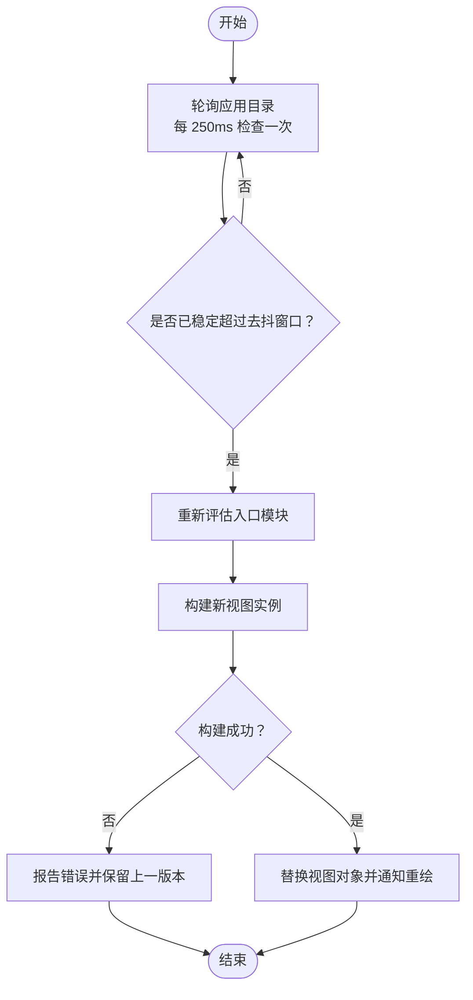
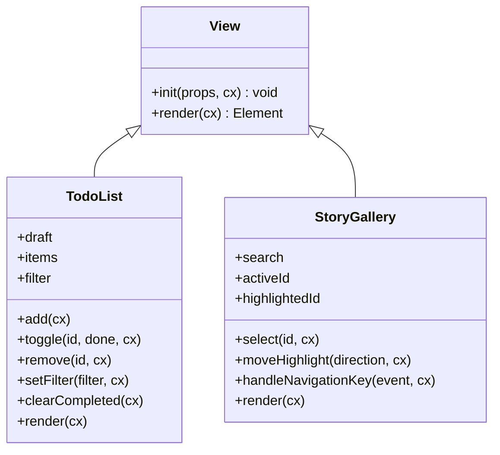
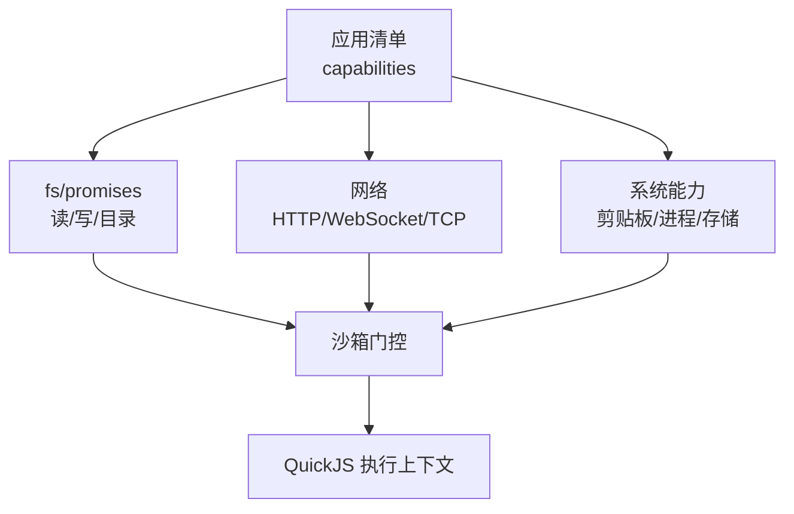
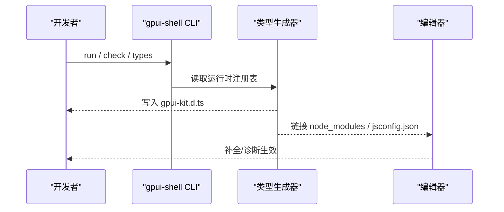
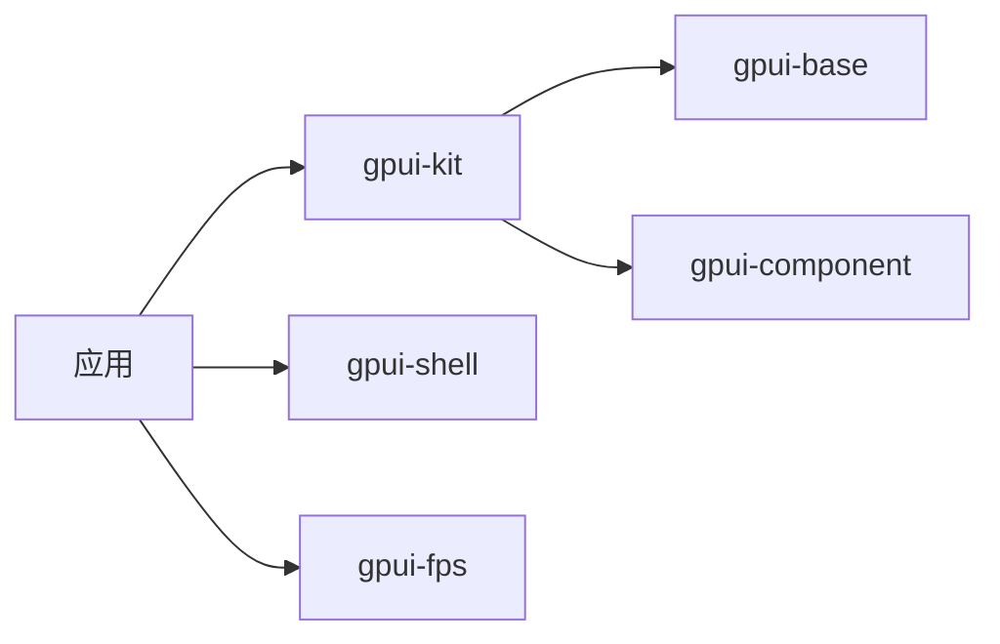
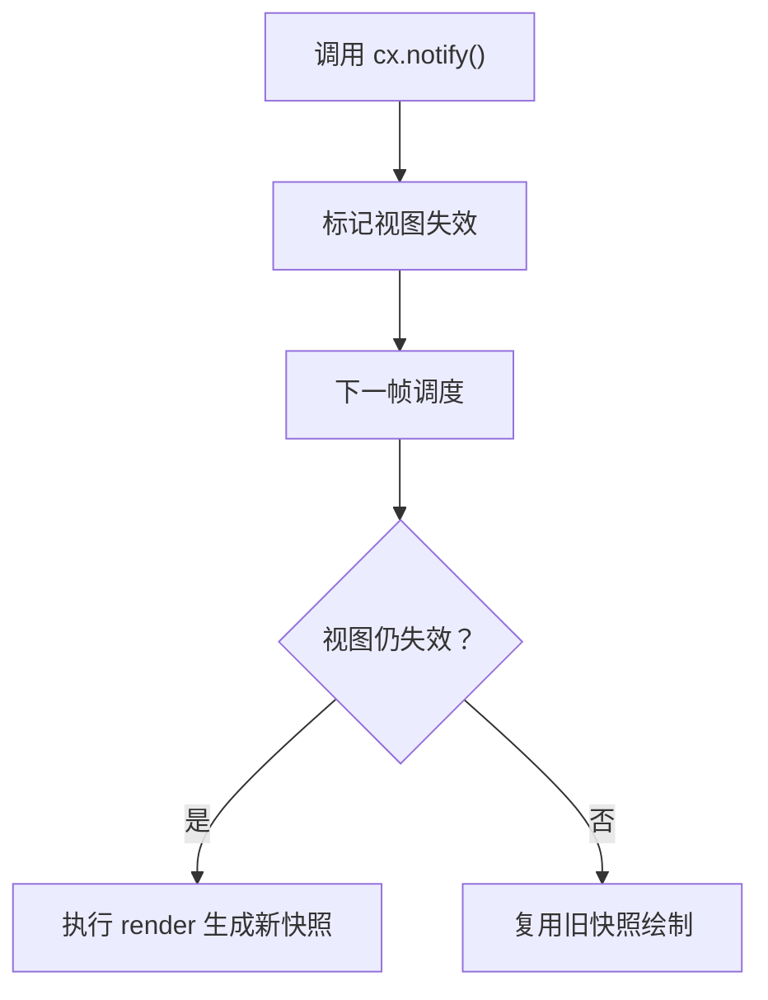
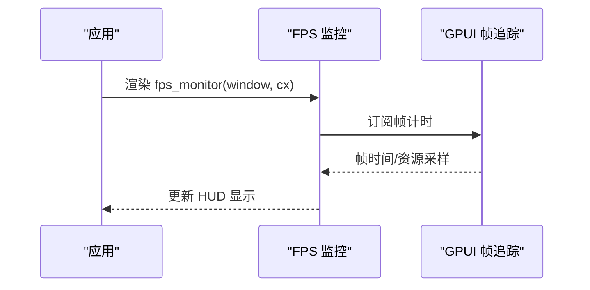

# 开发指南

<cite>
**本文引用的文件**   
- [README.md](file://README.md)
- [crates/shell/README.md](file://crates/shell/README.md)
- [docs/gpui-shell.md](file://docs/gpui-shell.md)
- [crates/shell/src/watch.rs](file://crates/shell/src/watch.rs)
- [examples/js_todolist/main.js](file://examples/js_todolist/main.js)
- [examples/js_story/app.js](file://examples/js_story/app.js)
- [crates/fps/README.md](file://crates/fps/README.md)
- [website/shell/performance.md](file://website/shell/performance.md)
</cite>

## 目录
1. [简介](#简介)
2. [项目结构](#项目结构)
3. [核心组件](#核心组件)
4. [架构总览](#架构总览)
5. [详细组件分析](#详细组件分析)
6. [依赖关系分析](#依赖关系分析)
7. [性能与调试](#性能与调试)
8. [开发与部署工作流](#开发与部署工作流)
9. [常见问题排查](#常见问题排查)
10. [结论](#结论)

## 简介
本指南面向使用 GPUI Kit 的 Shell 运行时开发者，聚焦插件化 JavaScript 应用（gpui-shell）的开发环境搭建、调试技巧、性能分析方法、热重载机制、完整开发工作流，以及待办事项应用和故事展示应用的实战示例。Shell 运行时的目标是让 Rust 宿主在编译后仍可被 JavaScript 扩展：脚本负责界面组合与业务逻辑，Rust 负责渲染、布局、输入、主题与系统能力门控。

## 项目结构
仓库采用多 crate 组织，Shell 相关能力集中在 `crates/shell`，示例位于 `examples/js_*`，FPS 监控在 `crates/fps`，文档与网站说明在 `docs` 与 `website`。

**图示来源**
- [README.md:52-106](file://README.md#L52-L106)
- [crates/shell/README.md:1-31](file://crates/shell/README.md#L1-L31)

**章节来源**
- [README.md:52-106](file://README.md#L52-L106)
- [crates/shell/README.md:1-31](file://crates/shell/README.md#L1-L31)

## 核心组件
- gpui-shell 运行时：提供 QuickJS 引擎封装、元素与样式绑定、能力门控、类型声明生成、CLI 命令（run/check/types/dev/bundle）。
- 视图模型：JavaScript 类继承 `View`，通过 `init` 初始化状态，通过 `render` 返回元素描述；`cx.notify()` 触发重绘。
- 热重载：基于轮询源目录变更，去抖后重建模块并替换视图对象，保持窗口与实体不变。
- 性能观测：FPS HUD 与运行时指标（脚本渲染次数、材料化次数、平均耗时等）。

**章节来源**
- [crates/shell/README.md:75-197](file://crates/shell/README.md#L75-L197)
- [crates/shell/README.md:399-420](file://crates/shell/README.md#L399-L420)
- [crates/shell/src/watch.rs:1-42](file://crates/shell/src/watch.rs#L1-L42)
- [website/shell/performance.md:10-18](file://website/shell/performance.md#L10-L18)

## 架构总览
Shell 运行时将“脚本层”与“Rust 基础层”解耦：脚本拥有呈现与业务，Rust 拥有渲染、布局、输入、主题与系统能力。QuickJS 作为默认引擎位于“引擎接缝”之下，上层为语言无关的设计。

**图示来源**
- [docs/gpui-shell.md:214-241](file://docs/gpui-shell.md#L214-L241)
- [docs/gpui-shell.md:376-406](file://docs/gpui-shell.md#L376-L406)
- [crates/shell/README.md:548-571](file://crates/shell/README.md#L548-L571)

## 详细组件分析

### 热重载机制
热重载是 Shell 开发体验的核心。其流程如下：

**图示来源**
- [crates/shell/src/watch.rs:1-42](file://crates/shell/src/watch.rs#L1-L42)
- [crates/shell/src/watch.rs:248-287](file://crates/shell/src/watch.rs#L248-L287)
- [crates/shell/src/watch.rs:494-561](file://crates/shell/src/watch.rs#L494-L561)

关键要点
- 轮询而非事件监听：避免引入外部文件系统事件库，代价是每个源文件一次 stat，适合少量源码的应用目录。
- 去抖：编辑器批量写入时只触发一次重载。
- 原子性：先重新加载模块并构造新视图，成功后再替换旧对象；失败则保留上一版本并上报错误。
- 生命周期：Watcher 持有弱引用，随视图或运行时销毁而停止；可通过丢弃句柄主动停止。

**章节来源**
- [crates/shell/src/watch.rs:26-42](file://crates/shell/src/watch.rs#L26-L42)
- [crates/shell/src/watch.rs:59-80](file://crates/shell/src/watch.rs#L59-L80)
- [crates/shell/src/watch.rs:289-397](file://crates/shell/src/watch.rs#L289-L397)
- [crates/shell/src/watch.rs:494-561](file://crates/shell/src/watch.rs#L494-L561)

### 视图与渲染模型
JavaScript 视图通过继承 `View` 定义界面：
- `init(props, cx)`：一次性初始化状态。
- `render(cx)`：返回元素描述；元素是一次性的，不应缓存到实例字段。
- `cx.notify()`：标记视图失效，请求下一帧重绘。

**图示来源**
- [examples/js_todolist/main.js:39-165](file://examples/js_todolist/main.js#L39-L165)
- [examples/js_story/app.js:13-115](file://examples/js_story/app.js#L13-L115)

**章节来源**
- [crates/shell/README.md:399-420](file://crates/shell/README.md#L399-L420)
- [examples/js_todolist/main.js:39-165](file://examples/js_todolist/main.js#L39-L165)
- [examples/js_story/app.js:13-115](file://examples/js_story/app.js#L13-L115)

### 能力与系统 API
Shell 默认拒绝所有系统访问，需通过清单显式授予：
- 文件系统：`fs/promises`，异步 API，路径受能力目录限制。
- 网络：`fetch`、WebSocket、TCP，按主机、方法、路径白名单授权。
- 剪贴板、进程、存储等：按需开启。

**图示来源**
- [crates/shell/README.md:422-547](file://crates/shell/README.md#L422-L547)
- [docs/gpui-shell.md:99-113](file://docs/gpui-shell.md#L99-L113)

**章节来源**
- [crates/shell/README.md:422-547](file://crates/shell/README.md#L422-L547)
- [docs/gpui-shell.md:99-113](file://docs/gpui-shell.md#L99-L113)

### 类型声明与编辑器支持
每次运行、检查或生成类型时，Shell 会向应用目录写入 `gpui-kit.d.ts`，并提供 `node_modules` 链接与 `jsconfig.json` 脚手架，使编辑器能解析内置模块与 Git 依赖的类型。

**图示来源**
- [crates/shell/README.md:599-700](file://crates/shell/README.md#L599-L700)

**章节来源**
- [crates/shell/README.md:599-700](file://crates/shell/README.md#L599-L700)

## 依赖关系分析
- 顶层应用通常依赖 `gpui-kit`，它统一导出 `gpui`、`gpui-base`、`gpui-component` 与资源。
- Shell 运行时独立于 UI 组件库，绑定 `gpui-base` 以保留脚本对视觉决策的完全控制权。
- FPS 监控可嵌入任意 GPUI 应用，用于观察帧率、帧时间与资源占用。

**图示来源**
- [README.md:22-31](file://README.md#L22-L31)
- [docs/gpui-shell.md:243-265](file://docs/gpui-shell.md#L243-L265)
- [crates/fps/README.md:35-79](file://crates/fps/README.md#L35-L79)

**章节来源**
- [README.md:22-31](file://README.md#L22-L31)
- [docs/gpui-shell.md:243-265](file://docs/gpui-shell.md#L243-L265)
- [crates/fps/README.md:35-79](file://crates/fps/README.md#L35-L79)

## 性能与调试

### 性能模型
脚本成本 = 视图失效频率 × 描述一个视图的成本。每个视图维护自己的快照；未失效的视图不会执行 JavaScript，仅复用已有描述。

**图示来源**
- [website/shell/performance.md:10-18](file://website/shell/performance.md#L10-L18)
- [website/shell/performance.md:20-43](file://website/shell/performance.md#L20-L43)
- [website/shell/performance.md:106-128](file://website/shell/performance.md#L106-L128)

**章节来源**
- [website/shell/performance.md:10-18](file://website/shell/performance.md#L10-L18)
- [website/shell/performance.md:20-43](file://website/shell/performance.md#L20-L43)
- [website/shell/performance.md:106-128](file://website/shell/performance.md#L106-L128)

### 优化策略
- 拆分大视图：将频繁变化的部分拆成独立的 `View`，减少单次描述节点数。
- 精准失效：只对可见数据变化调用 `cx.notify()`，避免广播式刷新。
- 控制边界：父视图失效不会导致子视图重建；子视图失效也不会向上冒泡。
- 关注指标：脚本渲染次数、材料化次数、平均脚本渲染耗时、最慢渲染、结构重复率等。

**章节来源**
- [website/shell/performance.md:44-77](file://website/shell/performance.md#L44-L77)
- [website/shell/performance.md:78-128](file://website/shell/performance.md#L78-L128)
- [website/shell/performance.md:149-175](file://website/shell/performance.md#L149-L175)

### FPS 监控
FPS HUD 显示最大帧率、帧时间、丢帧率、GPU/CPU/内存占用，不依赖组件库，可在任意 GPUI 应用中启用。

**图示来源**
- [crates/fps/README.md:1-33](file://crates/fps/README.md#L1-L33)
- [crates/fps/README.md:35-79](file://crates/fps/README.md#L35-L79)
- [crates/fps/README.md:112-199](file://crates/fps/README.md#L112-L199)

**章节来源**
- [crates/fps/README.md:1-33](file://crates/fps/README.md#L1-L33)
- [crates/fps/README.md:35-79](file://crates/fps/README.md#L35-L79)
- [crates/fps/README.md:112-199](file://crates/fps/README.md#L112-L199)

## 开发与部署工作流

### 环境准备
- 安装运行时：可从发行版安装脚本或 crates.io 安装。
- 运行示例：`cargo run -p gpui-shell -- run examples/js_todolist`。
- 检查与类型：`check` 验证加载与渲染，`types` 生成类型声明。

**章节来源**
- [crates/shell/README.md:126-187](file://crates/shell/README.md#L126-L187)

### 编写代码
- 入口：应用目录下的 `main.js`，默认导出继承 `View` 的类。
- 状态管理：使用 `InputState` 等实体保存输入状态，事件回调中修改状态并调用 `cx.notify()`。
- 样式：使用 snake_case 风格方法链表达布局与主题语义色。

**章节来源**
- [examples/js_todolist/main.js:39-165](file://examples/js_todolist/main.js#L39-L165)
- [crates/shell/README.md:246-307](file://crates/shell/README.md#L246-L307)

### 调试技巧
- 开发模式：`dev` 启动带调试日志的热重载；`run --watch` 仅重载。
- 错误恢复：重载失败保留上一版本并在视图上显示错误横幅。
- 类型提示：确保 `gpui-kit.d.ts` 与 `jsconfig.json` 存在，以获得补全与诊断。

**章节来源**
- [crates/shell/README.md:188-197](file://crates/shell/README.md#L188-L197)
- [crates/shell/src/watch.rs:301-330](file://crates/shell/src/watch.rs#L301-L330)
- [crates/shell/README.md:599-700](file://crates/shell/README.md#L599-L700)

### 测试
- 单元测试：Shell 内部包含大量关于 watcher、扫描、去抖等的测试用例。
- 集成测试：示例应用可作为端到端验证点，如待办事项与故事展示。

**章节来源**
- [crates/shell/src/watch.rs:563-759](file://crates/shell/src/watch.rs#L563-L759)
- [examples/js_todolist/main.js:1-15](file://examples/js_todolist/main.js#L1-L15)
- [examples/js_story/app.js:1-11](file://examples/js_story/app.js#L1-L11)

### 构建与打包
- 二进制运行：`gpui-shell run <应用名>` 或指定目录。
- 打包分发：`bundle` 生成 macOS/Linux 包或 Windows 便携文件夹。
- 清单配置：`gpui-shell.json` 声明 ID、版本、入口、依赖与能力。

**章节来源**
- [crates/shell/README.md:148-166](file://crates/shell/README.md#L148-L166)
- [crates/shell/README.md:422-547](file://crates/shell/README.md#L422-L547)

## 常见问题排查

- 热重载不触发
  - 检查是否为 `.js`/`.mjs` 源文件；非源文件会被忽略。
  - 确认目录未被跳过（如 `node_modules`、`target`）。
  - 查看是否超过文件数量限制（默认上限），超限会报错并停止监视。

- 重载失败但界面未崩溃
  - 这是预期行为：上一版本继续运行，错误通过 tracing 与视图错误横幅上报。

- 数据未更新但 FPS 正常
  - 可能缺少 `cx.notify()` 或使用了错误的刷新方式（宿主侧应使用 `refresh`）。
  - 区分“帧率问题”与“呈现延迟问题”。

- 编辑器无法识别模块
  - 运行 `types` 生成 `gpui-kit.d.ts`，并确保 `jsconfig.json` 存在。
  - 检查 Git 依赖是否在清单中正确声明且可拉取。

**章节来源**
- [crates/shell/src/watch.rs:73-80](file://crates/shell/src/watch.rs#L73-L80)
- [crates/shell/src/watch.rs:217-240](file://crates/shell/src/watch.rs#L217-L240)
- [crates/shell/src/watch.rs:366-380](file://crates/shell/src/watch.rs#L366-L380)
- [website/shell/performance.md:130-147](file://website/shell/performance.md#L130-L147)
- [crates/shell/README.md:599-700](file://crates/shell/README.md#L599-L700)

## 结论
Shell 运行时通过“脚本负责呈现、Rust 负责渲染”的分层设计，提供了高迭代速度的插件化开发体验。热重载保证编辑即见，能力门控保障安全，FPS 与运行时指标帮助定位性能瓶颈。结合待办事项与故事展示两个示例，开发者可以快速上手从编写、调试、测试到打包的全流程。