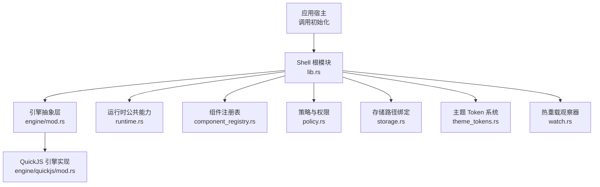
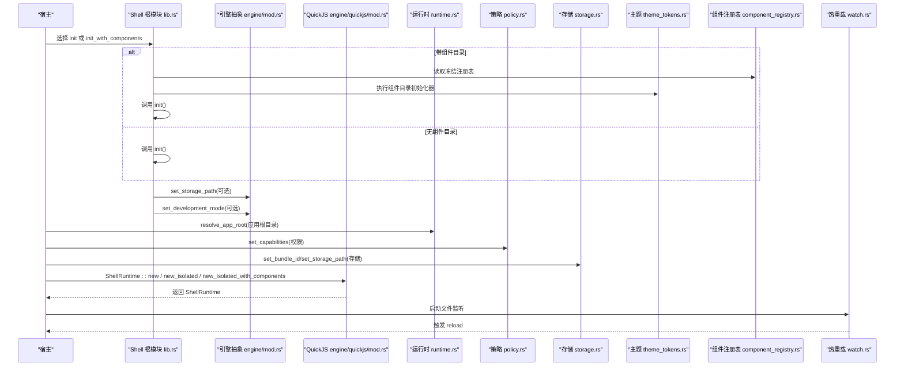
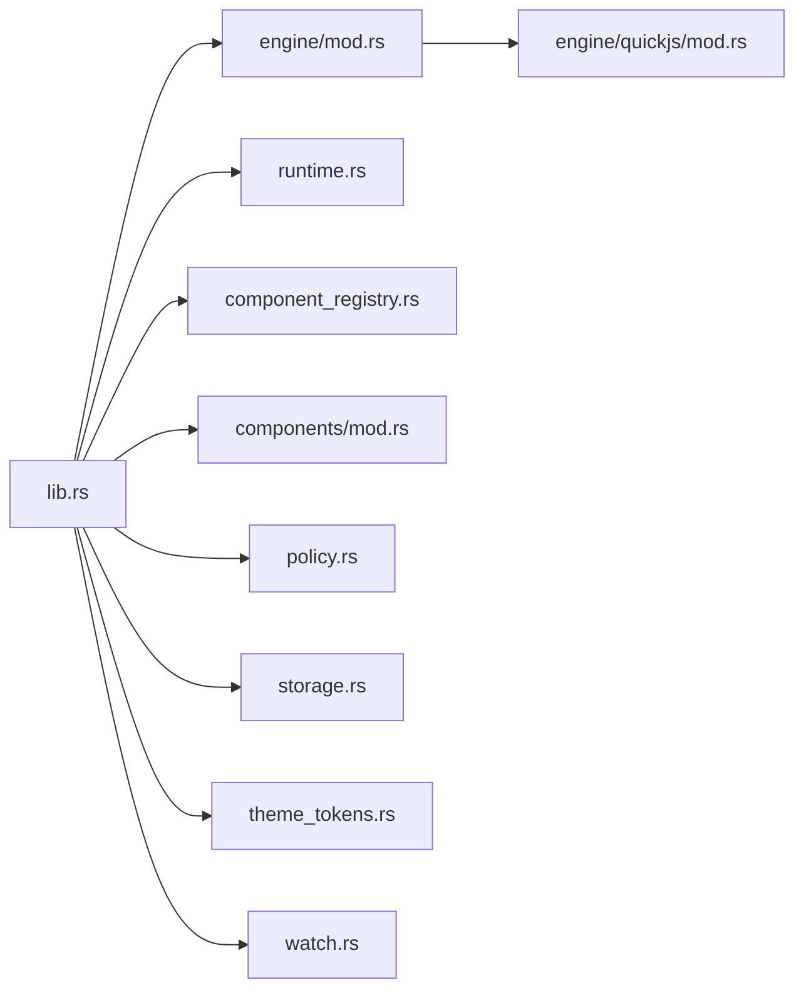

# 引擎初始化

<cite>
**本文引用的文件**   
- [lib.rs](file://crates/shell/src/lib.rs)
- [runtime.rs](file://crates/shell/src/runtime.rs)
- [engine/mod.rs](file://crates/shell/src/engine/mod.rs)
- [engine/quickjs/mod.rs](file://crates/shell/src/engine/quickjs/mod.rs)
- [engine/quickjs/host.rs](file://crates/shell/src/engine/quickjs/host.rs)
- [engine/quickjs/sandbox.rs](file://crates/shell/src/engine/quickjs/sandbox.rs)
- [component_registry.rs](file://crates/shell/src/component_registry.rs)
- [components/mod.rs](file://crates/shell/src/components/mod.rs)
- [policy.rs](file://crates/shell/src/policy.rs)
- [storage.rs](file://crates/shell/src/storage.rs)
- [theme_tokens.rs](file://crates/shell/src/theme_tokens.rs)
- [watch.rs](file://crates/shell/src/watch.rs)
</cite>

## 目录
1. [引言](#引言)
2. [项目结构](#项目结构)
3. [核心组件](#核心组件)
4. [架构总览](#架构总览)
5. [详细组件分析](#详细组件分析)
6. [依赖关系分析](#依赖关系分析)
7. [性能考虑](#性能考虑)
8. [故障排查指南](#故障排查指南)
9. [结论](#结论)

## 引言
本文聚焦于 GPUI Shell 的“引擎初始化”过程，围绕 ShellRuntime 的创建与配置展开，解释以下关键点：
- init() 与 init_with_components() 的区别、调用顺序与适用场景。
- 应用根目录解析、存储路径设置、主题系统初始化与组件注册表加载。
- 开发模式与生产模式的差异，以及热重载机制的工作原理。
- 实际初始化流程的代码级示例（以路径引用形式给出）与错误处理策略。

该文档面向希望理解并正确集成 GPUI Shell 的开发者，既提供高层概览，也深入到关键实现位置，帮助你在不同宿主环境中安全、可维护地启动脚本化应用。

## 项目结构
Shell 的核心初始化入口位于 crate 根模块，引擎抽象在 engine 模块中隔离，QuickJS 具体实现在 engine/quickjs 子模块下。运行时公共能力（如应用根目录解析、数据目录、退出请求等）集中在 runtime 模块；组件注册表、策略、存储、主题 token 与热重载分别由对应模块承担职责。

图表来源
- [lib.rs:279-301](file://crates/shell/src/lib.rs#L279-L301)
- [engine/mod.rs:1-156](file://crates/shell/src/engine/mod.rs#L1-L156)
- [engine/quickjs/mod.rs:1-200](file://crates/shell/src/engine/quickjs/mod.rs#L1-L200)
- [runtime.rs:130-202](file://crates/shell/src/runtime.rs#L130-L202)
- [component_registry.rs:1-120](file://crates/shell/src/component_registry.rs#L1-L120)
- [policy.rs:1-120](file://crates/shell/src/policy.rs#L1-L120)
- [storage.rs:1-120](file://crates/shell/src/storage.rs#L1-L120)
- [theme_tokens.rs:1-120](file://crates/shell/src/theme_tokens.rs#L1-L120)
- [watch.rs:1-120](file://crates/shell/src/watch.rs#L1-L120)

章节来源
- [lib.rs:1-140](file://crates/shell/src/lib.rs#L1-L140)
- [engine/mod.rs:1-156](file://crates/shell/src/engine/mod.rs#L1-L156)

## 核心组件
- ShellRuntime：脚本引擎的统一抽象与对外接口，负责加载应用、实例化视图、构建渲染快照、分发回调等。
- 引擎适配层：engine/mod.rs 暴露 set_storage_path 与 set_development_mode 等主机配置入口，确保引擎必须实现这些能力，避免静默失败。
- QuickJS 实现：engine/quickjs 提供具体 JS 引擎集成，包括沙箱、宿主 API、主题 API、窗口 API、调度器等。
- 运行时公共能力：runtime.rs 提供应用根目录解析、数据目录定位、身份校验、错误横幅与覆盖层等。
- 组件注册表：component_registry.rs 管理组件描述符、状态与方法、材料化器，并提供冻结后的只读注册表供初始化使用。
- 策略与权限：policy.rs 控制脚本能力（文件系统、网络、剪贴板等），默认策略在宿主侧注入。
- 存储路径：storage.rs 将 localStorage 指向持久化文件，配合 set_bundle_id 或 set_storage_path 完成数据落盘。
- 主题系统：theme_tokens.rs 与 theme API 协同，提供语义化颜色与样式 token。
- 热重载：watch.rs 监听源文件变更，触发重新加载与应用版本切换。

章节来源
- [engine/mod.rs:1-156](file://crates/shell/src/engine/mod.rs#L1-L156)
- [engine/quickjs/mod.rs:1-200](file://crates/shell/src/engine/quickjs/mod.rs#L1-L200)
- [runtime.rs:1-202](file://crates/shell/src/runtime.rs#L1-L202)
- [component_registry.rs:1-120](file://crates/shell/src/component_registry.rs#L1-L120)
- [policy.rs:1-120](file://crates/shell/src/policy.rs#L1-L120)
- [storage.rs:1-120](file://crates/shell/src/storage.rs#L1-L120)
- [theme_tokens.rs:1-120](file://crates/shell/src/theme_tokens.rs#L1-L120)
- [watch.rs:1-120](file://crates/shell/src/watch.rs#L1-L120)

## 架构总览
Shell 的初始化遵循“先基础环境，再组件生态，最后引擎运行态”的顺序。宿主首先选择是否启用组件目录，然后设置应用标识与存储路径，随后根据环境开启开发模式，最终通过 ShellRuntime 加载应用并进入热重载循环。

图表来源
- [lib.rs:279-301](file://crates/shell/src/lib.rs#L279-L301)
- [engine/mod.rs:140-156](file://crates/shell/src/engine/mod.rs#L140-L156)
- [runtime.rs:130-202](file://crates/shell/src/runtime.rs#L130-L202)
- [component_registry.rs:1-120](file://crates/shell/src/component_registry.rs#L1-L120)
- [components/mod.rs:60-80](file://crates/shell/src/components/mod.rs#L60-L80)
- [watch.rs:1-120](file://crates/shell/src/watch.rs#L1-L120)

## 详细组件分析

### 初始化入口：init() 与 init_with_components()
- init(cx)：仅初始化基础层与样式反射表，适合裸运行时或不需要组件目录的场景。
- init_with_components(cx, components)：先执行组件目录的初始化器（若存在），再调用 init(cx)。适用于需要预装组件全局状态、主题扩展或类型声明生成的宿主。

两者区别与使用场景：
- 当宿主持有 FrozenComponentRegistry 且组件目录包含初始化逻辑时，应使用 init_with_components。
- 当宿主仅需要最小运行时，或自行管理组件生命周期时，使用 init 即可。

章节来源
- [lib.rs:279-301](file://crates/shell/src/lib.rs#L279-L301)

### 应用根目录解析
resolve_app_root(path, entry) 负责确定应用根目录：
- 如果 path 是文件，取其父目录作为候选根。
- 如果候选根不存在，直接报错。
- 规范化路径后检查 entry 是否存在；若不存在，生成友好错误信息，提示可能的嵌套应用位置。

典型错误：
- 路径不存在。
- 无法规范化路径。
- 缺少 entry 文件，但发现潜在的应用目录。

章节来源
- [runtime.rs:130-202](file://crates/shell/src/runtime.rs#L130-L202)

### 存储路径设置与数据目录
- set_bundle_id(id)：校验 id 合法性，计算 app_data_dir，设置存储路径为 store.json，并在策略中记录应用标识与数据目录。
- bundle_id_for_path(root)：为没有固定 bundle id 的开发目录生成稳定标识（基于目录名与路径摘要）。
- set_storage_path(path)：将 localStorage 指向指定文件，供测试或自定义布局使用。

数据目录规则：
- macOS：~/Library/Application Support/gpui-shell/apps/<id>
- Windows：%APPDATA%/gpui-shell/apps/<id>
- Linux：~/.local/share/gpui-shell/apps/<id>
- 可通过 XDG_DATA_HOME 覆盖。

章节来源
- [lib.rs:203-269](file://crates/shell/src/lib.rs#L203-L269)
- [runtime.rs:30-117](file://crates/shell/src/runtime.rs#L30-L117)
- [storage.rs:1-120](file://crates/shell/src/storage.rs#L1-L120)

### 主题系统初始化
- init() 会调用 style::init()，建立样式反射表。
- 组件目录可能通过初始化器安装主题扩展、token 映射或 UI 行为。
- theme_tokens.rs 提供语义化 token，配合主题 JSON 文件进行渲染。

章节来源
- [lib.rs:279-288](file://crates/shell/src/lib.rs#L279-L288)
- [theme_tokens.rs:1-120](file://crates/shell/src/theme_tokens.rs#L1-L120)

### 组件注册表加载
- FrozenComponentRegistry：冻结后的只读注册表，供 init_with_components 使用。
- ComponentRegistry：构建阶段的可变注册表，支持 with_initializer 注册初始化函数。
- components/mod.rs：提供 new_isolated_runtime 等便捷方法，内部使用 new_isolated_with_components 加载内置组件。

章节来源
- [component_registry.rs:1-120](file://crates/shell/src/component_registry.rs#L1-L120)
- [components/mod.rs:60-80](file://crates/shell/src/components/mod.rs#L60-L80)

### 引擎创建与配置：ShellRuntime
- engine/mod.rs 暴露 set_storage_path 与 set_development_mode，强制引擎实现这些能力。
- QuickJS 实现位于 engine/quickjs/mod.rs，提供 ShellRuntime 的具体构造与生命周期管理。
- 常见构造方式：
  - new：普通实例化。
  - new_isolated：隔离实例，用于测试或多应用隔离。
  - new_isolated_with_components：隔离实例并加载组件注册表。

章节来源
- [engine/mod.rs:140-156](file://crates/shell/src/engine/mod.rs#L140-L156)
- [engine/quickjs/mod.rs:1-200](file://crates/shell/src/engine/quickjs/mod.rs#L1-L200)

### 开发模式与生产模式
- set_development_mode(true)：放宽沙箱限制，允许 eval、解冻内置原型，便于 REPL 与调试。
- set_development_mode(false)：严格沙箱，禁止危险操作，适合发布产品。

章节来源
- [engine/mod.rs:151-156](file://crates/shell/src/engine/mod.rs#L151-L156)
- [engine/quickjs/sandbox.rs:1-120](file://crates/shell/src/engine/quickjs/sandbox.rs#L1-L120)

### 热重载机制
- watch.rs：监听应用源文件变化，触发重新加载。
- 重新加载流程：
  - 检测到变更。
  - 构建新的 ApplicationGeneration。
  - 替换当前视图对象，保留策略与宿主配置。
  - 若新视图渲染失败，回滚到上一代并保持界面可用。

章节来源
- [watch.rs:1-120](file://crates/shell/src/watch.rs#L1-L120)
- [runtime.rs:204-234](file://crates/shell/src/runtime.rs#L204-L234)

### 错误处理策略
- 渲染失败：error_banner/error_overlay/failure_surface 提供用户可见的错误横幅与覆盖层，折叠堆栈，支持复制。
- 应用根目录解析失败：missing_entry_message 提供友好提示，列出可能的嵌套应用。
- 回调注册异常：CallbackArena 保证只在构建期间注册，否则记录错误并返回无效 ID。

章节来源
- [runtime.rs:512-800](file://crates/shell/src/runtime.rs#L512-L800)
- [runtime.rs:159-202](file://crates/shell/src/runtime.rs#L159-L202)
- [runtime.rs:396-411](file://crates/shell/src/runtime.rs#L396-L411)

## 依赖关系分析
初始化阶段的依赖关系如下：
- lib.rs 依赖 engine/mod.rs 暴露的主机配置接口。
- engine/mod.rs 委托 quickjs 实现具体引擎。
- runtime.rs 提供路径与数据目录工具，被 lib.rs 与 host 层调用。
- component_registry.rs 与 components/mod.rs 提供组件生态初始化。
- policy.rs 与 storage.rs 分别管理权限与存储。
- theme_tokens.rs 与样式系统协同。
- watch.rs 在应用加载后启动，驱动热重载。

图表来源
- [lib.rs:279-301](file://crates/shell/src/lib.rs#L279-L301)
- [engine/mod.rs:140-156](file://crates/shell/src/engine/mod.rs#L140-L156)
- [engine/quickjs/mod.rs:1-200](file://crates/shell/src/engine/quickjs/mod.rs#L1-L200)
- [runtime.rs:130-202](file://crates/shell/src/runtime.rs#L130-L202)
- [component_registry.rs:1-120](file://crates/shell/src/component_registry.rs#L1-L120)
- [components/mod.rs:60-80](file://crates/shell/src/components/mod.rs#L60-L80)
- [policy.rs:1-120](file://crates/shell/src/policy.rs#L1-L120)
- [storage.rs:1-120](file://crates/shell/src/storage.rs#L1-L120)
- [theme_tokens.rs:1-120](file://crates/shell/src/theme_tokens.rs#L1-L120)
- [watch.rs:1-120](file://crates/shell/src/watch.rs#L1-L120)

章节来源
- [lib.rs:1-140](file://crates/shell/src/lib.rs#L1-L140)
- [engine/mod.rs:1-156](file://crates/shell/src/engine/mod.rs#L1-L156)

## 性能考虑
- 渲染频率约束：build_snapshot 是唯一进入脚本 render 的入口，避免每帧触发脚本渲染，防止占用 GPUI 帧预算。
- 虚拟列表例外：render_virtual_items 与 item_keys 在布局阶段运行，属于窄范围例外，不进入脚本 render，不影响计数器。
- 回调区域：CallbackArena 按代次组织回调，避免线性查找，提升回调分发性能。
- 存储与主题：一次性初始化，避免重复 IO 与反射开销。

章节来源
- [engine/mod.rs:70-119](file://crates/shell/src/engine/mod.rs#L70-L119)
- [runtime.rs:292-442](file://crates/shell/src/runtime.rs#L292-L442)

## 故障排查指南
常见问题与处理建议：
- 应用根目录找不到 entry 文件：
  - 检查路径是否为文件或目录。
  - 确认 entry 文件名与导出类是否正确。
  - 参考 missing_entry_message 提供的候选目录。
- 存储路径未生效：
  - 确认是否调用了 set_bundle_id 或 set_storage_path。
  - 检查 XDG_DATA_HOME 或平台默认路径是否可写。
- 开发模式未生效：
  - 确认是否在加载应用前调用 set_development_mode(true)。
  - 检查引擎是否实现了 set_development_mode。
- 热重载不触发：
  - 确认 watch.rs 已启动并监听正确路径。
  - 检查文件变更事件是否被系统过滤。
- 渲染失败：
  - 查看 error_banner 或 failure_surface 输出的错误横幅。
  - 复制堆栈信息进行调试。

章节来源
- [runtime.rs:130-202](file://crates/shell/src/runtime.rs#L130-L202)
- [runtime.rs:512-800](file://crates/shell/src/runtime.rs#L512-L800)
- [engine/mod.rs:140-156](file://crates/shell/src/engine/mod.rs#L140-L156)
- [watch.rs:1-120](file://crates/shell/src/watch.rs#L1-L120)

## 结论
GPUI Shell 的引擎初始化通过清晰的层次划分与严格的契约边界，确保脚本引擎的选择不会影响上层逻辑。init 与 init_with_components 提供了灵活的基础与环境准备；应用根目录解析、存储路径设置、主题系统与组件注册表共同构成稳定的运行基座；开发模式与热重载机制则提升了开发与迭代效率。按照本文的流程与注意事项，你可以在不同宿主环境中安全、可靠地启动脚本化应用。