# 插件系统

<cite>
**本文引用的文件**   
- [gpui-shell.md](file://docs/gpui-shell.md)
- [shell/lib.rs](file://crates/shell/src/lib.rs)
- [shell/plugin.rs](file://crates/shell/src/plugin.rs)
- [shell/dependencies.rs](file://crates/shell/src/dependencies.rs)
- [shell/host_modules.rs](file://crates/shell/src/host_modules.rs)
- [shell/component_registry.rs](file://crates/shell/src/component_registry.rs)
- [shell/typings.rs](file://crates/shell/src/typings.rs)
- [shell/spec.rs](file://crates/shell/src/spec.rs)
- [shell/materialize.rs](file://crates/shell/src/materialize.rs)
- [shell/view.rs](file://crates/shell/src/view.rs)
- [shell/runtime.rs](file://crates/shell/src/runtime.rs)
- [shell/capability.rs](file://crates/shell/src/capability.rs)
- [shell/scope.rs](file://crates/shell/src/scope.rs)
- [shell/assets.rs](file://crates/shell/src/assets.rs)
- [shell/watch.rs](file://crates/shell/src/watch.rs)
- [shell/error.rs](file://crates/shell/src/error.rs)
- [shell/value.rs](file://crates/shell/src/value.rs)
- [shell/entities.rs](file://crates/shell/src/entities.rs)
- [shell/root.rs](file://crates/shell/src/root.rs)
- [shell/dock.rs](file://crates/shell/src/dock.rs)
- [shell/default-tokens.json](file://crates/shell/src/default-tokens.json)
- [shell/component-inventory.json](file://crates/shell/component-inventory.json)
</cite>

## 目录
1. [简介](#简介)
2. [项目结构](#项目结构)
3. [核心组件](#核心组件)
4. [架构总览](#架构总览)
5. [详细组件分析](#详细组件分析)
6. [依赖与版本管理](#依赖与版本管理)
7. [插件清单与加载流程](#插件清单与加载流程)
8. [类型声明生成与组件注册](#类型声明生成与组件注册)
9. [本地开发与调试](#本地开发与调试)
10. [发布与分发](#发布与分发)
11. [性能与可观测性](#性能与可观测性)
12. [故障排查](#故障排查)
13. [最佳实践](#最佳实践)
14. [结论](#结论)

## 简介
本文件面向“插件系统”的完整说明，围绕 GPUI Shell 的脚本运行时、能力门控、模块解析、类型声明生成、组件注册以及插件生命周期展开。文档将解释：
- 插件清单文件格式（基于仓库现有实现与约定）
- 依赖管理与 Git 依赖支持
- 版本兼容性检查与能力边界
- 插件加载流程：模块解析、类型声明生成、组件注册
- 本地开发、调试与热重载
- 打包、发布与常见问题

需要特别说明的是：当前仓库中的插件系统处于“已构建但未完全对外暴露”的状态——多插件管理器与 CLI 的多插件加载路径尚未在宿主入口中启用；但插件运行时模型（清单、发现、隔离策略、存储、加载与卸载）已在 `crates/shell` 内实现。

**章节来源**
- [gpui-shell.md:10-57](file://docs/gpui-shell.md#L10-L57)

## 项目结构
GPUI Shell 位于 `crates/shell`，其职责是提供脚本运行时、绑定层、能力系统与命令行宿主。与插件相关的关键位置包括：
- 插件与宿主接口：`plugin.rs`、`host_modules.rs`
- 依赖与模块解析：`dependencies.rs`、`assets.rs`
- 组件注册与目录：`component_registry.rs`、`component-inventory.json`
- 类型声明生成：`typings.rs`
- 渲染协议与快照：`spec.rs`、`materialize.rs`、`view.rs`
- 运行时与沙箱：`runtime.rs`、`capability.rs`、`scope.rs`
- 主题与默认调色板：`default-tokens.json`
- 错误与值转换：`error.rs`、`value.rs`
- 实体与根视图：`entities.rs`、`root.rs`
- Dock 面板与脚本面板：`dock.rs`

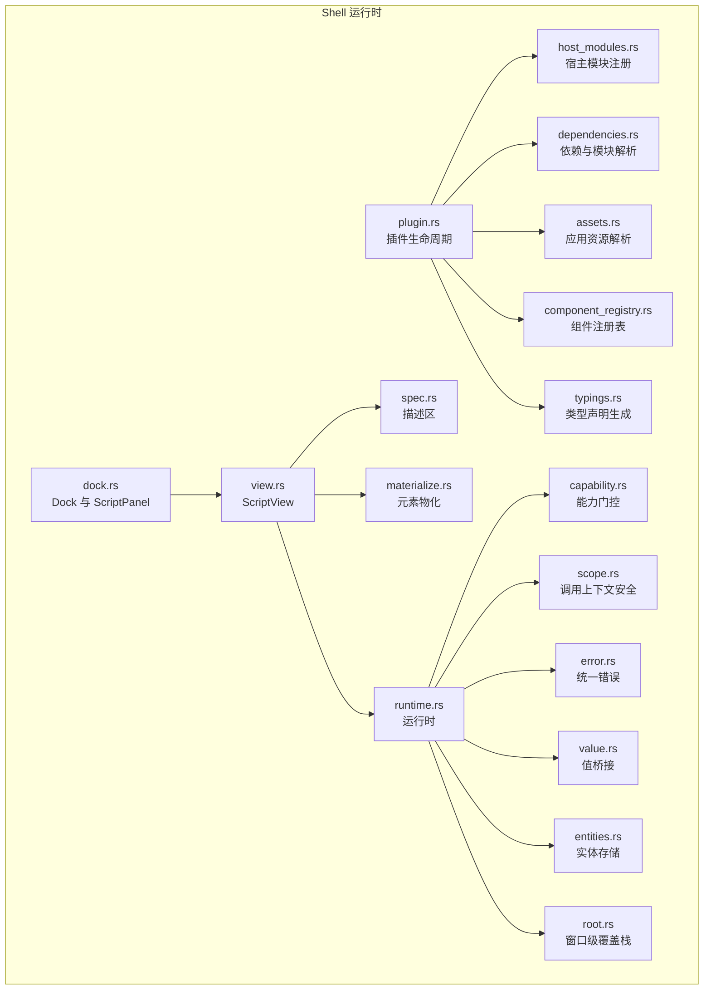

**图表来源**
- [shell/plugin.rs](file://crates/shell/src/plugin.rs)
- [shell/host_modules.rs](file://crates/shell/src/host_modules.rs)
- [shell/dependencies.rs](file://crates/shell/src/dependencies.rs)
- [shell/assets.rs](file://crates/shell/src/assets.rs)
- [shell/component_registry.rs](file://crates/shell/src/component_registry.rs)
- [shell/typings.rs](file://crates/shell/src/typings.rs)
- [shell/spec.rs](file://crates/shell/src/spec.rs)
- [shell/materialize.rs](file://crates/shell/src/materialize.rs)
- [shell/view.rs](file://crates/shell/src/view.rs)
- [shell/runtime.rs](file://crates/shell/src/runtime.rs)
- [shell/capability.rs](file://crates/shell/src/capability.rs)
- [shell/scope.rs](file://crates/shell/src/scope.rs)
- [shell/error.rs](file://crates/shell/src/error.rs)
- [shell/value.rs](file://crates/shell/src/value.rs)
- [shell/entities.rs](file://crates/shell/src/entities.rs)
- [shell/root.rs](file://crates/shell/src/root.rs)
- [shell/dock.rs](file://crates/shell/src/dock.rs)

**章节来源**
- [gpui-shell.md:378-403](file://docs/gpui-shell.md#L378-L403)

## 核心组件
- 插件生命周期：负责插件发现、清单校验、依赖安装、模块加载、初始化、运行与卸载。
- 宿主模块注册：为脚本暴露稳定的 Rust API，如文件系统、进程、网络、剪贴板等。
- 依赖与模块解析：处理标准模块、应用目录模块与 Git 依赖。
- 组件注册表：维护组件描述符、参数模式、文档与 TypeScript 类型。
- 类型声明生成：从运行时调度表生成 `gpui-kit.d.ts`。
- 渲染协议：描述区、快照、物化与回调生命周期。
- 能力门控：以最小权限原则控制脚本对系统资源的访问。
- 调用上下文安全：防止跨帧借用与非法状态变更。
- 值桥接与错误：统一脚本与 Rust 之间的值与异常。
- 实体与根视图：保留状态、窗口覆盖栈与根视图挂载。
- Dock 与脚本面板：允许脚本作为面板参与布局与持久化。

**章节来源**
- [gpui-shell.md:378-403](file://docs/gpui-shell.md#L378-L403)
- [gpui-shell.md:590-743](file://docs/gpui-shell.md#L590-L743)

## 架构总览
GPUI Shell 将脚本运行时置于 `gpui-base` 之上，脚本拥有呈现与组合权，Rust 负责元素模型、布局、文本输入、覆盖栈、主题令牌与能力门控。

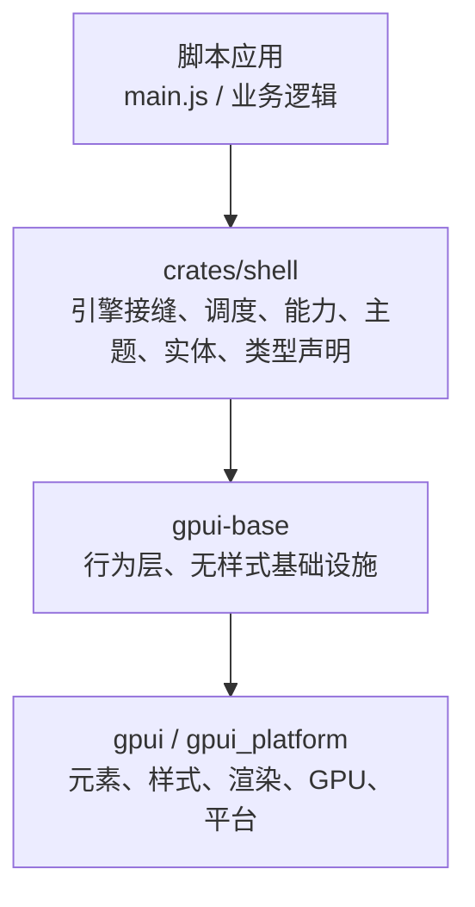

**图表来源**
- [gpui-shell.md:214-236](file://docs/gpui-shell.md#L214-L236)

**章节来源**
- [gpui-shell.md:214-236](file://docs/gpui-shell.md#L214-L236)

## 详细组件分析

### 插件生命周期与加载流程
插件加载的核心步骤包括：
1. 发现插件目录并读取清单。
2. 校验清单字段、依赖与能力。
3. 安装依赖（含 Git 依赖）。
4. 解析模块（标准模块、应用目录模块、Git 依赖模块）。
5. 初始化插件并注册宿主模块与组件。
6. 执行入口（通常为 `main.js`），挂载根视图。
7. 运行期间响应事件、异步任务与热重载。
8. 卸载时清理回调、任务、实体与缓存。

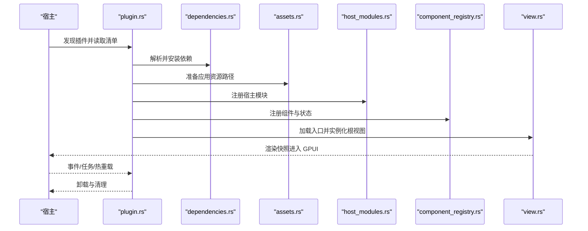

**图表来源**
- [shell/plugin.rs](file://crates/shell/src/plugin.rs)
- [shell/dependencies.rs](file://crates/shell/src/dependencies.rs)
- [shell/assets.rs](file://crates/shell/src/assets.rs)
- [shell/host_modules.rs](file://crates/shell/src/host_modules.rs)
- [shell/component_registry.rs](file://crates/shell/src/component_registry.rs)
- [shell/view.rs](file://crates/shell/src/view.rs)

**章节来源**
- [gpui-shell.md:590-743](file://docs/gpui-shell.md#L590-L743)
- [gpui-shell.md:635-639](file://docs/gpui-shell.md#L635-L639)

### 模块解析与依赖管理
- 标准模块：如 `buffer`、`path`、`url`、`crypto`、`zlib`、`console`、`process`、`fs/promises`、`net`、`websocket.WebSocket` 等由 Standard Runtime 提供。
- 应用目录模块：除标准模块外的 bare import 会在应用目录内解析。
- Git 依赖：通过依赖解析器安装并纳入模块解析范围。
- 模块大小限制：每个源模块在进入 QuickJS 前限制为 8 MiB。

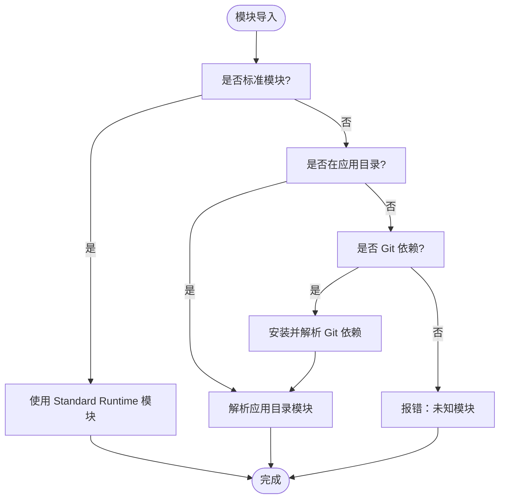

**图表来源**
- [gpui-shell.md:85-113](file://docs/gpui-shell.md#L85-L113)
- [shell/dependencies.rs](file://crates/shell/src/dependencies.rs)
- [shell/assets.rs](file://crates/shell/src/assets.rs)

**章节来源**
- [gpui-shell.md:85-113](file://docs/gpui-shell.md#L85-L113)
- [gpui-shell.md:635-639](file://docs/gpui-shell.md#L635-L639)

### 类型声明生成
类型声明由 `typings.rs` 生成，输出 `gpui-kit.d.ts`，保证：
- 风格方法来自反射表，避免手写漂移。
- 参数类型通过探针决定，确保 TypeScript 与运行时一致。
- 颜色令牌来自主题命名集合。
- 阶段联合来自 `ScopePhase`。
- 生成的声明包含能力、元素生命周期、组件目录等元信息。

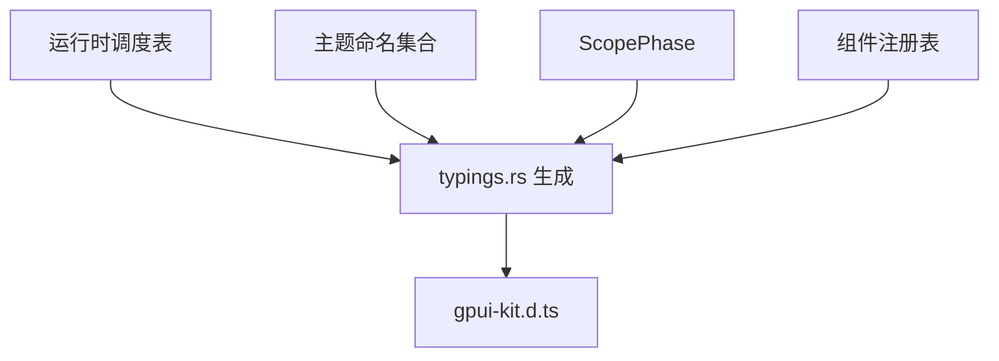

**图表来源**
- [shell/typings.rs](file://crates/shell/src/typings.rs)
- [gpui-shell.md:2043-2091](file://docs/gpui-shell.md#L2043-L2091)

**章节来源**
- [gpui-shell.md:2043-2091](file://docs/gpui-shell.md#L2043-L2091)

### 组件注册与目录
组件注册表维护：
- 组件描述符：名称、构造器、方法、文档。
- 参数模式：字符串、数字、布尔、元素、实体、回调、枚举、数组、可选。
- 生成 TypeScript 类型与文档。
- 保留状态：工厂返回原生实体或输入状态，脚本持有冻结句柄。
- 效果：应用级与窗口级副作用的生命周期管理。

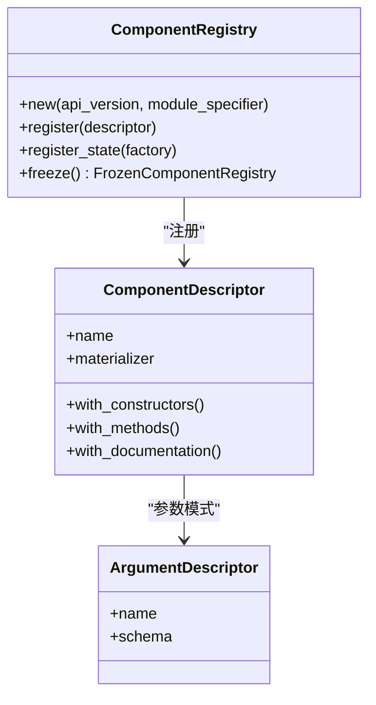

**图表来源**
- [shell/component_registry.rs](file://crates/shell/src/component_registry.rs)
- [gpui-shell.md:2137-2275](file://docs/gpui-shell.md#L2137-L2275)

**章节来源**
- [gpui-shell.md:2137-2275](file://docs/gpui-shell.md#L2137-L2275)

### 渲染协议与快照
渲染协议强调：
- 元素是消耗值，不能复用。
- 描述区保存节点、操作与子节点。
- 快照一次构建，多次回放。
- 失败构建不污染已发布快照。
- 物化为纯 Rust 深度优先遍历。

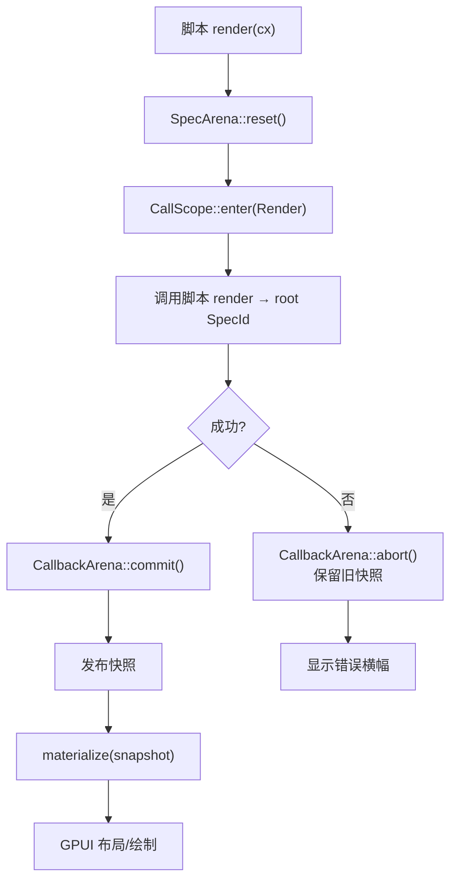

**图表来源**
- [shell/spec.rs](file://crates/shell/src/spec.rs)
- [shell/materialize.rs](file://crates/shell/src/materialize.rs)
- [shell/view.rs](file://crates/shell/src/view.rs)
- [gpui-shell.md:995-1075](file://docs/gpui-shell.md#L995-L1075)

**章节来源**
- [gpui-shell.md:880-1203](file://docs/gpui-shell.md#L880-L1203)

### 能力门控与调用上下文安全
- 能力集默认为空，所有能力需显式授予。
- 文件系统、进程、网络、WebSocket、剪贴板等受能力门控。
- 调用上下文分阶段：Render、Event、Task、Layout，各阶段允许与拒绝不同操作。
- 防止跨帧借用与非法状态变更。

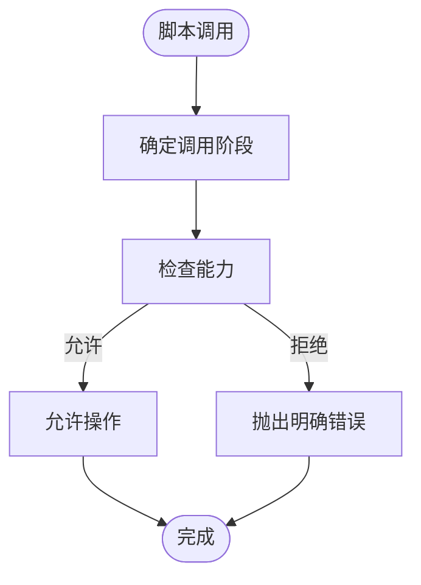

**图表来源**
- [shell/capability.rs](file://crates/shell/src/capability.rs)
- [shell/scope.rs](file://crates/shell/src/scope.rs)
- [gpui-shell.md:1206-1313](file://docs/gpui-shell.md#L1206-L1313)

**章节来源**
- [gpui-shell.md:1206-1313](file://docs/gpui-shell.md#L1206-L1313)

### Dock 与脚本面板
- `ScriptPanel` 将脚本视图作为面板主体。
- `ScriptDockSkin` 提供外观与回调。
- 面板布局、拖拽、调整大小与持久化由 base 提供，脚本负责呈现。
- 命令而非回调用于 chrome 交互，避免生命周期问题。

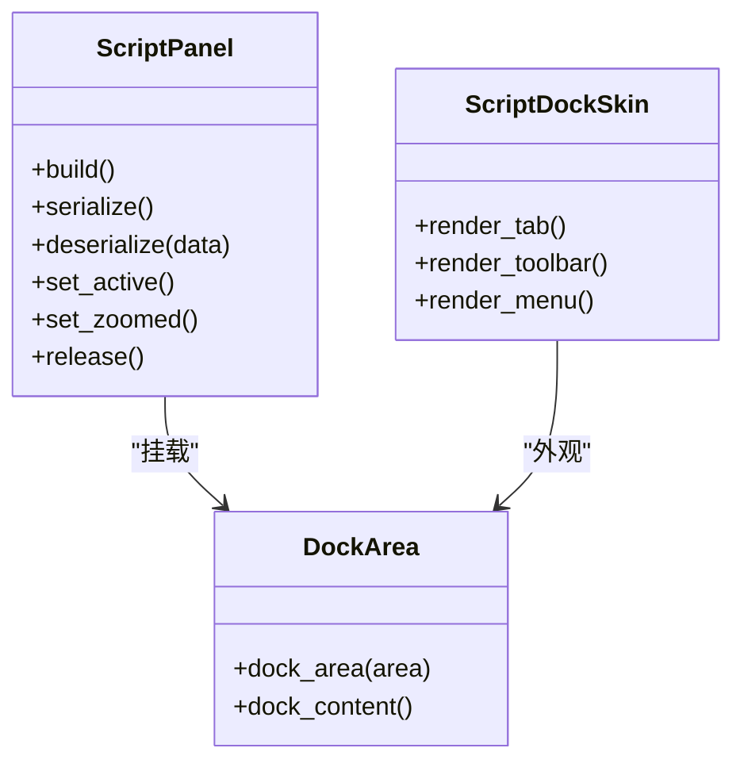

**图表来源**
- [shell/dock.rs](file://crates/shell/src/dock.rs)
- [gpui-shell.md:2314-2400](file://docs/gpui-shell.md#L2314-L2400)

**章节来源**
- [gpui-shell.md:2314-2400](file://docs/gpui-shell.md#L2314-L2400)

## 依赖与版本管理
- 标准模块由 Standard Runtime 提供，不依赖外部 Node.js 或浏览器环境。
- 应用目录模块通过应用路径解析。
- Git 依赖通过依赖解析器安装，纳入模块解析。
- 模块大小限制为 8 MiB。
- 版本兼容性通过能力门控与组件注册表的 API 版本约束。

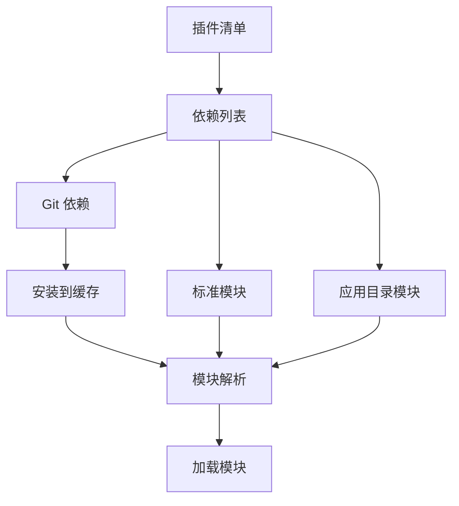

**图表来源**
- [shell/dependencies.rs](file://crates/shell/src/dependencies.rs)
- [shell/assets.rs](file://crates/shell/src/assets.rs)
- [gpui-shell.md:85-113](file://docs/gpui-shell.md#L85-L113)

**章节来源**
- [gpui-shell.md:85-113](file://docs/gpui-shell.md#L85-L113)
- [gpui-shell.md:635-639](file://docs/gpui-shell.md#L635-L639)

## 插件清单与加载流程
插件清单应包含：
- 插件标识与版本
- 入口文件（例如 `main.js`）
- 依赖列表（标准模块、应用目录模块、Git 依赖）
- 能力请求（文件系统、网络、进程等）
- 组件注册信息（组件名、导出、文档）
- 主题与资源路径

加载流程：
1. 读取清单并校验字段。
2. 安装依赖。
3. 解析模块。
4. 注册宿主模块与组件。
5. 初始化插件并挂载根视图。
6. 运行与热重载。
7. 卸载与清理。

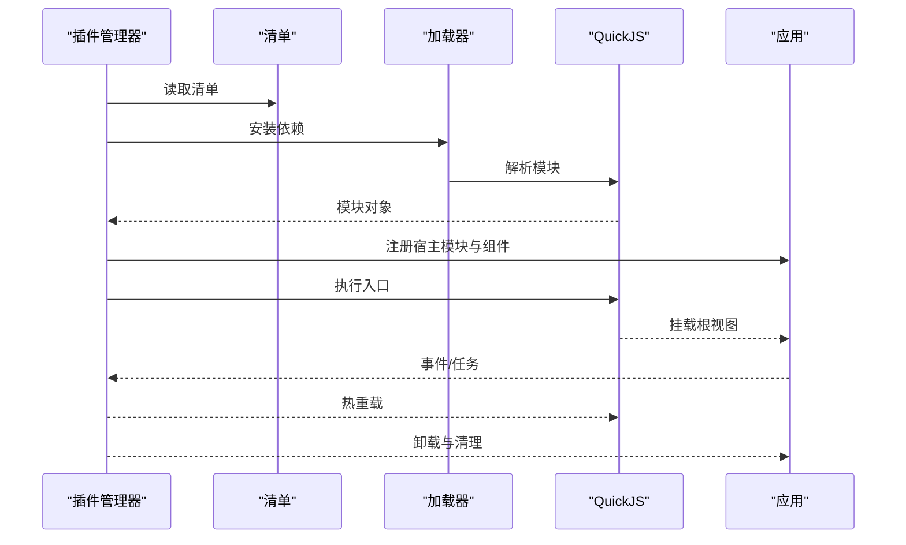

**图表来源**
- [shell/plugin.rs](file://crates/shell/src/plugin.rs)
- [shell/dependencies.rs](file://crates/shell/src/dependencies.rs)
- [shell/host_modules.rs](file://crates/shell/src/host_modules.rs)
- [shell/view.rs](file://crates/shell/src/view.rs)

**章节来源**
- [gpui-shell.md:590-743](file://docs/gpui-shell.md#L590-L743)

## 类型声明生成与组件注册
类型声明生成与组件注册紧密耦合：
- 组件描述符定义参数模式与文档。
- 类型声明从运行时调度表生成，确保一致性。
- 组件注册表冻结后不可修改，保证线程安全与共享。
- 保留状态通过句柄传递，防止伪造与泄漏。

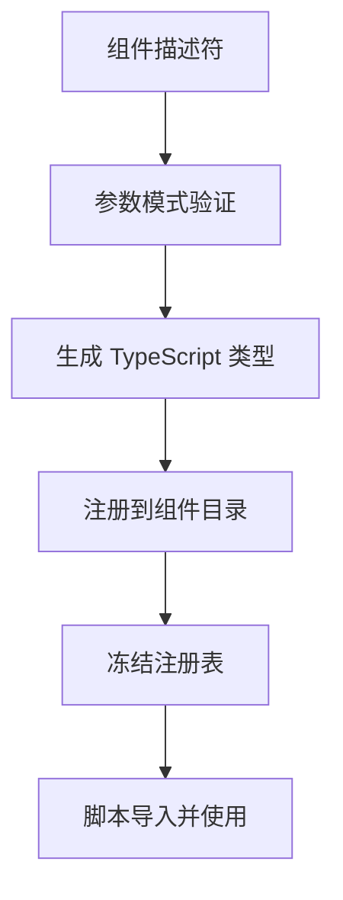

**图表来源**
- [shell/component_registry.rs](file://crates/shell/src/component_registry.rs)
- [shell/typings.rs](file://crates/shell/src/typings.rs)
- [gpui-shell.md:2137-2275](file://docs/gpui-shell.md#L2137-L2275)

**章节来源**
- [gpui-shell.md:2137-2275](file://docs/gpui-shell.md#L2137-L2275)

## 本地开发与调试
- 使用 `cargo run -p gpui-shell -- run <应用目录>` 启动示例应用。
- 利用 `cx.notify()` 触发重绘，避免在 render 阶段直接修改状态。
- 使用 `// @ts-check` 与生成的 `gpui-kit.d.ts` 进行类型检查。
- 通过错误横幅与日志定位脚本错误。
- 热重载保持窗口、焦点与元素身份不变。

**章节来源**
- [gpui-shell.md:24-32](file://docs/gpui-shell.md#L24-L32)
- [gpui-shell.md:1076-1095](file://docs/gpui-shell.md#L1076-L1095)
- [gpui-shell.md:2043-2091](file://docs/gpui-shell.md#L2043-L2091)

## 发布与分发
- 插件打包为应用目录，包含清单、入口文件、依赖与资源。
- 使用 `gpui-shell types <目录>` 生成类型声明。
- 通过能力门控限制插件权限。
- 发布前校验清单、依赖与类型声明一致性。

**章节来源**
- [gpui-shell.md:2043-2091](file://docs/gpui-shell.md#L2043-L2091)

## 性能与可观测性
- 描述缓存减少脚本渲染成本。
- 物化为纯 Rust 操作，避免每帧进入 VM。
- 回调按快照生命周期管理，避免内存泄漏。
- 未实现 GC 统计，需通过内存观察发现缓慢泄漏。

**章节来源**
- [gpui-shell.md:1191-1203](file://docs/gpui-shell.md#L1191-L1203)
- [gpui-shell.md:875-877](file://docs/gpui-shell.md#L875-L877)

## 故障排查
常见问题与解决方案：
- 未知模块：检查标准模块、应用目录与 Git 依赖配置。
- 元素复用错误：确保每次 render 重建元素。
- 回调失效：确认回调属于当前快照且未被废弃。
- 能力不足：检查能力授予与权限配置。
- 主题颜色透明：确保安装默认调色板或提供主题。

**章节来源**
- [gpui-shell.md:85-113](file://docs/gpui-shell.md#L85-L113)
- [gpui-shell.md:965-983](file://docs/gpui-shell.md#L965-L983)
- [gpui-shell.md:1335-1354](file://docs/gpui-shell.md#L1335-L1354)
- [gpui-shell.md:1887-1944](file://docs/gpui-shell.md#L1887-L1944)

## 最佳实践
- 项目结构：遵循应用目录规范，清晰分离清单、入口、依赖与资源。
- 命名约定：使用 snake_case 调用宿主 API，camelCase 编写业务逻辑。
- 调试技巧：使用 `// @ts-check`、错误横幅与日志定位问题。
- 性能优化：避免在 render 阶段创建实体或打开覆盖层。
- 安全实践：最小权限原则，仅申请必要能力。

**章节来源**
- [gpui-shell.md:548-583](file://docs/gpui-shell.md#L548-L583)
- [gpui-shell.md:1289-1313](file://docs/gpui-shell.md#L1289-L1313)

## 结论
GPUI Shell 的插件系统提供了脚本驱动的 UI 扩展能力，结合 Rust 的高性能渲染与类型安全的宿主 API。通过清单、依赖管理、能力门控与组件注册，插件可在安全边界内扩展应用功能。尽管多插件管理器尚未完全集成，但插件运行时模型已具备坚实基础，适合内部工具、面板与脚本化界面开发。