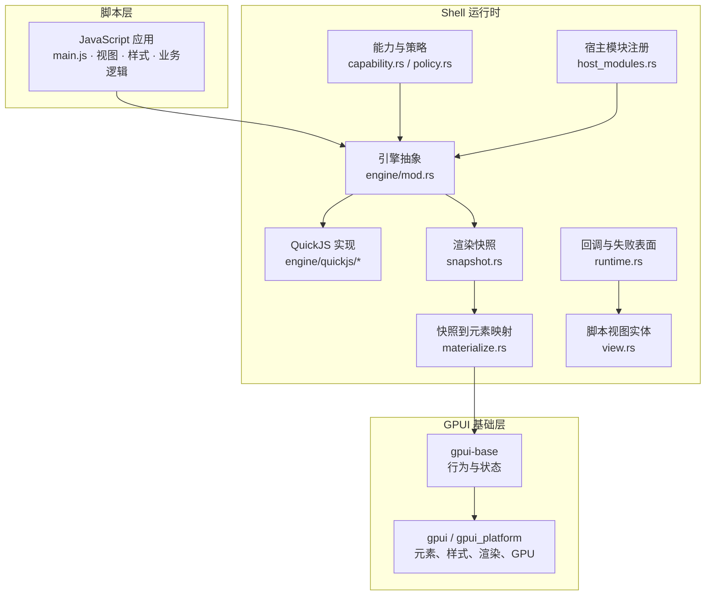
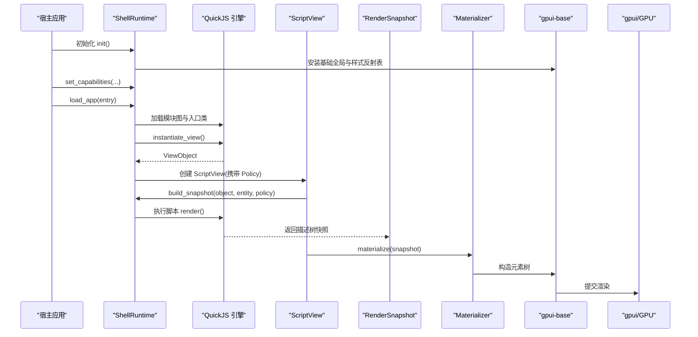
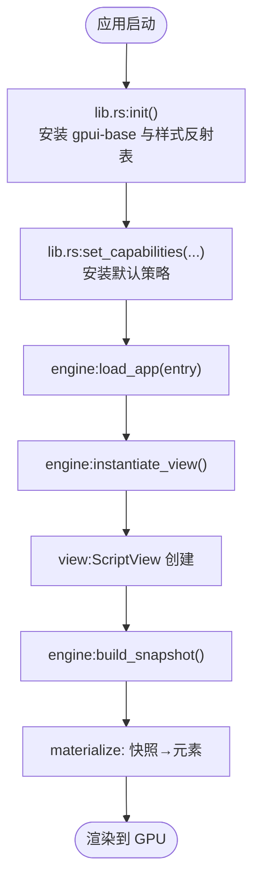
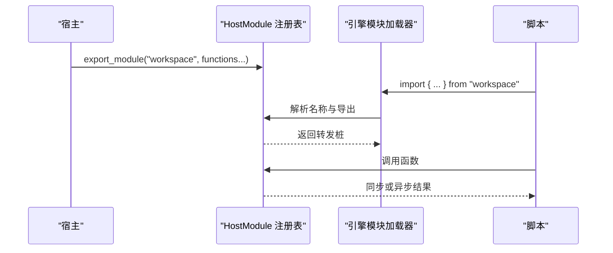
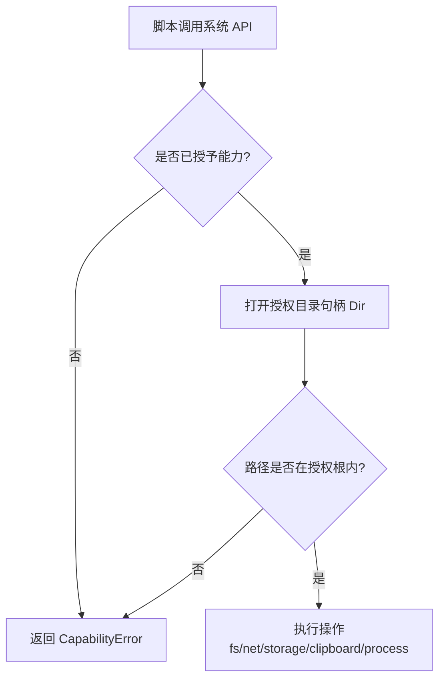
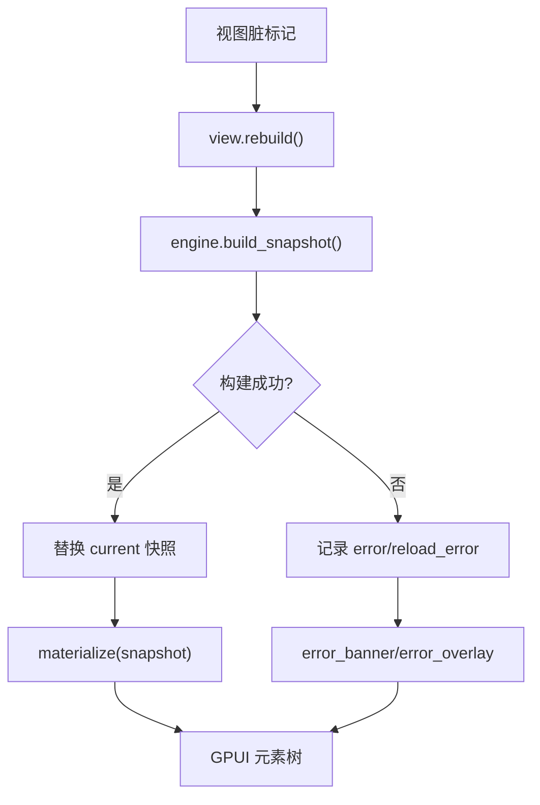
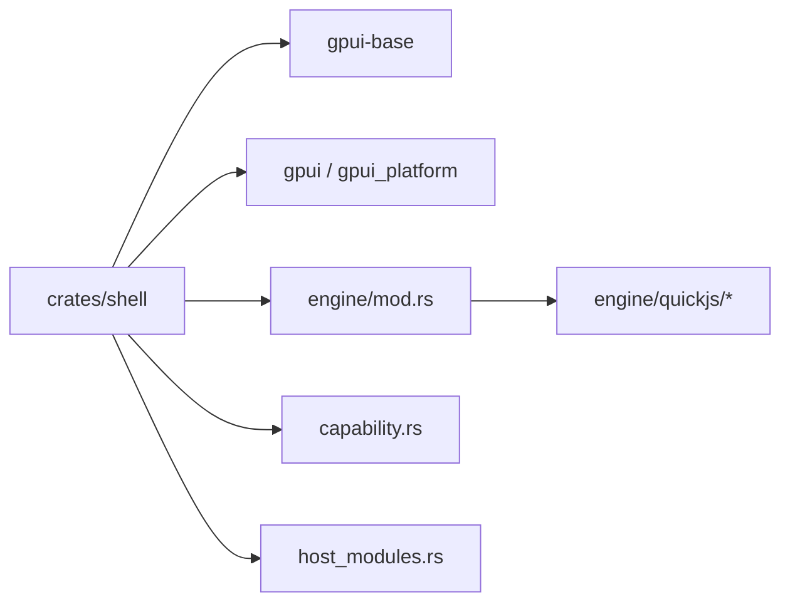

# 架构设计

<cite>
**本文引用的文件**   
- [lib.rs](file://crates/shell/src/lib.rs)
- [engine/mod.rs](file://crates/shell/src/engine/mod.rs)
- [runtime.rs](file://crates/shell/src/runtime.rs)
- [capability.rs](file://crates/shell/src/capability.rs)
- [view.rs](file://crates/shell/src/view.rs)
- [snapshot.rs](file://crates/shell/src/snapshot.rs)
- [materialize.rs](file://crates/shell/src/materialize.rs)
- [host_modules.rs](file://crates/shell/src/host_modules.rs)
- [gpui-shell.md](file://docs/gpui-shell.md)
</cite>

## 目录
1. [引言](#引言)
2. [项目结构](#项目结构)
3. [核心组件](#核心组件)
4. [架构总览](#架构总览)
5. [详细组件分析](#详细组件分析)
6. [依赖关系分析](#依赖关系分析)
7. [性能与资源限制](#性能与资源限制)
8. [故障排查指南](#故障排查指南)
9. [结论](#结论)

## 引言
本文件面向 Shell 运行时与 JavaScript 扩展系统的整体架构，聚焦以下目标：
- 明确 Rust 宿主与 JavaScript 脚本的职责边界：宿主负责渲染、布局、系统能力与沙箱；脚本负责组合、展示与业务逻辑。
- 说明引擎初始化流程、模块加载机制、视图构建与渲染路径。
- 解释能力授予模型、安全边界与资源限制策略。
- 通过架构图表与交互流程图，呈现各层关系和数据流向。

该运行时基于 `gpui-base`，将“应用层 UI”置于脚本侧，Rust 提供元素模型、布局、主题令牌、覆盖层栈与能力门控。脚本以 QuickJS 为默认执行环境，通过稳定的桥接接口访问宿主能力。

**章节来源**
- [gpui-shell.md:10-26](file://docs/gpui-shell.md#L10-L26)
- [gpui-shell.md:36-60](file://docs/gpui-shell.md#L36-L60)

## 项目结构
Shell 运行时位于 `crates/shell`，关键目录与职责如下：
- `engine/`：脚本引擎抽象与具体实现（当前为 QuickJS），封装 VM 生命周期、模块加载、方法派发、回调与异常转换。
- `scope`：调用上下文栈、阶段与生成号检查，保证跨语言调用的安全性。
- `snapshot`：脚本渲染产物——描述树快照，供多个 GPUI 帧复用。
- `spec`：元素描述区、一次性检查与调试树输出。
- `materialize`：纯 Rust 的快照到真实元素的映射，避免在渲染路径回退到脚本。
- `style` / `theme_tokens`：样式反射表、语义令牌解析。
- `capability` / `policy`：能力集、授予策略与路径解析。
- `runtime`：回调存储、失败表面、退出请求处理与应用代际管理。
- `root` / `view`：窗口级覆盖层与脚本视图实体。
- `host_modules`：宿主向脚本暴露的模块注册中心。
- `assets` / `watch` / `typings`：应用资源、热重载与类型声明生成。

**图表来源**
- [engine/mod.rs:1-60](file://crates/shell/src/engine/mod.rs#L1-L60)
- [snapshot.rs:1-25](file://crates/shell/src/snapshot.rs#L1-L25)
- [materialize.rs:1-12](file://crates/shell/src/materialize.rs#L1-L12)
- [capability.rs:1-6](file://crates/shell/src/capability.rs#L1-L6)
- [host_modules.rs:1-10](file://crates/shell/src/host_modules.rs#L1-L10)
- [runtime.rs:1-7](file://crates/shell/src/runtime.rs#L1-L7)
- [view.rs:1-24](file://crates/shell/src/view.rs#L1-L24)

**章节来源**
- [gpui-shell.md:378-406](file://docs/gpui-shell.md#L378-L406)
- [gpui-shell.md:408-447](file://docs/gpui-shell.md#L408-L447)

## 核心组件
- 引擎抽象与 QuickJS 实现：定义 `ShellRuntime`、`ViewType`、`ViewObject` 等句柄，统一加载应用、实例化视图、构建快照、派发事件。
- 渲染快照：脚本一次 `render()` 产出一个不可变描述树，多个 GPUI 帧可重复消费，避免每帧进入 VM。
- 快照物化器：纯 Rust 遍历描述树并构造真实 GPUI 元素，仅在虚拟列表等受限场景下短暂进入 VM。
- 能力与策略：默认空能力集，所有系统能力需显式授予；路径、网络、进程、存储、剪贴板等均有细粒度控制。
- 宿主模块：编译期注册、导入时解析、运行期转发；禁止动态原生扩展加载。
- 视图实体：持有脚本对象、快照、策略、错误与刷新标记，协调重建与错误覆盖。
- 运行时回调与失败表面：按快照代际管理回调生命周期，提供非致命错误界面。

**章节来源**
- [engine/mod.rs:1-119](file://crates/shell/src/engine/mod.rs#L1-L119)
- [snapshot.rs:1-25](file://crates/shell/src/snapshot.rs#L1-L25)
- [materialize.rs:1-63](file://crates/shell/src/materialize.rs#L1-L63)
- [capability.rs:1-6](file://crates/shell/src/capability.rs#L1-L6)
- [host_modules.rs:1-10](file://crates/shell/src/host_modules.rs#L1-L10)
- [view.rs:1-24](file://crates/shell/src/view.rs#L1-L24)
- [runtime.rs:1-7](file://crates/shell/src/runtime.rs#L1-L7)

## 架构总览
Shell 运行时采用“引擎隔离 + 快照驱动 + 能力门控”的分层设计：
- 脚本层只负责组合与展示，不进入布局与绘制路径。
- 引擎层仅暴露最小契约，其余逻辑保持在 Rust 侧。
- 快照作为稳定描述，解耦脚本渲染与 GPUI 重绘。
- 能力与策略决定脚本能访问的系统资源，默认拒绝一切。

**图表来源**
- [lib.rs:279-301](file://crates/shell/src/lib.rs#L279-L301)
- [engine/mod.rs:12-47](file://crates/shell/src/engine/mod.rs#L12-L47)
- [view.rs:242-282](file://crates/shell/src/view.rs#L242-L282)
- [snapshot.rs:1-25](file://crates/shell/src/snapshot.rs#L1-L25)
- [materialize.rs:674-707](file://crates/shell/src/materialize.rs#L674-L707)

**章节来源**
- [gpui-shell.md:214-241](file://docs/gpui-shell.md#L214-L241)
- [gpui-shell.md:590-743](file://docs/gpui-shell.md#L590-L743)

## 详细组件分析

### 引擎抽象与初始化流程
- 引擎契约集中在 `engine/mod.rs`，对外暴露 `ShellRuntime` 及其方法族：加载应用、实例化视图、构建快照、派发事件。
- 初始化由 `lib.rs` 的 `init` 完成：调用 `gpui_base::init`，安装样式反射表，确保首次脚本调用无需额外延迟。
- 引擎选择通过 Cargo feature 锁定，当前唯一实现为 QuickJS；若未启用则编译期报错。

**图表来源**
- [lib.rs:279-301](file://crates/shell/src/lib.rs#L279-L301)
- [engine/mod.rs:12-47](file://crates/shell/src/engine/mod.rs#L12-L47)
- [view.rs:242-282](file://crates/shell/src/view.rs#L242-L282)
- [materialize.rs:674-707](file://crates/shell/src/materialize.rs#L674-L707)

**章节来源**
- [engine/mod.rs:12-119](file://crates/shell/src/engine/mod.rs#L12-L119)
- [lib.rs:279-301](file://crates/shell/src/lib.rs#L279-L301)

### 模块加载机制
- 宿主通过 `export_module` 注册模块名与方法，脚本使用 ES 模块语法导入。
- 模块解析发生在链接阶段，拼写错误在运行前暴露；函数体在每次调用时通过注册表转发。
- 保留命名空间（如 `gpui-kit`、`fs/promises`）禁止被宿主覆盖，避免静默失效。
- 异步宿主函数分为主线程参数校验与后台执行两部分，避免阻塞渲染线程。

**图表来源**
- [host_modules.rs:1-10](file://crates/shell/src/host_modules.rs#L1-L10)
- [host_modules.rs:411-442](file://crates/shell/src/host_modules.rs#L411-L442)
- [host_modules.rs:758-778](file://crates/shell/src/host_modules.rs#L758-L778)

**章节来源**
- [host_modules.rs:1-105](file://crates/shell/src/host_modules.rs#L1-L105)
- [host_modules.rs:411-778](file://crates/shell/src/host_modules.rs#L411-L778)

### 沙箱隔离模型与能力授予
- 默认能力为空：无文件系统、进程、网络、存储、剪贴板访问。
- 能力通过 `Capabilities` 构建器显式授予，支持读/写根目录、HTTP 请求范围、TCP/WebSocket 主机白名单、环境变量白名单、命令执行许可等。
- 路径访问通过 `cap_std` 的 `Dir` 句柄进行，防止符号链接逃逸与路径穿越。
- HTTP 授权支持 scheme、host、端口、方法与路径前缀的组合匹配。
- 进程退出请求由宿主处理器决定，脚本只能“请求”，不能直接终止宿主。

**图表来源**
- [capability.rs:24-38](file://crates/shell/src/capability.rs#L24-L38)
- [capability.rs:393-510](file://crates/shell/src/capability.rs#L393-L510)
- [capability.rs:537-569](file://crates/shell/src/capability.rs#L537-L569)
- [runtime.rs:444-510](file://crates/shell/src/runtime.rs#L444-L510)

**章节来源**
- [capability.rs:1-6](file://crates/shell/src/capability.rs#L1-L6)
- [capability.rs:24-38](file://crates/shell/src/capability.rs#L24-L38)
- [capability.rs:393-510](file://crates/shell/src/capability.rs#L393-L510)
- [capability.rs:537-569](file://crates/shell/src/capability.rs#L537-L569)
- [runtime.rs:444-510](file://crates/shell/src/runtime.rs#L444-L510)

### 视图构建与渲染路径
- `ScriptView` 是脚本视图与 GPUI 渲染循环的唯一桥梁。
- 脏标记触发重建：`rebuild` 调用引擎构建快照，成功后替换旧快照并清除错误。
- 干净帧跳过脚本执行，直接物化快照；虚拟列表等例外在布局阶段有限进入 VM。
- 错误以覆盖条显示，保留上一帧可用界面，便于用户继续编辑与恢复。

**图表来源**
- [view.rs:242-282](file://crates/shell/src/view.rs#L242-L282)
- [view.rs:304-343](file://crates/shell/src/view.rs#L304-L343)
- [snapshot.rs:1-25](file://crates/shell/src/snapshot.rs#L1-L25)
- [materialize.rs:674-707](file://crates/shell/src/materialize.rs#L674-L707)

**章节来源**
- [view.rs:37-86](file://crates/shell/src/view.rs#L37-L86)
- [view.rs:242-282](file://crates/shell/src/view.rs#L242-L282)
- [view.rs:304-343](file://crates/shell/src/view.rs#L304-L343)

### 宿主控制渲染、布局与系统能力
- 渲染与布局：宿主通过 `gpui-base` 与 `gpui` 提供元素模型、布局、文本输入、焦点与覆盖层；脚本只提供描述树。
- 系统能力：通过 `set_capabilities` 与 `Policy` 控制文件系统、网络、进程、存储、剪贴板与环境变量。
- 宿主模块：通过 `export_module` 暴露受控 API，禁止动态原生扩展加载。
- 窗口与主题：`ShellRoot` 管理窗口级覆盖层；默认颜色令牌由库安装中性回退，CLI 可嵌入主题。

**章节来源**
- [lib.rs:188-201](file://crates/shell/src/lib.rs#L188-L201)
- [lib.rs:238-246](file://crates/shell/src/lib.rs#L238-L246)
- [lib.rs:351-455](file://crates/shell/src/lib.rs#L351-L455)
- [gpui-shell.md:282-312](file://docs/gpui-shell.md#L282-L312)

## 依赖关系分析
- `crates/shell` 依赖 `gpui-base` 与 `gpui`，不依赖 `gpui-component`，保持视觉系统中立。
- 引擎抽象与 QuickJS 实现分离，但当前为结构性隔离而非 trait 契约；添加新引擎需手动对齐接口。
- 能力与策略位于引擎之上，避免引擎忽略安全配置。
- 宿主模块注册表与标准运行时模块共享命名空间，保留名称冲突检测。

**图表来源**
- [gpui-shell.md:313-324](file://docs/gpui-shell.md#L313-L324)
- [engine/mod.rs:91-119](file://crates/shell/src/engine/mod.rs#L91-L119)
- [host_modules.rs:758-778](file://crates/shell/src/host_modules.rs#L758-L778)

**章节来源**
- [gpui-shell.md:313-324](file://docs/gpui-shell.md#L313-L324)
- [engine/mod.rs:91-119](file://crates/shell/src/engine/mod.rs#L91-L119)

## 性能与资源限制
- 渲染路径隔离：脚本 `render()` 只在脏标记时执行，多数帧仅物化快照，避免 VM 开销。
- 虚拟列表例外：仅在可见窗口范围内进入 VM，成本与行数无关，但与可视项数量相关。
- 回调生命周期：按快照代际管理，避免跨视图污染与内存泄漏。
- 资源限制：HTTP 请求超时与缓冲体大小限制、TCP I/O 超时与读写限制、WebSocket 消息大小限制、进程命令白名单、环境变量白名单。
- 开发模式：可放宽沙箱（允许 `eval`、解冻原型），生产环境禁用。

**章节来源**
- [materialize.rs:13-63](file://crates/shell/src/materialize.rs#L13-L63)
- [runtime.rs:280-341](file://crates/shell/src/runtime.rs#L280-L341)
- [gpui-shell.md:99-113](file://docs/gpui-shell.md#L99-L113)
- [lib.rs:271-277](file://crates/shell/src/lib.rs#L271-L277)

## 故障排查指南
- 渲染失败：`ScriptView` 记录错误并在上一帧上叠加错误条，保留滚动位置与焦点。
- 重载失败：区分“渲染失败”与“重载失败”，优先显示重载错误，提示修复后自动重试。
- 能力不足：`CapabilityError` 明确指出缺失的能力与路径，帮助定位 manifest 或宿主配置。
- 宿主模块错误：未知函数或类型不匹配会返回 `HostError`，包含模块名与可用导出列表。
- 退出请求：脚本只能请求退出，宿主必须安装处理器；未安装时会报告缺失。

**章节来源**
- [view.rs:304-343](file://crates/shell/src/view.rs#L304-L343)
- [runtime.rs:512-700](file://crates/shell/src/runtime.rs#L512-L700)
- [capability.rs:537-569](file://crates/shell/src/capability.rs#L537-L569)
- [host_modules.rs:717-748](file://crates/shell/src/host_modules.rs#L717-L748)
- [runtime.rs:444-510](file://crates/shell/src/runtime.rs#L444-L510)

## 结论
Shell 运行时通过清晰的职责分离与严格的沙箱模型，使 JavaScript 脚本能够以接近脚本语言的迭代速度构建应用界面，同时保持 Rust 与 GPU 在渲染路径上的高性能。引擎抽象、快照驱动、能力门控与宿主模块注册共同构成可扩展、可审计、可恢复的扩展系统。未来若引入多引擎或多进程隔离，应遵循现有契约与策略分层，确保安全边界不被绕过。