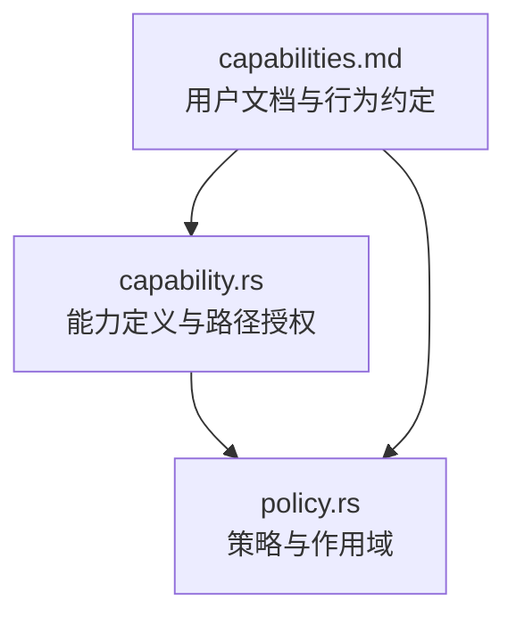
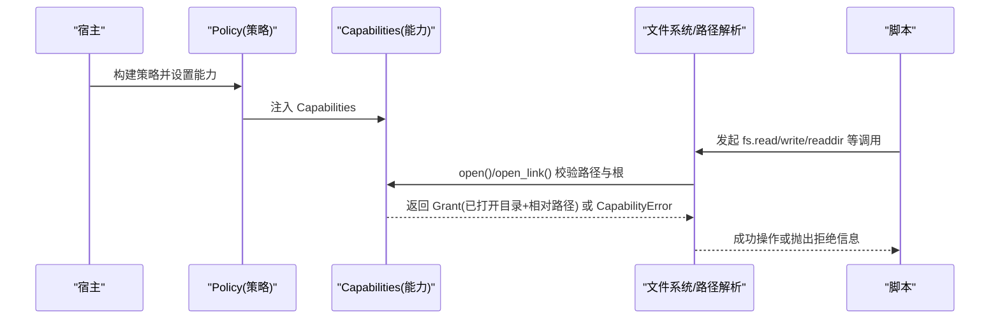
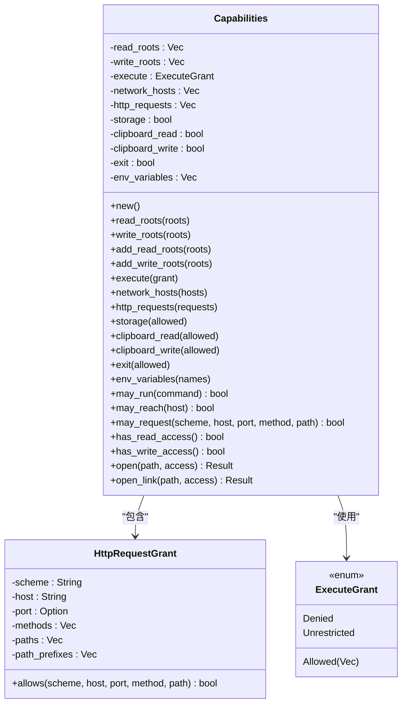
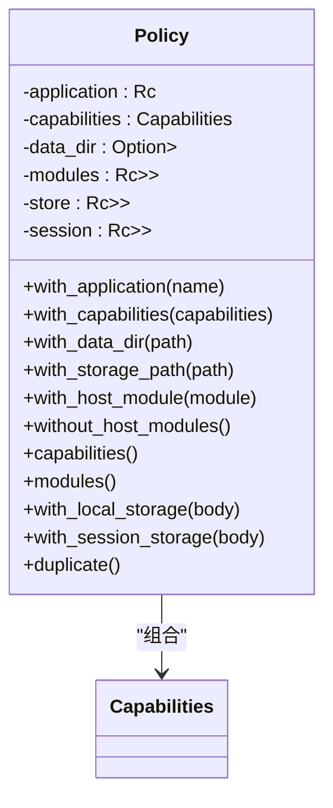
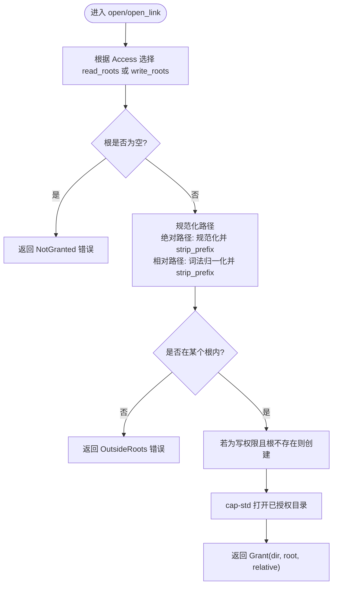
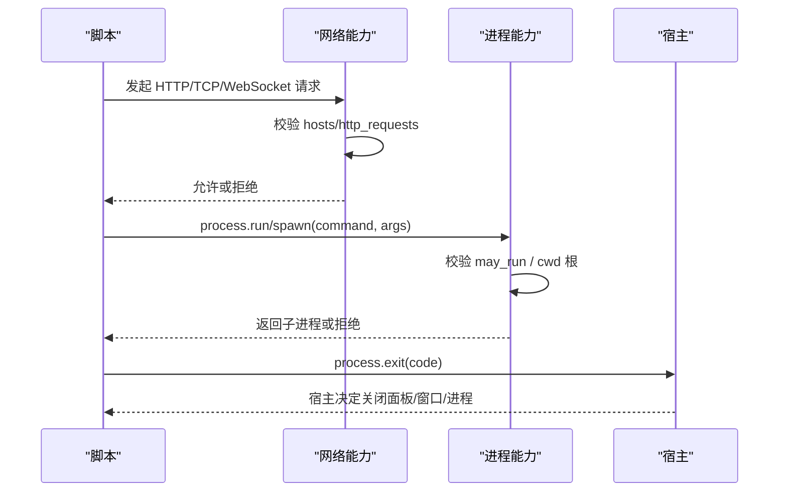
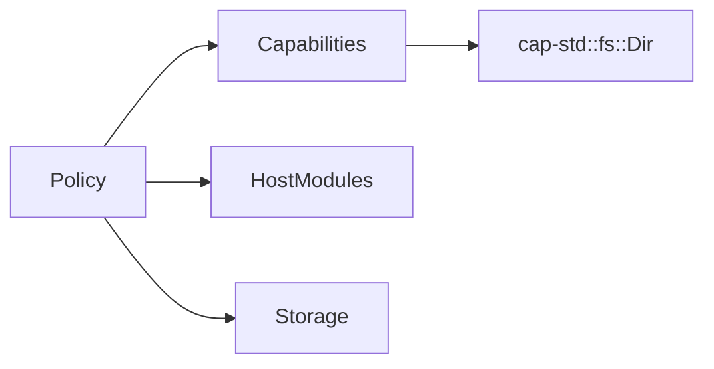

# 能力控制系统

<cite>
**本文引用的文件**   
- [crates/shell/src/capability.rs](file://crates/shell/src/capability.rs)
- [crates/shell/src/policy.rs](file://crates/shell/src/policy.rs)
- [website/shell/capabilities.md](file://website/shell/capabilities.md)
</cite>

## 目录
1. [引言](#引言)
2. [项目结构](#项目结构)
3. [核心组件](#核心组件)
4. [架构总览](#架构总览)
5. [详细组件分析](#详细组件分析)
6. [依赖关系分析](#依赖关系分析)
7. [性能与资源限制](#性能与资源限制)
8. [故障排查指南](#故障排查指南)
9. [结论](#结论)
10. [附录：权限配置示例与最佳实践](#附录权限配置示例与最佳实践)

## 引言
本文件系统面向 gpui-kit 的 Shell 运行时，解释“能力控制系统”的设计目标、权限模型与实现边界。其核心思想是“默认拒绝”：脚本在启动时没有任何文件系统、网络、剪贴板、进程或存储访问能力；只有宿主显式授予或通过清单声明的能力才会生效。系统通过策略对象将“谁在运行”“以什么权限运行”“能访问哪些资源”绑定在一起，并在沙箱中限制语言能力和系统调用，从而形成清晰的安全边界。

## 项目结构
能力控制系统主要位于 shell crate 中，关键文件如下：
- capability.rs：定义能力集合、路径根、HTTP 请求规则、执行命令白名单、错误类型以及路径解析与授权逻辑。
- policy.rs：定义策略对象，聚合能力、数据目录、主机模块、持久化存储与会话存储，并提供默认策略与线程/视图级作用域管理。
- website/shell/capabilities.md：面向用户的 Shell 能力文档，描述默认拒绝、清单字段、各能力语义、沙箱限制与违规提示。



**图表来源**
- [crates/shell/src/capability.rs:1-1138](file://crates/shell/src/capability.rs#L1-L1138)
- [crates/shell/src/policy.rs:1-387](file://crates/shell/src/policy.rs#L1-L387)
- [website/shell/capabilities.md:1-429](file://website/shell/capabilities.md#L1-L429)

**章节来源**
- [crates/shell/src/capability.rs:1-1138](file://crates/shell/src/capability.rs#L1-L1138)
- [crates/shell/src/policy.rs:1-387](file://crates/shell/src/policy.rs#L1-L387)
- [website/shell/capabilities.md:1-429](file://website/shell/capabilities.md#L1-L429)

## 核心组件
- Capabilities：表示一个脚本被允许做什么，包括读/写根目录、网络主机与 HTTP 请求规则、外部命令执行策略、存储、剪贴板读写、退出请求与环境变量可见性。
- Policy：将 Capabilities 与应用名称、数据目录、主机模块、本地存储与会话存储组合起来，作为“当前代码在谁的权威下运行”的统一答案。
- Grant：由 Capabilities.open/open_link 返回的“已打开目录句柄 + 相对路径”，代表一次具体的能力持有者，而非字符串路径。
- CapabilityError：统一的拒绝原因，用于向宿主和用户提供可操作的修复建议。

这些组件共同实现了“最小权限、明确拒绝、可审计、可组合”的权限模型。

**章节来源**
- [crates/shell/src/capability.rs:24-38](file://crates/shell/src/capability.rs#L24-L38)
- [crates/shell/src/capability.rs:61-74](file://crates/shell/src/capability.rs#L61-L74)
- [crates/shell/src/capability.rs:144-154](file://crates/shell/src/capability.rs#L144-L154)
- [crates/shell/src/capability.rs:537-571](file://crates/shell/src/capability.rs#L537-L571)
- [crates/shell/src/policy.rs:61-109](file://crates/shell/src/policy.rs#L61-L109)

## 架构总览
下图展示了能力授予、策略绑定与运行时访问控制的整体流程。



**图表来源**
- [crates/shell/src/capability.rs:393-510](file://crates/shell/src/capability.rs#L393-L510)
- [crates/shell/src/policy.rs:151-169](file://crates/shell/src/policy.rs#L151-L169)
- [website/shell/capabilities.md:10-24](file://website/shell/capabilities.md#L10-L24)

## 详细组件分析

### Capabilities：能力模型与授予机制
Capabilities 是所有能力的集中表达。它采用私有字段与构造器方法，确保新增能力不会破坏嵌入者的接口。

- 文件系统访问
  - read_roots / write_roots：分别表示可读与可写的根目录集合。
  - add_read_roots / add_write_roots：追加根目录，避免覆盖已有授予。
  - has_read_access / has_write_access：快速判断是否具备任意读写能力。
- 网络访问
  - network_hosts：允许连接的主机列表（TCP/WebSocket）。
  - http_requests：按 scheme/host/port/method/path_prefixes 精确约束 HTTP 请求。
  - may_reach / may_request：检查主机可达性与具体请求是否被允许。
- 进程管理
  - execute：ExecuteGrant 枚举，支持 Denied / Allowed(Vec<String>) / Unrestricted。
  - may_run：检查命令是否在白名单或无限制。
- 存储与剪贴板
  - storage：localStorage 能力开关。
  - clipboard_read / clipboard_write：剪贴板读写分离授权。
- 退出与环境
  - exit：是否允许脚本请求退出。
  - env_variables：除默认环境变量外，额外暴露给 process.env 的变量名列表。
  - default_env_variables：从内置列表加载默认环境变量名，不包含敏感值。



**图表来源**
- [crates/shell/src/capability.rs:24-38](file://crates/shell/src/capability.rs#L24-L38)
- [crates/shell/src/capability.rs:61-74](file://crates/shell/src/capability.rs#L61-L74)
- [crates/shell/src/capability.rs:144-154](file://crates/shell/src/capability.rs#L144-L154)
- [crates/shell/src/capability.rs:219-308](file://crates/shell/src/capability.rs#L219-L308)
- [crates/shell/src/capability.rs:345-374](file://crates/shell/src/capability.rs#L345-L374)

**章节来源**
- [crates/shell/src/capability.rs:24-38](file://crates/shell/src/capability.rs#L24-L38)
- [crates/shell/src/capability.rs:61-74](file://crates/shell/src/capability.rs#L61-L74)
- [crates/shell/src/capability.rs:144-154](file://crates/shell/src/capability.rs#L144-L154)
- [crates/shell/src/capability.rs:219-308](file://crates/shell/src/capability.rs#L219-L308)
- [crates/shell/src/capability.rs:345-374](file://crates/shell/src/capability.rs#L345-L374)

### Policy：作用域管理与默认策略
Policy 将“能力、应用标识、数据目录、主机模块、本地存储与会话存储”组合为单一上下文。它强调：
- 能力冻结：一旦 View 创建，其 Capabilities 不可变，防止并发切换导致权限漂移。
- 默认策略：新 View 若无显式策略则继承默认 Policy；可通过 set_default/update_default 修改默认策略，但不会影响已持有的旧策略。
- 作用域安全：策略不是线程局部状态，而是随调用帧传播，避免 await 后权限被其他任务覆盖。
- 模块与存储共享：HostModules 与 Storage 以 Rc/RefCell 共享，保证撤销模块与单文件缓存一致性。



**图表来源**
- [crates/shell/src/policy.rs:61-109](file://crates/shell/src/policy.rs#L61-L109)
- [crates/shell/src/policy.rs:117-239](file://crates/shell/src/policy.rs#L117-L239)
- [crates/shell/src/policy.rs:241-296](file://crates/shell/src/policy.rs#L241-L296)

**章节来源**
- [crates/shell/src/policy.rs:1-45](file://crates/shell/src/policy.rs#L1-L45)
- [crates/shell/src/policy.rs:61-109](file://crates/shell/src/policy.rs#L61-L109)
- [crates/shell/src/policy.rs:117-239](file://crates/shell/src/policy.rs#L117-L239)
- [crates/shell/src/policy.rs:241-296](file://crates/shell/src/policy.rs#L241-L296)

### 路径解析与沙箱隔离
路径解析是能力系统的核心安全点。Capabilities.open/open_link 负责：
- 选择正确的根目录（读/写）并验证为空时的拒绝。
- 对绝对路径进行规范化与根内包含检查。
- 对相对路径先做词法归一化，再基于真实文件系统判定包含关系，防止符号链接逃逸。
- 使用 cap-std 的 Dir 打开已授权目录，返回 Grant，后续所有操作都通过该句柄执行，避免“检查-使用”时序漏洞。
- 对最终组件是否跟随符号链接提供两种模式：Follow（读取内容）与 Keep（操作链接本身）。



**图表来源**
- [crates/shell/src/capability.rs:393-510](file://crates/shell/src/capability.rs#L393-L510)
- [crates/shell/src/capability.rs:655-709](file://crates/shell/src/capability.rs#L655-L709)

**章节来源**
- [crates/shell/src/capability.rs:393-510](file://crates/shell/src/capability.rs#L393-L510)
- [crates/shell/src/capability.rs:655-709](file://crates/shell/src/capability.rs#L655-L709)

### 网络与进程能力
- 网络
  - capabilities.network.hosts：允许 TCP/WebSocket 连接的主机。
  - capabilities.http.requests：按 scheme/host/port/method/path_prefixes 约束 HTTP 请求，默认 HTTPS，端口默认为协议标准端口。
  - 文档说明 fetch 与 WebSocket 的行为、超时、重定向与头限制。
- 进程
  - capabilities.execute：Denied / Allowed / Unrestricted。
  - process.run：捕获输出、超时、大小限制。
  - process.spawn：流式处理、行缓冲、进程组终止、与 View 生命周期绑定。
  - process.exit：仅请求宿主处理，不直接退出运行时。



**图表来源**
- [website/shell/capabilities.md:416-424](file://website/shell/capabilities.md#L416-L424)
- [website/shell/capabilities.md:315-362](file://website/shell/capabilities.md#L315-L362)
- [crates/shell/src/capability.rs:345-374](file://crates/shell/src/capability.rs#L345-L374)

**章节来源**
- [website/shell/capabilities.md:315-362](file://website/shell/capabilities.md#L315-L362)
- [website/shell/capabilities.md:416-424](file://website/shell/capabilities.md#L416-L424)
- [crates/shell/src/capability.rs:345-374](file://crates/shell/src/capability.rs#L345-L374)

### 存储与剪贴板
- 存储
  - localStorage：持久化到宿主指定的 store.json，键数量、值大小、写入队列均有上限。
  - sessionStorage：内存存储，不跨进程，无需能力。
  - 未授予时抛出，应用应优雅降级。
- 剪贴板
  - cx.read_from_clipboard / cx.write_to_clipboard。
  - 读写分离授权，拒绝消息指明缺失的半能力。

**章节来源**
- [website/shell/capabilities.md:188-278](file://website/shell/capabilities.md#L188-L278)
- [website/shell/capabilities.md:279-299](file://website/shell/capabilities.md#L279-L299)

### 沙箱隔离与安全边界
沙箱在语言层和能力层双重限制：
- 禁用动态代码：删除 globalThis.eval，替换 Function 构造函数。
- 冻结内置原型：Object/Array/Function/String/Number 原型冻结，防止插件互相污染。
- 模块解析限制：import/import() 仅限应用根目录。
- 资源限制：堆、栈、模块大小、宿主任务数、渲染/事件/模块评估时间预算。
- 开发模式：恢复动态代码与原型可写，但不放宽能力授予。

**章节来源**
- [website/shell/capabilities.md:384-414](file://website/shell/capabilities.md#L384-L414)

## 依赖关系分析
能力系统与策略的关系如下：
- Policy 组合 Capabilities，并通过 update_default/install 安装默认能力。
- 路径解析依赖 cap-std 提供的 Dir 与 ambient_authority，确保“能力即句柄”。
- 网络与进程能力由文档与能力查询函数共同约束。



**图表来源**
- [crates/shell/src/policy.rs:46-56](file://crates/shell/src/policy.rs#L46-L56)
- [crates/shell/src/capability.rs:9-10](file://crates/shell/src/capability.rs#L9-L10)

**章节来源**
- [crates/shell/src/policy.rs:46-56](file://crates/shell/src/policy.rs#L46-L56)
- [crates/shell/src/capability.rs:9-10](file://crates/shell/src/capability.rs#L9-L10)

## 性能与资源限制
- 文件系统 I/O 异步返回 Promise，避免阻塞 UI 与 VM。
- 文件大小与目录条目限制：readFile 最大 64 MiB，writeFile 最大 8 MiB，readdir 最多 10,000 项或 1 MiB UTF-8 名称字节。
- 存储写入合并：多次 setItem 合并为一次磁盘写入，flush 作为屏障。
- 进程输出限制：run 捕获 stdout/stderr 各 8 MiB，spawn 单行 8 MiB。
- 沙箱资源限制：堆 256 MiB、解释器栈 1 MiB、模块源 8 MiB、宿主任务 1,024、渲染/事件 50ms/500ms、模块评估 5s。

**章节来源**
- [website/shell/capabilities.md:176-183](file://website/shell/capabilities.md#L176-L183)
- [website/shell/capabilities.md:225-229](file://website/shell/capabilities.md#L225-L229)
- [website/shell/capabilities.md:328-329](file://website/shell/capabilities.md#L328-L329)
- [website/shell/capabilities.md:394-406](file://website/shell/capabilities.md#L394-L406)

## 故障排查指南
常见拒绝信息与修复建议：
- 文件系统读/写未授予：需要在清单中声明 capabilities.fs.read 或 capabilities.fs.write。
- 路径超出根：需要将目标目录添加到 capabilities.fs.read 或 capabilities.fs.write。
- 存储未授予：需要设置 capabilities.storage 为 true。
- 进程执行未授予：需要将命令加入 capabilities.fs.execute。
- 进程退出未授予：需要设置 capabilities.process.exit 为 true。

此外，当剪贴板缺少某一半能力时，拒绝消息会明确指出缺失的是 read 还是 write。

**章节来源**
- [website/shell/capabilities.md:44-67](file://website/shell/capabilities.md#L44-L67)
- [website/shell/capabilities.md:288-299](file://website/shell/capabilities.md#L288-L299)

## 结论
能力控制系统通过“默认拒绝 + 显式授予 + 句柄化路径 + 策略冻结”的组合，构建了清晰的权限边界。Capabilities 定义能力面，Policy 绑定作用域，Grant 固化一次授权，CapabilityError 提供可操作的拒绝信息。配合沙箱的语言层限制与资源预算，系统在易用性与安全性之间取得平衡。对于宿主而言，关键在于最小权限原则、明确的清单声明与稳健的降级处理。

## 附录：权限配置示例与最佳实践

### 权限配置示例
以下示例来自用户文档，展示如何在清单中声明能力：
- 文件系统：read/write 根目录，支持 ${pluginDir}/${dataDir}/${homeDir}。
- 网络：hosts 与 http 规则，限定 scheme/host/method/path_prefixes。
- 存储：开启 localStorage。
- 剪贴板：只允许写。
- 进程：禁止 exit。

```json
{
  "id": "com.example.quotes",
  "name": "Quotes",
  "version": "1.0.0",
  "shell-version": "{{gpui_kit_version}}",
  "entry": "main.js",
  "dependencies": {
    "omarchy-ui": "huacnlee/omarchy-ui"
  },
  "capabilities": {
    "fs": { "read": ["${pluginDir}"], "write": ["${dataDir}"] },
    "network": {
      "hosts": ["stream.example.com"],
      "http": [
        {
          "scheme": "https",
          "host": "api.example.com",
          "methods": ["GET"],
          "path_prefixes": ["/v1/"]
        }
      ]
    },
    "storage": true,
    "clipboard": { "read": false, "write": true },
    "process": { "exit": false }
  }
}
```

**章节来源**
- [website/shell/capabilities.md:69-127](file://website/shell/capabilities.md#L69-L127)

### 最佳实践与安全建议
- 遵循最小权限原则：仅授予功能所需的最小能力集。
- 使用精确 HTTP 规则：限定 scheme/host/method/path_prefixes，避免宽泛 host 授权。
- 谨慎授予进程执行：优先白名单命令，避免 unrestricted。
- 环境暴露最小化：仅在 manifest 中列出必要的 process.env 变量。
- 优雅降级：当存储或剪贴板未授予时，应用应记录警告并回退到无持久化或无剪贴板行为。
- 风险评估方法：
  - 识别敏感能力：文件系统写、进程执行、网络出站、剪贴板写、退出请求。
  - 评估影响面：数据泄露、命令注入、横向移动、会话劫持、服务中断。
  - 制定缓解措施：最小根目录、命令白名单、HTTPS 强制、输入输出限额、超时与取消。

[本节为通用指导，不直接分析具体文件]