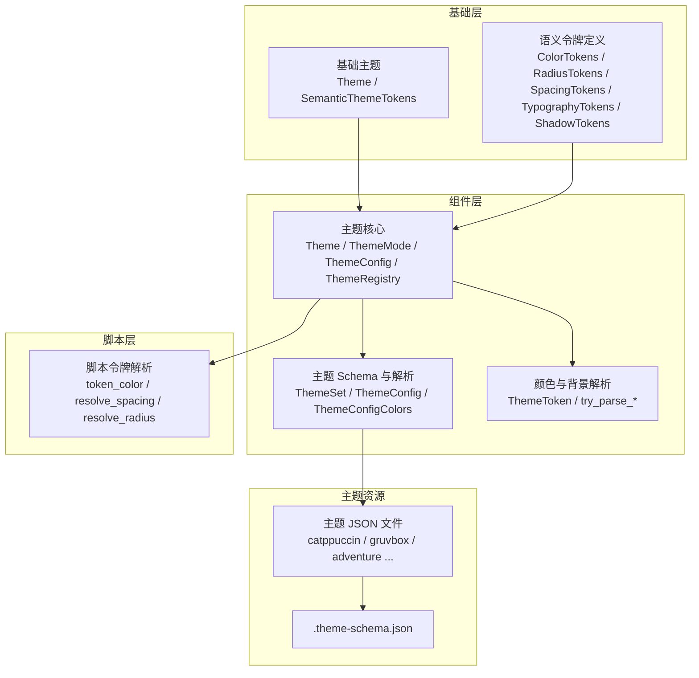
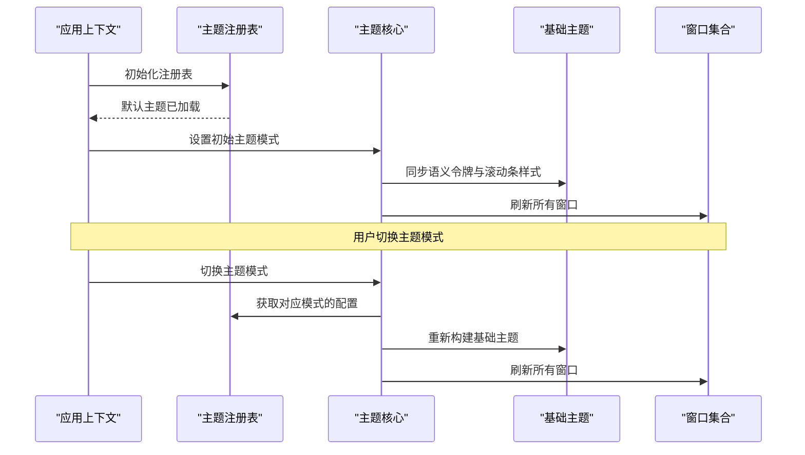
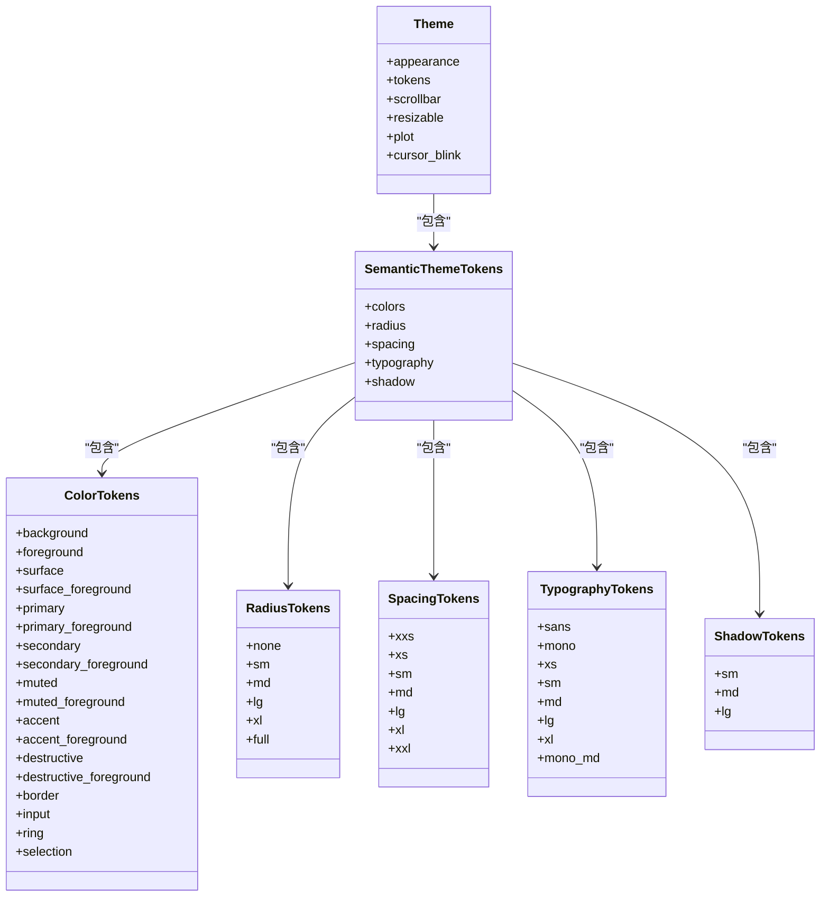
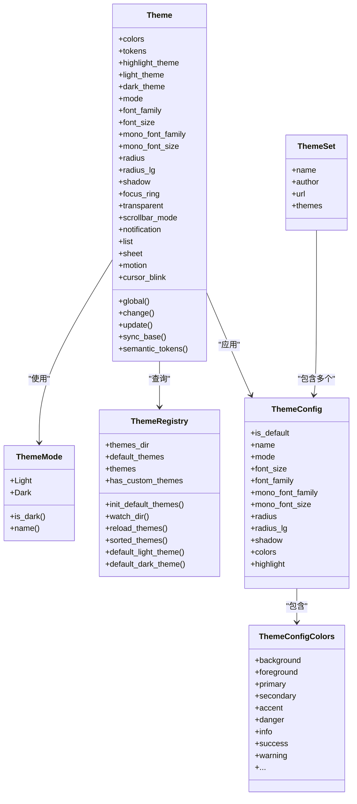
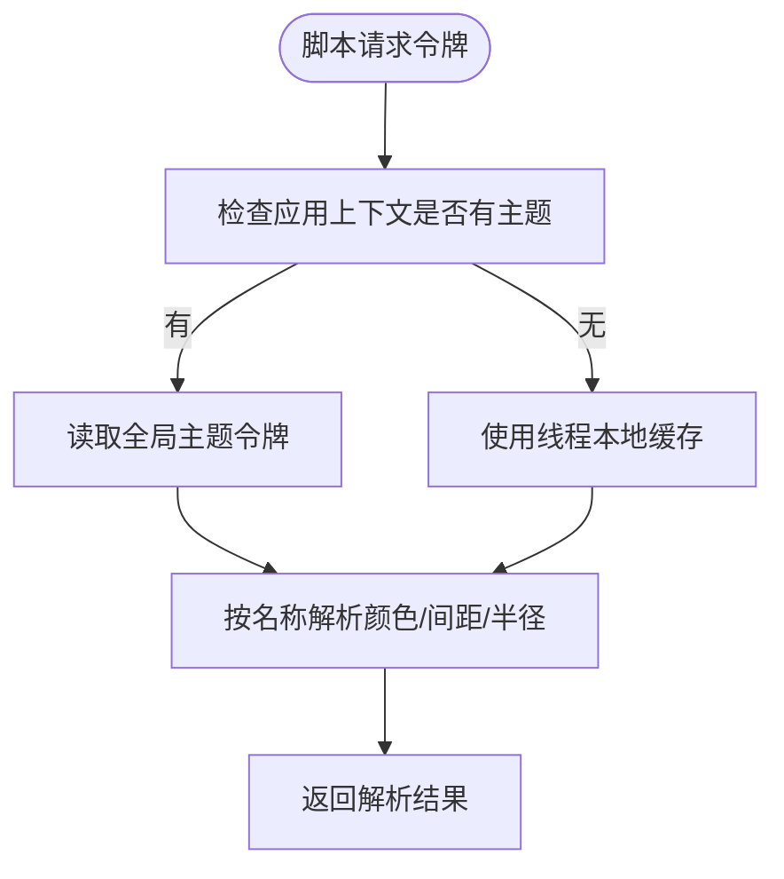
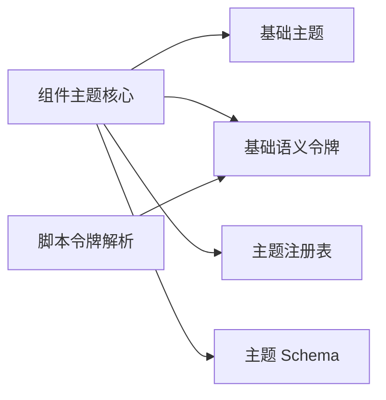
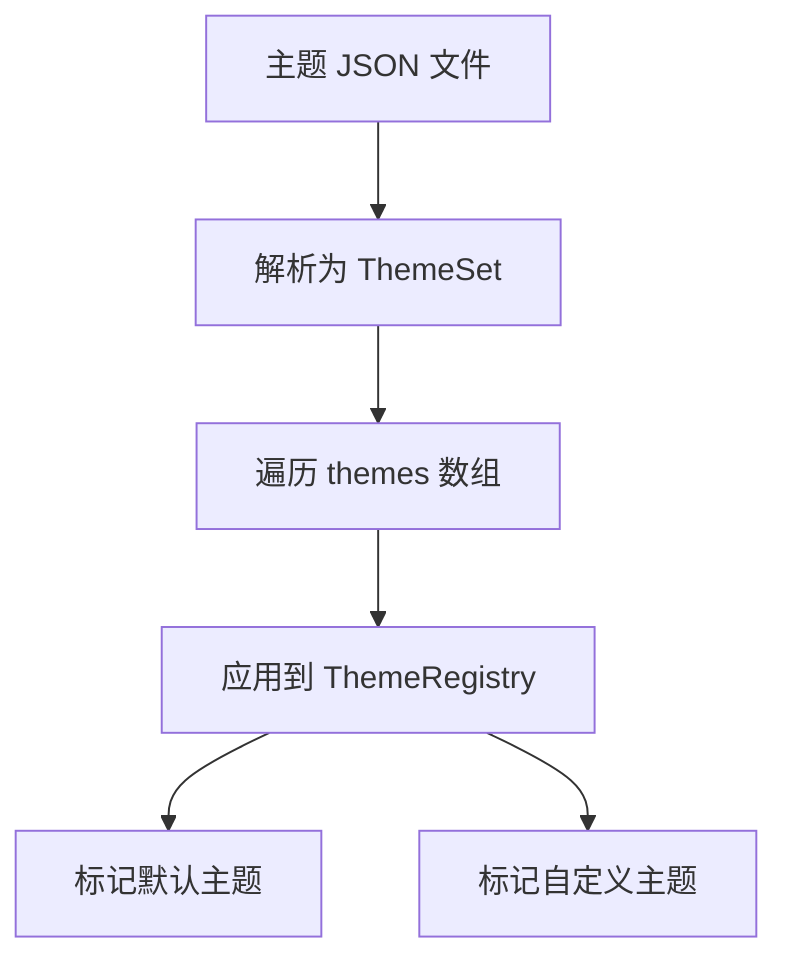
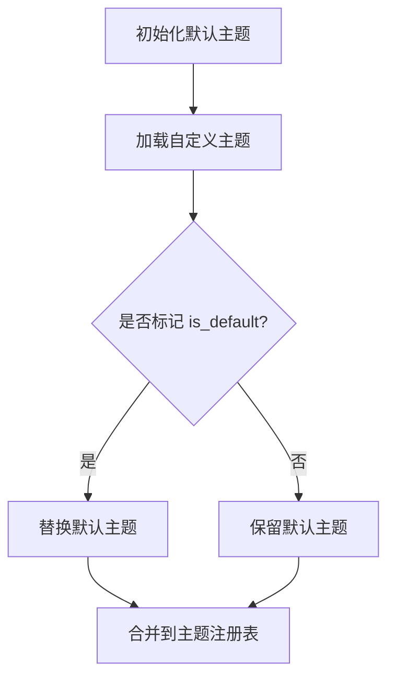
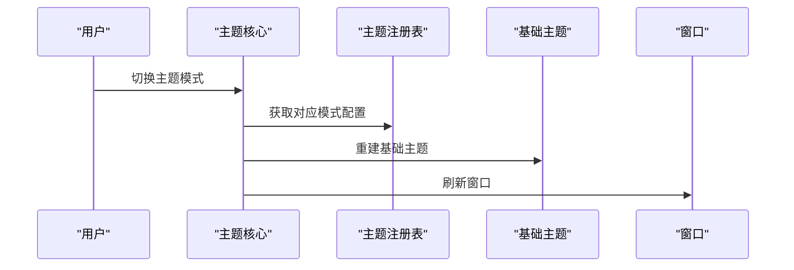

# 主题系统

<cite>
**本文引用的文件**   
- [crates/base/src/theme.rs](file://crates/base/src/theme.rs)
- [crates/base/src/theme_tokens.rs](file://crates/base/src/theme_tokens.rs)
- [crates/component/src/theme/mod.rs](file://crates/component/src/theme/mod.rs)
- [crates/component/src/theme/registry.rs](file://crates/component/src/theme/registry.rs)
- [crates/component/src/theme/schema.rs](file://crates/component/src/theme/schema.rs)
- [crates/shell/src/theme_tokens.rs](file://crates/shell/src/theme_tokens.rs)
- [themes/catppuccin.json](file://themes/catppuccin.json)
- [themes/gruvbox.json](file://themes/gruvbox.json)
- [themes/adventure.json](file://themes/adventure.json)
- [.theme-schema.json](file://.theme-schema.json)
</cite>

## 目录
1. [引言](#引言)
2. [项目结构](#项目结构)
3. [核心组件](#核心组件)
4. [架构总览](#架构总览)
5. [详细组件分析](#详细组件分析)
6. [依赖关系分析](#依赖关系分析)
7. [性能与运行时特性](#性能与运行时特性)
8. [自定义主题开发指南](#自定义主题开发指南)
9. [预置主题使用指南](#预置主题使用指南)
10. [品牌主题与继承覆盖机制](#品牌主题与继承覆盖机制)
11. [调试与排错](#调试与排错)
12. [结论](#结论)

## 引言
本文件系统性说明 gpui-kit 的主题系统，重点包括：
- 语义化颜色令牌体系
- 多尺寸（半径、间距、字号）支持
- 动态主题切换与运行时刷新
- 主题文件结构与变量命名约定
- 字体配置与阴影系统
- 预置主题使用与品牌主题开发
- 主题注册、继承与覆盖机制
- 主题工具链与调试技巧

该主题系统由三层组成：
- 基础层：提供全局语义设计令牌和基础 UI 行为。
- 组件层：维护应用级主题状态、主题注册表、解析器与渲染投影。
- 脚本层：在 Shell 中通过名称解析语义令牌，供脚本或外部消费。

## 项目结构
主题相关代码主要分布在以下模块：
- `crates/base`：基础语义令牌、滚动条与图表运动等基础主题能力。
- `crates/component`：主题核心实现，包含主题结构、模式、注册表、Schema 与颜色解析。
- `crates/shell`：脚本侧的令牌解析与缓存。
- `themes`：内置主题 JSON 文件集合。
- `.theme-schema.json`：主题文件的 JSON Schema。

**图示来源**
- [crates/base/src/theme.rs:1-46](file://crates/base/src/theme.rs#L1-L46)
- [crates/base/src/theme_tokens.rs:10-247](file://crates/base/src/theme_tokens.rs#L10-L247)
- [crates/component/src/theme/mod.rs:145-219](file://crates/component/src/theme/mod.rs#L145-L219)
- [crates/component/src/theme/registry.rs:75-183](file://crates/component/src/theme/registry.rs#L75-L183)
- [crates/component/src/theme/schema.rs:21-84](file://crates/component/src/theme/schema.rs#L21-L84)
- [crates/shell/src/theme_tokens.rs:83-168](file://crates/shell/src/theme_tokens.rs#L83-L168)

**章节来源**
- [crates/base/src/theme.rs:1-46](file://crates/base/src/theme.rs#L1-L46)
- [crates/base/src/theme_tokens.rs:10-247](file://crates/base/src/theme_tokens.rs#L10-L247)
- [crates/component/src/theme/mod.rs:145-219](file://crates/component/src/theme/mod.rs#L145-L219)
- [crates/component/src/theme/registry.rs:75-183](file://crates/component/src/theme/registry.rs#L75-L183)
- [crates/component/src/theme/schema.rs:21-84](file://crates/component/src/theme/schema.rs#L21-L84)
- [crates/shell/src/theme_tokens.rs:83-168](file://crates/shell/src/theme_tokens.rs#L83-L168)

## 核心组件
- 基础主题与语义令牌：
  - `Theme`：应用级基础主题，包含外观、滚动条、图表、光标闪烁等。
  - `SemanticThemeTokens`：语义设计令牌集合，包含颜色、半径、间距、排版、阴影。
- 组件主题核心：
  - `Theme`：应用主题状态，包含颜色、令牌、高亮主题、明暗主题配置、字体、半径、阴影、滚动条模式、动效、光标闪烁等。
  - `ThemeMode`：主题模式枚举（light/dark）。
  - `ThemeRegistry`：主题注册表，负责默认主题加载、热重载、排序与查询。
  - `ThemeConfig` / `ThemeSet` / `ThemeConfigColors`：主题文件结构体与颜色字段映射。
- 脚本令牌解析：
  - `token_color` / `resolve_spacing` / `resolve_radius`：根据名称从当前语义令牌中解析值。

**章节来源**
- [crates/base/src/theme.rs:10-46](file://crates/base/src/theme.rs#L10-L46)
- [crates/base/src/theme_tokens.rs:10-247](file://crates/base/src/theme_tokens.rs#L10-L247)
- [crates/component/src/theme/mod.rs:145-219](file://crates/component/src/theme/mod.rs#L145-L219)
- [crates/component/src/theme/mod.rs:814-842](file://crates/component/src/theme/mod.rs#L814-L842)
- [crates/component/src/theme/registry.rs:75-183](file://crates/component/src/theme/registry.rs#L75-L183)
- [crates/component/src/theme/schema.rs:21-84](file://crates/component/src/theme/schema.rs#L21-L84)
- [crates/shell/src/theme_tokens.rs:83-168](file://crates/shell/src/theme_tokens.rs#L83-L168)

## 架构总览
主题系统在启动时初始化注册表并设置默认主题；运行时可通过 API 切换主题模式、更新主题配置，并同步到基础层与所有窗口。

**图示来源**
- [crates/component/src/theme/mod.rs:36-42](file://crates/component/src/theme/mod.rs#L36-L42)
- [crates/component/src/theme/mod.rs:396-406](file://crates/component/src/theme/mod.rs#L396-L406)
- [crates/component/src/theme/mod.rs:479-484](file://crates/component/src/theme/mod.rs#L479-L484)
- [crates/component/src/theme/registry.rs:41-73](file://crates/component/src/theme/registry.rs#L41-L73)

**章节来源**
- [crates/component/src/theme/mod.rs:36-42](file://crates/component/src/theme/mod.rs#L36-L42)
- [crates/component/src/theme/mod.rs:396-406](file://crates/component/src/theme/mod.rs#L396-L406)
- [crates/component/src/theme/mod.rs:479-484](file://crates/component/src/theme/mod.rs#L479-L484)
- [crates/component/src/theme/registry.rs:41-73](file://crates/component/src/theme/registry.rs#L41-L73)

## 详细组件分析

### 基础主题与语义令牌
- 基础主题 `Theme`：
  - 包含外观、滚动条主题、可调整面板主题、图表运动、光标闪烁。
  - 提供全局访问方法，用于读取与应用基础主题。
- 语义令牌 `SemanticThemeTokens`：
  - 颜色令牌 `ColorTokens`：背景、前景、表面、主色、次要色、强调、破坏、边框、输入、环、选择。
  - 半径令牌 `RadiusTokens`：none/sm/md/lg/xl/full。
  - 间距令牌 `SpacingTokens`：xxs/xs/sm/md/lg/xl/xxl。
  - 排版令牌 `TypographyTokens`：无衬线/等宽字体族与字号层级。
  - 阴影令牌 `ShadowTokens`：sm/md/lg 阴影集合。

**图示来源**
- [crates/base/src/theme.rs:10-46](file://crates/base/src/theme.rs#L10-L46)
- [crates/base/src/theme_tokens.rs:10-247](file://crates/base/src/theme_tokens.rs#L10-L247)

**章节来源**
- [crates/base/src/theme.rs:10-46](file://crates/base/src/theme.rs#L10-L46)
- [crates/base/src/theme_tokens.rs:10-247](file://crates/base/src/theme_tokens.rs#L10-L247)

### 组件主题核心
- 主题核心 `Theme`：
  - 管理颜色、令牌、高亮主题、明暗主题配置、字体、半径、阴影、滚动条模式、动效、光标闪烁。
  - 提供全局读写接口与主题变更流程。
  - 将主题同步到基础层，确保滚动条、可调整手柄、图表动效一致。
- 主题模式 `ThemeMode`：
  - light/dark，支持从窗口外观转换。
- 主题注册表 `ThemeRegistry`：
  - 初始化默认主题，监听主题目录变化，热重载主题。
  - 提供主题列表、排序、默认主题查询。
- 主题 Schema 与解析：
  - `ThemeSet` / `ThemeConfig` / `ThemeConfigColors` 描述主题文件结构。
  - 支持颜色、背景渐变、组件颜色、基础色板、编辑器高亮等。

**图示来源**
- [crates/component/src/theme/mod.rs:145-219](file://crates/component/src/theme/mod.rs#L145-L219)
- [crates/component/src/theme/mod.rs:814-842](file://crates/component/src/theme/mod.rs#L814-L842)
- [crates/component/src/theme/registry.rs:75-183](file://crates/component/src/theme/registry.rs#L75-L183)
- [crates/component/src/theme/schema.rs:21-84](file://crates/component/src/theme/schema.rs#L21-L84)
- [crates/component/src/theme/schema.rs:262-689](file://crates/component/src/theme/schema.rs#L262-L689)

**章节来源**
- [crates/component/src/theme/mod.rs:145-219](file://crates/component/src/theme/mod.rs#L145-L219)
- [crates/component/src/theme/mod.rs:814-842](file://crates/component/src/theme/mod.rs#L814-L842)
- [crates/component/src/theme/registry.rs:75-183](file://crates/component/src/theme/registry.rs#L75-L183)
- [crates/component/src/theme/schema.rs:21-84](file://crates/component/src/theme/schema.rs#L21-L84)
- [crates/component/src/theme/schema.rs:262-689](file://crates/component/src/theme/schema.rs#L262-L689)

### 脚本令牌解析
脚本侧通过名称解析当前语义令牌，避免频繁复制大对象，提高性能。

**图示来源**
- [crates/shell/src/theme_tokens.rs:28-64](file://crates/shell/src/theme_tokens.rs#L28-L64)
- [crates/shell/src/theme_tokens.rs:83-168](file://crates/shell/src/theme_tokens.rs#L83-L168)

**章节来源**
- [crates/shell/src/theme_tokens.rs:28-64](file://crates/shell/src/theme_tokens.rs#L28-L64)
- [crates/shell/src/theme_tokens.rs:83-168](file://crates/shell/src/theme_tokens.rs#L83-L168)

## 依赖关系分析
- 组件主题核心依赖基础主题与语义令牌，用于生成基础层主题快照。
- 主题注册表依赖默认主题与文件系统，支持热重载。
- 脚本令牌解析依赖基础语义令牌，提供轻量访问路径。

**图示来源**
- [crates/component/src/theme/mod.rs:479-484](file://crates/component/src/theme/mod.rs#L479-L484)
- [crates/component/src/theme/registry.rs:41-73](file://crates/component/src/theme/registry.rs#L41-L73)
- [crates/shell/src/theme_tokens.rs:28-64](file://crates/shell/src/theme_tokens.rs#L28-L64)

**章节来源**
- [crates/component/src/theme/mod.rs:479-484](file://crates/component/src/theme/mod.rs#L479-L484)
- [crates/component/src/theme/registry.rs:41-73](file://crates/component/src/theme/registry.rs#L41-L73)
- [crates/shell/src/theme_tokens.rs:28-64](file://crates/shell/src/theme_tokens.rs#L28-L64)

## 性能与运行时特性
- 主题更新路径：
  - `Theme::update` 与 `Theme::change` 保证所有副本同步，重建基础主题并刷新窗口。
  - 直接编辑全局主题字段不会自动同步，需调用 `sync_base` 与刷新窗口。
- 滚动条与图表动效：
  - 组件层定义动效策略并投影到基础层，确保一致性。
- 脚本令牌缓存：
  - 线程本地缓存令牌快照，减少重复解析开销。

**章节来源**
- [crates/component/src/theme/mod.rs:295-343](file://crates/component/src/theme/mod.rs#L295-L343)
- [crates/component/src/theme/mod.rs:479-484](file://crates/component/src/theme/mod.rs#L479-L484)
- [crates/component/src/theme/mod.rs:106-143](file://crates/component/src/theme/mod.rs#L106-L143)
- [crates/shell/src/theme_tokens.rs:28-64](file://crates/shell/src/theme_tokens.rs#L28-L64)

## 自定义主题开发指南

### 主题文件格式
主题文件为 JSON，遵循 `.theme-schema.json`。顶层包含：
- `name`：主题集名称
- `author`：作者
- `url`：来源链接
- `themes`：主题数组，每个主题包含：
  - `name`：主题名
  - `mode`：light/dark
  - `colors`：颜色配置
  - `highlight`：编辑器高亮配置（可选）

**图示来源**
- [crates/component/src/theme/schema.rs:21-35](file://crates/component/src/theme/schema.rs#L21-L35)
- [crates/component/src/theme/registry.rs:247-295](file://crates/component/src/theme/registry.rs#L247-L295)

**章节来源**
- [crates/component/src/theme/schema.rs:21-35](file://crates/component/src/theme/schema.rs#L21-L35)
- [crates/component/src/theme/registry.rs:247-295](file://crates/component/src/theme/registry.rs#L247-L295)

### 颜色变量命名约定
颜色字段采用点号分隔的命名空间，例如：
- 基础色：`background`、`foreground`、`border`、`input`、`ring`
- 语义色：`primary`、`secondary`、`accent`、`danger`、`info`、`success`、`warning`
- 组件色：`button.primary.background`、`tab.active.background`、`sidebar.foreground`
- 基础色板：`base.red`、`base.green`、`base.blue`、`base.magenta`、`base.cyan`、`base.yellow` 及其 `.light` 变体

**章节来源**
- [crates/component/src/theme/schema.rs:262-689](file://crates/component/src/theme/schema.rs#L262-L689)

### 字体配置
主题支持：
- `font.family`：无衬线字体族
- `font.size`：基础字号
- `mono_font.family`：等宽字体族
- `mono_font.size`：等宽字号

默认字体族与字号由主题核心处理，缺失字体会回退到系统字体。

**章节来源**
- [crates/component/src/theme/schema.rs:48-66](file://crates/component/src/theme/schema.rs#L48-L66)
- [crates/component/src/theme/mod.rs:164-187](file://crates/component/src/theme/mod.rs#L164-L187)

### 间距与半径系统
- 半径：`radius`（通用）、`radius.lg`（大型元素）
- 间距：通过语义令牌 `SpacingTokens` 提供 xxs 到 xxl 的尺度
- 半径与间距在语义令牌中统一暴露给组件层

**章节来源**
- [crates/component/src/theme/schema.rs:68-76](file://crates/component/src/theme/schema.rs#L68-L76)
- [crates/base/src/theme_tokens.rs:110-158](file://crates/base/src/theme_tokens.rs#L110-L158)

### 阴影系统
- `shadow`：启用或禁用阴影
- 阴影令牌 `ShadowTokens` 提供 sm/md/lg 三级阴影集合

**章节来源**
- [crates/component/src/theme/schema.rs:74-76](file://crates/component/src/theme/schema.rs#L74-L76)
- [crates/base/src/theme_tokens.rs:203-219](file://crates/base/src/theme_tokens.rs#L203-L219)

### 最佳实践
- 优先使用语义色而非组件色，便于全局替换。
- 使用基础色板派生组件色，保持色彩一致性。
- 明确设置 `radius` 与 `radius.lg`，确保圆角一致性。
- 使用 `highlight` 配置编辑器高亮，兼容 Zed 主题格式。
- 通过 `Theme::update` 或 `Theme::change` 进行运行时修改，避免直接编辑全局字段。

**章节来源**
- [crates/component/src/theme/schema.rs:262-689](file://crates/component/src/theme/schema.rs#L262-L689)
- [crates/component/src/theme/mod.rs:295-343](file://crates/component/src/theme/mod.rs#L295-L343)

## 预置主题使用指南

### Catppuccin
- 提供多种变体（Latte/Frappe/Macchiato/Mocha），分别对应 light/dark 模式。
- 包含完整的颜色配置与编辑器高亮。

**章节来源**
- [themes/catppuccin.json:1-830](file://themes/catppuccin.json#L1-L830)

### Gruvbox
- 提供 Light/Dark 两套主题。
- 包含丰富的组件颜色与语法高亮。

**章节来源**
- [themes/gruvbox.json:1-303](file://themes/gruvbox.json#L1-L303)

### Adventure
- 提供深色主题与 Adventure Time 变体。
- 包含完整的 UI 颜色与编辑器高亮。

**章节来源**
- [themes/adventure.json:1-308](file://themes/adventure.json#L1-L308)

## 品牌主题与继承覆盖机制

### 主题继承
- 默认主题由注册表初始化，自定义主题可覆盖默认主题。
- 若自定义主题标记 `is_default`，则替换对应模式的默认主题。

**图示来源**
- [crates/component/src/theme/registry.rs:163-183](file://crates/component/src/theme/registry.rs#L163-L183)
- [crates/component/src/theme/registry.rs:279-292](file://crates/component/src/theme/registry.rs#L279-L292)

**章节来源**
- [crates/component/src/theme/registry.rs:163-183](file://crates/component/src/theme/registry.rs#L163-L183)
- [crates/component/src/theme/registry.rs:279-292](file://crates/component/src/theme/registry.rs#L279-L292)

### 运行时切换
- 通过 `Theme::change` 切换明暗模式，自动加载对应主题并刷新窗口。
- 通过 `Theme::update` 编辑主题字段，自动同步基础层与令牌。

**图示来源**
- [crates/component/src/theme/mod.rs:396-406](file://crates/component/src/theme/mod.rs#L396-L406)
- [crates/component/src/theme/mod.rs:479-484](file://crates/component/src/theme/mod.rs#L479-L484)

**章节来源**
- [crates/component/src/theme/mod.rs:396-406](file://crates/component/src/theme/mod.rs#L396-L406)
- [crates/component/src/theme/mod.rs:479-484](file://crates/component/src/theme/mod.rs#L479-L484)

## 调试与排错

### 常见问题
- 主题未生效：
  - 确认是否通过 `Theme::update` 或 `Theme::change` 修改主题。
  - 直接编辑全局字段后需调用 `sync_base` 并刷新窗口。
- 主题文件无效：
  - 检查 JSON 是否符合 `.theme-schema.json`。
  - 查看日志中的解析错误信息。
- 字体显示异常：
  - 确认字体族已安装或通过 `add_fonts` 嵌入。
  - 检查主题中的 `font.family` 与 `mono_font.family`。

### 调试技巧
- 使用 `Theme::semantic_tokens()` 获取当前语义令牌快照。
- 使用 `Theme::theme_name()` 检查当前主题名称。
- 启用主题目录监听，观察热重载行为。

**章节来源**
- [crates/component/src/theme/mod.rs:479-484](file://crates/component/src/theme/mod.rs#L479-L484)
- [crates/component/src/theme/registry.rs:185-232](file://crates/component/src/theme/registry.rs#L185-L232)

## 结论
gpui-kit 的主题系统以语义化令牌为核心，提供一致的视觉语言与灵活的扩展能力。通过主题注册表与运行时切换机制，开发者可以便捷地创建、覆盖与切换主题，满足从个人偏好到企业品牌的多样化需求。建议在设计系统时优先使用语义令牌，并通过主题文件集中管理颜色、字体、半径与阴影，确保 UI 的一致性与可维护性。