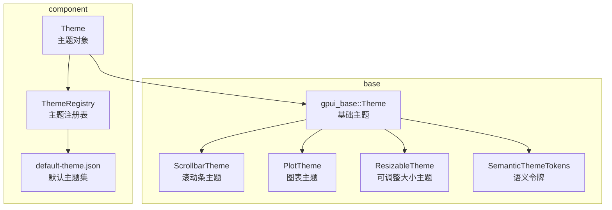
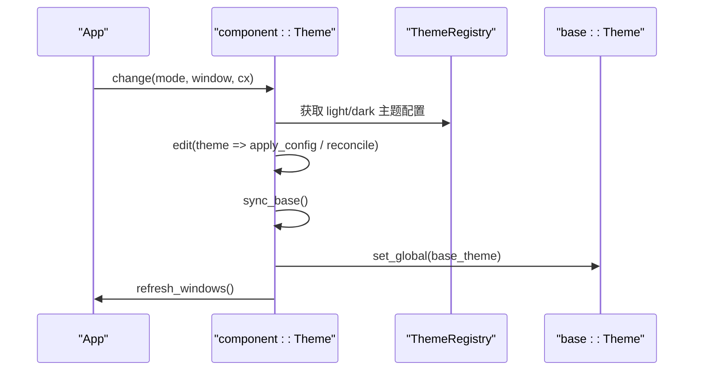
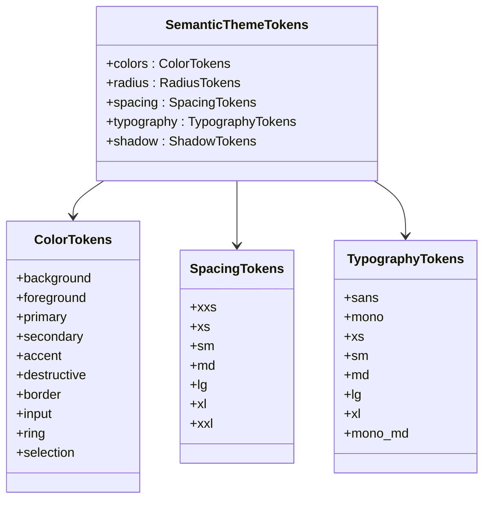
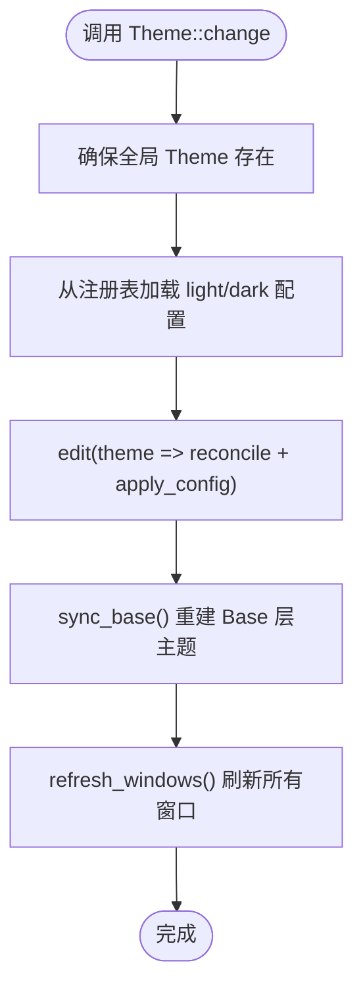
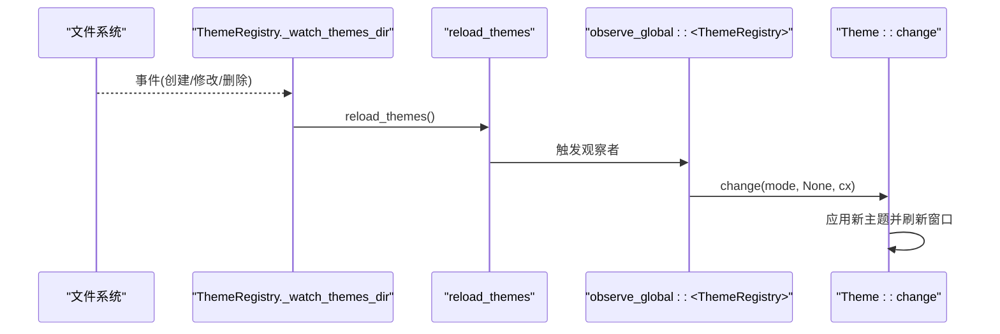
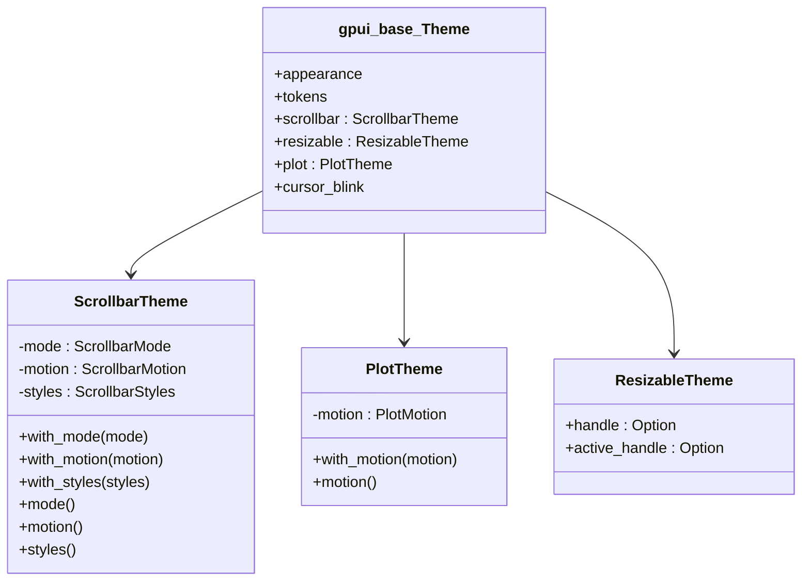
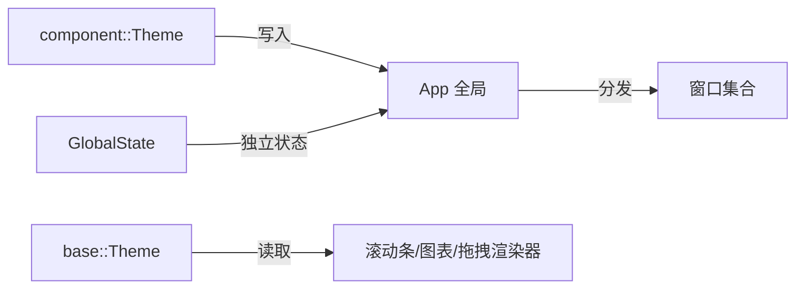
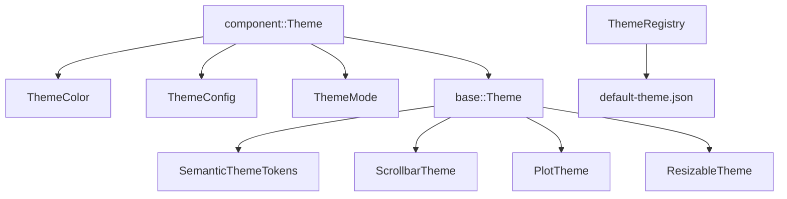

# 主题系统

<cite>
**本文引用的文件**   
- [crates/base/src/theme.rs](file://crates/base/src/theme.rs)
- [crates/base/src/theme_tokens.rs](file://crates/base/src/theme_tokens.rs)
- [crates/base/src/global_state.rs](file://crates/base/src/global_state.rs)
- [crates/component/src/theme/mod.rs](file://crates/component/src/theme/mod.rs)
- [crates/component/src/theme/registry.rs](file://crates/component/src/theme/registry.rs)
- [crates/component/src/theme/default-theme.json](file://crates/component/src/theme/default-theme.json)
</cite>

## 目录
1. [引言](#引言)
2. [项目结构](#项目结构)
3. [核心组件](#核心组件)
4. [架构总览](#架构总览)
5. [详细组件分析](#详细组件分析)
6. [依赖关系分析](#依赖关系分析)
7. [性能与可维护性](#性能与可维护性)
8. [故障排查指南](#故障排查指南)
9. [结论](#结论)
10. [附录：主题开发最佳实践](#附录主题开发最佳实践)

## 引言
本文件系统性梳理 gpui-kit 的主题体系，重点解释以下目标：
- Theme 主题架构的设计原理与职责边界。
- 语义化设计系统：ColorTokens 颜色令牌、SpacingTokens 间距令牌、TypographyTokens 排版令牌等。
- 主题注册、动态切换、嵌套主题机制。
- PlotTheme、ResizableTheme、ScrollbarTheme 等特定组件主题的定制方式。
- GlobalState 全局状态管理与主题系统的集成点。
- 主题开发最佳实践：颜色对比度、字体层次、响应式与可访问性建议。
- 通过“代码片段路径”的方式展示自定义主题的完整实现流程（不直接粘贴源码）。

## 项目结构
主题系统横跨两个 crate：
- base：提供底层基础主题、滚动条/绘图/拖拽区域的基础主题投影、以及语义化 Token 定义。
- component：提供应用级主题对象、主题注册表、默认主题配置、样式层与 Base 层的桥接。

**图示来源**
- [crates/component/src/theme/mod.rs:145-219](file://crates/component/src/theme/mod.rs#L145-L219)
- [crates/component/src/theme/registry.rs:75-83](file://crates/component/src/theme/registry.rs#L75-L83)
- [crates/base/src/theme.rs:10-31](file://crates/base/src/theme.rs#L10-L31)
- [crates/base/src/theme.rs:60-146](file://crates/base/src/theme.rs#L60-L146)
- [crates/base/src/theme_tokens.rs:10-18](file://crates/base/src/theme_tokens.rs#L10-L18)

**章节来源**
- [crates/component/src/theme/mod.rs:1-80](file://crates/component/src/theme/mod.rs#L1-L80)
- [crates/component/src/theme/registry.rs:1-43](file://crates/component/src/theme/registry.rs#L1-L43)
- [crates/base/src/theme.rs:1-46](file://crates/base/src/theme.rs#L1-L46)
- [crates/base/src/theme_tokens.rs:1-18](file://crates/base/src/theme_tokens.rs#L1-L18)

## 核心组件
- 应用级主题 Theme：持有颜色、字体、圆角、阴影、滚动条模式、运动策略、光标闪烁等，并提供更新、切换、同步到 Base 层的能力。
- 语义令牌 SemanticThemeTokens：抽象出颜色、半径、间距、排版、阴影等跨组件共享的视觉尺度。
- 基础主题 gpui_base::Theme：被 Base 层渲染器读取，包含 ScrollbarTheme、PlotTheme、ResizableTheme 等具体行为主题。
- 主题注册表 ThemeRegistry：管理默认主题、加载外部主题、监听目录变更并热重载。
- 全局状态 GlobalState：Base 层的全局交互上下文，与主题系统解耦但共存于 App 全局。

**章节来源**
- [crates/component/src/theme/mod.rs:145-219](file://crates/component/src/theme/mod.rs#L145-L219)
- [crates/base/src/theme_tokens.rs:10-18](file://crates/base/src/theme_tokens.rs#L10-L18)
- [crates/base/src/theme.rs:10-31](file://crates/base/src/theme.rs#L10-L31)
- [crates/component/src/theme/registry.rs:75-83](file://crates/component/src/theme/registry.rs#L75-L83)
- [crates/base/src/global_state.rs:21-37](file://crates/base/src/global_state.rs#L21-L37)

## 架构总览
主题系统采用“应用层主题 + 基础层主题”的双层模型：
- 应用层 Theme 负责语义化配置、主题注册与切换、Token 计算与同步。
- 基础层 gpui_base::Theme 负责滚动条、图表、拖拽手柄等基础 UI 的行为与样式。
- 两者通过 semantic_tokens 映射保持一致；任何对 Theme 的编辑都会重建 Base 层主题并刷新窗口。

**图示来源**
- [crates/component/src/theme/mod.rs:396-406](file://crates/component/src/theme/mod.rs#L396-L406)
- [crates/component/src/theme/mod.rs:295-343](file://crates/component/src/theme/mod.rs#L295-L343)
- [crates/component/src/theme/mod.rs:479-484](file://crates/component/src/theme/mod.rs#L479-L484)
- [crates/component/src/theme/registry.rs:41-73](file://crates/component/src/theme/registry.rs#L41-L73)

## 详细组件分析

### 语义化设计系统：ColorTokens、SpacingTokens、TypographyTokens
- ColorTokens：定义背景、前景、主色、强调、危险、边框、输入、聚焦环、选区等语义色。提供 light/dark 两套默认调色板，保证明暗模式下可读性与对比度。
- SpacingTokens：统一的间距刻度，从 xxs 到 xxl，用于控制内边距、外边距、栅格间距等。
- TypographyTokens：定义无衬线/等宽字体族、字号与行高刻度，以及 mono_md 等变体。
- RadiusTokens、ShadowTokens：统一圆角与阴影层级，便于在不同尺寸元素上保持一致的视觉深度。

**图示来源**
- [crates/base/src/theme_tokens.rs:10-18](file://crates/base/src/theme_tokens.rs#L10-L18)
- [crates/base/src/theme_tokens.rs:20-47](file://crates/base/src/theme_tokens.rs#L20-L47)
- [crates/base/src/theme_tokens.rs:134-158](file://crates/base/src/theme_tokens.rs#L134-L158)
- [crates/base/src/theme_tokens.rs:175-201](file://crates/base/src/theme_tokens.rs#L175-L201)

**章节来源**
- [crates/base/src/theme_tokens.rs:10-108](file://crates/base/src/theme_tokens.rs#L10-L108)
- [crates/base/src/theme_tokens.rs:110-201](file://crates/base/src/theme_tokens.rs#L110-L201)

### 主题对象 Theme：注册、切换与同步
- 初始化：在应用启动时调用 init，注册默认主题并设置初始模式为 Light，同时同步滚动条显示策略。
- 切换模式：change 会确保全局 Theme 存在，并从注册表加载对应模式的默认主题，再通过 update 执行 reconcile 与同步。
- 更新路径：update 封装了 edit，保证 colors 与 tokens 的一致性、Base 层主题重建与窗口刷新。
- 同步 Base：sync_base 将当前 Theme 转换为 gpui_base::Theme，并安装文本视图默认值。

**图示来源**
- [crates/component/src/theme/mod.rs:36-42](file://crates/component/src/theme/mod.rs#L36-L42)
- [crates/component/src/theme/mod.rs:396-406](file://crates/component/src/theme/mod.rs#L396-L406)
- [crates/component/src/theme/mod.rs:295-343](file://crates/component/src/theme/mod.rs#L295-L343)
- [crates/component/src/theme/mod.rs:479-484](file://crates/component/src/theme/mod.rs#L479-L484)

**章节来源**
- [crates/component/src/theme/mod.rs:36-53](file://crates/component/src/theme/mod.rs#L36-L53)
- [crates/component/src/theme/mod.rs:295-343](file://crates/component/src/theme/mod.rs#L295-L343)
- [crates/component/src/theme/mod.rs:396-406](file://crates/component/src/theme/mod.rs#L396-L406)
- [crates/component/src/theme/mod.rs:479-484](file://crates/component/src/theme/mod.rs#L479-L484)

### 主题注册与热重载：ThemeRegistry
- 默认主题：从内置 default-theme.json 解析默认 Light/Dark 主题，并构建默认配色与语法高亮主题。
- 注册表：维护 themes 与 default_themes 两张表，支持按名称查询、排序、导出默认主题。
- 热重载：在非 WASM 环境下监听 themes 目录变化，自动重新加载 JSON 主题文件，触发 active theme 重绘。
- 观察回调：当注册表变化时，根据当前 mode 与已保存的 light/dark 主题名，重新应用对应主题并刷新窗口。

**图示来源**
- [crates/component/src/theme/registry.rs:41-73](file://crates/component/src/theme/registry.rs#L41-L73)
- [crates/component/src/theme/registry.rs:185-232](file://crates/component/src/theme/registry.rs#L185-L232)
- [crates/component/src/theme/registry.rs:234-295](file://crates/component/src/theme/registry.rs#L234-L295)

**章节来源**
- [crates/component/src/theme/registry.rs:12-43](file://crates/component/src/theme/registry.rs#L12-L43)
- [crates/component/src/theme/registry.rs:75-183](file://crates/component/src/theme/registry.rs#L75-L183)
- [crates/component/src/theme/registry.rs:185-295](file://crates/component/src/theme/registry.rs#L185-L295)

### 基础层主题与特定组件主题
- ScrollbarTheme：定义滚动条模式、动效与样式，包括轨道、滑块、悬停与激活态，并在移动端适配宽度与内边距。
- PlotTheme：定义图表进入动画、指针跟随动效与数据绘制时长，由 component 层映射到 base 层 PlotMotion。
- ResizableTheme：定义拖拽手柄与激活手柄的颜色，未设置时为透明，交由上层语义 token 决定。

**图示来源**
- [crates/base/src/theme.rs:60-102](file://crates/base/src/theme.rs#L60-L102)
- [crates/base/src/theme.rs:104-126](file://crates/base/src/theme.rs#L104-L126)
- [crates/base/src/theme.rs:128-146](file://crates/base/src/theme.rs#L128-L146)
- [crates/base/src/theme.rs:10-31](file://crates/base/src/theme.rs#L10-L31)

**章节来源**
- [crates/base/src/theme.rs:60-146](file://crates/base/src/theme.rs#L60-L146)
- [crates/component/src/theme/mod.rs:408-463](file://crates/component/src/theme/mod.rs#L408-L463)

### 全局状态 GlobalState 与主题系统集成
- GlobalState 是 Base 层的全局交互上下文，负责菜单、延迟弹出、文本选择抑制、表格单元格绘制范围等。
- 与主题系统解耦：主题系统通过 App 全局存储 Theme 与 gpui_base::Theme；GlobalState 独立存储交互状态。
- 集成点：主题切换后刷新窗口，窗口内的交互逻辑通过 GlobalState 维持自身状态，不受主题字段直写影响。

**图示来源**
- [crates/base/src/global_state.rs:21-37](file://crates/base/src/global_state.rs#L21-L37)
- [crates/base/src/global_state.rs:67-73](file://crates/base/src/global_state.rs#L67-L73)
- [crates/component/src/theme/mod.rs:479-484](file://crates/component/src/theme/mod.rs#L479-L484)

**章节来源**
- [crates/base/src/global_state.rs:21-172](file://crates/base/src/global_state.rs#L21-L172)

### 实际示例：自定义主题的完整实现过程
以下示例以“代码片段路径”的形式给出步骤，避免直接粘贴源码：
1. 定义主题配置文件
   - 参考默认主题结构，新建一个 JSON 主题集，包含 name、mode、colors、highlight 等字段。
   - 参考路径：[crates/component/src/theme/default-theme.json:1-428](file://crates/component/src/theme/default-theme.json#L1-L428)
2. 注册主题
   - 使用 ThemeRegistry::load_themes_from_str 或 watch_dir 加载自定义主题。
   - 参考路径：[crates/component/src/theme/registry.rs:151-161](file://crates/component/src/theme/registry.rs#L151-L161)
3. 切换主题模式
   - 调用 Theme::change(ThemeMode::Light/Dark, None, cx) 切换。
   - 参考路径：[crates/component/src/theme/mod.rs:396-406](file://crates/component/src/theme/mod.rs#L396-L406)
4. 更新主题字段
   - 使用 Theme::update(cx, |theme| ...) 安全地编辑颜色、圆角、字体等。
   - 参考路径：[crates/component/src/theme/mod.rs:295-343](file://crates/component/src/theme/mod.rs#L295-L343)
5. 同步基础层主题
   - 若直接通过 global_mut 修改字段，需手动调用 Theme::sync_base(cx)。
   - 参考路径：[crates/component/src/theme/mod.rs:479-484](file://crates/component/src/theme/mod.rs#L479-L484)
6. 验证语义令牌
   - 通过 theme.semantic_tokens() 检查颜色、半径、间距、排版是否一致。
   - 参考路径：[crates/component/src/theme/mod.rs:511-519](file://crates/component/src/theme/mod.rs#L511-L519)

**章节来源**
- [crates/component/src/theme/default-theme.json:1-428](file://crates/component/src/theme/default-theme.json#L1-L428)
- [crates/component/src/theme/registry.rs:151-161](file://crates/component/src/theme/registry.rs#L151-L161)
- [crates/component/src/theme/mod.rs:295-343](file://crates/component/src/theme/mod.rs#L295-L343)
- [crates/component/src/theme/mod.rs:396-406](file://crates/component/src/theme/mod.rs#L396-L406)
- [crates/component/src/theme/mod.rs:479-484](file://crates/component/src/theme/mod.rs#L479-L484)
- [crates/component/src/theme/mod.rs:511-519](file://crates/component/src/theme/mod.rs#L511-L519)

## 依赖关系分析
- component::Theme 依赖：
  - ThemeColor、ThemeConfig、ThemeMode、ThemeSet、HighlightTheme、ListSettings、NotificationSettings、SheetSettings、MotionTokens。
  - gpui_base::Theme、gpui_base::ScrollbarTheme、gpui_base::PlotTheme、gpui_base::ResizableTheme。
- base::Theme 依赖：
  - SemanticThemeTokens、ScrollbarMode、ScrollbarMotion、ScrollbarStyles、PlotMotion、CursorBlink。
- registry 依赖：
  - 内置 default-theme.json，并使用 notify 监听 themes 目录。

**图示来源**
- [crates/component/src/theme/mod.rs:1-20](file://crates/component/src/theme/mod.rs#L1-L20)
- [crates/component/src/theme/mod.rs:145-219](file://crates/component/src/theme/mod.rs#L145-L219)
- [crates/base/src/theme.rs:1-8](file://crates/base/src/theme.rs#L1-L8)
- [crates/base/src/theme.rs:10-31](file://crates/base/src/theme.rs#L10-L31)
- [crates/component/src/theme/registry.rs:12-43](file://crates/component/src/theme/registry.rs#L12-L43)

**章节来源**
- [crates/component/src/theme/mod.rs:1-20](file://crates/component/src/theme/mod.rs#L1-L20)
- [crates/base/src/theme.rs:1-31](file://crates/base/src/theme.rs#L1-L31)
- [crates/component/src/theme/registry.rs:12-43](file://crates/component/src/theme/registry.rs#L12-L43)

## 性能与可维护性
- 一致性保障：Theme::update 与 Theme::change 保证 colors 与 tokens 同步，并重建 Base 层主题，避免滚动条、图表、拖拽手柄出现不一致。
- 渐变保留：主题文件中声明的渐变会在 reconcile 中保留，直到该字段的纯色被覆盖。
- 字体回退：默认字体族与等宽字体族在未安装时会回退到系统可用字体，避免布局崩溃。
- 滚动条动效：component 层集中定义滚动条动效参数，并投影到 base 层，保持行为一致。
- 可维护性：语义令牌将颜色、间距、排版等抽象出来，新增字段不会破坏现有组件。

**章节来源**
- [crates/component/src/theme/mod.rs:295-343](file://crates/component/src/theme/mod.rs#L295-L343)
- [crates/component/src/theme/mod.rs:408-463](file://crates/component/src/theme/mod.rs#L408-L463)
- [crates/base/src/theme_tokens.rs:229-237](file://crates/base/src/theme_tokens.rs#L229-L237)

## 故障排查指南
- 主题切换无效：
  - 确认是否调用了 Theme::change 或 Theme::update，而非仅修改全局引用。
  - 参考路径：[crates/component/src/theme/mod.rs:396-406](file://crates/component/src/theme/mod.rs#L396-L406)
- 滚动条样式未更新：
  - 若通过 global_mut 直接修改字段，需调用 Theme::sync_base(cx) 重建 Base 层主题。
  - 参考路径：[crates/component/src/theme/mod.rs:479-484](file://crates/component/src/theme/mod.rs#L479-L484)
- 主题文件未生效：
  - 检查 JSON 格式与 schema，确认主题名唯一且未被覆盖。
  - 查看日志输出，确认 ThemeRegistry 成功加载与热重载。
  - 参考路径：[crates/component/src/theme/registry.rs:234-295](file://crates/component/src/theme/registry.rs#L234-L295)
- 字体显示异常：
  - 检查 font_family 与 mono_font_family 是否安装，必要时启用回退逻辑。
  - 参考路径：[crates/component/src/theme/mod.rs:164-185](file://crates/component/src/theme/mod.rs#L164-L185)

**章节来源**
- [crates/component/src/theme/mod.rs:396-406](file://crates/component/src/theme/mod.rs#L396-L406)
- [crates/component/src/theme/mod.rs:479-484](file://crates/component/src/theme/mod.rs#L479-L484)
- [crates/component/src/theme/registry.rs:234-295](file://crates/component/src/theme/registry.rs#L234-L295)
- [crates/component/src/theme/mod.rs:164-185](file://crates/component/src/theme/mod.rs#L164-L185)

## 结论
gpui-kit 的主题系统通过“应用层 Theme + 基础层 gpui_base::Theme”的双层架构，实现了语义化设计系统与具体组件行为的清晰分离。语义令牌（颜色、间距、排版、阴影）保证了跨组件的一致性；主题注册表提供了灵活的主题管理与热重载能力；Base 层主题则承载滚动条、图表、拖拽手柄等基础 UI 的具体表现。通过 Theme::update 与 Theme::change 的安全更新路径，开发者可以可靠地定制主题，并确保所有窗口与组件同步刷新。

## 附录：主题开发最佳实践
- 颜色对比度
  - 使用语义色命名（primary、secondary、muted、destructive），避免组件相关命名。
  - 明暗模式下分别校验前景与背景的亮度差，确保可读性。
  - 参考路径：[crates/base/src/theme_tokens.rs:55-108](file://crates/base/src/theme_tokens.rs#L55-L108)
- 字体层次
  - 使用 TypographyTokens 的 xs/sm/md/lg/xl 建立清晰的层级。
  - 设置 sans 与 mono 字体族，并为编辑器场景使用 mono_md。
  - 参考路径：[crates/base/src/theme_tokens.rs:175-201](file://crates/base/src/theme_tokens.rs#L175-L201)
- 响应式设计
  - 使用 SpacingTokens 的刻度控制间距，避免硬编码像素。
  - 在移动端考虑滚动条拇指宽度与内边距，提升触控体验。
  - 参考路径：[crates/base/src/theme_tokens.rs:134-158](file://crates/base/src/theme_tokens.rs#L134-L158)
  - 参考路径：[crates/component/src/theme/mod.rs:90-103](file://crates/component/src/theme/mod.rs#L90-L103)
- 可访问性
  - 确保焦点环 ring 可见，必要时关闭 focus_ring 以避免被裁剪。
  - 使用 selection 语义色作为半透明选区背景，保证文字可读。
  - 参考路径：[crates/component/src/theme/mod.rs:193-201](file://crates/component/src/theme/mod.rs#L193-L201)
  - 参考路径：[crates/base/src/theme_tokens.rs:40-47](file://crates/base/src/theme_tokens.rs#L40-L47)
- 主题文件组织
  - 使用 ThemeSet 结构组织多个主题，区分 is_default、name、mode。
  - 将 highlight 语法高亮主题与 colors 分离，便于复用与维护。
  - 参考路径：[crates/component/src/theme/default-theme.json:1-428](file://crates/component/src/theme/default-theme.json#L1-L428)