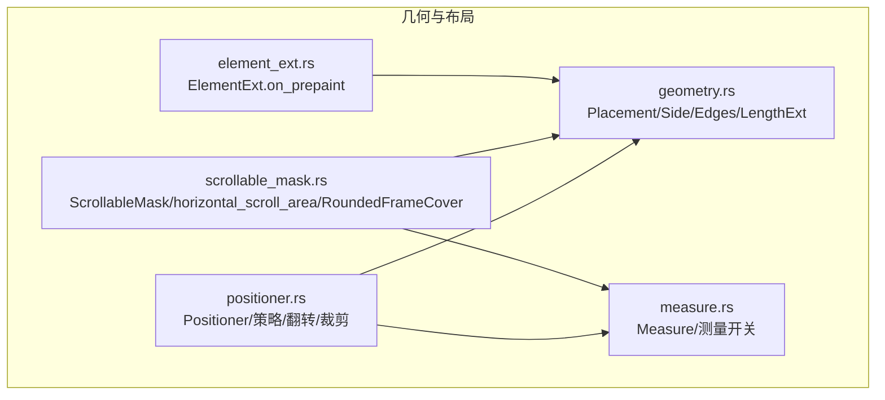
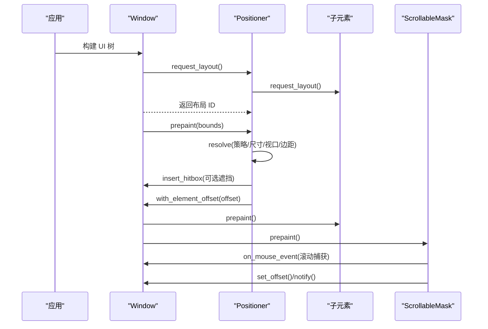
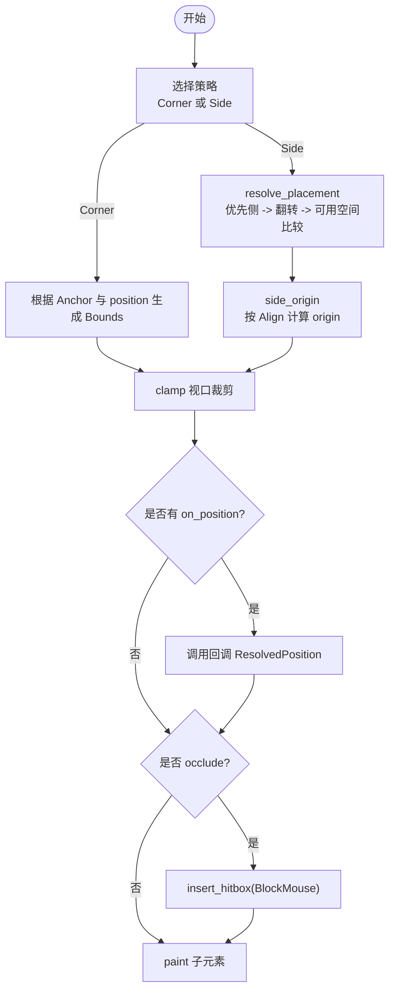
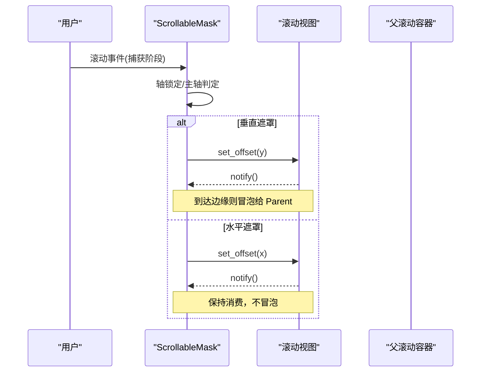
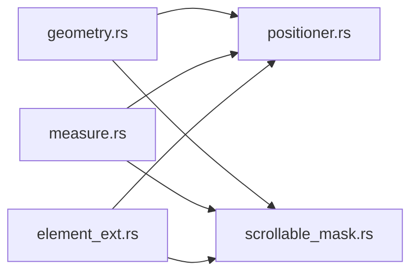

# 几何与布局系统

<cite>
**本文引用的文件**   
- [geometry.rs](file://crates/base/src/geometry.rs)
- [measure.rs](file://crates/base/src/measure.rs)
- [positioner.rs](file://crates/base/src/positioner.rs)
- [scrollable_mask.rs](file://crates/base/src/scrollable_mask.rs)
- [element_ext.rs](file://crates/base/src/element_ext.rs)
</cite>

## 目录
1. [引言](#引言)
2. [项目结构](#项目结构)
3. [核心组件](#核心组件)
4. [架构总览](#架构总览)
5. [详细组件分析](#详细组件分析)
6. [依赖关系分析](#依赖关系分析)
7. [性能考虑](#性能考虑)
8. [故障排查指南](#故障排查指南)
9. [结论](#结论)
10. [附录：API 使用指南与示例](#附录api-使用指南与示例)

## 引言
本文件面向需要深入理解并扩展 gpui-kit 几何与布局系统的开发者。文档聚焦以下目标：
- 解释坐标系统、尺寸计算与位置定位的核心算法；
- 详细说明 Geometry 相关类型、测量系统 Measure、Positioner 定位器、ScrollableMask 滚动遮罩等组件的实现原理；
- 提供点、矩形、边距、内边距等几何操作的 API 使用指南；
- 解释布局约束、弹性布局、绝对定位等布局模式的实现细节；
- 给出性能优化最佳实践，包括测量缓存、布局复用等；
- 通过实际代码示例展示复杂布局场景的处理方法。

## 项目结构
与几何与布局相关的核心代码集中在 base crate 的若干源文件中：
- geometry.rs：定义基础几何枚举、边集合 Edges、长度转换工具；
- measure.rs：提供测量计时与条件测量工具；
- positioner.rs：实现弹出层/锚定元素的统一定位策略（侧边放置、翻转、视口裁剪）；
- scrollable_mask.rs：实现滚动遮罩、水平滚动区域、圆角边框覆盖等滚动相关几何与交互逻辑；
- element_ext.rs：为父元素提供 prepaint 后观察边界的能力，便于在布局完成后进行几何观测。

图表来源
- [geometry.rs:1-152](file://crates/base/src/geometry.rs#L1-L152)
- [measure.rs:1-49](file://crates/base/src/measure.rs#L1-L49)
- [positioner.rs:1-793](file://crates/base/src/positioner.rs#L1-L793)
- [scrollable_mask.rs:1-800](file://crates/base/src/scrollable_mask.rs#L1-L800)
- [element_ext.rs:1-36](file://crates/base/src/element_ext.rs#L1-L36)

章节来源
- [geometry.rs:1-152](file://crates/base/src/geometry.rs#L1-L152)
- [measure.rs:1-49](file://crates/base/src/measure.rs#L1-L49)
- [positioner.rs:1-793](file://crates/base/src/positioner.rs#L1-L793)
- [scrollable_mask.rs:1-800](file://crates/base/src/scrollable_mask.rs#L1-L800)
- [element_ext.rs:1-36](file://crates/base/src/element_ext.rs#L1-L36)

## 核心组件
本节概述各组件的职责与协作方式：
- 几何基础（geometry.rs）：提供 Placement、Side、AxisExt、LengthExt、Edges 等基础类型，用于描述方向、边距和长度换算；
- 测量系统（measure.rs）：提供条件测量与计时封装，用于性能分析与热点定位；
- 定位器（positioner.rs）：统一处理弹出层的位置解析，支持“侧边放置+自动翻转+视口裁剪”以及“角点锚定”两种策略；
- 滚动遮罩（scrollable_mask.rs）：负责滚动事件拦截、轴锁定、边缘行为、水平滚动区域与圆角边框覆盖；
- 元素扩展（element_ext.rs）：提供 prepaint 阶段回调，以便在布局完成后读取最终边界。

章节来源
- [geometry.rs:1-152](file://crates/base/src/geometry.rs#L1-L152)
- [measure.rs:1-49](file://crates/base/src/measure.rs#L1-L49)
- [positioner.rs:1-793](file://crates/base/src/positioner.rs#L1-L793)
- [scrollable_mask.rs:1-800](file://crates/base/src/scrollable_mask.rs#L1-L800)
- [element_ext.rs:1-36](file://crates/base/src/element_ext.rs#L1-L36)

## 架构总览
下图展示了定位与滚动在 GPUI 渲染管线中的关键交互：

图表来源
- [positioner.rs:327-441](file://crates/base/src/positioner.rs#L327-L441)
- [scrollable_mask.rs:415-631](file://crates/base/src/scrollable_mask.rs#L415-L631)

## 详细组件分析

### 几何基础：Placement、Side、Edges、LengthExt
- Placement：表示元素相对触发点的方位（上/下/左/右），并提供水平/垂直判断与轴向映射；
- Side：仅表示左右两侧，常用于更细粒度的对齐或约束；
- AxisExt：为 Axis 提供便捷的水平/垂直判断；
- LengthExt：将抽象长度转换为像素值，Auto 返回 None，Definite 转为 Pixels；
- Edges<T>：四边容器，支持 all(value) 快速构造统一边距。

这些类型是定位与滚动模块的基础数据结构，贯穿了偏移、边距、视口裁剪等计算。

章节来源
- [geometry.rs:8-58](file://crates/base/src/geometry.rs#L8-L58)
- [geometry.rs:62-85](file://crates/base/src/geometry.rs#L62-L85)
- [geometry.rs:87-103](file://crates/base/src/geometry.rs#L87-L103)
- [geometry.rs:105-120](file://crates/base/src/geometry.rs#L105-L120)
- [geometry.rs:122-152](file://crates/base/src/geometry.rs#L122-L152)

### 测量系统：Measure 与条件测量
- measurement_enabled：根据环境变量决定是否启用测量日志；
- measure_if：当 if_ 为真且测量开启时，包装执行体并记录耗时；
- measure：无条件开启测量时的便捷封装；
- Measure：RAII 式计时器，结束时输出 tracing trace 日志。

该子系统不改变布局结果，主要用于性能分析与瓶颈定位。

章节来源
- [measure.rs:1-49](file://crates/base/src/measure.rs#L1-L49)

### 定位器：Positioner 的定位策略与视口裁剪
Positioner 是一个无样式的父元素，负责：
- 选择定位策略：
  - 角点锚定：将弹出层的某个角固定在指定点，不做翻转，只做视口裁剪；
  - 侧边放置：优先放置在指定侧，若空间不足则翻转到对侧，再按对齐方式计算原点，最后做视口裁剪；
- 计算窗口框架边距：区分服务器装饰与客户端装饰，并根据贴边情况调整 client_inset；
- 视口裁剪：保证弹出层始终位于可视区域内，保留最小 margin；
- 可选遮挡：插入 Hitbox 阻止鼠标穿透到下层；
- 回调：on_position 暴露最终 bounds 与 placement，供上层监听。

图表来源
- [positioner.rs:211-325](file://crates/base/src/positioner.rs#L211-L325)
- [positioner.rs:333-441](file://crates/base/src/positioner.rs#L333-L441)

章节来源
- [positioner.rs:16-70](file://crates/base/src/positioner.rs#L16-L70)
- [positioner.rs:77-182](file://crates/base/src/positioner.rs#L77-L182)
- [positioner.rs:194-204](file://crates/base/src/positioner.rs#L194-L204)
- [positioner.rs:211-325](file://crates/base/src/positioner.rs#L211-L325)
- [positioner.rs:327-441](file://crates/base/src/positioner.rs#L327-L441)

### 滚动遮罩：ScrollableMask 与 horizontal_scroll_area
ScrollableMask 是一个覆盖在滚动内容之上的交互层，职责包括：
- 轴锁定：精确手势（trackpad）开始时锁定主轴，避免对角滑动导致轴切换；
- 事件捕获：在 capture 阶段拦截滚动事件，确保自身优先于祖先滚动容器；
- 边缘行为：
  - 垂直遮罩：到达边缘时将事件冒泡给父级（类似 CSS overscroll-behavior:auto）；
  - 水平遮罩：即使到达边缘也继续消费事件，防止被父级映射为垂直滚动；
- 普通鼠标滚轮转横向：vertical_wheel 模式将竖直滚轮行增量映射为横向滚动；
- 水平滚动区域：horizontal_scroll_area 将遮罩与圆角边框覆盖作为兄弟节点，避免随滚动偏移；
- 圆角边框覆盖：RoundedFrameCover 用 Path 填充四个角落的方形缺口，使圆角视觉一致。

图表来源
- [scrollable_mask.rs:350-405](file://crates/base/src/scrollable_mask.rs#L350-L405)
- [scrollable_mask.rs:415-631](file://crates/base/src/scrollable_mask.rs#L415-L631)
- [scrollable_mask.rs:75-115](file://crates/base/src/scrollable_mask.rs#L75-L115)

章节来源
- [scrollable_mask.rs:17-60](file://crates/base/src/scrollable_mask.rs#L17-L60)
- [scrollable_mask.rs:75-115](file://crates/base/src/scrollable_mask.rs#L75-L115)
- [scrollable_mask.rs:117-170](file://crates/base/src/scrollable_mask.rs#L117-L170)
- [scrollable_mask.rs:172-290](file://crates/base/src/scrollable_mask.rs#L172-L290)
- [scrollable_mask.rs:292-324](file://crates/base/src/scrollable_mask.rs#L292-L324)
- [scrollable_mask.rs:350-405](file://crates/base/src/scrollable_mask.rs#L350-L405)
- [scrollable_mask.rs:415-631](file://crates/base/src/scrollable_mask.rs#L415-L631)

### 元素扩展：ElementExt.on_prepaint
ElementExt 为任意父元素提供 in-prepaint 回调能力，允许在布局完成后读取最终边界，常用于：
- 绘制辅助线或调试框；
- 基于最终边界进行二次布局或动画；
- 与 Positioner/ScrollableMask 配合，获取子元素最终位置以计算遮罩或吸附效果。

章节来源
- [element_ext.rs:1-36](file://crates/base/src/element_ext.rs#L1-L36)

## 依赖关系分析
- geometry.rs 被 positioner.rs 与 scrollable_mask.rs 共同依赖，提供 Placement、Edges 等基础类型；
- measure.rs 可被任何需要性能分析的模块使用；
- positioner.rs 依赖 gpui 的 Element/ParentElement/Style/Bounds/Point/Size 等，实现定位与裁剪；
- scrollable_mask.rs 依赖 gpui 的 Element/Hitbox/ContentMask/ScrollEvent 等，实现滚动事件拦截与遮罩绘制；
- element_ext.rs 依赖 gpui 的 canvas 与 ParentElement，提供 prepaint 钩子。

图表来源
- [geometry.rs:1-152](file://crates/base/src/geometry.rs#L1-L152)
- [measure.rs:1-49](file://crates/base/src/measure.rs#L1-L49)
- [positioner.rs:1-793](file://crates/base/src/positioner.rs#L1-L793)
- [scrollable_mask.rs:1-800](file://crates/base/src/scrollable_mask.rs#L1-L800)
- [element_ext.rs:1-36](file://crates/base/src/element_ext.rs#L1-L36)

章节来源
- [geometry.rs:1-152](file://crates/base/src/geometry.rs#L1-L152)
- [measure.rs:1-49](file://crates/base/src/measure.rs#L1-L49)
- [positioner.rs:1-793](file://crates/base/src/positioner.rs#L1-L793)
- [scrollable_mask.rs:1-800](file://crates/base/src/scrollable_mask.rs#L1-L800)
- [element_ext.rs:1-36](file://crates/base/src/element_ext.rs#L1-L36)

## 性能考虑
- 测量与埋点：
  - 使用 measure_if/measure 包裹昂贵计算，结合环境变量控制开关，避免生产环境开销；
- 布局与绘制：
  - Positioner 仅在 prepaint 阶段计算位置，避免重复布局；
  - ScrollableMask 在 capture 阶段处理滚动，减少事件冒泡成本；
- 视口裁剪与翻转：
  - resolve_placement 与 clamp 使用简单算术运算，复杂度 O(1)，适合高频调用；
- 遮罩与路径绘制：
  - RoundedFrameCover 仅在存在圆角半径时绘制缺口，避免多余开销；
- 建议：
  - 对频繁变化的弹出层，尽量复用 Positioner 实例并通过 position() 更新坐标；
  - 对大量滚动项，优先使用虚拟列表并结合 ScrollableMask 的轴锁定，减少重绘；
  - 使用 ElementExt.on_prepaint 收集边界统计，避免在 paint 中做复杂计算。

[本节为通用指导，不直接分析具体文件]

## 故障排查指南
- 弹出层被遮挡或错位：
  - 检查 frame_insets 与 margin 设置是否正确；
  - 确认 Placement 与 Align 组合是否符合预期；
  - 使用 on_position 回调打印 ResolvedPosition.bounds 与 placement；
- 滚动事件未生效或被父级吞掉：
  - 确认 ScrollableMask 是否在 capture 阶段注册；
  - 对于水平滚动条，使用 vertical_wheel 模式适配普通鼠标滚轮；
  - 检查 hitbox 是否被其他元素 occlude；
- 圆角边框出现方形缺口：
  - 确认 RoundedFrameCover 的 corner_radii 配置正确；
  - 检查 backdrop 颜色是否与背景一致；
- 性能问题：
  - 使用 measure 标记热点函数；
  - 减少不必要的 notify 与重建；
  - 避免在 paint 中进行复杂几何计算。

章节来源
- [positioner.rs:194-204](file://crates/base/src/positioner.rs#L194-L204)
- [positioner.rs:211-325](file://crates/base/src/positioner.rs#L211-L325)
- [scrollable_mask.rs:415-631](file://crates/base/src/scrollable_mask.rs#L415-L631)
- [scrollable_mask.rs:172-290](file://crates/base/src/scrollable_mask.rs#L172-L290)
- [measure.rs:1-49](file://crates/base/src/measure.rs#L1-L49)

## 结论
gpui-kit 的几何与布局系统以 geometry.rs 为基础，通过 positioner.rs 提供统一的弹出层定位策略，通过 scrollable_mask.rs 提供健壮的滚动遮罩与事件处理，辅以 measure.rs 的性能测量与 element_ext.rs 的布局后观测能力，形成一套完整、可扩展且高性能的几何与布局基础设施。开发者可以基于这些组件构建复杂的布局场景，同时保持良好的性能与可维护性。

[本节为总结性内容，不直接分析具体文件]

## 附录：API 使用指南与示例

### 几何操作 API 使用指南
- Placement：
  - 用于指定弹出层相对于触发点的方位；
  - 可通过 is_horizontal/is_vertical/axis 进行轴向判断；
- Side：
  - 用于限定左右两侧，常用于对齐或约束；
- Edges：
  - 使用 all(value) 快速设置统一边距；
  - 分别设置 top/right/bottom/left 实现非对称边距；
- LengthExt：
  - to_pixels(base_size, rem_size) 将抽象长度转为像素；
  - Auto 返回 None，由上层决定如何处理。

章节来源
- [geometry.rs:8-58](file://crates/base/src/geometry.rs#L8-L58)
- [geometry.rs:62-85](file://crates/base/src/geometry.rs#L62-L85)
- [geometry.rs:105-120](file://crates/base/src/geometry.rs#L105-L120)
- [geometry.rs:122-152](file://crates/base/src/geometry.rs#L122-L152)

### 定位器 Positioner 使用要点
- 侧边放置：
  - 使用 side(trigger_bounds) 创建；
  - 通过 placement/align/offset 配置首选侧、对齐方式与间距；
  - 自动翻转与视口裁剪由内部算法处理；
- 角点锚定：
  - 使用 corner(anchor, position) 创建；
  - 通过 position() 动态更新坐标；
  - 不进行翻转，仅做视口裁剪；
- 回调与遮挡：
  - on_position 获取最终 bounds 与 placement；
  - occlude 阻止鼠标穿透到下层；
  - margin 设置最小边距。

章节来源
- [positioner.rs:77-182](file://crates/base/src/positioner.rs#L77-L182)
- [positioner.rs:211-325](file://crates/base/src/positioner.rs#L211-L325)
- [positioner.rs:327-441](file://crates/base/src/positioner.rs#L327-L441)

### 滚动遮罩 ScrollableMask 使用要点
- 基本用法：
  - new(axis, scroll_handle) 创建遮罩；
  - id() 自定义元素 ID，避免多实例共享状态；
  - debug() 开启调试边框；
- 水平滚动区域：
  - horizontal_scroll_area(id, scroll_handle, style, child) 将遮罩与圆角边框覆盖作为兄弟节点；
  - 忽略垂直滚轮，仅处理水平滚动；
- 普通鼠标滚轮转横向：
  - vertical_wheel(scroll_handle) 将竖直滚轮行增量映射为横向滚动；
- 圆角边框覆盖：
  - RoundedFrameCover.uniform(radius) 设置统一圆角；
  - backdrop(color) 设置缺口填充色；
  - frame_border(width) 设置边框宽度以扩大覆盖范围。

章节来源
- [scrollable_mask.rs:75-115](file://crates/base/src/scrollable_mask.rs#L75-L115)
- [scrollable_mask.rs:117-170](file://crates/base/src/scrollable_mask.rs#L117-L170)
- [scrollable_mask.rs:172-290](file://crates/base/src/scrollable_mask.rs#L172-L290)
- [scrollable_mask.rs:350-405](file://crates/base/src/scrollable_mask.rs#L350-L405)
- [scrollable_mask.rs:415-631](file://crates/base/src/scrollable_mask.rs#L415-L631)

### 复杂布局场景示例
- 弹出菜单跟随触发按钮：
  - 使用 Positioner::side 绑定触发按钮边界；
  - 设置 placement=Bottom、align=Center、offset=px(4)；
  - 启用 occlude 阻止鼠标穿透；
  - 通过 on_position 记录最终位置，用于后续动画或吸附；
- 表格横向滚动与纵向滚动共存：
  - 表格行使用 horizontal_scroll_area 包裹；
  - 外层使用 ScrollableMask(Axis::Vertical) 处理纵向滚动；
  - 表格内部使用 ScrollableMask(Axis::Horizontal) 处理横向滚动；
  - 使用 vertical_wheel 适配普通鼠标滚轮；
- 圆角卡片内的滚动内容：
  - 使用 RoundedFrameCover 填充圆角缺口；
  - backdrop 设置为主题背景色；
  - frame_border 与卡片边框宽度一致，确保视觉一致。

章节来源
- [positioner.rs:77-182](file://crates/base/src/positioner.rs#L77-L182)
- [scrollable_mask.rs:75-115](file://crates/base/src/scrollable_mask.rs#L75-L115)
- [scrollable_mask.rs:172-290](file://crates/base/src/scrollable_mask.rs#L172-L290)
- [scrollable_mask.rs:350-405](file://crates/base/src/scrollable_mask.rs#L350-L405)
- [scrollable_mask.rs:415-631](file://crates/base/src/scrollable_mask.rs#L415-L631)