# 动画与运动系统

<cite>
**本文引用的文件**   
- [motion.rs](file://crates/base/src/motion.rs)
- [animation.rs](file://crates/base/src/animation.rs)
- [easing.rs](file://crates/base/src/motion/easing.rs)
- [keyframes.rs](file://crates/base/src/motion/keyframes.rs)
- [timing.rs](file://crates/base/src/motion/timing.rs)
- [presence.rs](file://crates/base/src/motion/presence.rs)
- [sequence.rs](file://crates/base/src/motion/sequence.rs)
- [stagger.rs](file://crates/base/src/motion/stagger.rs)
- [reduce_motion.rs](file://crates/base/src/reduce_motion.rs)
</cite>

## 目录
1. [引言](#引言)
2. [项目结构](#项目结构)
3. [核心概念](#核心概念)
4. [架构总览](#架构总览)
5. [关键组件详解](#关键组件详解)
6. [依赖关系分析](#依赖关系分析)
7. [性能与可访问性](#性能与可访问性)
8. [故障排查](#故障排查)
9. [结论](#结论)
10. [附录：API 使用指南](#附录api-使用指南)

## 引言
本文件面向希望理解并正确使用 gpui-kit 动画与运动系统的开发者。文档聚焦 Motion 框架的设计与实现，覆盖以下主题：
- Keyframes 关键帧、Easing 缓动函数、Timing 时间控制、Spring 弹簧动画等核心概念
- 动画状态管理、插值计算、序列编排的实现机制
- Discrete、Presence、Sequence、Stagger 等动画模式的 API 使用方式
- reduce_motion 可访问性支持
- GPU 加速、批量更新等性能优化实践
- 复杂动画效果的组合方法与示例思路

## 项目结构
Motion 系统位于 base crate 的 motion 模块中，并与 animation 模块共享基础插值与缓动能力；reduce_motion 提供跨平台可访问性开关。

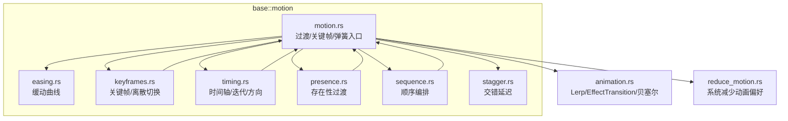

**图表来源**
- [motion.rs:14-30](file://crates/base/src/motion.rs#L14-L30)
- [animation.rs:97-257](file://crates/base/src/animation.rs#L97-L257)
- [reduce_motion.rs:1-34](file://crates/base/src/reduce_motion.rs#L1-L34)

**章节来源**
- [motion.rs:14-30](file://crates/base/src/motion.rs#L14-L30)
- [animation.rs:97-257](file://crates/base/src/animation.rs#L97-L257)
- [reduce_motion.rs:1-34](file://crates/base/src/reduce_motion.rs#L1-L34)

## 核心概念
- Interpolate 插值接口：定义任意类型在两个目标之间的线性插值语义，为数值、几何、颜色、变换等提供统一动画基础。
- Transition 基于时间的过渡策略：封装 duration、delay、easing，负责进度采样与状态（Idle/Delayed/Running/Finished）。
- Timing 时间轴：支持 delay、duration、iterations、direction、easing，输出带 phase/directed_progress/iteration 的 TimingSample。
- Spring 弹簧物理模型：以 response/damping/epsilon/travel 描述，保持速度连续性，适合可中途重定向的值。
- Keyframes 关键帧：按 offset 分段插值，每段可独立 easing；Discrete 表示在指定进度点发生离散切换。
- Presence 存在性：将 present 布尔映射到 0..1 的过渡，输出 Phase（Entering/Present/Exiting/Absent）与进度。
- Sequence 序列：多个 Step 依次播放，每个 Step 拥有自己的 target 与 Transition，完成时自动交接。
- Stagger 交错：根据 origin 计算每个元素的 delay，用于列表项或网格项的入场/出场。
- reduce_motion：读取系统“减少动画”偏好，所有 Motion API 在开启时直接返回最终值并跳过动画帧。

**章节来源**
- [motion.rs:35-104](file://crates/base/src/motion.rs#L35-L104)
- [motion.rs:106-173](file://crates/base/src/motion.rs#L106-L173)
- [timing.rs:5-175](file://crates/base/src/motion/timing.rs#L5-L175)
- [motion.rs:412-561](file://crates/base/src/motion.rs#L412-L561)
- [keyframes.rs:5-141](file://crates/base/src/motion/keyframes.rs#L5-L141)
- [presence.rs:7-155](file://crates/base/src/motion/presence.rs#L7-L155)
- [sequence.rs:5-257](file://crates/base/src/motion/sequence.rs#L5-L257)
- [stagger.rs:1-38](file://crates/base/src/motion/stagger.rs#L1-L38)
- [reduce_motion.rs:1-34](file://crates/base/src/reduce_motion.rs#L1-L34)

## 架构总览
Motion 系统以“值 + 时间策略”为核心，通过 GPUI 的 keyed element state 维护每元素每通道的动画状态，并在渲染期间按需请求下一帧。

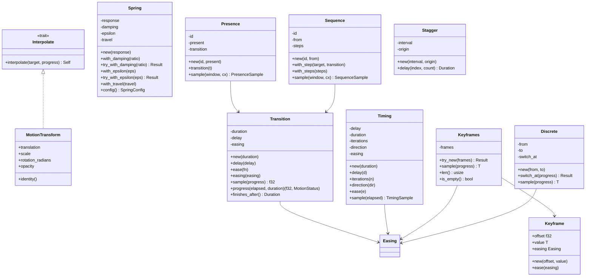

**图表来源**
- [motion.rs:35-104](file://crates/base/src/motion.rs#L35-L104)
- [motion.rs:106-173](file://crates/base/src/motion.rs#L106-L173)
- [motion.rs:412-561](file://crates/base/src/motion.rs#L412-L561)
- [keyframes.rs:5-141](file://crates/base/src/motion/keyframes.rs#L5-L141)
- [timing.rs:5-175](file://crates/base/src/motion/timing.rs#L5-L175)
- [presence.rs:28-155](file://crates/base/src/motion/presence.rs#L28-L155)
- [sequence.rs:5-257](file://crates/base/src/motion/sequence.rs#L5-L257)
- [stagger.rs:1-38](file://crates/base/src/motion/stagger.rs#L1-L38)

## 关键组件详解

### 插值与基础动画
- Lerp trait 提供数值、Pixels、Point、Hsla 等类型的线性插值实现。
- EffectTransition 是旧式元素级过渡（fade/slide/width/height），内部使用 Animation 与 Lerp 驱动样式属性。
- cubic_bezier 与 unclamped_cubic_bezier 提供 CSS 兼容的三次贝塞尔求解器，支持预期与超调。

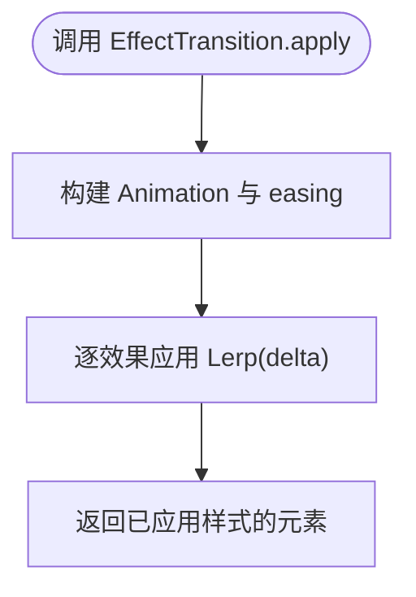

**图表来源**
- [animation.rs:143-257](file://crates/base/src/animation.rs#L143-L257)
- [animation.rs:97-139](file://crates/base/src/animation.rs#L97-L139)
- [animation.rs:9-71](file://crates/base/src/animation.rs#L9-L71)

**章节来源**
- [animation.rs:9-71](file://crates/base/src/animation.rs#L9-L71)
- [animation.rs:97-139](file://crates/base/src/animation.rs#L97-L139)
- [animation.rs:143-257](file://crates/base/src/animation.rs#L143-L257)

### 过渡 Transition 与状态机
- Transition 封装 duration、delay、easing，并提供 sample 与 progress。
- MotionStatus 表达 Idle/Delayed/Running/Finished 四态。
- transition / transition_with_status 基于 ElementId 通道维护 ValueTransition 状态，支持反向回退与重定向。

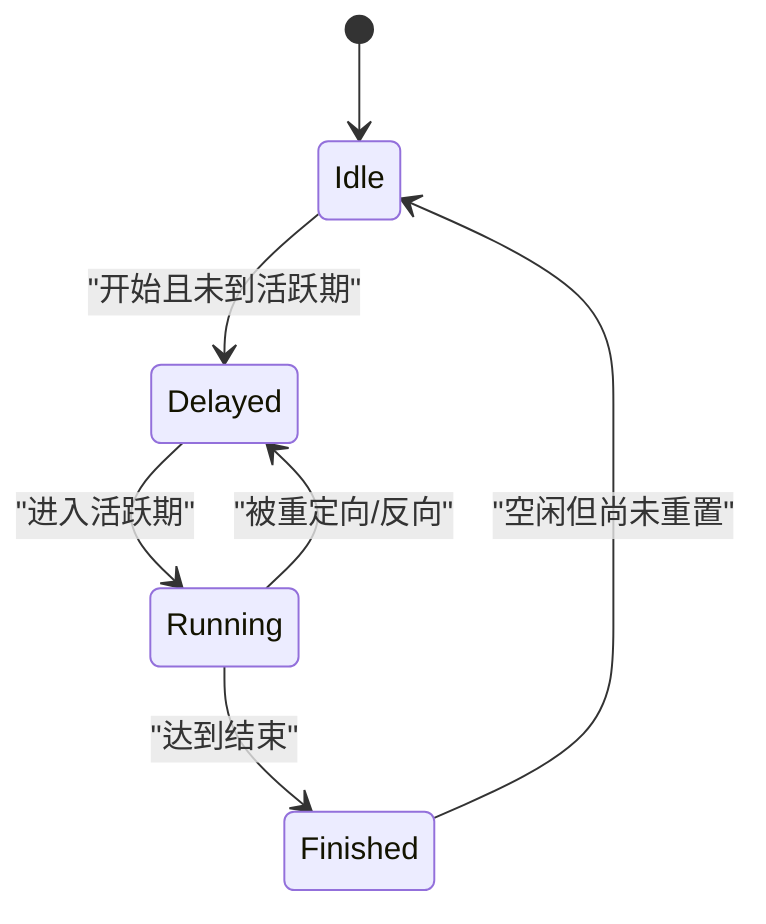

**图表来源**
- [motion.rs:246-258](file://crates/base/src/motion.rs#L246-L258)
- [motion.rs:152-173](file://crates/base/src/motion.rs#L152-L173)
- [motion.rs:268-361](file://crates/base/src/motion.rs#L268-L361)

**章节来源**
- [motion.rs:106-173](file://crates/base/src/motion.rs#L106-L173)
- [motion.rs:246-258](file://crates/base/src/motion.rs#L246-L258)
- [motion.rs:268-361](file://crates/base/src/motion.rs#L268-L361)

### 关键帧 Keyframes 与离散 Discrete
- Keyframe 包含 offset、value、easing；Keyframes 校验端点与单调性，并按区间插值。
- Discrete 在 switch_at 处从 from 切换到 to，常用于图标/状态的突变。

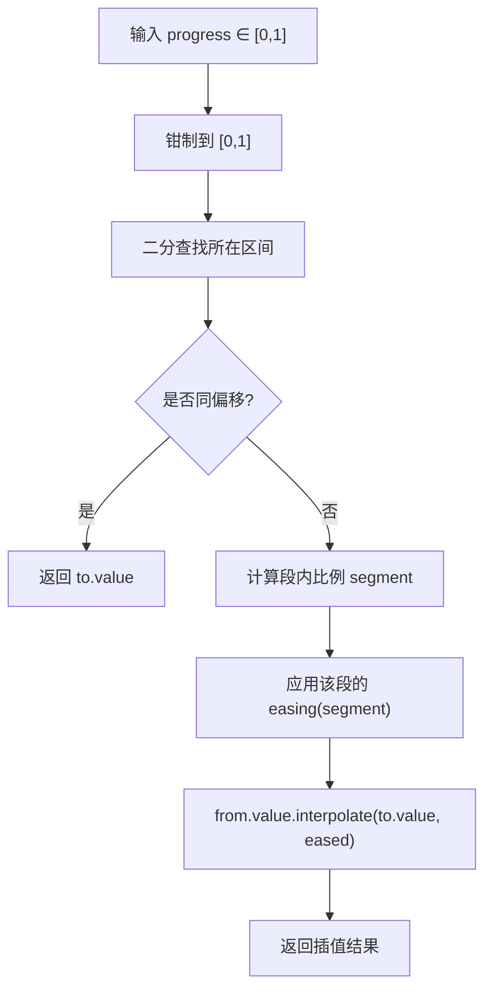

**图表来源**
- [keyframes.rs:41-90](file://crates/base/src/motion/keyframes.rs#L41-L90)
- [keyframes.rs:101-141](file://crates/base/src/motion/keyframes.rs#L101-L141)

**章节来源**
- [keyframes.rs:5-141](file://crates/base/src/motion/keyframes.rs#L5-L141)

### 时间控制 Timing
- Timing 支持 delay（可为负）、duration、iterations（有限/无限）、direction（Normal/Reverse/Alternate/AlternateReverse）、easing。
- sample 返回 TimingSample，包含 phase、directed_progress、iteration、active、finished。

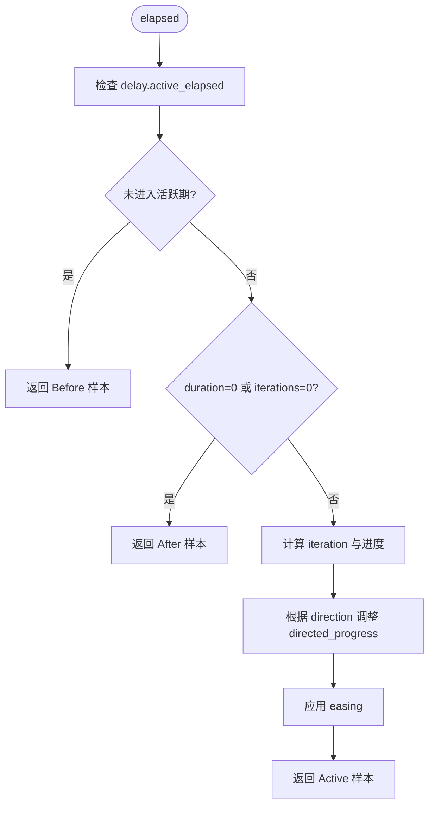

**图表来源**
- [timing.rs:113-174](file://crates/base/src/motion/timing.rs#L113-L174)
- [timing.rs:5-71](file://crates/base/src/motion/timing.rs#L5-L71)

**章节来源**
- [timing.rs:5-175](file://crates/base/src/motion/timing.rs#L5-L175)

### 弹簧 Spring
- Spring 以 response/damping/epsilon/travel 建模物理弹簧，支持 travel 暂停移动但保留状态。
- spring 函数维护 SpringState（position/velocity），在静止于目标时零开销；否则步进并请求下一帧。

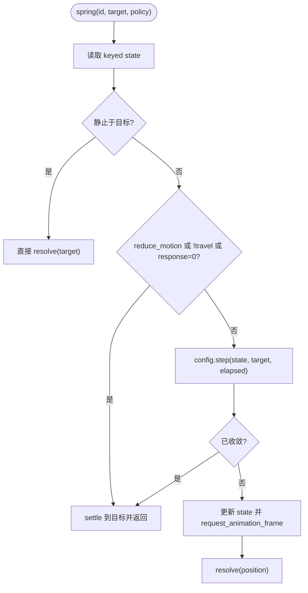

**图表来源**
- [motion.rs:412-561](file://crates/base/src/motion.rs#L412-L561)
- [motion.rs:579-653](file://crates/base/src/motion.rs#L579-L653)

**章节来源**
- [motion.rs:412-561](file://crates/base/src/motion.rs#L412-L561)
- [motion.rs:579-653](file://crates/base/src/motion.rs#L579-L653)

### 存在性 Presence
- Presence 将 present 布尔映射到 0..1 的过渡，输出 PresencePhase（Entering/Present/Exiting/Absent）。
- 在 reduce_motion 或 duration=0 时直接稳定返回 Present/Absent。

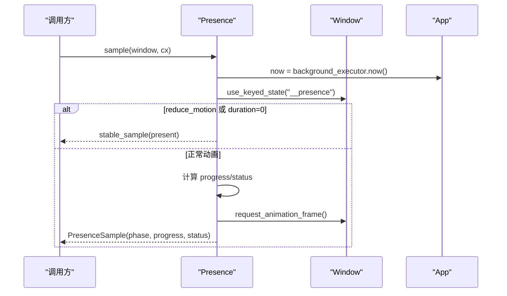

**图表来源**
- [presence.rs:28-155](file://crates/base/src/motion/presence.rs#L28-L155)

**章节来源**
- [presence.rs:7-155](file://crates/base/src/motion/presence.rs#L7-L155)

### 序列编排 Sequence
- Sequence 由多个 SequenceStep 组成，每个 Step 有 target 与 Transition。
- 状态机按 step 推进，完成时 hand_over 到下一步；重定向时从当前插值位置重启。

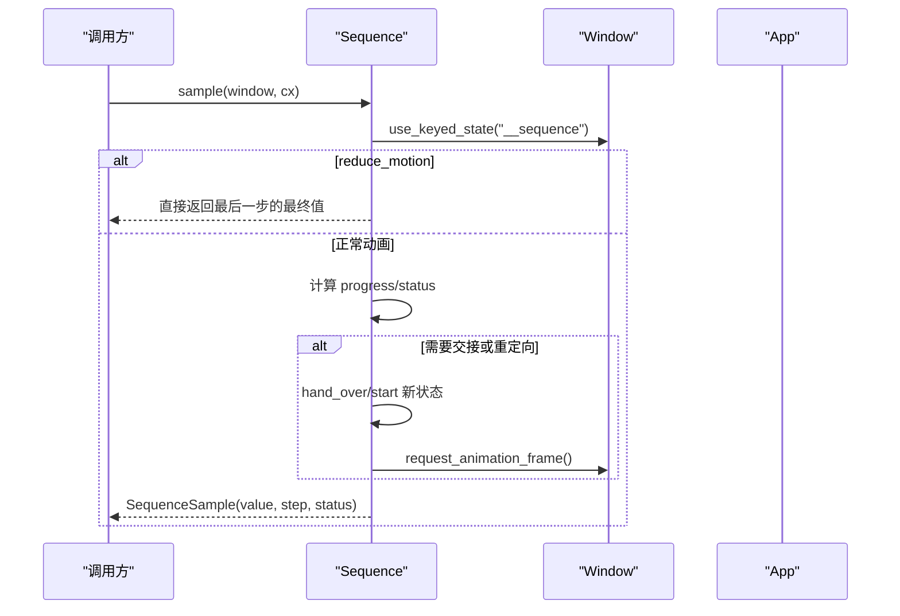

**图表来源**
- [sequence.rs:66-257](file://crates/base/src/motion/sequence.rs#L66-L257)

**章节来源**
- [sequence.rs:5-257](file://crates/base/src/motion/sequence.rs#L5-L257)

### 交错 Stagger
- Stagger 根据 interval 与 origin（First/Last/Center/Index）计算每个索引的 delay。
- 常用于列表项入场、网格项出现等场景。

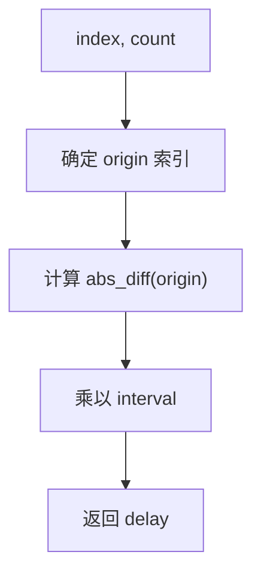

**图表来源**
- [stagger.rs:1-38](file://crates/base/src/motion/stagger.rs#L1-L38)

**章节来源**
- [stagger.rs:1-38](file://crates/base/src/motion/stagger.rs#L1-L38)

## 依赖关系分析
- motion.rs 作为门面，导出 Easing、Keyframes、Presence、Sequence、Stagger、Timing 等公共类型，并实现 transition/animate_keyframes/spring 等运行时逻辑。
- easing.rs 依赖 animation.rs 的 cubic_bezier/unclamped_cubic_bezier。
- presence.rs、sequence.rs、keyframes.rs 均依赖 motion.rs 中的 Transition、Interpolate、MotionStatus 等。
- reduce_motion.rs 通过 App::reduce_motion 影响所有 Motion API 的行为。

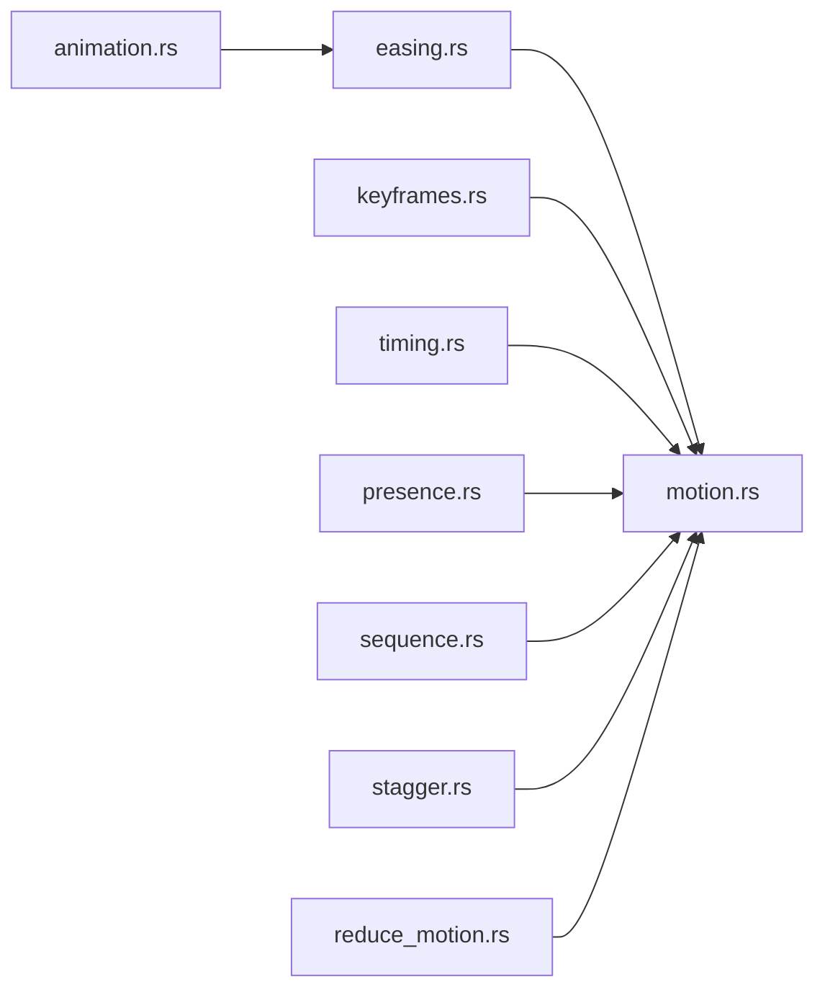

**图表来源**
- [motion.rs:14-30](file://crates/base/src/motion.rs#L14-L30)
- [easing.rs:1-4](file://crates/base/src/motion/easing.rs#L1-L4)
- [animation.rs:9-71](file://crates/base/src/animation.rs#L9-L71)

**章节来源**
- [motion.rs:14-30](file://crates/base/src/motion.rs#L14-L30)
- [easing.rs:1-4](file://crates/base/src/motion/easing.rs#L1-L4)
- [animation.rs:9-71](file://crates/base/src/animation.rs#L9-L71)

## 性能与可访问性

### 性能优化要点
- 使用 GPU 友好的属性：优先使用 transform（translate/scale/rotate）与 opacity，避免触发布局与重绘的属性（如 width/height/top/left）。
- 批量更新：尽量在同一帧内集中更新多个 MotionValue，减少多次 request_animation_frame。
- 利用静止优化：spring 在静止于目标时无额外计算；Transition 在 Idle 状态下不请求帧。
- 合理设置 epsilon：像素级动画可使用更宽松的 epsilon 提前结束，减少子像素抖动带来的多余帧。
- 复用 key：animate_keyframes 与 transition 使用稳定的 id 维持回放状态；需要重播时变更 id（例如加入 generation）。
- 避免昂贵 easing：自定义 easing 函数应轻量；必要时缓存中间结果或使用预计算表。

[本节为通用指导，不直接分析具体文件]

### 可访问性 reduce_motion
- 系统在初始化时尝试读取平台的“减少动画”偏好，并通过 App::reduce_motion 暴露给所有 Motion API。
- 当 reduce_motion 为真时，transition/animate_keyframes/spring/presence/sequence 会直接返回最终值并跳过动画帧。
- 平台差异：
  - macOS：NSWorkspace.accessibilityDisplayShouldReduceMotion
  - Windows：SystemParametersInfoW(SPI_GETCLIENTAREAANIMATION)
  - Linux：XDG Desktop Portal Settings reduced-motion（异步监听）

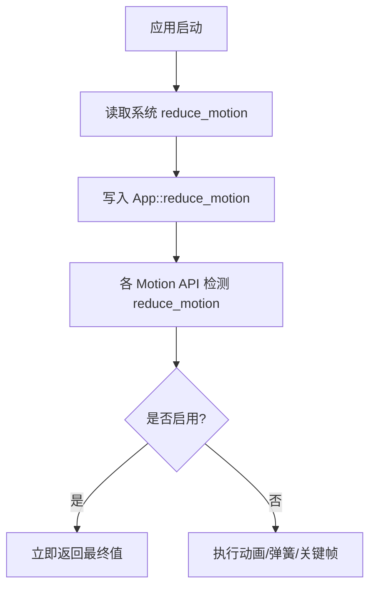

**图表来源**
- [reduce_motion.rs:47-101](file://crates/base/src/reduce_motion.rs#L47-L101)
- [reduce_motion.rs:103-183](file://crates/base/src/reduce_motion.rs#L103-L183)
- [motion.rs:303-317](file://crates/base/src/motion.rs#L303-L317)
- [motion.rs:390-395](file://crates/base/src/motion.rs#L390-L395)
- [motion.rs:628-631](file://crates/base/src/motion.rs#L628-L631)
- [presence.rs:61-72](file://crates/base/src/motion/presence.rs#L61-L72)
- [sequence.rs:148-160](file://crates/base/src/motion/sequence.rs#L148-L160)

**章节来源**
- [reduce_motion.rs:1-34](file://crates/base/src/reduce_motion.rs#L1-L34)
- [reduce_motion.rs:47-101](file://crates/base/src/reduce_motion.rs#L47-L101)
- [reduce_motion.rs:103-183](file://crates/base/src/reduce_motion.rs#L103-L183)
- [motion.rs:303-317](file://crates/base/src/motion.rs#L303-L317)
- [motion.rs:390-395](file://crates/base/src/motion.rs#L390-L395)
- [motion.rs:628-631](file://crates/base/src/motion.rs#L628-L631)
- [presence.rs:61-72](file://crates/base/src/motion/presence.rs#L61-L72)
- [sequence.rs:148-160](file://crates/base/src/motion/sequence.rs#L148-L160)

## 故障排查
- 关键帧无效：确保至少两个关键帧、offset 单调、首尾为 0.0/1.0，否则会抛出 KeyframeError。
- 缓动参数非法：cubic_bezier 的控制点必须有限且 x∈[0,1]；steps 的 count 必须非零；linear_stops 需满足输入/输出约束。
- 弹簧参数非法：damping 必须为非负有限数；epsilon 必须为正有限数；可通过 try_with_* 获取错误。
- 时序异常：negative delay 会使初始进度位于活跃区间；alternate 会在奇数次迭代反转方向。
- 不可达帧：若进度超出 [0,1]，clamp 后仍可能产生预期/超调（贝塞尔 y 控制点越界），对 opacity/color 等属性需自行 clamp。

**章节来源**
- [keyframes.rs:41-68](file://crates/base/src/motion/keyframes.rs#L41-L68)
- [easing.rs:113-176](file://crates/base/src/motion/easing.rs#L113-L176)
- [motion.rs:428-561](file://crates/base/src/motion.rs#L428-L561)
- [timing.rs:113-174](file://crates/base/src/motion/timing.rs#L113-L174)
- [animation.rs:9-71](file://crates/base/src/animation.rs#L9-L71)

## 结论
gpui-kit 的 Motion 系统以“值 + 时间策略”为核心，提供从简单过渡到复杂序列编排的完整能力。其设计强调：
- 可插值的值抽象与统一的 MotionStatus 状态机
- 与 GPUI 元素状态深度集成的运行时
- 对系统 reduce_motion 的全链路支持
- 对性能敏感路径的优化（静止零开销、request_animation_frame 条件化）

在实际项目中，建议优先使用 transform/opacity 进行 GPU 友好动画，结合 Presence/Sequence/Stagger 组织复杂交互，并通过 reduce_motion 保障可访问性。

[本节为总结性内容，不直接分析具体文件]

## 附录：API 使用指南

### 基础过渡 transition
- 适用场景：单值过渡（如尺寸、透明度、位移）。
- 关键点：
  - 使用稳定的 TransitionId 标识元素内的不同通道
  - 通过 Transition::new(Duration).delay(...).ease(...) 配置
  - 在 reduce_motion 下直接返回目标值

参考路径
- [motion.rs:106-173](file://crates/base/src/motion.rs#L106-L173)
- [motion.rs:268-361](file://crates/base/src/motion.rs#L268-L361)

### 关键帧 animate_keyframes
- 适用场景：多阶段动画（入场、停留、退出），每段可独立 easing。
- 关键点：
  - 使用 Keyframes::try_new 构造，确保端点与单调性
  - 使用 Timing 控制 delay/duration/iterations/direction/easing
  - 在 reduce_motion 下直接返回最终帧

参考路径
- [motion.rs:374-410](file://crates/base/src/motion.rs#L374-L410)
- [keyframes.rs:41-90](file://crates/base/src/motion/keyframes.rs#L41-L90)
- [timing.rs:82-174](file://crates/base/src/motion/timing.rs#L82-L174)

### 离散切换 Discrete
- 适用场景：图标/状态在某个进度点突变。
- 关键点：
  - 使用 Discrete::new(from, to).switch_at(progress)
  - 配合 Keyframes 或 Timing 使用

参考路径
- [keyframes.rs:101-141](file://crates/base/src/motion/keyframes.rs#L101-L141)

### 存在性 Presence
- 适用场景：组件出现/消失的淡入淡出或滑入滑出。
- 关键点：
  - new(id, present).transition(Transition)
  - sample 返回 PresenceSample，should_render 判断是否渲染

参考路径
- [presence.rs:28-155](file://crates/base/src/motion/presence.rs#L28-L155)

### 序列编排 Sequence
- 适用场景：多步动画（如先缩放再平移），步骤间无缝衔接。
- 关键点：
  - new(id, from).with_step(target, transition)
  - sample 返回 SequenceSample，step/status/value 可用于 UI 分支

参考路径
- [sequence.rs:66-257](file://crates/base/src/motion/sequence.rs#L66-L257)

### 交错 Stagger
- 适用场景：列表项逐个入场，origin 决定起始位置。
- 关键点：
  - Stagger::new(interval, origin).delay(index, count)
  - 通常与 Presence/Sequence 组合

参考路径
- [stagger.rs:1-38](file://crates/base/src/motion/stagger.rs#L1-L38)

### 弹簧 Spring
- 适用场景：可中途重定向的物理动画（拖拽释放、弹性反馈）。
- 关键点：
  - Spring::new(response).with_damping/ratio.with_epsilon.with_travel
  - spring(id, target, policy) 返回目标类型解析后的值

参考路径
- [motion.rs:412-561](file://crates/base/src/motion.rs#L412-L561)
- [motion.rs:579-653](file://crates/base/src/motion.rs#L579-L653)

### 可访问性 reduce_motion
- 适用场景：遵循系统“减少动画”偏好。
- 关键点：
  - 应用启动时调用 init 或 apply_system_reduce_motion
  - 所有 Motion API 自动响应 App::reduce_motion

参考路径
- [reduce_motion.rs:47-101](file://crates/base/src/reduce_motion.rs#L47-L101)
- [reduce_motion.rs:103-183](file://crates/base/src/reduce_motion.rs#L103-L183)