# 基础层 (gpui-base)

<cite>
**本文引用的文件**   
- [crates/base/Cargo.toml](file://crates/base/Cargo.toml)
- [crates/base/README.md](file://crates/base/README.md)
- [crates/base/src/lib.rs](file://crates/base/src/lib.rs)
- [crates/base/src/root.rs](file://crates/base/src/root.rs)
- [crates/base/src/theme.rs](file://crates/base/src/theme.rs)
- [crates/base/src/motion.rs](file://crates/base/src/motion.rs)
- [crates/base/src/geometry.rs](file://crates/base/src/geometry.rs)
- [crates/base/src/component_traits.rs](file://crates/base/src/component_traits.rs)
- [crates/base/src/measure.rs](file://crates/base/src/measure.rs)
- [crates/base/src/styled.rs](file://crates/base/src/styled.rs)
- [crates/base/src/state_style.rs](file://crates/base/src/state_style.rs)
</cite>

## 目录
1. [引言](#引言)
2. [项目结构](#项目结构)
3. [核心组件](#核心组件)
4. [架构总览](#架构总览)
5. [详细组件分析](#详细组件分析)
6. [依赖关系分析](#依赖关系分析)
7. [性能与测量](#性能与测量)
8. [故障排查指南](#故障排查指南)
9. [结论](#结论)
10. [附录：行为抽象与扩展点](#附录行为抽象与扩展点)

## 引言
`gpui-base` 是 GPUI 应用的行为与基础设施基础层。它提供交互、焦点管理、可访问性语义、动画、主题令牌、滚动与虚拟列表等能力，但**不绑定具体视觉样式**。这意味着“行为属于基础层，呈现属于应用或上层组件库”。例如 `Button::new("save")` 默认没有内边距、背景、圆角和尺寸；这些由调用方决定。

该层适合希望拥有自身设计系统、复用稳定行为并自行控制外观的应用。若需要开箱即用且带完整视觉设计的组件，应使用更高层的 `gpui-component`。

**章节来源**
- [crates/base/README.md:1-44](file://crates/base/README.md#L1-L44)

## 项目结构
`crates/base` 是一个以“行为 + 基础设施”为核心的 Rust crate。其顶层模块通过 `lib.rs` 统一暴露公共 API，并按职责划分到多个源文件：

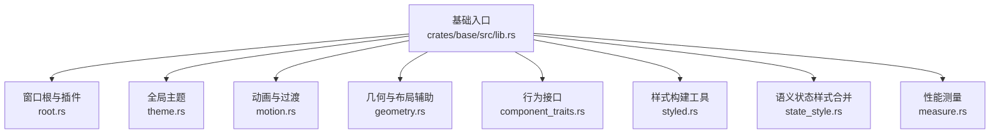

**图表来源**
- [crates/base/src/lib.rs:12-89](file://crates/base/src/lib.rs#L12-L89)
- [crates/base/src/lib.rs:91-226](file://crates/base/src/lib.rs#L91-L226)

**章节来源**
- [crates/base/src/lib.rs:1-90](file://crates/base/src/lib.rs#L1-L90)
- [crates/base/Cargo.toml:1-14](file://crates/base/Cargo.toml#L1-L14)

## 核心组件
本节聚焦基础层的关键抽象：Root 根组件、Theme 主题系统、Motion 动画系统、Geometry 几何计算、ComponentTraits 行为接口、样式与状态合并机制，以及测量与渲染管线。

### Root 根组件与展示层插件
Root 是窗口内容宿主，负责：
- 注册并持有展示层插件（如窗口边框、调试层、覆盖层）。
- 在每帧渲染前执行插件的 `prepare`，用于同步窗口级设置。
- 为根表面应用插件默认样式，再应用实例样式。
- 允许插件用 `decorate` 包裹最终元素树。
- 处理 Tab / Shift-Tab 焦点遍历，并在存在 FocusTrap 时把焦点限制在容器内。
- 提供复制选中文本的快捷键支持。

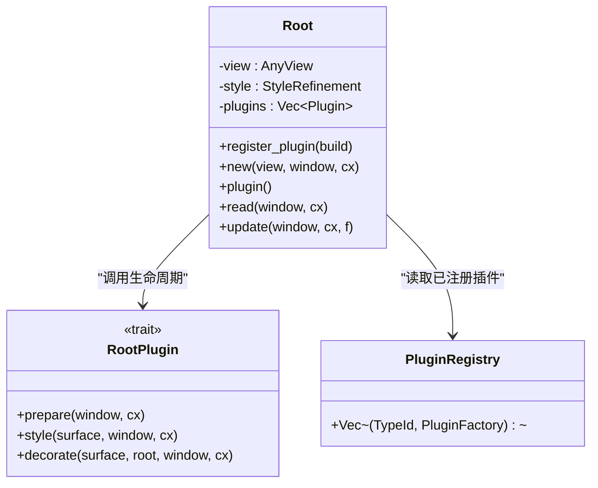

**图表来源**
- [crates/base/src/root.rs:53-103](file://crates/base/src/root.rs#L53-L103)
- [crates/base/src/root.rs:109-124](file://crates/base/src/root.rs#L109-L124)
- [crates/base/src/root.rs:126-221](file://crates/base/src/root.rs#L126-L221)

Root 的渲染流程如下：

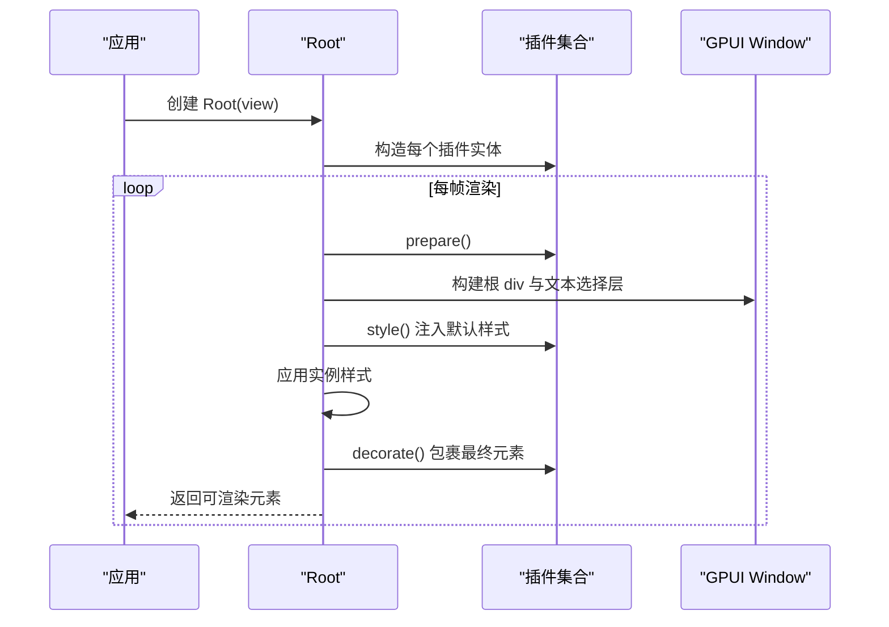

**图表来源**
- [crates/base/src/root.rs:246-277](file://crates/base/src/root.rs#L246-L277)

**章节来源**
- [crates/base/src/root.rs:11-51](file://crates/base/src/root.rs#L11-L51)
- [crates/base/src/root.rs:53-103](file://crates/base/src/root.rs#L53-L103)
- [crates/base/src/root.rs:126-277](file://crates/base/src/root.rs#L126-L277)

### Theme 主题系统
Theme 是基础层的全局配置中心，包含：
- 明暗外观 `ThemeAppearance`。
- 语义令牌 `SemanticThemeTokens`。
- 滚动条默认行为 `ScrollbarTheme`。
- 可调整面板默认行为 `ResizableTheme`。
- 图表动画默认行为 `PlotTheme`。
- 光标闪烁策略 `CursorBlink`。

Theme 作为 GPUI 的 Global 存储，可通过 `Theme::global(cx)` 读取，或通过 `Theme::global_mut(cx)` 获取可变引用进行初始化或修改。

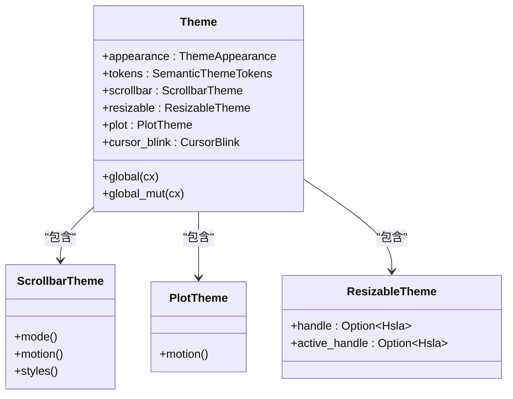

**图表来源**
- [crates/base/src/theme.rs:10-46](file://crates/base/src/theme.rs#L10-L46)
- [crates/base/src/theme.rs:60-146](file://crates/base/src/theme.rs#L60-L146)

**章节来源**
- [crates/base/src/theme.rs:10-58](file://crates/base/src/theme.rs#L10-L58)
- [crates/base/src/theme.rs:60-146](file://crates/base/src/theme.rs#L60-L146)

### Motion 动画系统
Motion 提供两套动画 API：
- `transition` / `transition_with_status`：基于目标值与时间策略的 CSS 风格过渡。
- `spring`：物理弹簧过渡，保留速度，适合拖拽中断后继续运动。
- `animate_keyframes`：关键帧序列播放。
- 支持缓动函数、延迟、迭代次数、回放方向、交错、出现/消失、揭示等高级特性。

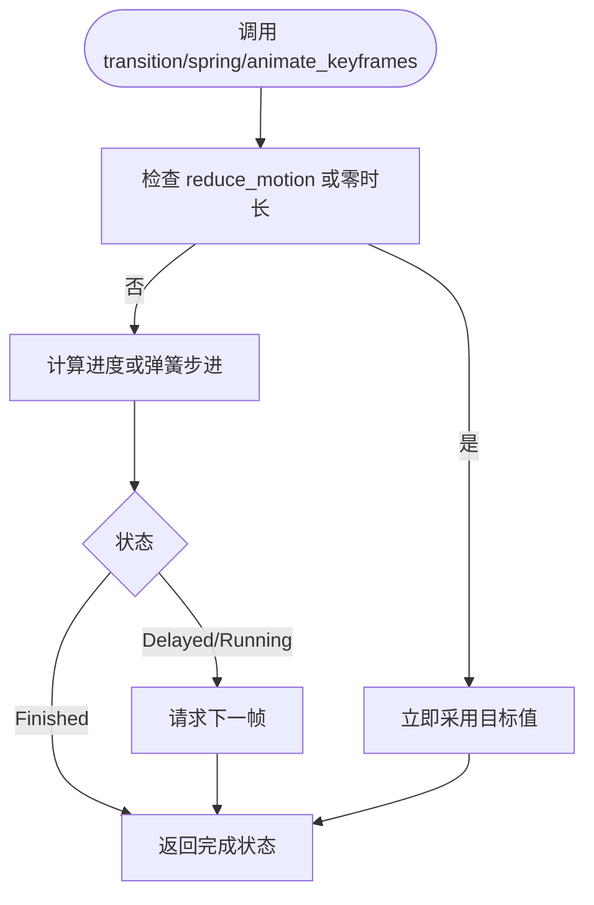

**图表来源**
- [crates/base/src/motion.rs:260-361](file://crates/base/src/motion.rs#L260-L361)
- [crates/base/src/motion.rs:374-410](file://crates/base/src/motion.rs#L374-L410)
- [crates/base/src/motion.rs:579-653](file://crates/base/src/motion.rs#L579-L653)

**章节来源**
- [crates/base/src/motion.rs:32-38](file://crates/base/src/motion.rs#L32-L38)
- [crates/base/src/motion.rs:64-104](file://crates/base/src/motion.rs#L64-L104)
- [crates/base/src/motion.rs:106-173](file://crates/base/src/motion.rs#L106-L173)
- [crates/base/src/motion.rs:260-361](file://crates/base/src/motion.rs#L260-L361)
- [crates/base/src/motion.rs:374-410](file://crates/base/src/motion.rs#L374-L410)
- [crates/base/src/motion.rs:412-561](file://crates/base/src/motion.rs#L412-L561)
- [crates/base/src/motion.rs:579-653](file://crates/base/src/motion.rs#L579-L653)

### Geometry 几何计算
Geometry 模块提供布局与定位的基础类型与扩展：
- `Placement`：描述元素相对父容器的放置方向。
- `Side`：描述左右侧。
- `AxisExt`：扩展 Axis 的水平/垂直判断。
- `LengthExt`：将 Length 转换为像素。
- `Edges<T>`：四边可序列化、可比较的边距/内边距容器。

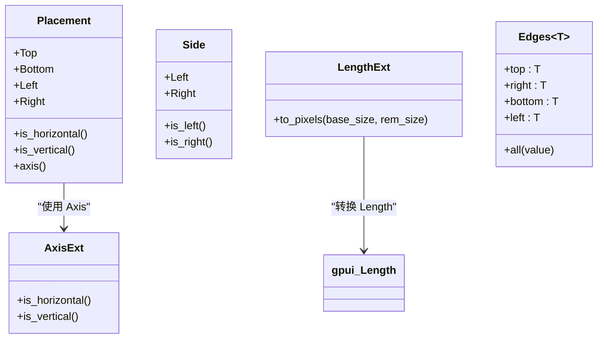

**图表来源**
- [crates/base/src/geometry.rs:8-58](file://crates/base/src/geometry.rs#L8-L58)
- [crates/base/src/geometry.rs:62-85](file://crates/base/src/geometry.rs#L62-L85)
- [crates/base/src/geometry.rs:87-120](file://crates/base/src/geometry.rs#L87-L120)
- [crates/base/src/geometry.rs:122-151](file://crates/base/src/geometry.rs#L122-L151)

**章节来源**
- [crates/base/src/geometry.rs:8-151](file://crates/base/src/geometry.rs#L8-L151)

### ComponentTraits 行为接口
基础层定义一组面向行为的 trait，使组件可以表达语义状态而不绑定视觉实现：
- `Selectable`：表达选中状态与弹出打开状态。
- `Disableable`：表达禁用状态。
- `FocusableExt`：表达是否绘制焦点环。
- `Collapsible`：表达折叠状态。

这些 trait 强调“状态与呈现分离”，视觉细节由上层组件或应用决定。

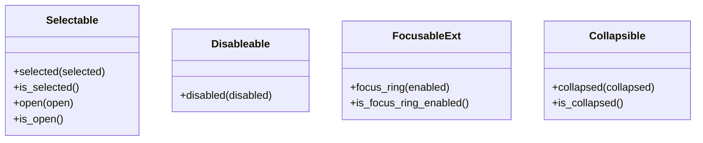

**图表来源**
- [crates/base/src/component_traits.rs:1-56](file://crates/base/src/component_traits.rs#L1-L56)

**章节来源**
- [crates/base/src/component_traits.rs:1-56](file://crates/base/src/component_traits.rs#L1-L56)

### 样式系统与状态合并
基础层提供通用样式构建工具与语义状态样式合并逻辑：
- `StyledExt`：提供 flex 布局、边距、字体粗细、调试边框、圆角等便捷方法。
- `StateStyle`：包装 `StyleRefinement`，支持 fluent 构建器。
- `resolve_style`：固定顺序合并实例样式、活跃状态样式、禁用样式。

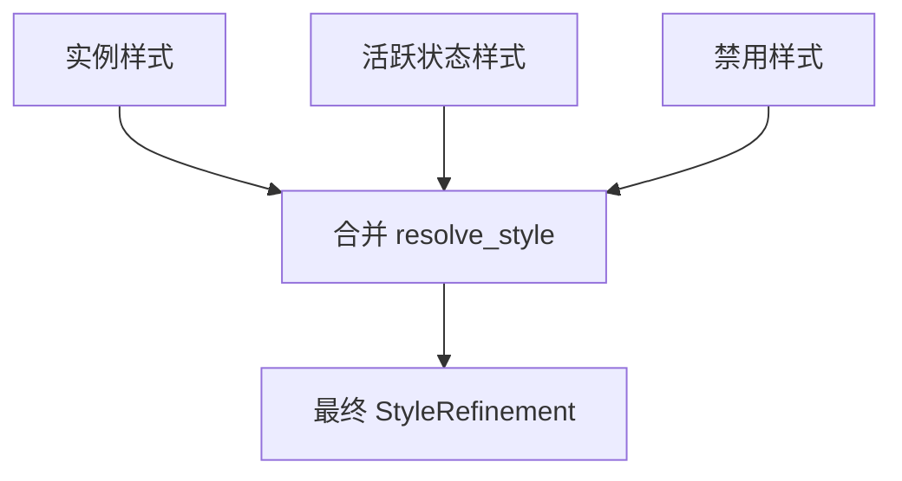

**图表来源**
- [crates/base/src/styled.rs:34-64](file://crates/base/src/styled.rs#L34-L64)
- [crates/base/src/styled.rs:78-203](file://crates/base/src/styled.rs#L78-L203)
- [crates/base/src/state_style.rs:27-53](file://crates/base/src/state_style.rs#L27-L53)

**章节来源**
- [crates/base/src/styled.rs:34-203](file://crates/base/src/styled.rs#L34-L203)
- [crates/base/src/state_style.rs:1-53](file://crates/base/src/state_style.rs#L1-L53)

## 架构总览
基础层位于应用与底层 GPUI 之间，向上暴露无样式行为与基础设施，向下依赖 GPUI 的视图、窗口、事件、样式与平台能力。

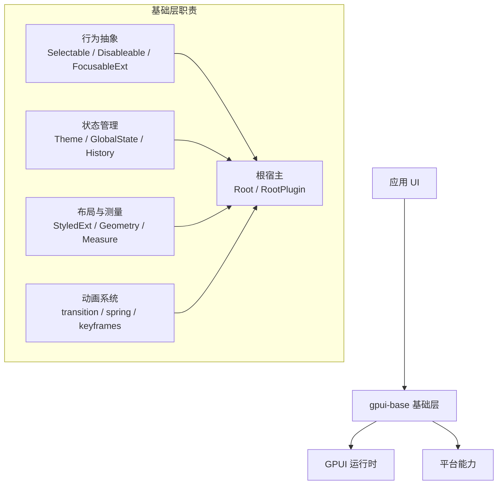

**图表来源**
- [crates/base/src/lib.rs:238-256](file://crates/base/src/lib.rs#L238-L256)
- [crates/base/src/root.rs:53-103](file://crates/base/src/root.rs#L53-L103)
- [crates/base/src/theme.rs:10-46](file://crates/base/src/theme.rs#L10-L46)
- [crates/base/src/motion.rs:260-361](file://crates/base/src/motion.rs#L260-L361)

**章节来源**
- [crates/base/src/lib.rs:1-90](file://crates/base/src/lib.rs#L1-L90)
- [crates/base/src/lib.rs:238-256](file://crates/base/src/lib.rs#L238-L256)

## 详细组件分析

### Root 根组件深度分析
Root 的核心价值在于“窗口级宿主 + 插件化展示层”。它不关心应用如何装饰窗口，只保证：
- 插件生命周期按顺序执行。
- 插件默认样式优先于实例样式。
- 插件装饰包裹最终元素。
- 焦点遍历尊重 FocusTrap。
- 复制选中文本符合平台习惯。

#### 渲染阶段
1. `prepare`：同步窗口级设置。
2. 构建根元素与文本选择层。
3. `style`：插件注入默认样式。
4. 应用 Root 实例样式。
5. `decorate`：插件包裹最终元素。

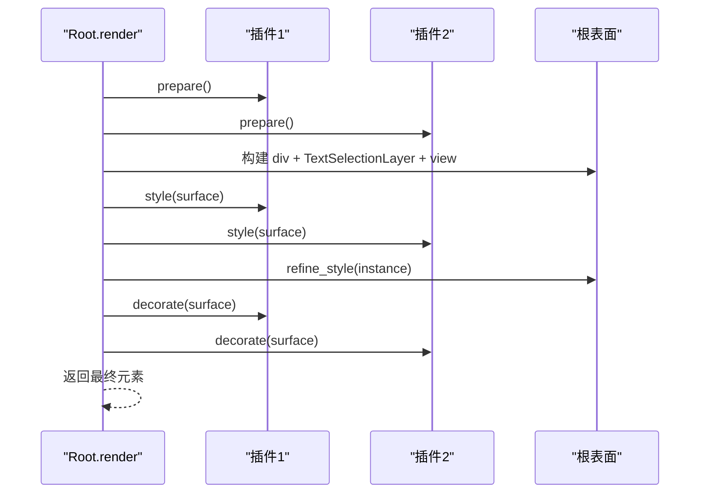

**图表来源**
- [crates/base/src/root.rs:246-277](file://crates/base/src/root.rs#L246-L277)

#### 焦点陷阱与 Tab 遍历
当存在活动焦点陷阱时，Root 会先尝试一次普通焦点前进，然后检测当前焦点是否在陷阱容器内；如果不在，则持续前进直到回到容器或检测到循环。这避免了模态遮挡下焦点逃逸到背景控件。

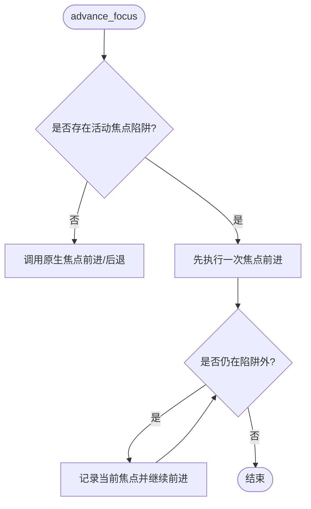

**图表来源**
- [crates/base/src/root.rs:14-40](file://crates/base/src/root.rs#L14-L40)

**章节来源**
- [crates/base/src/root.rs:14-51](file://crates/base/src/root.rs#L14-L51)
- [crates/base/src/root.rs:53-103](file://crates/base/src/root.rs#L53-L103)
- [crates/base/src/root.rs:126-277](file://crates/base/src/root.rs#L126-L277)

### Theme 主题系统深度分析
Theme 是基础层全局配置的单一事实来源。它不是“样式库”，而是“行为默认值 + 语义令牌”的配置对象。例如：
- `ScrollbarTheme` 控制滚动条模式、动效与样式。
- `PlotTheme` 控制图表动画。
- `ResizableTheme` 控制可调整面板手柄颜色。
- `Theme.tokens` 提供颜色、圆角、间距、排版、阴影等语义令牌。

应用可以在初始化后修改全局主题，但要注意：令牌本身不会自动给无样式控件上色；应用必须读取令牌并在自己的组件中应用。

**章节来源**
- [crates/base/src/theme.rs:10-58](file://crates/base/src/theme.rs#L10-L58)
- [crates/base/src/theme.rs:60-146](file://crates/base/src/theme.rs#L60-L146)

### Motion 动画系统深度分析
Motion 的设计目标是“值动画与呈现解耦”。它不替调用者选择要动画的属性，而是返回当前插值结果或弹簧位置。

#### 值过渡 `transition`
- 首次目标值立即采用。
- 后续目标变化从采样值开始过渡。
- 支持延迟、缓动、反向平滑。
- 受 `reduce_motion` 影响，无障碍用户可直接获得最终值。

#### 弹簧 `spring`
- 保留速度与位移。
- 拖拽过程中可暂停传播，释放后继续向目标收敛。
- 支持阻尼、响应周期、收敛容差。
- 静止时避免无谓的动画帧请求。

#### 关键帧 `animate_keyframes`
- 基于 Timing 的 CSS 风格时序。
- 支持 Before / Active / After 阶段。
- 支持交错、重复、交替方向。

**章节来源**
- [crates/base/src/motion.rs:106-173](file://crates/base/src/motion.rs#L106-L173)
- [crates/base/src/motion.rs:260-361](file://crates/base/src/motion.rs#L260-L361)
- [crates/base/src/motion.rs:374-410](file://crates/base/src/motion.rs#L374-L410)
- [crates/base/src/motion.rs:412-561](file://crates/base/src/motion.rs#L412-L561)
- [crates/base/src/motion.rs:579-653](file://crates/base/src/motion.rs#L579-L653)

### Geometry 几何计算深度分析
Geometry 模块提供的是“布局语言”而非“布局算法”。它帮助组件表达：
- 元素相对于父容器的放置方向。
- 水平/垂直轴判断。
- 长度单位转换。
- 四边对称或独立边距。

真正的布局由 GPUI 的 Flex/Grid/Bounds 体系完成；基础层在此基础上提供更易用的语义类型。

**章节来源**
- [crates/base/src/geometry.rs:8-151](file://crates/base/src/geometry.rs#L8-L151)

### ComponentTraits 行为接口深度分析
`Selectable` 同时表达“选中”和“打开”两种语义：
- 普通按钮上两者通常一致。
- 侧边栏行选中表示当前视图，不一定表示下拉菜单打开。
- 因此触发器可以重写 `open` 与 `is_open`，让弹出层与选中状态解耦。

`FocusableExt` 只携带“是否绘制焦点环”的状态，不负责绘制焦点环；绘制逻辑属于视觉层。

**章节来源**
- [crates/base/src/component_traits.rs:1-56](file://crates/base/src/component_traits.rs#L1-L56)

### 样式系统与状态合并深度分析
基础层对样式合并有严格约定：
1. 实例样式作为基线。
2. 活跃语义状态覆盖基线。
3. 禁用状态最后覆盖，确保禁用优先级最高。

这种设计保证：
- 状态样式可安全叠加。
- 未设置的字段不会被覆盖。
- 所有基础控件共享同一套样式解析顺序。

**章节来源**
- [crates/base/src/state_style.rs:27-53](file://crates/base/src/state_style.rs#L27-L53)
- [crates/base/src/styled.rs:78-203](file://crates/base/src/styled.rs#L78-L203)

## 依赖关系分析
`gpui-base` 直接依赖 GPUI 运行时，并通过 Cargo features 控制可选能力：
- `gpui-fast`：可选快速路径。
- `decimal`：可选高精度小数。
- `test-support`：测试支持。
- `inspector`：调试检查器支持。

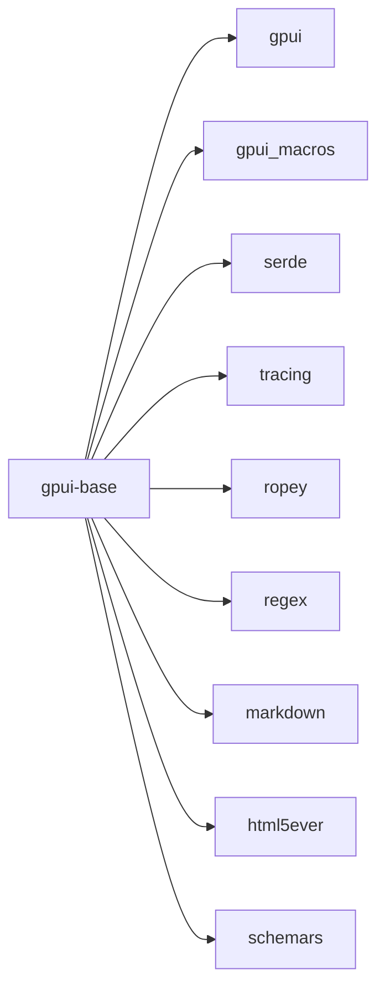

**图表来源**
- [crates/base/Cargo.toml:33-58](file://crates/base/Cargo.toml#L33-L58)

**章节来源**
- [crates/base/Cargo.toml:1-94](file://crates/base/Cargo.toml#L1-L94)

## 性能与测量
基础层提供轻量级性能测量工具：
- `measurement_enabled()`：根据环境变量启用测量日志。
- `measure_if(name, if_, f)`：条件测量。
- `measure(name, f)`：无条件测量。
- `Measure`：RAII 计时器，结束时通过 `tracing` 输出耗时。

此外，Motion 系统在以下场景优化性能：
- 弹簧静止时跳过步进与帧请求。
- `reduce_motion` 时直接返回最终值。
- 关键帧与过渡仅在运行中请求动画帧。

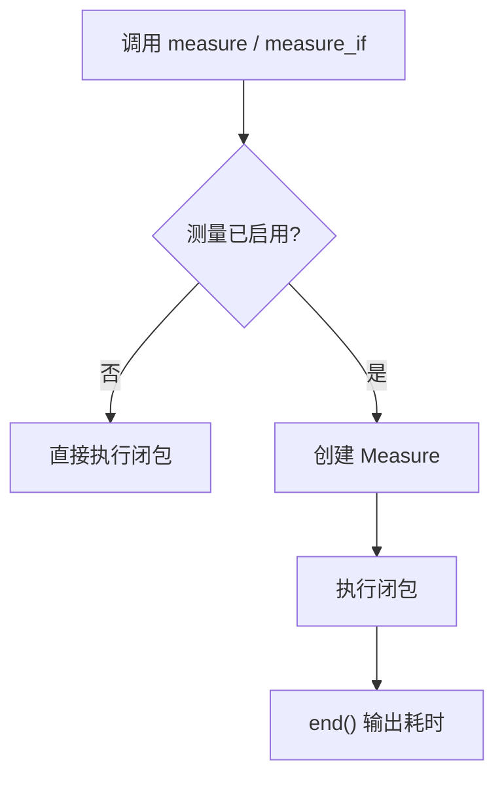

**图表来源**
- [crates/base/src/measure.rs:3-48](file://crates/base/src/measure.rs#L3-L48)

**章节来源**
- [crates/base/src/measure.rs:1-49](file://crates/base/src/measure.rs#L1-L49)
- [crates/base/src/motion.rs:601-617](file://crates/base/src/motion.rs#L601-L617)

## 故障排查指南
### 初始化问题
- 忘记调用 `gpui_kit::base::init(cx)` 可能导致全局主题、焦点陷阱、弹窗、对话框等基础设施未安装。
- 如果已经调用更高层的 `gpui_kit::init(cx)`，不要重复调用基础层初始化。

**章节来源**
- [crates/base/README.md:67-83](file://crates/base/README.md#L67-L83)
- [crates/base/src/lib.rs:238-256](file://crates/base/src/lib.rs#L238-L256)

### 焦点被错误捕获
- 如果模态框中的 Tab 遍历跳到了背景控件，检查是否正确使用了 `FocusTrapElement`。
- Root 会在存在活动焦点陷阱时限制焦点范围；若容器没有可聚焦子项，焦点会停留在陷阱容器上。

**章节来源**
- [crates/base/src/root.rs:14-40](file://crates/base/src/root.rs#L14-L40)
- [crates/base/src/root.rs:280-490](file://crates/base/src/root.rs#L280-L490)

### 样式覆盖不符合预期
- 如果禁用状态没有生效，确认禁用样式是否放在语义状态之后。
- 如果 hover/active 在禁用时仍可见，注意基础层无法抑制 GPUI 的 hover/active 样式，应在调用处用条件渲染保护。

**章节来源**
- [crates/base/src/state_style.rs:27-53](file://crates/base/src/state_style.rs#L27-L53)
- [crates/base/README.md:177-191](file://crates/base/README.md#L177-L191)

### 动画不播放或表现异常
- 检查是否启用了 `reduce_motion`。
- 检查过渡时长是否为 0。
- 对于弹簧，检查阻尼、响应周期、epsilon 是否合理。
- 对于关键帧，检查 Timing 的阶段与方向。

**章节来源**
- [crates/base/src/motion.rs:303-317](file://crates/base/src/motion.rs#L303-L317)
- [crates/base/src/motion.rs:390-395](file://crates/base/src/motion.rs#L390-L395)
- [crates/base/src/motion.rs:448-561](file://crates/base/src/motion.rs#L448-L561)

## 结论
`gpui-base` 的定位清晰而克制：它提供稳定的行为抽象、状态管理、布局辅助、测量工具和动画基础设施，但不替应用决定视觉呈现。Root 作为窗口宿主与插件框架，Theme 作为全局配置中心，Motion 作为值动画引擎，Geometry 作为布局语言，ComponentTraits 作为行为契约，共同构成一个可扩展、可测试、可复用的基础层。

对于自定义组件开发者，最佳实践是：
- 实现行为 trait，而不是直接绑定样式。
- 使用 Theme tokens 表达语义，而不是硬编码颜色。
- 使用 `transition` 或 `spring` 控制值动画，而不是直接操作 DOM。
- 使用 Root 插件扩展窗口级展示能力。
- 使用 `measure` 与 `reduce_motion` 保障性能与无障碍体验。

**章节来源**
- [crates/base/README.md:36-44](file://crates/base/README.md#L36-L44)
- [crates/base/src/lib.rs:1-6](file://crates/base/src/lib.rs#L1-L6)

## 附录：行为抽象与扩展点

### 自定义行为开发指南
1. **选择正确的行为接口**
   - 需要选中语义：实现 `Selectable`。
   - 需要禁用语义：实现 `Disableable`。
   - 需要焦点环语义：实现 `FocusableExt`。
   - 需要折叠语义：实现 `Collapsible`。

2. **保持状态与呈现分离**
   - trait 方法只改变状态。
   - 视觉层在 `render` 中根据状态选择样式。
   - 使用 `StateStyle` 与 `resolve_style` 保证状态覆盖顺序一致。

3. **与 Root 集成**
   - 如果需要窗口级覆盖层、调试信息或全局装饰，实现 `RootPlugin`。
   - 在 `prepare` 中同步窗口设置。
   - 在 `style` 中注入默认样式。
   - 在 `decorate` 中包裹最终元素。

4. **性能优化技巧**
   - 使用 `measure` 标记热点路径。
   - 使用 `reduce_motion` 适配无障碍用户。
   - 弹簧在静止时避免动画帧。
   - 关键帧只在运行中请求帧。

5. **与上层组件的关系**
   - `gpui-base` 不依赖 `gpui-component`。
   - `gpui-component` 可在基础层之上提供完整视觉设计。
   - 应用可同时使用两层，但不应机械替换导入。

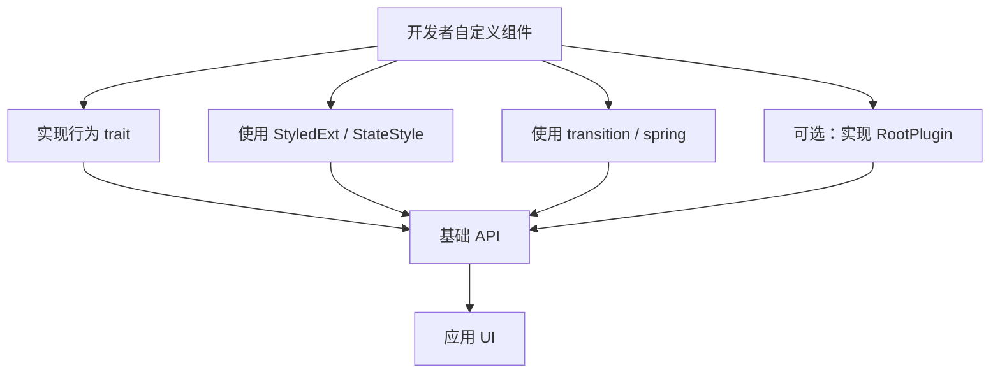

**图表来源**
- [crates/base/src/component_traits.rs:1-56](file://crates/base/src/component_traits.rs#L1-L56)
- [crates/base/src/styled.rs:78-203](file://crates/base/src/styled.rs#L78-L203)
- [crates/base/src/motion.rs:260-361](file://crates/base/src/motion.rs#L260-L361)
- [crates/base/src/root.rs:74-103](file://crates/base/src/root.rs#L74-L103)

**章节来源**
- [crates/base/src/component_traits.rs:1-56](file://crates/base/src/component_traits.rs#L1-L56)
- [crates/base/src/styled.rs:78-203](file://crates/base/src/styled.rs#L78-L203)
- [crates/base/src/motion.rs:260-361](file://crates/base/src/motion.rs#L260-L361)
- [crates/base/src/root.rs:74-103](file://crates/base/src/root.rs#L74-L103)
- [crates/base/README.md:290-302](file://crates/base/README.md#L290-L302)