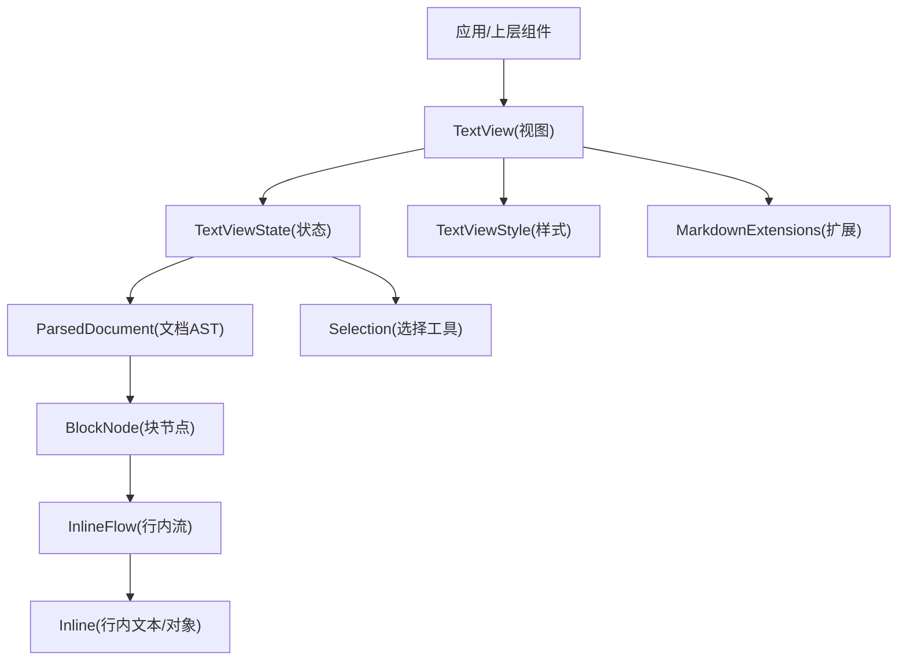
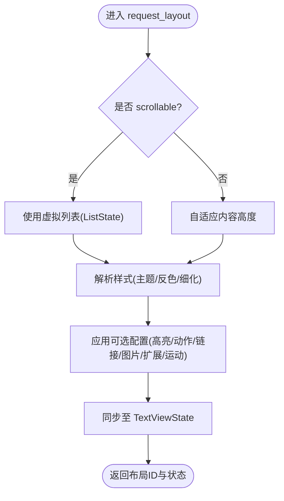
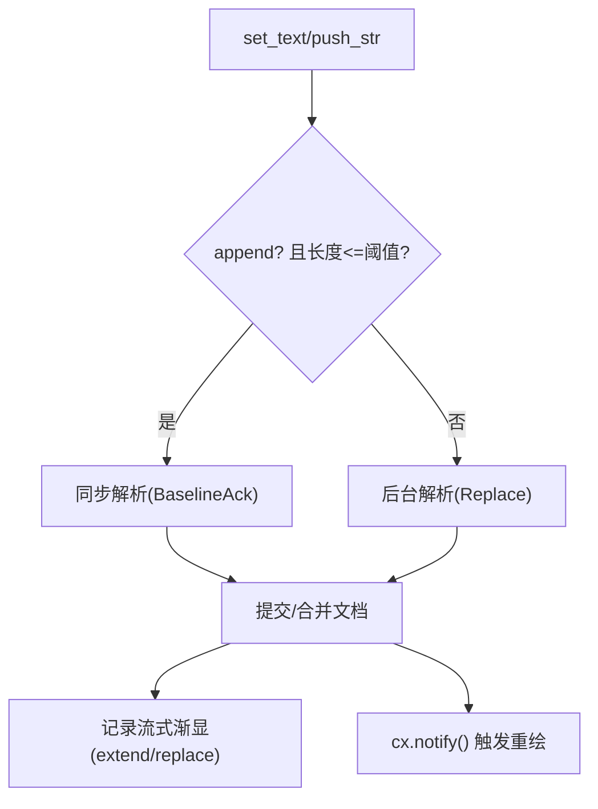
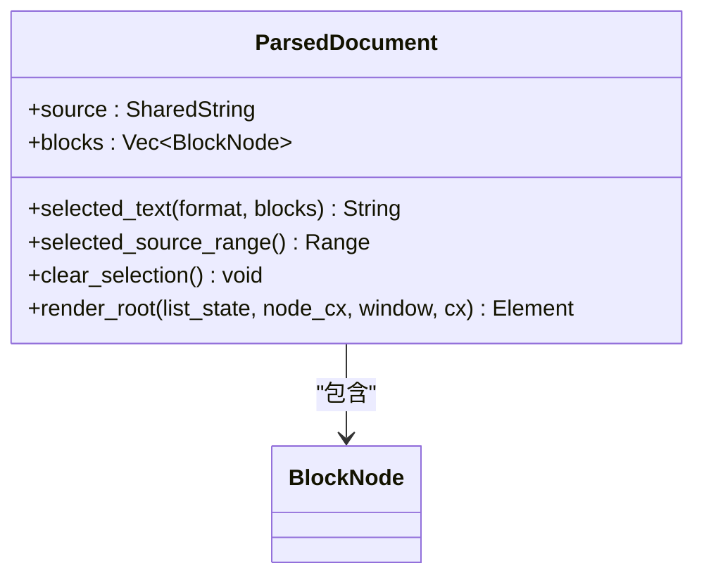
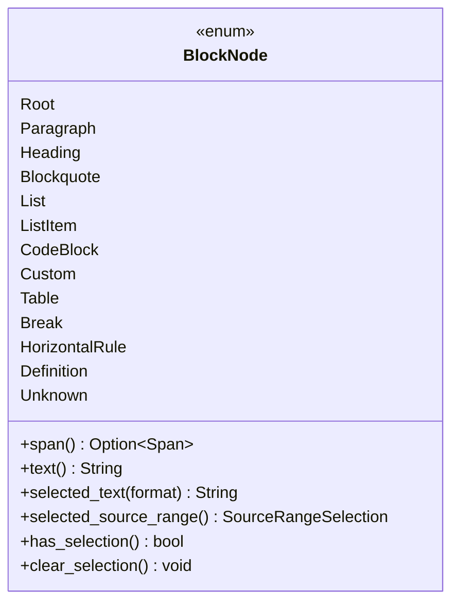
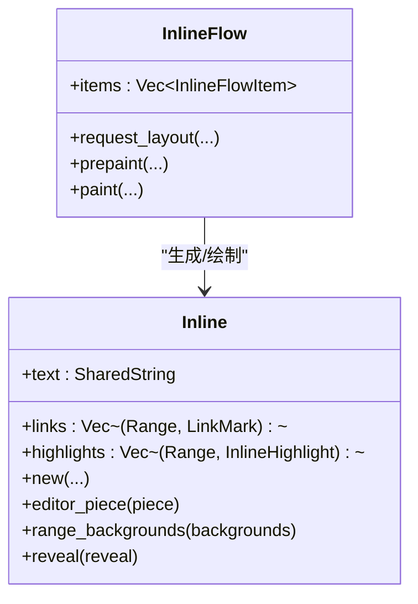
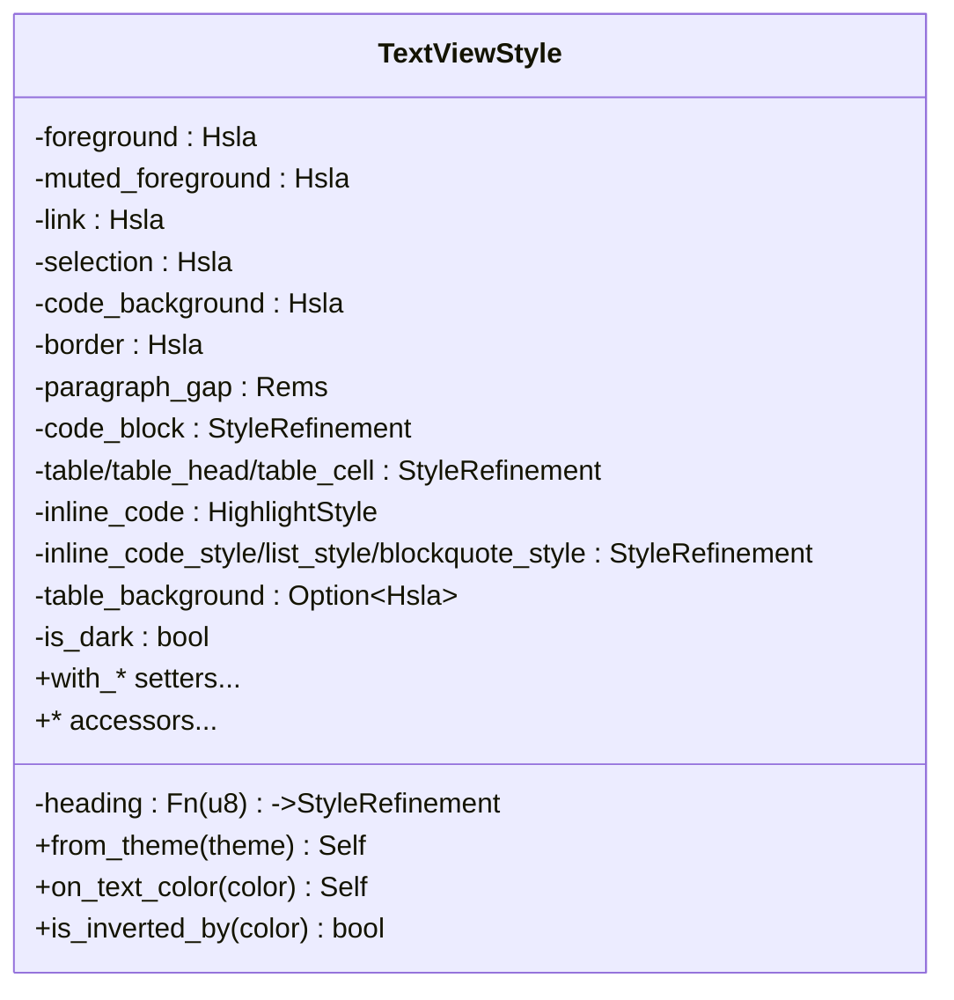
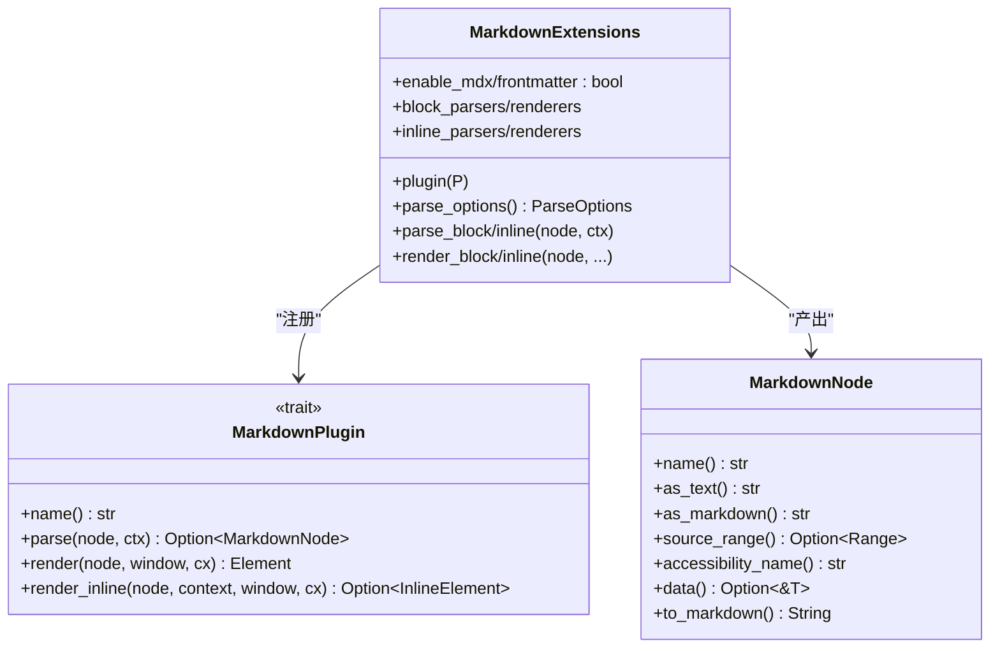
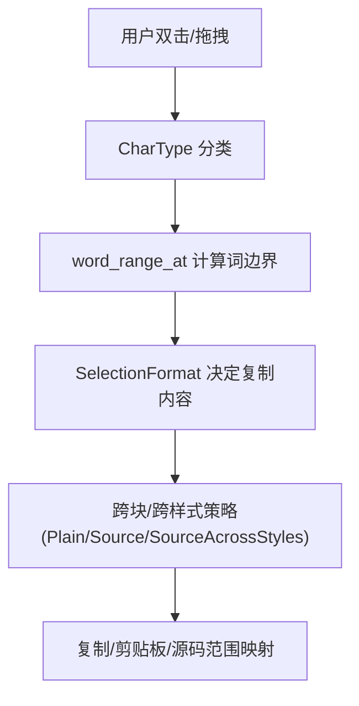
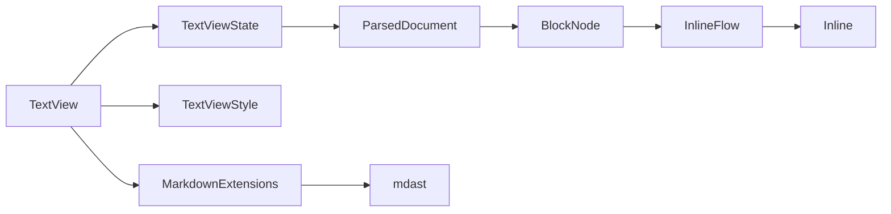

# 文本处理系统

<cite>
**本文引用的文件**   
- [lib.rs](file://crates/base/src/lib.rs)
- [mod.rs](file://crates/base/src/text/mod.rs)
- [text_view.rs](file://crates/base/src/text/text_view.rs)
- [state.rs](file://crates/base/src/text/state.rs)
- [document.rs](file://crates/base/src/text/document.rs)
- [node.rs](file://crates/base/src/text/node.rs)
- [style.rs](file://crates/base/src/text/style.rs)
- [inline_flow.rs](file://crates/base/src/text/inline_flow.rs)
- [inline.rs](file://crates/base/src/text/inline.rs)
- [markdown_ext.rs](file://crates/base/src/text/markdown_ext.rs)
- [selection.rs](file://crates/base/src/text/selection.rs)
</cite>

## 目录
1. [引言](#引言)
2. [项目结构](#项目结构)
3. [核心组件](#核心组件)
4. [架构总览](#架构总览)
5. [详细组件分析](#详细组件分析)
6. [依赖关系分析](#依赖关系分析)
7. [性能与优化](#性能与优化)
8. [故障排查指南](#故障排查指南)
9. [结论](#结论)
10. [附录：使用示例与最佳实践](#附录使用示例与最佳实践)

## 引言
本文件系统性地梳理并文档化 gpui-kit 的文本处理子系统，重点覆盖以下能力：
- Text 组件与 TextView 渲染管线
- Document 文档模型（解析、块级节点、流式布局）
- Style 样式系统（主题适配、反色表面、代码块/表格/列表/引用等细化）
- Selection 选择管理（词边界、复制格式、跨块选择、虚拟滚动下的投影）
- Markdown 解析与扩展（插件、MDX、Frontmatter、自定义节点）
- HTML 支持（基础标签渲染）
- 富文本编辑相关能力（范围高亮、行内代码、链接点击、图片资源、流式渐显）
- 高级特性（范围高亮、流式渲染、最大行数裁剪、虚拟滚动）
- 交互机制（选择算法、光标移动、输入法/组合输入、自动滚动）
- 性能优化（后台解析、增量合并、保留布局、虚拟滚动、增量渲染）

## 项目结构
文本子系统位于 base 层的 text 模块，围绕“视图-状态-文档-节点-行内流”分层组织：
- 顶层导出与快捷构造：Text、markdown/html 工厂函数
- 视图层：TextView（元素生命周期、样式解析、事件分发、滚动与可见性）
- 状态层：TextViewState（解析调度、增量更新、选择状态、范围高亮、流式渐显）
- 文档层：ParsedDocument（AST、块集合、选择文本提取、流位置计算）
- 节点层：BlockNode（段落、标题、列表、表格、代码块、自定义节点等）
- 行内层：InlineFlow、Inline（排版、形状化、链接、高亮、编辑器拼接）
- 样式层：TextViewStyle（主题映射、反色适配、细化策略）
- Markdown 扩展：MarkdownExtensions、MarkdownPlugin、MarkdownNode
- 选择工具：word_range_at、CharType 分类



图示来源
- [mod.rs:22-35](file://crates/base/src/text/mod.rs#L22-L35)
- [text_view.rs:152-175](file://crates/base/src/text/text_view.rs#L152-L175)
- [state.rs:111-172](file://crates/base/src/text/state.rs#L111-L172)
- [document.rs:15-20](file://crates/base/src/text/document.rs#L15-L20)
- [node.rs:45-106](file://crates/base/src/text/node.rs#L45-L106)
- [inline_flow.rs:30-75](file://crates/base/src/text/inline_flow.rs#L30-L75)
- [inline.rs:314-340](file://crates/base/src/text/inline.rs#L314-L340)
- [style.rs:13-39](file://crates/base/src/text/style.rs#L13-L39)
- [markdown_ext.rs:244-255](file://crates/base/src/text/markdown_ext.rs#L244-L255)
- [selection.rs:3-13](file://crates/base/src/text/selection.rs#L3-L13)

章节来源
- [lib.rs:188-199](file://crates/base/src/lib.rs#L188-L199)
- [mod.rs:22-35](file://crates/base/src/text/mod.rs#L22-L35)

## 核心组件
- Text：统一入口，承载字符串或 TextView；提供 style/get_text 等便捷方法。
- TextView：GPUI Element，负责解析模式（Markdown/HTML）、样式装配、事件处理、滚动与可见区域裁剪、流式渐显控制。
- TextViewState：维护源文本、解析任务、已提交文档、选择状态、范围高亮、流式进度、虚拟滚动 ListState。
- ParsedDocument：保存 source 与 blocks，提供 selected_text、selected_source_range、render_root 等。
- BlockNode：块级 AST（段落、标题、引用、列表、表格、代码块、自定义节点等），实现文本提取、选择统计、源码重建。
- InlineFlow/Inline：行内排版引擎，负责形状化、换行、链接、高亮、编辑器片段对接、范围背景绘制。
- TextViewStyle：主题到具体颜色的映射，支持反色表面、代码块/表格/列表/引用细化、行内代码样式。
- MarkdownExtensions：插件注册、解析选项、MDX/Frontmatter 开关、自定义节点解析与渲染。
- Selection：字符类型分类与词边界计算，支撑双击选词、跨块选择。

章节来源
- [mod.rs:51-115](file://crates/base/src/text/mod.rs#L51-L115)
- [text_view.rs:136-175](file://crates/base/src/text/text_view.rs#L136-L175)
- [state.rs:111-172](file://crates/base/src/text/state.rs#L111-L172)
- [document.rs:15-20](file://crates/base/src/text/document.rs#L15-L20)
- [node.rs:45-106](file://crates/base/src/text/node.rs#L45-L106)
- [inline_flow.rs:30-75](file://crates/base/src/text/inline_flow.rs#L30-L75)
- [inline.rs:314-340](file://crates/base/src/text/inline.rs#L314-L340)
- [style.rs:13-39](file://crates/base/src/text/style.rs#L13-L39)
- [markdown_ext.rs:244-255](file://crates/base/src/text/markdown_ext.rs#L244-L255)
- [selection.rs:3-13](file://crates/base/src/text/selection.rs#L3-L13)

## 架构总览
下图展示从应用调用到最终绘制的端到端流程，包括解析、布局、选择与渲染的关键路径。

```mermaid
sequenceDiagram
participant App as "应用"
participant TV as "TextView(视图)"
participant ST as "TextViewState(状态)"
participant PAR as "后台解析器"
participant DOC as "ParsedDocument(文档)"
participant BLK as "BlockNode(块)"
participant FLOW as "InlineFlow(行内流)"
participant INL as "Inline(行内)"
App->>TV : 创建/更新(文本, 模式)
TV->>ST : request_layout()
ST->>PAR : 发送解析任务(增量/全量)
PAR-->>ST : 返回解析结果(含AST)
ST->>DOC : 提交/合并文档
TV->>DOC : render_root(虚拟列表)
DOC->>BLK : 遍历块渲染
BLK->>FLOW : 构建行内项(文本/图片/对象)
FLOW->>INL : 形状化/换行/链接/高亮
INL-->>TV : 绘制完成
```

图示来源
- [text_view.rs:649-773](file://crates/base/src/text/text_view.rs#L649-L773)
- [state.rs:522-580](file://crates/base/src/text/state.rs#L522-L580)
- [document.rs:240-302](file://crates/base/src/text/document.rs#L240-L302)
- [inline_flow.rs:363-459](file://crates/base/src/text/inline_flow.rs#L363-L459)
- [inline.rs:692-720](file://crates/base/src/text/inline.rs#L692-L720)

## 详细组件分析

### TextView 视图组件
职责
- 作为 GPUI Element，承担请求布局、预绘制、绘制阶段逻辑
- 解析并装配 TextViewStyle（主题、反色表面、行内代码/列表/引用细化）
- 管理可选项：selectable、scrollable、max_lines、code_block_actions/highlighter、table_actions、link_click_handler、image_source、on_reveal、markdown_extensions、motion
- 将配置下发至 TextViewState，驱动解析与渲染

关键流程
- request_layout：根据是否 scrollable 决定虚拟列表或自适应高度；计算 max_lines 裁剪上限；合并默认样式与局部样式；同步设置回调与扩展
- 事件处理：复制、全选、链接点击、滚动暴露回调等



图示来源
- [text_view.rs:649-773](file://crates/base/src/text/text_view.rs#L649-L773)
- [text_view.rs:319-478](file://crates/base/src/text/text_view.rs#L319-L478)

章节来源
- [text_view.rs:136-175](file://crates/base/src/text/text_view.rs#L136-L175)
- [text_view.rs:319-478](file://crates/base/src/text/text_view.rs#L319-L478)
- [text_view.rs:649-773](file://crates/base/src/text/text_view.rs#L649-L773)

### TextViewState 状态与解析管线
职责
- 维护源文本、解析任务、已提交文档、选择状态、范围高亮、流式渐显、虚拟滚动
- 解析调度：小文本同步解析，大文本后台解析；增量 append 与全量 replace 区分
- 提交合并：committed_revision、full_update_revision、compatible_layout_update
- 选择与复制：selected_text、selected_source_range、SelectionFormat
- 范围高亮：set_range_highlights、reveal_range、clear_range_highlights
- 流式渐显：StreamFadeTracker，记录 extend/replace，定时 tick 刷新



图示来源
- [state.rs:329-375](file://crates/base/src/text/state.rs#L329-L375)
- [state.rs:522-580](file://crates/base/src/text/state.rs#L522-L580)
- [state.rs:603-645](file://crates/base/src/text/state.rs#L603-L645)

章节来源
- [state.rs:111-172](file://crates/base/src/text/state.rs#L111-L172)
- [state.rs:329-375](file://crates/base/src/text/state.rs#L329-L375)
- [state.rs:522-580](file://crates/base/src/text/state.rs#L522-L580)
- [state.rs:603-645](file://crates/base/src/text/state.rs#L603-L645)

### ParsedDocument 文档模型
职责
- 保存 source 与 blocks（Arc<Vec<BlockNode>>）
- selected_text：按 SelectionFormat 输出纯文本或 Markdown 源码（跨块/跨样式策略）
- selected_source_range：聚合各块的源码选择范围
- clear_selection：同步清理所有 inline 选择缓存
- render_root：非虚拟/虚拟两种渲染路径，计算 flow_position 以决定首块与间距



图示来源
- [document.rs:15-20](file://crates/base/src/text/document.rs#L15-L20)
- [document.rs:110-206](file://crates/base/src/text/document.rs#L110-L206)
- [document.rs:240-302](file://crates/base/src/text/document.rs#L240-L302)

章节来源
- [document.rs:15-20](file://crates/base/src/text/document.rs#L15-L20)
- [document.rs:110-206](file://crates/base/src/text/document.rs#L110-L206)
- [document.rs:240-302](file://crates/base/src/text/document.rs#L240-L302)

### BlockNode 块节点体系
职责
- 定义块级 AST：Root、Paragraph、Heading、Blockquote、List、ListItem、CodeBlock、Custom、Table、Break、HorizontalRule、Definition、Unknown
- 文本提取：text()/selected_text()/selected_source()，支持源码重建（标题前缀、列表缩进、引用前缀、表格还原）
- 选择统计：has_selection()/selection_styles()/clear_selection()
- 源码范围：selected_source_range() 递归聚合



图示来源
- [node.rs:45-106](file://crates/base/src/text/node.rs#L45-L106)
- [node.rs:419-542](file://crates/base/src/text/node.rs#L419-L542)
- [node.rs:544-770](file://crates/base/src/text/node.rs#L544-L770)

章节来源
- [node.rs:45-106](file://crates/base/src/text/node.rs#L45-L106)
- [node.rs:419-542](file://crates/base/src/text/node.rs#L419-L542)
- [node.rs:544-770](file://crates/base/src/text/node.rs#L544-L770)

### InlineFlow 与 Inline 行内排版
职责
- InlineFlow：行内项（文本/图片/对象）布局、测量缓存、编辑器片段上报、范围背景绘制
- Inline：文本形状化、换行、链接点击、高亮叠加、范围背景、reveal 定位、编辑器拼接
- 保留布局：RetainedLayout 跨帧复用 StyledText，减少重复 shaping 与 wrap



图示来源
- [inline_flow.rs:30-75](file://crates/base/src/text/inline_flow.rs#L30-L75)
- [inline_flow.rs:363-459](file://crates/base/src/text/inline_flow.rs#L363-L459)
- [inline_flow.rs:462-776](file://crates/base/src/text/inline_flow.rs#L462-L776)
- [inline.rs:314-340](file://crates/base/src/text/inline.rs#L314-L340)
- [inline.rs:692-720](file://crates/base/src/text/inline.rs#L692-L720)

章节来源
- [inline_flow.rs:30-75](file://crates/base/src/text/inline_flow.rs#L30-L75)
- [inline_flow.rs:363-459](file://crates/base/src/text/inline_flow.rs#L363-L459)
- [inline_flow.rs:462-776](file://crates/base/src/text/inline_flow.rs#L462-L776)
- [inline.rs:314-340](file://crates/base/src/text/inline.rs#L314-L340)
- [inline.rs:692-720](file://crates/base/src/text/inline.rs#L692-L720)

### TextViewStyle 样式系统
职责
- 从主题 Token 派生颜色（前景、次要、链接、选择、代码背景、边框）
- 反色表面检测与适配：on_text_color/is_inverted_by
- 细化策略：heading(level)、code_block、table/table_head/table_cell、inline_code/inline_code_style、list_style、blockquote_style
- 行内代码尺寸与圆角/边框/阴影等 Box 属性规范化



图示来源
- [style.rs:13-39](file://crates/base/src/text/style.rs#L13-L39)
- [style.rs:71-109](file://crates/base/src/text/style.rs#L71-L109)
- [style.rs:354-406](file://crates/base/src/text/style.rs#L354-L406)

章节来源
- [style.rs:13-39](file://crates/base/src/text/style.rs#L13-L39)
- [style.rs:71-109](file://crates/base/src/text/style.rs#L71-L109)
- [style.rs:354-406](file://crates/base/src/text/style.rs#L354-L406)

### Markdown 扩展与解析
职责
- MarkdownExtensions：启用 MDX/Frontmatter、注册 block/inline 解析器与渲染器、插件封装
- MarkdownPlugin：统一 name/parse/render 接口，支持 is_block 标记
- MarkdownNode：携带 name/text/markdown/accessibility_name/data/span，支持 to_markdown 与共享文本缓冲



图示来源
- [markdown_ext.rs:44-75](file://crates/base/src/text/markdown_ext.rs#L44-L75)
- [markdown_ext.rs:106-221](file://crates/base/src/text/markdown_ext.rs#L106-L221)
- [markdown_ext.rs:244-459](file://crates/base/src/text/markdown_ext.rs#L244-L459)

章节来源
- [markdown_ext.rs:44-75](file://crates/base/src/text/markdown_ext.rs#L44-L75)
- [markdown_ext.rs:106-221](file://crates/base/src/text/markdown_ext.rs#L106-L221)
- [markdown_ext.rs:244-459](file://crates/base/src/text/markdown_ext.rs#L244-L459)

### Selection 选择与交互
职责
- CharType 分类（Word/Whitespace/Newline/Other）
- word_range_from_chars/word_range_at：基于 Unicode 分段的词边界计算
- 在 TextViewState 中结合 SelectionFormat（Plain/Source/SourceAcrossStyles）进行复制与源码重建
- 在 Inline/InlineFlow 中处理链接点击、范围背景、reveal 定位



图示来源
- [selection.rs:3-13](file://crates/base/src/text/selection.rs#L3-L13)
- [selection.rs:51-93](file://crates/base/src/text/selection.rs#L51-L93)
- [state.rs:71-98](file://crates/base/src/text/state.rs#L71-L98)
- [state.rs:407-482](file://crates/base/src/text/state.rs#L407-L482)

章节来源
- [selection.rs:3-13](file://crates/base/src/text/selection.rs#L3-L13)
- [selection.rs:51-93](file://crates/base/src/text/selection.rs#L51-L93)
- [state.rs:71-98](file://crates/base/src/text/state.rs#L71-L98)
- [state.rs:407-482](file://crates/base/src/text/state.rs#L407-L482)

## 依赖关系分析
- TextView 依赖 TextViewState、TextViewStyle、MarkdownExtensions、LinkClickHandlerFn、ImageSourceFn 等
- TextViewState 依赖 ParsedDocument、MarkdownExtensions、RangeHighlightFrame、StreamFadeTracker、ListState
- ParsedDocument 依赖 BlockNode 集合与 NodeContext
- BlockNode 依赖 InlineFlow/Inline、MarkdownNode、TableData、CodeBlock 等
- InlineFlow 依赖 Inline、InlineObject、LinkMark、RevealAt
- MarkdownExtensions 依赖 markdown-rs mdast、Window/App 上下文



图示来源
- [text_view.rs:152-175](file://crates/base/src/text/text_view.rs#L152-L175)
- [state.rs:111-172](file://crates/base/src/text/state.rs#L111-L172)
- [document.rs:15-20](file://crates/base/src/text/document.rs#L15-L20)
- [node.rs:45-106](file://crates/base/src/text/node.rs#L45-L106)
- [inline_flow.rs:30-75](file://crates/base/src/text/inline_flow.rs#L30-L75)
- [markdown_ext.rs:244-255](file://crates/base/src/text/markdown_ext.rs#L244-L255)

章节来源
- [text_view.rs:152-175](file://crates/base/src/text/text_view.rs#L152-L175)
- [state.rs:111-172](file://crates/base/src/text/state.rs#L111-L172)
- [document.rs:15-20](file://crates/base/src/text/document.rs#L15-L20)
- [node.rs:45-106](file://crates/base/src/text/node.rs#L45-L106)
- [inline_flow.rs:30-75](file://crates/base/src/text/inline_flow.rs#L30-L75)
- [markdown_ext.rs:244-255](file://crates/base/src/text/markdown_ext.rs#L244-L255)

## 性能与优化
- 后台解析与增量合并：小文本同步解析保证首帧高度准确；大文本后台解析避免阻塞 UI；append 时仅重解析末尾块，保持选择兼容
- 保留布局 RetainedLayout：跨帧复用 StyledText，减少 shaping/wrap 开销；线程本地表 + Weak 清理
- 虚拟滚动：ListState::measure_all 确保滚动条稳定；按需测量与 re-measure_items 避免抖动
- 流式渐显：StreamFadeTracker 记录 extend/replace，tick 刷新，避免频繁重绘
- 行内代码与高亮：InlineHighlight 合并与 fade_highlights 避免闪烁；code_insets 精确内边距
- 反色表面：on_text_color 自动推导 link/muted/code/border/selection，提升可读性

章节来源
- [state.rs:522-580](file://crates/base/src/text/state.rs#L522-L580)
- [state.rs:603-645](file://crates/base/src/text/state.rs#L603-L645)
- [inline.rs:364-405](file://crates/base/src/text/inline.rs#L364-L405)
- [inline.rs:429-448](file://crates/base/src/text/inline.rs#L429-L448)
- [inline.rs:172-220](file://crates/base/src/text/inline.rs#L172-L220)
- [style.rs:354-406](file://crates/base/src/text/style.rs#L354-L406)

## 故障排查指南
- 解析错误：TextViewState.parsed_error 会记录失败信息；检查 MarkdownExtensions 配置（MDX/Frontmatter）与自定义解析器
- 选择异常：确认 selectable 与 selection_format；检查跨块/跨样式策略；虚拟滚动下需确保 preserve_inline_selection
- 范围高亮无效：仅在 Markdown 模式下可用；确保 range 索引的是 rendered_text；注意 append 后的 remap
- 链接未响应：检查 on_link_click 是否设置；默认左键/键盘打开 URL；图片链接同样走 handle_link_click
- 流式渐显不生效：确认 set_motion 或 state.motion；检查 stream_fade.note_extend/note_replace 调用时机

章节来源
- [state.rs:329-375](file://crates/base/src/text/state.rs#L329-L375)
- [state.rs:675-738](file://crates/base/src/text/state.rs#L675-L738)
- [text_view.rs:116-134](file://crates/base/src/text/text_view.rs#L116-L134)
- [text_view.rs:439-465](file://crates/base/src/text/text_view.rs#L439-L465)

## 结论
该文本处理系统以 TextView 为入口，通过 TextViewState 协调后台解析与增量合并，借助 ParsedDocument 与 BlockNode 构建稳定的文档树，并在 InlineFlow/Inline 上完成高性能的行内排版。样式系统支持主题与反色表面，Markdown 扩展提供灵活的插件机制。选择与复制策略兼顾 Plain 与 Source，虚拟滚动与保留布局保障大规模文本的性能与流畅度。

## 附录：使用示例与最佳实践
- 创建 Markdown/HTML 视图：使用 markdown/html 工厂函数或 TextView::markdown/TextView::html
- 自定义代码块高亮：通过 code_block_highlighter 或全局 TextViewDefaults::with_code_block_highlighter
- 自定义表格/代码块动作：table_actions / code_block_actions
- 链接点击处理：on_link_click；未设置则默认 open_url
- 图片资源替换：image_source 统一接管 URI/DataURL
- 流式渐显：set_motion 或 state.set_motion；push_str 追加内容时自动记录 extend
- 范围高亮与定位：set_range_highlights + reveal_range；注意 Markdown 模式与 rendered_text 索引
- 最大行数裁剪：max_lines；配合 is_clamped 判断是否需要展开
- 虚拟滚动：scrollable(true)；父容器固定高度；ListState 自动 measure_all

章节来源
- [mod.rs:37-49](file://crates/base/src/text/mod.rs#L37-L49)
- [text_view.rs:380-478](file://crates/base/src/text/text_view.rs#L380-L478)
- [text_view.rs:282-323](file://crates/base/src/text/text_view.rs#L282-L323)
- [state.rs:675-738](file://crates/base/src/text/state.rs#L675-L738)
- [state.rs:377-386](file://crates/base/src/text/state.rs#L377-L386)