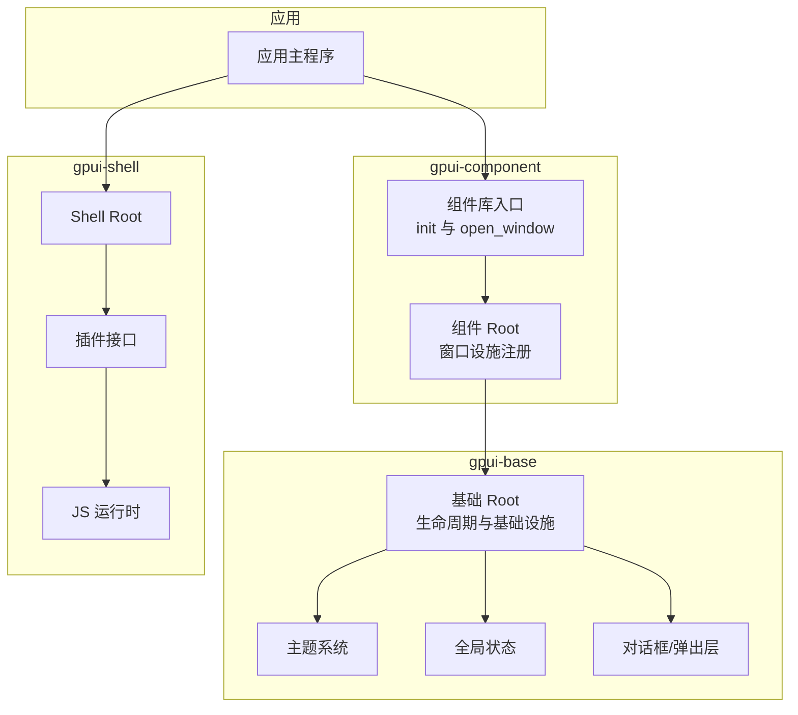
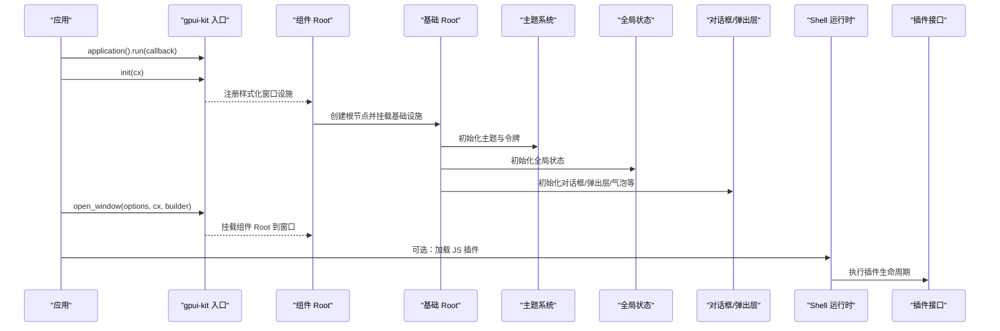
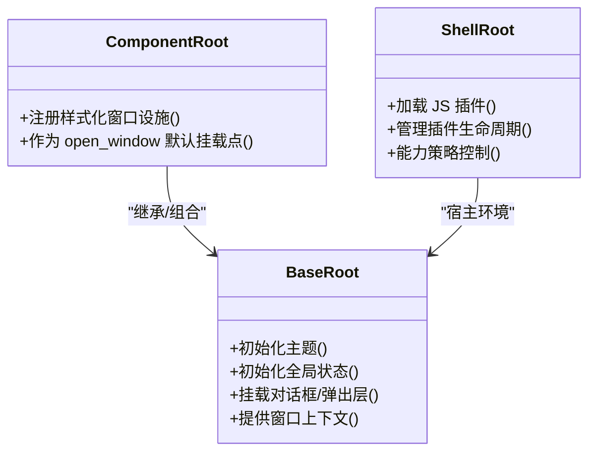
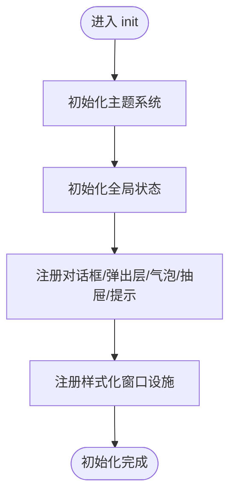
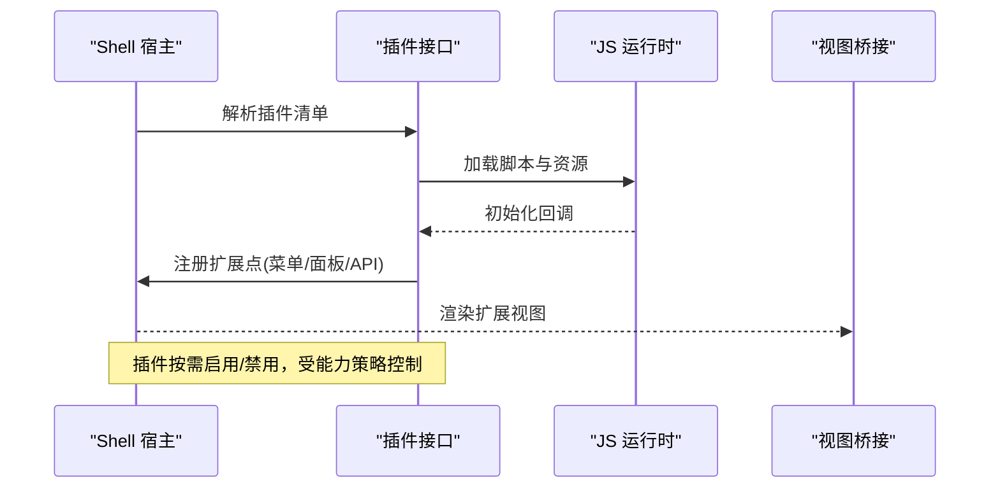
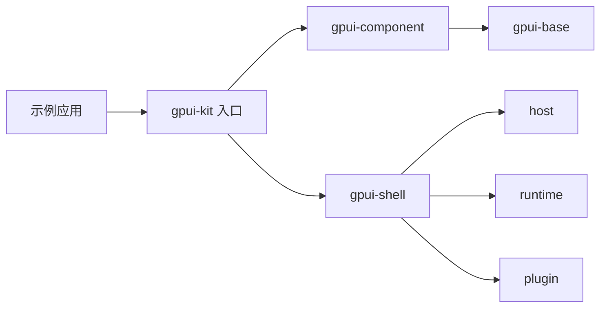

# 根应用与初始化

<cite>
**本文引用的文件**   
- [README.md](file://README.md)
- [crates/base/src/root.rs](file://crates/base/src/root.rs)
- [crates/component/src/root.rs](file://crates/component/src/root.rs)
- [crates/component/src/lib.rs](file://crates/component/src/lib.rs)
- [crates/base/src/theme.rs](file://crates/base/src/theme.rs)
- [crates/base/src/global_state.rs](file://crates/base/src/global_state.rs)
- [crates/base/src/dialog.rs](file://crates/base/src/dialog.rs)
- [crates/base/src/popup.rs](file://crates/base/src/popup.rs)
- [crates/base/src/popover.rs](file://crates/base/src/popover.rs)
- [crates/base/src/sheet.rs](file://crates/base/src/sheet.rs)
- [crates/base/src/toast.rs](file://crates/base/src/toast.rs)
- [crates/shell/src/root.rs](file://crates/shell/src/root.rs)
- [crates/shell/src/plugin.rs](file://crates/shell/src/plugin.rs)
- [crates/shell/src/runtime.rs](file://crates/shell/src/runtime.rs)
- [crates/shell/src/host.rs](file://crates/shell/src/host.rs)
- [examples/hello_world/src/main.rs](file://examples/hello_world/src/main.rs)
- [examples/app_assets/src/main.rs](file://examples/app_assets/src/main.rs)
</cite>

## 目录
1. [引言](#引言)
2. [项目结构](#项目结构)
3. [核心组件](#核心组件)
4. [架构总览](#架构总览)
5. [详细组件分析](#详细组件分析)
6. [依赖分析](#依赖分析)
7. [性能考虑](#性能考虑)
8. [故障排查指南](#故障排查指南)
9. [结论](#结论)
10. [附录](#附录)

## 引言
本文件聚焦于 GPUI Kit 的“根应用与初始化”主题，系统解释 Root 根组件的生命周期管理、应用启动流程、插件加载机制、资源初始化顺序，以及 init 函数的基础设施启动过程（主题系统、全局状态、对话框、弹出框等）。同时给出 RootPlugin 插件接口的实现指南、扩展点注册方法、应用配置与环境检测要点，并提供启动性能优化技巧与自定义初始化的实践路径。

## 项目结构
GPUI Kit 在仓库中按 crate 分层组织：
- gpui-base：无样式行为、状态与基础设施，包含 Root、主题、全局状态、对话框/弹出层等基础能力。
- gpui-component：基于 base 的完整样式化 UI 组件库，提供应用级 Root 包装与窗口设施注册。
- gpui-shell：Rust 宿主承载 JavaScript 扩展运行时，提供插件接口、能力授权、脚本生命周期管理。
- examples：示例应用展示最小可运行入口与资源装配方式。

图表来源
- [crates/component/src/lib.rs](file://crates/component/src/lib.rs)
- [crates/component/src/root.rs](file://crates/component/src/root.rs)
- [crates/base/src/root.rs](file://crates/base/src/root.rs)
- [crates/shell/src/root.rs](file://crates/shell/src/root.rs)
- [crates/shell/src/plugin.rs](file://crates/shell/src/plugin.rs)

章节来源
- [README.md:118-186](file://README.md#L118-L186)

## 核心组件
- 基础 Root（gpui-base）：负责应用根节点的生命周期、平台适配、主题与全局状态注入、对话框/弹出层等基础设施挂载。
- 组件 Root（gpui-component）：在基础 Root 之上注册样式化窗口设施（如标题栏、菜单、工具条等），并暴露应用级 open_window 入口。
- Shell Root（gpui-shell）：为 JS 扩展提供宿主环境，管理插件生命周期、能力策略、脚本回调与视图桥接。
- 插件接口（gpui-shell）：定义插件生命周期钩子、扩展点注册、能力声明与资源加载契约。

章节来源
- [crates/base/src/root.rs](file://crates/base/src/root.rs)
- [crates/component/src/root.rs](file://crates/component/src/root.rs)
- [crates/shell/src/root.rs](file://crates/shell/src/root.rs)
- [crates/shell/src/plugin.rs](file://crates/shell/src/plugin.rs)

## 架构总览
应用启动时，通常通过 gpui_kit::application().run(...) 进入事件循环；在回调中调用 gpui_kit::init(cx) 完成组件库初始化；随后使用 gpui_kit::open_window(...) 打开窗口，该入口会挂载组件 Root，进而委托基础 Root 完成基础设施初始化。若使用 gpui-shell，则额外加载 JS 插件与运行时。

图表来源
- [README.md:173-186](file://README.md#L173-L186)
- [crates/component/src/lib.rs](file://crates/component/src/lib.rs)
- [crates/component/src/root.rs](file://crates/component/src/root.rs)
- [crates/base/src/root.rs](file://crates/base/src/root.rs)
- [crates/shell/src/runtime.rs](file://crates/shell/src/runtime.rs)
- [crates/shell/src/plugin.rs](file://crates/shell/src/plugin.rs)

## 详细组件分析

### 根组件 Root 生命周期
- 基础 Root（base）：
  - 负责在应用启动阶段注入主题、全局状态、可访问性、输入系统等基础设施。
  - 维护窗口级上下文，确保各子系统共享一致的状态与主题。
- 组件 Root（component）：
  - 在基础 Root 之上注册样式化窗口设施（例如标题栏、菜单、工具条、状态栏等）。
  - 作为 open_window 的默认挂载点，保证所有窗口具备一致的视觉与交互基线。
- Shell Root（shell）：
  - 为 JS 扩展提供宿主视图与能力边界，管理插件加载、卸载与通信。

图表来源
- [crates/base/src/root.rs](file://crates/base/src/root.rs)
- [crates/component/src/root.rs](file://crates/component/src/root.rs)
- [crates/shell/src/root.rs](file://crates/shell/src/root.rs)

章节来源
- [crates/base/src/root.rs](file://crates/base/src/root.rs)
- [crates/component/src/root.rs](file://crates/component/src/root.rs)
- [crates/shell/src/root.rs](file://crates/shell/src/root.rs)

### init 函数初始化顺序
init 的核心职责是完成组件库的全局初始化，包括：
- 主题系统：加载默认主题与令牌，建立样式语义。
- 全局状态：初始化跨组件共享的状态容器。
- 对话框/弹出层：注册全局可见的覆盖层（对话框、弹出框、气泡、抽屉、提示等）。
- 窗口设施：注册标题栏、菜单、工具条等样式化窗口元素。

图表来源
- [crates/component/src/lib.rs](file://crates/component/src/lib.rs)
- [crates/base/src/theme.rs](file://crates/base/src/theme.rs)
- [crates/base/src/global_state.rs](file://crates/base/src/global_state.rs)
- [crates/base/src/dialog.rs](file://crates/base/src/dialog.rs)
- [crates/base/src/popup.rs](file://crates/base/src/popup.rs)
- [crates/base/src/popover.rs](file://crates/base/src/popover.rs)
- [crates/base/src/sheet.rs](file://crates/base/src/sheet.rs)
- [crates/base/src/toast.rs](file://crates/base/src/toast.rs)

章节来源
- [crates/component/src/lib.rs](file://crates/component/src/lib.rs)
- [crates/base/src/theme.rs](file://crates/base/src/theme.rs)
- [crates/base/src/global_state.rs](file://crates/base/src/global_state.rs)
- [crates/base/src/dialog.rs](file://crates/base/src/dialog.rs)
- [crates/base/src/popup.rs](file://crates/base/src/popup.rs)
- [crates/base/src/popover.rs](file://crates/base/src/popover.rs)
- [crates/base/src/sheet.rs](file://crates/base/src/sheet.rs)
- [crates/base/src/toast.rs](file://crates/base/src/toast.rs)

### RootPlugin 插件接口与扩展点
Shell 的插件接口定义了插件生命周期与扩展点契约，典型流程包括：
- 插件声明：定义能力、依赖、资源清单。
- 插件加载：宿主根据策略加载脚本与资源。
- 生命周期钩子：初始化、激活、暂停、销毁等阶段回调。
- 扩展点注册：向宿主暴露 API、菜单、面板等扩展点。

图表来源
- [crates/shell/src/plugin.rs](file://crates/shell/src/plugin.rs)
- [crates/shell/src/runtime.rs](file://crates/shell/src/runtime.rs)
- [crates/shell/src/host.rs](file://crates/shell/src/host.rs)

章节来源
- [crates/shell/src/plugin.rs](file://crates/shell/src/plugin.rs)
- [crates/shell/src/runtime.rs](file://crates/shell/src/runtime.rs)
- [crates/shell/src/host.rs](file://crates/shell/src/host.rs)

### 应用配置、环境检测与平台适配
- 应用配置：通过 application 构建器设置图标、资源、窗口选项等。
- 环境检测：在 init 前后进行平台特性探测，决定是否启用某些能力（如 GPU、WebAssembly、可访问性）。
- 平台适配：基础 Root 在不同平台上注入差异化的窗口设施与行为（标题栏、菜单、滚动条等）。

章节来源
- [crates/base/src/root.rs](file://crates/base/src/root.rs)
- [crates/component/src/root.rs](file://crates/component/src/root.rs)
- [README.md:188-194](file://README.md#L188-L194)

### 应用启动性能优化
- 延迟加载：将非关键插件或重型资源放入懒加载路径，仅在需要时初始化。
- 资源预取：在应用冷启动阶段异步预取常用资源（字体、图标、主题数据）。
- 减少同步阻塞：避免在 init 中进行耗时 I/O，改用后台任务与进度反馈。
- 按需启用功能：通过 Cargo features 与运行时开关裁剪不必要的子系统。
- 视图缓存与增量更新：对大型列表/表格启用虚拟化与增量重绘。

[本节为通用指导，不直接分析具体文件]

## 依赖分析
- component 依赖 base 的基础设施（主题、全局状态、对话框/弹出层）。
- shell 依赖 host 与 runtime 提供 JS 扩展能力，并通过 plugin 接口与宿主解耦。
- 示例应用通过 gpui_kit 统一入口简化依赖，内部自动选择合适层。

图表来源
- [README.md:118-186](file://README.md#L118-L186)
- [crates/component/src/lib.rs](file://crates/component/src/lib.rs)
- [crates/shell/src/lib.rs](file://crates/shell/src/lib.rs)

章节来源
- [README.md:118-186](file://README.md#L118-L186)

## 性能考虑
- 在 init 中只做必要初始化，避免长耗时操作。
- 使用异步任务加载重型资源，并在 UI 上显示进度。
- 合理拆分插件，按需加载，减少首屏压力。
- 利用虚拟化与增量渲染降低大列表/表格的绘制成本。
- 针对 WebAssembly 目标，注意模块体积与首次加载时间。

[本节为通用指导，不直接分析具体文件]

## 故障排查指南
- 主题未生效：检查是否在 open_window 之前调用了 init，确认主题令牌已正确加载。
- 对话框/弹出层不可用：确认全局覆盖层已在 init 中注册，且当前窗口已挂载组件 Root。
- 插件无法加载：检查能力策略是否允许相应权限，确认脚本路径与资源清单有效。
- 窗口设施缺失：确认组件 Root 已作为默认挂载点，且相关 feature 已启用。

章节来源
- [crates/base/src/theme.rs](file://crates/base/src/theme.rs)
- [crates/base/src/dialog.rs](file://crates/base/src/dialog.rs)
- [crates/base/src/popup.rs](file://crates/base/src/popup.rs)
- [crates/shell/src/plugin.rs](file://crates/shell/src/plugin.rs)
- [crates/shell/src/host.rs](file://crates/shell/src/host.rs)

## 结论
GPUI Kit 的根应用与初始化围绕“基础 Root + 组件 Root + Shell Root”三层展开：基础 Root 提供稳定的基础设施，组件 Root 提供样式化窗口体验，Shell Root 提供可扩展的 JS 插件生态。init 函数按主题→全局状态→覆盖层→窗口设施的顺序完成初始化，确保后续窗口与插件能稳定工作。通过合理的配置、环境检测与性能优化策略，可以在不同平台上获得一致且高性能的应用体验。

## 附录

### 实际代码示例参考
- 最小可运行应用：展示 application.run、init、open_window 的标准用法。
- 资源装配示例：展示如何传入图标与资源集合。

章节来源
- [examples/hello_world/src/main.rs](file://examples/hello_world/src/main.rs)
- [examples/app_assets/src/main.rs](file://examples/app_assets/src/main.rs)
- [README.md:147-186](file://README.md#L147-L186)