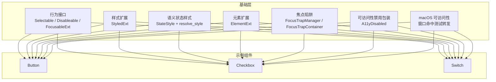
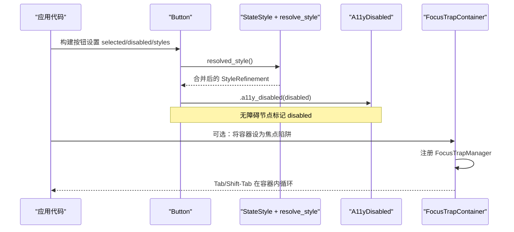
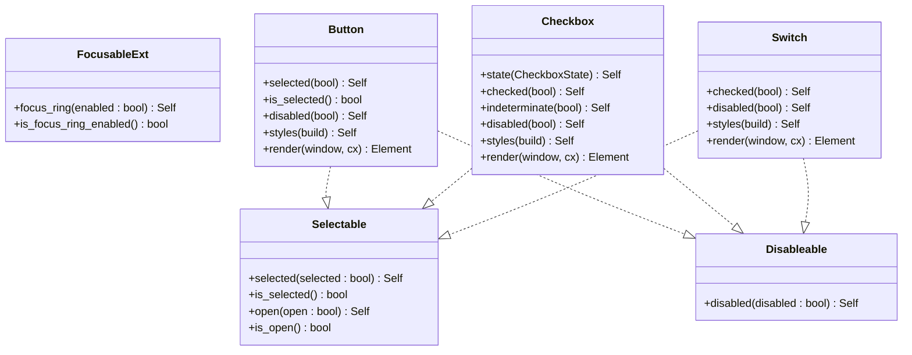
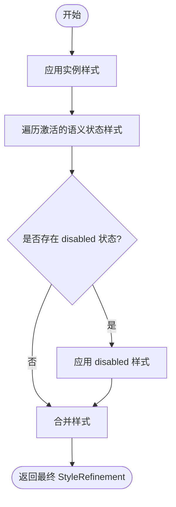
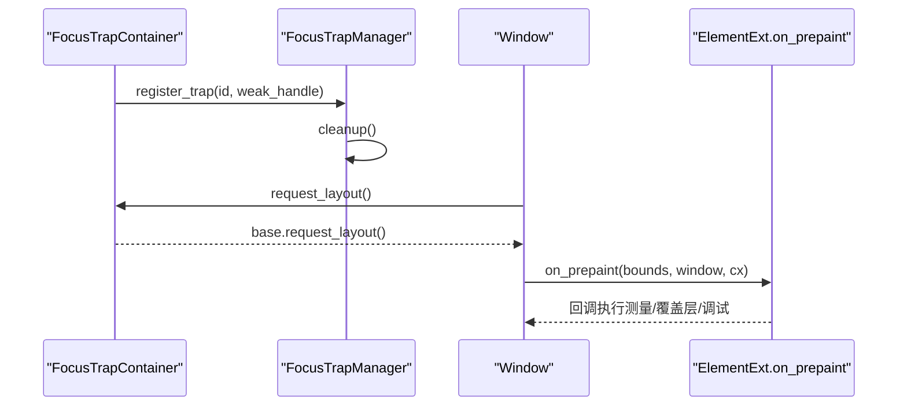
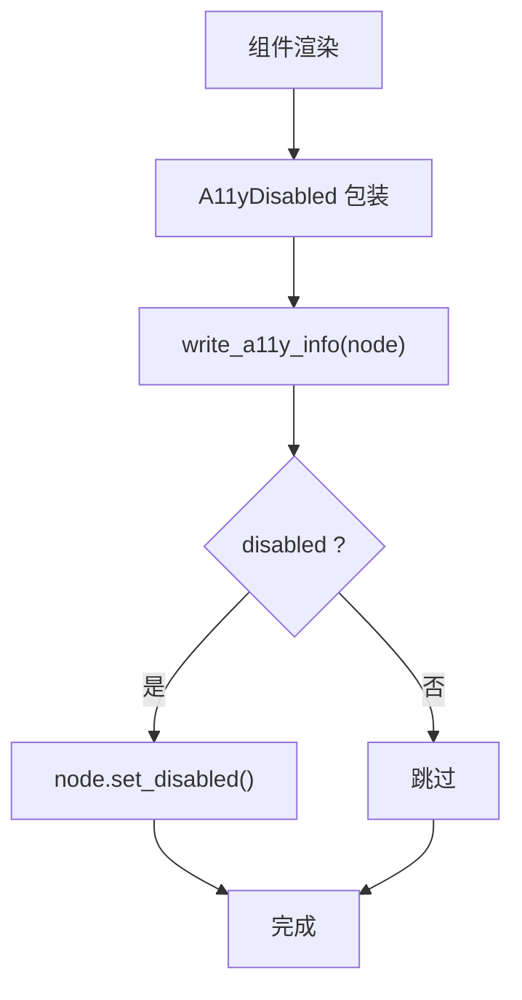
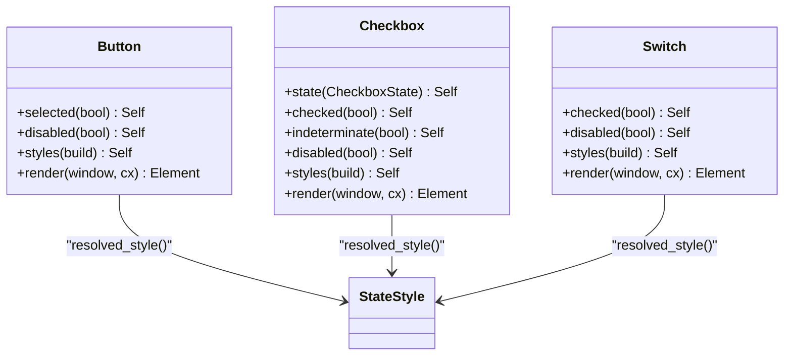
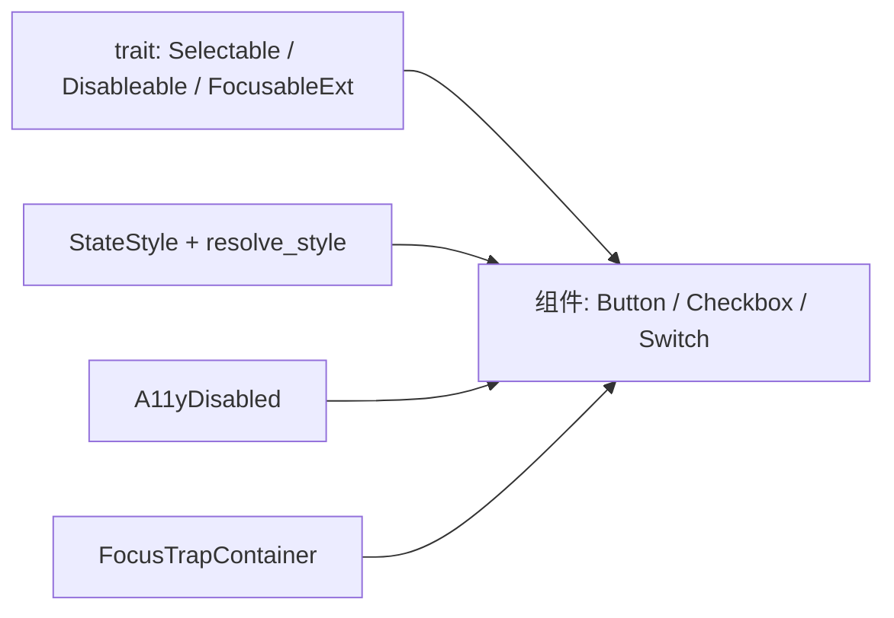

# 行为基础设施

<cite>
**本文引用的文件**   
- [lib.rs](file://crates/base/src/lib.rs)
- [component_traits.rs](file://crates/base/src/component_traits.rs)
- [styled.rs](file://crates/base/src/styled.rs)
- [state_style.rs](file://crates/base/src/state_style.rs)
- [element_ext.rs](file://crates/base/src/element_ext.rs)
- [a11y_disabled.rs](file://crates/base/src/a11y_disabled.rs)
- [focus_trap.rs](file://crates/base/src/focus_trap.rs)
- [macos_accessibility.rs](file://crates/base/src/macos_accessibility.rs)
- [button.rs](file://crates/base/src/button.rs)
- [checkbox.rs](file://crates/base/src/checkbox.rs)
- [switch.rs](file://crates/base/src/switch.rs)
</cite>

## 目录
1. [引言](#引言)
2. [项目结构](#项目结构)
3. [核心组件](#核心组件)
4. [架构总览](#架构总览)
5. [详细组件分析](#详细组件分析)
6. [依赖关系分析](#依赖关系分析)
7. [性能考虑](#性能考虑)
8. [故障排查指南](#故障排查指南)
9. [结论](#结论)
10. [附录：自定义行为与可复用组件开发指南](#附录自定义行为与可复用组件开发指南)

## 引言
本文件系统性梳理 gpui-base 的行为基础设施，聚焦“行为与样式分离”的设计原则。重点包括：
- 组件行为抽象层：Selectable、Disableable、FocusableExt、Collapsible 等 trait 的职责边界。
- 样式系统：StyledExt 扩展、StateStyle 语义状态样式封装、resolve_style 优先级规则。
- 元素扩展：ElementExt 提供的文本选择作用域与预绘制观察能力。
- 焦点管理：全局 FocusTrapManager 与 FocusTrapContainer 的 Tab 循环机制。
- 可访问性：A11yDisabled 包装器、macOS 命中测试转发、RoleOverride 与语义角色暴露。
- 生命周期钩子：on_prepaint 在布局后、绘制前获取最终 Bounds，用于测量、覆盖层、调试等。
- 组合与继承：通过 trait 组合行为，通过样式链叠加语义状态，避免继承爆炸。
- 性能优化：最小化额外节点、延迟计算、只更新必要字段、避免重复渲染。

## 项目结构
gpui-base 以“基础行为 + 无样式组件”为核心，将交互、焦点、可访问性与语义状态从视觉表现中剥离。顶层 lib.rs 负责模块组织与应用初始化；component_traits.rs 定义通用行为接口；styled.rs 与 state_style.rs 提供样式扩展与语义状态解析；element_ext.rs 提供元素级扩展；focus_trap.rs 提供焦点陷阱；a11y_disabled.rs 与 macos_accessibility.rs 处理可访问性细节；button.rs、checkbox.rs、switch.rs 展示如何组合这些基础设施构建可复用组件。

**图表来源**
- [lib.rs:1-260](file://crates/base/src/lib.rs#L1-L260)
- [component_traits.rs:1-115](file://crates/base/src/component_traits.rs#L1-L115)
- [styled.rs:1-286](file://crates/base/src/styled.rs#L1-L286)
- [state_style.rs:1-104](file://crates/base/src/state_style.rs#L1-L104)
- [element_ext.rs:1-36](file://crates/base/src/element_ext.rs#L1-L36)
- [focus_trap.rs:1-288](file://crates/base/src/focus_trap.rs#L1-L288)
- [a11y_disabled.rs:1-305](file://crates/base/src/a11y_disabled.rs#L1-L305)
- [macos_accessibility.rs:1-79](file://crates/base/src/macos_accessibility.rs#L1-L79)
- [button.rs:1-675](file://crates/base/src/button.rs#L1-L675)
- [checkbox.rs:1-713](file://crates/base/src/checkbox.rs#L1-L713)
- [switch.rs:1-744](file://crates/base/src/switch.rs#L1-L744)

**章节来源**
- [lib.rs:1-260](file://crates/base/src/lib.rs#L1-L260)

## 核心组件
本节概述行为基础设施的关键构件及其职责。

- 行为接口（component_traits.rs）
  - Selectable：暴露受控 selected 与 open 状态，默认 open 回退到 selected，便于触发器兼容旧实现。
  - Disableable：统一 disabled 配置入口。
  - FocusableExt：仅承载是否显示焦点环的状态，不绑定几何与视觉。
  - Collapsible：折叠状态接口，供展开/收起类组件使用。

- 样式系统（styled.rs, state_style.rs）
  - StyledExt：为 GPUI Styled 提供 h_flex/v_flex、paddings/margins、字体粗细快捷方法、圆角、调试边框等。
  - StateStyle：封装 StyleRefinement，支持 FluentBuilder 的条件修饰。
  - resolve_style：固定样式层级顺序：实例样式 → 语义状态样式（selected/checked/disabled 等）→ disabled 最后覆盖。

- 元素扩展（element_ext.rs）
  - ElementExt：提供 text_selection_scope 标记文本选择作用域；on_prepaint 在布局完成后回调，传入最终 Bounds，适合做覆盖层、测量、调试。

- 焦点管理（focus_trap.rs）
  - FocusTrapManager：全局管理器，维护容器 ID 到弱引用 FocusHandle 的映射，查找当前活动容器并清理失效句柄。
  - FocusTrapContainer：包裹任意父元素，注册为焦点陷阱容器，Tab/Shift-Tab 在容器内循环，防止焦点逃逸。

- 可访问性（a11y_disabled.rs, macos_accessibility.rs）
  - A11yDisabledExt/A11yDisabled：在不增加布局/焦点/无障碍节点的前提下，将根元素的无障碍节点标记为 disabled。
  - macOS 命中测试转发：通过 Objective-C 运行时向 NSWindow 注入 accessibilityHitTest:，确保辅助技术命中测试正确转发到视图内容。

**章节来源**
- [component_traits.rs:1-115](file://crates/base/src/component_traits.rs#L1-L115)
- [styled.rs:1-286](file://crates/base/src/styled.rs#L1-L286)
- [state_style.rs:1-104](file://crates/base/src/state_style.rs#L1-L104)
- [element_ext.rs:1-36](file://crates/base/src/element_ext.rs#L1-L36)
- [focus_trap.rs:1-288](file://crates/base/src/focus_trap.rs#L1-L288)
- [a11y_disabled.rs:1-305](file://crates/base/src/a11y_disabled.rs#L1-L305)
- [macos_accessibility.rs:1-79](file://crates/base/src/macos_accessibility.rs#L1-L79)

## 架构总览
下图展示行为基础设施与示例组件之间的协作关系，以及样式解析与可访问性标记的调用路径。

**图表来源**
- [button.rs:148-158](file://crates/base/src/button.rs#L148-L158)
- [button.rs:214-270](file://crates/base/src/button.rs#L214-L270)
- [state_style.rs:27-53](file://crates/base/src/state_style.rs#L27-L53)
- [a11y_disabled.rs:24-40](file://crates/base/src/a11y_disabled.rs#L24-L40)
- [focus_trap.rs:122-136](file://crates/base/src/focus_trap.rs#L122-L136)
- [focus_trap.rs:201-212](file://crates/base/src/focus_trap.rs#L201-L212)

## 详细组件分析

### 行为接口与组合模式
Selectable、Disableable、FocusableExt 等 trait 定义了跨组件的统一行为契约。组件通过实现这些 trait 来声明自身具备的能力，而不是通过继承获得行为。例如：
- Button 实现 Selectable，将 selected 映射到内部状态，并在样式解析时参与优先级。
- Checkbox 与 Switch 通过 on_change 暴露受控值变化，结合 styles 提供语义状态样式。
- FocusableExt 仅保存焦点环开关状态，具体绘制由组件视觉层决定。

**图表来源**
- [component_traits.rs:1-56](file://crates/base/src/component_traits.rs#L1-L56)
- [button.rs:161-176](file://crates/base/src/button.rs#L161-L176)
- [checkbox.rs:18-63](file://crates/base/src/checkbox.rs#L18-L63)
- [switch.rs:15-35](file://crates/base/src/switch.rs#L15-L35)

**章节来源**
- [component_traits.rs:1-115](file://crates/base/src/component_traits.rs#L1-L115)
- [button.rs:161-176](file://crates/base/src/button.rs#L161-L176)
- [checkbox.rs:18-63](file://crates/base/src/checkbox.rs#L18-L63)
- [switch.rs:15-35](file://crates/base/src/switch.rs#L15-L35)

### 样式系统与状态优先级
所有组件通过 StateStyle 与 resolve_style 统一样式解析流程。优先级固定：
1. 实例样式（GPUI Styled 链）
2. 语义状态样式（selected/checked/disabled 等）
3. disabled 始终最后覆盖

这确保了即使应用设置了实例样式，语义状态（尤其是 disabled）仍能正确覆盖。

**图表来源**
- [state_style.rs:27-53](file://crates/base/src/state_style.rs#L27-L53)
- [button.rs:148-158](file://crates/base/src/button.rs#L148-L158)
- [checkbox.rs:180-194](file://crates/base/src/checkbox.rs#L180-L194)
- [switch.rs:280-290](file://crates/base/src/switch.rs#L280-L290)

**章节来源**
- [state_style.rs:1-104](file://crates/base/src/state_style.rs#L1-L104)
- [button.rs:148-158](file://crates/base/src/button.rs#L148-L158)
- [checkbox.rs:180-194](file://crates/base/src/checkbox.rs#L180-L194)
- [switch.rs:280-290](file://crates/base/src/switch.rs#L280-L290)

### 焦点管理与生命周期钩子
- FocusTrapContainer 在 request_layout 阶段注册到全局管理器，并通过 WeakFocusHandle 跟踪容器焦点句柄。active_focus_trap 可在外部查询当前活动容器。
- ElementExt::on_prepaint 在布局完成后回调，提供最终 Bounds，适合做覆盖层、测量、调试高亮等。

**图表来源**
- [focus_trap.rs:76-109](file://crates/base/src/focus_trap.rs#L76-L109)
- [focus_trap.rs:201-212](file://crates/base/src/focus_trap.rs#L201-L212)
- [element_ext.rs:15-32](file://crates/base/src/element_ext.rs#L15-L32)

**章节来源**
- [focus_trap.rs:1-288](file://crates/base/src/focus_trap.rs#L1-L288)
- [element_ext.rs:1-36](file://crates/base/src/element_ext.rs#L1-L36)

### 可访问性支持与平台适配
- A11yDisabled 包装器在 write_a11y_info 中根据 disabled 标志设置无障碍节点的 disabled 状态，同时透传 role、label、actions 等语义信息。
- macOS 下通过注入 accessibilityHitTest: 方法，将命中测试转发到 NSView，确保辅助技术能正确识别控件区域。

**图表来源**
- [a11y_disabled.rs:126-135](file://crates/base/src/a11y_disabled.rs#L126-L135)
- [macos_accessibility.rs:16-40](file://crates/base/src/macos_accessibility.rs#L16-L40)

**章节来源**
- [a11y_disabled.rs:1-305](file://crates/base/src/a11y_disabled.rs#L1-L305)
- [macos_accessibility.rs:1-79](file://crates/base/src/macos_accessibility.rs#L1-L79)

### 示例组件：Button、Checkbox、Switch
三者均遵循相同模式：
- 暴露受控状态（selected/checked/disabled）。
- 通过 styles 提供语义状态样式。
- 在 render 中组合焦点、键盘事件、无障碍语义与样式解析。
- 使用 a11y_disabled 标记无障碍节点。

**图表来源**
- [button.rs:148-158](file://crates/base/src/button.rs#L148-L158)
- [button.rs:214-270](file://crates/base/src/button.rs#L214-L270)
- [checkbox.rs:180-194](file://crates/base/src/checkbox.rs#L180-L194)
- [checkbox.rs:370-405](file://crates/base/src/checkbox.rs#L370-L405)
- [switch.rs:280-290](file://crates/base/src/switch.rs#L280-L290)
- [switch.rs:358-399](file://crates/base/src/switch.rs#L358-L399)

**章节来源**
- [button.rs:1-675](file://crates/base/src/button.rs#L1-L675)
- [checkbox.rs:1-713](file://crates/base/src/checkbox.rs#L1-L713)
- [switch.rs:1-744](file://crates/base/src/switch.rs#L1-L744)

## 依赖关系分析
- 组件对 trait 的依赖：Button/Checkbox/Switch 实现 Selectable/Disableable，从而获得统一的 API 与样式集成点。
- 样式依赖：所有组件通过 StateStyle 与 resolve_style 统一样式解析，避免各自实现优先级逻辑。
- 可访问性依赖：组件在渲染末尾调用 a11y_disabled，确保无障碍节点状态一致。
- 焦点依赖：可选使用 FocusTrapContainer 包裹容器，使 Tab 循环在容器内生效。

**图表来源**
- [component_traits.rs:1-56](file://crates/base/src/component_traits.rs#L1-L56)
- [state_style.rs:27-53](file://crates/base/src/state_style.rs#L27-L53)
- [a11y_disabled.rs:24-40](file://crates/base/src/a11y_disabled.rs#L24-L40)
- [focus_trap.rs:122-136](file://crates/base/src/focus_trap.rs#L122-L136)
- [button.rs:161-176](file://crates/base/src/button.rs#L161-L176)
- [checkbox.rs:18-63](file://crates/base/src/checkbox.rs#L18-L63)
- [switch.rs:15-35](file://crates/base/src/switch.rs#L15-L35)

**章节来源**
- [component_traits.rs:1-115](file://crates/base/src/component_traits.rs#L1-L115)
- [state_style.rs:1-104](file://crates/base/src/state_style.rs#L1-L104)
- [a11y_disabled.rs:1-305](file://crates/base/src/a11y_disabled.rs#L1-L305)
- [focus_trap.rs:1-288](file://crates/base/src/focus_trap.rs#L1-L288)
- [button.rs:1-675](file://crates/base/src/button.rs#L1-L675)
- [checkbox.rs:1-713](file://crates/base/src/checkbox.rs#L1-L713)
- [switch.rs:1-744](file://crates/base/src/switch.rs#L1-L744)

## 性能考虑
- 样式解析集中化：通过 resolve_style 统一合并，避免每个组件重复实现优先级逻辑，减少分支判断开销。
- 最小化额外节点：A11yDisabled 不引入布局/焦点/无障碍节点，仅在 write_a11y_info 中修改节点状态。
- 延迟与条件渲染：FluentBuilder 的 when/when_some/when_none 只在条件满足时应用样式，减少无效属性写入。
- 焦点句柄复用：组件支持 track_focus 使用调用方提供的 FocusHandle，避免创建多余 keyed state。
- 预绘制回调：on_prepaint 仅在布局完成后触发一次，适合一次性测量或覆盖层绘制，避免每帧重复计算。

[本节为通用指导，不直接分析具体文件]

## 故障排查指南
- 无障碍节点未标记 disabled：确认组件渲染末尾调用了 a11y_disabled(disabled)，且 disabled 状态与 UI 一致。
- macOS 辅助技术无法命中控件：检查是否在 macOS 上安装了窗口命中测试转发（install_window_hit_test_forwarder），并确保 NSView 存在。
- 焦点逃逸出对话框：确认容器使用了 focus_trap 并传入稳定的 FocusHandle，且在 request_layout 阶段成功注册到 FocusTrapManager。
- 样式未按预期覆盖：检查 resolve_style 的输入顺序，确保 disabled 状态放在最后；语义状态样式应晚于实例样式。
- on_prepaint 未触发或 Bounds 异常：确认元素已参与布局且未被裁剪；注意绝对定位子元素需配合 size_full 与 inset 以避免越界。

**章节来源**
- [a11y_disabled.rs:126-135](file://crates/base/src/a11y_disabled.rs#L126-L135)
- [macos_accessibility.rs:16-40](file://crates/base/src/macos_accessibility.rs#L16-L40)
- [focus_trap.rs:76-109](file://crates/base/src/focus_trap.rs#L76-L109)
- [state_style.rs:27-53](file://crates/base/src/state_style.rs#L27-L53)
- [element_ext.rs:15-32](file://crates/base/src/element_ext.rs#L15-L32)

## 结论
gpui-base 通过 trait 抽象行为、样式系统解耦视觉、状态样式统一优先级、元素扩展提供生命周期钩子、焦点陷阱保障可访问导航、无障碍包装确保辅助技术一致性，形成一套高内聚、低耦合、可扩展的行为基础设施。组件通过组合 trait 与样式 API 即可构建可复用的行为组件，无需继承复杂基类。

[本节为总结，不直接分析具体文件]

## 附录：自定义行为与可复用组件开发指南

### 实现 FocusableExt 的示例思路
- 在自定义控件结构中新增 focus_ring_enabled 布尔字段。
- 实现 FocusableExt：
  - focus_ring(enabled) 设置字段并返回 self。
  - is_focus_ring_enabled() 返回字段值。
- 在渲染时根据 is_focus_ring_enabled() 决定是否绘制焦点环（视觉层自行实现）。

参考路径：
- [component_traits.rs:43-50](file://crates/base/src/component_traits.rs#L43-L50)
- [component_traits.rs:94-103](file://crates/base/src/component_traits.rs#L94-L103)

### 实现 Disableable 的示例思路
- 在控件结构中新增 disabled 字段。
- 实现 Disableable：
  - disabled(disabled) 设置字段并返回 self。
- 在渲染中：
  - 阻止鼠标/键盘激活（如 on_mouse_down 阻止传播）。
  - 控制 tab_stop 与 tab_index。
  - 调用 a11y_disabled(disabled) 标记无障碍节点。

参考路径：
- [component_traits.rs:37-41](file://crates/base/src/component_traits.rs#L37-L41)
- [button.rs:61-69](file://crates/base/src/button.rs#L61-L69)
- [button.rs:244-270](file://crates/base/src/button.rs#L244-L270)
- [a11y_disabled.rs:24-40](file://crates/base/src/a11y_disabled.rs#L24-L40)

### 实现 Selectable 的示例思路
- 在控件结构中新增 selected 字段。
- 实现 Selectable：
  - selected(selected) 设置字段并返回 self。
  - is_selected() 返回字段值。
  - 可选重写 open/is_open，当 selected 含义不同于“弹出打开”时。
- 在样式解析中，将 selected 作为语义状态之一参与 resolve_style。

参考路径：
- [component_traits.rs:1-35](file://crates/base/src/component_traits.rs#L1-L35)
- [button.rs:161-169](file://crates/base/src/button.rs#L161-L169)
- [button.rs:148-158](file://crates/base/src/button.rs#L148-L158)

### 构建可复用行为组件的步骤
1. 定义控件结构与受控状态（selected/checked/disabled）。
2. 实现必要的 trait（Selectable/Disableable/FocusableExt/Collapsible）。
3. 提供 styles 构建器，使用 StateStyle 定义语义状态样式。
4. 在 render 中：
   - 组合焦点（track_focus/tab_index/tab_stop）。
   - 绑定交互（on_click/on_change）。
   - 暴露无障碍语义（role/aria_label/aria_toggled）。
   - 调用 a11y_disabled(disabled)。
   - 使用 refine_style(&style) 应用最终样式。
5. 可选：使用 FocusTrapContainer 包裹容器以实现焦点循环。
6. 可选：使用 ElementExt::on_prepaint 进行测量或覆盖层绘制。

参考路径：
- [button.rs:214-270](file://crates/base/src/button.rs#L214-L270)
- [checkbox.rs:370-405](file://crates/base/src/checkbox.rs#L370-L405)
- [switch.rs:358-399](file://crates/base/src/switch.rs#L358-L399)
- [focus_trap.rs:122-136](file://crates/base/src/focus_trap.rs#L122-L136)
- [element_ext.rs:15-32](file://crates/base/src/element_ext.rs#L15-L32)

**章节来源**
- [component_traits.rs:1-115](file://crates/base/src/component_traits.rs#L1-L115)
- [button.rs:1-675](file://crates/base/src/button.rs#L1-L675)
- [checkbox.rs:1-713](file://crates/base/src/checkbox.rs#L1-L713)
- [switch.rs:1-744](file://crates/base/src/switch.rs#L1-L744)
- [focus_trap.rs:1-288](file://crates/base/src/focus_trap.rs#L1-L288)
- [element_ext.rs:1-36](file://crates/base/src/element_ext.rs#L1-L36)