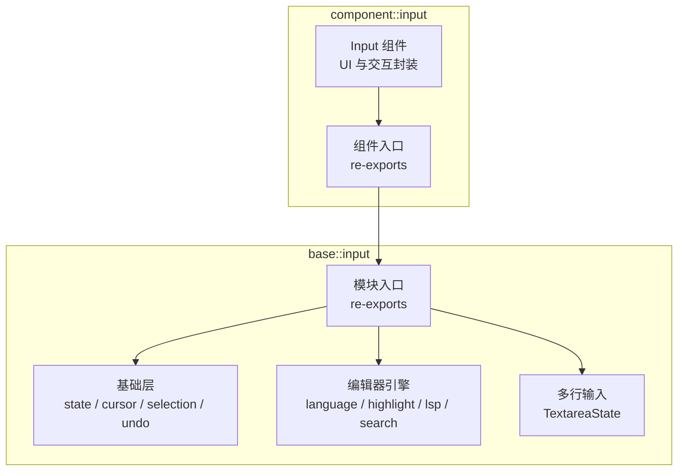
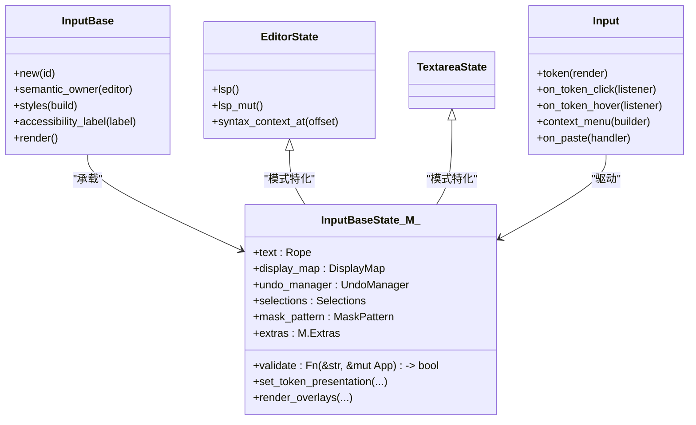
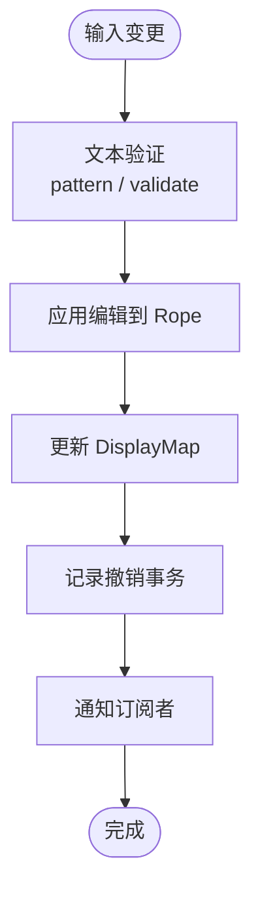
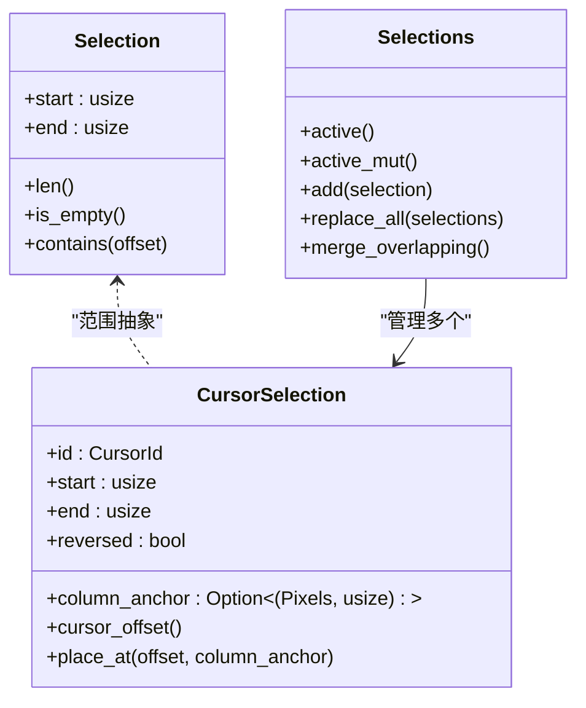
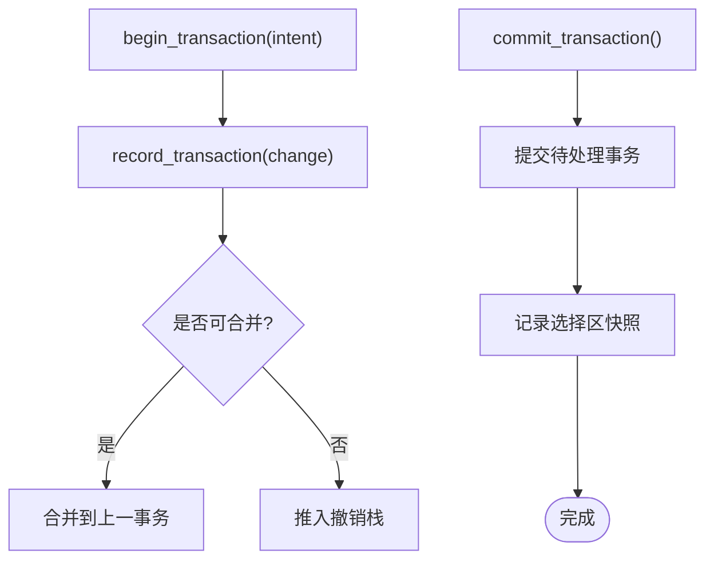
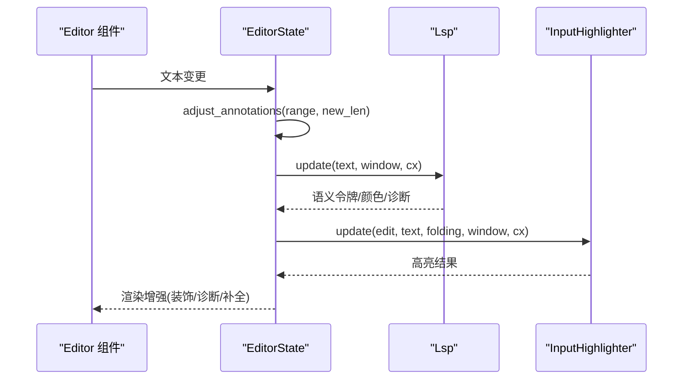
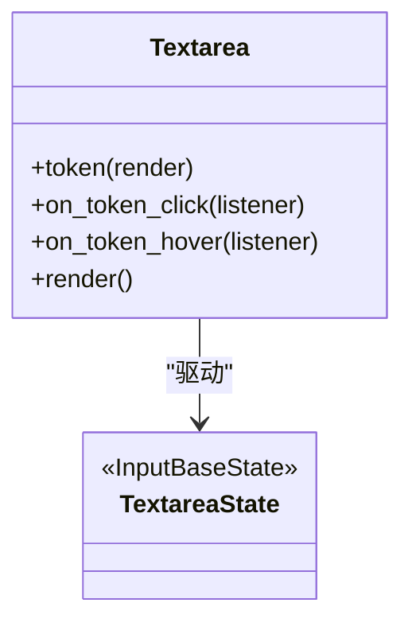
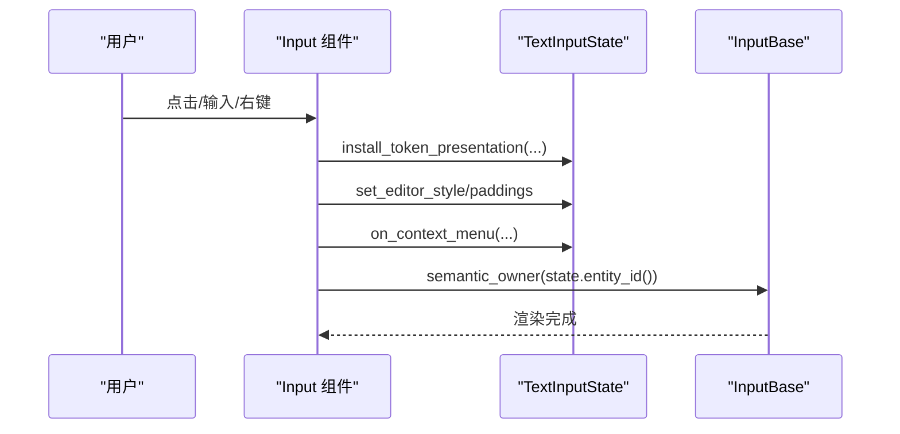
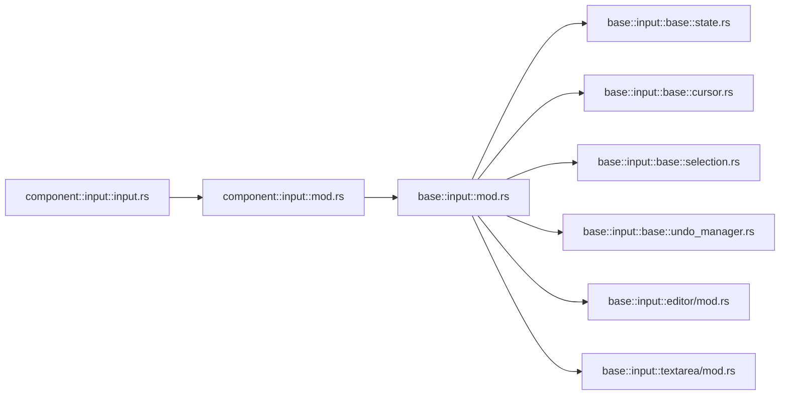

# 输入系统

<cite>
**本文引用的文件**   
- [crates/base/src/input/mod.rs](file://crates/base/src/input/mod.rs)
- [crates/base/src/input/README.md](file://crates/base/src/input/README.md)
- [crates/base/src/input/base/mod.rs](file://crates/base/src/input/base/mod.rs)
- [crates/base/src/input/base/state.rs](file://crates/base/src/input/base/state.rs)
- [crates/base/src/input/base/cursor.rs](file://crates/base/src/input/base/cursor.rs)
- [crates/base/src/input/base/selection.rs](file://crates/base/src/input/base/selection.rs)
- [crates/base/src/input/base/undo_manager.rs](file://crates/base/src/input/base/undo_manager.rs)
- [crates/base/src/input/editor/mod.rs](file://crates/base/src/input/editor/mod.rs)
- [crates/base/src/input/textarea/mod.rs](file://crates/base/src/input/textarea/mod.rs)
- [crates/component/src/input/mod.rs](file://crates/component/src/input/mod.rs)
- [crates/component/src/input/input.rs](file://crates/component/src/input/input.rs)
</cite>

## 目录
1. [简介](#简介)
2. [项目结构](#项目结构)
3. [核心组件](#核心组件)
4. [架构总览](#架构总览)
5. [详细组件分析](#详细组件分析)
6. [依赖关系分析](#依赖关系分析)
7. [性能与内存优化](#性能与内存优化)
8. [故障排查指南](#故障排查指南)
9. [结论](#结论)
10. [附录：复杂输入场景示例](#附录复杂输入场景示例)

## 简介
本文件系统性梳理 gpui-kit 的输入子系统，覆盖 Input、Textarea、Editor 的统一架构与实现机制。重点包括：
- Base 基础层：状态管理、光标与选择区、撤销重做、掩码模式、文本验证、滚动与布局等。
- Editor 编辑器引擎：语言配置、语法高亮、LSP 集成、自动补全、诊断与装饰器。
- Textarea 多行输入：通用多行编辑能力，不包含代码编辑器专属特性。
- 键盘事件处理、输入法（IME）支持、上下文菜单、触摸选择、内联 Token 渲染等高级特性。
- 性能优化策略：增量更新、批处理、显示映射缓存、撤销事务合并等。

## 项目结构
输入模块在 base 层提供共享编辑引擎，component 层提供面向业务的高阶组件。根模块通过显式路径声明组织内部子模块，对外保持稳定的公共 API。

**图示来源**
- [crates/base/src/input/mod.rs:1-132](file://crates/base/src/input/mod.rs#L1-L132)
- [crates/base/src/input/README.md:1-21](file://crates/base/src/input/README.md#L1-L21)
- [crates/component/src/input/mod.rs:1-67](file://crates/component/src/input/mod.rs#L1-L67)

**章节来源**
- [crates/base/src/input/mod.rs:1-132](file://crates/base/src/input/mod.rs#L1-L132)
- [crates/base/src/input/README.md:1-21](file://crates/base/src/input/README.md#L1-L21)
- [crates/component/src/input/mod.rs:1-67](file://crates/component/src/input/mod.rs#L1-L67)

## 核心组件
- InputBase：输入语义与交互框架，负责焦点、可访问性、样式与子元素承载。
- InputBaseState：统一的状态机，持有 Rope 文档、DisplayMap、UndoManager、Selections、MaskPattern、Validation、LSP 等。
- Selection/CursorSelection：光标与选择区模型，支持多光标、方向、列选择锚点。
- UndoManager：基于事务的撤销/重做，支持批量合并、原子事务、选择区快照。
- EditorState：代码编辑器模式，扩展 LSP、语法高亮、折叠、诊断、装饰器等。
- TextareaState：普通多行文本模式，不暴露代码编辑器能力。
- Input（组件层）：将状态与 UI 组合，提供前缀/后缀、清除按钮、掩码切换、粘贴拦截、自定义上下文菜单等。

**章节来源**
- [crates/base/src/input/base/mod.rs:1-313](file://crates/base/src/input/base/mod.rs#L1-L313)
- [crates/base/src/input/base/state.rs:427-607](file://crates/base/src/input/base/state.rs#L427-L607)
- [crates/base/src/input/base/cursor.rs:1-361](file://crates/base/src/input/base/cursor.rs#L1-L361)
- [crates/base/src/input/base/selection.rs:1-166](file://crates/base/src/input/base/selection.rs#L1-L166)
- [crates/base/src/input/base/undo_manager.rs:1-602](file://crates/base/src/input/base/undo_manager.rs#L1-L602)
- [crates/base/src/input/editor/mod.rs:1-308](file://crates/base/src/input/editor/mod.rs#L1-L308)
- [crates/base/src/input/textarea/mod.rs:1-60](file://crates/base/src/input/textarea/mod.rs#L1-L60)
- [crates/component/src/input/input.rs:130-421](file://crates/component/src/input/input.rs#L130-L421)

## 架构总览
输入系统采用“状态与展示分离”的设计：组件层只负责 UI 组装与用户交互；基础层负责文本编辑、光标选择、历史、显示映射、语言服务与 LSP。三种输入形态共享同一套状态机，通过模式标记区分能力边界。

**图示来源**
- [crates/base/src/input/base/mod.rs:122-273](file://crates/base/src/input/base/mod.rs#L122-L273)
- [crates/base/src/input/base/state.rs:427-607](file://crates/base/src/input/base/state.rs#L427-L607)
- [crates/base/src/input/editor/mod.rs:5-224](file://crates/base/src/input/editor/mod.rs#L5-L224)
- [crates/base/src/input/textarea/mod.rs:5-60](file://crates/base/src/input/textarea/mod.rs#L5-L60)
- [crates/component/src/input/input.rs:130-421](file://crates/component/src/input/input.rs#L130-L421)

## 详细组件分析

### Base 基础层：状态与行为
- 状态字段涵盖文档 Rope、显示映射、撤销历史、选择区、掩码、验证、滚动、Token 渲染、搜索会话、上下文菜单、LSP 等。
- 提供预绘制光标几何、显示行计数、预包裹、滚动偏移、可见视口等能力，支撑高性能渲染与弹出定位。
- 通过 InputPresentation 暴露只读视图给上层组件，屏蔽内部可变状态。

**图示来源**
- [crates/base/src/input/base/state.rs:427-607](file://crates/base/src/input/base/state.rs#L427-L607)

**章节来源**
- [crates/base/src/input/base/state.rs:427-607](file://crates/base/src/input/base/state.rs#L427-L607)

### 光标与选择区
- Selection 表示字节范围，CursorSelection 增加 id、方向、列锚点，支持多光标。
- Selections 维护至少一个活动选择，支持合并重叠、生成唯一 id、替换全部选择。
- 双击选词、三击选行的逻辑由 selection.rs 提供，考虑掩码模式下的特殊处理。

**图示来源**
- [crates/base/src/input/base/cursor.rs:1-361](file://crates/base/src/input/base/cursor.rs#L1-L361)
- [crates/base/src/input/base/selection.rs:1-166](file://crates/base/src/input/base/selection.rs#L1-L166)

**章节来源**
- [crates/base/src/input/base/cursor.rs:1-361](file://crates/base/src/input/base/cursor.rs#L1-L361)
- [crates/base/src/input/base/selection.rs:1-166](file://crates/base/src/input/base/selection.rs#L1-L166)

### 撤销与重做
- UndoManager 以事务为单位记录 Change，支持相邻按键合并、原子事务、选择区快照、自动闭合括号对恢复。
- 限制最大事务数与每事务变更数，避免无限增长。
- 提供 begin_transaction/commit_transaction 嵌套调用，保证复合操作作为一次撤销单元。

**图示来源**
- [crates/base/src/input/base/undo_manager.rs:1-602](file://crates/base/src/input/base/undo_manager.rs#L1-L602)

**章节来源**
- [crates/base/src/input/base/undo_manager.rs:1-602](file://crates/base/src/input/base/undo_manager.rs#L1-L602)

### Editor 编辑器引擎
- EditorState 是 InputBaseState 的代码编辑器模式特化，启用语言、行号、折叠、缩进、诊断、装饰器与 LSP。
- 通过 InputModeKind 接口注入编辑器专属回调：刷新语言特性、接受内联补全、驱动高亮器、注册动作等。
- 提供 lsp()/lsp_mut() 访问 LSP 提供者，以及 syntax_context_at 查询语法上下文。

**图示来源**
- [crates/base/src/input/editor/mod.rs:1-308](file://crates/base/src/input/editor/mod.rs#L1-L308)

**章节来源**
- [crates/base/src/input/editor/mod.rs:1-308](file://crates/base/src/input/editor/mod.rs#L1-L308)

### Textarea 多行输入
- TextareaState 是 InputBaseState 的多行模式特化，不包含代码编辑器能力。
- Textarea 组件负责 Token 渲染与点击/悬停回调的安装，并将呈现委托给状态。

**图示来源**
- [crates/base/src/input/textarea/mod.rs:1-60](file://crates/base/src/input/textarea/mod.rs#L1-L60)

**章节来源**
- [crates/base/src/input/textarea/mod.rs:1-60](file://crates/base/src/input/textarea/mod.rs#L1-L60)

### Input 组件层
- Input 组件绑定 TextInputState，负责 UI 装配：前缀/后缀、清除按钮、掩码切换、尺寸与边框、可访问性角色、粘贴拦截、自定义上下文菜单。
- 安装 Token 渲染与悬停回调，同步焦点与原生内容类型，设置编辑器样式与内边距。
- 根据状态能力构建上下文菜单项（剪切/复制/粘贴/全选/跳转定义/代码动作）。

**图示来源**
- [crates/component/src/input/input.rs:541-760](file://crates/component/src/input/input.rs#L541-L760)
- [crates/base/src/input/base/mod.rs:122-273](file://crates/base/src/input/base/mod.rs#L122-L273)

**章节来源**
- [crates/component/src/input/input.rs:130-421](file://crates/component/src/input/input.rs#L130-L421)
- [crates/component/src/input/input.rs:541-760](file://crates/component/src/input/input.rs#L541-L760)
- [crates/base/src/input/base/mod.rs:122-273](file://crates/base/src/input/base/mod.rs#L122-L273)

## 依赖关系分析
- component::input 通过 re-export 暴露 base::input 的能力，保持组件 API 稳定。
- base::input 通过显式 #[path] 组织内部模块，避免改变外部模块路径。
- EditorState 与 TextareaState 复用 InputBaseState，通过模式标记隔离能力。

**图示来源**
- [crates/component/src/input/mod.rs:1-67](file://crates/component/src/input/mod.rs#L1-L67)
- [crates/base/src/input/mod.rs:1-132](file://crates/base/src/input/mod.rs#L1-L132)

**章节来源**
- [crates/component/src/input/mod.rs:1-67](file://crates/component/src/input/mod.rs#L1-L67)
- [crates/base/src/input/mod.rs:1-132](file://crates/base/src/input/mod.rs#L1-L132)

## 性能与内存优化
- 增量更新：DisplayMap 缓存换行信息，避免每次重新计算；prewrap 可在首次布局前准备换行。
- 撤销合并：UndoManager 将相邻同意图的变更合并为单次插入，减少撤销条目数量。
- 显示映射与滚动：使用 ScrollHandle 与 deferred_scroll_offset 延迟应用滚动偏移，减少重排。
- Token 布局缓存：token_layout_cache 与 token_bounds 缓存 Token 测量结果，提升悬停与命中测试性能。
- 高亮批处理：drive_highlighter_batch 支持批量更新高亮，降低频繁重绘开销。
- 内存限制：UndoManager 限制最大事务数与每事务变更数，防止长会话内存膨胀。

[本节为通用指导，无需具体文件引用]

## 故障排查指南
- 上下文菜单不可用：检查 InputContextMenuCapabilities 的 disabled/readonly/masked/code_editor/selection 标志；确认 is_editable/is_copyable 返回值是否符合预期。
- 粘贴被拦截：确认 on_paste 处理器返回 true 时阻止默认插入；注意 Web 平台 read_from_clipboard 可能为 None。
- 掩码输入无法复制：masked 模式下 Copy/Cut 禁用，需先取消掩码或允许复制。
- 选择区异常：双击/三击选词/行逻辑受 masked 影响；检查 select_word/select_line 分支。
- 撤销失效：确认 begin_transaction/commit_transaction 正确嵌套；Atomic 意图不会合并；检查 coalescing_boundary 与 MAX_UNDO_TRANSACTIONS/MAX_CHANGES_PER_TRANSACTION。

**章节来源**
- [crates/base/src/input/base/mod.rs:8-120](file://crates/base/src/input/base/mod.rs#L8-L120)
- [crates/component/src/input/input.rs:400-421](file://crates/component/src/input/input.rs#L400-L421)
- [crates/base/src/input/base/selection.rs:21-56](file://crates/base/src/input/base/selection.rs#L21-L56)
- [crates/base/src/input/base/undo_manager.rs:100-236](file://crates/base/src/input/base/undo_manager.rs#L100-L236)

## 结论
gpui-kit 的输入系统通过统一的 InputBaseState 状态机，将单行输入、多行文本与代码编辑器整合为一套可扩展的架构。组件层专注 UI 与交互，基础层负责文本、光标、历史、显示映射与语言服务。该设计在保证功能完整性的同时，提供了良好的性能与可维护性。

[本节为总结性内容，无需具体文件引用]

## 附录：复杂输入场景示例
- 带掩码与密码切换的输入：结合 mask_toggle 与 content_type=Password/NewPassword，配合 on_paste 拦截敏感数据。
- 自定义上下文菜单：通过 context_menu 替换内置菜单，按 capabilities 动态启用跳转定义与代码动作。
- 多行 Token 输入：使用 Textarea.token/on_token_click/on_token_hover 渲染内联 Token，并处理点击打开链接或触发业务逻辑。
- 编辑器 LSP 集成：通过 EditorState.lsp_mut() 注册 CompletionProvider/DefinitionProvider/HoverProvider，并在文本变更时触发 refresh_language_features。
- 撤销与批量编辑：使用 begin_transaction_with(EditIntent::Typing) 包裹多光标输入，确保多次按键合并为一个撤销单元。

[本节为概念性示例，无需具体文件引用]