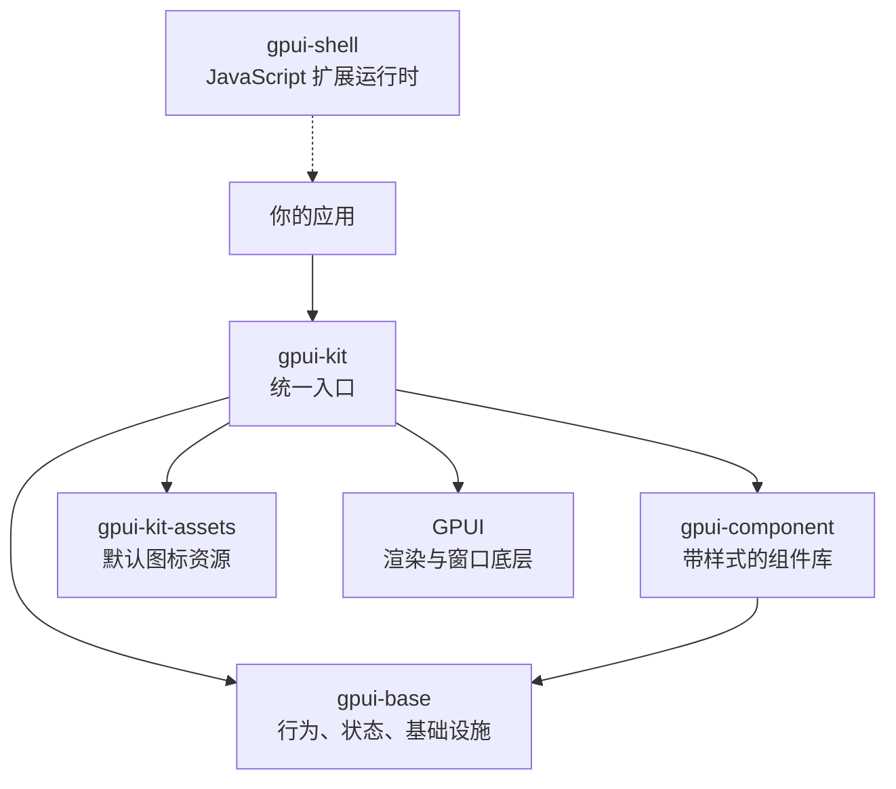
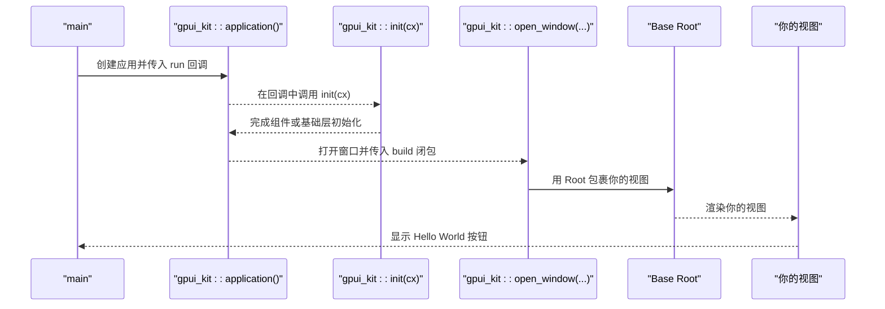
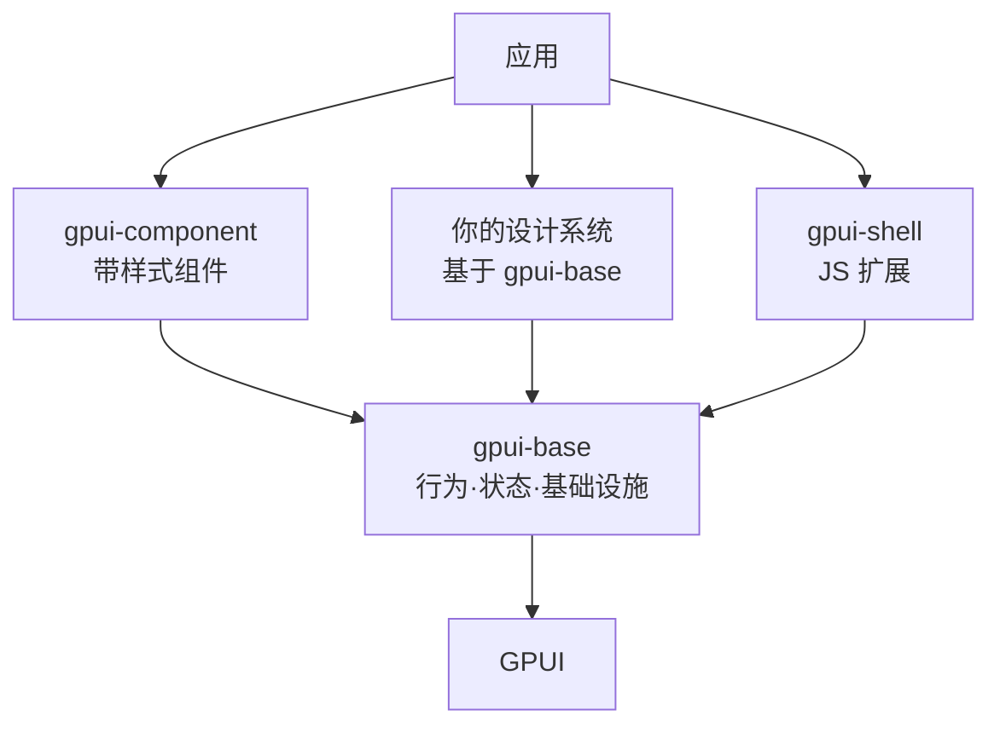
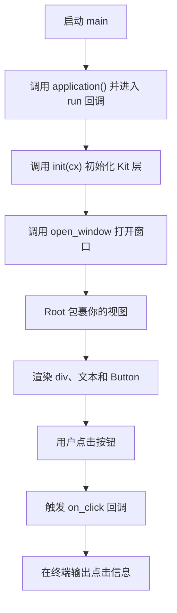
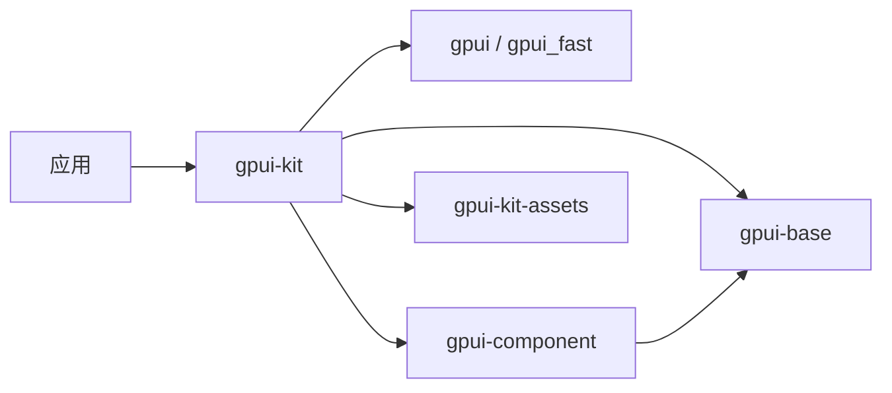

# 快速开始

<cite>
**本文引用的文件**   
- [README.md](file://README.md)
- [crates/kit/src/lib.rs](file://crates/kit/src/lib.rs)
- [crates/kit/Cargo.toml](file://crates/kit/Cargo.toml)
- [crates/base/Cargo.toml](file://crates/base/Cargo.toml)
- [crates/component/Cargo.toml](file://crates/component/Cargo.toml)
- [examples/hello_world/Cargo.toml](file://examples/hello_world/Cargo.toml)
- [examples/hello_world/src/main.rs](file://examples/hello_world/src/main.rs)
- [website/docs/getting-started.md](file://website/docs/getting-started.md)
- [website/zh-CN/docs/installation.md](file://website/zh-CN/docs/installation.md)
</cite>

## 目录
1. [简介](#简介)
2. [项目结构](#项目结构)
3. [核心组件](#核心组件)
4. [架构总览](#架构总览)
5. [详细组件分析](#详细组件分析)
6. [依赖分析](#依赖分析)
7. [性能考虑](#性能考虑)
8. [故障排除指南](#故障排除指南)
9. [结论](#结论)

## 简介
GPUI Kit 是一个基于 Rust 和 GPUI 的桌面应用框架，提供生产可用的 UI 系统、数据与布局能力、可复用行为与基础设施，以及可选的 JavaScript 扩展运行时。它默认暴露一个统一的 `gpui-kit` 依赖，让应用只需声明一次依赖即可使用 GPUI、基础层、组件库和默认图标资源。

核心价值包括：
- 丰富的组件与基础控件，覆盖表单、导航、叠加层、数据展示、编辑与反馈等场景。
- 经过商业桌面应用长期打磨的生产就绪能力。
- 支持 WebAssembly、无障碍访问、UI 集成测试、原生体验、高帧率渲染、虚拟列表、代码编辑器、Dock 布局、富文本与图表等。
- 清晰的三层架构：`gpui-component`（带样式的组件）、`gpui-base`（无样式行为与基础设施）、`gpui-shell`（Rust 宿主中的 JavaScript 运行时）。

对于初学者，你可以从 `gpui-kit` 开始；对于需要自定义设计系统的开发者，可以基于 `gpui-base` 构建自己的组件；对于需要插件化或脚本化的产品，可以引入 `gpui-shell`。

**章节来源**
- [README.md:11-50](file://README.md#L11-L50)
- [README.md:52-106](file://README.md#L52-L106)

## 项目结构
仓库采用多 crate 的 Cargo workspace 组织方式，核心分层如下：



- `gpui-kit`：应用依赖的统一门面，重导出 GPUI、base、component、assets 等，并提供 `application()`、`init()`、`open_window()` 等常用 API。
- `gpui-base`：无样式的行为、交互与基础设施，适合构建设计系统。
- `gpui-component`：带主题与交互细节的组件库，适合直接用于应用界面。
- `gpui-kit-assets`：默认图标集，可通过 `assets::Assets` 注入应用。
- `gpui-shell`：可选的 JavaScript 扩展运行时，由 Rust 宿主加载脚本面板和业务逻辑。

**图示来源**
- [README.md:22-31](file://README.md#L22-L31)
- [README.md:52-106](file://README.md#L52-L106)
- [crates/kit/src/lib.rs:1-45](file://crates/kit/src/lib.rs#L1-L45)

**章节来源**
- [README.md:22-31](file://README.md#L22-L31)
- [README.md:52-106](file://README.md#L52-L106)
- [crates/kit/src/lib.rs:1-45](file://crates/kit/src/lib.rs#L1-L45)

## 核心组件
本节聚焦应用开发中最常用的三个部分：统一入口、初始化、窗口创建。

### 统一入口：`gpui_kit::application()`
- 作用：创建桌面应用实例，并允许配置如图标资源等全局设置。
- 典型用法：通过 `.run(|cx| { ... })` 进入应用生命周期回调。
- 在示例中，应用会先注册默认图标资源，再执行初始化并打开窗口。

### 初始化：`gpui_kit::init(cx)`
- 作用：初始化当前启用的 Kit 层。如果启用了 `component` 特性，则初始化组件库及其主题；否则只初始化 `gpui-base`。
- 调用时机：必须在打开应用窗口或使用任何组件功能之前调用一次。
- 内部逻辑：根据是否启用 `component` 特性，选择调用组件层初始化或基础层初始化。

### 打开窗口：`gpui_kit::open_window(options, cx, build)`
- 作用：创建一个窗口，并在窗口内挂载一个 Base `Root`，从而让对话框、抽屉、通知、菜单等叠加层正常工作。
- 返回值：返回窗口句柄和视图实体，应用负责关闭、退出和确认流程。
- 参数说明：
  - `options`：窗口选项，例如尺寸、标题等。
  - `cx`：应用上下文。
  - `build`：闭包，接收窗口和应用上下文，返回要显示的视图实体。



**图示来源**
- [crates/kit/src/lib.rs:175-212](file://crates/kit/src/lib.rs#L175-L212)
- [examples/hello_world/src/main.rs:24-33](file://examples/hello_world/src/main.rs#L24-L33)

**章节来源**
- [crates/kit/src/lib.rs:175-212](file://crates/kit/src/lib.rs#L175-L212)
- [examples/hello_world/src/main.rs:24-33](file://examples/hello_world/src/main.rs#L24-L33)

## 架构总览
GPUI Kit 的三层架构强调“行为属于基础层，呈现属于应用层”。

| 层级 | 职责 | 适用场景 |
| --- | --- | --- |
| `gpui-component` | 完整的带样式组件库，提供主题、交互、语义化控件 | 快速构建应用界面 |
| `gpui-base` | 无样式的行为、状态、基础设施 | 构建设计系统或深度定制 UI |
| `gpui-shell` | Rust 宿主中的 JavaScript 扩展运行时 | 插件化、脚本化扩展 |



**图示来源**
- [README.md:52-106](file://README.md#L52-L106)

**章节来源**
- [README.md:52-106](file://README.md#L52-L106)

## 详细组件分析

### 环境要求
- 操作系统：macOS、Windows、Linux。
- macOS：需要 Xcode Command Line Tools，并确保字体渲染相关依赖可用。
- Windows：需要 Visual Studio Build Tools 或 Community，安装 C++ 桌面开发工作负载，并使用 MSVC 工具链。
- Linux：需要图形会话、X11 或 Wayland、Vulkan 驱动及相关开发头文件。
- Rust 与 Cargo：建议使用仓库锁定的 Rust 版本，并通过 `rustc --version` 和 `cargo --version` 验证。

常见安装问题包括找不到 `cargo`、Rust 版本不满足依赖要求、缺少 Windows SDK、Linux 缺少系统库、Linux 上编译成功但无窗口、macOS 上窗口打开但没有文字等。

**章节来源**
- [website/zh-CN/docs/installation.md:11-50](file://website/zh-CN/docs/installation.md#L11-L50)
- [website/zh-CN/docs/installation.md:80-104](file://website/zh-CN/docs/installation.md#L80-L104)

### 依赖安装与项目初始化
1. 安装 Rust 和 Cargo。
2. 在你的应用 `Cargo.toml` 中添加 `gpui-kit` 依赖。
3. 首次构建可能需要下载和编译依赖。
4. 运行示例验证环境：`cargo run -p hello_world`。

如果你希望使用 GPUI Fast 后端，可以在依赖中启用 `gpui-fast` 特性。该特性会为所有已启用的 Kit 层统一选择对应的后端，同时保持原有导入和初始化方式不变。

**章节来源**
- [website/zh-CN/docs/installation.md:40-74](file://website/zh-CN/docs/installation.md#L40-L74)
- [website/docs/getting-started.md:11-52](file://website/docs/getting-started.md#L11-L52)

### Cargo.toml 配置示例
最小依赖配置：
```toml
[dependencies]
gpui-kit = "{{gpui_kit_version}}"
```

启用 GPUI Fast：
```toml
[dependencies]
gpui-kit = { version = "{{gpui_kit_version}}", features = ["gpui-fast"] }
```

示例项目的 `Cargo.toml` 展示了如何把 `gpui-kit` 作为依赖，并保留 `gpui-fast` 特性的透传开关。

**章节来源**
- [website/docs/getting-started.md:18-35](file://website/docs/getting-started.md#L18-L35)
- [examples/hello_world/Cargo.toml:8-16](file://examples/hello_world/Cargo.toml#L8-L16)

### 特性开关说明
`gpui-kit` 的主要特性包括：
- `default`：默认启用 `component` 和 `assets`。
- `gpui-fast`：选择 GPUI Fast 后端。
- `component`：启用带样式的组件库。
- `assets`：启用默认图标资源。
- `test-support`：启用 UI 集成测试辅助。
- `profiler`：启用帧事件探测。
- `inspector`：启用检查器。
- `decimal`：启用十进制数值支持。
- `speech`：启用语音输入。
- `tree-sitter`、`syntect`、`tree-sitter-languages` 及多个语言语法特性：用于代码高亮与语法树解析。

这些特性是累加的，因此启用 `gpui-fast` 后，上游包仍会参与编译；应用应避免混用 Kit 的 Fast 类型与直接依赖的上游 GPUI 类型。

**章节来源**
- [crates/kit/Cargo.toml:18-76](file://crates/kit/Cargo.toml#L18-L76)
- [website/docs/getting-started.md:27-48](file://website/docs/getting-started.md#L27-L48)

### 完整 Hello World 示例
Hello World 示例演示了以下关键步骤：
1. 引入组件库和 Kit 根命名空间。
2. 定义一个实现 `Render` 的视图。
3. 在 `main` 中调用 `gpui_kit::application().run`。
4. 在回调中调用 `gpui_kit::init(cx)`。
5. 使用 `gpui_kit::open_window` 打开窗口并挂载视图。
6. 添加一个按钮，点击时在终端打印消息。



**图示来源**
- [examples/hello_world/src/main.rs:1-34](file://examples/hello_world/src/main.rs#L1-L34)
- [crates/kit/src/lib.rs:175-212](file://crates/kit/src/lib.rs#L175-L212)

**章节来源**
- [examples/hello_world/src/main.rs:1-34](file://examples/hello_world/src/main.rs#L1-L34)
- [website/docs/getting-started.md:83-134](file://website/docs/getting-started.md#L83-L134)

### 图标与资源
默认图标集通过 `gpui-kit-assets` 提供。你可以在应用中使用 `gpui_kit::application().with_assets(gpui_kit::assets::Assets)` 注册默认图标源。如果不启用 `assets` 特性，也可以按组件库定义的图标名称使用自己的 SVG 文件。

**章节来源**
- [README.md:188-195](file://README.md#L188-L195)
- [crates/kit/Cargo.toml:24-25](file://crates/kit/Cargo.toml#L24-L25)

## 依赖分析
`gpui-kit` 是应用依赖的统一门面，内部组合了多个 crate：



- `gpui-kit` 默认依赖 `gpui` 和 `gpui-base`。
- `component` 特性启用时，引入 `gpui-component`。
- `assets` 特性启用时，引入 `gpui-kit-assets`。
- `gpui-fast` 特性会同时切换核心、平台和 Web 后端。

**图示来源**
- [crates/kit/Cargo.toml:18-30](file://crates/kit/Cargo.toml#L18-L30)
- [crates/kit/Cargo.toml:78-92](file://crates/kit/Cargo.toml#L78-L92)
- [crates/base/Cargo.toml:27-41](file://crates/base/Cargo.toml#L27-L41)
- [crates/component/Cargo.toml:17-43](file://crates/component/Cargo.toml#L17-L43)

**章节来源**
- [crates/kit/Cargo.toml:18-30](file://crates/kit/Cargo.toml#L18-L30)
- [crates/kit/Cargo.toml:78-92](file://crates/kit/Cargo.toml#L78-L92)
- [crates/base/Cargo.toml:27-41](file://crates/base/Cargo.toml#L27-L41)
- [crates/component/Cargo.toml:17-43](file://crates/component/Cargo.toml#L17-L43)

## 性能考虑
- Debug 构建下，框架依赖通常没有优化，运行性能明显低于 release 构建。
- 可以通过 Cargo profile override 仅优化框架相关依赖，而不影响应用的调试体验。
- 启用 `gpui-fast` 可以选择不同的渲染与布局后端，但应保持依赖一致性，避免混用上游 GPUI 和 Fast 类型。
- 对于大型界面，优先使用虚拟列表、按需渲染、减少不必要的重建，并结合 UI 集成测试验证交互。

**章节来源**
- [website/zh-CN/docs/installation.md:106-122](file://website/zh-CN/docs/installation.md#L106-L122)
- [website/docs/getting-started.md:27-48](file://website/docs/getting-started.md#L27-L48)

## 故障排除指南
常见问题与排查建议：

| 现象 | 排查方法 |
| --- | --- |
| 找不到 `cargo` 或 `rustc` | 使用 rustup 安装 Rust，打开新终端后再次检查版本。 |
| 构建提示 Rust 版本不受支持 | 检查 `rustc --version`，更新到仓库要求的版本。 |
| Windows 提示缺少 `link.exe` 或 Windows SDK | 安装 Visual Studio C++ 工作负载和 SDK，并使用 MSVC 工具链。 |
| Linux 提示缺少系统库或头文件 | 安装 Ubuntu 开发包或对应发行版等价包，确保有 X11/Wayland 和 Vulkan 环境。 |
| Linux 上编译成功但无窗口 | 确认运行在有图形会话的环境中，且存在可用的 Vulkan 驱动。 |
| macOS 上窗口打开但没有文字 | 确保平台后端启用了字体渲染相关特性；`gpui-kit` 默认已处理，直接依赖 GPUI 的应用需单独配置。 |
| Cargo 无法解析 `gpui-pre` 或 API 不一致 | 保持 `gpui-kit` 依赖，不要单独覆盖某个 GPUI 包版本；使用仓库提交的 `Cargo.lock`。 |

此外，初始化顺序错误也可能导致组件不可用：务必在打开窗口前调用 `gpui_kit::init(cx)`。

**章节来源**
- [website/zh-CN/docs/installation.md:92-104](file://website/zh-CN/docs/installation.md#L92-L104)
- [crates/kit/src/lib.rs:202-212](file://crates/kit/src/lib.rs#L202-L212)

## 结论
GPUI Kit 通过 `gpui-kit` 统一入口，帮助你在 Rust 中快速构建高性能桌面应用。对于初学者，推荐从 `gpui-kit` 和 `gpui-component` 开始，使用 `application()`、`init()` 和 `open_window()` 完成第一个窗口；对于需要深度定制或设计系统的团队，可以基于 `gpui-base` 构建自有组件；对于需要脚本化扩展的产品，可以引入 `gpui-shell`。配合合适的特性开关、平台依赖和性能优化策略，GPUI Kit 能够支撑从简单工具到复杂商业桌面应用的多种场景。