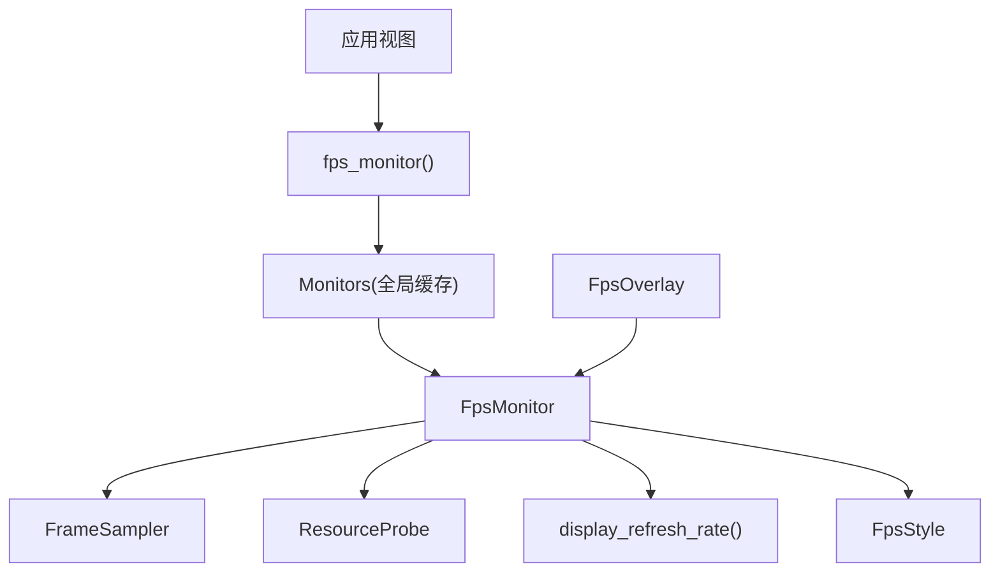
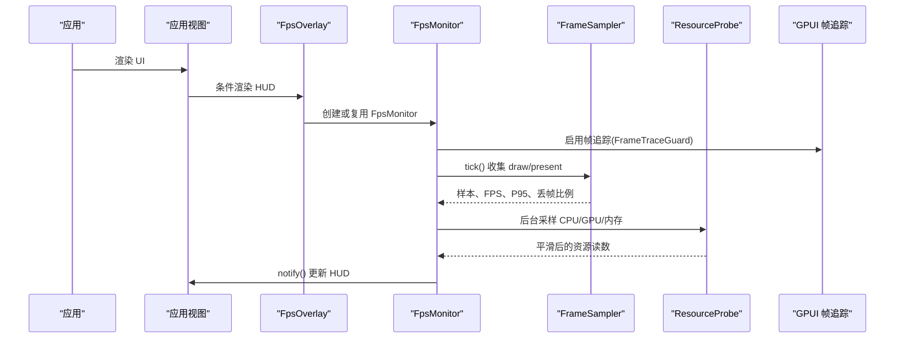
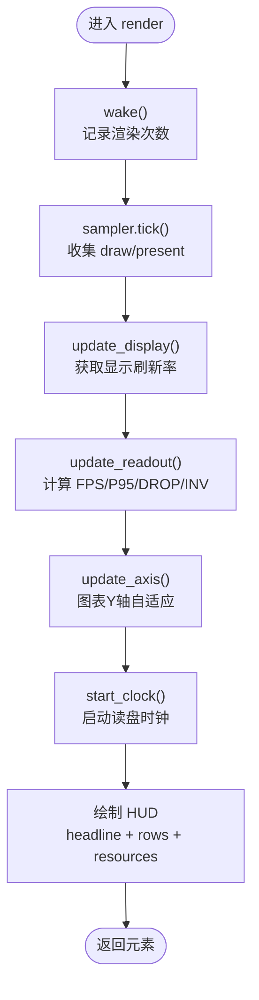
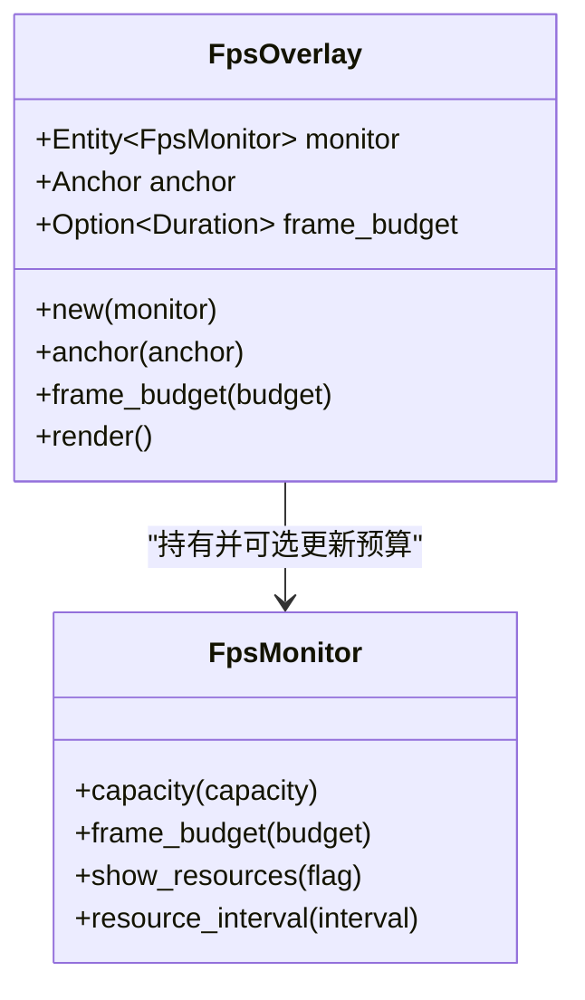
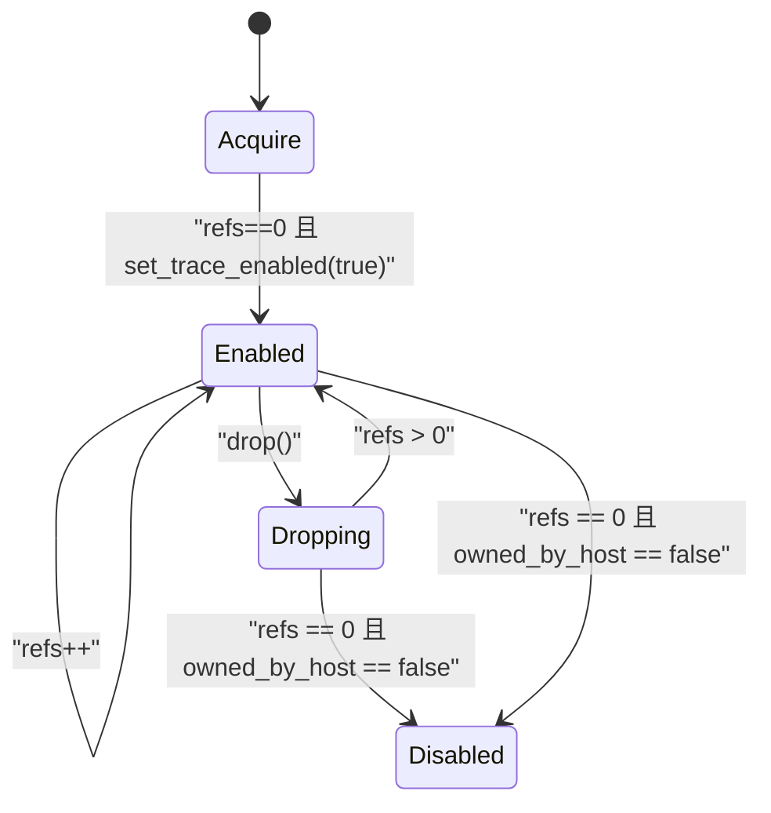
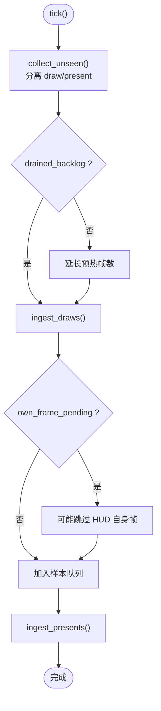
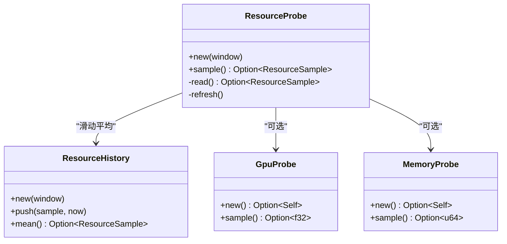
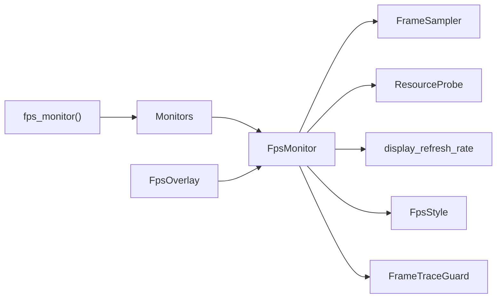

# FPS 监控

<cite>
**本文引用的文件**   
- [lib.rs](file://crates/fps/src/lib.rs)
- [monitor.rs](file://crates/fps/src/monitor.rs)
- [overlay.rs](file://crates/fps/src/overlay.rs)
- [style.rs](file://crates/fps/src/style.rs)
- [sampler.rs](file://crates/fps/src/sampler.rs)
- [gpu.rs](file://crates/fps/src/gpu.rs)
- [memory.rs](file://crates/fps/src/memory.rs)
- [refresh.rs](file://crates/fps/src/refresh.rs)
- [main.rs（FPS 示例）](file://examples/fps_monitor/src/main.rs)
</cite>

## 目录
1. [简介](#简介)
2. [项目结构](#项目结构)
3. [核心组件](#核心组件)
4. [架构总览](#架构总览)
5. [详细组件分析](#详细组件分析)
6. [依赖关系分析](#依赖关系分析)
7. [性能与使用建议](#性能与使用建议)
8. [故障排查](#故障排查)
9. [结论](#结论)

## 简介
本仓库的 FPS 监控能力由 `gpui-fps` crate 提供，用于在 GPUI 应用中叠加实时性能 HUD。它展示：
- 帧率、帧时间曲线、丢帧比例、无效化合并情况
- 进程级 CPU、内存、GPU 使用情况（非 WebAssembly 平台）
- 基于显示刷新率的预算评估与图表缩放

关键设计原则：
- HUD 不驱动应用帧循环；帧率是“推导值”，不是“计数值”，避免把自身开销计入应用成本
- 通过 GPUI 的帧追踪采集数据，按窗口过滤，避免多窗口互相污染
- 资源采样在后台任务中进行，避免阻塞渲染线程
- 通过引用计数的全局开关保护帧追踪状态，避免多个 HUD 或宿主程序互相关闭追踪

## 项目结构
FPS 相关代码集中在 `crates/fps`，对外暴露两个主要类型和便捷函数：
- `FpsMonitor`：HUD 视图与统计逻辑
- `FpsOverlay`：将 `FpsMonitor` 定位到父容器的某个角或边
- `fps_monitor(window, cx)`：快捷入口，自动为每个窗口复用同一个 `FpsMonitor`

**图示来源**
- [lib.rs:83-100](file://crates/fps/src/lib.rs#L83-L100)
- [monitor.rs:202-232](file://crates/fps/src/monitor.rs#L202-L232)
- [overlay.rs:33-62](file://crates/fps/src/overlay.rs#L33-L62)

**章节来源**
- [lib.rs:1-48](file://crates/fps/src/lib.rs#L1-L48)
- [lib.rs:83-108](file://crates/fps/src/lib.rs#L83-L108)

## 核心组件
- `FpsMonitor`
  - 负责帧采样、读盘更新、图表绘制、资源采样调度、显示刷新率适配
  - 维护 HUD 可见性、紧凑模式、标题行切换（最大可持续帧率 vs 实际观测帧率）
- `FpsOverlay`
  - 将 `FpsMonitor` 以绝对定位方式钉在父容器的边缘或角落
  - 支持设置每帧预算，覆盖显示刷新率自动预算
- `FrameTraceGuard`
  - 管理 GPUI 帧追踪的全局开关
  - 引用计数确保最后一个守卫释放时才恢复原状态
- `FrameSampler`
  - 从 `FrameTimingCollector` 中按窗口过滤 draw/present 事件
  - 计算 FPS、平均帧耗时、P95 帧耗时、丢帧比例、无效化合并均值
- `ResourceProbe` / `GpuProbe` / `MemoryProbe`
  - 非 WebAssembly 平台下采集 CPU、内存、GPU 使用率
  - 对 GPU 和私有内存采用平台后端，不可用时优雅降级
- `FpsStyle`
  - HUD 颜色主题，包含背景、前景、标签色以及按预算分级的 good/warn/bad 颜色

**章节来源**
- [monitor.rs:106-232](file://crates/fps/src/monitor.rs#L106-L232)
- [overlay.rs:9-62](file://crates/fps/src/overlay.rs#L9-L62)
- [lib.rs:124-160](file://crates/fps/src/lib.rs#L124-L160)
- [sampler.rs:23-64](file://crates/fps/src/sampler.rs#L23-L64)
- [sampler.rs:309-498](file://crates/fps/src/sampler.rs#L309-L498)
- [gpu.rs:1-44](file://crates/fps/src/gpu.rs#L1-L44)
- [memory.rs:1-48](file://crates/fps/src/memory.rs#L1-L48)
- [style.rs:3-65](file://crates/fps/src/style.rs#L3-L65)

## 架构总览
FPS 监控的整体流程如下：

**图示来源**
- [lib.rs:83-100](file://crates/fps/src/lib.rs#L83-L100)
- [monitor.rs:653-660](file://crates/fps/src/monitor.rs#L653-L660)
- [monitor.rs:378-444](file://crates/fps/src/monitor.rs#L378-L444)
- [sampler.rs:103-127](file://crates/fps/src/sampler.rs#L103-L127)

## 详细组件分析

### FpsMonitor：帧率统计与 HUD 渲染
职责：
- 初始化并复用 `FrameSampler`
- 根据显示刷新率自适应每帧预算
- 周期性更新读盘数值，避免每帧抖动
- 绘制帧时间曲线图，并按预算分级着色
- 控制 HUD 可见性：长时间未渲染则停止时钟、释放帧追踪
- 支持紧凑模式和标题行切换

关键行为：
- `wake()`：HUD 再次可见时重新启用帧追踪并重置采样器
- `sleep()`：HUD 隐藏时停止时钟、释放帧追踪、丢弃旧资源读数
- `update_readout()`：每 500ms 计算一次可读指标
- `update_axis()`：图表 Y 轴快速上升、缓慢回退，避免跳变
- `render_chart()`：按容量绘制最近 N 帧的耗时折线
- `render_headline()`：居中显示主数字，左侧显示 MAX/OBSERVED 标记，右侧显示单位

**图示来源**
- [monitor.rs:653-660](file://crates/fps/src/monitor.rs#L653-L660)
- [monitor.rs:490-527](file://crates/fps/src/monitor.rs#L490-L527)
- [monitor.rs:532-600](file://crates/fps/src/monitor.rs#L532-L600)

**章节来源**
- [monitor.rs:202-232](file://crates/fps/src/monitor.rs#L202-L232)
- [monitor.rs:284-304](file://crates/fps/src/monitor.rs#L284-L304)
- [monitor.rs:306-366](file://crates/fps/src/monitor.rs#L306-L366)
- [monitor.rs:378-444](file://crates/fps/src/monitor.rs#L378-L444)
- [monitor.rs:478-527](file://crates/fps/src/monitor.rs#L478-L527)
- [monitor.rs:532-600](file://crates/fps/src/monitor.rs#L532-L600)
- [monitor.rs:653-800](file://crates/fps/src/monitor.rs#L653-L800)

### FpsOverlay：HUD 定位与预算注入
职责：
- 将 `FpsMonitor` 以绝对定位方式放置到父容器的指定锚点
- 支持设置每帧预算，覆盖显示刷新率自动预算
- 默认右上角，支持左上、左下、右下、顶部居中、底部居中、左右居中

使用要点：
- 父容器必须设置为相对定位
- 若已有配置好的 `FpsMonitor`，可直接用 `FpsOverlay::new(monitor)` 包裹

**图示来源**
- [overlay.rs:33-62](file://crates/fps/src/overlay.rs#L33-L62)
- [monitor.rs:306-366](file://crates/fps/src/monitor.rs#L306-L366)

**章节来源**
- [overlay.rs:9-92](file://crates/fps/src/overlay.rs#L9-L92)

### FrameTraceGuard：帧追踪引用计数管理
机制：
- 进程级开关：`gpui::profiler::set_trace_enabled`
- 首次 acquire 时开启追踪；如果之前已经开启，则标记为“由宿主拥有”
- 每次 acquire 引用计数加一；drop 时减一
- 仅当引用计数归零且非宿主拥有时，才关闭追踪

意义：
- 多个 HUD 同时存在不会互相关闭追踪
- 宿主程序自行开启的追踪不会被 HUD 意外关闭

**图示来源**
- [lib.rs:119-160](file://crates/fps/src/lib.rs#L119-L160)

**章节来源**
- [lib.rs:111-160](file://crates/fps/src/lib.rs#L111-L160)

### FrameSampler：帧率统计与样本管理
职责：
- 从 `FrameTimingCollector` 拉取 draw/present 事件
- 按窗口过滤，避免其他窗口污染
- 忽略 HUD 自身触发的帧，避免自测量
- 冷启动预热：前若干帧不计入统计，避免首帧慢导致误报
- 计算 FPS、present 间隔、平均帧耗时、P95 帧耗时、丢帧比例、无效化合并均值

关键点：
- FPS 基于 present 时间戳区间计算，而非读取批次时间
- own_frame_pending 机制排除 HUD 自身通知导致的帧
- warmup 跳过冷启动阶段
- over_budget_ratio 基于保留样本中超过预算的比例

**图示来源**
- [sampler.rs:103-127](file://crates/fps/src/sampler.rs#L103-L127)
- [sampler.rs:260-307](file://crates/fps/src/sampler.rs#L260-L307)

**章节来源**
- [sampler.rs:23-64](file://crates/fps/src/sampler.rs#L23-L64)
- [sampler.rs:103-127](file://crates/fps/src/sampler.rs#L103-L127)
- [sampler.rs:145-258](file://crates/fps/src/sampler.rs#L145-L258)
- [sampler.rs:260-307](file://crates/fps/src/sampler.rs#L260-L307)

### 资源采样：CPU、内存、GPU
- CPU：使用 `sysinfo` 的进程 CPU 占用，单位为“单核饱和=100”
- 内存：优先使用平台私有内存计数器，不可用时回退到驻留集大小
- GPU：平台后端探测进程级 GPU 占用，不可用时该行不显示
- 所有资源读数通过 `ResourceHistory` 做滑动窗口平均，避免跳动

**图示来源**
- [sampler.rs:309-498](file://crates/fps/src/sampler.rs#L309-L498)
- [gpu.rs:18-44](file://crates/fps/src/gpu.rs#L18-L44)
- [memory.rs:30-48](file://crates/fps/src/memory.rs#L30-L48)

**章节来源**
- [sampler.rs:309-498](file://crates/fps/src/sampler.rs#L309-L498)
- [gpu.rs:1-68](file://crates/fps/src/gpu.rs#L1-L68)
- [memory.rs:1-98](file://crates/fps/src/memory.rs#L1-L98)

### 显示刷新率适配
目的：
- 将显示刷新周期作为每帧预算，使“FRAME”“P95”“DROP”等评级合理
- 窗口跨显示器移动时重新查询刷新率

实现：
- macOS：CoreGraphics 获取显示模式刷新率
- Windows：GetMonitorInfo + EnumDisplaySettingsW
- Wayland：枚举 wl_output，匹配名称与当前模式
- 其他平台：返回 None，HUD 不强制预算上限

**章节来源**
- [refresh.rs:1-25](file://crates/fps/src/refresh.rs#L1-L25)
- [refresh.rs:34-82](file://crates/fps/src/refresh.rs#L34-L82)
- [refresh.rs:84-201](file://crates/fps/src/refresh.rs#L84-L201)

### 样式与主题
- `FpsStyle` 提供深色 HUD 配色，保证在任何窗口背景下可读
- 按帧耗时与预算比较给出 good/warn/bad 三级颜色
- HUD 背景接近不透明，避免无法感知下层内容导致对比度不足

**章节来源**
- [style.rs:3-65](file://crates/fps/src/style.rs#L3-L65)

## 依赖关系分析
- `fps_monitor` 通过全局 `Monitors` 缓存每个窗口的 `FpsMonitor`
- `FpsMonitor` 依赖：
  - `FrameSampler`：帧统计
  - `ResourceProbe`：资源采样
  - `display_refresh_rate`：显示刷新率
  - `FpsStyle`：颜色主题
- `FpsOverlay` 依赖 `FpsMonitor`，并可注入每帧预算
- `FrameTraceGuard` 依赖 GPUI 进程级帧追踪开关

**图示来源**
- [lib.rs:83-108](file://crates/fps/src/lib.rs#L83-L108)
- [monitor.rs:202-232](file://crates/fps/src/monitor.rs#L202-L232)
- [overlay.rs:33-62](file://crates/fps/src/overlay.rs#L33-L62)

**章节来源**
- [lib.rs:83-108](file://crates/fps/src/lib.rs#L83-L108)
- [monitor.rs:202-232](file://crates/fps/src/monitor.rs#L202-L232)
- [overlay.rs:33-62](file://crates/fps/src/overlay.rs#L33-L62)

## 性能与使用建议
最佳实践：
- 条件渲染 HUD：仅在调试或性能分析时渲染，避免常驻 UI 开销
- 使用 `fps_monitor(window, cx)`：自动复用每个窗口的监控实例
- 自定义位置：使用 `FpsOverlay` 的 `anchor` 设置位置
- 自定义预算：使用 `frame_budget` 固定预算，不随显示刷新率变化
- 关闭资源采样：在 WebAssembly 或不需要 CPU/GPU/内存读数时调用 `show_resources(false)`
- 调整采样间隔：通过 `resource_interval` 控制资源采样频率
- 调整图表容量：通过 `capacity` 控制保留帧数，平衡历史长度与内存

常见问题：
- HUD 遮挡内容：使用紧凑模式或调整锚点
- 数字跳动过快：HUD 已内置 500ms 读盘间隔；如需更稳可关闭资源采样
- 首帧误报：采样器有预热帧，避免冷启动影响
- 多窗口数据污染：采样器按窗口 ID 过滤
- HUD 自身帧被计入：通过 `expect_own_frame` 排除 HUD 通知导致的帧

[本节为通用指导，不直接分析具体文件]

## 故障排查
- HUD 不显示
  - 确认父容器设置了相对定位
  - 确认条件渲染分支确实渲染了 HUD
- 资源行缺失
  - WebAssembly 平台默认无资源采样
  - 某些平台无 GPU 计数器，GPU 行会省略
  - 私有内存计数器不可用时回退到驻留集大小
- 帧率异常低或高
  - 检查是否处于预热阶段
  - 检查是否误将 HUD 自身帧计入
  - 检查显示刷新率是否正确识别
- 图表 Y 轴跳变
  - 图表 Y 轴快速上升、缓慢回退，属正常设计
  - 可通过调整 `capacity` 和 `frame_budget` 改善视觉稳定性

**章节来源**
- [overlay.rs:19-32](file://crates/fps/src/overlay.rs#L19-L32)
- [sampler.rs:145-180](file://crates/fps/src/sampler.rs#L145-L180)
- [sampler.rs:260-307](file://crates/fps/src/sampler.rs#L260-L307)
- [gpu.rs:18-44](file://crates/fps/src/gpu.rs#L18-L44)
- [memory.rs:30-48](file://crates/fps/src/memory.rs#L30-L48)

## 结论
`gpui-fps` 提供了轻量、准确、可嵌入的 FPS 监控方案。它以 GPUI 帧追踪为基础，结合显示刷新率和资源采样，给出直观的 HUD 反馈。通过 `FpsMonitor` 与 `FpsOverlay` 的组合，开发者可以灵活集成性能监控界面，并在需要时自定义样式、位置和预算策略。`FrameTraceGuard` 的引用计数机制确保了多 HUD 共存和宿主程序自定义追踪的安全性。

[本节为总结性内容，不直接分析具体文件]