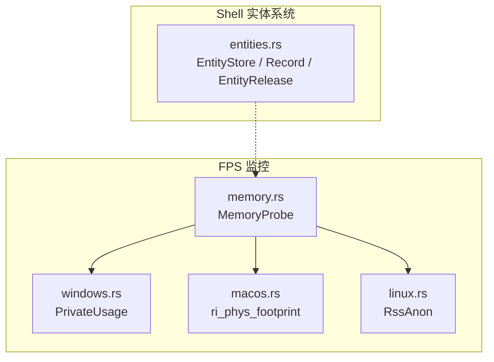
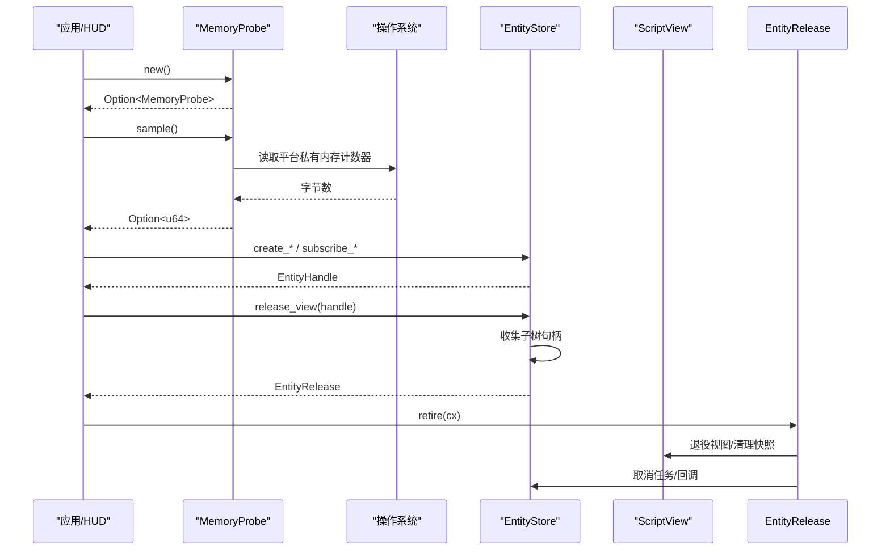
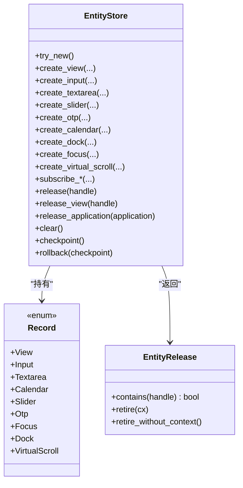
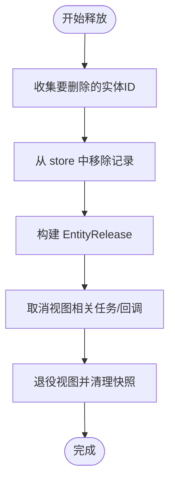
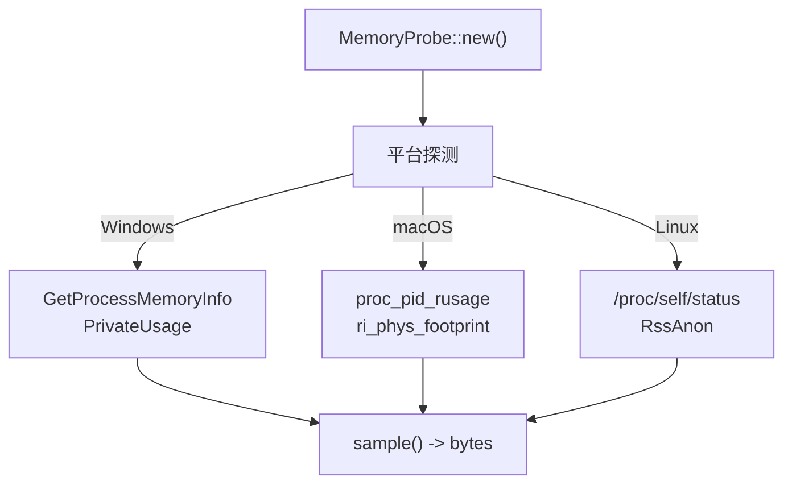
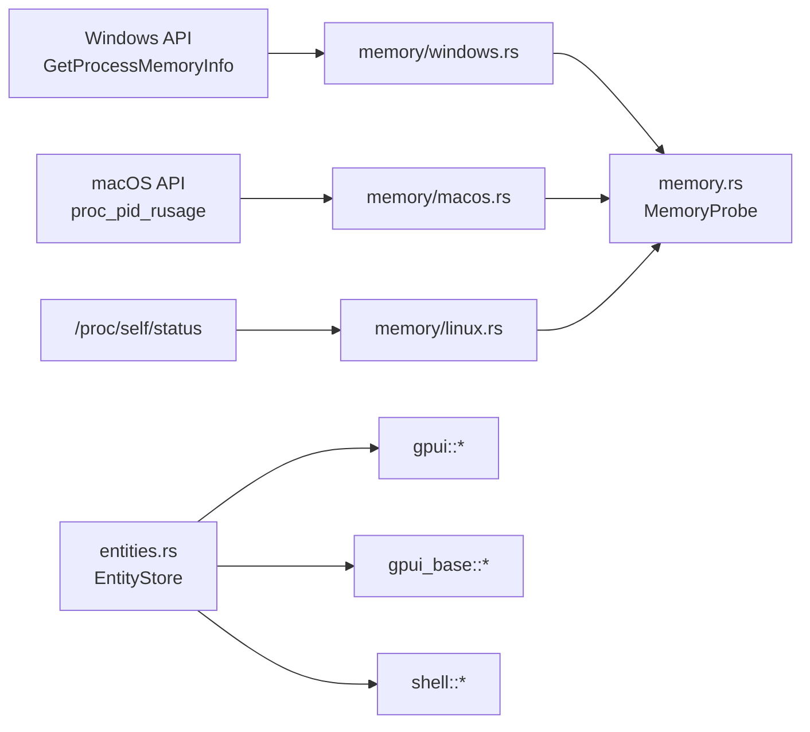

# 内存管理

<cite>
**本文引用的文件**   
- [crates/fps/src/memory.rs](file://crates/fps/src/memory.rs)
- [crates/fps/src/memory/windows.rs](file://crates/fps/src/memory/windows.rs)
- [crates/fps/src/memory/macos.rs](file://crates/fps/src/memory/macos.rs)
- [crates/fps/src/memory/linux.rs](file://crates/fps/src/memory/linux.rs)
- [crates/shell/src/entities.rs](file://crates/shell/src/entities.rs)
</cite>

## 目录
1. [引言](#引言)
2. [项目结构](#项目结构)
3. [核心组件](#核心组件)
4. [架构总览](#架构总览)
5. [详细组件分析](#详细组件分析)
6. [依赖关系分析](#依赖关系分析)
7. [性能与优化](#性能与优化)
8. [故障排查指南](#故障排查指南)
9. [结论](#结论)

## 引言
本指南聚焦 GPUI Kit 的内存管理机制，围绕以下目标展开：
- 实体生命周期管理：脚本侧通过句柄访问跨帧保留的状态，由运行时统一托管。
- 异步任务内存优化：在释放视图或应用时取消相关回调和任务，避免悬挂引用。
- 资源清理策略：按“应用/视图”层级批量回收，保证订阅、状态和快照被正确释放。
- 平台差异：Windows、macOS、Linux 下私有内存采样实现不同，但对外暴露一致的字节单位。
- 泄漏检测与优化实践：结合实体上限、句柄校验、订阅所有权以及平台内存探针，给出可操作的优化建议。
- 实际案例：以 FPS 内存探针测试为例，展示如何验证“采样值跟随进程分配增长”。

## 项目结构
与内存管理直接相关的代码主要分布在两个 crate：
- fps crate：提供跨平台的内存采样能力（MemoryProbe），用于 HUD 或监控面板显示进程私有内存。
- shell crate：提供脚本可见的实体存储（EntityStore），负责实体创建、查询、订阅、释放与应用级回收。

**图表来源**
- [crates/fps/src/memory.rs:21-47](file://crates/fps/src/memory.rs#L21-L47)
- [crates/fps/src/memory/windows.rs:20-58](file://crates/fps/src/memory/windows.rs#L20-L58)
- [crates/fps/src/memory/macos.rs:19-58](file://crates/fps/src/memory/macos.rs#L19-L58)
- [crates/fps/src/memory/linux.rs:27-54](file://crates/fps/src/memory/linux.rs#L27-L54)
- [crates/shell/src/entities.rs:190-250](file://crates/shell/src/entities.rs#L190-L250)

**章节来源**
- [crates/fps/src/memory.rs:1-47](file://crates/fps/src/memory.rs#L1-L47)
- [crates/shell/src/entities.rs:1-53](file://crates/shell/src/entities.rs#L1-L53)

## 核心组件
- MemoryProbe：封装平台私有内存采样，返回字节数；若平台不支持则返回 None，上层可回退到常驻集大小。
- EntityStore：运行时级别的实体存储，维护脚本可见的实体句柄与内部记录，支持按应用/视图维度释放。
- EntityRelease：延迟释放计划，收集要取消的任务、要退役的视图，并在合适时机执行清理。

关键职责划分：
- fps::memory：只关心“当前进程有多少私有内存”，不关心业务对象。
- shell::entities：只关心“脚本持有的实体如何创建、查找、订阅、释放”，不关心底层页表。

**章节来源**
- [crates/fps/src/memory.rs:30-47](file://crates/fps/src/memory.rs#L30-L47)
- [crates/shell/src/entities.rs:190-250](file://crates/shell/src/entities.rs#L190-L250)

## 架构总览
GPUI Kit 的内存管理采用“监控 + 托管”的双层设计：
- 监控层：fps::memory 提供平台无关的私有内存采样 API，便于 HUD 显示真实的应用内存压力。
- 托管层：shell::entities 提供实体生命周期管理，确保脚本持有的状态不会泄露，且能按应用/视图粒度回收。

**图表来源**
- [crates/fps/src/memory.rs:38-47](file://crates/fps/src/memory.rs#L38-L47)
- [crates/fps/src/memory/windows.rs:41-58](file://crates/fps/src/memory/windows.rs#L41-L58)
- [crates/fps/src/memory/macos.rs:42-58](file://crates/fps/src/memory/macos.rs#L42-L58)
- [crates/fps/src/memory/linux.rs:47-54](file://crates/fps/src/memory/linux.rs#L47-L54)
- [crates/shell/src/entities.rs:842-971](file://crates/shell/src/entities.rs#L842-L971)

## 详细组件分析

### 实体生命周期管理（EntityStore）
EntityStore 是脚本可见实体的唯一所有者。脚本持有的是 u64 句柄，而非实体本身；句柄的高位表示 store id，低位表示实体 id，从而防止跨运行时误用。

要点：
- 每个运行时一个 store，store id 线程局部递增，避免共享。
- 实体类型通过 Record 枚举区分：View、Input、Textarea、Calendar、Slider、Otp、Focus、Dock、VirtualScroll。
- 所有创建方法都会检查容量上限 MAX_LIVE_ENTITIES，超出返回 EntityLimitError。
- 订阅由 store 持有，而不是交给脚本，避免脚本 drop 后事件不再触发。
- 释放分为三类：
  - release：释放单个非 View 实体。
  - release_view：释放某个视图及其子树下的所有实体。
  - release_application：按 ApplicationGeneration 释放属于该应用的所有实体。

**图表来源**
- [crates/shell/src/entities.rs:59-162](file://crates/shell/src/entities.rs#L59-L162)
- [crates/shell/src/entities.rs:190-250](file://crates/shell/src/entities.rs#L190-L250)
- [crates/shell/src/entities.rs:257-1119](file://crates/shell/src/entities.rs#L257-L1119)

**章节来源**
- [crates/shell/src/entities.rs:1-53](file://crates/shell/src/entities.rs#L1-L53)
- [crates/shell/src/entities.rs:190-250](file://crates/shell/src/entities.rs#L190-L250)
- [crates/shell/src/entities.rs:257-1119](file://crates/shell/src/entities.rs#L257-L1119)

### 异步任务与资源清理（EntityRelease）
当释放视图或应用时，系统会：
- 收集需要移除的记录与句柄。
- 取消与该视图关联的回调和任务，避免继续持有 VM 或窗口上下文。
- 将视图标记为退役，清除快照等帧级数据。
- 在 Drop 路径上尽量做“尽力而为”的清理，即使没有 AppContext。

**图表来源**
- [crates/shell/src/entities.rs:842-971](file://crates/shell/src/entities.rs#L842-L971)
- [crates/shell/src/entities.rs:225-249](file://crates/shell/src/entities.rs#L225-L249)

**章节来源**
- [crates/shell/src/entities.rs:225-249](file://crates/shell/src/entities.rs#L225-L249)
- [crates/shell/src/entities.rs:842-971](file://crates/shell/src/entities.rs#L842-L971)

### 平台内存采样（MemoryProbe）
MemoryProbe 对上层暴露统一的 sample() -> Option<u64>，内部根据 target_os 选择不同实现：
- Windows：调用 GetProcessMemoryInfo，读取 PrivateUsage，反映进程已提交但未与其他进程共享的内存。
- macOS：调用 proc_pid_rusage，读取 ri_phys_footprint，对应 Activity Monitor 的 Memory 列，是内核判断内存压力的指标。
- Linux：解析 /proc/self/status 中的 RssAnon，即匿名常驻内存，避免遍历映射带来的开销。

**图表来源**
- [crates/fps/src/memory.rs:21-47](file://crates/fps/src/memory.rs#L21-L47)
- [crates/fps/src/memory/windows.rs:20-58](file://crates/fps/src/memory/windows.rs#L20-L58)
- [crates/fps/src/memory/macos.rs:19-58](file://crates/fps/src/memory/macos.rs#L19-L58)
- [crates/fps/src/memory/linux.rs:27-54](file://crates/fps/src/memory/linux.rs#L27-L54)

**章节来源**
- [crates/fps/src/memory.rs:1-47](file://crates/fps/src/memory.rs#L1-L47)
- [crates/fps/src/memory/windows.rs:1-59](file://crates/fps/src/memory/windows.rs#L1-L59)
- [crates/fps/src/memory/macos.rs:1-60](file://crates/fps/src/memory/macos.rs#L1-L60)
- [crates/fps/src/memory/linux.rs:1-85](file://crates/fps/src/memory/linux.rs#L1-L85)

### 内存使用模式与最佳实践
- 大对象处理：
  - 优先使用 EntityStore 的 create_* 接口，让运行时统一管理生命周期，避免脚本侧忘记释放。
  - 对于超大文本或图像，考虑分块加载、虚拟列表滚动句柄 VirtualListScrollHandle，减少同时驻留内存。
- 缓存策略：
  - 将频繁读写的 UI 状态放入 InputState、TextareaState、SliderState 等实体中，避免每帧重建。
  - 使用 DockArea 等复杂布局实体时，注意其订阅和皮肤渲染可能持有较多状态，应在应用卸载时显式释放。
- 垃圾回收优化：
  - 不要长期持有 EntityHandle 而不释放；release 后句柄失效，避免重复使用。
  - 使用 release_application 按应用边界清理，避免跨应用残留。
  - 利用 checkpoint/rollback 在初始化失败时回滚部分实体，避免脏状态。

[本节为通用实践总结，不直接分析具体文件]

## 依赖关系分析
- fps::memory 与平台库耦合：
  - Windows：依赖 windows crate 的 ProcessStatus。
  - macOS：依赖 libc 的 rusage 接口。
  - Linux：依赖 std::fs 读取 /proc/self/status。
- shell::entities 与 GPUI 生态耦合：
  - 依赖 gpui::Entity、Window、App、Subscription 等。
  - 依赖 gpui_base 的输入、日历、滑块、Dock 等状态类型。
  - 依赖 shell 内部的 ScriptView、ShellRuntime、ApplicationGeneration 等。

**图表来源**
- [crates/fps/src/memory/windows.rs:15-18](file://crates/fps/src/memory/windows.rs#L15-L18)
- [crates/fps/src/memory/macos.rs:17-21](file://crates/fps/src/memory/macos.rs#L17-L21)
- [crates/fps/src/memory/linux.rs:16-25](file://crates/fps/src/memory/linux.rs#L16-L25)
- [crates/shell/src/entities.rs:21-41](file://crates/shell/src/entities.rs#L21-L41)

**章节来源**
- [crates/fps/src/memory/windows.rs:15-18](file://crates/fps/src/memory/windows.rs#L15-L18)
- [crates/fps/src/memory/macos.rs:17-21](file://crates/fps/src/memory/macos.rs#L17-L21)
- [crates/fps/src/memory/linux.rs:16-25](file://crates/fps/src/memory/linux.rs#L16-L25)
- [crates/shell/src/entities.rs:21-41](file://crates/shell/src/entities.rs#L21-L41)

## 性能与优化
- 平台采样开销：
  - Linux 选择 RssAnon 而非 smaps_rollup，避免遍历地址空间锁，显著降低采样耗时。
  - macOS 使用稳定的 rusage 接口，避免硬编码 Mach 结构体版本。
  - Windows 使用 PrivateUsage，避免逐页查询工作集的昂贵操作。
- 实体数量限制：
  - EntityStore 设置 MAX_LIVE_ENTITIES，防止无限增长导致 OOM。
  - ensure_capacity 在 push 前检查，超限时返回 EntityLimitError。
- 订阅与回调：
  - 订阅由 store 持有，避免脚本侧 drop 导致事件中断。
  - 释放视图时取消 owned work，避免后台任务继续持有窗口或 VM 引用。

优化建议：
- 在长生命周期应用中，定期调用 release_application 清理旧应用实体。
- 对高频交互控件，复用 SliderState、InputState 等实体，避免每帧重建。
- 使用 VirtualListScrollHandle 管理滚动请求，避免大量 scroll_to_item 堆积。
- 在 HUD 中使用 MemoryProbe.sample() 监控私有内存趋势，发现异常增长及时定位。

**章节来源**
- [crates/fps/src/memory/linux.rs:1-15](file://crates/fps/src/memory/linux.rs#L1-L15)
- [crates/fps/src/memory/macos.rs:1-16](file://crates/fps/src/memory/macos.rs#L1-L16)
- [crates/fps/src/memory/windows.rs:1-12](file://crates/fps/src/memory/windows.rs#L1-L12)
- [crates/shell/src/entities.rs:53-57](file://crates/shell/src/entities.rs#L53-L57)
- [crates/shell/src/entities.rs:1098-1119](file://crates/shell/src/entities.rs#L1098-L1119)

## 故障排查指南
常见问题与定位方法：
- 句柄无效：
  - 现象：release 后继续使用句柄，无法解析实体。
  - 原因：句柄已被释放，或来自其他 store。
  - 排查：确认 release 调用点，检查 entity_id 是否跨 store。
- 内存持续增长：
  - 现象：HUD 显示私有内存持续上升。
  - 原因：未释放实体、未取消订阅、未清理视图快照。
  - 排查：检查 release_view/release_application 调用，确认 EntityRelease.retire 被执行。
- 平台采样异常：
  - 现象：MemoryProbe.new() 返回 None。
  - 原因：平台权限不足或接口不可用。
  - 排查：在 Windows 检查 PROCESS_QUERY_INFORMATION，在 Linux 检查 /proc/self/status 可读性。

实用断言与测试：
- MemoryProbe 单元测试验证采样值跟随进程分配增长，确保单位为字节。
- EntityStore 测试覆盖：
  - 释放后句柄不再解析。
  - 不同 store 的句柄互不干扰。
  - 应用级释放只清理所属实体。
  - 输入/文本域/OTP/日历等类型互不混淆。

**章节来源**
- [crates/fps/src/memory.rs:50-97](file://crates/fps/src/memory.rs#L50-L97)
- [crates/shell/src/entities.rs:1307-1481](file://crates/shell/src/entities.rs#L1307-L1481)

## 结论
GPUI Kit 的内存管理通过“平台无关的私有内存采样”和“强约束的实体生命周期托管”共同保障应用稳定性：
- fps::memory 提供准确的进程私有内存观测，帮助开发者识别真实内存压力。
- shell::entities 通过句柄、store id、订阅所有权和应用/视图层级释放，有效防止内存泄漏。
- 结合 MAX_LIVE_ENTITIES、EntityRelease 的退役机制与平台采样优化，可在大规模 UI 场景中保持可控的内存占用。

在实际工程中，建议：
- 始终通过 EntityStore 创建和管理实体，避免脚本侧直接持有长生命周期对象。
- 在应用卸载或视图销毁时，显式调用 release_view 或 release_application。
- 使用 MemoryProbe 监控私有内存趋势，配合日志与断言快速定位泄漏点。