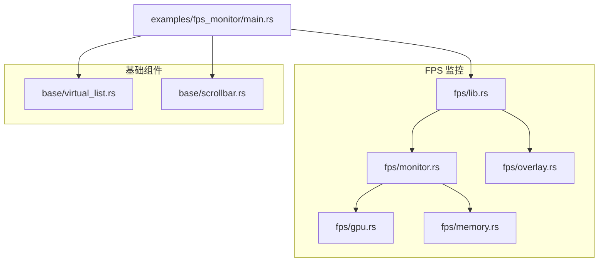
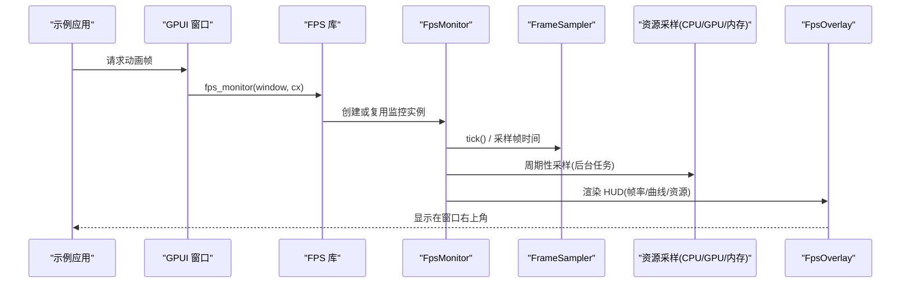
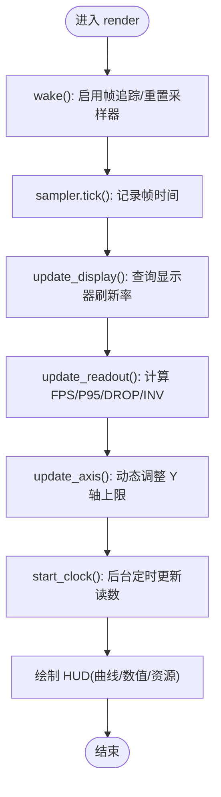
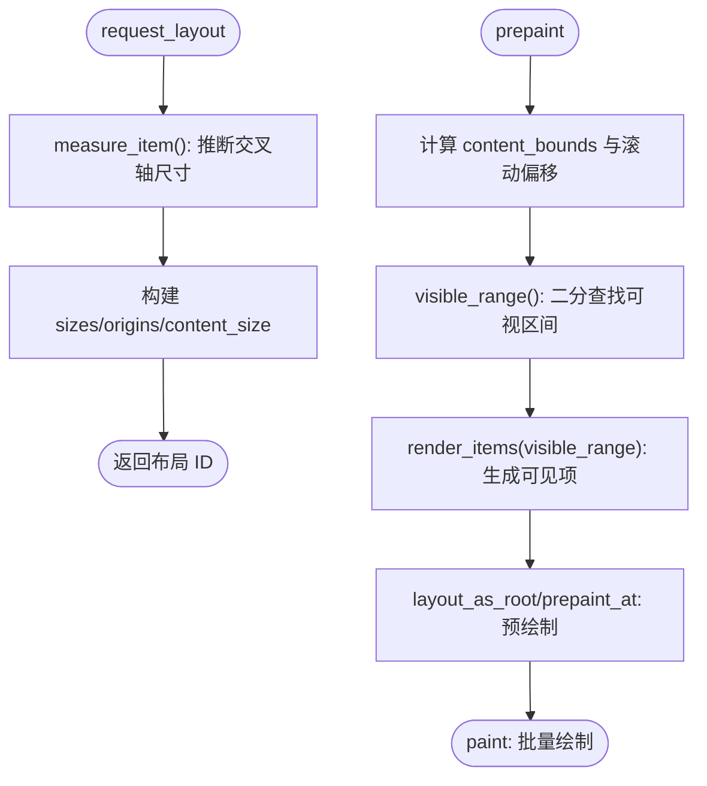
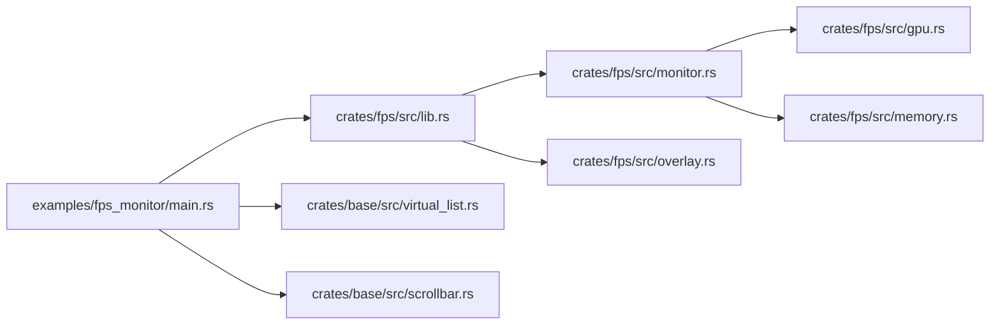

# 性能优化

<cite>
**本文引用的文件**   
- [crates/fps/src/lib.rs](file://crates/fps/src/lib.rs)
- [crates/fps/src/monitor.rs](file://crates/fps/src/monitor.rs)
- [crates/fps/src/overlay.rs](file://crates/fps/src/overlay.rs)
- [crates/fps/src/gpu.rs](file://crates/fps/src/gpu.rs)
- [crates/fps/src/memory.rs](file://crates/fps/src/memory.rs)
- [examples/fps_monitor/src/main.rs](file://examples/fps_monitor/src/main.rs)
- [crates/base/src/virtual_list.rs](file://crates/base/src/virtual_list.rs)
- [crates/base/src/scrollbar.rs](file://crates/base/src/scrollbar.rs)
</cite>

## 目录
1. [简介](#简介)
2. [项目结构](#项目结构)
3. [核心组件](#核心组件)
4. [架构总览](#架构总览)
5. [详细组件分析](#详细组件分析)
6. [依赖关系分析](#依赖关系分析)
7. [性能考量与调优策略](#性能考量与调优策略)
8. [故障排查指南](#故障排查指南)
9. [结论](#结论)
10. [附录：测试案例与对比数据](#附录测试案例与对比数据)

## 简介
本指南面向在 GPUI 应用中进行性能优化的工程师，聚焦以下主题：FPS 监控工具使用、内存管理策略、渲染优化技术、虚拟化方案（虚拟列表）、大数据集处理技巧、懒加载模式、异步任务调度、GPU 加速渲染与绘制优化、性能分析方法与瓶颈识别、跨平台注意事项。文档以仓库中 FPS 监控模块与虚拟列表实现为依据，提供可操作的实践建议与可视化说明。

## 项目结构
围绕性能优化的关键代码主要分布在以下位置：
- FPS 监控 HUD：位于 crates/fps，包含帧采样、资源采样、覆盖层与样式等。
- 虚拟列表：位于 crates/base/src/virtual_list.rs，用于大数据集的高效渲染。
- 滚动条 FPS 上限控制：位于 crates/base/src/scrollbar.rs，限制拖拽滚动的最大帧率。
- FPS 示例应用：examples/fps_monitor，演示如何叠加 FPS HUD 到图形负载场景中。

**图表来源**
- [crates/fps/src/lib.rs:1-181](file://crates/fps/src/lib.rs#L1-L181)
- [crates/fps/src/monitor.rs:1-800](file://crates/fps/src/monitor.rs#L1-L800)
- [crates/fps/src/overlay.rs:1-92](file://crates/fps/src/overlay.rs#L1-L92)
- [crates/fps/src/gpu.rs:1-68](file://crates/fps/src/gpu.rs#L1-L68)
- [crates/fps/src/memory.rs:1-98](file://crates/fps/src/memory.rs#L1-L98)
- [crates/base/src/virtual_list.rs:1-800](file://crates/base/src/virtual_list.rs#L1-L800)
- [crates/base/src/scrollbar.rs:825-944](file://crates/base/src/scrollbar.rs#L825-L944)
- [examples/fps_monitor/src/main.rs:1-426](file://examples/fps_monitor/src/main.rs#L1-L426)

**章节来源**
- [crates/fps/src/lib.rs:1-181](file://crates/fps/src/lib.rs#L1-L181)
- [crates/base/src/virtual_list.rs:1-800](file://crates/base/src/virtual_list.rs#L1-L800)
- [crates/base/src/scrollbar.rs:825-944](file://crates/base/src/scrollbar.rs#L825-L944)
- [examples/fps_monitor/src/main.rs:1-426](file://examples/fps_monitor/src/main.rs#L1-L426)

## 核心组件
- FPS 监控 HUD：提供实时帧率、帧时间曲线、CPU/GPU/内存占用等指标；基于 GPUI 的帧追踪采集数据，不驱动帧循环，避免污染测量结果。
- 虚拟列表：仅渲染可见范围内的项，支持不同尺寸的行/列，通过二分查找计算可视区间，减少布局与绘制开销。
- 滚动条 FPS 上限：对拖拽滚动进行帧率上限控制，避免高频重绘导致卡顿。
- GPU/内存采样：跨平台获取进程级 GPU 利用率与私有内存，作为 HUD 的资源行展示。

**章节来源**
- [crates/fps/src/lib.rs:1-181](file://crates/fps/src/lib.rs#L1-L181)
- [crates/fps/src/monitor.rs:106-232](file://crates/fps/src/monitor.rs#L106-L232)
- [crates/base/src/virtual_list.rs:1-800](file://crates/base/src/virtual_list.rs#L1-L800)
- [crates/base/src/scrollbar.rs:825-944](file://crates/base/src/scrollbar.rs#L825-L944)
- [crates/fps/src/gpu.rs:1-68](file://crates/fps/src/gpu.rs#L1-L68)
- [crates/fps/src/memory.rs:1-98](file://crates/fps/src/memory.rs#L1-L98)

## 架构总览
FPS 监控由“帧采样 + 资源采样 + 显示覆盖层”组成，示例应用将 HUD 叠加到图形负载场景上，便于观察不同负载下的帧时间与资源变化。

**图表来源**
- [examples/fps_monitor/src/main.rs:176-207](file://examples/fps_monitor/src/main.rs#L176-L207)
- [crates/fps/src/lib.rs:83-100](file://crates/fps/src/lib.rs#L83-L100)
- [crates/fps/src/monitor.rs:653-683](file://crates/fps/src/monitor.rs#L653-L683)
- [crates/fps/src/overlay.rs:64-90](file://crates/fps/src/overlay.rs#L64-L90)

## 详细组件分析

### FPS 监控组件
- 功能要点
  - 基于 GPUI 的 FrameTimingCollector 采集每帧 draw 耗时，统计 FPS、P95、掉帧比例、无效重绘次数。
  - 提供滚动帧时间曲线，按预算（默认 60Hz）着色，支持切换“最大可持续帧率”和“实际观测帧率”。
  - 后台任务周期采样 CPU/GPU/内存，HUD 隐藏时自动停止采样，避免无谓开销。
  - 通过 FpsOverlay 将 HUD 锚定到父容器的角落，支持自定义帧预算。
- 关键流程
  - 首次调用 fps_monitor 时创建并缓存 FpsMonitor，后续复用。
  - 渲染时唤醒监控、更新显示刷新率、计算读数、启动时钟、绘制 HUD。
  - 资源采样在后台执行，HUD 显示时才更新 UI。

**图表来源**
- [crates/fps/src/monitor.rs:653-683](file://crates/fps/src/monitor.rs#L653-L683)
- [crates/fps/src/monitor.rs:379-444](file://crates/fps/src/monitor.rs#L379-L444)
- [crates/fps/src/monitor.rs:490-527](file://crates/fps/src/monitor.rs#L490-L527)

**章节来源**
- [crates/fps/src/lib.rs:1-181](file://crates/fps/src/lib.rs#L1-L181)
- [crates/fps/src/monitor.rs:106-232](file://crates/fps/src/monitor.rs#L106-L232)
- [crates/fps/src/monitor.rs:379-444](file://crates/fps/src/monitor.rs#L379-L444)
- [crates/fps/src/monitor.rs:490-527](file://crates/fps/src/monitor.rs#L490-L527)
- [crates/fps/src/overlay.rs:1-92](file://crates/fps/src/overlay.rs#L1-L92)

### 虚拟列表组件
- 设计目标
  - 仅渲染可见范围项，支持不同尺寸的行/列，适用于复杂布局（如表格）。
  - 通过 ItemSizeLayout 维护每项尺寸与前缀和，快速计算内容区域大小与项边界。
  - 使用二分查找 visible_range 确定可视区间，减少布局与绘制压力。
- 关键流程
  - request_layout：计算最长项尺寸、构建 sizes/origins/content_size。
  - prepaint：根据滚动偏移与视口计算可视区间，渲染可见项并缓存元素。
  - paint：批量绘制已预绘制的项。

**图表来源**
- [crates/base/src/virtual_list.rs:435-599](file://crates/base/src/virtual_list.rs#L435-L599)
- [crates/base/src/virtual_list.rs:601-768](file://crates/base/src/virtual_list.rs#L601-L768)
- [crates/base/src/virtual_list.rs:384-413](file://crates/base/src/virtual_list.rs#L384-L413)

**章节来源**
- [crates/base/src/virtual_list.rs:1-800](file://crates/base/src/virtual_list.rs#L1-L800)

### 滚动条 FPS 上限控制
- 目的：限制拖拽滚动的最大帧率，避免频繁重绘造成卡顿。
- 机制：配置 max_fps（默认 120），内部按 1/max_fps 计算最小间隔，节流滚动更新。

**章节来源**
- [crates/base/src/scrollbar.rs:825-944](file://crates/base/src/scrollbar.rs#L825-L944)

### GPU 与内存采样
- GPU 采样：跨平台获取进程级 GPU 利用率百分比，不可用时 HUD 不显示该行。
- 内存采样：跨平台获取进程私有内存字节数，不可用时回退为驻留集。

**章节来源**
- [crates/fps/src/gpu.rs:1-68](file://crates/fps/src/gpu.rs#L1-L68)
- [crates/fps/src/memory.rs:1-98](file://crates/fps/src/memory.rs#L1-L98)

## 依赖关系分析
- FPS 库对外暴露 fps_monitor 与 FpsOverlay/FpsMonitor，示例应用直接依赖该库。
- FpsMonitor 依赖 FrameSampler（帧采样）、ResourceProbe（资源采样）、display_refresh_rate（刷新率）。
- 虚拟列表依赖 GPUI 的 Element/ScrollHandle 体系，与滚动条组件解耦但共享滚动语义。

**图表来源**
- [examples/fps_monitor/src/main.rs:1-426](file://examples/fps_monitor/src/main.rs#L1-L426)
- [crates/fps/src/lib.rs:1-181](file://crates/fps/src/lib.rs#L1-L181)
- [crates/fps/src/monitor.rs:1-800](file://crates/fps/src/monitor.rs#L1-L800)
- [crates/fps/src/overlay.rs:1-92](file://crates/fps/src/overlay.rs#L1-L92)
- [crates/fps/src/gpu.rs:1-68](file://crates/fps/src/gpu.rs#L1-L68)
- [crates/fps/src/memory.rs:1-98](file://crates/fps/src/memory.rs#L1-L98)
- [crates/base/src/virtual_list.rs:1-800](file://crates/base/src/virtual_list.rs#L1-L800)
- [crates/base/src/scrollbar.rs:825-944](file://crates/base/src/scrollbar.rs#L825-L944)

**章节来源**
- [examples/fps_monitor/src/main.rs:1-426](file://examples/fps_monitor/src/main.rs#L1-L426)
- [crates/fps/src/lib.rs:1-181](file://crates/fps/src/lib.rs#L1-L181)
- [crates/base/src/virtual_list.rs:1-800](file://crates/base/src/virtual_list.rs#L1-L800)

## 性能考量与调优策略
- FPS 监控使用建议
  - 仅在调试或诊断时开启 HUD，生产环境按需隐藏以减少额外开销。
  - 合理设置 frame_budget：高刷显示器下应提高预算阈值，避免误判掉帧。
  - 关注 FRAME/P95/DROP/INV 四要素：FRAME 表示单帧成本，P95 反映尾部延迟，DROP 表示超预算比例，INV 表示无效重绘次数。
- 虚拟列表优化
  - 确保 item_sizes 准确且稳定，避免频繁变更导致重新计算 origins/sizes。
  - 使用 with_item_to_measure_index 指定代表性项，提升交叉轴尺寸推断准确性。
  - 结合滚动条 max_fps 限制拖拽频率，降低滚动时的抖动与重绘。
- 大数据集与懒加载
  - 分页或增量加载数据，避免一次性构造超大 item_sizes。
  - 对昂贵子组件采用懒初始化，仅在可见范围内创建。
- 异步任务调度
  - 将重型计算放入后台任务，避免阻塞渲染线程。
  - 使用 window.request_animation_frame 驱动动画，配合 HUD 观察帧时间。
- GPU 加速与绘制优化
  - 合并路径绘制，减少 paint_path 调用次数（参考示例中的分段绘制）。
  - 避免在每帧分配大量临时对象，尽量复用缓冲区与颜色表。
- 内存管理
  - 监控私有内存增长趋势，定位泄漏点；注意共享库映射页不计入私有内存。
  - 及时释放不再使用的纹理、字体与大对象。
- 跨平台注意事项
  - GPU/内存采样在某些平台可能不可用，HUD 会隐去对应行，不应将其视为错误。
  - 显示器刷新率可能随窗口移动而变化，HUD 会自动适配；必要时显式设置 frame_budget。

[本节为通用指导，不直接分析具体文件]

## 故障排查指南
- HUD 数字不更新
  - 检查是否启用了后台时钟与资源采样；确认 HUD 未被长时间隐藏导致 sleep。
  - 确认应用仍在调用 request_animation_frame 维持动画循环。
- 帧率异常低
  - 查看 FRAME/P95 是否超过 frame_budget；检查 DROP 比例与 INV 值。
  - 检查是否存在大量无效重绘或重复布局。
- 滚动卡顿
  - 调整滚动条 max_fps，避免过高刷新导致频繁重绘。
  - 使用虚拟列表并确保 item_sizes 正确。
- GPU/内存行缺失
  - 平台不支持或计数器不可用属正常现象；HUD 会跳过该行。

**章节来源**
- [crates/fps/src/monitor.rs:379-444](file://crates/fps/src/monitor.rs#L379-L444)
- [crates/base/src/scrollbar.rs:825-944](file://crates/base/src/scrollbar.rs#L825-L944)
- [crates/fps/src/gpu.rs:1-68](file://crates/fps/src/gpu.rs#L1-L68)
- [crates/fps/src/memory.rs:1-98](file://crates/fps/src/memory.rs#L1-L98)

## 结论
通过 FPS 监控与虚拟列表的组合，可以在复杂 UI 与大数据集场景下获得稳定的交互体验。合理设置帧预算、限制滚动帧率、采用懒加载与异步调度，能有效降低主线程压力。GPU/内存采样帮助定位资源瓶颈，跨平台差异需在设计时考虑。建议在开发阶段持续使用 HUD 观察关键指标，逐步优化至生产可用状态。

[本节为总结性内容，不直接分析具体文件]

## 附录：测试案例与对比数据
- 测试场景
  - 使用 examples/fps_monitor 示例，动态调节曲线数量作为负载旋钮，观察 HUD 的帧时间曲线与资源行变化。
  - 在大型列表中启用虚拟列表，对比关闭虚拟列表时的 FPS 与内存占用。
- 预期对比
  - 启用虚拟列表后，FPS 更稳定，P95 下降，DROP 比例降低。
  - 滚动条启用 max_fps 后，拖拽滚动更平滑，帧时间波动减小。
  - 后台异步任务分担计算后，主线程帧时间显著降低。
- 数据采集方法
  - 使用 HUD 的 FRAME/P95/DROP/INV 与 GPU/内存行，记录不同配置下的数值。
  - 在不同显示器刷新率下验证 frame_budget 的影响。

**章节来源**
- [examples/fps_monitor/src/main.rs:1-426](file://examples/fps_monitor/src/main.rs#L1-L426)
- [crates/fps/src/monitor.rs:653-683](file://crates/fps/src/monitor.rs#L653-L683)
- [crates/base/src/virtual_list.rs:601-768](file://crates/base/src/virtual_list.rs#L601-L768)
- [crates/base/src/scrollbar.rs:825-944](file://crates/base/src/scrollbar.rs#L825-L944)