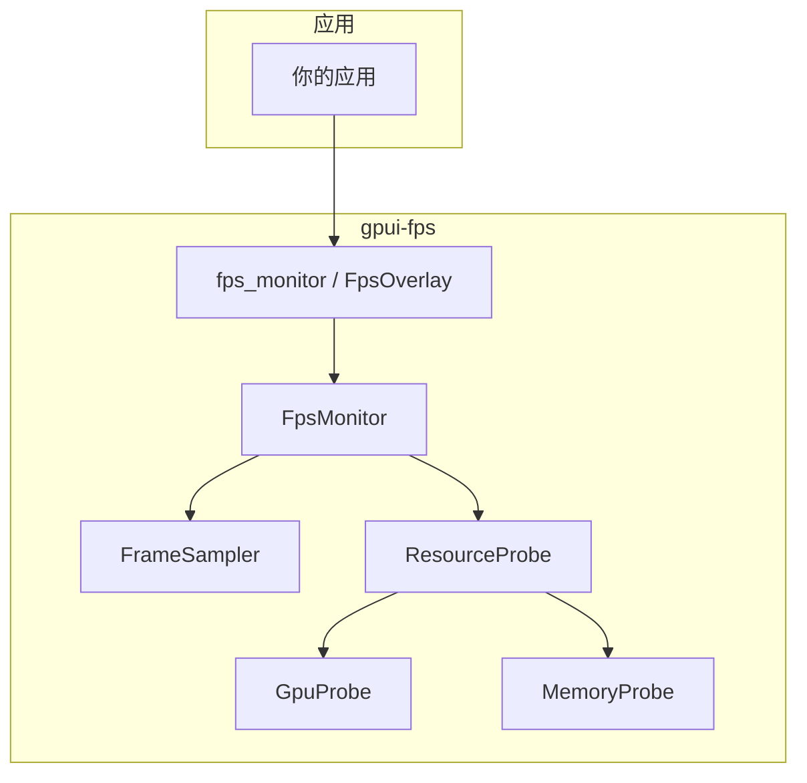
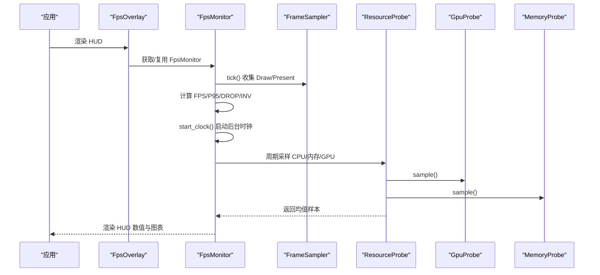
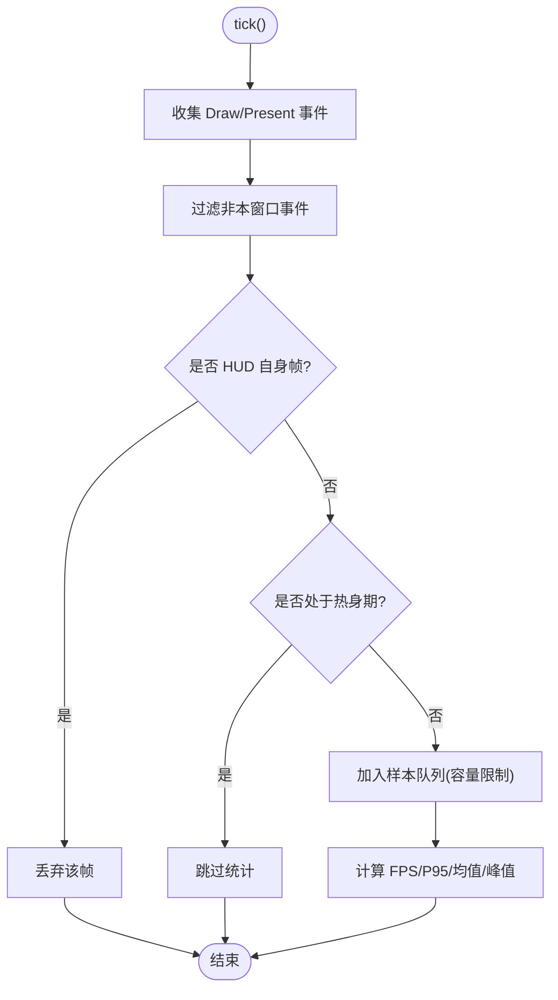
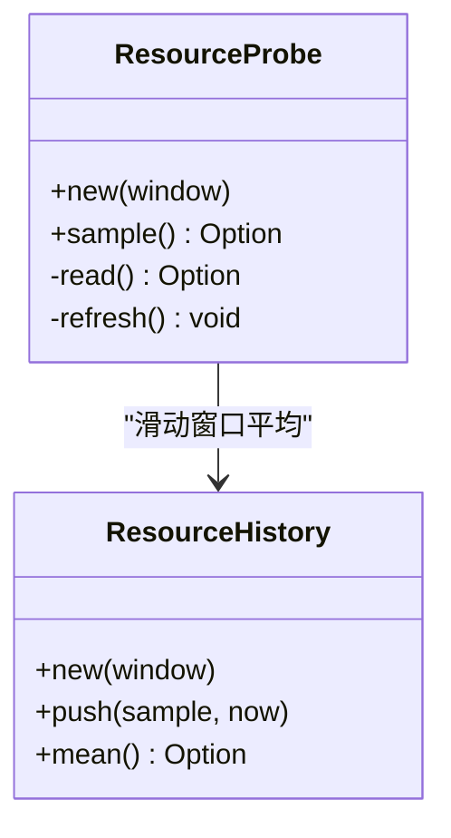
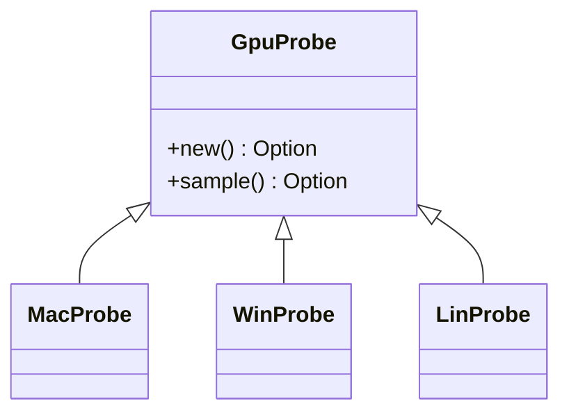
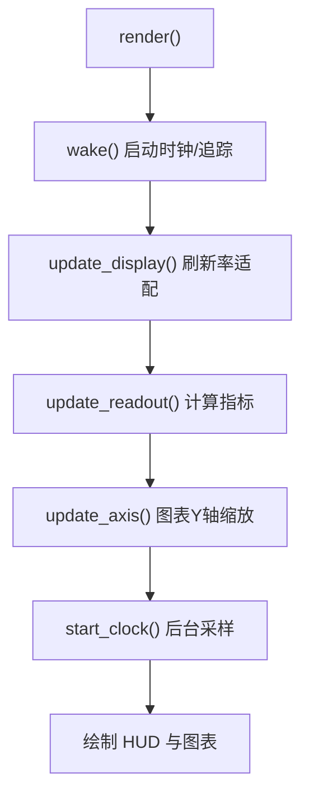
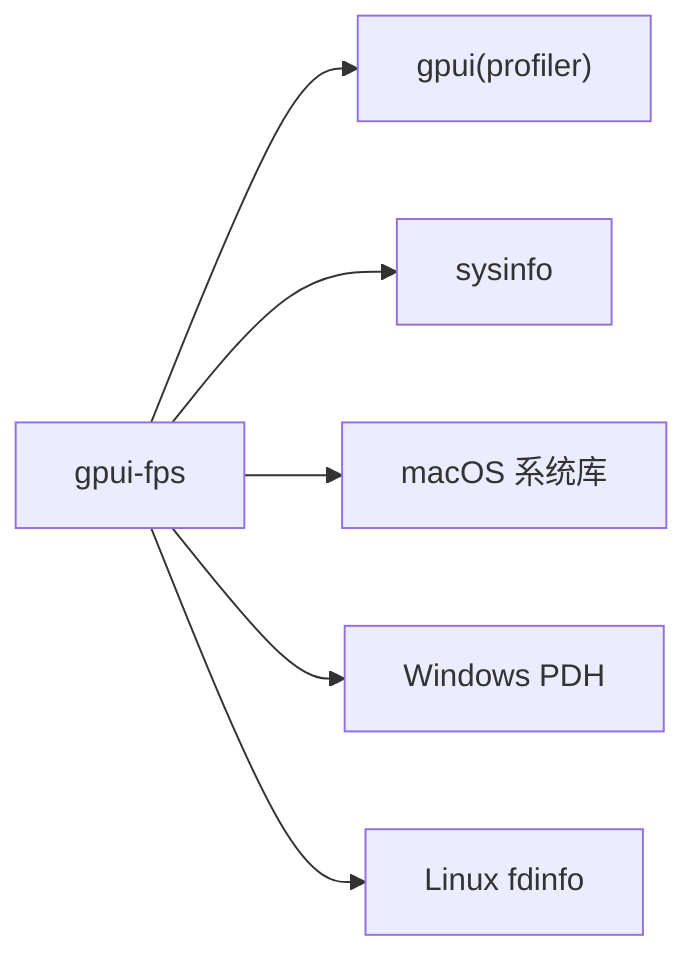

# 性能分析工具

<cite>
**本文引用的文件**   
- [crates/fps/README.md](file://crates/fps/README.md)
- [crates/fps/Cargo.toml](file://crates/fps/Cargo.toml)
- [crates/fps/src/lib.rs](file://crates/fps/src/lib.rs)
- [crates/fps/src/sampler.rs](file://crates/fps/src/sampler.rs)
- [crates/fps/src/monitor.rs](file://crates/fps/src/monitor.rs)
- [crates/fps/src/overlay.rs](file://crates/fps/src/overlay.rs)
- [crates/fps/src/gpu.rs](file://crates/fps/src/gpu.rs)
- [crates/fps/src/memory.rs](file://crates/fps/src/memory.rs)
- [crates/fps/src/gpu/macos.rs](file://crates/fps/src/gpu/macos.rs)
- [crates/fps/src/gpu/windows.rs](file://crates/fps/src/gpu/windows.rs)
- [crates/fps/src/gpu/linux.rs](file://crates/fps/src/gpu/linux.rs)
</cite>

## 目录
1. [简介](#简介)
2. [项目结构](#项目结构)
3. [核心组件](#核心组件)
4. [架构总览](#架构总览)
5. [详细组件分析](#详细组件分析)
6. [依赖关系分析](#依赖关系分析)
7. [性能考量与优化建议](#性能考量与优化建议)
8. [故障排查指南](#故障排查指南)
9. [结论](#结论)
10. [附录：基准测试与回归检测实践](#附录基准测试与回归检测实践)

## 简介
本指南面向使用 GPUI 的应用开发者，系统性介绍内置的性能采样器（Sampler）与 GPU 性能监控能力，帮助你定位 CPU 热点、GPU 渲染瓶颈与内存峰值，并给出编写性能基准测试与自动化回归检测的实践方法。同时覆盖不同平台下的性能采集差异与调试技巧，并提供从问题发现到解决的完整案例流程。

## 项目结构
gpui-fps 是一个独立的 crate，提供实时 FPS、帧时间曲线、CPU/GPU/内存 HUD，以及底层采样与平台相关实现。关键路径如下：
- 对外 API：fps_monitor、FpsMonitor、FpsOverlay
- 帧采样与统计：FrameSampler、ResourceProbe、ResourceHistory
- 资源采集：GPU（macOS/Windows/Linux）、进程私有内存
- 显示层：HUD 视图、图表绘制、刷新策略

**图示来源**
- [crates/fps/src/lib.rs:83-100](file://crates/fps/src/lib.rs#L83-L100)
- [crates/fps/src/monitor.rs:202-232](file://crates/fps/src/monitor.rs#L202-L232)
- [crates/fps/src/sampler.rs:39-79](file://crates/fps/src/sampler.rs#L39-L79)
- [crates/fps/src/gpu.rs:18-44](file://crates/fps/src/gpu.rs#L18-L44)
- [crates/fps/src/memory.rs:30-48](file://crates/fps/src/memory.rs#L30-L48)

**章节来源**
- [crates/fps/README.md:1-33](file://crates/fps/README.md#L1-L33)
- [crates/fps/Cargo.toml:1-21](file://crates/fps/Cargo.toml#L1-L21)

## 核心组件
- fps_monitor：窗口级 HUD 入口，按 WindowId 复用 FpsMonitor，避免重复创建。
- FpsMonitor：HUD 视图与数据更新中枢，负责帧预算、图表轴缩放、时钟调度、资源采样周期控制。
- FrameSampler：从 GPUI 全局帧追踪中过滤当前窗口的 Draw/Present 事件，计算 FPS、P95、丢弃率、无效化合并比等指标。
- ResourceProbe：后台线程周期性采样 CPU、内存、GPU，并对结果做滑动窗口平均。
- GpuProbe/MemoryProbe：平台相关的 GPU 利用率与进程私有内存采集封装。

**章节来源**
- [crates/fps/src/lib.rs:57-100](file://crates/fps/src/lib.rs#L57-L100)
- [crates/fps/src/monitor.rs:202-232](file://crates/fps/src/monitor.rs#L202-L232)
- [crates/fps/src/sampler.rs:39-79](file://crates/fps/src/sampler.rs#L39-L79)
- [crates/fps/src/sampler.rs:411-487](file://crates/fps/src/sampler.rs#L411-L487)
- [crates/fps/src/gpu.rs:18-44](file://crates/fps/src/gpu.rs#L18-L44)
- [crates/fps/src/memory.rs:30-48](file://crates/fps/src/memory.rs#L30-L48)

## 架构总览
下图展示一次 HUD 渲染与采样的调用链：应用触发渲染 -> FpsMonitor 收集帧事件 -> 计算指标 -> 启动后台时钟采样资源 -> 渲染 HUD。

**图示来源**
- [crates/fps/src/lib.rs:83-100](file://crates/fps/src/lib.rs#L83-L100)
- [crates/fps/src/monitor.rs:378-444](file://crates/fps/src/monitor.rs#L378-L444)
- [crates/fps/src/sampler.rs:103-127](file://crates/fps/src/sampler.rs#L103-L127)
- [crates/fps/src/sampler.rs:453-476](file://crates/fps/src/sampler.rs#L453-L476)

## 详细组件分析

### 帧采样器（FrameSampler）
职责
- 从 GPUI 的 FrameTimingCollector 中过滤当前窗口的事件。
- 维护固定容量环形队列，记录每帧 draw 时长与 invalidations。
- 基于 Present 时间戳计算 FPS 与呈现间隔；基于 draw 时长计算均值、P95、超预算比例、峰值。
- 忽略 HUD 自身触发的帧，避免污染应用测量。

关键行为
- warmup 机制：冷启动帧不计入统计，避免首帧抖动误导。
- expect_own_frame：标记 HUD 自身触发的重绘，若该帧仅由 HUD 引起则丢弃。
- over_budget_ratio：以 frame_budget 为阈值统计丢帧比例。
- percentile_draw：对保留帧排序后取近似分位点，用于 P95。

**图示来源**
- [crates/fps/src/sampler.rs:103-127](file://crates/fps/src/sampler.rs#L103-L127)
- [crates/fps/src/sampler.rs:156-258](file://crates/fps/src/sampler.rs#L156-L258)
- [crates/fps/src/sampler.rs:261-306](file://crates/fps/src/sampler.rs#L261-L306)

**章节来源**
- [crates/fps/src/sampler.rs:9-21](file://crates/fps/src/sampler.rs#L9-L21)
- [crates/fps/src/sampler.rs:103-127](file://crates/fps/src/sampler.rs#L103-L127)
- [crates/fps/src/sampler.rs:156-258](file://crates/fps/src/sampler.rs#L156-L258)
- [crates/fps/src/sampler.rs:261-306](file://crates/fps/src/sampler.rs#L261-L306)

### 资源采样（ResourceProbe / ResourceHistory）
职责
- 在后台线程周期性读取 CPU、内存、GPU 指标。
- 对每个指标进行滑动窗口平均，避免读数跳动过大。
- 将 GPU 百分比限制在 0..=100，兼容多引擎并发场景。

关键点
- minimum_resource_interval：受 sysinfo 最小 CPU 更新间隔约束。
- RESOURCE_WINDOW：默认 3 秒滑动窗口，平衡稳定性与响应性。
- 在 Web 平台不提供资源采样，时钟仍运行但无资源行。

**图示来源**
- [crates/fps/src/sampler.rs:332-409](file://crates/fps/src/sampler.rs#L332-L409)
- [crates/fps/src/sampler.rs:411-487](file://crates/fps/src/sampler.rs#L411-L487)

**章节来源**
- [crates/fps/src/sampler.rs:332-409](file://crates/fps/src/sampler.rs#L332-L409)
- [crates/fps/src/sampler.rs:411-487](file://crates/fps/src/sampler.rs#L411-L487)
- [crates/fps/src/sampler.rs:489-498](file://crates/fps/src/sampler.rs#L489-L498)

### GPU 监控（GpuProbe 平台实现）
- macOS：通过 IORegistry 查询加速器客户端的 accumulatedGPUTime，按进程 PID 前缀筛选。
- Windows：通过 PDH 计数器 \GPU Engine(*)\Utilization Percentage，按实例名中的 pid_ 前缀筛选，取最忙引擎类型。
- Linux：解析 /proc/self/fdinfo 下 drm-engine-* 计数，按引擎维度取最大值。

注意
- 当平台或驱动不可用时，GPU 行直接省略而非显示 0%。
- 多个引擎并发时，不累加而是取最忙引擎类型，保证不超过 100%。

**图示来源**
- [crates/fps/src/gpu.rs:18-44](file://crates/fps/src/gpu.rs#L18-L44)
- [crates/fps/src/gpu/macos.rs:44-74](file://crates/fps/src/gpu/macos.rs#L44-L74)
- [crates/fps/src/gpu/windows.rs:44-100](file://crates/fps/src/gpu/windows.rs#L44-L100)
- [crates/fps/src/gpu/linux.rs:37-67](file://crates/fps/src/gpu/linux.rs#L37-L67)

**章节来源**
- [crates/fps/src/gpu.rs:1-29](file://crates/fps/src/gpu.rs#L1-L29)
- [crates/fps/src/gpu/macos.rs:1-74](file://crates/fps/src/gpu/macos.rs#L1-L74)
- [crates/fps/src/gpu/windows.rs:1-100](file://crates/fps/src/gpu/windows.rs#L1-L100)
- [crates/fps/src/gpu/linux.rs:1-67](file://crates/fps/src/gpu/linux.rs#L1-L67)

### 内存监控（MemoryProbe）
- 目标：采集“进程私有内存”，而非包含共享库页的 RSS。
- 平台差异：macOS 使用 Activity Monitor 对应计数器；Windows 使用 PrivateUsage；Linux 使用匿名驻留内存。
- 不可用回退：若无专用计数器，回退到 sysinfo 的进程内存值。

**章节来源**
- [crates/fps/src/memory.rs:1-48](file://crates/fps/src/memory.rs#L1-L48)

### HUD 视图与交互（FpsMonitor / FpsOverlay）
- FpsOverlay：将 FpsMonitor 锚定到父容器的四角或边中位置，支持设置 frame_budget。
- FpsMonitor：
  - 根据 display refresh rate 自动采纳 frame_budget，也可显式固定。
  - 图表 Y 轴动态缩放，增长即时、衰减缓慢，避免抖动。
  - 点击切换紧凑模式；右键切换 MAX/OBSERVED  headline。
  - 隐藏时停止时钟与帧追踪引用，释放资源。

**图示来源**
- [crates/fps/src/overlay.rs:40-91](file://crates/fps/src/overlay.rs#L40-L91)
- [crates/fps/src/monitor.rs:306-366](file://crates/fps/src/monitor.rs#L306-L366)
- [crates/fps/src/monitor.rs:475-527](file://crates/fps/src/monitor.rs#L475-L527)
- [crates/fps/src/monitor.rs:653-660](file://crates/fps/src/monitor.rs#L653-L660)

**章节来源**
- [crates/fps/src/overlay.rs:1-91](file://crates/fps/src/overlay.rs#L1-L91)
- [crates/fps/src/monitor.rs:20-41](file://crates/fps/src/monitor.rs#L20-L41)
- [crates/fps/src/monitor.rs:306-366](file://crates/fps/src/monitor.rs#L306-L366)
- [crates/fps/src/monitor.rs:475-527](file://crates/fps/src/monitor.rs#L475-L527)
- [crates/fps/src/monitor.rs:653-660](file://crates/fps/src/monitor.rs#L653-L660)

## 依赖关系分析
- gpui profiler：启用 profiler 特性后，可访问 FrameTimingCollector 与 set_trace_enabled。
- sysinfo：跨平台进程 CPU/内存采样。
- 平台特定依赖：
  - macOS：core-graphics、objc2-io-kit 等用于 IORegistry 查询。
  - Windows：windows crate 的 Performance 接口（PDH）。
  - Linux：wayland-client、fdinfo 解析。

**图示来源**
- [crates/fps/Cargo.toml:17-57](file://crates/fps/Cargo.toml#L17-L57)
- [crates/fps/src/lib.rs:119-159](file://crates/fps/src/lib.rs#L119-L159)

**章节来源**
- [crates/fps/Cargo.toml:17-57](file://crates/fps/Cargo.toml#L17-L57)
- [crates/fps/src/lib.rs:119-159](file://crates/fps/src/lib.rs#L119-L159)

## 性能考量与优化建议
- 帧预算与刷新率
  - 优先让 HUD 自动采纳显示器刷新周期作为 frame_budget；必要时显式固定，避免高刷屏误判。
  - 关注 FRAME 与 P95 双指标：均值反映常态，P95 暴露慢尾卡顿。
- 无效化合并（INV）
  - INV > 1 表示频繁无效化被合并，存在多余工作；结合业务逻辑减少高频状态变更。
- 资源采样频率
  - 使用 minimum_resource_interval 确保 CPU 采样有意义；Web 平台默认 200ms。
  - 关闭 show_resources 可降低开销，适合生产环境。
- HUD 自身开销隔离
  - expect_own_frame 已排除 HUD 自绘帧；避免在 render 中额外触发不必要的 window 刷新。
- GPU 行缺失
  - 某些平台/驱动不可用会省略 GPU 行，属预期行为；不要将其视为 0%。

[本节为通用指导，无需代码来源]

## 故障排查指南
常见问题与定位思路
- HUD 数字不更新
  - 检查是否在隐藏状态下导致 clock 停止；重新显示后会恢复。
  - 确认 fps_monitor 仅在需要时渲染，避免多次重复创建。
- FPS 为 0 或极低
  - 可能窗口空闲或被遮挡；查看 INTERVAL 与 DROP 行判断是否未呈现。
  - 检查是否存在大量无效化（INV），考虑合并更新。
- GPU 行缺失
  - macOS Intel 或某些 Linux 驱动不可用；属预期，参考 README 说明。
- 内存读数异常偏高
  - 确认读取的是“私有内存”而非 RSS；HUD 已尽量对齐各平台 Activity Monitor/Task Manager 口径。

**章节来源**
- [crates/fps/README.md:150-234](file://crates/fps/README.md#L150-L234)
- [crates/fps/src/monitor.rs:284-304](file://crates/fps/src/monitor.rs#L284-L304)
- [crates/fps/src/sampler.rs:489-498](file://crates/fps/src/sampler.rs#L489-L498)

## 结论
gpui-fps 提供了低侵入、跨平台的性能 HUD 与采样能力：基于 GPUI 帧追踪的真实帧成本、稳定的 P95 与丢弃率、后台平滑的资源采样，以及平台无关的 GPU/内存采集封装。通过合理设置 frame_budget、关注 FRAME/P95/INV/DROP 的组合信号，并结合平台差异理解 GPU 行可用性，你可以高效定位 CPU/GPU/内存瓶颈，持续优化 UI 流畅度。

[本节为总结，无需代码来源]

## 附录：基准测试与回归检测实践

### 如何编写性能基准测试
- 选择稳定场景：例如滚动列表、动画、复杂布局，确保输入一致。
- 使用 FpsMonitor 的 capacity 与 frame_budget 配置，使图表与阈值符合被测场景。
- 采集指标：
  - 帧时间均值与 P95
  - 丢帧比例（DROP）
  - 无效化合并比（INV）
  - CPU/GPU/内存均值（如可用）
- 多次运行取稳健统计量（中位数、P95），剔除冷启动阶段。

参考实现位置
- 图表容量与预算设置：[crates/fps/src/monitor.rs:306-366](file://crates/fps/src/monitor.rs#L306-L366)
- 指标计算：[crates/fps/src/sampler.rs:156-258](file://crates/fps/src/sampler.rs#L156-L258)

**章节来源**
- [crates/fps/src/monitor.rs:306-366](file://crates/fps/src/monitor.rs#L306-L366)
- [crates/fps/src/sampler.rs:156-258](file://crates/fps/src/sampler.rs#L156-L258)

### 自动化性能回归检测
- 基线采集：在 CI 上运行基准场景，记录关键指标（FRAME、P95、DROP、INV、CPU/GPU/MEM）。
- 阈值告警：当 P95 或 DROP 超过历史基线一定比例时触发告警。
- 可视化对比：将 HUD 图表导出为图片/CSV，纳入 PR 报告。
- 资源采样开关：CI 环境可开启 show_resources 以捕获 CPU/GPU/MEM 趋势。

参考实现位置
- 资源采样开关与间隔：[crates/fps/src/monitor.rs:351-366](file://crates/fps/src/monitor.rs#L351-L366)
- 最小采样间隔：[crates/fps/src/sampler.rs:489-498](file://crates/fps/src/sampler.rs#L489-L498)

**章节来源**
- [crates/fps/src/monitor.rs:351-366](file://crates/fps/src/monitor.rs#L351-L366)
- [crates/fps/src/sampler.rs:489-498](file://crates/fps/src/sampler.rs#L489-L498)

### 实际案例分析：从发现到解决
问题现象
- 用户反馈界面偶尔卡顿，FPS 波动明显。

定位步骤
- 打开 HUD，观察：
  - FRAME 与 P95：若 P95 显著高于 FRAME，存在慢尾。
  - DROP：若 > 0%，说明有掉帧。
  - INV：若远大于 1，存在冗余无效化。
  - GPU：若接近 100%，可能存在渲染瓶颈。
- 结合业务：
  - 若 INV 高：减少高频状态更新，合并批量操作。
  - 若 GPU 高：减少复杂着色、过度绘制、大图纹理。
  - 若 CPU 高：检查主线程阻塞任务、序列化/反序列化、文本布局。

验证修复
- 修改后再次运行，确认 FRAME/P95 下降、DROP 归零、INV 趋近 1。
- 在 CI 中加入基准用例，防止回归。

参考实现位置
- HUD 指标含义与颜色分级：[crates/fps/src/monitor.rs:653-800](file://crates/fps/src/monitor.rs#L653-L800)
- 指标计算与统计：[crates/fps/src/sampler.rs:156-258](file://crates/fps/src/sampler.rs#L156-L258)

**章节来源**
- [crates/fps/src/monitor.rs:653-800](file://crates/fps/src/monitor.rs#L653-L800)
- [crates/fps/src/sampler.rs:156-258](file://crates/fps/src/sampler.rs#L156-L258)