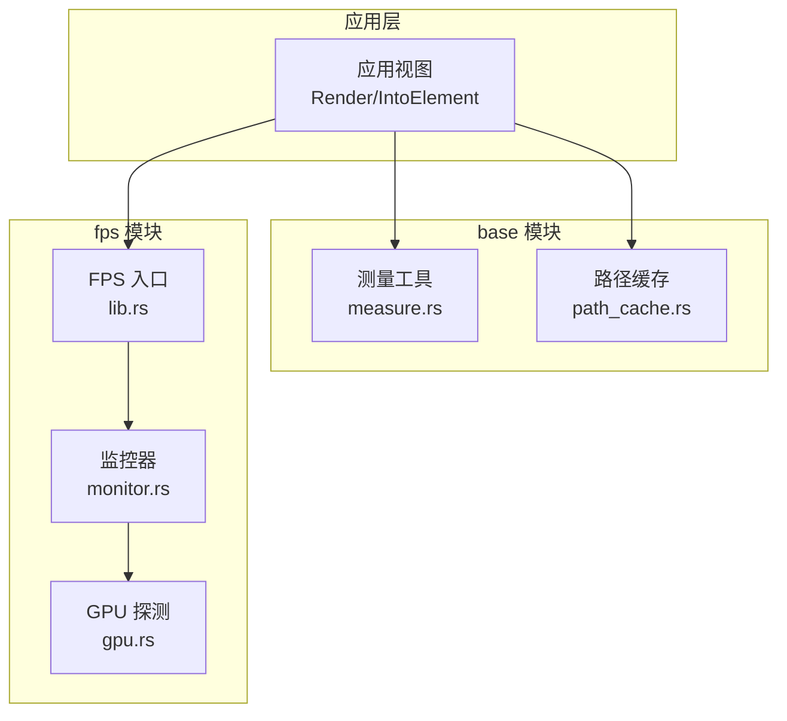
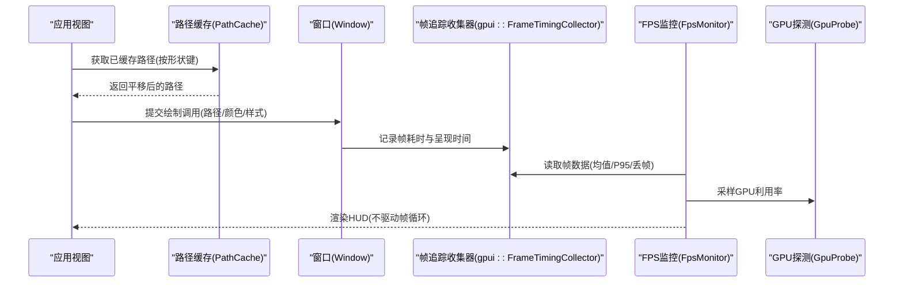
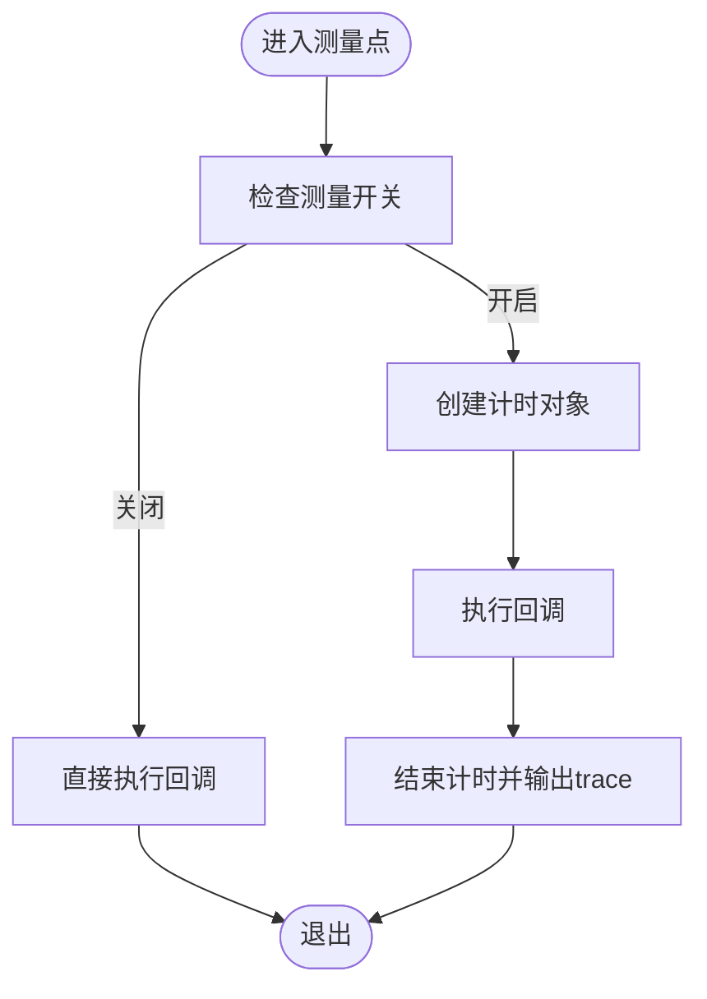
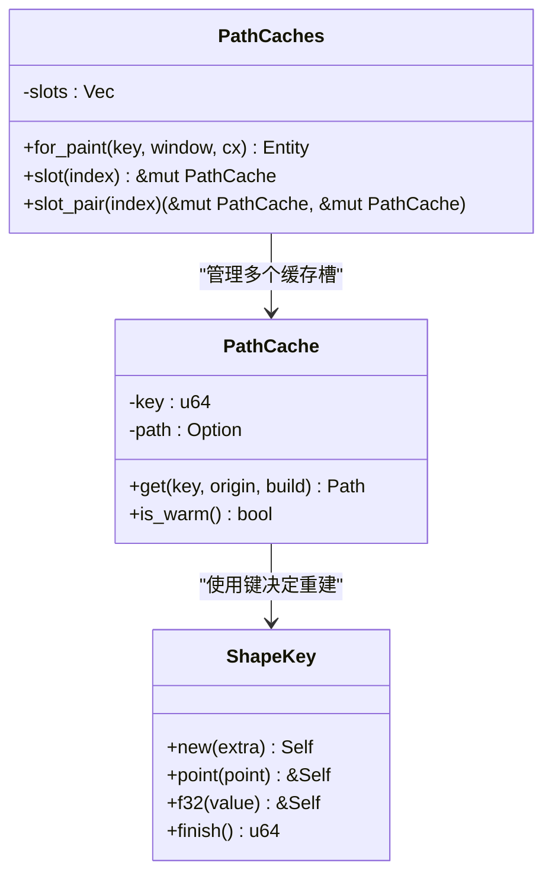
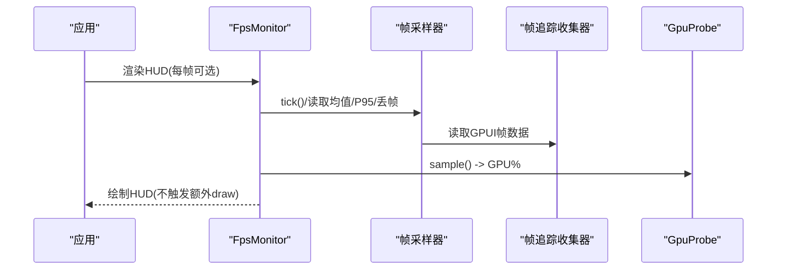
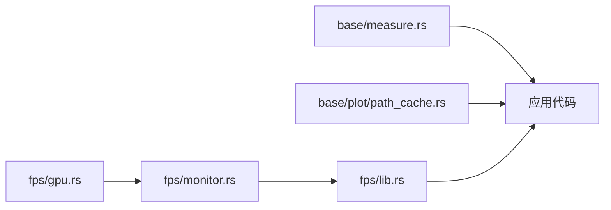

# 渲染优化

<cite>
**本文引用的文件**   
- [crates/base/src/measure.rs](file://crates/base/src/measure.rs)
- [crates/fps/src/lib.rs](file://crates/fps/src/lib.rs)
- [crates/fps/src/gpu.rs](file://crates/fps/src/gpu.rs)
- [crates/fps/src/monitor.rs](file://crates/fps/src/monitor.rs)
- [crates/base/src/plot/path_cache.rs](file://crates/base/src/plot/path_cache.rs)
</cite>

## 目录
1. [简介](#简介)
2. [项目结构](#项目结构)
3. [核心组件](#核心组件)
4. [架构总览](#架构总览)
5. [详细组件分析](#详细组件分析)
6. [依赖关系分析](#依赖关系分析)
7. [性能考量](#性能考量)
8. [故障排查指南](#故障排查指南)
9. [结论](#结论)
10. [附录](#附录)

## 简介
本文件聚焦于 GPU 加速渲染与绘制优化的系统性实践，围绕以下主题展开：
- GPU 加速渲染的工作原理与绘制调用优化、批处理、状态管理
- 测量系统（Measure）的性能特性与使用方式
- 布局缓存与增量更新、脏区域管理、视口裁剪
- 渲染性能分析工具的使用方法与瓶颈识别技巧
- 不同场景下的渲染优化策略：大量元素渲染、复杂动画、高分辨率屏幕适配

## 项目结构
本项目在渲染与性能方面涉及两个关键子模块：
- base 模块：提供基础 UI 能力，包含测量工具与绘图路径缓存等通用优化设施
- fps 模块：提供实时性能 HUD，用于观测帧率、GPU/CPU/内存占用与帧耗时分布

**图示来源** 
- [crates/base/src/measure.rs:1-49](file://crates/base/src/measure.rs#L1-L49)
- [crates/base/src/plot/path_cache.rs:1-198](file://crates/base/src/plot/path_cache.rs#L1-L198)
- [crates/fps/src/lib.rs:1-181](file://crates/fps/src/lib.rs#L1-L181)
- [crates/fps/src/monitor.rs:1-800](file://crates/fps/src/monitor.rs#L1-L800)
- [crates/fps/src/gpu.rs:1-68](file://crates/fps/src/gpu.rs#L1-L68)

**章节来源**
- [crates/base/src/measure.rs:1-49](file://crates/base/src/measure.rs#L1-L49)
- [crates/base/src/plot/path_cache.rs:1-198](file://crates/base/src/plot/path_cache.rs#L1-L198)
- [crates/fps/src/lib.rs:1-181](file://crates/fps/src/lib.rs#L1-L181)
- [crates/fps/src/monitor.rs:1-800](file://crates/fps/src/monitor.rs#L1-L800)
- [crates/fps/src/gpu.rs:1-68](file://crates/fps/src/gpu.rs#L1-L68)

## 核心组件
- 测量系统（Measure）：提供条件开启的计时埋点，便于定位热点路径而不影响生产性能
- 路径缓存（PathCache/PathCaches）：将昂贵的几何细分结果按形状键缓存，跨帧复用并平移至目标原点
- FPS 监控（FpsMonitor/FpsOverlay）：基于 GPUI 帧追踪采集帧耗时、丢帧比例、无效重绘次数，并提供 GPU/CPU/内存采样
- GPU 探测（GpuProbe）：跨平台获取进程级 GPU 利用率百分比

这些组件共同支撑了“可观测—可缓存—可增量”的渲染优化闭环。

**章节来源**
- [crates/base/src/measure.rs:1-49](file://crates/base/src/measure.rs#L1-L49)
- [crates/base/src/plot/path_cache.rs:1-198](file://crates/base/src/plot/path_cache.rs#L1-L198)
- [crates/fps/src/lib.rs:1-181](file://crates/fps/src/lib.rs#L1-L181)
- [crates/fps/src/monitor.rs:1-800](file://crates/fps/src/monitor.rs#L1-L800)
- [crates/fps/src/gpu.rs:1-68](file://crates/fps/src/gpu.rs#L1-L68)

## 架构总览
下图展示了从应用视图到 GPU 绘制的整体流程，以及性能观测如何嵌入其中：

**图示来源**
- [crates/base/src/plot/path_cache.rs:1-198](file://crates/base/src/plot/path_cache.rs#L1-L198)
- [crates/fps/src/lib.rs:1-181](file://crates/fps/src/lib.rs#L1-L181)
- [crates/fps/src/monitor.rs:1-800](file://crates/fps/src/monitor.rs#L1-L800)
- [crates/fps/src/gpu.rs:1-68](file://crates/fps/src/gpu.rs#L1-L68)

## 详细组件分析

### 测量系统（Measure）
- 设计要点
  - 通过环境变量开关控制是否启用测量，避免在生产环境引入额外开销
  - 提供条件测量与无条件测量两种 API，内部统一为带生命周期的计时对象
  - 结束时输出 tracing trace 日志，便于与外部性能工具关联
- 复杂度与成本
  - 创建/结束为 O(1)，仅在启用时产生计时与日志写入
- 使用建议
  - 对热点路径（如文本布局、路径细分、动画插值）进行细粒度埋点
  - 结合 FPS HUD 观察测量段对整体帧时的影响

**图示来源**
- [crates/base/src/measure.rs:1-49](file://crates/base/src/measure.rs#L1-L49)

**章节来源**
- [crates/base/src/measure.rs:1-49](file://crates/base/src/measure.rs#L1-L49)

### 路径缓存（PathCache / PathCaches）
- 设计要点
  - 将路径构建（含描边、虚线、曲线细分）的结果按形状键缓存，跨帧复用
  - 缓存路径以零原点构建，每次返回时平移到当前帧的原点，避免重复细分
  - PathCaches 将多个形状缓存绑定到窗口元素 ID，保证生命周期与绘制一致
- 复杂度与收益
  - 命中时 O(n) 平移顶点；未命中时仅一次昂贵细分
  - 图表滚动、动画中频繁重绘的场景下显著降低 CPU/GPU 压力
- 使用建议
  - 为每个形状分配稳定且区分度高的键（包含点集、线宽、曲线样式等）
  - 对填充与描边分别缓存（slot_pair），避免相互污染

**图示来源**
- [crates/base/src/plot/path_cache.rs:1-198](file://crates/base/src/plot/path_cache.rs#L1-L198)

**章节来源**
- [crates/base/src/plot/path_cache.rs:1-198](file://crates/base/src/plot/path_cache.rs#L1-L198)

### FPS 监控与 GPU 探测
- FPS 监控（FpsMonitor/FpsOverlay）
  - 从 GPUI 帧追踪读取帧耗时、呈现间隔、P95、丢帧比例与平均无效重绘次数
  - 不驱动帧循环，避免自身成为性能噪声；通过 Window::request_animation_frame 间接刷新数字
  - 支持紧凑模式、自定义预算、资源采样开关与显示刷新率自适应
- GPU 探测（GpuProbe）
  - 跨平台封装，返回进程级 GPU 利用率百分比；不可用时整行隐藏
  - 采样失败时保留上次读数，避免 HUD 闪烁

**图示来源**
- [crates/fps/src/lib.rs:1-181](file://crates/fps/src/lib.rs#L1-L181)
- [crates/fps/src/monitor.rs:1-800](file://crates/fps/src/monitor.rs#L1-L800)
- [crates/fps/src/gpu.rs:1-68](file://crates/fps/src/gpu.rs#L1-L68)

**章节来源**
- [crates/fps/src/lib.rs:1-181](file://crates/fps/src/lib.rs#L1-L181)
- [crates/fps/src/monitor.rs:1-800](file://crates/fps/src/monitor.rs#L1-L800)
- [crates/fps/src/gpu.rs:1-68](file://crates/fps/src/gpu.rs#L1-L68)

## 依赖关系分析
- 耦合关系
  - FPS 监控依赖 GPUI 的帧追踪与窗口机制，但不反向驱动渲染
  - 路径缓存依赖 GPUI 的路径与窗口状态，通过 keyed state 绑定生命周期
  - GPU 探测是平台无关抽象，具体实现由平台后端提供
- 潜在风险
  - 过度使用测量可能增加 I/O 与锁竞争，应仅在调试或特定条件下开启
  - 路径缓存键不稳定会导致缓存失效，需确保键的稳定性与区分度

**图示来源**
- [crates/base/src/measure.rs:1-49](file://crates/base/src/measure.rs#L1-L49)
- [crates/base/src/plot/path_cache.rs:1-198](file://crates/base/src/plot/path_cache.rs#L1-L198)
- [crates/fps/src/lib.rs:1-181](file://crates/fps/src/lib.rs#L1-L181)
- [crates/fps/src/monitor.rs:1-800](file://crates/fps/src/monitor.rs#L1-L800)
- [crates/fps/src/gpu.rs:1-68](file://crates/fps/src/gpu.rs#L1-L68)

**章节来源**
- [crates/base/src/measure.rs:1-49](file://crates/base/src/measure.rs#L1-L49)
- [crates/base/src/plot/path_cache.rs:1-198](file://crates/base/src/plot/path_cache.rs#L1-L198)
- [crates/fps/src/lib.rs:1-181](file://crates/fps/src/lib.rs#L1-L181)
- [crates/fps/src/monitor.rs:1-800](file://crates/fps/src/monitor.rs#L1-L800)
- [crates/fps/src/gpu.rs:1-68](file://crates/fps/src/gpu.rs#L1-L68)

## 性能考量
- 绘制调用优化与批处理
  - 尽量合并相同状态的绘制调用，减少状态切换与批次数量
  - 使用路径缓存避免重复细分，降低 CPU 侧计算与 GPU 上传压力
- 状态管理与脏区域
  - 利用框架的脏区机制，仅重绘受影响区域；避免全局无差别重绘
  - 对频繁变化的数据采用增量更新，保持路径键稳定，提升缓存命中率
- 视口裁剪
  - 将可见性判断前置，避免对不可见元素进行布局与绘制
  - 列表/表格等长列表场景使用虚拟滚动，仅维护可视区元素
- 高分辨率屏幕适配
  - 合理设置像素密度与缩放，避免不必要的超采样
  - 对矢量图形优先使用路径缓存，减少高 DPI 下的细分成本

[本节为通用指导，不直接分析具体文件]

## 故障排查指南
- 常见症状与定位
  - 帧时尖峰：查看 FPS HUD 的 P95 与 DROP 指标，结合 Measure 埋点定位热点
  - GPU 占用异常：确认 GpuProbe 是否可用；若不可用，HUD 会隐藏该行
  - 缓存未命中：检查路径键是否稳定，是否混入易变字段（如随机数、时间戳）
- 诊断步骤
  - 开启 FPS HUD，观察 FRAME/P95/DROP/INV 的变化趋势
  - 在疑似热点路径添加 Measure 埋点，对比开启前后的帧时变化
  - 对图表/动画路径启用 PathCache，验证缓存命中与顶点平移正确性
- 恢复与优化
  - 调整帧预算（frame_budget）匹配显示器刷新率，避免误判丢帧
  - 降低资源采样频率，减少 HUD 自身开销
  - 拆分复杂形状为多个简单形状，提高缓存粒度和复用率

**章节来源**
- [crates/fps/src/monitor.rs:1-800](file://crates/fps/src/monitor.rs#L1-L800)
- [crates/fps/src/gpu.rs:1-68](file://crates/fps/src/gpu.rs#L1-L68)
- [crates/base/src/measure.rs:1-49](file://crates/base/src/measure.rs#L1-L49)
- [crates/base/src/plot/path_cache.rs:1-198](file://crates/base/src/plot/path_cache.rs#L1-L198)

## 结论
通过“可观测—可缓存—可增量”的体系化方法，可以在不改变业务逻辑的前提下显著提升渲染性能：
- 使用 FPS HUD 与 Measure 精准定位瓶颈
- 借助 PathCache 消除重复细分，降低 CPU/GPU 负载
- 结合脏区与视口裁剪，最小化重绘范围
- 针对不同场景（大量元素、复杂动画、高分屏）制定差异化优化策略

[本节为总结性内容，不直接分析具体文件]

## 附录
- 快速上手清单
  - 在应用顶层渲染 FPS HUD，按需开启资源采样
  - 对热点路径添加 Measure 埋点，仅在调试环境启用
  - 为图表/动画中的形状建立稳定的 ShapeKey，并使用 PathCache 缓存
  - 针对长列表/表格启用虚拟滚动，仅维护可视区元素
  - 根据显示器刷新率配置帧预算，避免误判丢帧

[本节为补充信息，不直接分析具体文件]