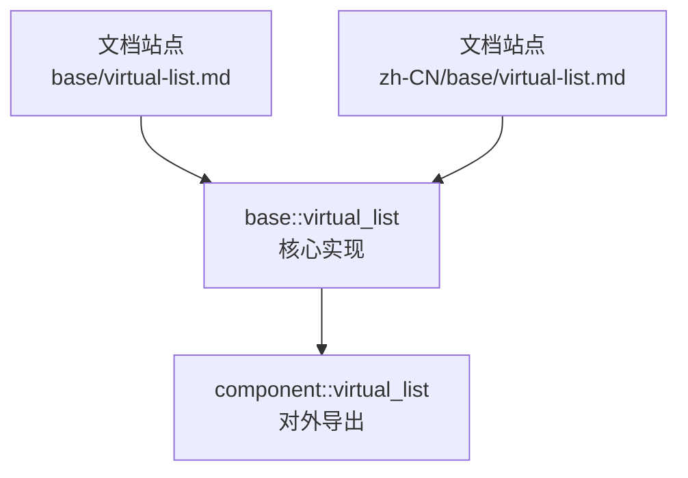
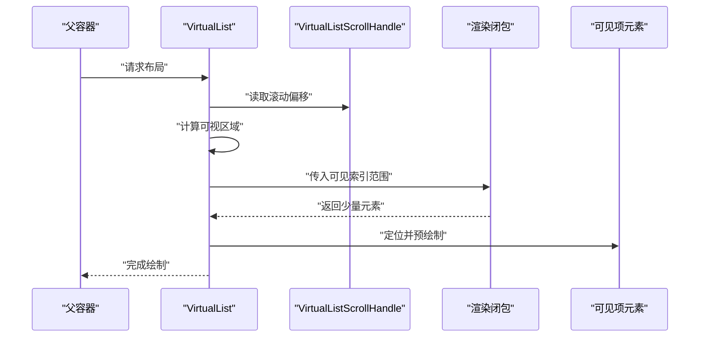
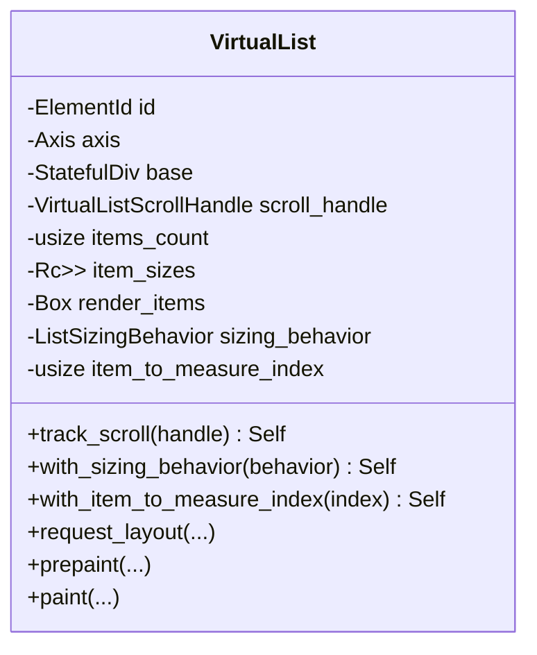
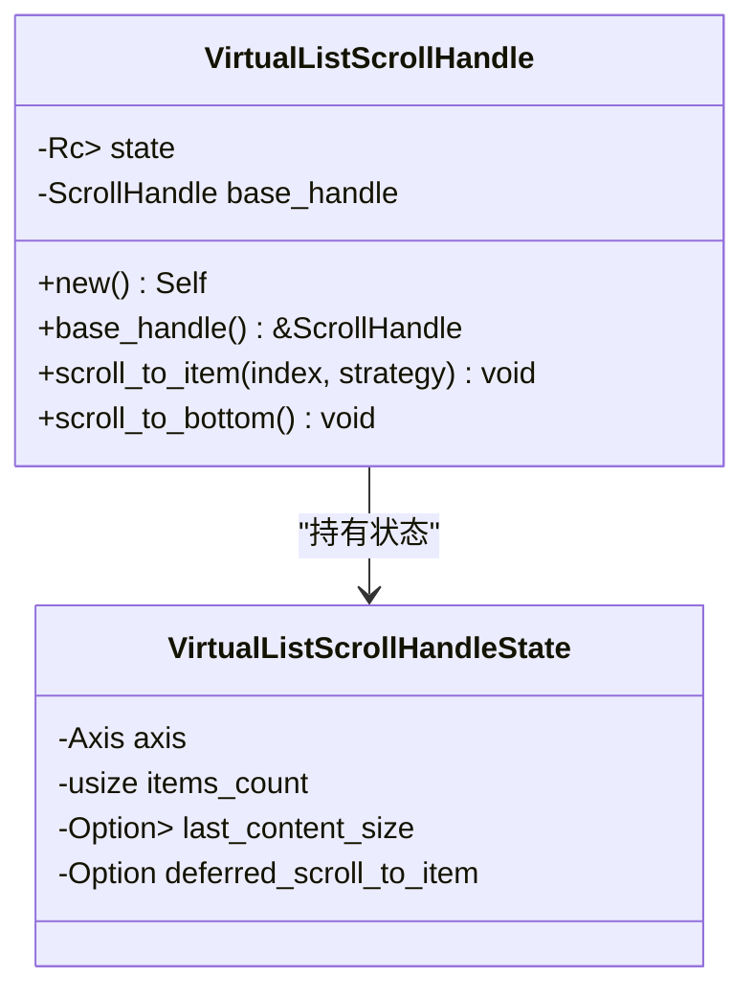
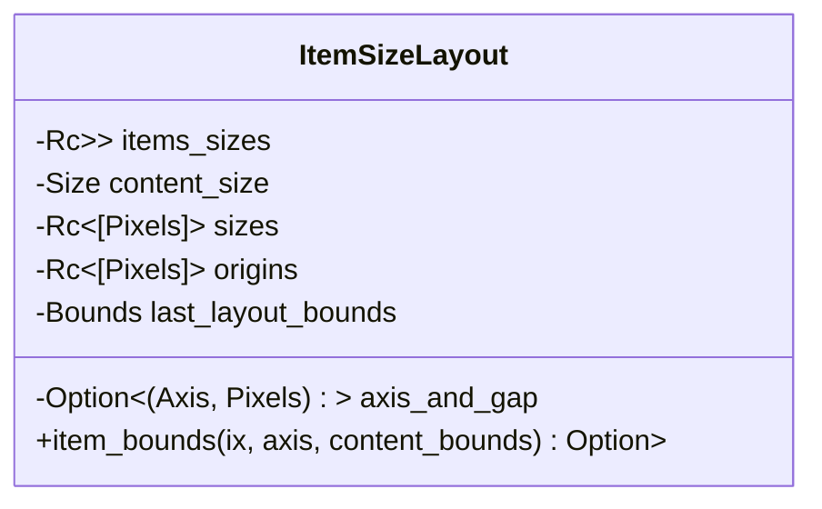
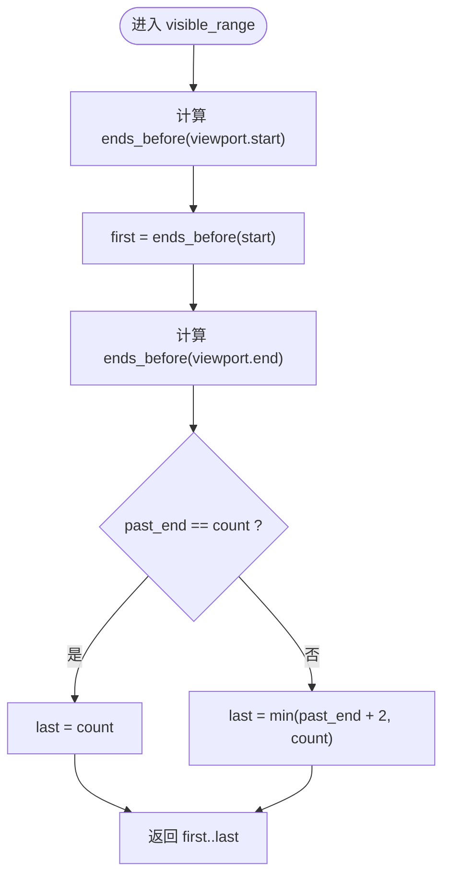
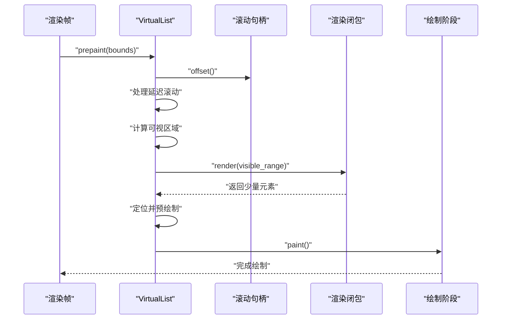
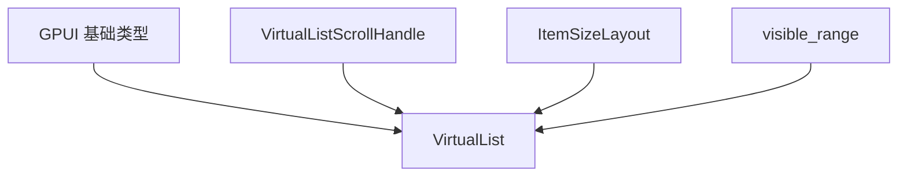

# 虚拟化技术

<cite>
**本文引用的文件**   
- [virtual_list.rs](file://crates/base/src/virtual_list.rs)
- [virtual-list.md](file://website/base/virtual-list.md)
- [virtual-list.md（中文）](file://website/zh-CN/base/virtual-list.md)
- [virtual_list.rs（组件层导出）](file://crates/component/src/virtual_list.rs)
</cite>

## 目录
1. [引言](#引言)
2. [项目结构](#项目结构)
3. [核心组件](#核心组件)
4. [架构总览](#架构总览)
5. [详细组件分析](#详细组件分析)
6. [依赖关系分析](#依赖关系分析)
7. [性能考量与优化](#性能考量与优化)
8. [大数据集最佳实践](#大数据集最佳实践)
9. [不同数据类型的虚拟化模式](#不同数据类型的虚拟化模式)
10. [配置选项与参数调优](#配置选项与参数调优)
11. [性能测试方法](#性能测试方法)
12. [常见问题与排错](#常见问题与排错)
13. [结论](#结论)

## 引言
本指南面向需要在 GPUI 中高效渲染海量列表的开发者，围绕 VirtualList 的实现原理、可视区域计算、项目复用机制、滚动性能优化、配置项调优以及在不同数据类型下的使用模式展开。VirtualList 属于基础设施型能力：它不自带外观，也不限制你返回的项目类型；你只需预先提供每个项目的尺寸，并提供一个“按可见范围渲染”的闭包。其设计目标是让十万级甚至百万级条目在屏幕上保持流畅滚动，同时支持可变行高、表格、聊天记录和大纲树等复杂场景。

## 项目结构
VirtualList 的核心实现位于 base 层的虚拟列表模块，并在 component 层进行统一导出，便于上层组件直接使用。文档站点提供了英文与中文的使用说明，强调“预先提供尺寸”的设计契约、滚动句柄用法、滚动条集成方式以及性能注意事项。

**图表来源**
- [virtual_list.rs:1-227](file://crates/base/src/virtual_list.rs#L1-L227)
- [virtual_list.rs（组件层导出）:1-23](file://crates/component/src/virtual_list.rs#L1-L23)
- [virtual-list.md:1-148](file://website/base/virtual-list.md#L1-L148)
- [virtual-list.md（中文）:1-66](file://website/zh-CN/base/virtual-list.md#L1-L66)

**章节来源**
- [virtual_list.rs:1-227](file://crates/base/src/virtual_list.rs#L1-L227)
- [virtual_list.rs（组件层导出）:1-23](file://crates/component/src/virtual_list.rs#L1-L23)
- [virtual-list.md:1-148](file://website/base/virtual-list.md#L1-L148)
- [virtual-list.md（中文）:1-66](file://website/zh-CN/base/virtual-list.md#L1-L66)

## 核心组件
VirtualList 的核心由以下部分组成：
- VirtualList：虚拟化列表元素，负责布局、可视区域计算、只绘制可见项。
- VirtualListScrollHandle：滚动控制句柄，持有滚动位置、延迟滚动到指定项、底部跟随等能力。
- ItemSizeLayout：每帧共享的尺寸布局缓存，包含每项尺寸、前缀和、内容尺寸、上次布局边界等。
- visible_range：基于二分查找的可见区间计算函数，决定哪些索引需要渲染。
- v_virtual_list / h_virtual_list：分别创建纵向和横向的 VirtualList。

这些组件共同实现了“仅渲染可见项 + 稳定滚动条 + 可变尺寸”的目标。

**章节来源**
- [virtual_list.rs:30-127](file://crates/base/src/virtual_list.rs#L30-L127)
- [virtual_list.rs:214-337](file://crates/base/src/virtual_list.rs#L214-L337)
- [virtual_list.rs:339-382](file://crates/base/src/virtual_list.rs#L339-L382)
- [virtual_list.rs:384-413](file://crates/base/src/virtual_list.rs#L384-L413)
- [virtual_list.rs:129-171](file://crates/base/src/virtual_list.rs#L129-L171)

## 架构总览
下图展示了 VirtualList 在渲染管线中的关键交互：父容器提供有界空间，VirtualList 根据滚动偏移计算可视区域，调用渲染闭包生成少量元素，再将这些元素定位到内容坐标系中进行绘制。

**图表来源**
- [virtual_list.rs:435-599](file://crates/base/src/virtual_list.rs#L435-L599)
- [virtual_list.rs:601-743](file://crates/base/src/virtual_list.rs#L601-L743)
- [virtual_list.rs:384-413](file://crates/base/src/virtual_list.rs#L384-L413)

## 详细组件分析

### VirtualList 元素
VirtualList 是 GPUI Element 的具体实现，承担以下职责：
- 维护轴方向（纵向或横向）、项目总数、尺寸表、渲染闭包、尺寸行为策略。
- 在 request_layout 阶段构建 ItemSizeLayout，计算每项尺寸与前缀和，确定内容尺寸。
- 在 prepaint 阶段计算可视区域，调用渲染闭包生成可见项，并进行定位与裁剪。
- 在 paint 阶段批量绘制已预绘制的可见项。

**图表来源**
- [virtual_list.rs:214-337](file://crates/base/src/virtual_list.rs#L214-L337)
- [virtual_list.rs:435-599](file://crates/base/src/virtual_list.rs#L435-L599)
- [virtual_list.rs:601-743](file://crates/base/src/virtual_list.rs#L601-L743)

**章节来源**
- [virtual_list.rs:214-337](file://crates/base/src/virtual_list.rs#L214-L337)
- [virtual_list.rs:435-599](file://crates/base/src/virtual_list.rs#L435-L599)
- [virtual_list.rs:601-743](file://crates/base/src/virtual_list.rs#L601-L743)

### VirtualListScrollHandle 滚动句柄
滚动句柄封装了滚动位置、轴方向、项目数量、最后内容尺寸以及延迟滚动目标。它支持：
- 滚动到指定索引（Top/Center/Bottom）。
- 滚动到底部（常用于消息列表自动跟随）。
- 暴露底层 ScrollHandle，以便与其他滚动系统对接。
- 实现 ScrollbarHandle，使外部滚动条可直接驱动 VirtualList。

**图表来源**
- [virtual_list.rs:30-127](file://crates/base/src/virtual_list.rs#L30-L127)

**章节来源**
- [virtual_list.rs:30-127](file://crates/base/src/virtual_list.rs#L30-L127)

### ItemSizeLayout 尺寸布局缓存
ItemSizeLayout 跨帧共享，避免重复计算：
- sizes：每项沿主轴方向的尺寸（含 gap）。
- origins：每项起始偏移的前缀和。
- content_size：内容总尺寸。
- last_layout_bounds：上次布局边界，用于更新滚动约束。

**图表来源**
- [virtual_list.rs:339-382](file://crates/base/src/virtual_list.rs#L339-L382)

**章节来源**
- [virtual_list.rs:339-382](file://crates/base/src/virtual_list.rs#L339-L382)

### 可见区域计算 visible_range
visible_range 通过二分查找快速确定与视口相交的索引范围：
- ends_before(edge) 找到第一个结束点超过 edge 的索引。
- first = ends_before(viewport.start)
- past_end = ends_before(viewport.end)
- last = past_end 或 past_end+2 的最小值，确保至少多绘制一项以平滑滚动。

**图表来源**
- [virtual_list.rs:384-413](file://crates/base/src/virtual_list.rs#L384-L413)

**章节来源**
- [virtual_list.rs:384-413](file://crates/base/src/virtual_list.rs#L384-L413)

### 渲染流程与项目复用
VirtualList 在每一帧执行以下步骤：
1. 计算内容边界与滚动偏移。
2. 应用延迟滚动策略（Top/Center/Bottom）。
3. 计算可视区域并调用渲染闭包生成少量元素。
4. 将元素定位到内容坐标，设置可用空间，预绘制后加入待绘制队列。
5. 在 paint 阶段批量绘制。

**图表来源**
- [virtual_list.rs:601-743](file://crates/base/src/virtual_list.rs#L601-L743)

**章节来源**
- [virtual_list.rs:601-743](file://crates/base/src/virtual_list.rs#L601-L743)

## 依赖关系分析
VirtualList 依赖 GPUI 的基础设施：
- Element、Div、ScrollHandle、Axis、Bounds、Point、Pixels、AvailableSpace、ListSizingBehavior 等。
- 通过 track_scroll 绑定滚动句柄，实现滚动同步。
- 通过 ContentMask 进行裁剪，减少无关绘制。
- 通过 SmallVec 存储可见项，降低分配开销。

**图表来源**
- [virtual_list.rs:19-28](file://crates/base/src/virtual_list.rs#L19-L28)
- [virtual_list.rs:214-337](file://crates/base/src/virtual_list.rs#L214-L337)
- [virtual_list.rs:339-382](file://crates/base/src/virtual_list.rs#L339-L382)
- [virtual_list.rs:384-413](file://crates/base/src/virtual_list.rs#L384-L413)

**章节来源**
- [virtual_list.rs:19-28](file://crates/base/src/virtual_list.rs#L19-L28)
- [virtual_list.rs:214-337](file://crates/base/src/virtual_list.rs#L214-L337)
- [virtual_list.rs:339-382](file://crates/base/src/virtual_list.rs#L339-L382)
- [virtual_list.rs:384-413](file://crates/base/src/virtual_list.rs#L384-L413)

## 性能考量与优化
- 每帧工作量与可见项数成正比，而非总项数。示例页面可容纳十万行，但仅绘制约十多项。
- 尺寸表是唯一随总数增长的内存占用；对于大量统一高度场景，uniform_list 更合适。
- 渲染闭包是热路径：避免 I/O、排序、过滤；不要为每行创建持久 entity；元素 ID 应来自稳定键或索引。
- 交叉轴测量默认取第 0 项，若第一项不具代表性，应设置 with_item_to_measure_index。
- 必须给 VirtualList 提供有边界的父容器，否则无法虚拟化。

**章节来源**
- [virtual-list.md:127-131](file://website/base/virtual-list.md#L127-L131)
- [virtual-list.md:117-126](file://website/base/virtual-list.md#L117-L126)
- [virtual-list.md:54-70](file://website/base/virtual-list.md#L54-L70)
- [virtual-list.md:108-116](file://website/base/virtual-list.md#L108-L116)

## 大数据集最佳实践
- 懒加载：仅在可见范围内渲染，避免一次性构造全部 UI。
- 预加载策略：利用 visible_range 的“超绘制一项”特性，提前准备相邻项的数据，提升滚动顺滑度。
- 数据分页：将后端数据切分为页，结合滚动到底部或触底加载更多逻辑，配合 scroll_to_bottom 实现自动跟随。
- 稳定的 item_sizes：保证 item_sizes.len() 与数据长度一致；若真实尺寸不可知，使用合理估算或固定行高。
- 避免在渲染闭包中做重计算：把数据准备放在实体状态中，渲染闭包只做索引与映射。

**章节来源**
- [virtual-list.md:15-26](file://website/base/virtual-list.md#L15-L26)
- [virtual-list.md:117-131](file://website/base/virtual-list.md#L117-L131)

## 不同数据类型的虚拟化模式
- 文本：适合固定行高或估算行高；注意交叉轴宽度测量，必要时选择代表性文本行作为测量项。
- 图片：图片加载与解码应在渲染闭包之外异步完成；渲染时仅展示占位图或缓存后的图像元素。
- 复杂组件：避免在闭包内创建持久 entity；使用轻量元素组合；对昂贵子树进行局部缓存或条件渲染。
- 表格：VirtualList 支持可变行高，适合复杂表格；注意表头与滚动句柄的关系，必要时使用 with_scroll_handle 适配。

**章节来源**
- [virtual-list.md:54-70](file://website/base/virtual-list.md#L54-L70)
- [virtual-list.md:117-131](file://website/base/virtual-list.md#L117-L131)

## 配置选项与参数调优
VirtualList 的关键配置包括：
- item_sizes：每项尺寸表，纵向列表使用 height，横向列表使用 width；长度即项目数。
- overscroll：VirtualList 本身不直接暴露 overscroll 参数；如需弹性回弹效果，可在外层滚动容器或主题层配置。
- scrollbar：VirtualList 不自带滚动条；通过 VirtualListScrollHandle 实现 ScrollbarHandle，外部 Scrollbar 可直接驱动。
- with_sizing_behavior：Auto（默认）使用父容器空间；Infer 根据项目推导尺寸。
- with_item_to_measure_index：设置交叉轴测量项索引，避免第一项不具代表性导致宽度推断错误。
- track_scroll：绑定滚动句柄，使滚动位置与 VirtualList 同步。

调优建议：
- 对于大量统一高度数据，优先使用 uniform_list；VirtualList 更适合可变尺寸。
- 为 VirtualList 提供有界父容器，避免无限布局。
- 若需自定义滚动条样式或行为，使用外部 Scrollbar 并传入 VirtualListScrollHandle。

**章节来源**
- [virtual-list.md:54-70](file://website/base/virtual-list.md#L54-L70)
- [virtual-list.md:108-116](file://website/base/virtual-list.md#L108-L116)
- [virtual-list.md:91-107](file://website/base/virtual-list.md#L91-L107)
- [virtual_list.rs:242-252](file://crates/base/src/virtual_list.rs#L242-L252)
- [virtual_list.rs:235-240](file://crates/base/src/virtual_list.rs#L235-L240)

## 性能测试方法
- 基准测试：使用框架提供的基准工具（如 benches），对比不同 item_sizes 策略下的渲染时间。
- FPS 监控：在应用层叠加 FPS 指标，观察滚动过程中的帧率稳定性。
- 可视化调试：使用 debug_bounds 或调试器检查可见范围是否正确，确认没有意外全量渲染。
- 回归测试：针对空列表、水平/垂直轴、gap 变化、axis 切换等场景编写单元测试，确保几何与滚动行为正确。

**章节来源**
- [virtual_list.rs:771-1023](file://crates/base/src/virtual_list.rs#L771-L1023)

## 常见问题与排错
- 滚动条跳动：通常是因为未预先提供尺寸或尺寸与实际不一致。请确保 item_sizes 准确且长度与数据一致。
- 滚动位置漂移：避免在渲染闭包中做耗时操作；将数据准备移出热路径。
- 宽度推断错误：当第一项不具代表性时，使用 with_item_to_measure_index 指向典型行。
- 无滚动条：VirtualList 不自带滚动条；请在外层相对容器中放置 Scrollbar，并传入 VirtualListScrollHandle。
- 无限布局：VirtualList 必须放在有界父容器中；否则无法虚拟化。
- 辅助技术连贯性：保持逻辑顺序、项目数和稳定身份，确保屏幕阅读器体验一致。

**章节来源**
- [virtual-list.md:54-70](file://website/base/virtual-list.md#L54-L70)
- [virtual-list.md:91-107](file://website/base/virtual-list.md#L91-L107)
- [virtual-list.md:108-116](file://website/base/virtual-list.md#L108-L116)
- [virtual-list.md:141-148](file://website/base/virtual-list.md#L141-L148)

## 结论
VirtualList 通过“预先提供尺寸 + 可见范围渲染 + 滚动句柄同步”的组合，实现了高性能的可变尺寸列表。其核心优势在于：
- 精确的偏移与稳定的滚动条。
- 每帧工作量与可见项数成正比。
- 灵活的轴方向与尺寸行为策略。
- 与外部滚动条无缝集成。

在实际项目中，应根据数据特征选择合适的虚拟化方案：统一高度用 uniform_list，可变尺寸用 VirtualList；始终提供准确的尺寸表、有界父容器和稳定的渲染闭包，以获得最佳的滚动性能与用户体验。